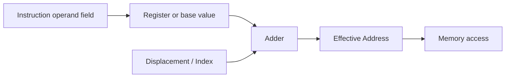

## Syllabus Position

**Subject:** [[Computer Organization and Architecture Index]]
**Parent Topic:** [[Instruction Set Architecture]]
**Sibling Topics:** [[Machine Instructions]], [[Instruction Cycle]], [[Data Path]], [[Control Unit]]
**Leads To:** [[Effective Address]], [[Pipelining]], [[Assembly Language]]

**GATE Syllabus Line:** Computer Organization and Architecture - Machine instructions and addressing modes, ALU, data-path and control unit.

**Exam Weight Note:** Appears very frequently as 1-mark MCQs on effective address calculation and as 2-mark NAT questions where students must infer operand location from a mode description such as immediate, direct, indirect, indexed, or relative.

---

## The Problem This Solves

A CPU must know not just what operation to perform, but also where to find the data for that operation. The same instruction like `ADD` can mean very different things depending on whether the operand is a constant, a register value, a memory cell, or an address that needs another lookup. Addressing modes solve this by giving the instruction a compact rule for interpreting its operand field. Without them, every instruction would need a bulky explicit address and the instruction set would be far less flexible.

**Analogy:** Addressing mode is like a delivery label that says whether the written number is the house itself, the building directory entry, or a pointer to another slip inside the office. The number on the label is not always the final destination.

**Core Idea (one sentence):** An addressing mode tells the CPU how to interpret an instruction's operand field to obtain the actual operand or its [[Effective Address]].

---

## Formal Theory

A **[[Addressing Mode]]** is the rule used by the processor to interpret the operand field of a machine instruction and determine the actual operand value or the [[Effective Address]] from which the operand should be fetched.

### Why Addressing Modes Exist

Addressing modes trade off three things:

1. **Instruction size**: smaller when operands are implicit or abbreviated.
2. **Flexibility**: larger when operands can be constants, registers, memory contents, or offsets.
3. **Execution cost**: lower when the operand is near the CPU, higher when extra memory references are needed.

This is why [[Machine Instruction]] design and addressing-mode design always appear together in GATE questions.

### Immediate Addressing

In **[[Immediate Addressing]]**, the operand field contains the actual value, not an address.

Example:

```text
MOV R1, #5
```

Here the value $5$ is used directly. No memory lookup is needed for the operand itself.

**Why it matters:** Immediate mode is fast because the CPU does not chase another address, but the constant size is limited by instruction bits.

### Direct Addressing

In **[[Direct Addressing]]**, the operand field contains the memory address of the operand.

Example:

```text
LOAD R1, A
```

The instruction points straight to memory location $A$.

The effective address is simply

$$
EA = A
$$

This is simple to decode, but the address field may need many bits if memory is large.

### Indirect Addressing

In **[[Indirect Addressing]]**, the operand field points to a memory location that itself contains the effective address.

Example:

```text
LOAD R1, (A)
```

The memory word at address $A$ stores the actual address of the operand.

The effective address is

$$
EA = M[A]
$$

where $M[A]$ means the contents of memory at address $A$.

This mode is more flexible than direct addressing because it lets data structures contain references, but it costs an extra memory access.

### Register Addressing

In **[[Register Addressing]]**, the operand resides in a register named by the instruction.

Example:

```text
ADD R1, R2
```

The source operand is taken from `R2` directly.

This is very fast because registers are close to the ALU and do not require main-memory access.

### Register Indirect Addressing

In **[[Register Indirect Addressing]]**, the register holds the memory address of the operand.

Example:

```text
LOAD R1, (R2)
```

The effective address is

$$
EA = [R2]
$$

This is like indirect addressing, but the pointer lives in a register instead of memory, so it is usually faster.

### Indexed Addressing

In **[[Indexed Addressing]]**, the effective address is the sum of a base address and an index register.

$$
EA = A + [IX]
$$

This is common for arrays because the base points to the first element and the index selects the element number.

### Base Register Addressing

In **[[Base Addressing]]**, the effective address is formed using a base register and sometimes a displacement.

$$
EA = [BR] + d
$$

where $BR$ is the base register and $d$ is a small constant offset.

This is essential for relocation, segmented views, and modular code because the code can move while the base register changes.

### Relative Addressing

In **[[Relative Addressing]]**, the effective address is based on the current [[Program Counter]].

$$
EA = PC + d
$$

This is heavily used in branches because the target can be described relative to the current instruction rather than as a full absolute address.

### Auto-Increment and Auto-Decrement

In **[[Auto Increment Addressing]]** and **[[Auto Decrement Addressing]]**, the register-indirect value is used and then automatically updated.

- Auto-increment: use `R`, then `R <- R + 1` (or by word size).
- Auto-decrement: `R <- R - 1`, then use `R`.

These are useful for sequential data structures and stack operations.

### Effective Address Pipeline View

Addressing modes are not just naming schemes. They directly affect the [[Data Path]] because the CPU may need one or more extra stages to compute the effective address.

```text
Algorithm EFFECTIVE_ADDRESS(mode, operand_field):
    if mode = IMMEDIATE:
        return operand_field
    if mode = DIRECT:
        return operand_field
    if mode = INDIRECT:
        return Memory[operand_field]
    if mode = REGISTER:
        return Register[operand_field]
    if mode = REGISTER_INDIRECT:
        return Memory[Register[operand_field]]
    if mode = INDEXED:
        return operand_field + IndexRegister
    if mode = BASE:
        return BaseRegister + displacement
    if mode = RELATIVE:
        return ProgramCounter + displacement
```

### What GATE Actually Tests Here

GATE usually asks you to calculate the effective address, identify the mode from a short instruction, or compare register indirect, direct, and immediate modes. The trick is almost always to separate the written operand field from the actual operand value or final memory address.

---

## Diagrams and Visuals

### Visual 1: Direct vs Indirect vs Immediate

**How to draw it:** Draw three instruction boxes and show where the operand field points.

```text
Immediate:  [OP | #5]        -> value used directly
Direct:     [OP | A ]        -> Memory[A]
Indirect:   [OP | A ] -> Memory[A] -> actual operand
```

**Labels:**
- `#5`: literal constant.
- `A`: address field.
- second arrow in indirect mode: extra memory dereference.

### Visual 2: Register Indirect and Indexed

**How to draw it:** Draw a register feeding the ALU, then show the sum with displacement or memory lookup.



**Labels:**
- `R`: register containing address or base.
- `D`: index or displacement.
- `EA`: address actually used to access memory.

### Visual 3: Relative Branch

**How to draw it:** Draw the current PC and a small forward/backward jump offset.

```text
PC = 1000
displacement = +20
EA = 1020
```

**Labels:**
- `PC`: location of current instruction.
- `displacement`: signed offset.
- `EA`: branch target.

### Visual 4: Array Access with Indexed Mode

**How to draw it:** Show base address of an array and the index selecting one element.

```text
Base A = 2000
Index = 3
EA = 2003
```

**Labels:**
- `Base`: first array element address.
- `Index`: element position.
- `EA`: selected element address.

---

## Complexity Analysis

Addressing modes change the constant cost of instruction execution, not the asymptotic class, because each mode requires only a bounded number of steps.

### Time Cost by Mode

- **Immediate:** cheapest. The operand is already in the instruction, so the CPU uses it directly.
- **Register:** very cheap. The operand comes from a register file read.
- **Direct:** one memory access after the instruction fetch.
- **Indirect:** at least two memory references, one to get the address and one to get the operand.
- **Indexed / base / relative:** one addition plus a memory access, so slightly more than direct.
- **Auto increment / decrement:** one address update in addition to the fetch.

So all modes are $O(1)$ per use, but their constants differ. GATE tests those constants in disguised form, often through a memory-access count question.

### Best, Average, Worst Cases

- **Best case:** immediate or register mode, because no extra memory dereference is needed.
- **Average case:** direct, indexed, or base-relative mode, where one address calculation and one memory access are typical.
- **Worst case:** indirect mode, because the CPU must fetch an address from memory and then fetch the operand from memory again.

### Space Cost

- **Auxiliary space:** $O(1)$ because the CPU only needs a small number of temporary registers and control signals.
- **Instruction space:** smaller operand fields are possible in modes such as relative or register indirect, while direct addressing may require larger address fields.

### Complexity Summary Table

| Case         | Time Complexity | Space Complexity | Trigger Condition |
|--------------|-----------------|------------------|------------------|
| Best Case    | $O(1)$          | $O(1)$           | Immediate or register operand |
| Average Case | $O(1)$          | $O(1)$           | Direct, indexed, base, or relative access |
| Worst Case   | $O(1)$          | $O(1)$           | Indirect mode with extra memory dereference |

---

## Worked Example

Assume the following memory and registers:

$$
M[100] = 500,\quad M[500] = 42,\quad R1 = 20,\quad R2 = 200,\quad PC = 1000
$$

Evaluate each instruction's effective address or operand:

### Step 1: Immediate

```text
MOV R3, #7
```

State:

```text
R3 = 7
```

No memory lookup is needed for the operand itself.

### Step 2: Direct

```text
LOAD R4, 100
```

Effective address:

$$
EA = 100
$$

Operand fetched:

$$
M[100] = 500
$$

State:

```text
R4 = 500
```

### Step 3: Indirect

```text
LOAD R5, (100)
```

First fetch:

$$
M[100] = 500
$$

So

$$
EA = 500
$$

Second fetch:

$$
M[500] = 42
$$

State:

```text
R5 = 42
```

### Step 4: Register Indirect

```text
LOAD R6, (R1)
```

Since $R1 = 20$,

$$
EA = 20
$$

If $M[20] = 99$, then `R6 = 99`.

### Step 5: Indexed

```text
LOAD R7, 300(R1)
```

Effective address:

$$
EA = 300 + 20 = 320
$$

If $M[320] = 11$, then `R7 = 11`.

### Step 6: Relative

```text
JUMP +24
```

With $PC = 1000$,

$$
EA = 1000 + 24 = 1024
$$

So the branch target becomes $1024$.

Total operations: $6$ mode evaluations, each with a bounded number of arithmetic or memory steps. This confirms the $O(1)$ claim per instruction because the processor never performs an unbounded search to resolve a mode.

What changes if the operand field is larger? The instruction may become longer, but the mode logic remains the same. What changes if the mode is indirect instead of direct? The CPU performs one extra memory access, which increases the constant factor.

---

## Intuition Anchors

### The Analogy (restated and deepened)

Think of the operand field like a note that says "go to room 5," but the addressing mode decides whether room 5 is the actual destination, a mailbox containing the real destination, or just a label on a folder. Immediate mode means the note itself is the answer. Direct mode means the note points to the answer. Indirect mode means the note points to another note that points to the answer. That is why mode choice changes both execution cost and instruction size.

### The Mental Model

An expert asks one question first: "What is the CPU actually holding after decoding the operand field?" If the answer is a value, you are in immediate mode. If it is a register number, you are in register mode. If it is an address, you must decide whether that address is final or if another memory read is required. This mental checkpoint prevents most exam mistakes.

### The One-Line Recall

Addressing mode tells the CPU whether the instruction field is a value, a register, an address, or a recipe for finding a final address.

### The #1 Trap

Students often confuse the written number in the instruction with the actual operand. They see `100` and assume it is always an address. That is wrong because in immediate mode `100` is just the value, while in direct mode `100` is a memory location, and in indirect mode `100` is a memory location that stores another address.

---

## GATE Questions

**Question 1 - GATE-style - 1-mark**

> In a machine with direct addressing, the instruction operand field contains:

- (A) the actual operand value
- (B) the memory address of the operand
- (C) the register number only
- (D) the effective address after addition with PC

<details>
<summary>Solution</summary>

**Answer: (B)**

**Reasoning:**

In direct addressing, the instruction's operand field is the address of the operand in memory. The CPU uses that address directly to fetch the operand.

Why others are wrong:

- (A) describes immediate addressing.
- (C) describes register addressing.
- (D) describes relative addressing.

**What this question is really testing:** Basic mode identification.

**Trap to avoid:** Assuming every numeric operand is a literal value.

</details>

---

**Question 2 - Conceptual / Numerical - 2-mark**

> A register-indirect instruction uses a register that contains the address $3000$. If memory location $3000$ contains $75$, what is the operand value fetched?

- (A) $3000$
- (B) $75$
- (C) $3075$
- (D) Cannot be determined

<details>
<summary>Solution</summary>

**Answer: (B)**

**Reasoning:**

Register indirect means the register holds the address, not the data. The CPU uses the register contents as the effective address, so it reads `M[3000] = 75`.

Option elimination:

- (A) is the address, not the fetched operand.
- (C) is a made-up combination and has no architectural basis.
- (D) is wrong because the memory value is given.

**What this question is really testing:** One extra level of dereference in register indirect mode.

**Trap to avoid:** Stopping at the pointer value and not reading memory.

</details>

---

**Question 3 - Hard / Multi-concept - 2-mark**

> A loop traverses an array of $N$ words stored sequentially in memory. Which addressing mode is most suitable if the base address is in a register and the index changes every iteration?

- (A) Immediate addressing
- (B) Relative addressing
- (C) Indexed addressing
- (D) Direct addressing only

<details>
<summary>Solution</summary>

**Answer: (C)**

**Reasoning:**

Array traversal needs a fixed base address plus a varying offset. Indexed addressing computes

$$
EA = Base + Index
$$

which exactly matches sequential array access.

Why others are wrong:

- (A) immediate gives a constant, not an array element address.
- (B) relative addressing is tied to `PC`, so it suits branches, not data arrays.
- (D) direct addressing could work only if every element had a separate explicit address encoded, which is inefficient and inflexible.

**What this question is really testing:** Matching access pattern to addressing mode semantics.

**Trap to avoid:** Choosing relative addressing just because there is an offset.

</details>

**Pattern Recognition:**

- If the question says "operand field contains the actual value," the answer is immediate.
- If it says "address stored in memory/register points to operand," think indirect or register indirect.
- If a branch target uses `PC + displacement`, the mode is relative.
- If the question mentions arrays, base plus index is usually indexed addressing.

---

## Edge Cases and Failure Modes

- [ ] **Input of size $0$ or $1$:** Students assume addressing modes are irrelevant for tiny inputs. Actual behavior: the mode still determines whether constants or memory operands are needed. Fix: classify the operand source first.
- [ ] **All elements identical / same target address:** Students think indirect mode changes the value itself. Actual behavior: it changes how the address is resolved, not the data semantics. Fix: separate address resolution from data content.
- [ ] **Large memory size:** Students forget that direct addressing needs enough bits for the full address. Fix: compute address field width using $\lceil \log_2 M \rceil$.
- [ ] **Off-by-one in relative branches:** Students treat the displacement as absolute. Actual behavior: it is added to `PC`, often after fetch depending on machine semantics. Fix: check whether the architecture uses `PC` of current or next instruction.
- [ ] **Infinite loop in auto increment/decrement usage:** Students assume the register updates by one byte always. Actual behavior: the increment may equal the word size. Fix: update by the machine's addressed unit.
- [ ] **Topic-specific failure - confusing immediate and direct mode:** The same number can mean a value or an address. Fix: ask whether the CPU should fetch again from memory after decoding.

---

## Comparisons

| Feature              | [[Addressing Modes]] | [[Machine Instructions]] | [[Effective Address]] |
|----------------------|----------------------|--------------------------|----------------------|
| Time Complexity      | $O(1)$ per resolution | $O(1)$ per instruction   | $O(1)$ result        |
| Space Complexity     | $O(1)$               | $O(1)$                   | $O(1)$               |
| Key Property         | Interprets operand field | Encodes operation plus operands | Final address used by memory |
| When to Prefer       | When operand location varies | When discussing ISA format | When doing access calculation |
| GATE Trap            | Confusing mode with opcode | Confusing instruction type with mode | Confusing EA with raw operand |

The most common GATE question comparing these is: "Given a short instruction and a memory/register state, identify the mode and compute the effective address." The answer hinges on recognizing whether the operand field is a value, a pointer, a register reference, or a PC-relative offset.

---

## Connections Web

### Must know before this topic:

- [[Machine Instructions]] - addressing modes are embedded inside instruction formats.
- [[Register]] - many modes rely on registers to hold operands or addresses.
- [[Main Memory]] - direct and indirect modes both involve memory access.
- [[Program Counter]] - relative addressing depends on PC.
- [[Opcode]] - helps separate operation choice from operand interpretation.

### Topics that build on this:

- [[Instruction Cycle]] - effective address calculation is part of decode/execute.
- [[Pipelining]] - some modes add address-generation stages.
- [[Assembly Language]] - programmers choose modes for code clarity and efficiency.
- [[Compiler Design]] - code generation selects addressing modes for arrays, locals, and branches.

### GATE subject cross-links:

- [[Computer Organization and Architecture Index]] > [[Instruction Set Architecture]]
- [[Computer Organization and Architecture Index]] > [[Data Path]]

### Cross-subject connections:

- [[Operating Systems]] - stack frames and relocation use base-relative style reasoning.
- [[Compiler Design]] - local variables and array indexing are lowered into addressing modes.
- [[Data Structures]] - pointer traversal and arrays mirror indirect and indexed access.

### Standard references:

- [[Computer Organization and Design]]
- [[M. Morris Mano]]
- [[Hamacher]]

---

## Quick Revision Sheet

**Definition (1 sentence):** An addressing mode tells the CPU how to interpret the operand field and how to compute the effective address or value.

**Core Idea / Analogy (1 sentence):** The written number is not always the destination; the mode tells whether it is a value, a pointer, or an offset.

**Algorithm Steps (numbered, maximum 6 steps):**
1. Read the operand field from the instruction.
2. Identify the addressing mode.
3. If immediate, use the value directly.
4. If address-based, compute or fetch the effective address.
5. Access memory or register as required.
6. Use the fetched operand in the operation.

**Complexity:**
- Time (best / average / worst): $O(1)$ / $O(1)$ / $O(1)$
- Space: $O(1)$ auxiliary
- Recurrence (if applicable): Not applicable; this is a bounded hardware decoding step.

**Key Properties (3 to 5 bullet points - facts GATE tests directly):**
- Immediate means the field is the value.
- Direct means the field is the memory address.
- Indirect means the field points to a location that contains the address.
- Indexed and base modes are ideal for arrays and relocatable code.
- Relative mode uses `PC + displacement` and is common in branches.

**The #1 Trap:** Do not assume a number in the instruction is always an address; check the mode first.

**When to use this over alternatives:** Use addressing modes whenever the question asks how operands are located, how many memory references are needed, or how branch targets and arrays are encoded.

**Mnemonic or one-liner to remember the steps:** `Value, Address, Pointer, Register, PC`.

---

## Revision Checklist

- [ ] I can state the formal definition without looking.
- [ ] I can explain the analogy and map it to the algorithm or concept.
- [ ] I can trace a 6-element example by hand in under 2 minutes.
- [ ] I can derive the worst-case complexity from scratch.
- [ ] I know what the Quick Revision Sheet says without reading it.
- [ ] I can solve all 3 GATE questions in this note without peeking.
- [ ] I know the #1 trap and can articulate why students fall for it.
- [ ] I have linked this note correctly in my Obsidian vault.
- [ ] I have scheduled a spaced-repetition review in 3 days.
