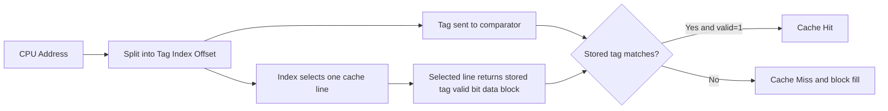

## Syllabus Position

Subject: [[Computer Organization and Architecture Index]]
Parent Topic: [[Cache Memory]]
Sibling Topics: [[Set Associative Mapping]], [[Fully Associative Mapping]], [[Cache Miss Types]], [[Write Policies]]
Leads To: [[Cache Mapping Methods]], [[Average Memory Access Time]], [[Cache Controller]], [[Memory Hierarchy]]

GATE Syllabus Line: Computer Organization and Architecture - memory hierarchy; cache memory; mapping functions.

Exam Weight Note: Appears frequently as 1-mark and 2-mark questions on address split into [[Tag]], [[Index]], and [[Block Offset]], on conflict misses, and on why direct-mapped caches are fast but collision-prone.

## The Problem This Solves

The CPU wants cache access to be extremely fast, so the hardware cannot afford to search many cache lines every time it looks for data. At the same time, main memory contains far more blocks than the cache can hold, so the system needs a deterministic rule for deciding where each memory block should go. [[Direct Mapping]] solves this by giving every main-memory block exactly one legal cache line. That rule makes hardware simple and lookup quick, but it also means two unrelated blocks can keep fighting for the same line.

Analogy: Think of a hostel where every student is assigned exactly one locker based on roll number modulo the number of lockers. Finding your locker is instant, but two students whose roll numbers map to the same locker cannot use it at the same time.

Core Idea (one sentence): [[Direct Mapping]] places each memory block into exactly one cache line using a modulo rule, so cache lookup needs only one index decode and one tag comparison.

## Formal Theory

**[[Direct Mapping]]** is a cache mapping scheme in which each block of [[Main Memory]] can be stored in exactly one [[Cache Line]], determined by the cache-line index computed from the block number.

### Mapping Rule

Suppose the cache has $L$ lines and main memory is divided into numbered blocks. If the accessed memory block number is $B$, then the destination line is

$$
\text{Line Number} = B \bmod L
$$

This rule is the whole design. Hardware does not ask where else the block could go, because there is no alternative location. That is why direct mapping is simpler than [[Set Associative Mapping]] or [[Fully Associative Mapping]].

### Address Format

For a byte-addressable system, a physical address is split into three fields:

$$
[\text{[[Tag]]} \mid \text{[[Index]]} \mid \text{[[Block Offset]]}]
$$

If

- address size $= m$ bits
- cache size $= C$ bytes
- block size $= B$ bytes
- number of lines $L = \frac{C}{B}$

then

$$
\text{Offset bits} = \log_2 B
$$

because the offset chooses one byte within a block,

$$
\text{Index bits} = \log_2 L
$$

because the index chooses one cache line, and

$$
\text{Tag bits} = m - \log_2 L - \log_2 B
$$

because the remaining upper bits must identify which of the many memory blocks currently occupies that indexed line.

### Cache Lookup Process

During access, the cache does not compare the incoming address with all lines. It uses the [[Index]] bits to select one line directly, then compares only that line's stored [[Tag]] with the address tag.

If the tag matches and the valid bit is $1$, the access is a hit. Otherwise it is a miss, and the required block must be fetched from lower memory and written into that same line.

### Hit and Miss Behavior

Direct mapping produces three classic outcomes:

- **[[Cache Hit]]**: right line chosen and tag matches.
- **[[Compulsory Miss]]**: first access to a block.
- **[[Conflict Miss]]**: a different block with the same index has replaced the old one.

The distinctive weakness of direct mapping is the conflict miss. Even if most of the cache is empty, two blocks with identical indices cannot coexist. That repeated eviction pattern is often called **[[Thrashing]]** in GATE-style discussion.

### Why Replacement Policy Is Trivial Here

In direct mapping, there is no victim-selection choice on a miss. The indexed line is the only possible destination, so the incoming block overwrites that line automatically. This is why complicated policies like [[LRU]] or [[FIFO]] are not needed for pure direct mapping.

### Hardware View

The important hardware pieces are:

- a line decoder driven by the [[Index]] bits
- a tag store holding one tag per line
- a valid bit per line
- a comparator that checks the stored tag against the address tag

Because only one line is selected, only one tag comparator is needed per access in the basic model. GATE often tests this against associative caches, where multiple parallel comparisons are required.

### Pseudocode for Lookup

```text
Algorithm DIRECT_MAP_LOOKUP(address):
    extract tag, index, offset from address
    select cache line using index
    if valid[index] = 1 and stored_tag[index] = tag:
        return HIT, data[index][offset]
    fetch required block from lower memory
    overwrite line index with fetched block
    stored_tag[index] <- tag
    valid[index] <- 1
    return MISS, fetched_data[offset]
```

### Pseudocode for Address Partitioning

```text
Algorithm SPLIT_ADDRESS(m, cache_size, block_size, address):
    lines <- cache_size / block_size
    offset_bits <- log2(block_size)
    index_bits <- log2(lines)
    tag_bits <- m - index_bits - offset_bits
    return tag_bits, index_bits, offset_bits
```

### What GATE Actually Tests Here

GATE usually tests four angles: computing [[Tag]]-[[Index]]-[[Block Offset]] bits, identifying which blocks conflict under the modulo rule, explaining why no replacement policy is needed, and comparing direct mapping with set-associative mapping in terms of speed and conflict misses.

## Diagrams and Visuals

### Visual 1: Address Split for a Direct-Mapped Cache

How to draw it: Draw a long rectangle for the physical address and divide it into three parts labeled Tag, Index, and Block Offset. Under the Index field, draw an arrow to one cache line.

```text
Physical Address
+-------------------+-----------+--------------+
|        Tag        |   Index   | Block Offset |
+-------------------+-----------+--------------+
          |               |
          |               +--> selects one cache line
          +--> compared with stored tag in that line
```

Labels:
- Tag: identifies which memory block among many possible blocks for that line.
- Index: selects the cache line directly.
- Block Offset: selects the byte or word inside the cached block.

### Visual 2: Direct-Mapped Lookup Flow

How to draw it: Draw the CPU address entering a splitter, then one branch to the line decoder and one branch to the tag comparator. From the selected line, show a valid-bit check and finally data output.



Labels:
- Split stage: separates fields without searching the whole cache.
- Comparator: checks only one tag in direct mapping.
- Miss path: fetches the block from lower memory and overwrites the selected line.

### Visual 3: Conflict Miss Picture

How to draw it: Draw two memory blocks, `Block 0` and `Block 64`, both pointing to `Line 0` in a cache with 64 lines.

```text
Main Memory Blocks               Cache Lines

Block 0  -----------\
                      >------ Line 0
Block 64 ----------/

Block 1  --------------------> Line 1
Block 65 --------------------> Line 1
```

Labels:
- Block 0 and Block 64 collide because $0 \bmod 64 = 64 \bmod 64 = 0$.
- This collision is a conflict miss source, not a capacity calculation error.

## Complexity Analysis

Direct mapping is a hardware organization, not a growing algorithm, so GATE cares about bounded lookup cost and miss behavior rather than asymptotic search over data structures.

### Per-Access Time Derivation

On every access, the hardware performs three bounded actions:

1. Decode the [[Index]] bits to select one line.
2. Compare one stored [[Tag]] with the incoming tag.
3. If hit, use the [[Block Offset]] to extract the requested byte or word.

None of these steps depends on the total number of main-memory blocks. That is why hit-time lookup is treated as $O(1)$.

### Best Case

Best case occurs on a cache hit. The block is already present, so the hardware does one index decode, one tag comparison, and one data selection.

$$
T_{best} = T_{index} + T_{tag} + T_{data} = O(1)
$$

### Average Case

Average behavior is captured through [[Average Memory Access Time]]:

$$
\text{AMAT} = T_{hit} + r_{miss} \times P_{miss}
$$

where $r_{miss}$ is the miss rate and $P_{miss}$ is the miss penalty. Direct mapping often has a larger $r_{miss}$ than associative schemes because conflict misses are more common.

### Worst Case

Worst case occurs when the access stream alternates between blocks that map to the same line. Then almost every access becomes a miss.

$$
T_{worst} = T_{hit} + P_{miss}
$$

This is still $O(1)$ per access in the asymptotic sense, but the constant factor becomes large because each miss triggers a lower-memory fetch.

### Space Cost

For a cache with $L$ lines and tag length $t$, the tag directory stores roughly

$$
L \times (t + 1)
$$

bits if we count one valid bit per line and ignore dirty bits for simplicity. The data array stores exactly the cache data capacity $C$. Direct mapping needs less comparator hardware than associative caches because it checks one tag, not many.

### Complexity Summary Table

| Case         | Time Complexity | Space Complexity | Trigger Condition |
|--------------|-----------------|------------------|-------------------|
| Best Case    | $O(1)$          | $O(1)$ per access; cache storage fixed in hardware | Requested block already present and valid |
| Average Case | $O(1)$          | $O(1)$ per access; total cache metadata $= O(L)$ | Mixed hit/miss pattern summarized by AMAT |
| Worst Case   | $O(1)$          | $O(1)$ per access; total cache metadata $= O(L)$ | Alternating conflicting blocks force repeated misses |

## Worked Example

Take a byte-addressable system with:

- Physical address size = $16$ bits
- Cache size = $1\text{ KB} = 2^{10}$ bytes
- Block size = $16$ bytes = $2^4$ bytes
- Mapping = [[Direct Mapping]]

### Step 1: Derive Tag, Index, and Offset Bits

Number of cache lines:

$$
L = \frac{2^{10}}{2^4} = 2^6 = 64
$$

So,

$$
\text{Offset bits} = 4, \quad \text{Index bits} = 6, \quad \text{Tag bits} = 16 - 6 - 4 = 6
$$

Thus the address split is:

$$
[\text{Tag}(6) \mid \text{Index}(6) \mid \text{Offset}(4)]
$$

### Step 2: Access Sequence

Use this GATE-style address sequence:

$$
0x0004,\ 0x0018,\ 0x000C,\ 0x0408,\ 0x0410,\ 0x0014
$$

Compute block number as

$$
\text{Block Number} = \left\lfloor \frac{\text{Address}}{16} \right\rfloor
$$

### Step 3: Trace Every Access

| Access | Address | Block No. | Line $= B \bmod 64$ | Tag $= \lfloor B/64 \rfloor$ | Hit/Miss | Line 0 State | Line 1 State |
|--------|---------|-----------|----------------------|-------------------------------|----------|--------------|--------------|
| 1 | $0x0004$ | $0$ | $0$ | $0$ | Miss | Tag $0$ loaded | Empty |
| 2 | $0x0018$ | $1$ | $1$ | $0$ | Miss | Tag $0$ loaded | Tag $0$ loaded |
| 3 | $0x000C$ | $0$ | $0$ | $0$ | Hit  | Tag $0$ stays | Tag $0$ loaded |
| 4 | $0x0408$ | $64$ | $0$ | $1$ | Miss | Tag $1$ replaces Tag $0$ | Tag $0$ loaded |
| 5 | $0x0410$ | $65$ | $1$ | $1$ | Miss | Tag $1$ loaded | Tag $1$ replaces Tag $0$ |
| 6 | $0x0014$ | $1$ | $1$ | $0$ | Miss | Tag $1$ loaded | Tag $0$ replaces Tag $1$ |

### Step 4: Explain the Key Event

Access 4 is the turning point. Address $0x0408$ belongs to block $64$, and

$$
64 \bmod 64 = 0
$$

so it must enter line $0$, exactly where block $0$ was sitting. That eviction is forced by the mapping rule. The same thing happens between blocks $1$ and $65$ at line $1$.

### Step 5: Final Interpretation

Hits = $1$, Misses = $5$.

This is not because the cache is too small in total capacity. The working set here is only four blocks, and many lines remain unused. The misses happen because the specific blocks collide on the same indices, which is the signature of [[Conflict Miss]].

Total operations: $6$ index decodes, $6$ tag comparisons, $1$ hit, and $5$ block fills. This confirms the $O(1)$ lookup claim because every access still checks only one indexed line, while the performance penalty comes from miss frequency, not from searching more lines.

What changes if the input is a friendly access pattern such as $0x0004, 0x0008, 0x000C, 0x000E$? All those addresses lie in the same block, so after the first compulsory miss the later accesses become hits due to spatial locality. What changes if the cache were 2-way set associative with the same total size? Blocks $0$ and $64$ could coexist inside the same set, so the conflict pattern would be reduced.

## Intuition Anchors

**The Analogy (restated and deepened):** The hostel-locker analogy explains both the speed and the weakness. Your roll number immediately tells you which locker to check, so lookup is fast. But if another student is assigned the same locker slot by the modulo rule, one of you must displace the other. That is exactly why direct mapping has low lookup hardware cost but higher conflict misses.

**The Mental Model:** Picture direct mapping as a two-step test: first go straight to one cache line using the index, then ask, "Is the tag here the one I need?" If yes, hit. If no, the old resident is evicted and the new block moves in. Experts do not imagine a search over the whole cache; they imagine a single predetermined parking spot.

**The One-Line Recall:** Direct mapping means one block, one possible line: use modulo for the line, then split address as Tag-Index-Offset and compare exactly one tag.

**The #1 Trap:** Students often think a miss in direct mapping means the cache is full overall. That is wrong. The cache may have many empty or irrelevant lines, but the required block still misses if its one legal line currently contains some other block with the same index. The correction is to separate capacity from collision: direct mapping mainly hurts through conflict misses.

## GATE Questions

**Question 1 - PYQ-style - 2-mark**

> A direct-mapped cache has size $32\text{ KB}$ and block size $64$ bytes. The physical address is $32$ bits. The number of bits in the tag field is

- (A) 15
- (B) 17
- (C) 19
- (D) 21

<details>
<summary>Solution</summary>

**Answer: (B)**

**Reasoning:**

Block offset bits:

$$
64 = 2^6 \Rightarrow \text{Offset} = 6
$$

Number of lines:

$$
\frac{32\text{ KB}}{64\text{ B}} = \frac{2^{15}}{2^6} = 2^9
$$

So index bits $= 9$.

Therefore,

$$
\text{Tag} = 32 - 9 - 6 = 17
$$

This gives option (B). So let us eliminate carefully.

- (A) 15: too small; would come from subtracting the wrong index count.
- (B) 17: correct from the direct formula.
- (C) 19: usually comes from forgetting some index bits.
- (D) 21: usually comes from subtracting only offset bits.

**Answer: (B)**

**What this question is really testing:** Pure address partitioning for a direct-mapped cache.

**Trap to avoid:** Using cache size directly in bytes without first dividing by block size to get the number of lines.

</details>

**Question 2 - Conceptual - 1-mark**

> Which statement is true for a direct-mapped cache?

- (A) A memory block can be placed in any cache line.
- (B) A memory block can be placed in any line within one set.
- (C) A memory block has exactly one possible cache line.
- (D) A replacement policy like LRU must always be executed on every miss.

<details>
<summary>Solution</summary>

**Answer: (C)**

**Reasoning:**

Direct mapping fixes one legal destination line for each memory block.

- (A) describes [[Fully Associative Mapping]].
- (B) describes [[Set Associative Mapping]].
- (C) is the defining property of direct mapping.
- (D) is false because there is no victim choice; the indexed line is overwritten automatically.

**What this question is really testing:** Whether you know the defining placement rule, not just the name.

**Trap to avoid:** Confusing "fast" with "flexible." Direct mapping is fast because it is inflexible.

</details>

**Question 3 - Hard / Multi-concept - 2-mark**

> A processor uses a direct-mapped cache with hit time $2\text{ ns}$, miss penalty $40\text{ ns}$, and miss rate $10\%$. The average memory access time is

- (A) $4\text{ ns}$
- (B) $6\text{ ns}$
- (C) $8\text{ ns}$
- (D) $42\text{ ns}$

<details>
<summary>Solution</summary>

**Answer: (B)**

**Reasoning:**

Use

$$
\text{AMAT} = T_{hit} + r_{miss} \times P_{miss}
$$

So,

$$
\text{AMAT} = 2 + 0.1 \times 40 = 2 + 4 = 6\text{ ns}
$$

Eliminate options:

- (A) $4\text{ ns}$: misses counted incorrectly.
- (B) $6\text{ ns}$: correct.
- (C) $8\text{ ns}$: often comes from adding hit time twice.
- (D) $42\text{ ns}$: this is close to miss-access time, not average access time.

**What this question is really testing:** Combining mapping knowledge with [[Average Memory Access Time]].

**Trap to avoid:** Multiplying the miss rate by total miss access time after already including hit time separately in the formula.

</details>

**Pattern Recognition:**

- If the question says direct mapped, immediately think `Line = Block mod Lines`.
- If block size is given, extract offset bits first; that step is almost never optional.
- If a sequence of addresses alternates between same-index blocks, expect conflict misses.
- If no associativity is mentioned and only one tag comparison is implied, direct mapping is usually the intended model.

## Edge Cases and Failure Modes

- [ ] Input of size $0$ or $1$: Students think mapping is irrelevant for tiny traces. Actual issue: even a one-access trace can still test tag, index, and offset extraction. Fix: always split the address first.
- [ ] All elements identical or repeated accesses to one block: Students overestimate miss rate. Actual behavior: after the first compulsory miss, repeated accesses usually hit until eviction. Fix: check whether the address stays within the same block.
- [ ] Input already arranged to collide: Students call this a capacity miss. Actual behavior: repeated same-index evictions are conflict misses. Fix: compute block numbers and line numbers explicitly.
- [ ] Integer or unit confusion: Students mix bytes, words, KB, and number of lines. Actual behavior: offset bits depend on block size in addressable units. Fix: convert every size to powers of 2 in the same unit before subtracting bits.
- [ ] Off-by-one errors in line counting: Students use number of blocks instead of number of lines. Actual behavior: index bits come from cache lines, not main-memory blocks. Fix: compute $L = C/B$ carefully.
- [ ] Infinite-loop style reasoning error: Students keep searching the whole cache mentally after a miss. Actual behavior: direct mapping checks one line only. Fix: remember the predetermined parking spot model.
- [ ] Topic-specific failure - forgetting valid bit: A matching tag in an uninitialized line is not a hit. Fix: hit requires both tag match and valid bit $= 1$.

## Comparisons

| Feature              | [[Direct Mapping]] | [[Set Associative Mapping]] | [[Fully Associative Mapping]] |
|----------------------|--------------------|-----------------------------|-------------------------------|
| Time Complexity      | $O(1)$ hit lookup with one tag compare | $O(1)$ hit lookup with $k$ parallel compares inside one set | $O(1)$ idealized lookup but with all-line associative compare hardware |
| Space Complexity     | Lowest metadata/comparator cost | Medium metadata and comparator cost | Highest comparator and control cost |
| Key Property         | Exactly one legal line per block | Exactly one legal set, many lines inside that set | Any block can go anywhere |
| When to Prefer       | When hardware simplicity and fast indexing matter most | When balancing speed and miss rate | When minimizing conflict misses matters most |
| GATE Trap            | Mistaking conflict misses for capacity misses | Forgetting sets $=$ lines/$k$ | Forgetting there is no index field |

The most common GATE comparison here is: "Why is direct mapping faster but less effective than set-associative mapping?" The answer hinges on one fact: direct mapping selects one line immediately, while associative methods offer more placement choices and therefore reduce conflict misses at the cost of more comparison hardware.

## Connections Web

**Must know before this topic:**

- [[Memory Hierarchy]] - explains why a cache exists at all.
- [[Cache Memory]] - direct mapping is one organization of cache placement.
- [[Locality of Reference]] - explains why blocks are worth caching.
- [[Binary Number System]] - address partitioning is pure bit arithmetic.
- [[Powers of 2]] - cache and block calculations depend on them.

**Topics that build on this:**

- [[Cache Mapping Methods]] - places direct mapping alongside the other two mapping families.
- [[Average Memory Access Time]] - converts hit/miss behavior into performance.
- [[Cache Miss Types]] - direct mapping makes conflict misses easy to visualize.
- [[Write Policies]] - govern what happens when the cached line is updated.
- [[Cache Controller]] - implements the lookup and refill logic.

**GATE subject cross-links:**

- [[Computer Organization and Architecture Index]] > [[Memory Hierarchy]]
- [[Computer Organization and Architecture Index]] > [[Cache Memory]]

**Cross-subject connections:**

- [[Operating Systems]] - page coloring and memory layout can affect practical cache conflicts.
- [[Compiler Design]] - loop transformations can reduce repeated same-index conflicts.
- [[Data Structures]] - array traversal patterns strongly influence spatial locality and hit rate.

**Standard references:**

- [[Computer Organization and Design (Patterson and Hennessy)]]
- [[Computer Organization (Hamacher, Vranesic, Zaky)]]
- [[Digital Design and Computer Architecture (Harris and Harris)]]

## Quick Revision Sheet

**Definition (1 sentence):** A direct-mapped cache gives each main-memory block exactly one possible cache line, chosen by modulo on the block number.

**Core Idea / Analogy (1 sentence):** One block has one parking slot; finding it is fast, but two blocks with the same slot collide.

**Algorithm Steps (numbered, maximum 6 steps):**
1. Compute block number from address.
2. Use lower block bits to get the line index.
3. Use remaining upper bits as the tag.
4. Select that one cache line.
5. Compare stored tag and valid bit.
6. On miss, fetch block and overwrite the same line.

**Complexity:**
- Time (best / average / worst): $O(1)$ / $O(1)$ / $O(1)$ per access
- Space: fixed cache data plus tag store; metadata about $O(L)$ for $L$ lines
- Recurrence (if applicable): Not applicable; this is bounded hardware lookup

**Key Properties (3 to 5 bullet points - facts GATE tests directly):**
- $\text{Line} = \text{Block Number} \bmod \text{Number of Lines}$.
- Address split is [[Tag]]-[[Index]]-[[Block Offset]].
- No replacement-policy choice is needed on a miss.
- One tag comparison per access makes lookup hardware simple.
- Main weakness is [[Conflict Miss]], not search delay.

**The #1 Trap:** A miss does not imply the whole cache is full; in direct mapping the one legal line may simply contain a conflicting block.

**When to use this over alternatives:** Prefer it when simplicity, low hardware cost, and short hit path matter more than minimizing conflict misses.

**Mnemonic or one-liner to remember the steps:** `Modulo picks the line, tag proves the block, offset picks the byte.`

## Revision Checklist

- [ ] I can state the formal definition without looking.
- [ ] I can explain the locker analogy and map it to line selection and conflicts.
- [ ] I can trace a 6-access example by hand in under 2 minutes.
- [ ] I can derive tag, index, and offset bits from cache and block sizes.
- [ ] I know what the Quick Revision Sheet says without reading it.
- [ ] I can solve all 3 GATE questions in this note without peeking.
- [ ] I know the #1 trap and can articulate why students fall for it.
- [ ] I have linked this note correctly in my Obsidian vault.
- [ ] I have scheduled a spaced-repetition review in 3 days.
