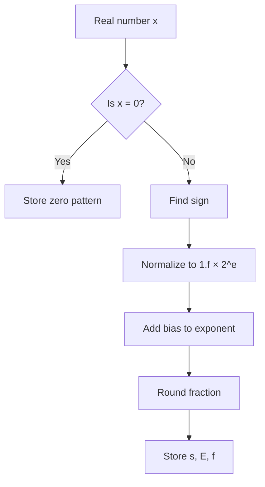

## Syllabus Position

Subject: [[Computer Organization & Architecture]]
Parent Topic: [[Data Representation]]
Sibling Topics: [[Signed Number Representation]], [[Fixed Point Representation]]
Leads To: [[IEEE 754]], [[Arithmetic Operations on Floating Point Numbers]]

GATE Syllabus Line: Number representation and computer arithmetic.

Exam Weight Note: Appears often as 1-mark MCQ on bias, normalization, special values, and rounding; sometimes as 2-mark NAT on range/precision calculations.

## The Problem This Solves

Integers are not enough when a machine must store very large numbers like distances to stars or very small numbers like probabilities. If we try to keep every decimal digit exactly, the storage cost grows fast and arithmetic becomes awkward. Floating point representation solves this by storing a number in a scientific-notation-like form with a sign, a scale, and a significant. That gives a computer a wide numeric range with limited bits, at the cost of exactness.

Analogy: floating point is like writing a number as a price tag plus a magnifying-glass setting, so the same small memory can represent both a tiny coin and a huge bill.

Core Idea (one sentence): represent a real number as $(-1)^s \times 1.f \times 2^e$ so the exponent shifts the binary point and the fraction stores precision.

## Formal Theory

### Formal definition
**[[Floating point representation]]** encodes a real number using three fields: a **[[sign bit]]**, a **[[biased exponent]]**, and a **[[fraction]]** or **[[mantissa]]** field. For normalized binary numbers, the value is

$$(-1)^s \times (1.f)_2 \times 2^{E-ब}$$

where $s \in \{0,1\}$, $E$ is the stored exponent field, and $B$ is the bias.

### Normalized form
A **[[normalized number]]** has the leading significand bit equal to $1$, so the leading 1 is implicit in IEEE-style formats. This saves one bit of storage and increases precision. For example, $13.25_{10} = 1101.01_2 = 1.10101_2 \times 2^3$.

### Biased exponent
The exponent is stored with a bias so that both positive and negative powers of two can be represented using unsigned comparison-friendly bits. For an exponent field of $k$ bits, the usual bias is

$$B = 2^{k-1} - 1.$$

This makes ordering and hardware comparison simpler because larger stored exponents usually mean larger actual exponents for normalized numbers.

### IEEE 754 single precision
In 32-bit single precision, the fields are:
- 1 sign bit
- 8 exponent bits
- 23 fraction bits

The value is:

$$(-1)^s \times (1.f) \times 2^{E-127}$$

for normalized numbers. The exponent field $E=0$ and $E=255$ are reserved for special encodings.

### Special values
- **Zero**: exponent all zeros, fraction all zeros.
- **Subnormal numbers**: exponent all zeros, fraction nonzero; they extend the representable range closer to zero with reduced precision.
- **Infinity**: exponent all ones, fraction all zeros.
- **NaN**: exponent all ones, fraction nonzero; used for invalid results.

### Rounding modes
IEEE 754 uses rounding because most decimal fractions have infinite binary expansions. Common modes include round to nearest ties to even, toward zero, toward $+\infty$, and toward $-\infty$. The default mode minimizes systematic bias in large computations.

### Pseudocode for encoding

```
Algorithm ENCODE_FLOAT(x):
    if x = 0: return sign, zero fields
    choose sign bit s
    normalize x to 1.f × 2^e
    E = e + bias
    round fraction f to available bits
    if overflow: return infinity
    if underflow: return subnormal or zero
    return s, E, f
```

What GATE actually tests here: bias calculation, normalized value reconstruction, smallest/largest representable values, special-case bit patterns, and rounding-related precision loss.

## Diagrams and Visuals

1. Draw a 32-bit floating-point word split into three blocks: sign, exponent, fraction.

ASCII approximation:

```
| s |   exponent (8 bits)   |        fraction (23 bits)         |
```

Labels: `s` = sign; exponent = scale; fraction = significant bits after the implicit leading 1.

2. Draw normalization of a binary number:

```
1101.01_2 = 1.10101_2 × 2^3
      ^
 binary point moved left
```

Labels: moving the point left increases exponent; fraction stores digits after the leading 1.

3. Mermaid flow for encoding:



## Complexity Analysis

Floating point encoding/decoding is a fixed-size hardware process for standard widths, so the asymptotic view is less relevant than the bit-level operation cost.

- **Encoding time**: the hardware or software routine scans the magnitude, normalizes it, and rounds the fraction. For a fixed word size, this is $O(1)$ time; for arbitrary-precision conversion from a decimal string of length $n$, it is $O(n)$ or worse depending on parsing.
- **Decoding time**: extracting sign, exponent, and fraction is $O(1)$ for fixed-size formats.
- **Space**: a 32-bit or 64-bit format uses exactly 32 or 64 bits per value; auxiliary space is $O(1)$.

Complexity Summary Table:

| Case | Time Complexity | Space Complexity | Trigger Condition |
|------|-----------------|------------------|-------------------|
| Best Case | $O(1)$ | $O(1)$ | Input already in machine format |
| Average Case | $O(1)$ | $O(1)$ | Standard encode/decode of fixed-width values |
| Worst Case | $O(n)$ | $O(1)$ | Parsing a length-$n$ decimal string into binary |

## Worked Example

Encode $13.25_{10}$ in IEEE 754 single precision.

Step 1: Convert to binary.
$$13.25_{10} = 1101.01_2$$

Step 2: Normalize.
$$1101.01_2 = 1.10101_2 \times 2^3$$

Step 3: Sign bit.
$13.25$ is positive, so $s=0$.

Step 4: Exponent field.
Actual exponent $e=3$, bias $=127$, so stored exponent is
$$E = 3 + 127 = 130 = 10000010_2.$$ 

Step 5: Fraction field.
Drop the implicit leading 1 and store the remaining bits:
$$f = 10101000000000000000000$$

Step 6: Final pattern.
$$0\ 10000010\ 10101000000000000000000$$

State after each step:
- After binary conversion: `1101.01`
- After normalization: `1.10101 × 2^3`
- After exponent encoding: `10000010`
- After fraction truncation: `10101000000000000000000`

Verify: decoding gives $(-1)^0 \times 1.10101_2 \times 2^3 = 13.25$ exactly.

What changes if the input is $0.1_{10}$? The binary expansion repeats forever, so the stored fraction is rounded and the decoded value is approximate, not exact.

## GATE Questions

**Question 1 — GATE-style — 1-mark**

In IEEE 754 single precision, the exponent field is stored with bias $127$. What is the actual exponent when the stored exponent field is `10000010`?

- (A) $2$
- (B) $3$
- (C) $4$
- (D) $130$

<details>
<summary>Solution</summary>

**Answer: (B)**

**Reasoning:** `10000010_2 = 130_{10}`. Actual exponent $=130-127=3$.

**What this question is really testing:** bias conversion.

**Trap to avoid:** adding the bias instead of subtracting it when decoding.

</details>

**Question 2 — Conceptual / Numerical — 2-mark**

Which of the following is true for subnormal numbers in IEEE 754?

- (A) They have exponent field all ones and fraction all zeros.
- (B) They allow representation of numbers closer to zero than normalized numbers.
- (C) They always increase precision compared to normalized numbers.
- (D) They are used only for NaN.

<details>
<summary>Solution</summary>

**Answer: (B)**

**Reasoning:** Subnormals use exponent all zeros and a nonzero fraction. They fill the gap between zero and the smallest normalized number. Option (A) is infinity, (D) is NaN, and (C) is false because subnormals trade precision for range.

</details>

**Question 3 — Hard / Multi-concept — 2-mark**

A floating-point format has 1 sign bit, 5 exponent bits, and 10 fraction bits. Assuming the usual bias, what is the bias and why is it chosen that way?

<details>
<summary>Solution</summary>

**Answer:** Bias $= 2^{5-1}-1 = 15$.

**Reasoning:** With 5 exponent bits, the standard bias is $2^{k-1}-1$. That centers the stored unsigned exponent range around zero so negative and positive actual exponents can be represented, and it makes comparison and ordering simpler for normalized numbers.

</details>

Pattern Recognition:
- If GATE gives a bit pattern, first identify sign, exponent, and fraction fields.
- If GATE asks for range, compute smallest/largest normalized values using the bias.
- If GATE mentions zero, infinity, or NaN, look at exponent all zeros or all ones.
- If GATE mentions `0.1` or similar decimals, expect rounding error in binary.

## Edge Cases and Failure Modes

- [ ] Input of size 0 or 1
  - Wrong assumption: every number has a normalized form.
  - What happens: zero is a special encoding and cannot be written as `1.f × 2^e`.
  - Fix: treat zero separately before normalization.
- [ ] All digits identical / repeated binary fraction
  - Wrong assumption: decimal fractions always terminate in binary.
  - What happens: values like $0.1_{10}$ repeat forever and must be rounded.
  - Fix: account for approximation error.
- [ ] Overflow
  - Wrong assumption: exponent can grow without limit.
  - What happens: value becomes infinity if exponent exceeds max.
  - Fix: detect overflow and saturate to infinity.
- [ ] Underflow
  - Wrong assumption: very small numbers are still normalized.
  - What happens: they become subnormals or zero.
  - Fix: support gradual underflow.
- [ ] Off-by-one in exponent bias
  - Wrong assumption: bias is $2^k-1$.
  - What happens: actual exponent is decoded wrongly.
  - Fix: use $2^{k-1}-1$.
- [ ] Topic-specific failure: implicit leading 1 forgotten
  - Wrong assumption: fraction field stores the whole significand.
  - What happens: decoded values are off by a factor of $2$.
  - Fix: remember normalized numbers store `1.` implicitly.

## Comparisons

| Feature | [[Floating point representation]] | [[Fixed Point Representation]] | [[Signed Number Representation]] |
|----------------------|-----------------------|-----------------------|-----------------------|
| Time Complexity | $O(1)$ encode/decode | $O(1)$ | $O(1)$ |
| Space Complexity | fixed bits per value | fixed bits per value | fixed bits per value |
| Key Property | wide range, approximate | exact scale, limited range | represents negatives |
| When to Prefer | scientific computation | money-like fixed scale | any signed integer coding |
| GATE Trap | confusing bias/normalization | mixing decimal point positions | confusing sign-magnitude and 2's complement |

The most common GATE question comparing these is a direct contrast of range versus precision, and the answer hinges on whether the format uses a variable exponent or a fixed radix point.

## Intuition Anchors

**The Analogy (restated and deepened):** Floating point is a movable-lens price tag. The exponent slides the viewing window left or right, while the fraction preserves the detail visible inside the window. That is why it covers tiny and huge values with the same bit budget, but also why two close real numbers can collapse to the same stored pattern.

**The Mental Model:** I picture a normalized binary number as a flashlight beam on a number line: the exponent moves the beam, and the mantissa shows the shape inside the beam. During decoding, I ask three questions in order: is it zero/special, what is the scale, and what is the significand?

**The One-Line Recall:** Floating point stores `sign + biased exponent + fraction`, so the exponent controls range and the fraction controls precision.

**The #1 Trap:** Students forget the implicit leading `1` in normalized numbers and then reconstruct the value incorrectly. It seems natural to store all bits explicitly, but IEEE 754 saves one bit and assumes that leading one unless the number is subnormal.

## GATE Questions

**Question 1 — [PYQ: GATE-style] — [Difficulty: 1-mark]**

In a normalized binary floating-point system, why is a biased exponent used?

- (A) To store negative mantissa bits
- (B) To make exponent comparison possible using unsigned ordering
- (C) To remove the sign bit
- (D) To increase the fraction length

<details>
<summary>Solution</summary>

**Answer: (B)**

**Reasoning:** Bias converts signed exponent values into unsigned stored values. This makes hardware comparison and sorting easier for normalized numbers. Options (A), (C), and (D) do not describe the purpose of bias.

**What this question is really testing:** understanding of biased exponent design.

**Trap to avoid:** thinking bias exists only for “making values positive” rather than for hardware-friendly ordering.

</details>

**Question 2 — [Conceptual / Numerical] — [Difficulty: 2-mark]**

Represent $5.5_{10}$ in normalized binary form.

<details>
<summary>Solution</summary>

**Answer:**

$$5.5_{10} = 101.1_2 = 1.011_2 \times 2^2$$

The sign bit is $0$. The normalized significand is `1.011`. The exponent is $2$.

**What this question is really testing:** binary conversion and normalization.

</details>

**Question 3 — [Hard / Multi-concept] — [Difficulty: 2-mark]**

Explain why floating point addition may require alignment of exponents before adding significands.

<details>
<summary>Solution</summary>

**Reasoning:** Two numbers such as $1.5 \times 2^3$ and $1.25 \times 2^1$ are scaled differently. Before adding significands, the smaller exponent must be shifted so both values refer to the same power of two. Otherwise the bit patterns represent different magnitudes and the addition is meaningless. This alignment is one reason floating point arithmetic is more expensive than integer arithmetic.

**What this question is really testing:** the arithmetic pipeline behind floating point addition.

</details>

**Pattern Recognition:**
- When a GATE question gives an exponent field, immediately subtract the bias.
- When it asks about exactness, check whether the decimal terminates in binary.
- When it asks about special patterns, inspect exponent all zeros or all ones.
- When it asks about range versus precision, remember exponent controls range and fraction controls precision.

## Quick Revision Sheet

**Definition (1 sentence):** Floating point representation stores a real number as sign, biased exponent, and fraction.

**Core Idea / Analogy (1 sentence):** It is scientific notation in binary, where the exponent moves the binary point and the fraction stores detail.

**Algorithm Steps (numbered, maximum 6 steps):**
1. Determine the sign bit.
2. Convert the magnitude to binary.
3. Normalize to `1.f × 2^e`.
4. Add bias to get stored exponent.
5. Round the fraction to fit the available bits.
6. Handle overflow, underflow, zero, infinity, and NaN separately.

**Complexity:**
- Time (best / average / worst): $O(1)$ / $O(1)$ / $O(n)$ for parsing a length-$n$ decimal string
- Space: $O(1)$ auxiliary, fixed storage per format
- Recurrence (if applicable): not usually used; this is a representation, not a recursive algorithm

**Key Properties (3 to 5 bullet points — facts GATE tests directly):**
- Bias is usually $2^{k-1}-1$ for a $k$-bit exponent field.
- Normalized numbers have an implicit leading `1`.
- Exponent all zeros and fraction all zeros represent zero.
- Exponent all ones and fraction nonzero represent NaN.
- Floating point is approximate, not exact, for many decimals.

**The #1 Trap:** Forgetting that `0.1_{10}` is repeating in binary, so it must be rounded.

**When to use this over alternatives:** Use floating point when you need a large dynamic range and can tolerate small rounding error.

**Mnemonic or one-liner to remember the steps:** `Sign, Scale, Significand`.

## Revision Checklist

- [ ] I can state the formal definition without looking.
- [ ] I can explain the analogy and map it to the algorithm or concept.
- [ ] I can trace a 6-element example by hand in under 2 minutes.
- [ ] I can derive the worst-case complexity from scratch.
- [ ] I know what the Quick Revision Sheet says without reading it.
- [ ] I can solve all 3 GATE questions in this note without peeking.
- [ ] I know the #1 trap and can articulate why students fall for it.
- [ ] I have linked this note correctly in my Obsidian vault.
- [ ] I have scheduled a spaced-repetition review in 3 days.
