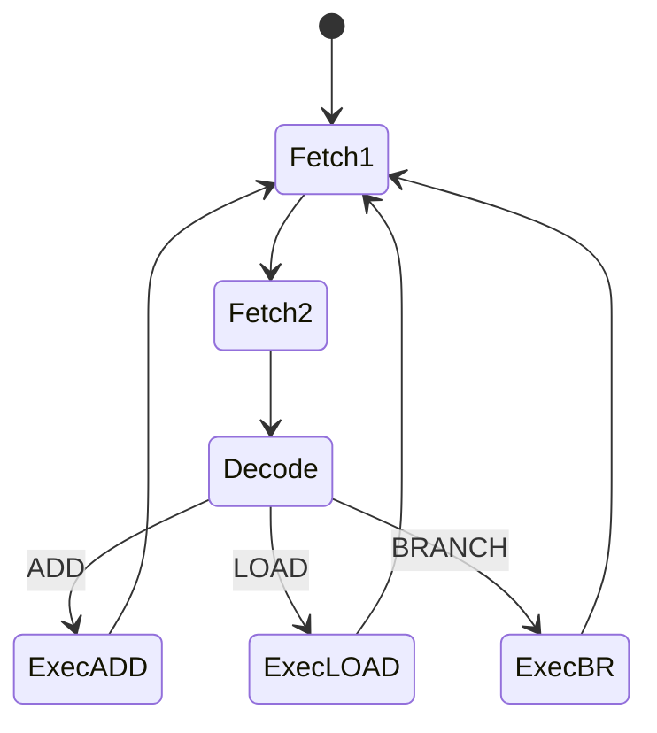

## Syllabus Position

**Subject:** [[Computer Organization and Architecture Index]]
**Parent Topic:** [[CPU Organization]]
**Sibling Topics:** [[Instruction Cycle]], [[Micro Operations, ALU Data Path and Control Unit]], [[Machine Instructions]], [[Addressing Modes]]
**Leads To:** [[Microprogramming]], [[RISC vs CISC]], [[Pipelining]], [[Control Signal Generation]]

**GATE Syllabus Line:** Computer Organization and Architecture - Machine instructions and addressing modes, ALU, data-path and control unit.

**Exam Weight Note:** Appears commonly as 1-mark MCQs asking why hardwired control is faster, and as 2-mark NAT or MSQ questions where you must infer control signals from opcode bits, timing states, or finite-state sequencing.

## The Problem This Solves

A processor cannot execute an instruction just because the instruction exists in memory. It must activate the correct register enables, ALU select lines, memory read or write signals, and sequencing signals at exactly the correct clock instants. Someone has to decide that when the opcode is ADD at time step $T_3$, the ALU should add, the source registers should drive the datapath, and the destination register should load the result. A hardwired control unit solves this by building the decision process directly into logic gates and flip-flops instead of storing it as a program.

Think of it like a railway junction whose tracks are permanently laid out for known routes. Once the signal condition arrives, the train is routed immediately through fixed hardware paths; no dispatcher manual has to be read first.

**Core Idea (one sentence):** A hardwired control unit generates CPU control signals directly from opcode bits, timing states, and status flags using fixed combinational and sequential logic.

## Formal Theory

A **[[Hardwired Control Unit Design]]** is a control implementation in which the **[[Control Unit]]** is realized using fixed logic circuits such as decoders, encoders, counters, flip-flops, gates, and sometimes a **[[Programmable Logic Array]]**, so that each required control signal is a Boolean function of the current instruction, timing state, and condition flags.

### Inputs to the Hardwired Control Unit

The control unit does not generate signals randomly. It observes a small set of inputs:

1. **[[Opcode]]** bits from the **[[Instruction Register]]**.
2. Timing signals such as $T_0, T_1, T_2, \dots$ from a **[[Sequence Counter]]** or state register.
3. Condition flags such as **[[Zero Flag]]**, **[[Carry Flag]]**, **[[Overflow Flag]]**, or interrupt status.
4. Sometimes external requests such as **[[Interrupt]]** or ready/wait signals.

At a high level,

$$
\text{Control Signal}_i = f_i(\text{Opcode bits}, T_j, \text{Flags}, \text{Interrupts})
$$

This equation matters in GATE because it explains why hardwired control is fast: once the inputs settle, the output is produced by gate propagation rather than by reading a control memory word.

### Internal Building Blocks

The typical hardwired design uses four main blocks.

#### Instruction Decoder

The **[[Instruction Decoder]]** converts opcode bits into one-hot instruction classes. If the opcode has $k$ bits, it can identify up to $2^k$ instruction groups.

$$
k \text{ opcode bits } \Rightarrow 2^k \text{ decoded outputs}
$$

For example, if `ADD` decodes to line $D_3$, then control equations can use terms like $D_3T_4$ to mean "during time step $T_4$ of an ADD instruction."

#### Timing Generator

The **[[Timing Generator]]** or sequence counter produces step signals that divide instruction execution into micro-time states.

Example fetch sequence:

$$
T_0: MAR \leftarrow PC
$$

$$
T_1: MDR \leftarrow M[MAR],\; PC \leftarrow PC + 1
$$

$$
T_2: IR \leftarrow MDR
$$

After decode, later timing states depend on the instruction class. GATE likes this because students must distinguish instruction-independent fetch steps from opcode-dependent execute steps.

#### Control Logic Network

The control logic combines decoded opcode lines, timing states, and flags. For instance,

$$
R1_{load} = D_{ADD} \cdot T_4
$$

$$
ALU_{select=ADD} = D_{ADD} \cdot T_3
$$

$$
PC_{load} = D_{BRANCH} \cdot T_4 \cdot Z
$$

These are representative Boolean equations. Their exact form depends on the datapath, but the design principle is stable: each control output is a logic expression.

#### State / Sequence Reset Logic

Once an instruction finishes, the sequence counter must reset so the next cycle returns to fetch. If an instruction ends at $T_4$, then an end signal may trigger:

$$
SC \leftarrow 0
$$

This prevents the control from drifting into unused states. Many GATE questions hide this point by asking how the CPU knows to start the next fetch cycle.

### Operation as a Finite-State Machine

Hardwired control is naturally modeled as a **[[Finite State Machine]]**. Each state corresponds to a timing step or control phase, and transitions depend on opcode class and condition signals.

```text
Algorithm HARDWIRED_CONTROL(opcode, flags):
    start in fetch state T0
    generate fetch control signals
    advance through T1, T2
    decode opcode
    for the decoded instruction class:
        generate execute signals in T3, T4, ...
    when instruction completes:
        reset sequence counter to T0
    return next instruction cycle
```

### Typical Design Flow

The design process usually follows these steps:

1. Write the **[[Register Transfer Level]]** micro-operations for each instruction.
2. Group them by timing steps.
3. Identify datapath resources used in each step.
4. Write Boolean equations for every control signal.
5. Implement the equations using gates, decoders, multiplexers, and flip-flops.

This is why hardwired control is easy for a small or regular **[[Instruction Set Architecture]]**, but becomes painful for a large irregular instruction set. Every new instruction can force new states, new equations, and new hardware dependencies.

### Advantages

1. Control signal generation is fast because there is no control memory access.
2. It suits simple and regular instruction formats, especially **[[RISC]]**-style designs.
3. It can be optimized aggressively for a specific datapath.

### Disadvantages

1. Modifying the instruction behavior requires redesigning logic.
2. Complex instruction sets make the control equations large and error-prone.
3. Debugging and extension are harder than in **[[Microprogrammed Control Unit Design]]**.

### What GATE Actually Tests Here

GATE usually tests the speed-flexibility trade-off, the role of opcode decoders and timing states, and whether you can read a control equation such as $D_2T_4Z$ correctly. It also likes comparisons: hardwired control is faster, but microprogrammed control is easier to modify and often preferred for complex instruction sets.

## Diagrams and Visuals

### Visual 1: Hardwired Control Block Diagram

**How to draw it:** Draw opcode bits from the instruction register entering an instruction decoder. Draw timing outputs from a sequence counter. Feed both into a control logic block. From that block, draw control lines to registers, ALU, memory, and PC.

```text
IR opcode --> [Instruction Decoder] --\
                                      > [Control Logic] --> Register load enables
Sequence Counter --> [T0 T1 T2 ...] --/                  --> ALU select lines
Flags --------------------------------/                  --> Memory R/W
                                                         --> PC control
```

**Labels:**
- `Instruction Decoder`: identifies instruction class.
- `Sequence Counter`: gives timing state.
- `Flags`: branch and condition inputs.
- `Control Logic`: fixed Boolean network generating signals.

### Visual 2: FSM View of Control

**How to draw it:** Draw states `Fetch1`, `Fetch2`, `Decode`, `Exec_ADD`, `Exec_LOAD`, `Exec_BRANCH`, then arrows based on opcode.



**Labels:**
- `Fetch1`, `Fetch2`: common fetch states.
- `Decode`: instruction classification.
- `Exec...`: opcode-specific fixed control paths.

### Visual 3: Equation-Based Signal Generation

**How to draw it:** Write three sample equations and highlight each input term.

```text
ALU_ADD   = D3 . T3
R1_load   = D3 . T4
PC_load   = D7 . T4 . Z
```

**Labels:**
- `D3`, `D7`: decoded opcode lines.
- `T3`, `T4`: timing states.
- `Z`: zero flag for conditional branch.

### Visual 4: Timing Trace for One Instruction

**How to draw it:** Draw clock slots $T_0$ to $T_4$ and list the active micro-operations below each slot.

```text
T0: MAR <- PC
T1: MDR <- M[MAR], PC <- PC + 1
T2: IR <- MDR, Decode
T3: Y <- R1, ALU <- ADD with R2
T4: R1 <- ALUout, SC <- 0
```

**Labels:**
- `Y` or temporary register: holds one operand.
- `SC <- 0`: restart fetch for next instruction.

## Complexity Analysis

This topic is about hardware latency and design complexity, not algorithmic growth over input size. The right way to analyze it is to ask how much delay and hardware cost are added to produce control signals.

### Time Cost of Signal Generation

For a hardwired controller, the delay to produce a control signal is the combinational propagation delay of the decoder and logic network plus any state-register delay.

Let:

$$
t_d = \text{opcode decode delay},\quad t_g = \text{logic network delay},\quad t_s = \text{state register delay}
$$

Then the control generation latency is approximately

$$
t_{control} \approx t_s + t_d + t_g
$$

There is no extra term for control memory access. That missing term is the main reason hardwired control is faster than microprogrammed control.

### Best, Average, Worst Cases

The number of clock steps per instruction depends on the instruction type, but within each step the control-signal derivation remains bounded and direct.

1. **Best case:** a simple register-register instruction with few execute states.
2. **Average case:** a typical ALU or memory-reference instruction with fetch, decode, execute, and write-back.
3. **Worst case:** a more complex instruction requiring additional wait states, memory cycles, or branch-condition evaluation.

### Hardware / Space Cost

Auxiliary hardware cost is fixed once the CPU is built, so asymptotically it is $O(1)$ per instruction executed. But in design terms, cost grows with:

1. Number of opcode classes.
2. Number of timing states.
3. Number of output control signals.
4. Complexity of each Boolean equation.

If there are $m$ control outputs, each realized as a function over opcode, timing, and flag inputs, then implementation complexity roughly scales with the total size of those Boolean expressions. GATE will not ask big-$O$ circuit synthesis theory here; it will ask the qualitative result that complexity rises quickly as the instruction set becomes irregular.

| Case | Time Complexity | Space Complexity | Trigger Condition |
|------|-----------------|------------------|------------------|
| Best Case | $O(1)$ control latency and few states | $O(1)$ per instruction | Simple register instruction with direct execute path |
| Average Case | $O(1)$ control latency | $O(1)$ per instruction | Typical fetch-decode-execute sequence |
| Worst Case | $O(1)$ control latency but more clock states | $O(1)$ per instruction | Complex instruction or added wait/branch states |

The important exam point is that all per-instruction control activity is bounded, but the hardware design burden is high when the ISA is complex.

## Worked Example

Consider a simple instruction `ADD R1, R2` on a datapath where the result is written back into `R1`. Assume:

```text
PC = 120
R1 = 9
R2 = 6
opcode(ADD) -> D3
```

We trace the hardwired control sequence.

### Step 1: $T_0$

Control action:

$$
MAR \leftarrow PC
$$

State after step:

```text
PC = 120
MAR = 120
R1 = 9
R2 = 6
```

### Step 2: $T_1$

Control actions:

$$
MDR \leftarrow M[MAR],\; PC \leftarrow PC + 1
$$

Suppose memory returns the encoded instruction `ADD R1, R2`.

State after step:

```text
PC = 121
MDR = ADD R1, R2
R1 = 9
R2 = 6
```

### Step 3: $T_2$

Control actions:

$$
IR \leftarrow MDR
$$

Decoder output becomes active:

$$
D_3 = 1
$$

State after step:

```text
IR = ADD R1, R2
Decoded line D3 = 1
```

### Step 4: $T_3$

Hardwired equation activates the ALU add path:

$$
ALU_{select=ADD} = D_3T_3
$$

Operands are selected and added.

Intermediate state:

```text
ALU input A = R1 = 9
ALU input B = R2 = 6
ALU output = 15
```

### Step 5: $T_4$

Write-back and sequence reset occur:

$$
R1_{load} = D_3T_4
$$

$$
SC \leftarrow 0
$$

Final state:

```text
PC = 121
R1 = 15
R2 = 6
Next control state = T0
```

Operation count by control phases: fetch uses $3$ states, execute uses $2$ states, so total states $= 5$. This confirms the $O(1)$ claim because the instruction requires a fixed finite number of control steps independent of data values.

What changes if the instruction is a conditional branch? The fetch and decode states remain the same, but the execute equation includes a flag term such as $D_{BR}T_4Z$. The next-PC behavior now depends on the zero flag, so a single extra condition input changes the control path without changing the overall hardwired design principle.

## Intuition Anchors

**The Analogy (restated and deepened):** Hardwired control is like a factory conveyor system with permanently wired sensors and gates. When item type `ADD` reaches station `T_3`, the same actuator always fires. That is why it is fast. But if you want to add a new product path tomorrow, you may need to physically rewire the station layout.

**The Mental Model:** Picture a decoder lighting up one instruction line, a counter lighting up one timing line, and an AND-gate network combining them. Wherever the right lines intersect, a control signal turns on.

**The One-Line Recall:** Hardwired control means `control signal = Boolean function of opcode + timing + flags`, so it is fast but inflexible.

**The #1 Trap:** Students often think hardwired control means "no sequencing." That is wrong because hardwired control still uses timing states or FSM states; the difference is only that those states drive fixed logic instead of indexing a control memory.

## GATE Questions

**Question 1 — PYQ-style — Difficulty: 1-mark**

> Which one of the following is the main advantage of a hardwired control unit over a microprogrammed control unit?

- (A) Easier modification of instruction set
- (B) Lower control signal generation latency
- (C) Lower datapath hardware cost
- (D) Larger instruction set support

<details>
<summary>Solution</summary>

**Answer: (B)**

**Reasoning:** A hardwired controller produces signals directly using combinational logic, so it avoids control memory lookup. (A) is false because modifying behavior is harder in hardwired designs. (C) is not necessarily true because datapath cost is mostly independent of whether control is hardwired or microprogrammed. (D) is false because large instruction sets usually favor microprogrammed control.

**What this question is really testing:** Whether you know the core speed versus flexibility trade-off.

**Trap to avoid:** Do not confuse control-unit speed with total CPU cost.

</details>

**Question 2 — Conceptual — Difficulty: 2-mark**

> A control signal is given by $X = D_2T_4Z$. Under which condition does $X$ become active?

- (A) Instruction class $D_2$ at time $T_4$ only
- (B) Time $T_4$ with zero flag set, regardless of instruction
- (C) Instruction class $D_2$ at time $T_4$ with zero flag set
- (D) Any branch instruction with zero flag cleared

<details>
<summary>Solution</summary>

**Answer: (C)**

**Reasoning:** The product term means logical AND. Therefore all three conditions must hold simultaneously: decoded instruction line $D_2 = 1$, timing state $T_4 = 1$, and zero flag $Z = 1$. (A) ignores the flag term, (B) ignores the instruction class, and (D) uses the opposite flag condition.

**What this question is really testing:** Correct reading of Boolean control equations.

**Trap to avoid:** Never read adjacency in a control equation as OR; it represents AND.

</details>

**Question 3 — Hard / Multi-concept — Difficulty: 2-mark**

> A processor uses a hardwired control unit and a single-bus datapath. Which statement is correct?

- (A) Any register-register addition can always complete in one clock cycle because the control is hardwired
- (B) A single-bus restriction may force multi-cycle execution even with hardwired control
- (C) Hardwired control removes the need for timing states in fetch
- (D) Single-bus datapaths are used only with microprogrammed control

<details>
<summary>Solution</summary>

**Answer: (B)**

**Reasoning:** The datapath and the control method are different issues. Even if the controller is fast, a single internal bus cannot carry two source operands simultaneously, so the addition may require staging across multiple cycles. (A) is wrong because datapath resource limits still apply. (C) is wrong because fetch sequencing still needs timing states. (D) is false because any datapath style can be paired with either control strategy.

**What this question is really testing:** Separation of datapath constraints from control implementation.

**Trap to avoid:** Do not assume a faster controller eliminates structural datapath limitations.

</details>

**Pattern Recognition:**
- If GATE asks "faster or easier to modify," the answer split is usually hardwired versus microprogrammed.
- If an equation like $D_iT_jC$ appears, decode it as instruction line AND timing line AND condition flag.
- If a question mixes datapath and control, check whether the bottleneck is bus structure rather than control logic.
- If sequencing states are mentioned, remember hardwired control still behaves like an FSM.

## Edge Cases and Failure Modes

- [ ] **Input of size 0 or 1:** Not applicable as an algorithmic input, but students wrongly expect asymptotic analysis; the correct lens is hardware latency and state count.
- [ ] **All elements identical / all states equivalent:** Wrong assumption: all instructions can share one execute path. Actual behavior: different instruction classes often need different control equations. Fix: separate common fetch states from opcode-specific execute states.
- [ ] **Input already in sorted / processed order:** Wrong assumption: data values determine control length. Actual behavior: instruction type, not operand magnitude, usually determines hardwired sequencing. Fix: analyze opcode and datapath resources, not data patterns.
- [ ] **Integer overflow:** Wrong assumption: ALU overflow automatically changes control flow. Actual behavior: overflow is only another flag input unless the ISA defines trap behavior. Fix: treat flags as inputs to later control decisions.
- [ ] **Off-by-one errors in indices or counts:** Wrong assumption: fetch starts at $T_1$. Actual behavior: many textbook designs start at $T_0$. Fix: follow the timing convention given in the question.
- [ ] **Infinite loops or non-termination conditions:** Wrong assumption: the sequence counter naturally returns to fetch. Actual behavior: an end-of-instruction reset signal is required. Fix: include explicit sequence reset logic.
- [ ] **Topic-specific failure:** Wrong assumption: adding one new complex instruction only needs one new decoder line. Actual behavior: it may require extra states, extra condition inputs, and new Boolean equations across multiple signals. Fix: account for full control redesign cost.

## Comparisons

| Feature | [[Hardwired Control Unit Design]] | [[Microprogrammed Control Unit Design]] | [[Finite State Machine]] |
|---|---|---|---|
| Time Complexity | Lower control latency | Higher due to control memory access | Abstract model, not direct implementation latency |
| Space Complexity | Fixed logic network | Control memory plus sequencer | Depends on state encoding |
| Key Property | Fast but rigid | Flexible but slower | Describes sequencing behavior |
| When to Prefer | Simple regular ISA, speed-critical design | Complex ISA, easy modification | For reasoning about both designs |
| GATE Trap | Thinking it has no states | Thinking it is always better | Forgetting FSM is a model, not a control style |

The most common GATE comparison asks why **[[RISC]]** machines are often associated with hardwired control while **[[CISC]]** machines are often associated with microprogramming. The answer hinges on regularity: simpler instruction formats make fixed logic practical and fast, while complex instruction behavior is easier to encode as microinstructions.

## Connections Web

**Must know before this topic:**
- [[Instruction Cycle]] — hardwired control sequences the fetch and execute phases.
- [[Micro Operations, ALU Data Path and Control Unit]] — control signals exist to trigger micro-operations on the datapath.
- [[Register Transfer Level]] — hardwired equations are derived from RTL steps.
- [[Opcode]] — decoded opcode lines drive control logic.
- [[Instruction Register]] — source of current opcode bits.
- [[Sequence Counter]] — generates timing states.

**Topics that build on this:**
- [[Microprogramming]] — the contrasting control design approach.
- [[Pipelining]] — control must be distributed across pipeline stages.
- [[RISC vs CISC]] — classic exam comparison tied to control style.
- [[Control Signal Generation]] — direct continuation of this topic.

**GATE subject cross-links:**
- [[Computer Organization and Architecture Index]] > [[CPU Organization]]
- [[Computer Organization and Architecture Index]] > [[Control Unit]]

**Cross-subject connections:**
- [[Finite State Machine]] — hardwired control is often formalized as an FSM from digital logic.
- [[Interrupt]] — asynchronous events feed into control decisions and sequencing.

**Standard references:**
- [[Morris Mano Basic Computer]]
- [[Patterson and Hennessy]]
- [[Hamacher Computer Organization]]

## Quick Revision Sheet

**Definition (1 sentence):** A hardwired control unit produces processor control signals using fixed logic derived from opcode bits, timing states, and condition flags.

**Core Idea / Analogy (1 sentence):** It is like a permanently wired railway route: very fast for known paths, hard to change when the route map changes.

**Algorithm Steps (numbered, maximum 6 steps):**
1. Fetch instruction using common timing states.
2. Decode opcode into instruction-class lines.
3. Combine decoded line with timing state and flags.
4. Assert datapath control signals for the current micro-step.
5. Advance or branch to next timing state.
6. Reset sequence counter to fetch when instruction completes.

**Complexity:**
- Time (best / average / worst): bounded per instruction; lower latency than microprogrammed control because there is no control memory lookup
- Space: fixed hardware logic, $O(1)$ per executed instruction
- Recurrence (if applicable): not applicable; analyzed using propagation delay, not recursion

**Key Properties (3 to 5 bullet points — facts GATE tests directly):**
- Each control signal is a Boolean function of opcode, timing, and flags.
- Hardwired control is faster than microprogrammed control.
- It is harder to modify or extend.
- It still uses sequencing states or FSM states.
- It is a natural fit for simple regular ISAs.

**The #1 Trap:** Assuming hardwired means one-cycle execution for every instruction; datapath limits still matter.

**When to use this over alternatives:** Use it when the ISA is regular and the design goal prioritizes speed over flexibility.

**Mnemonic or one-liner to remember the steps:** Decode plus time plus flags gives the line.

## Revision Checklist

- [ ] I can state the formal definition without looking.
- [ ] I can explain the analogy and map it to the algorithm or concept.
- [ ] I can trace a 6-element example by hand in under 2 minutes.
- [ ] I can derive the worst-case complexity from scratch.
- [ ] I know what the Quick Revision Sheet says without reading it.
- [ ] I can solve all 3 GATE questions in this note without peeking.
- [ ] I know the #1 trap and can articulate why students fall for it.
- [ ] I have linked this note correctly in my Obsidian vault.
- [ ] I have scheduled a spaced-repetition review in 3 days.
