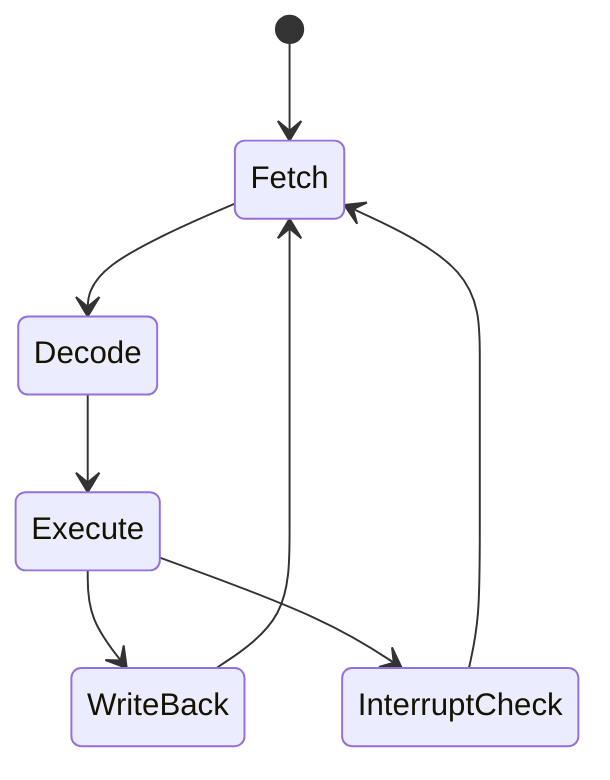
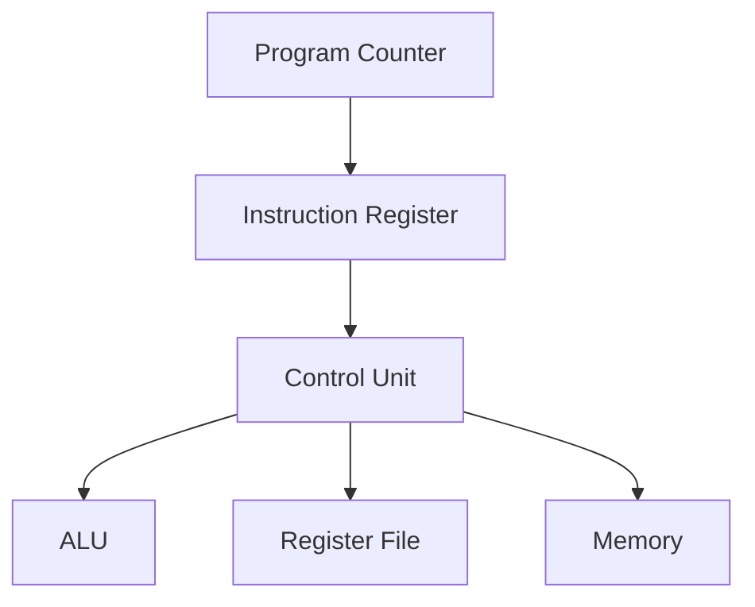

## Syllabus Position

**Subject:** [[Computer Organization and Architecture Index]]
**Parent Topic:** [[Instruction Set Architecture]]
**Sibling Topics:** [[Machine Instructions]], [[Addressing Modes]], [[Data Path]], [[Control Unit]]
**Leads To:** [[Pipelining]], [[Interrupts]], [[Microprogramming]], [[Hazards]]

**GATE Syllabus Line:** Computer Organization and Architecture - Machine instructions and addressing modes, ALU, data-path and control unit.

**Exam Weight Note:** Appears frequently as 1-mark MCQs on fetch/decode order, register role, and control signals, and as 2-mark NAT questions when students must trace a full instruction through PC, IR, memory, and execution units.

---

## The Problem This Solves

A CPU does not understand a program as one giant block. It must repeatedly find the next instruction, figure out what it means, obtain the required operands, perform the operation, and then decide where to go next. The instruction cycle is the disciplined loop that makes this possible. Without it, the processor would have no reliable rhythm for moving from one machine instruction to the next.

**Analogy:** The instruction cycle is like reading a recipe line by line: first you find the next line, then you interpret it, then you gather ingredients, then you cook, and finally you move to the next line.

**Core Idea (one sentence):** The instruction cycle is the repeated hardware loop that fetches, decodes, executes, and completes each machine instruction.

---

## Formal Theory

The **[[Instruction Cycle]]** is the sequence of actions the CPU performs to process one machine instruction from start to finish. It is the operational bridge between the program stored in memory and the actual work done by the hardware.

### Main Phases

The classic cycle has four core phases:

1. **Fetch**: bring the next instruction from memory into the CPU.
2. **Decode**: interpret the opcode and control fields.
3. **Execute**: perform the arithmetic, logical, memory, or branch operation.
4. **Write-back / Store result**: save the result in a register or memory if required.

Some texts also separate **operand fetch** and **interrupt check** as explicit subphases. GATE may include or omit these depending on the wording, so you must read the question carefully.

### Fetch Phase

During fetch, the CPU uses the [[Program Counter]] to locate the next instruction.

Typical micro-steps are:

```text
Algorithm FETCH():
    MAR <- PC
    MDR <- Memory[MAR]
    IR <- MDR
    PC <- PC + 1
```

Here, the **[[Memory Address Register]]** holds the address being accessed, the **[[Memory Data Register]]** holds the word read from memory, and the **[[Instruction Register]]** stores the fetched instruction.

### Decode Phase

In decode, the **[[Control Unit]]** examines the opcode and addressing information inside the instruction register.

```text
Algorithm DECODE(IR):
    opcode <- IR.opcode
    mode <- IR.addressing_mode
    operand_fields <- IR.operands
    generate control signals based on opcode and mode
```

This phase decides what kind of execution path is needed. For example, a register-to-register ADD needs fewer steps than a memory-indirect LOAD.

### Execute Phase

Execution depends on instruction type:

- For arithmetic instructions, the [[ALU]] performs the operation.
- For load/store instructions, memory access occurs.
- For branch instructions, the [[Program Counter]] may be replaced by a target address.

### Write-Back Phase

If the instruction produces a result, the CPU writes it back to a register or memory location.

For example, after `ADD R1, R2`, the ALU result may be written to `R1`. For `STORE`, the result is written to memory instead.

### Interrupt Check and Next Instruction Selection

After or between instructions, the CPU may check for an **[[Interrupt]]**. If an interrupt is pending and enabled, control transfers to the interrupt service routine instead of continuing normally. This is why the instruction cycle is a loop with decision points, not just a straight line.

### Cycle as a State Machine

The whole process can be seen as a simple state machine:



### What GATE Actually Tests Here

GATE often tests the exact role of PC, IR, MAR, MDR, and the control unit; the ordering of fetch/decode/execute; and whether the PC is incremented during fetch or after execution. Another common angle is identifying which phase uses the ALU or which phase needs memory access.

---

## Diagrams and Visuals

### Visual 1: Instruction Cycle Loop

**How to draw it:** Draw a circle with four labeled nodes: Fetch, Decode, Execute, Write-back.

```text
Fetch -> Decode -> Execute -> Write-back -> Fetch
```

**Labels:**
- `Fetch`: gets next instruction.
- `Decode`: interprets fields.
- `Execute`: does the work.
- `Write-back`: commits result.

### Visual 2: Register Transfer During Fetch

**How to draw it:** Show arrows from PC to MAR, memory to MDR, MDR to IR, and PC incrementing.

```text
PC -> MAR -> Memory -> MDR -> IR
  \---------------------> PC + 1
```

**Labels:**
- `PC`: next instruction address.
- `MAR`: memory address being accessed.
- `MDR`: memory word just read.
- `IR`: current instruction.

### Visual 3: Control Path and Data Path Split

**How to draw it:** Draw a control unit above and a datapath below. Show opcode going up to control, and control signals going down to ALU/registers/memory.



**Labels:**
- `Control Unit`: interprets instruction.
- `ALU`: computes.
- `Register File`: supplies operands.
- `Memory`: provides instruction or data.

### Visual 4: Branching Instruction Cycle

**How to draw it:** Show a branch instruction either updating PC normally or replacing it with target address.

```text
Decode branch
  |-- condition false -> PC already points to next instruction
  |-- condition true  -> PC <- target address
```

**Labels:**
- `condition`: branch test.
- `target address`: destination if branch is taken.

---

## Complexity Analysis

The instruction cycle is a bounded hardware process, so the asymptotic cost per instruction is constant. The important GATE distinction is the number of micro-operations and memory references required by different instruction types.

### Time Cost by Instruction Type

- **Simple register instruction:** fetch, decode, execute, write-back. Few steps, all constant.
- **Memory operand instruction:** fetch, decode, effective address calculation, memory access, execute, write-back. More steps, still constant.
- **Branch instruction:** fetch, decode, compare condition, possibly update PC. Still constant.

So for one instruction,

$$
T = O(1)
$$

### Best, Average, Worst Cases

- **Best case:** register-register ALU instruction with no memory operand fetch.
- **Average case:** typical instruction with one extra operand lookup or store.
- **Worst case:** indirect or memory-heavy instruction with additional address resolution and memory access.

### Space Cost

- **Auxiliary space:** $O(1)$, since the CPU uses a fixed set of registers such as [[Program Counter]], [[Instruction Register]], [[Memory Address Register]], and [[Memory Data Register]].
- **Instruction storage:** proportional to program length; that is unrelated to the cycle itself but important in code size questions.

### Complexity Summary Table

| Case         | Time Complexity | Space Complexity | Trigger Condition |
|--------------|-----------------|------------------|------------------|
| Best Case    | $O(1)$          | $O(1)$           | Simple register instruction |
| Average Case | $O(1)$          | $O(1)$           | Typical instruction with one operand access |
| Worst Case   | $O(1)$          | $O(1)$           | Memory or indirect operand plus branch decision |

---

## Worked Example

Consider the instruction `ADD R1, R2` and assume:

```text
PC = 200
R1 = 5
R2 = 7
```

### Step 1: Fetch

- `MAR <- PC = 200`
- Memory returns the instruction word.
- `IR <- instruction`
- `PC <- 201`

State:

```text
PC = 201, IR = ADD R1, R2, R1 = 5, R2 = 7
```

### Step 2: Decode

- Control unit sees opcode `ADD`.
- It recognizes register-register arithmetic.
- No effective address calculation is needed.

State:

```text
PC = 201, decoded operation = ADD, operands = R1 and R2
```

### Step 3: Execute

- ALU computes $5 + 7 = 12$.

State:

```text
ALU result = 12
```

### Step 4: Write-back

- `R1 <- 12`

Final state:

```text
PC = 201, R1 = 12, R2 = 7
```

Total operations: one instruction fetch, one decode, one ALU execution, and one register write-back. This confirms the $O(1)$ claim because each step is bounded and does not depend on input size.

What changes if the instruction is `LOAD R1, (R2)`? The cycle gains an effective address step and at least one extra memory read. What changes if a branch is taken? The PC update comes from the target address rather than simple increment.

---

## Intuition Anchors

### The Analogy (restated and deepened)

Think of the CPU as a very fast reader following a loop: open the next page, read the line, do what it says, mark the result, then move on. If the line says "turn to page 50," the reader does not continue normally; it jumps. That is exactly how the instruction cycle works with branches and interrupts. The flow is repetitive, but the details of each step depend on the instruction.

### The Mental Model

An expert pictures two lanes at once. The control lane decides what happens next, while the data lane moves bits through registers, the ALU, and memory. If you can track `PC -> IR -> decode -> execute -> PC` while also remembering where the data came from, you can solve almost any instruction-cycle question.

### The One-Line Recall

Instruction cycle = fetch the instruction with `PC`, decode it in `IR`, execute it through the datapath, write back the result, and repeat.

### The #1 Trap

Students often think the PC is updated only after the instruction fully executes. In many standard descriptions, the PC is incremented during fetch so the CPU already points to the next sequential instruction before execution begins. GATE uses this to test branch targets and relative addressing.

---

## GATE Questions

**Question 1 - GATE-style - 1-mark**

> Which register typically holds the address of the next instruction to be fetched?

- (A) IR
- (B) MAR
- (C) PC
- (D) MDR

<details>
<summary>Solution</summary>

**Answer: (C)**

**Reasoning:**

The [[Program Counter]] stores the address of the next instruction. MAR temporarily holds the memory address currently being accessed, IR holds the current instruction, and MDR holds the memory word being transferred.

Wrong options:

- (A) IR holds the instruction, not the address.
- (B) MAR holds the address used for memory access, but not the program sequence pointer.
- (D) MDR holds data read from or written to memory.

**What this question is really testing:** The role of core CPU registers in the fetch phase.

**Trap to avoid:** Confusing the next-instruction pointer with the memory-access address register.

</details>

---

**Question 2 - Conceptual / Numerical - 2-mark**

> In a standard instruction cycle, which phase is most directly responsible for determining whether an instruction is arithmetic, branch, or memory access?

- (A) Fetch
- (B) Decode
- (C) Write-back
- (D) Interrupt handling

<details>
<summary>Solution</summary>

**Answer: (B)**

**Reasoning:**

Decode examines the opcode and control bits in the instruction register. That is where the processor decides what kind of operation the instruction represents and what datapath resources are required.

Why others are wrong:

- (A) Fetch only brings the instruction into the CPU.
- (C) Write-back saves the result after the decision has already been made.
- (D) Interrupt handling is separate and optional.

**What this question is really testing:** Separation of fetch and decode responsibilities.

**Trap to avoid:** Assuming the opcode is interpreted during fetch rather than decode.

</details>

---

**Question 3 - Hard / Multi-concept - 2-mark**

> An instruction uses register-indirect addressing. Which additional step, beyond a simple register-register ALU operation, is required in the instruction cycle?

- (A) No extra step
- (B) Effective address calculation and memory access
- (C) Only branch target update
- (D) Only instruction fetch and write-back

<details>
<summary>Solution</summary>

**Answer: (B)**

**Reasoning:**

Register-indirect addressing means a register stores the memory address of the operand. The CPU must therefore read the register, use it as an effective address, and access memory before or during execution.

Why others are wrong:

- (A) is false because indirect addressing is not a direct register-register operation.
- (C) applies to branches, not register-indirect operands.
- (D) ignores operand retrieval.

**What this question is really testing:** How addressing modes alter the execution portion of the cycle.

**Trap to avoid:** Thinking the register value itself is the operand.

</details>

**Pattern Recognition:**

- If GATE asks for register roles, answer using fetch-phase logic.
- If it asks which phase identifies operation type, the answer is decode.
- If it asks about branch target or PC change, think execute or branch resolution.
- If it mentions indirect addressing, expect an extra memory access during the cycle.

---

## Edge Cases and Failure Modes

- [ ] **Input of size $0$ or $1$:** Students may think the instruction cycle disappears for tiny programs. Actual behavior: the cycle still runs for each instruction. Fix: think in instructions, not in program length only.
- [ ] **All instructions identical in format:** Students think decode is trivial and irrelevant. Actual behavior: decode still determines operation and control signals. Fix: separate fixed format from fixed semantics.
- [ ] **Already fetched next instruction:** Students forget that `PC` may increment during fetch. Fix: track when `PC` changes in the chosen machine model.
- [ ] **Branch instruction:** Students assume execute just means ALU arithmetic. Actual behavior: execute may update `PC` conditionally. Fix: treat control transfer as execution.
- [ ] **Interrupt arrival:** Students ignore asynchronous events. Actual behavior: interrupt can divert control after instruction completion or at a safe point. Fix: include interrupt check as a possible cycle extension.
- [ ] **Topic-specific failure - confusing MAR and MDR:** Students swap address and data registers. Fix: `MAR` holds the address, `MDR` holds the data.

---

## Comparisons

| Feature              | [[Instruction Cycle]] | [[Machine Instructions]] | [[Pipelining]] |
|----------------------|-----------------------|--------------------------|----------------|
| Time Complexity      | $O(1)$ per instruction | $O(1)$ per instruction   | Improves throughput, not single-cycle cost |
| Space Complexity     | $O(1)$                | $O(1)$                   | Extra pipeline registers |
| Key Property         | Repeated fetch-decode-execute loop | Binary command format | Overlaps multiple instruction cycles |
| When to Prefer       | When tracing execution order | When analyzing format and opcode fields | When analyzing performance and hazards |
| GATE Trap            | Mixing fetch order with PC update | Mixing opcode with addressing mode | Thinking pipelining reduces latency per instruction |

The most common GATE question comparing these is: "Which phase does what, and what happens to the PC?" The answer hinges on the difference between fetching an instruction, interpreting it, and executing control-flow changes.

---

## Connections Web

### Must know before this topic:

- [[Machine Instructions]] - the cycle processes encoded instructions.
- [[Addressing Modes]] - operand resolution happens during execution.
- [[Program Counter]] - selects the next instruction.
- [[Instruction Register]] - stores the current instruction.

### Topics that build on this:

- [[Pipelining]] - overlaps multiple instruction cycles.
- [[Interrupts]] - may interrupt the normal cycle.
- [[Microprogramming]] - implements cycle steps using microinstructions.
- [[Hazards]] - appear when cycle steps overlap.

### GATE subject cross-links:

- [[Computer Organization and Architecture Index]] > [[Instruction Set Architecture]]
- [[Computer Organization and Architecture Index]] > [[Data Path]]

### Cross-subject connections:

- [[Operating Systems]] - interrupts and context switching depend on instruction-cycle state.
- [[Compiler Design]] - generated code is ultimately consumed one instruction cycle at a time.
- [[Digital Logic]] - control signals in the cycle are implemented using combinational and sequential logic.

### Standard references:

- [[Computer Organization and Design]]
- [[M. Morris Mano]]
- [[Hamacher]]

---

## Quick Revision Sheet

**Definition (1 sentence):** The instruction cycle is the repeated hardware loop that fetches, decodes, executes, and completes each machine instruction.

**Core Idea / Analogy (1 sentence):** It is the CPU's read-do-repeat rhythm, like following one recipe line at a time.

**Algorithm Steps (numbered, maximum 6 steps):**
1. Fetch the next instruction using `PC`.
2. Load it into `IR` and increment `PC`.
3. Decode opcode and mode.
4. Compute effective address if needed.
5. Execute and write back.
6. Check branch/interrupt and repeat.

**Complexity:**
- Time (best / average / worst): $O(1)$ / $O(1)$ / $O(1)$
- Space: $O(1)$ auxiliary
- Recurrence (if applicable): Not applicable; this is a bounded hardware loop.

**Key Properties (3 to 5 bullet points - facts GATE tests directly):**
- `PC` points to the next instruction.
- `IR` holds the current instruction.
- `MAR` holds the address being accessed.
- `MDR` holds the data read from or written to memory.
- Decode decides the control path.

**The #1 Trap:** Do not mix up fetch, decode, and execute, especially the moment when `PC` changes.

**When to use this over alternatives:** Use this topic for questions about instruction sequencing, register roles, control signals, and branch behavior.

**Mnemonic or one-liner to remember the steps:** `Fetch -> Decode -> Execute -> Write-back -> Repeat`.

---

## Revision Checklist

- [ ] I can state the formal definition without looking.
- [ ] I can explain the analogy and map it to the algorithm or concept.
- [ ] I can trace a 6-element example by hand in under 2 minutes.
- [ ] I can derive the worst-case complexity from scratch.
- [ ] I know what the Quick Revision Sheet says without reading it.
- [ ] I can solve all 3 GATE questions in this note without peeking.
- [ ] I know the #1 trap and can articulate why students fall for it.
- [ ] I have linked this note correctly in my Obsidian vault.
- [ ] I have scheduled a spaced-repetition review in 3 days.
