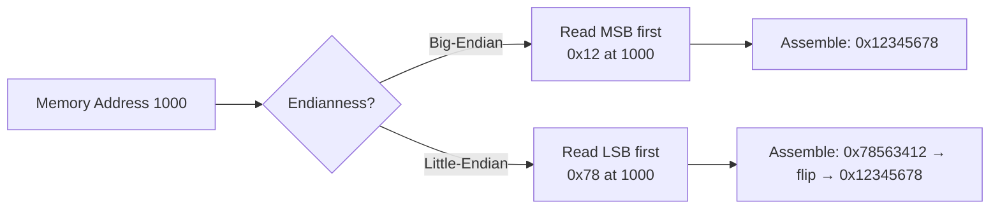

## Syllabus Position

**Subject:** [[Computer Organization and Architecture Index]]
**Parent Topic:** [[Memory Organization]]
**Sibling Topics:** [[Memory Addressing]], [[Word Alignment]], [[Memory Hierarchy]]
**Leads To:** [[Data Transfer Protocols]], [[Network Byte Order]], [[Cross-Platform Data Structures]]

**GATE Syllabus Line:** Computer Organization and Architecture — Memory hierarchy (cache, main memory, secondary storage); I/O interface (interrupt and DMA mode)

**Exam Weight Note:** Appears frequently as 1-mark MCQs on address calculation and byte ordering, and occasionally as 2-mark NAT questions requiring hex-to-decimal conversions with endianness consideration. Critical for questions involving memory dumps and data structure representation.

---

## The Problem This Solves

When a computer stores a multi-byte value (like a 32-bit integer or a 64-bit pointer) in memory, it must decide **in what order to arrange the individual bytes**. Should the most significant byte come first, or the least significant byte? Different computer architectures made different choices, leading to two competing standards.

**Analogy:** Imagine writing the year 2026. In most cultures, you write the most significant digit first: 2-0-2-6 (big-endian). But imagine a culture that writes numbers backwards: 6-2-0-2 (little-endian). Both represent the same value, but if you don't know the convention, you'll misinterpret the number. The same problem exists when computers exchange data.

**Core Idea (one sentence):** Endianness defines whether a multi-byte value is stored with its most significant byte at the lowest memory address (big-endian) or its least significant byte at the lowest memory address (little-endian).

---

## Formal Theory

### Definition

**Endianness** is the sequential order in which bytes are arranged in computer memory when representing multi-byte data types (integers, floating-point numbers, pointers, etc.).

There are two primary conventions:

1. **[[Big-Endian]]**: The **most significant byte (MSB)** is stored at the **lowest memory address**.
2. **[[Little-Endian]]**: The **least significant byte (LSB)** is stored at the **lowest memory address**.

### Mathematical Representation

Consider a 32-bit integer value:
$$\text{Value} = 0x12345678_{16} = 305419896_{10}$$

This value consists of 4 bytes:
- Byte 0 (MSB): `0x12`
- Byte 1: `0x34`
- Byte 2: `0x56`
- Byte 3 (LSB): `0x78`

### Big-Endian Storage

In **big-endian** format, bytes are stored from most significant to least significant:

| Memory Address | Byte Value | Significance |
|----------------|------------|--------------|
| 1000           | 0x12       | MSB          |
| 1001           | 0x34       |              |
| 1002           | 0x56       |              |
| 1003           | 0x78       | LSB          |

**Reading order matches intuitive human reading:** left to right, high to low.

### Little-Endian Storage

In **little-endian** format, bytes are stored from least significant to most significant:

| Memory Address | Byte Value | Significance |
|----------------|------------|--------------|
| 1000           | 0x78       | LSB          |
| 1001           | 0x56       |              |
| 1002           | 0x34       |              |
| 1003           | 0x12       | MSB          |

**Reading order is reversed:** the "little end" (LSB) comes first.

### Architecture Examples

**Big-Endian Architectures:**
- Motorola 68000 series
- SPARC
- IBM mainframes
- Network protocols (TCP/IP stack uses **network byte order** which is big-endian)

**Little-Endian Architectures:**
- Intel x86 and x86-64 (most PCs and servers)
- AMD processors
- Most ARM processors in little-endian mode
- RISC-V (typically little-endian)

**Bi-Endian Architectures:**
- ARM (can be configured for either mode)
- PowerPC
- MIPS
- RISC-V (supports both, but defaults to little-endian)

### Formal Conversion Algorithm

To convert a multi-byte value from one endianness to another:

```
Algorithm SWAP_ENDIANNESS(value, num_bytes):
    result = 0
    for i from 0 to num_bytes - 1:
        byte = (value >> (i * 8)) & 0xFF
        result = result | (byte << ((num_bytes - 1 - i) * 8))
    return result
```

### What GATE Actually Tests Here

GATE focuses on:
1. **Given a value and memory address, determine the byte layout for each endianness**
2. **Given a memory dump, determine the actual value under big-endian vs little-endian interpretation**
3. **Understanding why network protocols use big-endian**
4. **Calculating addresses of specific bytes within multi-byte words**
5. **Byte swapping operations and their time complexity**

---

## Diagrams and Visuals

### Visual 1: Multi-Byte Storage Comparison

**Drawing Instructions:** Draw two columns side by side. Each column has 4 boxes stacked vertically representing memory addresses 1000-1003. Label left column "Big-Endian" and right column "Little-Endian". For the value `0x12345678`, fill in the boxes accordingly.

```
Value: 0x12345678

BIG-ENDIAN                    LITTLE-ENDIAN
Address | Value               Address | Value
--------|------               --------|------
1000    | 12  ← MSB          1000    | 78  ← LSB
1001    | 34                  1001    | 56
1002    | 56                  1002    | 34
1003    | 78  ← LSB          1003    | 12  ← MSB
        ↓                             ↑
   High → Low                    Low → High
```

### Visual 2: 16-bit Value Storage

For a 16-bit value `0xABCD` stored at address `2000`:

```
BIG-ENDIAN                    LITTLE-ENDIAN
Address | Value               Address | Value
--------|------               --------|------
2000    | AB  (MSB)          2000    | CD  (LSB)
2001    | CD  (LSB)          2001    | AB  (MSB)
```

### Visual 3: Memory Read Operation

**Mermaid Diagram:** Shows how CPU reads a 32-bit value



### Visual 4: Network Data Transfer

```
Sender (Little-Endian x86)        Network (Big-Endian)        Receiver (Big-Endian SPARC)
Value: 0x12345678                                             Value: 0x12345678
Memory: [78|56|34|12]  ───htonl()───> [12|34|56|78] ───────> Memory: [12|34|56|78]
                       (convert to                           (no conversion
                        network order)                        needed)
```

---

## Complexity Analysis

Endianness is a **storage convention**, not an algorithm, so traditional complexity analysis doesn't directly apply. However, we analyze the **computational cost** of endianness-related operations:

### Byte Swapping (Endianness Conversion)

**Operation:** Converting a value from one endianness to another

**Time Complexity:**

For an $n$-byte value:
- **Naive approach:** $O(n)$ — requires iterating through each byte, extracting it, and repositioning it
- **Optimized approach (for fixed sizes):** $O(1)$ — modern CPUs provide dedicated instructions:
  - x86: `BSWAP` (byte swap) instruction
  - ARM: `REV` (reverse bytes) instruction
  - These execute in a single CPU cycle

**Derivation for naive approach:**
```
for i = 0 to n-1:           // n iterations
    extract byte[i]          // O(1) shift and mask
    reposition byte[i]       // O(1) shift and OR
Total: n × O(1) = O(n)
```

**Space Complexity:** $O(1)$ — only requires a temporary variable to hold the result

### Memory Access Operations

**Reading/Writing multi-byte values:**
- **Time Complexity:** $O(1)$ — regardless of endianness, reading or writing a word is a single memory operation
- The CPU's [[Memory Management Unit (MMU)]] handles byte ordering transparently
- **However:** Cross-platform data serialization requires explicit conversion: add $O(n)$ per multi-byte field

### Complexity Summary Table

| Operation                    | Time Complexity | Space Complexity | Notes                                    |
|------------------------------|-----------------|------------------|------------------------------------------|
| Store multi-byte value       | $O(1)$          | $O(1)$           | Native architecture handles ordering     |
| Load multi-byte value        | $O(1)$          | $O(1)$           | Native architecture handles ordering     |
| Byte swap (naive)            | $O(n)$          | $O(1)$           | $n$ = number of bytes in value           |
| Byte swap (hardware)         | $O(1)$          | $O(1)$           | Single CPU instruction (BSWAP, REV)      |
| Network serialization        | $O(k \cdot n)$  | $O(1)$           | $k$ = number of multi-byte fields        |

---

## Worked Example

### Problem
Given the 32-bit hexadecimal value `0xDEADBEEF` stored starting at memory address `0x1000`, show:
1. The byte-by-byte layout in both big-endian and little-endian
2. The value read if we interpret little-endian storage as big-endian
3. The byte swap operation to convert between them

### Solution

**Step 1: Break down the value into bytes**

Value: `0xDEADBEEF`
- Byte 0 (MSB): `0xDE`
- Byte 1: `0xAD`
- Byte 2: `0xBE`
- Byte 3 (LSB): `0xEF`

**Step 2: Big-Endian Layout**

In big-endian, MSB goes to the lowest address:

| Address | Byte Value | Decimal | Binary      |
|---------|------------|---------|-------------|
| 0x1000  | 0xDE       | 222     | 11011110    |
| 0x1001  | 0xAD       | 173     | 10101101    |
| 0x1002  | 0xBE       | 190     | 10111110    |
| 0x1003  | 0xEF       | 239     | 11101111    |

**Reading from memory (left to right):** `DE AD BE EF` — matches the original value directly.

**Step 3: Little-Endian Layout**

In little-endian, LSB goes to the lowest address:

| Address | Byte Value | Decimal | Binary      |
|---------|------------|---------|-------------|
| 0x1000  | 0xEF       | 239     | 11101111    |
| 0x1001  | 0xBE       | 190     | 10111110    |
| 0x1002  | 0xAD       | 173     | 10101101    |
| 0x1003  | 0xDE       | 222     | 11011110    |

**Reading from memory (left to right):** `EF BE AD DE` — appears reversed.

**Step 4: Cross-Interpretation Error**

If we store `0xDEADBEEF` in little-endian format (as shown above) but then read it on a big-endian machine **without conversion**, the machine reads bytes in order:
- Byte at 0x1000 = `0xEF` → interpreted as MSB
- Byte at 0x1001 = `0xBE`
- Byte at 0x1002 = `0xAD`
- Byte at 0x1003 = `0xDE` → interpreted as LSB

Resulting value: `0xEFBEADDE` ❌ **Wrong!**

**Verification:**
- Original: `0xDEADBEEF` = 3,735,928,559 (decimal)
- Misread: `0xEFBEADDE` = 4,022,250,974 (decimal)
- Difference: 286,322,415 (significant error!)

**Step 5: Byte Swap Operation**

To convert from little-endian to big-endian (or vice versa), we swap the byte order:

**Manual byte extraction and repositioning:**

```
Original value: 0xDEADBEEF

Extract bytes:
  Byte 0: (0xDEADBEEF >> 24) & 0xFF = 0xDE
  Byte 1: (0xDEADBEEF >> 16) & 0xFF = 0xAD
  Byte 2: (0xDEADBEEF >> 8)  & 0xFF = 0xBE
  Byte 3: (0xDEADBEEF >> 0)  & 0xFF = 0xEF

Reposition (reverse order):
  Result = (0xEF << 24) | (0xBE << 16) | (0xAD << 8) | (0xDE << 0)
         = 0xEF000000 | 0x00BE0000 | 0x0000AD00 | 0x000000DE
         = 0xEFBEADDE
```

**Using bitwise operations (efficient approach):**

```
x = 0xDEADBEEF

Step 1: Swap adjacent bytes within 16-bit pairs
  x = ((x & 0xFF00FF00) >> 8) | ((x & 0x00FF00FF) << 8)
  x = ((0xDE00BE00) >> 8) | ((0x00AD00EF) << 8)
  x = 0x00DE00BE | 0xAD00EF00
  x = 0xADDEEFBE

Step 2: Swap 16-bit halves
  x = (x >> 16) | (x << 16)
  x = 0x0000ADDE | 0xEFBE0000
  x = 0xEFBEADDE
```

**Total operations:** 6 bitwise operations (2 shifts, 2 ANDs, 2 ORs) = $O(1)$ time.

**Edge case follow-up:** What changes if the input is a 16-bit value like `0xABCD`?

**Answer:** Only 2 bytes need swapping. Store `0xABCD`:
- Big-endian: `[AB][CD]`
- Little-endian: `[CD][AB]`

Byte swap: `((0xABCD >> 8) & 0xFF) | ((0xABCD & 0xFF) << 8) = 0xCDAB`. The operation simplifies to a single 8-bit shift in each direction — still $O(1)$.

---

## Intuition Anchors

### The Analogy (restated and deepened)

Endianness is like writing dates: Americans write month-day-year (12/25/2026), Europeans write day-month-year (25/12/2026), and ISO standard writes year-month-day (2026-12-25). Each convention is internally consistent, but if you don't know which system someone is using, you'll misinterpret the date.

Similarly, both big-endian and little-endian are perfectly valid ways to store multi-byte values. Big-endian is "intuitive" because it matches how humans write numbers (most significant digit first). Little-endian is "hardware-friendly" because when you increment a value, the least significant byte—stored first—is the one most likely to change, allowing for faster carry propagation in [[Ripple Carry Adders]].

The complexity arises not from using one system or the other, but from **mixing** systems without conversion—just like misreading a date.

### The Mental Model

When I see a memory dump question, I immediately:
1. **Identify the byte boundary** — where does the multi-byte value start?
2. **Visualize the value as a sequence of bytes** — break `0x12345678` into `[12][34][56][78]`
3. **Apply the endianness rule as a direction arrow:**
   - Big-endian: arrow points left-to-right (MSB → LSB), same as writing
   - Little-endian: arrow points right-to-left (LSB → MSB), reversed
4. **For conversions:** I picture physically flipping the byte array — the first byte becomes last, second becomes second-to-last, etc.

### The One-Line Recall

**"Big-endian stores the big end (MSB) first at the lowest address; little-endian stores the little end (LSB) first — network protocols use big-endian (network byte order), Intel x86 uses little-endian."**

This sentence encodes:
- The definition of both conventions
- The mnemonic ("big end first" vs "little end first")
- The two most important real-world examples for GATE

### The #1 Trap

**The Trap:** Students see a memory dump like `[78][56][34][12]` and assume the value is `0x78563412` without considering endianness.

**Why it seems right:** Reading left-to-right, the bytes appear in that order, so it feels natural to concatenate them directly.

**The Correction:** You must **first know the architecture's endianness** before interpreting memory contents. If this is from a little-endian machine (like x86), the bytes are stored in reverse significance order, so the actual value is `0x12345678`—you must reverse the byte order before interpreting. The memory layout `[78][56][34][12]` tells you the **physical storage order**, not the **logical value**.

**How to avoid:** Always write down: "Architecture = ?, therefore MSB is at address ?". Force yourself to identify which byte is most significant before doing any calculation.

---

## GATE Questions

---

**Question 1 — PYQ: GATE 2015 — 1-mark**

> A computer uses little-endian byte ordering. The hexadecimal value `0x1234` is stored starting at memory address `0x5000`. What will be the content at memory address `0x5001`?

- (A) `0x12`
- (B) `0x34`
- (C) `0x56`
- (D) `0x00`

<details>
<summary>Solution</summary>

**Answer: (A)**

**Reasoning:**

Value: `0x1234` is a 16-bit (2-byte) value.

Break into bytes:
- Byte 0 (MSB): `0x12`
- Byte 1 (LSB): `0x34`

In **little-endian**, LSB is stored at the lowest address:
- Address `0x5000`: `0x34` (LSB)
- Address `0x5001`: `0x12` (MSB)

Therefore, the content at `0x5001` is `0x12`.

**Eliminate wrong options:**
- **(B) `0x34`:** This would be correct for big-endian, where MSB comes first. But we're using little-endian. ❌
- **(C) `0x56`:** This value doesn't exist in `0x1234`. ❌
- **(D) `0x00`:** No byte in the value is zero. ❌

**What this question is really testing:** Understanding that little-endian stores the least significant byte first, requiring you to reverse the "natural" reading order.

**Trap to avoid:** Assuming that the byte order in memory matches the hexadecimal representation as written. Students who pick (B) are thinking in big-endian terms.

</details>

---

**Question 2 — GATE-style Numerical — 2-mark**

> A 32-bit integer with value `305419896` (decimal) is stored at memory address `0x2000` in a big-endian system. If the same memory block (4 bytes starting at `0x2000`) is interpreted on a little-endian system **without any byte reordering**, what decimal value will be read?

<details>
<summary>Solution</summary>

**Answer: 2018915346**

**Reasoning:**

**Step 1:** Convert decimal to hexadecimal:
$305419896_{10} = 0x12345678_{16}$

**Step 2:** Big-endian storage at `0x2000`:

| Address | Byte  |
|---------|-------|
| 0x2000  | 0x12  |
| 0x2001  | 0x34  |
| 0x2002  | 0x56  |
| 0x2003  | 0x78  |

**Step 3:** Little-endian machine reads these bytes in the same physical order but interprets them with reversed significance:
- Byte at `0x2000` (`0x12`) → interpreted as **LSB**
- Byte at `0x2001` (`0x34`)
- Byte at `0x2002` (`0x56`)
- Byte at `0x2003` (`0x78`) → interpreted as **MSB**

Resulting value: `0x78563412`

**Step 4:** Convert to decimal:
$$0x78563412 = 7 \times 16^7 + 8 \times 16^6 + 5 \times 16^5 + 6 \times 16^4 + 3 \times 16^3 + 4 \times 16^2 + 1 \times 16^1 + 2 \times 16^0$$

Using direct conversion:
$$0x78563412 = 2018915346_{10}$$

**What this question is really testing:** The ability to trace through cross-platform data interpretation errors and perform hex-to-decimal conversion with careful attention to byte positioning.

**Trap to avoid:** Forgetting that reading bytes from memory is a physical operation independent of endianness—the bytes don't magically rearrange themselves when you move the storage device to a different computer.

</details>

---

**Question 3 — Conceptual / Multi-concept — 2-mark**

> A network packet contains a 32-bit IPv4 address `192.168.1.100`. This packet is created on a little-endian machine (x86) and transmitted over the network. The receiving machine is big-endian. Which of the following statements is correct?

- (A) The sending machine must use `htonl()` to convert to network byte order before transmission; the receiving machine needs no conversion
- (B) Neither machine needs to perform any conversion as both use 32-bit addressing
- (C) The sending machine needs no conversion, but the receiving machine must use `ntohl()`
- (D) Both machines must perform byte swapping

<details>
<summary>Solution</summary>

**Answer: (A)**

**Reasoning:**

**Key concept:** Network protocols (TCP/IP) use **big-endian byte order** by convention, called **[[Network Byte Order]]**.

**Breakdown:**

**Sender (little-endian x86):**
- IPv4 address `192.168.1.100` in hex: `0xC0A80164`
- In little-endian memory: `[64][01][A8][C0]`
- **Must convert to network byte order (big-endian)** using `htonl()` (host-to-network long)
- After conversion: `[C0][A8][01][64]` — ready for transmission

**Network transmission:**
- Bytes are transmitted in order: `C0 A8 01 64`
- This is big-endian format

**Receiver (big-endian SPARC):**
- Receives bytes: `C0 A8 01 64`
- Stores them in memory: `[C0][A8][01][64]`
- **This is already in big-endian format** (matches network byte order)
- **No conversion needed** — can use the value directly

**Eliminate wrong options:**

- **(B) Neither machine needs conversion:** Wrong. The little-endian sender's native format doesn't match network byte order. If no conversion is done, the address would be transmitted as `64 01 A8 C0`, resulting in `100.1.168.192` at the receiver—wrong address! ❌

- **(C) Sending machine needs no conversion:** Wrong. The x86 (little-endian) sender must convert to big-endian network byte order. ❌

- **(D) Both machines must perform byte swapping:** Wrong. The big-endian receiver's native format matches network byte order, so no conversion is needed. ❌

**What this question is really testing:** Understanding of network byte order convention and knowing which architectures need conversion when communicating over networks.

**Trap to avoid:** Assuming that because both machines can address 32 bits, they'll automatically interpret the bytes the same way. Endianness is about byte order, not addressability.

</details>

---

**Pattern Recognition:**

- **Memory dump questions:** Always explicitly determine which byte is the MSB and which is the LSB before reading left-to-right. Draw a table.
- **Cross-platform questions:** If two different architectures are mentioned, endianness conversion is almost certainly the point of the question.
- **Network questions:** TCP/IP always uses big-endian (network byte order). Little-endian machines must convert; big-endian machines don't.
- **Hex-to-decimal conversions:** These are paired with endianness to create multi-step numerical problems. Break the hex into bytes first, apply endianness, then convert.

---

## Edge Cases and Failure Modes

- [ ] **Single-byte values (8-bit char, uint8_t):** Endianness is irrelevant for single-byte values because there's no ordering ambiguity. A byte is a byte. Students waste time considering endianness for `char` arrays—don't.

- [ ] **Bit ordering vs byte ordering:** Endianness defines **byte order within multi-byte values**, not bit order within a byte. Bits within a byte are always numbered the same way (bit 7 = MSB, bit 0 = LSB) regardless of endianness. **Trap:** Questions about [[Bit Fields]] in structs—endianness affects field order, but within each byte, bits maintain standard ordering.

- [ ] **Byte arrays vs multi-byte integers:** A `char buffer[4] = {0x12, 0x34, 0x56, 0x78}` is stored as `[12][34][56][78]` regardless of endianness—it's just an array of bytes. But `int value = 0x12345678` will be stored as `[12][34][56][78]` (big-endian) or `[78][56][34][12]` (little-endian). **Fix:** Recognize that arrays don't have "significance" ordering—only multi-byte atomic values do.

- [ ] **Structure padding and alignment:** When a struct contains multi-byte fields, endianness affects each field individually, but [[Memory Alignment]] padding bytes are unaffected. **Example:** `struct {char c; int i;}` on x86 (little-endian) with 4-byte alignment: `[c][pad][pad][pad][i_byte0][i_byte1][i_byte2][i_byte3]`. The padding is always in the same place; only `i`'s bytes are reversed.

- [ ] **Floating-point values:** IEEE 754 floating-point values (float, double) are **also affected by endianness**. A `double` is 8 bytes—those 8 bytes follow the same endianness rules as integers. **Trap:** Students assume floating-point is "special" and endianness doesn't apply. **Correction:** All multi-byte values are affected.

- [ ] **Middle-endian (PDP-endian):** Rare historical format (PDP-11) where 16-bit words are little-endian but word pairs within 32-bit values are big-endian. Example: `0x12345678` → `[34][12][78][56]`. **GATE relevance:** Essentially zero—focus on big and little only.

- [ ] **Pointer values:** Pointers are just integers (addresses) under the hood. A 64-bit pointer on a little-endian system is stored with the least significant byte first. **Trap:** Assuming pointers are "special" and ignore endianness—they don't.

- [ ] **Shift operations and endianness:** Bitwise shifts (`<<`, `>>`) operate on the **logical value**, not the memory representation. `0x12345678 >> 8` gives `0x00123456` regardless of endianness—the shift works on the value itself, not the byte layout. **Fix:** Separate "value operations" (which are endian-independent) from "memory layout" (which is endian-dependent).

---

## Comparisons

### Big-Endian vs Little-Endian vs Bi-Endian

| Feature                  | Big-Endian                                | Little-Endian                             | Bi-Endian                                   |
|--------------------------|-------------------------------------------|-------------------------------------------|---------------------------------------------|
| **MSB Position**         | Lowest address                            | Highest address                           | Configurable                                |
| **LSB Position**         | Highest address                           | Lowest address                            | Configurable                                |
| **Human Readability**    | High (matches written order)              | Low (reversed)                            | Depends on mode                             |
| **Hardware Efficiency**  | Slightly slower for arithmetic            | Slightly faster for carry propagation     | Flexibility has overhead                    |
| **Network Compatibility**| Native (network byte order is big-endian) | Requires conversion (`htonl`, `ntohl`)    | Requires explicit setting + conversion      |
| **Example Architectures**| SPARC, Motorola 68k, Network protocols    | x86, x86-64, most ARM                     | ARM (switchable), MIPS, PowerPC             |
| **When to Prefer**       | Network protocol implementation           | General-purpose computing (x86 dominance) | Embedded systems requiring protocol support |
| **GATE Trap**            | Assuming all architectures use this       | Forgetting network byte order             | Ignoring which mode is active               |

### The most common GATE question comparing these

**Pattern:** "A value is stored on architecture X and read on architecture Y—what value is obtained?"

**The answer hinges on:** Whether X and Y have the same endianness. If they differ, the byte order is reversed, causing value corruption unless explicit conversion (`htonl`, `ntohl`, or manual byte swapping) is performed.

---

## Connections Web

### Must know before this topic:
- [[Binary Number System]] — understanding of bit significance (MSB, LSB)
- [[Memory Addressing]] — concept of sequential memory addresses
- [[Data Types]] — multi-byte types (int, long, float, double, pointers)
- [[Hexadecimal Number System]] — conversion between hex and binary/decimal

### Topics that build on this:
- [[Network Byte Order]] — TCP/IP protocols mandate big-endian
- [[Data Serialization]] — converting in-memory structures to byte streams
- [[Memory Dumps and Debugging]] — interpreting raw memory in debuggers
- [[Cross-Platform File Formats]] — endian-independent file storage (e.g., BMP, TIFF headers)
- [[DMA (Direct Memory Access)]] — hardware byte-order handling in I/O operations
- [[Type Punning]] — interpreting memory as different types (union-based tricks)

### GATE subject cross-links:
- [[Computer Organization and Architecture Index]] > [[Memory Organization]]
- [[Computer Networks Index]] > [[Application Layer]] (byte order in protocols)
- [[Operating Systems Index]] > [[Memory Management]] (understanding memory layout)

### Cross-subject connections:
- [[Data Link Layer]] — frame headers may require byte order conversion
- [[System Calls]] — `socket()`, `bind()`, `connect()` use network byte order functions
- [[Compiler Design]] — compilers must generate correct byte-order code for target architecture
- [[File Systems]] — on-disk structures (inodes, superblocks) must define endianness for portability

### Standard references:
- [[CLRS Chapter 2]] (not explicitly covered, but foundational for data representation)
- [[Tanenbaum's Structured Computer Organization Chapter 2]] — detailed coverage of memory organization
- [[Computer Organization and Design (Patterson & Hennessy) Chapter 2]] — endianness in MIPS and ARM

---

## Quick Revision Sheet

**Definition (1 sentence):**
Endianness is the byte ordering convention for storing multi-byte values in memory: big-endian stores the most significant byte at the lowest address, little-endian stores the least significant byte at the lowest address.

**Core Idea / Analogy (1 sentence):**
Big-endian is like writing numbers naturally (most significant digit first), while little-endian is like writing numbers backwards—both are valid, but mixing them without conversion causes misinterpretation.

**Key Layouts:**

1. **Value:** `0x12345678`
2. **Big-Endian storage at 0x1000:** `[12][34][56][78]` (MSB first)
3. **Little-Endian storage at 0x1000:** `[78][56][34][12]` (LSB first)

**Byte Swap (Conversion):**
```
Result = ((Value & 0xFF000000) >> 24) |
         ((Value & 0x00FF0000) >> 8)  |
         ((Value & 0x0000FF00) << 8)  |
         ((Value & 0x000000FF) << 24)
```

**Complexity:**
- **Time (byte swap):** $O(n)$ naive, $O(1)$ with hardware instructions (BSWAP, REV)
- **Space:** $O(1)$
- **Memory access:** $O(1)$ regardless of endianness

**Key Properties:**
- **Network byte order is big-endian** — use `htonl()`/`htons()` on little-endian machines before sending, `ntohl()`/`ntohs()` after receiving
- **x86/x86-64 are little-endian** — most PCs and servers
- **Endianness only affects multi-byte values** — single bytes (char) are unaffected
- **Cross-platform data exchange requires explicit conversion** — never assume endianness matches
- **Memory dumps read left-to-right give physical order, not logical value** — must apply endianness to interpret

**The #1 Trap:**
Reading a memory dump as if it's a direct hex representation without considering endianness—always identify which byte is the MSB first.

**When to use big-endian over little-endian:**
Use big-endian for network protocols (it's the standard); use little-endian for x86/ARM targets (hardware native). For portability, store data in a defined format (usually big-endian) and convert on load.

**Mnemonic:**
**"Big-Endian = Big end (MSB) first. Little-Endian = Little end (LSB) first. Network = Big."**

---

## Revision Checklist

- [ ] I can state the formal definition of both big-endian and little-endian without looking.
- [ ] I can explain the analogy (date formats or number writing) and map it to MSB/LSB positioning.
- [ ] I can trace a 4-byte value (e.g., `0xDEADBEEF`) through memory in both endiannesses by hand in under 2 minutes.
- [ ] I can derive the byte swap formula using bitwise operations from scratch.
- [ ] I know what the Quick Revision Sheet says without reading it.
- [ ] I can solve all 3 GATE questions in this note without peeking.
- [ ] I know the #1 trap (assuming memory order = value order) and can articulate why students fall for it.
- [ ] I have linked this note correctly in my Obsidian vault under [[Memory Organization]].
- [ ] I have scheduled a spaced-repetition review in 3 days.
