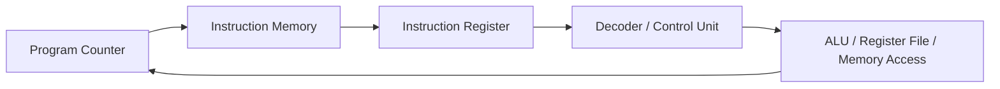

## Syllabus Position

**Subject:** [[Computer Organization and Architecture Index]]
**Parent Topic:** [[Instruction Set Architecture]]
**Sibling Topics:** [[Addressing Modes]], [[ALU]], [[Data Path]], [[Control Unit]]
**Leads To:** [[Instruction Cycle]], [[Pipelining]], [[Microprogramming]], [[RISC vs CISC]]

**GATE Syllabus Line:** Computer Organization and Architecture - Machine instructions and addressing modes, ALU, data-path and control unit.

**Exam Weight Note:** Appears regularly as 1-mark MCQs on instruction format, opcode bits, and address count, and as 2-mark NAT questions where instruction fields must be derived from register count, memory size, or expression evaluation style.

---

## The Problem This Solves

A processor cannot execute an English sentence such as "add these two values and store the result there." It needs a compact, binary command that tells it exactly what operation to perform, where the operands are, and where the result should go. That command must be simple enough for hardware to decode quickly, but expressive enough to support arithmetic, data movement, branching, and memory access. Without a disciplined instruction structure, the CPU would have no reliable way to map bits in memory to actual actions.

**Analogy:** A machine instruction is like a tightly formatted courier slip: one field says what job to do, one field says where to pick up the package, and one field says where to deliver it. If the slip format is ambiguous, the courier cannot act.

**Core Idea (one sentence):** A machine instruction is a binary-encoded command whose fields specify an operation and the operand locations needed for the CPU to execute that operation.

---

## Formal Theory

A **[[Machine Instruction]]** is a binary pattern interpreted by the CPU as a command to perform a specific operation on specified data. It belongs to the processor's **[[Instruction Set Architecture]]**, which defines the legal instructions, their formats, operand conventions, and visible machine behavior.

### Basic Fields of an Instruction

Most instructions are divided into logical fields:

1. **[[Opcode]]**: identifies the operation such as ADD, SUB, LOAD, or JUMP.
2. **[[Operand]] field**: identifies the data or the location of the data.
3. **[[Address]] field**: may hold a memory address, register number, or displacement.
4. **[[Addressing Mode]] field**: tells how the effective operand is obtained.

For a fixed-length instruction of total size $L$ bits,

$$
L = \text{opcode bits} + \text{mode bits} + \text{operand bits}
$$

This is one of the most common GATE calculations: if you know memory size, register count, and number of instructions, you can derive the minimum field widths.

### Opcode and Its Bit Requirement

If the architecture supports $N$ distinct operations, the opcode field must satisfy

$$
\text{opcode bits} \geq \lceil \log_2 N \rceil
$$

This follows because $k$ bits can encode at most $2^k$ distinct patterns. If $N = 90$, then $6$ bits are not enough because $2^6 = 64 < 90$, while $7$ bits work because $2^7 = 128 \geq 90$.

### Operand Specification

Operands can be stored in **[[Register]]s**, in **[[Main Memory]]**, or implicitly in a special register such as the **[[Accumulator]]** or the **[[Stack Pointer]]** environment for stack machines. The number of bits required to name a register depends on how many registers exist.

If there are $R$ registers, then

$$
\text{register field bits} = \lceil \log_2 R \rceil
$$

If memory has $M$ addressable locations, a direct memory address field needs

$$
\text{address bits} = \lceil \log_2 M \rceil
$$

### Classification by Number of Explicit Addresses

This is a favorite GATE comparison because it changes both code length and hardware assumptions.

#### Three-Address Instructions

A **[[Three-Address Instruction]]** explicitly names two source operands and one destination.

Example:

$$
X \leftarrow Y + Z
$$

Assembly style:

```text
ADD X, Y, Z
```

It is easy to understand and often reduces instruction count, but each instruction becomes wider because it must carry more operand fields.

#### Two-Address Instructions

A **[[Two-Address Instruction]]** usually uses one operand as both source and destination.

```text
ADD X, Y   ; X <- X + Y
```

This saves bits compared with three-address format, but it can overwrite one source operand, so extra MOVE instructions are often needed.

#### One-Address Instructions

A **[[One-Address Instruction]]** assumes one operand is implicit, usually the **[[Accumulator]]**.

```text
LOAD A
ADD B
STORE X
```

The instruction is shorter, but programs become longer because repeated LOAD and STORE operations are needed.

#### Zero-Address Instructions

A **[[Zero-Address Instruction]]** is used in stack machines where operands are implicit on the top of the **[[Stack]]**.

```text
PUSH A
PUSH B
ADD
POP X
```

This gives compact instruction formats but shifts complexity into stack discipline and expression ordering.

### Instruction Format Variants

#### Fixed-Length Format

In a **[[Fixed-Length Instruction]]** architecture, every instruction has the same number of bits. Decoding is simpler because the CPU knows exactly where each field lies.

#### Variable-Length Format

In a **[[Variable-Length Instruction]]** architecture, different instructions can occupy different numbers of bytes. This improves code density, but decoding and pipelining become more complex because instruction boundaries are not equally spaced.

### Instruction Categories

Machine instructions are also grouped by purpose:

1. **[[Data Transfer Instruction]]**: LOAD, STORE, MOVE.
2. **[[Arithmetic Instruction]]**: ADD, SUB, MUL, DIV.
3. **[[Logical Instruction]]**: AND, OR, XOR, NOT.
4. **[[Branch Instruction]]**: JUMP, CALL, conditional branch.
5. **[[Shift Instruction]]**: logical and arithmetic shifts.
6. **[[Input Output Instruction]]**: device communication.

GATE often tests whether a student can distinguish operation class from addressing mode. For example, `LOAD R1, 1000` is a data transfer instruction; immediate, direct, or indirect is a separate issue.

### Fetch-Decode-Execute View

An instruction is meaningful only because the processor follows the **[[Instruction Cycle]]**.

```text
Algorithm FETCH_DECODE_EXECUTE(PC):
    MAR <- PC
    MDR <- Memory[MAR]
    IR <- MDR
    PC <- PC + 1
    Decode opcode and operand fields from IR
    Compute effective address if needed
    Fetch operand values if needed
    Execute the specified operation
    Write result back to register or memory
    Update status flags and continue
```

The **[[Program Counter]]** selects the next instruction, the **[[Instruction Register]]** holds the current instruction, and the **[[Control Unit]]** generates control signals after decoding the opcode.

### What GATE Actually Tests Here

GATE rarely asks for a philosophical definition of machine instructions. It usually tests field-width calculation, comparison of $0$-, $1$-, $2$-, and $3$-address instructions, fixed-length versus variable-length tradeoffs, or the relation between instruction format and execution behavior inside the [[Data Path]].

---

## Diagrams and Visuals

### Visual 1: Generic Instruction Format

**How to draw it:** Draw one long rectangle and split it into four labeled boxes: opcode, mode, register field, and address/displacement field.

```text
+--------+------+----------+----------------+
| Opcode | Mode | Register | Address / Disp |
+--------+------+----------+----------------+
```

**Labels:**
- `Opcode`: what action the CPU performs.
- `Mode`: how to interpret the operand.
- `Register`: which register participates.
- `Address / Disp`: memory location or offset.

### Visual 2: Fetch-Decode-Execute Flow

**How to draw it:** Draw a loop from PC to memory to IR to control unit, then to execution units, and back to PC.



**Labels:**
- `PC`: address of next instruction.
- `Instruction Memory`: stores encoded machine instructions.
- `IR`: holds the current instruction.
- `Decoder / Control Unit`: interprets fields and emits control signals.
- `ALU / Register File / Memory Access`: actual execution resources.

### Visual 3: Address-Count Comparison

**How to draw it:** Write the same expression $X = (A-B) + (C\times D)$ in four columns for $3$-, $2$-, $1$-, and $0$-address machines.

```text
3-address:  SUB T1, A, B      MUL T2, C, D      ADD X, T1, T2
2-address:  MOV R1, A         SUB R1, B         MOV R2, C
            MUL R2, D         ADD R1, R2        MOV X, R1
1-address:  LOAD A            SUB B             STORE T
            LOAD C            MUL D             ADD T
            STORE X
0-address:  PUSH A            PUSH B            SUB
            PUSH C            PUSH D            MUL
            ADD               POP X
```

**Labels:**
- Fewer explicit addresses usually mean shorter instructions.
- Fewer explicit addresses usually mean more instructions.
- GATE asks for this tradeoff directly.

### Visual 4: Fixed vs Variable Length

**How to draw it:** Draw equal-sized boxes for fixed-length and mixed-sized boxes for variable-length.

```text
Fixed:    | 32 | 32 | 32 | 32 |
Variable: | 16 |   48   | 24 | 16 |
```

**Labels:**
- Fixed-length: easy decode, predictable alignment.
- Variable-length: better code density, harder decode.

---

## Complexity Analysis

Machine instructions are not analyzed like a recursive algorithm, so the right quantity here is execution cost per instruction and code-size cost per expression.

### Time Cost of Executing One Instruction

For one instruction, the CPU performs a bounded sequence of micro-steps:

1. Fetch instruction from memory.
2. Decode opcode and operand fields.
3. Compute effective address if the addressing mode requires it.
4. Fetch operand values.
5. Execute in the **[[ALU]]** or control path.
6. Write back result.

Each step is bounded by hardware design constants, so the asymptotic time per instruction is

$$
O(1)
$$

But GATE does care about the constants. A register-register ADD is faster than an indirect memory ADD because the latter may need extra memory accesses.

### Best, Average, and Worst Cases

- **Best case:** register-register fixed-length instruction. One instruction fetch, no effective-address overhead, no extra memory operand fetch. This is still $O(1)$ but with the smallest constant.
- **Average case:** one or more operands may come from registers while one address computation is needed. Still $O(1)$.
- **Worst case:** an instruction uses indirect or memory-based operands, so fetch plus address resolution plus operand access plus write-back may require multiple memory cycles. Still $O(1)$ because the number of such cycles is hardware-bounded for one instruction.

### Code-Size Tradeoff by Address Count

For the same high-level expression, let $k$ be the number of primitive arithmetic operations. Then the total program length is proportional to the number of instructions needed. Three-address machines reduce instruction count, while one-address and zero-address machines increase it because operand movement becomes implicit or repeated.

For example, for $X = (A-B) + (C\times D)$:

- $3$-address form uses $3$ instructions.
- $2$-address form uses $6$ instructions.
- $1$-address form uses $7$ instructions.
- $0$-address form uses $8$ instructions.

This is why GATE sometimes asks which machine minimizes code size versus which machine minimizes instruction width.

### Space Cost

- **Auxiliary hardware space during execution:** $O(1)$ because only a fixed set of architectural registers such as [[Program Counter]], [[Instruction Register]], and temporary execution registers are used for one instruction.
- **Program storage:** if each instruction has width $L$ bits and there are $n$ instructions, code storage is $nL$ bits. This is linear in instruction count, so instruction format directly affects memory footprint.

### Complexity Summary Table

| Case         | Time Complexity | Space Complexity | Trigger Condition |
|--------------|-----------------|------------------|------------------|
| Best Case    | $O(1)$          | $O(1)$           | Register-register instruction with no extra memory operand |
| Average Case | $O(1)$          | $O(1)$           | Typical instruction with bounded decode and operand access |
| Worst Case   | $O(1)$          | $O(1)$           | Memory or indirect operand requiring extra bounded memory cycles |

---

## Worked Example

Consider the expression

$$
X = (A - B) + (C \times D)
$$

Assume memory initially stores:

$$
A=9,\; B=4,\; C=6,\; D=5
$$

We will execute it on a two-address machine using this program:

```text
100: MOV R1, A
101: SUB R1, B
102: MOV R2, C
103: MUL R2, D
104: ADD R1, R2
105: MOV X, R1
```

Initial machine state:

```text
PC = 100, R1 = 0, R2 = 0, X = undefined
Memory: A=9, B=4, C=6, D=5
```

### Step 1: Fetch and execute `MOV R1, A`

- Fetch instruction at address $100$ into [[Instruction Register]].
- Decode as data transfer.
- Read memory location `A`.
- Write value $9$ into `R1`.

State after step:

```text
PC = 101, R1 = 9, R2 = 0, X = undefined
```

### Step 2: Fetch and execute `SUB R1, B`

- Fetch instruction at address $101$.
- Read memory location `B = 4`.
- Perform $R1 \leftarrow R1 - B = 9 - 4 = 5$.

State after step:

```text
PC = 102, R1 = 5, R2 = 0, X = undefined
```

### Step 3: Fetch and execute `MOV R2, C`

- Fetch instruction at address $102$.
- Read memory location `C = 6`.
- Write value $6$ into `R2`.

State after step:

```text
PC = 103, R1 = 5, R2 = 6, X = undefined
```

### Step 4: Fetch and execute `MUL R2, D`

- Fetch instruction at address $103$.
- Read memory location `D = 5`.
- Perform $R2 \leftarrow R2 \times D = 6 \times 5 = 30$.

State after step:

```text
PC = 104, R1 = 5, R2 = 30, X = undefined
```

### Step 5: Fetch and execute `ADD R1, R2`

- Fetch instruction at address $104$.
- Both operands are already in registers.
- Perform $R1 \leftarrow R1 + R2 = 5 + 30 = 35$.

State after step:

```text
PC = 105, R1 = 35, R2 = 30, X = undefined
```

### Step 6: Fetch and execute `MOV X, R1`

- Fetch instruction at address $105$.
- Store register value $35$ into memory location `X`.

Final state:

```text
PC = 106, R1 = 35, R2 = 30, X = 35
```

Verification:

$$
(9-4) + (6\times 5) = 5 + 30 = 35
$$

Total operations: $6$ instruction fetches, $4$ memory operand reads, $1$ memory write, and $3$ arithmetic/data movement updates that matter architecturally. This confirms the $O(k)$ claim for a program of $k$ instructions and the $O(1)$ claim per instruction because each instruction used a bounded number of micro-steps.

What changes if the input is already partly in registers? The program becomes shorter because one or more `MOV` instructions disappear. What changes if indirect addressing is used? The result stays the same, but execution takes more cycles because the effective address must be resolved before the operand is fetched.

---

## Intuition Anchors

### The Analogy (restated and deepened)

Think of a machine instruction as a courier slip with strict boxes. The opcode says whether the courier should pick up, combine, compare, or deliver. The operand fields tell which rooms or counters are involved. Three-address machines write detailed slips, so fewer slips are needed. Zero-address stack machines write tiny slips, but the courier must remember the package order on the stack. That is exactly the code-size versus instruction-width tradeoff GATE likes to test.

### The Mental Model

An expert pictures one instruction as two layers. First comes the static bit layout: opcode, register bits, address bits, and maybe mode bits. Second comes the dynamic execution path: `PC -> IR -> decode -> operand fetch -> execute -> write back`. If you can mentally walk both layers, field-width and execution questions become mechanical rather than conceptual.

### The One-Line Recall

Machine instruction = binary command of the [[Instruction Set Architecture]] whose opcode selects the operation and whose remaining fields identify operands, so instruction design is always a tradeoff between wider instructions and more instructions.

### The #1 Trap

Students often mix up **instruction type** with **addressing mode**. They see `ADD R1, 1000` and conclude it is a memory instruction by type. The correct view is: the instruction type is arithmetic because the opcode is ADD, while the addressing mode tells how `1000` should be interpreted. GATE uses this confusion to create very attractive wrong options.

---

## GATE Questions

**Question 1 - GATE-style - 1-mark**

> A processor has a fixed instruction length of $32$ bits. Each instruction is a two-address instruction with two direct memory address fields of $12$ bits each. How many bits remain for the opcode?

- (A) $6$
- (B) $8$
- (C) $10$
- (D) $12$

<details>
<summary>Solution</summary>

**Answer: (B)**

**Reasoning:**

Two address fields consume

$$
12 + 12 = 24 \text{ bits}
$$

So the remaining bits are

$$
32 - 24 = 8
$$

Hence the opcode can be $8$ bits wide.

Wrong options fail as follows:

- (A) $6$ would leave $2$ bits unused without justification.
- (C) $10$ would require $34$ total bits, which exceeds the instruction length.
- (D) $12$ would require $36$ total bits, also impossible.

**What this question is really testing:** Field partition inside a fixed-length instruction.

**Trap to avoid:** Forgetting that both operands consume address bits separately in a two-address format.

</details>

---

**Question 2 - Conceptual / Numerical - 2-mark**

> The arithmetic expression $X = (A-B) + (C\times D)$ is to be evaluated on a zero-address stack machine. Which of the following is the minimum correct instruction sequence length?

- (A) $5$
- (B) $6$
- (C) $7$
- (D) $8$

<details>
<summary>Solution</summary>

**Answer: (D)**

**Reasoning:**

One valid sequence is:

```text
PUSH A
PUSH B
SUB
PUSH C
PUSH D
MUL
ADD
POP X
```

This uses $8$ instructions.

Why not fewer?

- `SUB`, `MUL`, and `ADD` each need operands already on the stack.
- `A`, `B`, `C`, and `D` must each be pushed explicitly.
- The final result must be popped or stored.

Option elimination:

- (A) and (B) are too small to even load all operands and perform three operations.
- (C) misses either one operand push or the final result store.
- (D) is the first feasible count.

**What this question is really testing:** Implicit operand handling in zero-address machines.

**Trap to avoid:** Counting arithmetic operators but forgetting stack setup and final store.

</details>

---

**Question 3 - Hard / Multi-concept - 2-mark**

> A processor has $16$ general-purpose registers and a byte-addressable memory of size $64$ KB. An instruction format contains an opcode, one register field, and one direct memory address field. If the processor supports $128$ distinct opcodes, what is the minimum fixed instruction length?

- (A) $24$ bits
- (B) $27$ bits
- (C) $28$ bits
- (D) $32$ bits

<details>
<summary>Solution</summary>

**Answer: (B)**

**Reasoning:**

Register field bits:

$$
\lceil \log_2 16 \rceil = 4
$$

Memory address bits:

$$
64\text{ KB} = 64 \times 1024 = 2^{16} \text{ bytes}
$$

So direct addressing needs $16$ bits.

Opcode bits:

$$
\lceil \log_2 128 \rceil = 7
$$

Total instruction length:

$$
7 + 4 + 16 = 27 \text{ bits}
$$

Option elimination:

- (A) $24$ is too small by $3$ bits.
- (C) and (D) are valid implementation choices in practice, but not the **minimum**.
- Therefore (B) is correct.

**What this question is really testing:** Joint use of opcode sizing, register count, and memory address size.

**Trap to avoid:** Treating $64$ KB as $2^{15}$ because students forget that byte-addressable means each byte needs a unique address.

</details>

**Pattern Recognition:**

- If GATE gives register count, opcode count, and memory size together, it is almost always a field-width question.
- If GATE mentions $0$-, $1$-, $2$-, or $3$-address machines, compare instruction count versus instruction width.
- If options mix operation class and addressing mode, separate the opcode meaning from operand interpretation first.
- If the machine is fixed-length, every missing bit must be accounted for exactly once.

---

## Edge Cases and Failure Modes

- [ ] **Input of size $0$ or $1$ in an expression tree:** Students assume instruction translation always needs multiple operands. If the expression is just `X = A`, only a move/load-store path is needed. Fix: count operators before counting instruction forms.
- [ ] **All operands already in registers:** Students still include memory-load instructions. Actual behavior: register-register instructions may suffice. Fix: inspect operand location before writing the sequence.
- [ ] **Already optimized code path:** Students think fewer explicit addresses always mean fewer bits overall. Actual behavior: shorter instructions may need more instructions. Fix: compare total code size, not single-instruction size alone.
- [ ] **Integer overflow in field sizing:** Students use floor instead of ceiling in $\lceil \log_2 N \rceil$. Fix: choose the smallest integer $k$ such that $2^k \geq N$.
- [ ] **Off-by-one in memory addressing:** Students misread $64$ KB as needing fewer than $16$ address bits. Fix: for byte-addressable memory of size $2^m$ bytes, direct addressing needs exactly $m$ bits.
- [ ] **Non-termination confusion:** Students think every branch instruction simply increments [[Program Counter]]. Actual behavior: control-transfer instructions may replace `PC` with a target address. Fix: separate sequential execution from branch semantics.
- [ ] **Topic-specific failure - overwriting a source operand in two-address format:** Students write `ADD A, B` and forget that `A` is destroyed because the result goes back into `A`. Fix: insert a `MOV` into a temporary register or memory location when the original value must be preserved.

---

## Comparisons

| Feature              | [[Machine Instruction]] | [[Addressing Modes]] | [[Microinstruction]] |
|----------------------|-------------------------|----------------------|----------------------|
| Time Complexity      | $O(1)$ per instruction  | Not an execution unit; it affects operand access cost | $O(1)$ per micro-step |
| Space Complexity     | Depends on code length and instruction width | Part of the instruction field design | Depends on control memory width |
| Key Property         | Encodes operation plus operands | Explains how operand location is interpreted | Encodes internal control signals |
| When to Prefer       | Always at ISA level      | When analyzing effective address and operand fetch | When analyzing control-unit design |
| GATE Trap            | Confusing instruction class with mode | Confusing direct value with effective address | Confusing ISA-visible instruction with internal control word |

The most common GATE question comparing these is: "Which field tells what operation happens, and which field tells how to locate the operand?" The answer hinges on separating architectural instruction semantics from operand interpretation and from internal control sequencing.

---

## Connections Web

### Must know before this topic:

- [[Number System]] - instruction fields are binary-encoded.
- [[Register]] - operands are often stored here.
- [[Main Memory]] - direct and indirect operands are usually fetched from memory.
- [[Program Counter]] - selects the next instruction address.
- [[Instruction Register]] - stores the currently decoded instruction.

### Topics that build on this:

- [[Addressing Modes]] - explains how operand fields are interpreted.
- [[Instruction Cycle]] - explains how encoded instructions are executed.
- [[Pipelining]] - depends on predictable instruction flow and decode structure.
- [[Control Unit]] - generates control signals from opcode decoding.
- [[Microprogramming]] - implements instruction behavior using control words.

### GATE subject cross-links:

- [[Computer Organization and Architecture Index]] > [[Instruction Set Architecture]]
- [[Computer Organization and Architecture Index]] > [[Data Path]]

### Cross-subject connections:

- [[Compiler Design]] - code generation decides how high-level expressions map to machine instructions.
- [[Operating Systems]] - context switching must save architectural state affected by instructions.
- [[Stack]] - zero-address machines rely on stack discipline, linking COA with data structures.

### Standard references:

- [[Computer Organization and Design]]
- [[M. Morris Mano]]
- [[Hamacher]]

---

## Quick Revision Sheet

**Definition (1 sentence):** A machine instruction is a binary command in the [[Instruction Set Architecture]] that specifies an operation and the operands needed to perform it.

**Core Idea / Analogy (1 sentence):** It is a courier slip in bits: opcode says the job, remaining fields say where data comes from and where it goes.

**Algorithm Steps (numbered, maximum 6 steps):**
1. Fetch instruction using [[Program Counter]].
2. Load it into [[Instruction Register]].
3. Decode opcode and operand fields.
4. Compute effective address if needed.
5. Fetch operands and execute.
6. Write back result and update `PC` or branch target.

**Complexity:**
- Time (best / average / worst): $O(1)$ / $O(1)$ / $O(1)$
- Space: $O(1)$ auxiliary per instruction
- Recurrence (if applicable): Not applicable; this is a bounded hardware process, not a recursive algorithm.

**Key Properties (3 to 5 bullet points - facts GATE tests directly):**
- Opcode bits needed for $N$ operations = $\lceil \log_2 N \rceil$.
- Register bits needed for $R$ registers = $\lceil \log_2 R \rceil$.
- Direct address bits for $M$ locations = $\lceil \log_2 M \rceil$.
- Three-address machines reduce instruction count but widen instructions.
- Zero-address machines use a stack and implicit operands.

**The #1 Trap:** Do not confuse instruction type with addressing mode; opcode answers "what", mode answers "how to find operand".

**When to use this over alternatives:** Use this topic whenever the question asks how binary commands are structured, counted, decoded, or compared across address formats.

**Mnemonic or one-liner to remember the steps:** `Fetch -> Decode -> Locate -> Execute -> Write back`.

---

## Revision Checklist

- [ ] I can state the formal definition without looking.
- [ ] I can explain the analogy and map it to the algorithm or concept.
- [ ] I can trace a 6-element example by hand in under 2 minutes.
- [ ] I can derive the worst-case complexity from scratch.
- [ ] I know what the Quick Revision Sheet says without reading it.
- [ ] I can solve all 3 GATE questions in this note without peeking.
- [ ] I know the #1 trap and can articulate why students fall for it.
- [ ] I have linked this note correctly in my Obsidian vault.
- [ ] I have scheduled a spaced-repetition review in 3 days.
