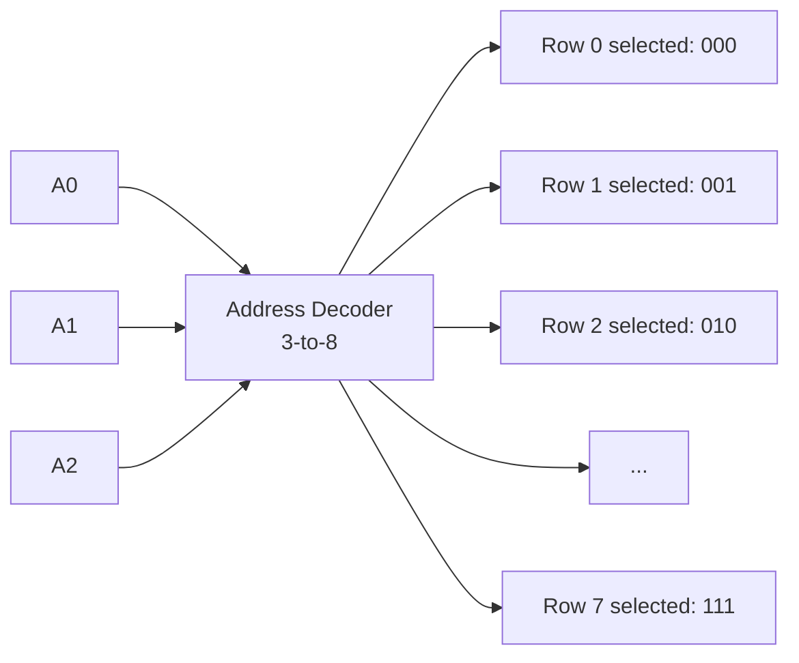

## Syllabus Position

**Subject:** [[Computer Organization and Architecture Index]]
**Parent Topic:** [[Computer Organization]]
**Sibling Topics:** [[Cache Memory]], [[Little Endian and Big Endian]], [[Memory Hierarchy]], [[Instruction Set Architecture]]
**Leads To:** [[Cache Memory]], [[Virtual Memory]], [[Memory Mapped I/O]], [[DMA (Direct Memory Access)]]

**GATE Syllabus Line:** Computer Organization and Architecture — Machine instructions and addressing modes, ALU, data-path and control unit; memory interface.

**Exam Weight Note:** Appears heavily as 1-mark MCQs on address/data line calculations and 2-mark NAT questions requiring computation of memory size, number of chips, or addressable locations. Extremely formula-dense — every formula here has appeared in GATE at least once.

---

## The Problem This Solves

A CPU processes data — but it can't hold everything it needs inside its registers (which are tiny and expensive). It needs a way to **store large amounts of data externally and retrieve any piece of it precisely and quickly**. The challenge is: how do you build a system where the CPU can say "give me the data at location 5000" and the memory unit knows exactly which physical storage cell to access?

**Analogy:** Think of memory like a massive apartment building. Each apartment has a unique address (flat number). When a delivery arrives for flat 304, the building's address system routes it to exactly the right door — not all 500 flats. The **address lines** are like the flat-number system, and the **data lines** are like the width of the door (how much can be delivered at once).

**Core Idea (one sentence):** Memory is an array of storage cells, each uniquely identified by an address; address lines determine how many cells exist, and data lines determine how many bits are read/written in a single operation.

---

## Formal Theory

### What is Memory?

**Memory** is a sequential collection of **storage locations**, each holding a fixed number of bits. Memory is organized as a 2D structure:

$$\text{Memory} = \text{(Number of locations)} \times \text{(Bits per location)}$$

The two fundamental parameters are:
1. **Address Lines ($n$):** Determine how many unique locations the memory has
2. **Data Lines ($m$):** Determine how many bits are stored/retrieved per location (the **word size**)

### Address Lines

**Address lines** are the set of binary input signals sent from the CPU to the memory unit that specify **which memory location** to read from or write to.

If a memory has $n$ address lines:
$$\text{Number of addressable locations} = 2^n$$

**Why?** Each address line is a single bit (0 or 1). With $n$ lines, you can form $2^n$ unique binary combinations — each combination selects exactly one memory location.

**Key formula:**
$$n = \log_2(\text{Number of locations})$$

**Examples:**

| Address Lines ($n$) | Addressable Locations | Common Name        |
|---------------------|-----------------------|--------------------|
| 10                  | $2^{10} = 1024$       | 1K locations       |
| 16                  | $2^{16} = 65536$      | 64K locations      |
| 20                  | $2^{20} = 1048576$    | 1M locations       |
| 32                  | $2^{32} \approx 4.29 \times 10^9$ | 4G locations |
| 64                  | $2^{64} \approx 1.84 \times 10^{19}$ | 16 Exalocations |

### Data Lines

**Data lines** (also called the **data bus width** or **word size**) are the set of binary signals that carry the actual data between the CPU and memory during a read or write operation.

If a memory has $m$ data lines:
$$\text{Bits per location (word size)} = m \text{ bits}$$

**Total memory capacity:**
$$\text{Total Capacity} = 2^n \times m \text{ bits} = \frac{2^n \times m}{8} \text{ bytes}$$

**Common data line configurations:**

| Data Lines ($m$) | Bits per Read | Word Size Name |
|------------------|---------------|----------------|
| 1                | 1 bit         | Bit-addressable|
| 4                | 4 bits        | Nibble         |
| 8                | 8 bits        | Byte           |
| 16               | 16 bits       | Word (x86-16)  |
| 32               | 32 bits       | Double Word    |
| 64               | 64 bits       | Quad Word      |

### The Address Space Formula (Master Formula)

This is the single most-tested formula in memory organization:

$$\boxed{\text{Memory Size} = 2^{\text{Address Lines}} \times \text{Data Lines (bits)}}$$

Or equivalently in bytes (assuming 8 data lines = 1 byte):

$$\text{Memory Size (bytes)} = 2^{\text{Address Lines}} \times \frac{\text{Data Lines}}{8}$$

### How Memory is Physically Stored

#### The Memory Cell (1-bit storage)

The fundamental unit of memory is a **memory cell** — a circuit that stores one bit. Two dominant technologies:

**1. SRAM (Static RAM):**
- Uses a **[[D-Flip Flop]] or 6-transistor latch** circuit per bit
- Retains data as long as power is supplied
- **Fast** (sub-nanosecond access), **expensive**, **low density**
- Used in: **[[Cache Memory]]** (L1, L2, L3)

**2. DRAM (Dynamic RAM):**
- Uses **one transistor + one capacitor** per bit
- Capacitor leaks charge → needs **periodic refresh** (every ~64ms)
- **Slower**, **cheaper**, **high density**
- Used in: **Main memory (RAM)**

#### Memory Array Organization

A memory chip is organized as a 2D array of cells:

```
         Data Lines (m bits wide)
         D0  D1  D2  ...  D(m-1)
        ┌───┬───┬───┬───┬───┐
Row 0   │ b │ b │ b │...│ b │  ← One word (m bits)
Row 1   │ b │ b │ b │...│ b │
Row 2   │ b │ b │ b │...│ b │
  ...   │...│...│...│...│...│
Row 2^n │ b │ b │ b │...│ b │
        └───┴───┴───┴───┴───┘
        ↑
   Address decoder selects exactly one row
```

Each row = one memory location (word). The address decoder takes the $n$-bit address and activates exactly one row.

#### Address Decoder

The **[[Address Decoder]]** is the combinational circuit that translates a binary address into a one-hot row selection signal:

- Input: $n$-bit binary address
- Output: $2^n$ lines, exactly one HIGH at a time

$$\text{Input lines} = n, \quad \text{Output lines} = 2^n$$

A $3 \times 8$ decoder (3 address bits → 8 row select lines):



### Read and Write Operations

#### Read Cycle

```
Algorithm MEMORY_READ(address):
    1. CPU places address on Address Bus (n lines)
    2. Assert READ control signal (R/W̄ = 1)
    3. Address decoder activates the selected row
    4. Selected row's m bits are driven onto Data Bus
    5. CPU latches data from Data Bus
    6. End of read cycle
```

#### Write Cycle

```
Algorithm MEMORY_WRITE(address, data):
    1. CPU places address on Address Bus (n lines)
    2. CPU places data on Data Bus (m lines)
    3. Assert WRITE control signal (R/W̄ = 0)
    4. Address decoder activates the selected row
    5. Data from Data Bus is written into selected row's m cells
    6. End of write cycle
```

### Memory Chip Parameters

A memory chip is characterized by its **size notation**:

$$\text{Chip Size} = K \times m$$

Where:
- $K$ = number of locations (rows) = $2^n$
- $m$ = number of data bits per location (data lines)

**Examples:**

| Notation    | Locations ($K$) | Data Width ($m$) | Address Lines ($n$) | Total Bits  |
|-------------|-----------------|------------------|---------------------|-------------|
| $1K \times 1$  | 1024            | 1 bit            | 10                  | 1024 bits   |
| $1K \times 8$  | 1024            | 8 bits (1 byte)  | 10                  | 8192 bits   |
| $4K \times 8$  | 4096            | 8 bits           | 12                  | 32768 bits  |
| $64K \times 16$| 65536           | 16 bits          | 16                  | 1M bits     |
| $1M \times 8$  | 1048576         | 8 bits           | 20                  | 8M bits     |

### Building Larger Memory from Chips (Chip Expansion)

When a single chip is too small, multiple chips are combined. Two expansion strategies:

#### 1. Word Expansion (Increasing Number of Locations)

**Goal:** Increase the number of addressable locations (add more rows)
**Method:** Use additional address lines + a chip-select decoder

- Connect **data lines in parallel** (all chips share the same data bus)
- Use **extra address bits** to select which chip is active via chip-select ($\overline{CS}$)

**Example:** Build $8K \times 8$ using $4K \times 8$ chips:
- Need 2 chips (each has 4K locations; 2 × 4K = 8K)
- Original chip: 12 address lines ($2^{12} = 4K$)
- Expanded memory: 13 address lines ($2^{13} = 8K$)
- **Extra bit** (A12) selects chip 0 or chip 1 via a 1-to-2 decoder

```
Address Bus (13 bits):  A12 | A11 A10 ... A0
                         ↓         ↓
                    Chip Select  Sent to both chips
                    (1-to-2       (only selected chip
                    decoder)       responds)
```

#### 2. Word Length Expansion (Increasing Data Width)

**Goal:** Increase the number of data bits per location (widen the word)
**Method:** Connect chips in parallel, each contributing some bits

- Connect **address lines in parallel** (all chips receive the same address)
- **Partition the data bus** across chips

**Example:** Build $1K \times 16$ using $1K \times 8$ chips:
- Need 2 chips (each provides 8 bits; 2 × 8 = 16 bits)
- Both chips share the same 10 address lines
- Chip 0 drives D0–D7, Chip 1 drives D8–D15

```
Address Bus (10 bits) → BOTH Chip 0 and Chip 1 simultaneously
Chip 0 → Data bits D0–D7
Chip 1 → Data bits D8–D15
Combined → 16-bit word
```

#### General Formula for Number of Chips Required

$$\text{Number of chips} = \frac{\text{Required Memory Size}}{\text{Chip Size}}$$

More precisely:

$$\text{Chips for word expansion} = \frac{\text{Required locations}}{\text{Locations per chip}} = \frac{2^{n_{required}}}{2^{n_{chip}}}$$

$$\text{Chips for word length expansion} = \frac{\text{Required data width}}{\text{Chip data width}} = \frac{m_{required}}{m_{chip}}$$

$$\text{Total chips} = \text{Chips for word expansion} \times \text{Chips for word length expansion}$$

### Memory Control Signals

Beyond address and data lines, memory chips have **control signals**:

| Signal | Full Name        | Function                                                    |
|--------|------------------|-------------------------------------------------------------|
| $\overline{CS}$ or $\overline{CE}$ | Chip Select / Chip Enable | Enables/disables the chip. Active LOW — chip only responds when this is 0. Used in word expansion. |
| $\overline{OE}$ | Output Enable    | Enables data output onto data bus during READ. Active LOW.  |
| $\overline{WE}$ | Write Enable     | Enables data input from data bus during WRITE. Active LOW.  |
| $R/\overline{W}$ | Read/Write       | HIGH = Read, LOW = Write. Selects operation direction.      |

### Memory Timing: Access Time

**[[Memory Access Time]]** ($t_{acc}$): Time from when the address is placed on the address bus to when valid data appears on the data bus.

Typical values:
- **SRAM:** 1–10 ns
- **DRAM:** 50–100 ns (without cache)
- **Flash:** 100 µs (write), 100 ns (read)
- **Hard Disk:** 5–20 ms (seek + rotational latency)

**[[Memory Cycle Time]]** ($t_{cycle}$): Minimum time between two consecutive memory operations. Always $\geq t_{acc}$.

$$t_{cycle} \geq t_{acc}$$

For DRAM: $t_{cycle} \approx 2 \times t_{acc}$ due to precharge time.

---

## Diagrams and Visuals

### Visual 1: Complete Memory System Architecture

```
CPU
┌─────────────────────┐
│  ┌───┐  ┌────────┐  │
│  │MAR│  │  MDR   │  │
│  └─┬─┘  └───┬────┘  │
│    │         │       │
└────┼─────────┼───────┘
     │         │
     │ Address │ Data
     │ Bus     │ Bus
     │ (n bits)│ (m bits)
     ↓         ↓
┌────┴─────────┴───────┐
│     MEMORY CHIP       │
│  ┌─────────────────┐  │
│  │ Address Decoder │  │
│  │   (n-to-2^n)    │  │
│  └────────┬────────┘  │
│           │ Row Select │
│  ┌────────┴────────┐  │
│  │  Memory Array   │  │
│  │  2^n rows ×     │  │
│  │  m bits/row     │  │
│  └─────────────────┘  │
│    CS̄   OĒ   WĒ       │
└──────────────────────┘
         ↑
   Control Signals
```

**MAR = [[Memory Address Register]]** (holds the address)
**MDR = [[Memory Data Register]]** (holds the data being read/written)

### Visual 2: Memory Array Detail (4×4 example)

For a $4 \times 4$ chip (2 address lines, 4 data lines):

```
              D0   D1   D2   D3    ← Data Lines (4 bits wide)
             ┌────┬────┬────┬────┐
A1=0, A0=0 →│Cell│Cell│Cell│Cell│  Row 00 (Address 0)
             ├────┼────┼────┼────┤
A1=0, A0=1 →│Cell│Cell│Cell│Cell│  Row 01 (Address 1)
             ├────┼────┼────┼────┤
A1=1, A0=0 →│Cell│Cell│Cell│Cell│  Row 10 (Address 2)
             ├────┼────┼────┼────┤
A1=1, A0=1 →│Cell│Cell│Cell│Cell│  Row 11 (Address 3)
             └────┴────┴────┴────┘
```

Only one row is active at a time (selected by address decoder).

### Visual 3: Word Expansion (Increasing Locations)

```
 Building 8K×8 from two 4K×8 chips:

 Address Lines:  A12 A11 A10 A9 ... A0
                  │   └────────────────┐
                  │                    │
                  ↓                    ↓
          ┌──────────┐         ┌──────┴─────┐
          │ 1-to-2   │         │ Both chips │
          │ Decoder  │         │ get A11–A0 │
          └──┬────┬──┘         └────────────┘
             │    │
    CS̄=0    ↓    ↓ CS̄=1
        ┌───────┐  ┌───────┐
        │ Chip 0│  │ Chip 1│
        │ 4K×8  │  │ 4K×8  │
        │(0–4K-1│  │(4K–8K-│
        │  addrs│  │   1   │
        │       │  │ addrs)│
        └───┬───┘  └───┬───┘
            └─────┬────┘
                  ↓
             D0–D7 (8 bits)
```

### Visual 4: Word Length Expansion (Increasing Data Width)

```
Building 1K×16 from two 1K×8 chips:

Address Lines A9–A0 → BOTH chips simultaneously

        ┌─────────────────────────────┐
        │                             │
        ↓                             ↓
   ┌─────────┐                   ┌─────────┐
   │ Chip 0  │                   │ Chip 1  │
   │  1K×8   │                   │  1K×8   │
   └────┬────┘                   └────┬────┘
        ↓                             ↓
    D0–D7                          D8–D15
(Lower byte)                    (Upper byte)
        └──────────┬──────────────────┘
                   ↓
              D0–D15 (16-bit word)
```

### Visual 5: Memory Read Timing Diagram

```
Time →
Address Bus: ─────[VALID ADDRESS]──────────────────────────
CS̄:          ────────────┐                 ┌───────────────
                          └─────────────────┘  (active low)
OĒ:          ──────────────────┐       ┌───────────────────
                                └───────┘  (active low)
Data Bus:    ─────────────────────[VALID DATA]─────────────
             │←── tACC (access time) ──→│
```

---

## Complexity Analysis

Memory organization is not algorithmic, but GATE tests the **computational complexity of memory calculations** and **chip count** problems.

### Address Line Calculation

Given memory size $S$ bytes and word size $w$ bits:

$$n_{\text{address}} = \log_2\!\left(\frac{S \times 8}{w}\right)$$

- Number of unique locations = $\frac{S \times 8}{w}$
- Address lines = $\log_2$ of that count

**Derivation:** Each location holds $w$ bits. Total bits = $S \times 8$. Total locations = $\frac{S \times 8}{w}$. Address lines = $\log_2(\text{locations})$.

### Data Line Calculation

Data lines = word size = number of bits transferred per memory access.

$$m = \text{word size in bits}$$

For byte-addressable memory: $m = 8$ bits (1 byte per location)
For word-addressable memory: $m = $ word size (16, 32, or 64 bits per location)

### Chip Count Formula

$$\text{Total chips} = \underbrace{\frac{2^{n_{\text{required}}}}{2^{n_{\text{chip}}}}}_{\text{word expansion}} \times \underbrace{\frac{m_{\text{required}}}{m_{\text{chip}}}}_{\text{word length expansion}}$$

### Summary Table

| Parameter | Formula | Example |
|-----------|---------|---------|
| Locations | $2^n$ | $2^{16} = 64\text{K}$ |
| Address lines | $\log_2(\text{locations})$ | $\log_2(64\text{K}) = 16$ |
| Total bits | $2^n \times m$ | $64\text{K} \times 8 = 512\text{Kb}$ |
| Total bytes | $2^n \times m / 8$ | $64\text{KB}$ |
| Chips (word exp.) | $2^{n_{req}} / 2^{n_{chip}}$ | $64\text{K} / 4\text{K} = 16$ |
| Chips (width exp.) | $m_{req} / m_{chip}$ | $16 / 8 = 2$ |
| Total chips | product of above two | $16 \times 2 = 32$ |

---

## Worked Example

### Problem
Design a memory system with the following specifications:
- **Required memory:** 64KB (byte-addressable)
- **Available chips:** $4K \times 4$ (4096 locations, 4 bits per location)

Find:
1. Number of address lines in the required memory
2. Number of data lines required
3. Number of chips needed (with breakdown)
4. Describe the wiring

---

### Step 1: Required Memory Parameters

Required memory = 64KB = $64 \times 1024$ bytes = $65536$ bytes

Since it's **byte-addressable**, each location = 8 bits = 1 byte.

$$\text{Locations required} = 65536 = 2^{16}$$

$$\text{Address lines required} = 16$$

$$\text{Data lines required} = 8 \text{ bits (byte-addressable)}$$

---

### Step 2: Available Chip Parameters

Chip specification: $4K \times 4$

- Locations per chip = $4K = 4096 = 2^{12}$
- Address lines per chip = $12$
- Data lines per chip = $4$ bits

---

### Step 3: Chips for Word Length Expansion

Each chip gives 4 bits, but we need 8 bits per location.

$$\text{Chips for width expansion} = \frac{8}{4} = 2 \text{ chips}$$

These 2 chips work **in parallel**, together providing an 8-bit word.

---

### Step 4: Chips for Word Expansion

Each group of 2 chips (from Step 3) covers $4K = 4096$ locations. We need $64K = 65536$ locations.

$$\text{Groups for word expansion} = \frac{64K}{4K} = \frac{2^{16}}{2^{12}} = 2^4 = 16 \text{ groups}$$

---

### Step 5: Total Chips

$$\text{Total chips} = 16 \times 2 = \boxed{32 \text{ chips}}$$

---

### Step 6: Address Line Wiring

- **Chip address lines (A0–A11):** Go to ALL 32 chips (within a group, all chips receive the same A0–A11 to select the same row)
- **Upper address bits (A12–A15):** Go to a **4-to-16 decoder** that generates 16 chip-select signals, one per group

$$\text{4-to-16 decoder: inputs = A12, A13, A14, A15; outputs = 16 chip-select lines}$$

---

### Step 7: Data Line Wiring

- Each group consists of 2 chips in parallel
- Chip 0 of each group drives **D0–D3** (lower nibble)
- Chip 1 of each group drives **D4–D7** (upper nibble)

---

### Summary Diagram

```
Address Bus (16 bits): A15 A14 A13 A12 | A11 A10 ... A0
                           ↓            |      ↓
                      4-to-16          |   Sent to ALL
                      Decoder          |   32 chips
                           ↓            |
                  16 Chip-Select Lines
                  (one per group)
                           ↓
  Group 0     Group 1  ...  Group 15
  ┌──┬──┐    ┌──┬──┐       ┌──┬──┐
  │C0│C1│    │C2│C3│  ...  │C30│C31│
  └──┴──┘    └──┴──┘       └───┴───┘
  D0–D3       D0–D3              ↑
  D4–D7       D4–D7      Only this group
                          active at a time
```

**Total operations to count: 32 chips, 16 address lines, 8 data lines. This confirms our $2^{16} \times 8 = 64\text{KB}$ requirement.**

**Edge case follow-up:** What if we only had $4K \times 8$ chips instead?

Answer: Each chip already provides 8 data bits, so no width expansion is needed. Only word expansion: $64K / 4K = 16$ chips total. Address wiring: A0–A11 → all chips; A12–A15 → 4-to-16 decoder for chip-select.

---

## Intuition Anchors

### The Analogy (restated and deepened)

Memory is a giant hotel. The **address lines** are the digits of the room number — with $n$ digits, you can have $10^n$ rooms (or with $n$ binary lines, $2^n$ rooms). The **data lines** are the width of the hotel's delivery system — 8 data lines means you move 8 bits (1 byte) per trip; 64 data lines means 8 bytes per trip.

When you need a bigger hotel but only have small modular rooms:
- **Word expansion** = add more floors/wings (more rooms, same room width)
- **Word length expansion** = combine adjacent rooms into suites (same count, wider rooms)

The address decoder is the hotel receptionist who looks at the room number and routes the delivery to exactly one room, never two.

### The Mental Model

When I see a memory organization problem, I:
1. **Convert sizes to powers of 2** — 64K = $2^{16}$, 4K = $2^{12}$
2. **Write the required spec as Required = $2^{n_r} \times m_r$**
3. **Write the chip spec as Chip = $2^{n_c} \times m_c$**
4. **Compute width expansion = $m_r / m_c$** (parallel chips in one group)
5. **Compute word expansion = $2^{n_r} / 2^{n_c}$** (number of groups)
6. **Total = product of the two**

This 5-step mental model solves every GATE chip count problem within 90 seconds.

### The One-Line Recall

**"$n$ address lines → $2^n$ locations; $m$ data lines → $m$ bits per word; total capacity = $2^n \times m$ bits; chips needed = (required locations / chip locations) × (required width / chip width)."**

### The #1 Trap

**The Trap:** Students confuse **address lines** with **memory size in bytes** — they see "16 address lines" and write "16 bytes" instead of $2^{16}$ bytes = 64KB.

**Why it seems right:** The number 16 appears prominently, and students in a rush map it directly to size.

**The Correction:** Address lines are an *exponent*, not a linear count. 16 address lines = $2^{16}$ locations, not 16 locations. Always compute $2^n$, never use $n$ raw.

**Secondary trap:** Forgetting that "byte-addressable" means each location = 8 bits (so data lines = 8), while "word-addressable" means each location = word size. If the question says "word-addressable, 16-bit words", data lines = 16.

---

## GATE Questions

---

**Question 1 — GATE-style MCQ — 1-mark**

> A memory chip has 12 address lines and 8 data lines. What is the total storage capacity of this chip?

- (A) 96 bits
- (B) 4096 bits
- (C) 32768 bytes
- (D) 4 KB

<details>
<summary>Solution</summary>

**Answer: (D)**

**Reasoning:**

Address lines = 12 → Number of locations = $2^{12} = 4096$

Data lines = 8 → 8 bits (1 byte) per location

Total capacity = $4096 \times 8$ bits = $4096 \times 1$ byte = **4096 bytes = 4KB**

**Eliminate wrong options:**
- **(A) 96 bits:** This would be $12 \times 8 = 96$ — a common mistake of multiplying the line counts instead of computing $2^{12}$. ❌
- **(B) 4096 bits:** This ignores that each of the $4096$ locations stores 8 bits, so it undercounts by a factor of 8. ❌
- **(C) 32768 bytes:** This would be $2^{15}$ bytes — incorrect exponent and incorrect byte count. ❌
- **(D) 4 KB:** This equals $4096$ bytes, which is the correct capacity. ✓

**What this tests:** Direct application of $\text{Capacity} = 2^n \times m$ bits.

**Trap to avoid:** Using $n$ (12) directly instead of $2^n$ (4096). The exponent vs. linear confusion is the #1 error here.

</details>

---

**Question 2 — GATE PYQ-style NAT — 2-mark**

> A system requires 256 KB of memory. The available memory chips are of size $16K \times 8$ bits. How many chips are required, and how many address lines does the final memory system need?

<details>
<summary>Solution</summary>

**Answer: 16 chips, 18 address lines**

**Reasoning:**

**Step 1: Required memory parameters**

Required = 256 KB = $256 \times 1024$ bytes = $262144$ bytes

Byte-addressable → each location = 8 bits → data lines = 8

Locations required = $262144 = 2^{18}$ → Address lines required = **18**

**Step 2: Chip parameters**

Chip = $16K \times 8 = 2^{14} \times 8$

Chip address lines = 14, chip data lines = 8

**Step 3: Width expansion**

Required data width = 8 bits; chip data width = 8 bits

$$\text{Width expansion chips} = \frac{8}{8} = 1 \text{ chip per group}$$

No width expansion needed.

**Step 4: Word expansion**

$$\text{Word expansion groups} = \frac{2^{18}}{2^{14}} = 2^4 = 16 \text{ groups}$$

**Step 5: Total chips**

$$\text{Total} = 16 \times 1 = \boxed{16 \text{ chips}}$$

**Step 6: Address line wiring**

- A0–A13 (14 bits) → address lines for each chip
- A14–A17 (4 bits) → 4-to-16 decoder for chip select
- Total address lines in final system = **18**

**What this tests:** Multi-step chip expansion calculation with address line counting.

**Trap to avoid:** Forgetting that the final system's address lines ≠ chip's address lines. The system needs more lines to select between groups.

</details>

---

**Question 3 — Hard / Multi-concept — 2-mark**

> A memory system is built using $1K \times 4$ chips to provide $8K \times 8$ memory. The memory is byte-addressable. How many chips are needed? How many address lines are connected to the address decoder that selects the chip group, and how many are connected to each chip's internal address inputs?

<details>
<summary>Solution</summary>

**Answer: 16 chips; 3 lines to decoder; 10 lines to each chip**

**Reasoning:**

**Required:** $8K \times 8$

- Locations = $8K = 2^{13}$ → needs 13 address lines total
- Data width = 8 bits

**Chip spec:** $1K \times 4$

- Chip locations = $1K = 2^{10}$ → 10 address lines per chip
- Chip data width = 4 bits

**Width expansion (to get 8 bits from 4-bit chips):**

$$\frac{8}{4} = 2 \text{ chips per group}$$

**Word expansion (to get 8K locations from 1K-location chips):**

$$\frac{2^{13}}{2^{10}} = 2^3 = 8 \text{ groups}$$

**Total chips:** $8 \times 2 = \boxed{16 \text{ chips}}$

**Address line breakdown:**

Total required = 13 lines

- **A0–A9 (10 lines):** Go directly to all chips — these are the *internal* row-select address lines for each chip (selecting from $2^{10} = 1K$ internal rows)
- **A10–A12 (3 lines):** Go to a **3-to-8 decoder** — these select which of the 8 groups is active ($2^3 = 8$ groups)

So: **3 lines to decoder, 10 lines to each chip's address inputs.**

**What this tests:** Combining width expansion AND word expansion in one problem, plus the precise wiring of address bits.

**Trap to avoid:** Connecting all 13 address bits to each chip. Chips only have 10 address pins — the upper bits must go to the decoder, not the chips themselves.

</details>

---

**Pattern Recognition:**

- **Chip count questions:** Always decompose into width expansion × word expansion. These are independent multipliers.
- **Address line questions:** System address lines = $\log_2(\text{total locations})$. Chip address lines = $\log_2(\text{chip locations})$. The **difference** goes to the decoder.
- **"Byte-addressable" clue:** Immediately sets data lines = 8 bits.
- **"Word-addressable" clue:** Data lines = word size. Carefully re-check if the word size is given.
- **Decoder inputs:** Always equal the **extra address bits** = System address lines − Chip address lines.

---

## Edge Cases and Failure Modes

- [x] **Power-of-2 requirement:** Memory sizes are always powers of 2 in GATE problems. If a chip count doesn't divide evenly, re-read the question — you likely mixed up KB with K (1K = 1024, not 1000). Fix: convert everything to powers of 2 first.

- [x] **Byte vs. word addressable:** "4K × 8 chip" in a byte-addressable system: each location = 1 byte, data lines = 8. But "4K × 16 chip" in a byte-addressable system: each location = 2 bytes, so the 4K *locations* hold 8KB of data. The address lines still = 12 (for 4K locations), but the capacity is 8KB, not 4KB. **Fix:** Always separate "locations" from "bytes."

- [x] **Data lines ≠ word size in all contexts:** A chip with 4 data lines in a system requiring 8-bit words needs 2 chips for width expansion. Confusing chip data lines with system data lines causes incorrect chip counts. **Fix:** Identify system data line requirement and chip data line count separately before dividing.

- [x] **Decoder input lines:** The extra address lines driving the chip-select decoder are NOT connected to individual chips' address inputs. Connecting all address lines to all chips is a design error — chips would respond to addresses outside their range. **Fix:** Only lower address bits go to chip address pins; upper bits go to decoder.

- [x] **SRAM vs DRAM refresh:** DRAM requires periodic refresh cycles that temporarily make memory unavailable. GATE questions on effective bandwidth must account for refresh overhead. **Fix:** Effective bandwidth = available cycles / total cycles × peak bandwidth.

- [x] **Memory-mapped I/O address space:** In systems using [[Memory Mapped I/O]], some addresses in the total $2^n$ address space are reserved for I/O devices, not actual RAM. The total addressable space is $2^n$, but usable RAM is less. **Fix:** Distinguish between "addressable locations" (the full $2^n$ count) and "actual RAM installed."

---

## Comparisons

### SRAM vs DRAM vs ROM

| Feature               | [[SRAM]]                         | [[DRAM]]                         | [[ROM]] / [[Flash]]               |
|-----------------------|----------------------------------|----------------------------------|-----------------------------------|
| **Storage Mechanism** | Flip-flop (6 transistors/bit)    | Capacitor + transistor (1+1/bit) | Fused links / floating gate       |
| **Volatile?**         | Yes (loses data on power loss)   | Yes                              | No (non-volatile)                 |
| **Refresh Needed?**   | No                               | Yes (every ~64ms)                | No                                |
| **Speed**             | Very fast (1–10 ns)              | Slower (50–100 ns)               | Read fast, write slow             |
| **Cost per bit**      | High                             | Low                              | Medium                            |
| **Density**           | Low (6 transistors/bit)          | High (1–2 transistors/bit)       | Very high                         |
| **Used in**           | Cache (L1/L2/L3), Registers      | Main Memory (RAM)                | BIOS, Firmware, SSDs              |
| **GATE Trap**         | Confused with registers          | Forgetting refresh overhead      | Treated as RAM in calculations    |

### Address Space: Byte-Addressable vs Word-Addressable

| Feature                         | Byte-Addressable                          | Word-Addressable                          |
|---------------------------------|-------------------------------------------|-------------------------------------------|
| **Each location holds**         | 1 byte (8 bits)                           | 1 word (16/32/64 bits)                    |
| **Data lines**                  | 8                                         | 16 / 32 / 64                              |
| **Address space for same chip** | Larger (more locations)                   | Smaller (fewer locations but wider)       |
| **Most common in GATE**         | Yes (default assumption)                  | Explicitly stated when used               |

**The most common GATE question comparing these** asks: "A $4K \times 16$ memory chip — how many bytes can it store, and how many address lines does it need?"

**The answer hinges on:** Understanding that 4K *locations* × 16 bits/location = 64K bits = 8KB, and that the 4K locations require 12 address lines regardless of the word size.

---

## Connections Web

### Must know before this topic:
- [[Binary Number System]] — address and data are binary values
- [[Powers of 2]] — all memory sizes are powers of 2
- [[Logic Gates]] — address decoder is built from logic gates
- [[D Flip Flop]] — the storage element in SRAM cells

### Topics that build on this:
- [[Cache Memory]] — fast buffer using SRAM between CPU and main memory
- [[Virtual Memory]] — extending address space beyond physical RAM
- [[Memory Hierarchy]] — full stack from registers to disk
- [[DMA (Direct Memory Access)]] — transferring data without CPU intervention
- [[Memory Mapped I/O]] — treating device registers as memory addresses
- [[Little Endian and Big Endian]] — byte ordering within multi-byte words
- [[Interleaved Memory]] — parallelizing memory banks for higher bandwidth
- [[DRAM Refresh]] — timing constraints for dynamic memory

### GATE subject cross-links:
- [[Computer Organization and Architecture Index]] > [[Memory Organization]]
- [[Computer Networks Index]] — network buffers are essentially memory systems
- [[Operating Systems Index]] > [[Memory Management]] — physical vs. virtual addressing

### Cross-subject connections:
- [[Compiler Design]] — stack/heap memory layout determined by compilers
- [[Operating Systems]] > [[Paging]] — OS manages physical memory pages
- [[Digital Logic]] — decoder circuits, multiplexers used in memory design

### Standard references:
- [[Computer Organization and Design (Patterson & Hennessy)]] — Chapter 5
- [[Computer Organization (Hamacher, Vranesic, Zaky)]] — Chapter 5
- [[Digital Design and Computer Architecture (Harris & Harris)]] — Chapter 5

---

## Quick Revision Sheet

**Definition (1 sentence):**
Memory is an array of $2^n$ locations each holding $m$ bits, where $n$ address lines uniquely select one location and $m$ data lines transfer its contents to/from the CPU.

**Core Idea / Analogy (1 sentence):**
Address lines are like a room number ($n$ digits → $2^n$ rooms); data lines are the door width (how many bits fit through in one trip).

**Master Formulas:**

$$\text{Locations} = 2^n \quad \text{(}n = \text{address lines)}$$
$$\text{Capacity} = 2^n \times m \text{ bits} = \frac{2^n \times m}{8} \text{ bytes}$$
$$\text{Total chips} = \frac{2^{n_{req}}}{2^{n_{chip}}} \times \frac{m_{req}}{m_{chip}}$$
$$\text{Decoder inputs} = n_{req} - n_{chip}$$

**Key Properties:**
- Byte-addressable → data lines = 8 bits (default in GATE unless stated)
- Word expansion → extra chips in series (need decoder/chip-select)
- Word length expansion → extra chips in parallel (same address, different data bits)
- SRAM: fast, expensive, for cache; DRAM: slow, cheap, for main memory
- Decoder input lines = system address lines − chip address lines

**The #1 Trap:**
Using $n$ (address lines count) as memory size directly instead of computing $2^n$.

**When to use word vs word-length expansion:**
- Need more locations? → Word expansion (vertical, need decoder)
- Need wider words? → Word length expansion (horizontal, parallel chips)

**Mnemonic:**
**"$2^n$ locations, $m$ bits wide — Chips = Locations-ratio × Width-ratio"**

---

## Revision Checklist

- [ ] I can state the master formula $\text{Capacity} = 2^n \times m$ without looking.
- [ ] I can explain the hotel analogy mapping address lines and data lines.
- [ ] I can solve a chip-count problem for both word and word-length expansion in under 3 minutes.
- [ ] I can identify how many address lines go to each chip vs. to the decoder.
- [ ] I know the Quick Revision Sheet formulas without reading them.
- [ ] I can solve all 3 GATE questions in this note without peeking.
- [ ] I know the #1 trap ($n$ vs $2^n$) and can articulate why students fall for it.
- [ ] I have linked this note correctly to [[Cache Memory]] and [[Memory Hierarchy]] in my Obsidian vault.
- [ ] I have scheduled a spaced-repetition review in 3 days.
