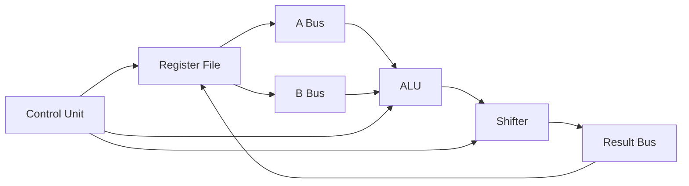
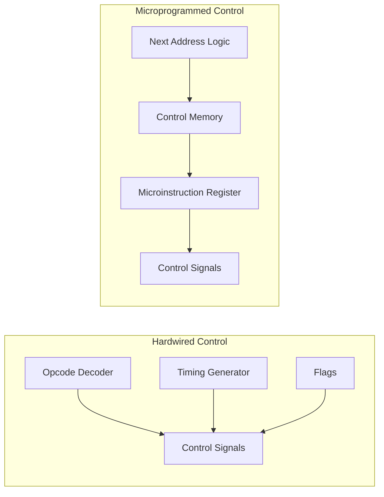

## Syllabus Position

**Subject:** [[Computer Organization and Architecture Index]]
**Parent Topic:** [[CPU Organization]]
**Sibling Topics:** [[Machine Instructions]], [[Addressing Modes]], [[Instruction Cycle]], [[Memory Organization]]
**Leads To:** [[Pipelining]], [[Microprogramming]], [[Hardwired Control]], [[RISC vs CISC]]

**GATE Syllabus Line:** Computer Organization and Architecture - Machine instructions and addressing modes, ALU, data-path and control unit.

**Exam Weight Note:** Appears very often as 1-mark MCQs on register transfer, flag behavior, and hardwired versus microprogrammed control, and as 2-mark NAT or MSQ questions where students must trace control signals, bus transfers, or an ALU operation across clock cycles.

---

## The Problem This Solves

A CPU does not execute an instruction in one magical jump. Even a simple instruction such as "add the contents of two registers" must be broken into tiny internal actions: move data from one register to another, select ALU inputs, choose the ALU function, store the result, and update status bits. The processor therefore needs both a physical path through which data can move and a decision-making mechanism that says exactly when each movement happens. Without that split, hardware would have values but no coordination, or coordination but no place for bits to flow.

**Analogy:** Think of a restaurant kitchen. The **[[Data Path]]** is the counter, utensils, pans, and ingredient trays through which food physically moves. The **[[Control Unit]]** is the head chef calling out: "take this bowl, mix these two items, heat for one step, plate the result." A **[[Micro Operation]]** is one such tiny kitchen action.

**Core Idea (one sentence):** Micro-operations are the elementary register-level actions of the CPU, the datapath provides the hardware routes for those actions, and the control unit generates the signals that make them happen in the right order.

---

## Formal Theory

A **[[Micro Operation]]** is an elementary operation performed on the information stored in one or more registers during a single clock pulse. At the **[[Register Transfer Level]]**, a machine instruction is realized as a sequence of such micro-operations. The **[[Data Path]]** contains registers, buses, multiplexers, the **[[ALU]]**, shifters, and interconnections that move and transform data. The **[[Control Unit]]** generates the time-dependent control signals that activate particular transfers and functions.

### Register Transfer Language

The standard notation for register movement is the **[[Register Transfer]]** statement:

$$
R_2 \leftarrow R_1
$$

This means the contents of register $R_1$ are copied into register $R_2$ at the active clock edge if the enabling control signal is asserted. It does not mean $R_1$ is erased. GATE often checks this exact point because students confuse transfer with move semantics from programming languages.

If a transfer is conditional, we write:

$$
P: R_2 \leftarrow R_1
$$

which means "if control variable $P = 1$, then load $R_2$ with the contents of $R_1$."

### Categories of Micro-Operations

Micro-operations are commonly grouped into four classes.

#### Register Transfer Micro-Operations

These move binary information from one register to another.

```text
Algorithm REGISTER_TRANSFER(R1, R2):
    place contents of R1 on internal bus
    enable load signal of R2
    on clock edge, copy bus value into R2
    return updated register state
```

Example:

$$
R_3 \leftarrow R_1
$$

If there is a common bus, only one source should drive the bus at a time. This is why bus arbitration or multiplexer selection matters in datapath questions.

#### Arithmetic Micro-Operations

These perform arithmetic on register data. Typical examples are addition, subtraction, increment, decrement, and add with carry.

Examples:

$$
R_3 \leftarrow R_1 + R_2
$$

$$
R_1 \leftarrow R_1 + 1
$$

$$
R_2 \leftarrow R_2 - 1
$$

Subtraction is usually implemented using **[[2's Complement]]** arithmetic:

$$
R_1 - R_2 = R_1 + (\overline{R_2} + 1)
$$

This matters in GATE because a single adder can implement both addition and subtraction if one operand is conditionally complemented and the carry-in is set to $1$.

#### Logic Micro-Operations

These perform bitwise operations on register contents.

Examples:

$$
R_1 \leftarrow R_2 \land R_3
$$

$$
R_1 \leftarrow R_2 \lor R_3
$$

$$
R_1 \leftarrow R_2 \oplus R_3
$$

$$
R_1 \leftarrow \overline{R_2}
$$

These operations are central to masking, bit testing, parity-related reasoning, and control flag generation.

#### Shift Micro-Operations

These shift register contents left or right.

Examples:

$$
R_1 \leftarrow shl\;R_1
$$

$$
R_1 \leftarrow shr\;R_1
$$

There are three standard forms:

1. **[[Logical Shift]]**: vacated bit positions are filled with $0$.
2. **[[Arithmetic Shift]]**: sign-preserving right shift for signed numbers.
3. **[[Circular Shift]]**: shifted-out bit re-enters at the other end.

GATE often tests whether arithmetic right shift preserves the sign bit while logical right shift inserts $0$ from the left.

### ALU and Its Role in the Datapath

The **[[Arithmetic Logic Unit]]** is the combinational block that performs arithmetic and logical micro-operations on its inputs. A typical ALU receives two input words, say $A$ and $B$, a function select field $F$, and sometimes a carry input $C_{in}$. It produces an output word and status flags.

Formally, we can view the ALU as:

$$
Y = f(A, B, F, C_{in})
$$

where $f$ is chosen from operations such as ADD, SUB, AND, OR, XOR, increment, or pass-through.

Typical status outputs are:

1. **[[Carry Flag]]**: indicates a carry out in unsigned addition.
2. **[[Zero Flag]]**: set when result equals $0$.
3. **[[Sign Flag]]**: reflects the most significant bit for signed interpretation.
4. **[[Overflow Flag]]**: indicates signed overflow.

For two's complement addition, overflow occurs when two same-sign operands produce a different-sign result. In bit terms, one equivalent test is:

$$
V = C_{n-1} \oplus C_n
$$

where $C_{n-1}$ is the carry into the sign bit and $C_n$ is the carry out of the sign bit.

### Datapath Structure

The **[[Data Path]]** is the collection of hardware blocks that carry data between storage and processing units. A minimal single-bus datapath usually contains:

1. A set of general-purpose **[[Register]]**s.
2. Special registers such as [[Program Counter]], [[Instruction Register]], [[Memory Address Register]], and [[Memory Data Register]].
3. One or more internal buses.
4. Multiplexers for selecting ALU inputs.
5. The [[ALU]] and often a shifter.
6. Temporary registers such as $Y$ and $Z$ in some textbook datapaths.

The datapath is called a "path" because data follows an enabled route. If a register cannot directly connect to another register, the transfer must be staged through the bus or temporary registers. GATE exploits this by asking which transfers can occur in one clock cycle under single-bus or multi-bus assumptions.

### Single-Bus, Two-Bus, and Three-Bus Datapaths

#### Single-Bus Datapath

In a **[[Single Bus Organization]]**, one source at a time can place data on the internal bus. Therefore many operations require multiple cycles.

Example for

$$
R_3 \leftarrow R_1 + R_2
$$

```text
Algorithm SINGLE_BUS_ADD(R1, R2, R3):
    Y <- R1
    bus <- R2
    Z <- Y + bus
    R3 <- Z
    return R3
```

This needs more than one internal transfer because the same bus cannot carry both operands simultaneously.

#### Two-Bus or Three-Bus Datapath

In a **[[Multi Bus Organization]]**, two operands can reach the ALU at the same time from separate buses, and a third path may return the result. This reduces the number of clock cycles per micro-operation sequence, but the hardware cost increases because more wires, ports, and control signals are needed.

For a three-bus system,

$$
R_3 \leftarrow R_1 + R_2
$$

can often be performed in a single cycle because one bus carries $R_1$, another carries $R_2$, and the result is written back through a destination path.

### Control Unit

The **[[Control Unit]]** is the sequencing and signal-generation part of the CPU. It interprets the opcode, current timing step, status flags, and sometimes interrupt conditions to generate control signals for the datapath.

At a high level:

$$
\text{Control Signals} = g(\text{Opcode}, \text{Timing}, \text{Flags}, \text{Interrupts})
$$

These signals decide:

1. Which register outputs are enabled.
2. Which register inputs are loaded.
3. Which multiplexer input is selected.
4. Which ALU function is chosen.
5. Whether memory is read or written.
6. Whether the PC is incremented, loaded, or held.

### Hardwired Control

In **[[Hardwired Control]]**, control signals are generated by fixed combinational and sequential logic using decoders, counters, PLA-like structures, and finite-state logic. This makes control faster because signals are produced directly from hardware logic, but it makes design changes harder.

You can think of it as:

$$
\text{Signal}_i = h_i(\text{Opcode bits}, T_j, \text{Flags})
$$

where $T_j$ denotes timing states such as fetch step $T_0$, $T_1$, and so on.

Hardwired control is preferred in designs where speed is critical and the instruction set is relatively simple. This is one reason **[[RISC]]** machines are often associated with hardwired control.

### Microprogrammed Control

In **[[Microprogrammed Control]]**, the control unit stores control words in a special control memory. Each control word, often called a microinstruction, specifies a set of control signals to be activated during one micro-step.

```text
Algorithm MICROPROGRAM_EXECUTE(opcode):
    microaddress <- start address for opcode
    repeat
        control_word <- control_memory[microaddress]
        emit control signals from control_word
        microaddress <- next microinstruction address
    until end of microprogram
    return
```

This approach is easier to modify and well suited for complex instruction sets, but it may be slower than hardwired control because control memory must be accessed.

### Timing and Control Sequence Example

Consider a fetch sequence in register-transfer form:

$$
T_0: MAR \leftarrow PC
$$

$$
T_1: MDR \leftarrow M[MAR],\; PC \leftarrow PC + 1
$$

$$
T_2: IR \leftarrow MDR
$$

Each timing step corresponds to one clock interval or micro-time state. The control unit ensures the correct enable, select, and load signals are active in that step. This is exactly the bridge between the abstract instruction cycle and concrete datapath behavior.

### What GATE Actually Tests Here

GATE rarely asks for isolated textbook definitions. It tests whether you can map a register transfer to hardware resources, count how many cycles a datapath needs, identify which control signals must be active, distinguish hardwired from microprogrammed control, and reason correctly about flags such as carry and overflow. The exam loves questions where a simple instruction is broken into micro-operations and one subtle hardware limitation, such as a single bus, changes the answer.

---

## Diagrams and Visuals

### Visual 1: Micro-operation as Register Transfer

**How to draw it:** Draw three registers $R_1$, $R_2$, and $R_3$ connected to a common internal bus. Show $R_1$ driving the bus and $R_2$ loading from it.

```text
R1 --out--> [ Internal Bus ] --in--> R2
R3 ---------X  (disabled this cycle)
```

**Labels:**
- `R1 out`: source register enable.
- `Internal Bus`: common path carrying one word at a time.
- `R2 in`: destination load enable.
- `R3 disabled`: proves only one source should drive the bus.

### Visual 2: Typical ALU Datapath

**How to draw it:** Draw a register file on the left, two buses going into the ALU, a shifter after the ALU, and a result bus coming back to the register file.



**Labels:**
- `A Bus` and `B Bus`: operands.
- `ALU`: arithmetic or logical function block.
- `Shifter`: optional shift stage after ALU.
- `Result Bus`: writes result back.
- `Control Unit`: chooses source registers, function, and destination.

### Visual 3: Single-Bus Add Trace

**How to draw it:** Show a timeline with three or four clock steps for computing $R_3 \leftarrow R_1 + R_2$ on a single-bus datapath.

```text
T0: Y <- R1
T1: Z <- Y + R2
T2: R3 <- Z
```

**Labels:**
- `Y`: temporary register holding first operand.
- `Z`: temporary register holding ALU result.
- `T0, T1, T2`: control steps generated by the control unit.

### Visual 4: Hardwired vs Microprogrammed Control

**How to draw it:** Draw two boxes side by side. Left: decoder, timing unit, flags feeding control signals. Right: control memory, microinstruction register, next-address logic feeding control signals.



**Labels:**
- `Opcode Decoder`: logic interpretation of instruction bits.
- `Timing Generator`: produces step signals like $T_0, T_1, T_2$.
- `Control Memory`: stores microinstructions.
- `Next Address Logic`: decides next microinstruction address.

### Visual 5: Fetch Path Through Datapath

**How to draw it:** Show `PC -> MAR -> Memory -> MDR -> IR`, and show the control unit emitting `Read`, `Load`, and `IncPC`.

```text
PC -> MAR -> Memory -> MDR -> IR
 |                            ^
 +---- IncPC control ---------+
```

**Labels:**
- `Read`: memory read control signal.
- `Load IR`: instruction register load control.
- `IncPC`: increment program counter.

---

## Complexity Analysis

This topic is hardware-structural, so complexity is best discussed per micro-operation sequence and per instruction rather than for growing input size. The key GATE insight is not asymptotic growth alone, but how datapath organization changes the number of control steps.

### Time Cost of a Single Micro-Operation

A single register transfer such as

$$
R_2 \leftarrow R_1
$$

is completed in one clock step if the datapath directly supports one source driving a bus and one destination loading from it. Therefore the cost is constant:

$$
T_{transfer} = O(1)
$$

The justification is that the number of registers does not change the number of actions for one chosen transfer; only the select lines become wider.

### Time Cost of ALU Micro-Operations

An ALU operation is also constant-time at the architectural level because the control unit selects a fixed combinational function and latches the result after a fixed propagation delay window.

$$
T_{ALU} = O(1)
$$

However, the number of clock cycles required to realize an instruction depends on datapath width and bus organization.

### Single-Bus Derivation

Suppose we want to compute:

$$
R_3 \leftarrow R_1 + R_2
$$

on a single-bus datapath. Because both operands cannot simultaneously travel on one bus, a temporary register is needed.

One valid sequence is:

1. $Y \leftarrow R_1$
2. $Z \leftarrow Y + R_2$
3. $R_3 \leftarrow Z$

Thus the number of control steps is $3$, which is still constant but larger than in a multi-bus design.

$$
T_{single\ bus\ add} = 3 = O(1)
$$

### Multi-Bus Derivation

In a two-bus or three-bus datapath, $R_1$ and $R_2$ can be supplied to the ALU simultaneously. Then the addition and write-back may occur in one cycle or a tightly bounded small number of cycles depending on the exact hardware.

$$
T_{multi\ bus\ add} = 1 \text{ or a small constant} = O(1)
$$

This is a classic architecture tradeoff: lower cycle count in exchange for higher hardware complexity and more wiring.

### Control Unit Complexity View

For **[[Hardwired Control]]**, control-signal generation is a fixed logic evaluation per cycle, so per step time is constant. For **[[Microprogrammed Control]]**, each micro-step usually includes one control-memory access plus signal emission, also constant per micro-step. The distinction is not asymptotic order but speed constant and flexibility.

### Space Cost

- **Auxiliary datapath space:** $O(1)$ because a CPU contains a fixed number of buses, registers, flags, multiplexers, and ALU blocks.
- **Control storage:** $O(1)$ at the architectural problem scale because control memory size is fixed for a given processor design, although microprogrammed control uses more dedicated storage than hardwired control.

### Complexity Summary Table

| Case         | Time Complexity | Space Complexity | Trigger Condition |
|--------------|-----------------|------------------|------------------|
| Best Case    | $O(1)$          | $O(1)$           | Direct register transfer or multi-bus ALU action in one cycle |
| Average Case | $O(1)$          | $O(1)$           | Typical instruction broken into a bounded number of micro-operations |
| Worst Case   | $O(1)$          | $O(1)$           | Single-bus or memory-involving sequence requiring more control steps |

The GATE-tested point is that all cases remain $O(1)$, but the exact number of control steps differs and often determines the correct option.

---

## Worked Example

Consider a single-bus datapath executing the micro-operation sequence for the instruction:

$$
R_3 \leftarrow R_1 + R_2
$$

Assume initially:

```text
R1 = 0110_2  (6)
R2 = 0011_2  (3)
R3 = 0000_2
Y  = undefined
Z  = undefined
Carry flag = 0
Zero flag  = 0
```

### Step 1: Move First Operand to Temporary Register

Control actions:

- Enable `R1out`
- Select bus source as `R1`
- Enable `Yin`

Micro-operation:

$$
Y \leftarrow R_1
$$

State after step:

```text
Bus = 0110
Y   = 0110
R1  = 0110
R2  = 0011
R3  = 0000
```

### Step 2: Feed Second Operand and Perform ALU Addition

Control actions:

- Enable `R2out`
- Select ALU inputs as `Y` and bus
- Select ALU function `ADD`
- Enable `Zin`

Micro-operation:

$$
Z \leftarrow Y + R_2 = 0110 + 0011 = 1001
$$

State after step:

```text
Bus = 0011
Y   = 0110
Z   = 1001
R1  = 0110
R2  = 0011
R3  = 0000
Carry flag = 0
Zero flag  = 0
```

The result is non-zero, so the zero flag remains $0$. No carry out occurs from the most significant bit in 4-bit unsigned addition, so carry remains $0$.

### Step 3: Write Result Back to Destination Register

Control actions:

- Enable `Zout`
- Select bus source as `Z`
- Enable `R3in`

Micro-operation:

$$
R_3 \leftarrow Z
$$

Final state:

```text
Bus = 1001
R1  = 0110
R2  = 0011
R3  = 1001  (9)
Y   = 0110
Z   = 1001
```

### Step 4: Interpret the Control Story

The datapath provided a legal route for both operands and the result, but because it was a single-bus organization, the two operands could not reach the ALU independently in one step. The control unit therefore scheduled an intermediate temporary storage step using `Y`.

### Operation Count

1. One transfer into `Y`
2. One ALU add into `Z`
3. One transfer into `R3`

Total operations: $3$ control steps. This confirms the $O(1)$ claim because the number of steps is fixed for this datapath organization and does not grow with program input size.

What changes if the datapath is three-bus? Both operands can be read simultaneously, so the same addition may complete in one clock cycle with direct write-back. What changes if the operation is subtraction? The ALU usually complements one operand and sets carry-in to $1$, but the step structure is otherwise similar.

---

## Intuition Anchors

**The Analogy (restated and deepened):** In the kitchen analogy, a single-bus datapath is like having only one narrow counter where only one ingredient tray can be placed at a time. To mix two ingredients, the chef first places one in a bowl, then brings the second, then combines them. A multi-bus datapath is like having two parallel counters feeding the stove at once. Hardwired control is a chef with fixed reflexes; microprogrammed control is a chef following a stored checklist.

**The Mental Model:** Picture two layers. The lower layer is hardware plumbing: registers, buses, ALU, shifter, temporary registers. The upper layer is a conductor issuing per-cycle commands: who talks to the bus, what the ALU computes, and who stores the result. If you can answer those three questions in each cycle, you can solve most datapath problems.

**The One-Line Recall:** Datapath moves and transforms data; control unit decides when and how; micro-operations are the one-clock building blocks of an instruction.

**The #1 Trap:** Students often think "single bus" only means slower in a vague way. The real consequence is precise: only one source can usually place data on the bus at a time, so two-source ALU operations need temporary storage and extra control steps. If you forget that constraint, you will undercount cycles and choose the wrong GATE option.

---

## GATE Questions

**Question 1 — GATE-style — Difficulty: 1-mark**

> Which one of the following is a micro-operation?

- (A) Compile a high-level program into machine code
- (B) $R_2 \leftarrow R_1 + R_3$
- (C) Load the operating system from disk during boot
- (D) Translate a virtual address into a physical address using paging

<details>
<summary>Solution</summary>

**Answer: (B)**

**Reasoning:**

A micro-operation is an elementary register-level operation completed in one clock step or one micro-step. Option (B) is a register arithmetic transfer and fits the exact definition. Option (A) is a compiler activity, not CPU microarchitecture. Option (C) is a system-level procedure spanning many instructions. Option (D) is a larger hardware process involving multiple structures and is not a single elementary register-level action as stated.

**What this question is really testing:** Whether you distinguish CPU internal elementary actions from system-level operations.

**Trap to avoid:** Treating any low-level hardware activity as a micro-operation. The definition is narrower: elementary register transfer, arithmetic, logic, or shift action.

</details>

---

**Question 2 — GATE-style — Difficulty: 2-mark**

> In a single-bus datapath, the operation $R_3 \leftarrow R_1 + R_2$ requires multiple clock cycles primarily because:

- (A) the ALU cannot perform addition in one cycle
- (B) memory must be accessed before every ALU operation
- (C) both source operands cannot be placed on the same bus simultaneously
- (D) the destination register cannot receive the ALU output directly

<details>
<summary>Solution</summary>

**Answer: (C)**

**Reasoning:**

In a single-bus organization, only one register output can usually drive the internal bus in a given cycle. An ALU addition needs two operands, so one operand is first stored in a temporary register such as $Y$, then the second is supplied in a later step. That is why extra cycles are needed.

Why the other options are wrong:

- (A) The ALU itself can perform addition as a combinational function in one step once operands are available.
- (B) Register-register addition does not inherently need memory access.
- (D) Many datapaths do allow destination loading from the ALU output path; the real bottleneck here is source delivery.

**What this question is really testing:** Whether you can connect bus structure to cycle count.

**Trap to avoid:** Blaming the ALU instead of the operand-routing constraint.

</details>

---

**Question 3 — GATE-style — Difficulty: 2-mark**

> Which statement correctly compares hardwired control and microprogrammed control?

- (A) Hardwired control is usually more flexible to modify than microprogrammed control
- (B) Microprogrammed control stores control words in control memory and is usually easier to modify
- (C) Hardwired control cannot generate timing signals
- (D) Microprogrammed control does not use a control unit

<details>
<summary>Solution</summary>

**Answer: (B)**

**Reasoning:**

Microprogrammed control uses a control memory containing microinstructions. Changing the control behavior can therefore be easier than redesigning fixed logic. Hardwired control is usually faster but less flexible. Option (A) reverses the actual tradeoff. Option (C) is false because hardwired units explicitly rely on timing generation. Option (D) is false because microprogrammed control is itself a type of control unit.

**What this question is really testing:** The speed-flexibility tradeoff between the two control styles.

**Trap to avoid:** Assuming "stored" automatically means faster. Stored control is usually more flexible, not necessarily faster.

</details>

**Pattern Recognition:**

- When GATE mentions `single bus`, immediately ask whether two operands are needed in the same cycle.
- When a question mentions overflow versus carry, separate signed interpretation from unsigned interpretation.
- When asked hardwired versus microprogrammed, the usual contrast is speed versus flexibility.
- If the question gives a register transfer, identify source enables, destination load, ALU function, and timing step.

---

## Edge Cases and Failure Modes

- [ ] **Transfer versus overwrite confusion:** Wrong assumption: $R_2 \leftarrow R_1$ destroys $R_1$. Actual behavior: it copies contents; source remains unchanged. Fix: treat register transfer as load-from-source, not move semantics.
- [ ] **Single-bus misconception:** Wrong assumption: a single-bus datapath can feed two ALU operands directly from two registers in one cycle. Actual behavior: only one source drives the bus, so temporary registers are needed. Fix: count bus-source constraints explicitly.
- [ ] **Carry versus overflow:** Wrong assumption: carry flag and overflow flag mean the same thing. Actual behavior: carry is for unsigned overflow out of the MSB, while overflow concerns signed range violation in two's complement. Fix: inspect operand signs and result sign for overflow.
- [ ] **Logical versus arithmetic right shift:** Wrong assumption: both fill the leftmost bit with $0$. Actual behavior: arithmetic right shift preserves the sign bit; logical right shift inserts $0$. Fix: check whether numbers are signed.
- [ ] **All-zero result case:** Wrong assumption: zero flag depends on operands being zero. Actual behavior: zero flag depends only on the final ALU result. Fix: evaluate flags after the operation, not before.
- [ ] **Hardwired versus microprogrammed control:** Wrong assumption: microprogrammed control means "no hardware logic." Actual behavior: it still uses hardware for sequencing and signal emission, but control words are stored. Fix: distinguish control storage method from total hardware presence.
- [ ] **Topic-specific failure - multiple sources driving a bus:** Wrong assumption: enabling two register outputs together is harmless. Actual behavior: it causes bus contention and invalid values. Fix: at most one tri-state source or one mux-selected source should drive a shared bus at a time.

---

## Comparisons

| Feature              | [[Micro Operation]] | [[Instruction Cycle]] | [[Pipelining]] |
|----------------------|---------------------|-----------------------|----------------|
| Time Complexity      | $O(1)$ per micro-step | $O(1)$ per instruction | $O(1)$ stage work, higher throughput |
| Space Complexity     | $O(1)$              | $O(1)$                | Extra pipeline registers |
| Key Property         | Elementary register-level action | Full fetch-decode-execute loop | Overlaps multiple instructions |
| When to Prefer       | When tracing control signals and buses | When tracing complete instruction behavior | When analyzing throughput and hazards |
| GATE Trap            | Confusing with whole instruction | Confusing phase order | Thinking pipelining reduces single-instruction latency drastically |

| Feature              | [[Hardwired Control]] | [[Microprogrammed Control]] | [[Data Path]] |
|----------------------|-----------------------|-----------------------------|---------------|
| Time Complexity      | $O(1)$ per control step, smaller constant | $O(1)$ per micro-step, larger constant possible | $O(1)$ per hardware transfer path |
| Space Complexity     | Lower dedicated control storage | Requires control memory | Fixed hardware blocks |
| Key Property         | Fixed logic signal generation | Stored control words | Physical movement and processing of data |
| When to Prefer       | Simpler, speed-focused CPUs | Complex instruction sets, easier modification | Structural analysis of CPU internals |
| GATE Trap            | Calling it flexible | Calling it faster by default | Mixing it up with control |

The most common GATE comparison pattern here is: given a datapath or control style, infer cycle count, flexibility, or speed. The answer usually hinges on one precise distinction: datapath is the hardware route for bits, while the control unit is the signal generator that sequences those routes.

---

## Connections Web

### Must know before this topic:

- [[Machine Instructions]] — instructions are implemented as sequences of micro-operations.
- [[Instruction Cycle]] — micro-operations populate fetch, decode, execute, and write-back phases.
- [[Digital Logic]] — control signals and ALU functions are built from logic circuits.
- [[Register Transfer Level]] — this is the descriptive level used for datapath reasoning.
- [[2's Complement]] — subtraction and overflow analysis depend on it.

### Topics that build on this:

- [[Pipelining]] — each pipeline stage contains controlled micro-operations.
- [[Microprogramming]] — formalizes control as stored microinstructions.
- [[Hardwired Control]] — direct implementation of control sequencing.
- [[RISC vs CISC]] — control style and datapath simplicity differ across these designs.
- [[Hazards]] — arise when overlapping datapath actions conflict.

### GATE subject cross-links:

- [[Computer Organization and Architecture Index]] > [[CPU Organization]]
- [[Computer Organization and Architecture Index]] > [[Data Path]]
- [[Computer Organization and Architecture Index]] > [[Control Unit]]

### Cross-subject connections:

- [[Operating Systems Index]] > [[Context Switching]] — saving and restoring CPU state relies on registers and control sequencing.
- [[Theory of Computation]] > [[Finite Automata]] — hardwired control can be modeled as a finite-state sequencing mechanism.
- [[Compiler Design]] — generated machine instructions ultimately become register-level micro-operations.
- [[Operating Systems Index]] > [[Interrupts]] — control logic responds to asynchronous events using status and sequencing.

### Standard references:

- [[M. Morris Mano]]
- [[Computer Organization and Design]]
- [[Hamacher]]
- [[Digital Design and Computer Architecture (Harris & Harris)]]

---

## Quick Revision Sheet

**Definition (1 sentence):** A micro-operation is an elementary register-level action performed in one control step; the datapath is the hardware that carries data, and the control unit generates the signals that sequence those actions.

**Core Idea / Analogy (1 sentence):** Datapath is the kitchen hardware, control unit is the chef, and micro-operations are the tiny cooking actions.

**Algorithm Steps (numbered, maximum 6 steps):**
1. Decode the instruction or current timing step.
2. Select source register outputs.
3. Route operands through bus or multiplexers.
4. Select ALU or shift function.
5. Capture result in destination register.
6. Update flags and move to next control step.

**Complexity:**
- Time (best / average / worst): $O(1)$ / $O(1)$ / $O(1)$
- Space: $O(1)$
- Recurrence (if applicable): Not applicable; bounded control sequencing.

**Key Properties (3 to 5 bullet points — facts GATE tests directly):**
- Register transfer copies data; it does not erase the source.
- Single-bus design often needs temporary registers for two-operand ALU work.
- Overflow and carry are different flags.
- Hardwired control is usually faster; microprogrammed control is usually more flexible.
- Datapath moves data; control unit tells it when and how.

**The #1 Trap:** Forgetting the bus constraint and assuming two source operands can appear simultaneously on a shared single bus.

**When to use this over alternatives:** Use this topic when a question asks about internal CPU signal flow, register transfers, cycle-level sequencing, or hardwired versus microprogrammed control.

**Mnemonic or one-liner to remember the steps:** `Select sources -> choose function -> load destination -> update flags`.

---

## Revision Checklist

- [ ] I can state the definition of a micro-operation without looking.
- [ ] I can explain the kitchen analogy and map it to datapath, control unit, and micro-operations.
- [ ] I can trace $R_3 \leftarrow R_1 + R_2$ on a single-bus datapath by hand in under 2 minutes.
- [ ] I can explain why single-bus and multi-bus organizations need different numbers of steps.
- [ ] I can distinguish carry from overflow without guessing.
- [ ] I can compare hardwired and microprogrammed control correctly.
- [ ] I know the Quick Revision Sheet one-liner without reading it.
- [ ] I can solve all 3 GATE questions in this note without peeking.
- [ ] I have linked this note correctly in my Obsidian vault.
- [ ] I have scheduled a spaced-repetition review in 3 days.
