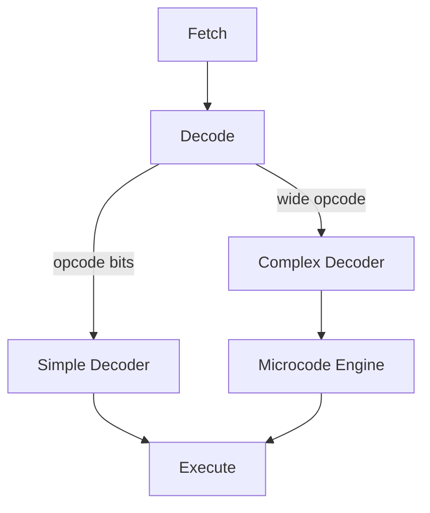

## 🗺️ Context
**Subject:** [[Computer Organization & Architecture]]
**Parent Topic:** [[Instruction Set Architecture]]
**Sibling Topics:** [[Instruction Format]], [[Addressing Modes]]
**Leads To:** [[Microarchitecture Design]], [[Dynamic Binary Translation]]

> 📍 **GATE Syllabus Mapping:** Encoding and representation of instructions; instruction formats; addressing modes (part of the GATE CS COA syllabus).

## 💡 Motivation & Intuition
Modern CPUs execute operations encoded as compact binary words called **[[Opcode]]s**. The opcode technique family addresses how to design, encode, decode, and optimize these binary representations so that a processor can fetch and execute useful work efficiently. Analogy: an opcode is a shorthand verb in a language — the shorter and clearer the verb, the faster speakers (processors) can follow commands.

Core idea (one sentence): Pack the operation and operand information into a fixed bit pattern so that hardware (or microcode) can quickly decode and execute it while balancing instruction density, decode complexity, and pipeline friendliness.

## 📖 Theory

### Formal definition
An **[[Opcode]]** is the bit-field within a machine instruction that specifies the operation the processor must perform. An **instruction format** partitions the instruction word into fields: opcode, operand specifiers, addressing mode bits, and optional immediate data.

### Instruction width and opcode field size
If instructions are W bits and the opcode field is k bits, the architecture supports up to
$$2^{k}$$
distinct opcodes. The remaining bits are available for operand specifiers:
$$	ext{operand bits} = W - k.$$ 

Example: In a 32-bit instruction with k=8, there are $2^{8}=256$ opcodes and 24 bits for operands.

### Fixed-length vs variable-length formats
- **Fixed-length**: every instruction is W bits (e.g., [[RISC]]). Simpler decode, easier pipelining.
- **Variable-length**: instruction length varies (e.g., many [[CISC]] ISAs). Higher code density but more complex decoder.

### Opcode classes and encoding techniques
- **Dense encoding**: common operations get short opcode fields or mapped micro-ops.
- **Prefix/escape bytes**: extend opcode space in variable-length ISAs.
- **Opcode compression**: pairs or sequences of instructions encoded compactly to save space (used in code caches/ISA extensions).

### Decoder strategies
- **Single-stage decode**: direct lookup of opcode -> micro-ops.
- **Multi-stage decode**: coarse opcode fields route to specialized decoders; useful for wide instruction sets.
- **Microcoded decode**: opcode selects a microcode routine (maps to [[Micro-operations]]).

### Pseudocode: simple decode

```
Algorithm DECODE_AND_EXECUTE(instruction):
    opcode = extract_bits(instruction, opcode_offset, k)
    switch opcode:
        case ADD: execute_add(instruction)
        case LOAD: execute_load(instruction)
        ...
    return
```

What GATE tests: bit-field sizing, trade-offs between fixed/variable formats, decode complexity, and addressing-mode encoding.

## 🖼️ Diagrams & Visuals

1) Draw: a single 32-bit instruction divided into fields (opcode, reg1, reg2, immediate).

ASCII approximation:

  [31........16][15.....8][7.....0]
  [  opcode(16) ][ reg (8)][ imm(8)]

Labels: opcode = operation selector; reg = register specifier; imm = immediate operand.

2) Decoder flow (Mermaid):



## ⏱️ Complexity Analysis
This is not an asymptotic algorithmic topic, but costs and complexities map to hardware resources and time-critical stages.

- **Decode latency**: fixed-length decoders have predictable latency $L_{d}$; variable-length decoders add variable overhead proportional to the number of bytes scanned.
- **Area / hardware complexity**: number of opcode bits and decoding logic grows roughly with $O(2^{k})$ for naive tables, but with practical sharing it's $O(k 	imes S)$ where $S$ is number of decoder blocks.

Summary table
| Case | Cost Metric | Notes |
|------|-------------|-------|
| Fixed-length ISA | low decode latency | $L_d$ deterministic; pipelining-friendly |
| Variable-length ISA | higher decode logic | needs length-detection and alignment |
| Very-large opcode space | higher hardware area | may require microcode or multi-stage decoding |

## 🔢 Worked Example
Instruction width $W=16$ bits. We want 5 registers (need 3 bits per reg) and support immediate up to 6 bits.

Design: opcode bits $k = W - (2*3 + 6) = 16 - 12 = 4$. So $2^{4}=16$ opcodes.

Choose encoding: 4-bit opcode, 3-bit rd, 3-bit rs, 6-bit imm.

Example instruction: bits = 0b0011 010 001 100101 (grouped)
- opcode=0011 (3) => ADD_IMM
- rd=010 (2)
- rs=001 (1)
- imm=100101 (37)

Execution trace: decoder extracts opcode (4 bits), dispatches to ALU, reads registers R1 and R2, sign-extends immediate, computes result, writes back to R2. Total decode+exec cycles depend on microarchitecture; in a single-cycle design this is 1 cycle for decode+exec (conceptually), in pipelined design decode and execute are separate stages.

What changes if instruction width is variable? You must first determine instruction length (scan prefixes) then extract fields; opcode field may be non-aligned, increasing decode cost.

## 🎯 GATE Questions

**Question 1 — GATE-style (1-mark)**
An ISA uses 32-bit fixed-length instructions. If it reserves 7 bits for opcode, how many distinct opcodes are available?
- (A) 128  (B) 256  (C) 64  (D) 512

<details>
<summary>💡 Solution</summary>

**Answer: (A)**

**Reasoning:** Number of opcodes = $2^{7}=128$. Trap: don't confuse total instruction bits with opcode bits.

</details>

**Question 2 — GATE-style (2-mark)**
Which design choice improves decode speed in a very large ISA without increasing die area significantly?
- (A) increase opcode field width
- (B) use multi-stage decode that first identifies opcode class
- (C) move to variable-length encoding
- (D) remove immediate fields

<details>
<summary>💡 Solution</summary>

**Answer: (B)**

**Reasoning:** Multi-stage decode groups opcodes by class, enabling small fast decoders for common classes and delegating rare cases to slower logic. This reduces average decode latency without linear area growth in a single giant table.

</details>

## ⚠️ Edge Cases & Traps
- [ ] Instruction size 0 — invalid. Fix: define minimum instruction width.
- [ ] Running out of opcode combinations — fix: introduce escape/prefix opcodes or microcode.
- [ ] Off-by-one in bit indexing when extracting fields — fix: document bit numbering (MSB=bit W-1 or LSB=0).
- [ ] Misaligned instructions (in variable-length ISAs) — fix: align fetch, or use re-alignment buffers.

## ⚖️ Comparisons
| Feature | [[Opcode Technique]] | [[RISC]] | [[CISC]] |
|---|---:|---:|---:|
| Time to decode | Medium | Low | High (variable) |
| Instruction density | Medium | Low | High |
| Hardware complexity | Medium | Low | High |
| When to prefer | Balanced pipelines | Simple, fast decode | Compact code, legacy support |

Most common GATE comparison: fixed vs variable-length instruction formats — answer hinges on decode predictability vs code density.

## 🧠 Memory Hooks & Mnemonics
- Mnemonic: "OP = 2^k" (remember opcode capacity formula).
- Visual metaphor: opcode = verb, operands = nouns; shorter verbs mean faster speech but fewer verbs exist.
- #1 Trap: Assuming more opcode bits always helps — wrong because decode logic and area cost grow; prefer smarter grouping and microcode.

## 🕸️ Connections Web

**Prerequisite Knowledge:**
- [[Binary Arithmetic]] — bit manipulation for fields
- [[Instruction Set Architecture]] — why opcodes exist
- [[Addressing Modes]] — encoded alongside opcodes
- [[Registers]]
- [[Endianness]]

**Builds Upon This Topic:**
- [[Microarchitecture Design]]
- [[Pipelining]]
- [[Dynamic Binary Translation]]
- [[Just-In-Time Compilation]]

**GATE Subject Links:**
- [[Computer Organization & Architecture]]
- [[Assembler]]
- [[Machine Code]]

**Cross-Subject Connections:**
- [[Operating Systems]] — context switches require instruction state preservation
- [[Compilers]] — instruction selection and scheduling interact with opcode choices

**Standard References:**
- [[Patterson & Hennessy]] — chapters on ISA and encoding
- [[Hennessy and Patterson Chapter 2]]

## ✅ Revision Checklist
- [ ] I can define an opcode and instruction format.
- [ ] I can compute opcode field size given W and operand bits.
- [ ] I can explain fixed vs variable-length trade-offs in one sentence.
- [ ] I can describe multi-stage decode and microcoded decode.
- [ ] I can solve the sample GATE questions above.

How would GATE test this? Expect short MCQs on bit-field sizing and trade-offs, and occasional 2-mark reasoning questions about decode strategies.
