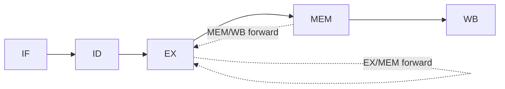
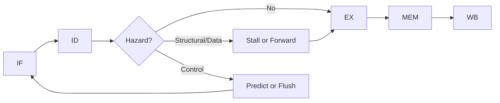

## Syllabus Position

**Subject:** [[Computer Organization and Architecture Index]]
**Parent Topic:** [[Processor Design]]
**Sibling Topics:** [[Instruction Cycle]], [[Data Path]], [[Control Unit]], [[Machine Instructions]]
**Leads To:** [[Pipeline Hazards]], [[Instruction Level Parallelism]], [[Superscalar Processors]], [[Branch Prediction]]

**GATE Syllabus Line:** Computer Organization and Architecture - ALU, data-path and control unit; instruction pipelining.

**Exam Weight Note:** This topic appears very often as 1-mark MCQs on hazard identification and speedup, and as 2-mark NAT/MSQ questions on timing tables, stall counting, forwarding, and branch penalty.

## The Problem This Solves

If a processor finishes one instruction completely before touching the next one, most hardware stays idle in each clock cycle. The fetch unit waits while the ALU works, the ALU waits while memory is accessed, and memory waits while results are written back. **[[Pipelining]]** was invented to overlap these activities so different instructions can use different hardware parts at the same time. But once instructions overlap, they start interfering with one another, which creates **[[Pipeline Hazard]]**s.

The analogy is an assembly line in a factory. One product is being painted, another is being inspected, and a third is being packed. The line is fast only if each station stays busy and no product blocks the next one.

Core Idea (one sentence): **[[Pipelining]]** improves instruction throughput by overlapping execution stages, and **[[Pipeline Hazard]]**s are the conflicts that stop this ideal overlap from happening.

## Formal Theory

**[[Pipelining]]** is an implementation technique in which instruction execution is divided into stages separated by **[[Pipeline Register]]**s, allowing multiple instructions to be in progress simultaneously. A **[[Pipeline Hazard]]** is any condition that prevents an instruction from advancing in the cycle where it would advance in an ideal pipeline.

### Classical Five-Stage Pipeline

The standard GATE model uses five stages:

1. **[[Instruction Fetch]] (IF):** read instruction memory using the **[[Program Counter]]**.
2. **[[Instruction Decode]] (ID):** decode opcode, read source registers, and generate control signals.
3. **[[Execute]] (EX):** perform ALU work or effective-address calculation.
4. **[[Memory Access]] (MEM):** read or write data memory if required.
5. **[[Write Back]] (WB):** write the result into the register file.

Each stage ideally consumes one **[[Clock Cycle]]**. The purpose of the **[[Pipeline Register]]** between stages is to preserve data, control bits, and destination information so every stage can work independently in the next cycle.

### Ideal Pipeline Timing

If the stage delays are $t_1, t_2, \dots, t_k$ and latch overhead is $t_r$, then the pipeline clock period is

$$
T_{clk} = \max(t_1, t_2, \dots, t_k) + t_r
$$

This formula exists because the slowest stage determines how soon the entire pipeline can safely advance.

For $n$ instructions in an ideal $k$-stage pipeline,

$$
T_{ideal}(n) = (k + n - 1)T_{clk}
$$

The first instruction needs $k$ cycles to emerge, and each later instruction ideally completes one cycle after that. In contrast, a non-pipelined design takes

$$
T_{nonpipe}(n) = n \sum_{i=1}^{k} t_i
$$

because every instruction must finish all stages before the next one begins.

### Speedup and Throughput

The speedup is

$$
S(n) = \frac{T_{nonpipe}(n)}{T_{ideal}(n)}
$$

If all stages are perfectly balanced with delay $t$ and latch overhead is ignored, then $T_{clk} = t$ and $\sum t_i = kt$, so

$$
S(n) = \frac{nk}{k+n-1}
$$

Hence,

$$
\lim_{n \to \infty} S(n) = k
$$

This is the standard GATE conclusion: ideal speedup approaches the number of stages, not more.

### Structural Hazard

A **[[Structural Hazard]]** occurs when two instructions need the same hardware resource in the same cycle. A classic example is a single unified memory used for both instruction fetch and data access. If one instruction is in IF while an older load is in MEM, both may need memory simultaneously.

This is not a data dependency problem. The instructions may be logically independent, but the hardware cannot serve both requests together.

### Data Hazard

A **[[Data Hazard]]** occurs when one instruction depends on the result of another overlapped instruction.

The most important type in the simple in-order RISC pipeline is **[[Read After Write]] (RAW)**:

$$
I_1: R_1 \leftarrow R_2 + R_3
$$

$$
I_2: R_4 \leftarrow R_1 + R_5
$$

$I_2$ needs the new value of $R_1$, but $I_1$ has not produced it yet.

The other dependency names are **[[Write After Read]] (WAR)** and **[[Write After Write]] (WAW)**. In a simple in-order five-stage pipeline, RAW is the main practical hazard because reads happen before later writes reorder anything. WAR and WAW become important in **[[Out-of-Order Execution]]**, **[[Scoreboarding]]**, and **[[Tomasulo Algorithm]]**.

### Control Hazard

A **[[Control Hazard]]** occurs when the next instruction address is uncertain because of a branch, jump, or exception. If the branch outcome is known only in EX, the processor may fetch wrong-path instructions in IF and ID before the decision is available.

If the branch is taken, those wrong-path instructions are **[[Flush]]**ed. The number of flushed instructions is the branch penalty in cycles for that pipeline design.

### Hazard Handling Techniques

#### Stall and Bubble Insertion

A **[[Stall]]** freezes part of the pipeline until correctness is restored. A **[[Bubble]]** is a dummy cycle inserted so that a later instruction does not move into a stage too early.

#### Operand Forwarding

**[[Operand Forwarding]]** sends a result directly from EX/MEM or MEM/WB pipeline registers to the ALU input of a dependent instruction. This avoids waiting for full register write-back when the value is already computed.

#### Branch Prediction

**[[Branch Prediction]]** guesses the next control-flow path so fetching continues without waiting. Correct guesses preserve throughput; wrong guesses cost flush cycles.

### Pipeline Control as Pseudocode

```text
Algorithm PIPELINE_ADVANCE(instruction_stream):
    while instructions remain or pipeline not empty:
        detect structural, data, and control hazards
        if safe to advance:
            perform WB, MEM, EX, ID, IF in overlapped fashion
            move outputs into pipeline registers
        else:
            stall required stages or insert bubble
        if branch resolved and prediction was wrong:
            flush wrong-path instructions
    return completed instructions
```

```text
Algorithm HANDLE_RAW(producer, consumer):
    if result available through forwarding path:
        forward value to consumer
    else:
        insert stall until value becomes available
    return safe execution
```

### What GATE Actually Tests Here

GATE rarely asks you to recite the textbook definition. It usually tests whether you can fill a timing table, identify the hazard class, count bubbles after forwarding assumptions are given, compute branch penalty, or distinguish throughput gain from latency reduction. The exam also likes trap questions where the presence or absence of separate instruction and data memory changes the answer from no hazard to **[[Structural Hazard]]**.

## Diagrams and Visuals

### Visual 1: Five-Stage Instruction Pipeline

1. Draw five boxes in one row labeled IF, ID, EX, MEM, and WB.
2. Put a small vertical bar between consecutive boxes to represent pipeline registers.
3. Draw arrows left to right to show stage progression.

```text
IF |R| ID |R| EX |R| MEM |R| WB
```

Labels:
- `IF`: instruction fetch.
- `ID`: decode and register read.
- `EX`: ALU or address work.
- `MEM`: data memory access.
- `WB`: register write-back.
- `R`: **[[Pipeline Register]]**.

### Visual 2: Time-Space Timing Table

1. Put cycles on the horizontal axis and instructions on the vertical axis.
2. Fill stage names diagonally to show overlap.
3. Insert `STALL` where a hazard blocks normal motion.

```text
Cycle ->   1    2    3    4      5    6    7
I1        IF   ID   EX   MEM     WB
I2             IF   ID   STALL   EX   MEM  WB
I3                  IF   STALL   ID   EX   MEM  WB
```

Labels:
- Each row is one instruction.
- Each column is one **[[Clock Cycle]]**.
- `STALL` marks a cycle lost to hazard handling.

### Visual 3: Forwarding Paths

1. Draw the five stages in a line.
2. Add dotted arrows from EX/MEM and MEM/WB back to EX.
3. Mark these arrows as bypass paths.



Labels:
- `EX/MEM forward`: value produced recently by ALU.
- `MEM/WB forward`: value available one stage later.
- `EX`: consumer stage that needs the operand.

### Visual 4: Branch Penalty Picture

1. Draw one branch instruction and two younger instructions behind it.
2. Show the branch resolving in EX.
3. Mark the younger wrong-path instructions as `FLUSH`.

```text
Cycle ->   1   2   3   4   5
Branch    IF  ID  EX  MEM WB
Next1         IF  ID  FLUSH
Next2             IF  FLUSH
```

Labels:
- `Branch`: control instruction.
- `FLUSH`: wrongly fetched instruction removed from the pipeline.
- Penalty equals the number of wrong-path instructions discarded.

### Visual 5: Hazard Decision Flow

1. Draw the normal stage flow from IF to WB.
2. Add a decision node after decode or execute named `Hazard?`.
3. Draw one path to normal progress and one to stall/forward/flush.



Labels:
- `Hazard?`: hardware checks for conflicts.
- `Stall or Forward`: used for **[[Data Hazard]]** and **[[Structural Hazard]]**.
- `Predict or Flush`: used for **[[Control Hazard]]**.

## Complexity Analysis

This topic is not analyzed with input-size complexity alone. The right lens is execution time for an instruction stream, plus the penalties added by hazards.

### Clock Period Derivation

The pipeline advances only when every stage can finish its work and every **[[Pipeline Register]]** can capture stable outputs. Therefore,

$$
T_{clk} = \max(t_1, t_2, \dots, t_k) + t_r
$$

The maximum stage delay appears because the whole machine must wait for the slowest stage in every cycle.

### Best-Case Time

If no hazard occurs for $n$ instructions in a $k$-stage pipeline, total cycles are

$$
k + n - 1
$$

So total execution time is

$$
T_{best}(n) = (k+n-1)T_{clk}
$$

The extra $k-1$ cycles are the fill cost. They are unavoidable because the first completed instruction cannot appear before the last stage is reached.

### Average-Case Time

Let the average stall cycles per instruction be $s$. Then average **[[CPI]]** is

$$
\text{CPI}_{avg} = 1 + s
$$

because an ideal scalar pipeline completes one instruction per cycle after fill, and each average stall adds directly to that baseline.

For large $n$,

$$
T_{avg}(n) \approx n(1+s)T_{clk}
$$

For exact finite streams, add fill overhead separately:

$$
T_{avg}(n) = (k+n-1+x_{avg})T_{clk}
$$

where $x_{avg}$ is the total number of stall or flush cycles.

### Worst-Case Time

In the worst case, hazards repeatedly prevent overlap. If total lost cycles are $x_{max}$, then

$$
T_{worst}(n) = (k+n-1+x_{max})T_{clk}
$$

The important idea is that every lost cycle adds a full clock period. Hazards do not partially slow a cycle; they create whole-cycle penalties in the GATE timing-table model.

### Space and Hardware Cost

Auxiliary pipeline hardware consists mainly of **[[Pipeline Register]]**s, forwarding paths, control logic, and hazard detection logic. This extra hardware is roughly proportional to the number of stage boundaries, so it is $O(k)$ with respect to pipeline depth, not instruction count.

### Speedup with Hazards

The practical speedup is

$$
S_{real}(n) = \frac{n \sum_{i=1}^{k} t_i}{(k+n-1+x)T_{clk}}
$$

This expression makes the exam insight obvious: even if $k$ is large, excessive hazard penalty $x$ can destroy most of the expected gain.

| Case | Time Complexity | Space Complexity | Trigger Condition |
|------|-----------------|------------------|-------------------|
| Best Case | $(k+n-1)T_{clk}$ | $O(k)$ extra hardware | Balanced pipeline, no hazards, no mispredictions |
| Average Case | $(k+n-1+x_{avg})T_{clk}$ | $O(k)$ extra hardware | Typical instruction mix with some RAW stalls and branch penalties |
| Worst Case | $(k+n-1+x_{max})T_{clk}$ | $O(k)$ extra hardware | Repeated hazards, poor prediction, or severe resource conflict |

## Worked Example

Consider a five-stage in-order pipeline with IF, ID, EX, MEM, WB. Assume separate instruction and data memory, full forwarding, branch resolution in EX, and one-cycle load-use penalty.

Instruction stream:

$$
I_1: \text{LW } R_1, 0(R_2)
$$

$$
I_2: \text{ADD } R_3, R_1, R_4
$$

$$
I_3: \text{SUB } R_5, R_3, R_6
$$

$$
I_4: \text{BEQ } R_5, R_5, \text{LABEL}
$$

$$
I_5: \text{OR } R_7, R_8, R_9 \quad \text{(wrong path if branch taken)}
$$

$$
I_6: \text{XOR } R_{10}, R_{11}, R_{12} \quad \text{(wrong path if branch taken)}
$$

$$
I_7: \text{LABEL: AND } R_{13}, R_3, R_{14}
$$

### Full Timing Trace

```text
Cycle ->   1    2    3    4      5    6    7    8    9   10   11   12
I1        IF   ID   EX   MEM     WB
I2             IF   ID   STALL   EX   MEM  WB
I3                  IF   STALL   ID   EX   MEM  WB
I4                              IF   ID   EX   MEM  WB
I5                                   IF   ID   FLUSH
I6                                        IF   FLUSH
I7                                             IF   ID   EX   MEM  WB
```

### Cycle 1

State: $I_1$ is in IF. The IF/ID register will hold $I_1$ at cycle end. No hazard exists because only one instruction is active.

### Cycle 2

State: $I_1$ moves to ID and $I_2$ enters IF. Register operands for the load are read. The pipeline is still ideally filled.

### Cycle 3

State: $I_1$ enters EX to compute the effective address, $I_2$ enters ID, and $I_3$ enters IF. The hazard detection logic notices that $I_2$ needs $R_1$, which will come from the load.

### Cycle 4

State: $I_1$ is in MEM and performs the actual data read. $I_2$ cannot enter EX because the loaded value is not available at the beginning of that cycle. One **[[Bubble]]** is inserted, and $I_3$ is held back. This is a **[[Read After Write]]** load-use hazard.

### Cycle 5

State: $I_1$ reaches WB and writes or makes available $R_1$. $I_2$ now enters EX using the newly available operand. $I_3$ moves to ID and $I_4$ enters IF.

### Cycle 6

State: $I_2$ is in MEM, $I_3$ is in EX, $I_4$ is in ID, and $I_5$ is in IF. The dependence from $I_2$ to $I_3$ does not create an extra stall because forwarding supplies $R_3$ in time.

### Cycle 7

State: $I_2$ is in WB, $I_3$ is in MEM, $I_4$ is in EX, $I_5$ is in ID, and $I_6$ is in IF. Since $I_4$ is `BEQ R5, R5, LABEL`, the branch is definitely taken. The decision becomes known in EX, so $I_5$ and $I_6$ are wrong-path instructions and must be flushed.

### Cycle 8

State: $I_4$ moves to MEM. The wrong-path instructions are gone, and the processor fetches the correct target instruction $I_7$. This is the first cycle of branch recovery.

### Cycle 9

State: $I_4$ reaches WB and $I_7$ reaches ID. The pipeline is refilling on the correct path.

### Cycle 10

State: $I_7$ enters EX. No hazard remains because $R_3$ was already produced much earlier by $I_2$.

### Cycle 11

State: $I_7$ enters MEM.

### Cycle 12

State: $I_7$ enters WB and completes execution.

### Operation Count

Useful instructions executed: $5$ namely $I_1, I_2, I_3, I_4, I_7$.

Ideal cycles without hazards for $5$ useful instructions:

$$
k+n-1 = 5+5-1 = 9
$$

Actual cycles used:

$$
12
$$

Extra cycles:

$$
12 - 9 = 3
$$

These $3$ cycles come from one load-use stall and a two-cycle taken-branch penalty. Total operations: $12$. This confirms the $T(n) = (k+n-1+x)T_{clk}$ claim because the observed hazard overhead is exactly $x = 3$.

What changes if the branch is not taken? The two flush cycles disappear because $I_5$ and $I_6$ become correct-path instructions. What changes if forwarding is removed? The $I_2 \to I_3$ and $I_3 \to I_4$ dependencies may introduce extra stalls because consumers must wait until WB instead of receiving values early.

## Intuition Anchors

**The Analogy (restated and deepened):** Think of a restaurant kitchen line. One dish is being chopped, another is cooking, and another is being plated. A **[[Structural Hazard]]** is two chefs fighting over one stove. A **[[Data Hazard]]** is the plating chef waiting for sauce that the cooking chef has not finished yet. A **[[Control Hazard]]** is the head chef suddenly changing the order ticket, forcing some partially prepared dishes to be discarded.

**The Mental Model:** Experts picture a diagonal timing table, not isolated instructions. They scan each cycle and ask three questions: which instruction wants this stage, whether it has the correct operands yet, and whether the next PC is known. If any answer is no, they decide between forward, stall, or flush.

**The One-Line Recall:** Pipelining gives one-result-per-cycle throughput only after fill, and every hazard simply adds whole lost cycles on top of the ideal $(k+n-1)$ pattern.

**The #1 Trap:** Students often think every RAW dependency causes a stall. That feels reasonable because the consumer clearly needs the producer's result, but the correct rule is more precise: stall only if the value is not available by the stage where the consumer needs it. With **[[Operand Forwarding]]**, many ALU-to-ALU RAW dependencies do not stall at all; the classic exception is the load-use case.

## GATE Questions

**Question 1 — GATE-style — Difficulty: 1-mark**

> A 5-stage balanced pipeline has no hazards and negligible latch overhead. For a very large number of instructions, the maximum speedup over the corresponding non-pipelined processor is:

- (A) $4$
- (B) $5$
- (C) $6$
- (D) Cannot be determined

<details>
<summary>Solution</summary>

**Answer: (B)**

**Reasoning:** In an ideal balanced $k$-stage pipeline, asymptotic speedup tends to $k$. Here $k=5$, so the limit is $5$.

- (A) is wrong because fill overhead affects finite streams, not the asymptotic limit.
- (C) is wrong because ideal speedup cannot exceed the number of balanced stages in this simple model.
- (D) is wrong because the question explicitly gives enough information.

**What this question is really testing:** Whether you know that pipeline speedup approaches stage count, not instruction count.

**Trap to avoid:** Do not confuse latency of the first output with long-run throughput gain.

</details>

**Question 2 — GATE-style — Difficulty: 1-mark**

> In a 5-stage pipeline, instruction fetch and data memory access use the same single memory. A load instruction is in MEM while another instruction is in IF in the same cycle. Which hazard occurs?

- (A) **[[Data Hazard]]**
- (B) **[[Structural Hazard]]**
- (C) **[[Control Hazard]]**
- (D) No hazard

<details>
<summary>Solution</summary>

**Answer: (B)**

**Reasoning:** Both instructions want the same hardware resource, namely one memory unit, in the same cycle. That is exactly the definition of a **[[Structural Hazard]]**.

- (A) is wrong because no operand dependency was described.
- (C) is wrong because no branch or control-flow uncertainty exists.
- (D) is wrong because simultaneous resource demand cannot be served by one port.

**What this question is really testing:** Whether you separate resource conflict from data dependency.

**Trap to avoid:** If the question says "single memory" or "single ALU," first think structural conflict.

</details>

**Question 3 — GATE-style — Difficulty: 2-mark**

> Consider the instruction sequence on a 5-stage in-order pipeline with forwarding and branch decision in EX:
> `LW R1, 0(R2)`
> `ADD R3, R1, R4`
> `BEQ R3, R5, LABEL`
> Assume a load-use dependency requires one stall and the branch is taken. How many extra cycles beyond the ideal no-hazard pipeline are introduced?

- (A) $1$
- (B) $2$
- (C) $3$
- (D) $4$

<details>
<summary>Solution</summary>

**Answer: (C)**

**Reasoning:**

1. `LW` to `ADD` is a load-use **[[Read After Write]]** dependency, so it causes one stall.
2. The branch decision is known in EX. By that time, younger instructions in IF and ID may already be on the wrong path.
3. A taken branch therefore costs two flush cycles in the standard 5-stage model.

Hence total extra cycles are

$$
1 + 2 = 3
$$

- (A) counts only the data hazard.
- (B) counts only the control hazard.
- (D) overestimates the penalty by adding a stall not justified by the stated forwarding assumption.

**What this question is really testing:** Whether you can combine data-hazard penalty with control-hazard penalty in one timing argument.

**Trap to avoid:** Forwarding removes many ALU RAW stalls, but it does not magically remove the load-use stall or the branch flush.

</details>

**Pattern Recognition:**
- If a question gives stage count and instruction count, immediately write $(k+n-1+x)T_{clk}$.
- If a branch resolution stage is specified, count how many younger instructions have already entered the pipeline before resolution.
- If forwarding is mentioned, test whether the consumer needs the value before MEM or after MEM; that separates no-stall ALU chains from load-use stalls.
- If one hardware resource is shared across stages, check **[[Structural Hazard]]** before searching for data dependence.

## Edge Cases and Failure Modes

- [ ] **Very short instruction streams:** Wrong assumption: asymptotic speedup always reflects real speedup. Actual fact: when $n$ is small, the $k-1$ fill cycles matter heavily. Fix: use the exact finite-stream formula, not just the long-run limit.
- [ ] **All instructions independent:** Wrong assumption: pipelining automatically implies some stall. Actual fact: independent instructions can sustain **[[CPI]]** close to $1$. Fix: inspect actual operands before inserting bubbles.
- [ ] **Load followed immediately by use:** Wrong assumption: forwarding removes every RAW problem. Actual fact: the loaded data typically becomes available too late for the very next EX stage. Fix: remember the classic one-cycle load-use stall unless the architecture says otherwise.
- [ ] **Single memory for IF and MEM:** Wrong assumption: fetch and data access always overlap. Actual fact: a unified single-ported memory creates a **[[Structural Hazard]]**. Fix: use separate instruction/data memory or accept stalls.
- [ ] **Taken branch with late resolution:** Wrong assumption: only the branch instruction itself matters. Actual fact: younger wrong-path instructions may need flushing. Fix: count instructions already in IF, ID, or later before the branch resolves.
- [ ] **Off-by-one cycle counting:** Wrong assumption: total cycles equal $k+n$. Actual fact: the exact ideal count is $k+n-1$. Fix: derive once from the timing table and memorize the pattern.
- [ ] **WAR and WAW in basic in-order pipeline:** Wrong assumption: every named dependency becomes an actual hazard. Actual fact: in the simple five-stage in-order model, RAW is the dominant practical hazard. Fix: check whether out-of-order execution or multiple write points are present before marking WAR or WAW as hazards.

## Comparisons

| Feature | [[Structural Hazard]] | [[Data Hazard]] | [[Control Hazard]] |
|---------|-----------------------|-----------------|--------------------|
| Root cause | Same hardware resource needed simultaneously | Operand dependency between overlapped instructions | Next PC not known yet |
| Typical example | One memory used by IF and MEM | `ADD` needing result of previous `LW` | Taken branch resolved in EX |
| Main fix | Duplicate resource or stall | Forward, stall, or schedule | Predict, delay, or flush |
| When it appears | Resource-limited pipeline | Dependent instruction stream | Branch-heavy control flow |
| GATE trap | Mistaking it for data dependency | Assuming every RAW stalls | Forgetting wrong-path instructions already entered |

The most common GATE comparison question here asks you to identify the hazard class from one sentence of architecture detail. The answer usually hinges on one distinguishing property: resource conflict means **[[Structural Hazard]]**, value dependency means **[[Data Hazard]]**, and uncertain next instruction address means **[[Control Hazard]]**.

## Connections Web

**Must know before this topic:**
- [[Instruction Cycle]] - pipelining overlaps multiple instruction cycles at once.
- [[Data Path]] - pipeline stages are carved from datapath functionality.
- [[Control Unit]] - hazard handling depends on stage-wise control signals.
- [[Machine Instructions]] - source and destination fields determine dependencies.
- [[Addressing Modes]] - effective address calculation often happens in EX.
- [[Clock Cycle]] - timing analysis is impossible without a cycle model.

**Topics that build on this:**
- [[Pipeline Hazards]] - deeper note on individual hazard classes.
- [[Instruction Level Parallelism]] - pipelining is the foundation of ILP.
- [[Superscalar Processors]] - multiple issues per cycle make hazard logic harder.
- [[Branch Prediction]] - advanced control-hazard reduction.
- [[Out-of-Order Execution]] - changes how RAW, WAR, and WAW are handled.
- [[Tomasulo Algorithm]] - dynamic scheduling with register renaming.

**GATE subject cross-links:**
- [[Computer Organization and Architecture Index]] > [[Processor Design]]

**Cross-subject connections:**
- [[Cache Memory]] - cache miss latency can turn MEM into a long stall source.
- [[Virtual Memory]] - translation and page faults can magnify effective memory-access penalty.
- [[Context Switching]] - unlike a pipeline stall, this is an operating-system level switch, not an intra-instruction hardware pause.

**Standard references:**
- [[Computer Organization and Design Patterson and Hennessy]]
- [[Morris Mano Computer System Architecture]]
- [[GATE Previous Year Questions COA]]

## Quick Revision Sheet

**Definition (1 sentence):** **[[Pipelining]]** overlaps instruction stages, and **[[Pipeline Hazard]]**s are the conditions that stop an instruction from moving forward in its ideal cycle.

**Core Idea / Analogy (1 sentence):** It is an assembly line for instructions, where stalls happen if two jobs want the same machine, need an unfinished part, or the next destination is not yet known.

**Algorithm Steps (numbered, maximum 6 steps):**
1. Fetch the next instruction.
2. Decode it and read operands.
3. Execute ALU work or address calculation.
4. Access memory if needed.
5. Write the result back.
6. If conflict appears, forward, stall, or flush.

**Complexity:**
- Time (best / average / worst): $(k+n-1)T_{clk}$ / $(k+n-1+x_{avg})T_{clk}$ / $(k+n-1+x_{max})T_{clk}$
- Space: $O(k)$ extra hardware
- Recurrence (if applicable): not recurrence-based; use stream timing and **[[CPI]]** instead

**Key Properties (3 to 5 bullet points — facts GATE tests directly):**
- Ideal asymptotic speedup approaches $k$ for a balanced $k$-stage pipeline.
- Ideal scalar pipeline has **[[CPI]]** close to $1$ after fill.
- The slowest stage fixes the pipeline clock period.
- RAW is the main true hazard in the basic in-order five-stage model.
- Load-use and taken branches are the two classic places where students must count penalty cycles carefully.

**The #1 Trap:** Marking every dependency as a stall without checking whether forwarding makes the operand available in time.

**When to use this over alternatives:** Use pipelining when you want fine-grained throughput improvement inside one processor datapath rather than full processor duplication.

**Mnemonic or one-liner to remember the steps:** `Fetch, Decode, Execute, Memory, Write-back; then count stalls only where values or paths fight back.`

## Revision Checklist

- [ ] I can state the formal definition without looking.
- [ ] I can explain the analogy and map it to the algorithm or concept.
- [ ] I can trace a 6-element example by hand in under 2 minutes.
- [ ] I can derive the worst-case complexity from scratch.
- [ ] I know what the Quick Revision Sheet says without reading it.
- [ ] I can solve all 3 GATE questions in this note without peeking.
- [ ] I know the #1 trap and can articulate why students fall for it.
- [ ] I have linked this note correctly in my Obsidian vault.
- [ ] I have scheduled a spaced-repetition review in 3 days.
