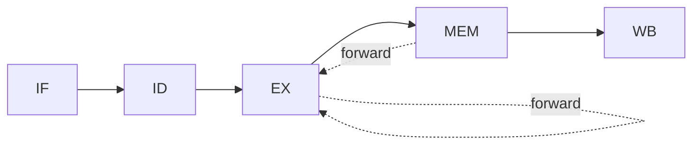
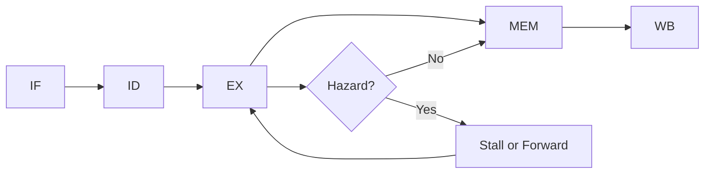

## Syllabus Position

**Subject:** [[Computer Organization and Architecture Index]]
**Parent Topic:** [[Processor Design]]
**Sibling Topics:** [[Instruction Cycle]], [[Data Path]], [[Control Unit]], [[RISC vs CISC]]
**Leads To:** [[Pipeline Hazards]], [[Instruction Level Parallelism]], [[Superscalar Processors]], [[Branch Prediction]]

**GATE Syllabus Line:** Computer Organization and Architecture - ALU, data-path and control unit; instruction pipelining.

**Exam Weight Note:** Appears very often as 1-mark MCQs on speedup, throughput, and hazard type, and as 2-mark NAT/MSQ questions requiring pipeline timing tables, stall counting, branch penalty calculation, or stage-balancing analysis.

---

## The Problem This Solves

If a processor waits for one instruction to finish completely before starting the next one, expensive hardware sits idle most of the time. While one instruction is being executed, the fetch unit, decoder, memory interface, and write-back hardware could already be helping later instructions. Pipelining was invented to overlap these steps so that different hardware parts stay busy in the same clock period. The result is higher instruction throughput without needing the entire instruction to become individually faster.

**Analogy:** It is like a laundry pipeline: one batch is being washed, another is being dried, and a third is being folded. Each batch still needs all three steps, but multiple batches move through different steps at the same time.

**Core Idea (one sentence):** [[Pipelining]] increases throughput by dividing instruction execution into stages and overlapping different instructions across those stages.

---

## Formal Theory

**[[Pipelining]]** is an implementation technique in which multiple instructions are processed concurrently by partitioning instruction execution into a sequence of stages, with each stage performing part of the work and passing intermediate results to the next stage through **[[Pipeline Register]]**s.

### Five-Stage Instruction Pipeline

The classical RISC pipeline used in GATE questions has five stages:

1. **[[Instruction Fetch]] (IF):** fetch instruction from memory using the [[Program Counter]].
2. **[[Instruction Decode]] (ID):** decode opcode, read register operands, and generate control signals.
3. **[[Execute]] (EX):** perform ALU operation or effective address calculation.
4. **[[Memory Access]] (MEM):** read from or write to data memory if required.
5. **[[Write Back]] (WB):** write the final result into the register file.

Each stage takes one clock cycle in the ideal model. Between stages, pipeline registers hold data so that each stage can work on a different instruction in the next cycle.

### Pipeline Timing Model

Suppose the stage delays are $t_1, t_2, \dots, t_k$ for a $k$-stage pipeline and the latch overhead is $t_r$. Then the pipeline clock period is determined by the slowest stage:

$$
T_{pipe} = \max(t_1, t_2, \dots, t_k) + t_r
$$

This is the core reason stage balancing matters. Even if four stages are short, one long stage forces every instruction to wait for that slowest stage at every cycle.

The non-pipelined clock period for the same datapath is approximately:

$$
T_{nonpipe} = \sum_{i=1}^{k} t_i
$$

because one instruction must finish all stage work before the next begins.

### Latency, Throughput, and Speedup

For one instruction, latency in a $k$-stage ideal pipeline is roughly:

$$
L = k \cdot T_{pipe}
$$

This is why pipelining does not reduce the number of stages an instruction travels through. A single instruction usually does not complete in one cycle; instead, many instructions overlap.

If $n$ instructions are executed on an ideal pipeline, total time is:

$$
T_{ideal}(n) = (k + n - 1)T_{pipe}
$$

The first instruction needs $k$ cycles to fill the pipeline, and each later instruction ideally completes one cycle after that.

For a non-pipelined processor:

$$
T_{nonpipe}(n) = n \cdot T_{nonpipe}
$$

Hence ideal speedup is:

$$
S(n) = \frac{n \cdot T_{nonpipe}}{(k+n-1)T_{pipe}}
$$

If all stages are perfectly balanced with delay $t$ and latch overhead is ignored, then $T_{nonpipe} = kt$ and $T_{pipe} = t$, so:

$$
S(n) = \frac{nk}{k+n-1}
$$

As $n \to \infty$,

$$
S_{max} \to k
$$

This is the standard GATE result: ideal speedup approaches the number of pipeline stages, not infinity.

### Pipeline Registers and Stage Isolation

A **[[Pipeline Register]]** stores intermediate values such as instruction fields, operands, ALU outputs, destination register numbers, and control bits. Without these registers, one stage would overwrite signals before the next stage finished using them. GATE sometimes asks which values must be carried forward from one stage to another; this is why pipeline register contents matter.

### Structural View

```text
Algorithm PIPELINED_EXECUTION(instruction_stream):
    while instructions remain or pipeline not empty:
        perform WB for oldest instruction
        perform MEM for next instruction
        perform EX for next instruction
        perform ID for next instruction
        perform IF for newest instruction
        move results into pipeline registers
    return completed instructions
```

This pseudocode shows overlap, not sequential completion. Every cycle contains work from multiple instructions.

### Hazards

Any condition that prevents the next instruction from executing in its designated cycle is a **[[Pipeline Hazard]]**. Hazards reduce the ideal throughput of one completed instruction per cycle.

#### [[Structural Hazard]]

Two stages need the same hardware resource in the same cycle. Example: one shared memory is required for both IF and MEM. The fix is duplication, better scheduling, or stalling.

#### [[Data Hazard]]

An instruction depends on a value produced by an earlier instruction.

The main GATE-tested dependency is **[[Read After Write]] (RAW)**:

$$
I_1: R_1 \leftarrow R_2 + R_3
$$

$$
I_2: R_4 \leftarrow R_1 + R_5
$$

Here $I_2$ cannot use the correct $R_1$ until $I_1$ produces it.

Other names are **[[Write After Read]] (WAR)** and **[[Write After Write]] (WAW)**. In a simple in-order five-stage pipeline, RAW is the main true hazard; WAR and WAW mainly appear in out-of-order or multi-write scenarios.

#### [[Control Hazard]]

A branch or jump changes the next instruction address, so the processor may fetch wrong instructions before the branch outcome is known. The penalty depends on the stage at which branch resolution occurs.

### Hazard Resolution Techniques

#### [[Stall]] or Bubble Insertion

The pipeline pauses one or more stages until the dependency clears. A bubble behaves like a dummy instruction that consumes a cycle.

#### [[Operand Forwarding]]

Results are sent directly from later pipeline stages to earlier ones without waiting for register write-back.

```text
Algorithm FORWARD_OR_STALL(producer, consumer):
    if producer result available in EX/MEM or MEM/WB register:
        forward result to consumer EX input
    else if consumer needs result before it exists:
        insert bubble
    return safe execution
```

#### [[Branch Prediction]]

The processor guesses the branch direction so that fetching can continue. If the guess is wrong, incorrectly fetched instructions are flushed.

### Pipeline Performance with Stalls

If average stall cycles per instruction are $s$, then practical CPI becomes:

$$
\text{CPI} = 1 + s
$$

for an otherwise ideal scalar pipeline. Therefore CPU time becomes proportional to:

$$
\text{CPU Time} = IC \times \text{CPI} \times T_{pipe}
$$

where $IC$ is the instruction count. GATE frequently hides pipeline penalties inside CPI calculations, so this formula must be automatic in your mind.

### What GATE Actually Tests Here

GATE usually tests four angles: speedup derivation, timing-table completion, identifying hazard type, and counting stall cycles after forwarding or branch penalties are applied. Less often, it asks conceptual questions such as why pipelining improves throughput but not single-instruction latency.

---

## Diagrams and Visuals

### Visual 1: Basic Five-Stage Pipeline

**How to draw it:** Draw five boxes in a row labeled IF, ID, EX, MEM, and WB, with small pipeline registers between adjacent boxes.

```text
IF |R| ID |R| EX |R| MEM |R| WB
```

**Labels:**
- `IF`: fetch next instruction.
- `ID`: decode and read operands.
- `EX`: ALU work or address calculation.
- `MEM`: data memory access.
- `WB`: write result back.
- `R`: pipeline register separating stages.

### Visual 2: Time-Space Pipeline Chart

**How to draw it:** Put clock cycles on the horizontal axis and instructions on the vertical axis, then place diagonal stage labels.

```text
Cycle ->   1   2   3   4   5   6   7
I1        IF  ID  EX MEM  WB
I2            IF  ID  EX MEM  WB
I3                IF  ID  EX MEM  WB
```

**Labels:**
- Each row is one instruction.
- Each column is one clock cycle.
- The diagonal pattern shows overlap.

### Visual 3: Data Forwarding Path

**How to draw it:** Draw EX/MEM and MEM/WB registers feeding back into ALU inputs in the EX stage.



**Labels:**
- `EX -> EX`: forwarding from recent ALU output.
- `MEM -> EX`: forwarding from later stage when value becomes available there.

### Visual 4: Branch Hazard Timeline

**How to draw it:** Show a branch instruction followed by two fetched instructions, then mark them flushed if the branch is taken.

```text
Cycle ->   1   2   3   4   5
Branch    IF  ID  EX  MEM WB
Next1         IF  ID  FLUSH
Next2             IF  FLUSH
```

**Labels:**
- `FLUSH`: instruction discarded because the branch changed control flow.
- Penalty equals the number of wrong-path instructions removed.

### Visual 5: Pipeline Flow as a Stage Graph

**How to draw it:** Draw a left-to-right graph of stage progression with a hazard decision around EX.



**Labels:**
- `Hazard?`: point where dependency or branch logic may delay progress.
- `Stall or Forward`: hardware action to preserve correctness.

---

## Complexity Analysis

Pipelining is not an algorithm whose cost grows with input size in the usual sense, so the right analysis lens is performance per instruction stream: latency, throughput, speedup, CPI, and utilization.

### Time Per Instruction Stream

For $n$ instructions on a $k$-stage ideal pipeline:

$$
T_{ideal}(n) = (k+n-1)T_{pipe}
$$

This comes from one fill phase of $k-1$ extra cycles plus one cycle per completed instruction after the first result emerges.

With total stall cycles $x$:

$$
T(n) = (k+n-1+x)T_{pipe}
$$

Every stall adds a full clock period because some stage must wait instead of advancing.

### Throughput

Throughput is completed instructions per unit time.

For large $n$ in the ideal case:

$$
\text{Throughput}_{ideal} \approx \frac{1}{T_{pipe}}
$$

With average CPI $= 1+s$:

$$
\text{Throughput}_{real} = \frac{1}{(1+s)T_{pipe}}
$$

So even a small stall rate directly reduces throughput.

### Latency

Latency of one instruction remains:

$$
L = kT_{pipe}
$$

This is why the statement "pipelining makes one instruction finish faster" is usually false. It increases overlap, not the number of stages skipped.

### Balanced vs Unbalanced Pipeline

If stage delays are unequal, the slowest stage dominates:

$$
T_{pipe} = \max(t_i) + t_r
$$

Hence stage balancing improves performance even if the number of stages stays constant. Splitting one very long stage into two shorter stages can reduce clock period, but too many stages increase latch overhead and branch penalty. GATE sometimes frames this as an optimization tradeoff.

### Space / Hardware Cost

Pipeline hardware cost grows because each stage needs storage and control information in pipeline registers. Thus extra hardware is roughly proportional to the number of stage boundaries, but remains constant with respect to instruction count $n$.

### Complexity Summary Table

| Case         | Time Complexity | Space Complexity | Trigger Condition |
|--------------|-----------------|------------------|------------------|
| Best Case    | $(k+n-1)T_{pipe}$ | $O(k)$ extra hardware | Ideal pipeline, no hazards, balanced stages |
| Average Case | $(k+n-1+x_{avg})T_{pipe}$ | $O(k)$ extra hardware | Typical workload with some stalls or branch penalties |
| Worst Case   | $(k+n-1+x_{max})T_{pipe}$ | $O(k)$ extra hardware | Heavy hazards, repeated stalls, poor branch behavior |

---

## Worked Example

Consider a five-stage pipeline with stages IF, ID, EX, MEM, WB and one instruction sequence:

$$
I_1: \text{LW } R_1, 0(R_2)
$$

$$
I_2: \text{ADD } R_3, R_1, R_4
$$

$$
I_3: \text{SUB } R_5, R_3, R_6
$$

Assume forwarding exists, but a load-use dependency still needs one stall because the loaded value is available only after MEM.

### Step-by-step Pipeline Trace

```text
Cycle ->   1    2    3    4     5    6    7    8
I1        IF   ID   EX   MEM    WB
I2             IF   ID   STALL  EX   MEM  WB
I3                  IF   STALL  ID   EX   MEM  WB
```

### Cycle 1

- Active state: $I_1$ in IF.
- Pipeline registers: IF/ID gets $I_1$ at cycle end.
- Completed instructions: none.

### Cycle 2

- $I_1$ moves to ID.
- $I_2$ enters IF.
- Register file read for $I_1$ begins.
- State: IF/ID has $I_2$; ID/EX gets decoded $I_1$.

### Cycle 3

- $I_1$ enters EX to compute effective address $R_2 + 0$.
- $I_2$ enters ID and discovers it needs $R_1$, which will be produced by the load.
- $I_3$ enters IF.
- Hazard detection unit identifies a load-use RAW hazard.

### Cycle 4

- $I_1$ enters MEM and reads memory.
- $I_2$ cannot safely enter EX yet, so one bubble is inserted.
- $I_3$ cannot advance from IF to ID because the earlier stage is stalled.
- State: one stall cycle consumed.

### Cycle 5

- $I_1$ enters WB and writes loaded value to $R_1$.
- $I_2$ now enters EX and uses forwarded or freshly available value of $R_1$.
- $I_3$ enters ID and waits for $R_3$, which will be produced by $I_2$.

### Cycle 6

- $I_2$ enters MEM.
- $I_3$ enters EX and uses forwarding from $I_2$'s result path, so no extra stall is required.

### Cycle 7

- $I_2$ enters WB and writes $R_3$.
- $I_3$ enters MEM.

### Cycle 8

- $I_3$ enters WB and writes $R_5$.
- Execution completes.

### Operation Count and Interpretation

- Number of instructions: $n = 3$
- Pipeline depth: $k = 5$
- Ideal cycles without stalls: $k+n-1 = 7$
- Actual cycles: $8$
- Stall cycles: $x = 1$

Total operations: 8 cycles. This confirms the pipeline-performance claim because the ideal overlap would need 7 cycles, and exactly one load-use hazard inserted one extra bubble.

What changes if the input is a sequence of independent ALU instructions instead? The stall disappears, so completion occurs in 7 cycles. What changes if forwarding is absent? Additional RAW stalls appear because consumers must wait until WB rather than using intermediate results.

---

## Intuition Anchors

**The Analogy (restated and deepened):** In the laundry analogy, one batch being slow in drying delays the entire rhythm because every later batch eventually reaches that dryer. That is the slowest-stage bottleneck. If a later batch needs a shirt still being washed by an earlier batch, that is a data hazard. If someone suddenly says "stop this order and wash a different batch first," that is a control hazard like a taken branch.

**The Mental Model:** Picture a diagonal timing table. Experts do not imagine one instruction in isolation; they track rows as instructions and columns as cycles. When solving GATE problems, they ask three questions per cycle: which stage is occupied, whether any dependency blocks movement, and whether forwarding or flushing changes the diagonal.

**The One-Line Recall:** Pipelining overlaps stage execution, so ideal time for $n$ instructions in a $k$-stage pipeline is $(k+n-1)T_{pipe}$, and hazards add stall cycles on top of that.

**The #1 Trap:** Students assume pipelining reduces instruction latency because more hardware is working simultaneously. That feels right because total completion rate improves, but the correct statement is that pipelining primarily improves throughput; one instruction still crosses all stages and may even take slightly longer due to pipeline-register overhead.

---

## GATE Questions

**Question 1 — GATE-style — Difficulty: 1-mark**

> A processor has a 5-stage ideal instruction pipeline. Ignoring latch overhead, what is the maximum possible speedup over the corresponding non-pipelined implementation for a very large number of instructions?

- (A) $4$
- (B) $5$
- (C) $6$
- (D) Depends only on instruction count

<details>
<summary>Solution</summary>

**Answer: (B)**

**Reasoning:** For a balanced $k$-stage pipeline, ideal asymptotic speedup tends to $k$. Here $k = 5$, so the limit is $5$.

- (A) is wrong because ideal speedup approaches the number of stages, not stages minus one.
- (C) is wrong because speedup cannot exceed the ideal overlap provided by 5 stages in this simplified model.
- (D) is wrong because for very large instruction count, the limit depends on stage count, not on $n$ alone.

**What this question is really testing:** Whether you remember that ideal speedup tends to the pipeline depth.

**Trap to avoid:** Do not confuse fill latency $k-1$ with maximum speedup $k$.

</details>

**Question 2 — Conceptual / Numerical — 2-mark**

> A 4-stage pipeline executes 20 instructions. The clock cycle is $10$ ns. There are 3 stall cycles in total. What is the total execution time?

- (A) $200$ ns
- (B) $230$ ns
- (C) $260$ ns
- (D) $270$ ns

<details>
<summary>Solution</summary>

**Answer: (C)**

**Reasoning:** Total cycles for a pipelined execution with stalls are:

$$
k + n - 1 + x = 4 + 20 - 1 + 3 = 26
$$

Hence total time is:

$$
26 \times 10\text{ ns} = 260\text{ ns}
$$

- (A) wrongly uses only $20$ cycles and forgets fill overhead and stalls.
- (B) accounts for some overhead but not all.
- (D) overcounts by one cycle.

**What this question is really testing:** Whether you can add fill cycles and stall cycles correctly.

**Trap to avoid:** Never use $nT_{pipe}$ directly for a finite instruction stream on a pipeline.

</details>

**Question 3 — Hard / Multi-concept — 2-mark**

> In a 5-stage in-order pipeline with stages IF, ID, EX, MEM, WB, consider the sequence:
> `LW R1, 0(R2)`
> `ADD R3, R1, R4`
> `BEQ R3, R5, LABEL`
> Assume operand forwarding is available, branch decision is made in EX, and a load-use hazard requires one stall. If the branch is taken, how many extra cycles beyond the ideal no-hazard pipeline are introduced?

- (A) $1$
- (B) $2$
- (C) $3$
- (D) $4$

<details>
<summary>Solution</summary>

**Answer: (C)**

**Reasoning:**

1. `LW` followed by `ADD` creates one load-use RAW hazard, so there is **1 stall**.
2. `ADD` to `BEQ` can often be handled by forwarding for operand availability, so no extra data stall is assumed beyond the given one.
3. Branch decision is made in EX. If branch is taken, instructions fetched on the wrong path before EX resolution must be flushed.
4. In the standard 5-stage picture, by the time the branch reaches EX, up to two younger instructions may have entered IF and ID. Therefore taken-branch penalty is **2 cycles**.

Total extra cycles beyond ideal pipeline:

$$
1 + 2 = 3
$$

- (A) counts only the load stall.
- (B) counts only branch penalty.
- (D) overestimates by assuming both more RAW stalls and larger branch flush than stated.

**What this question is really testing:** Combining RAW hazard reasoning with branch-resolution timing.

**Trap to avoid:** Do not add extra RAW stalls after forwarding unless the value is still unavailable at the needed stage.

</details>

**Pattern Recognition:**
- When GATE gives stage count and instruction count, immediately think $(k+n-1+x)T_{pipe}$.
- When a branch resolution stage is specified, count how many younger wrong-path instructions have already entered.
- When forwarding is mentioned, RAW does not automatically disappear; load-use hazards still often need one bubble.
- If one memory is shared for instructions and data, look first for a [[Structural Hazard]].

---

## Edge Cases and Failure Modes

- [ ] **Input of size 0 or 1:** Wrong assumption: formulas always need large-$n$ approximation. Actual fact: for very small instruction streams, fill and drain overhead dominate, so speedup may be much less than $k$. Fix: use exact formula $(k+n-1+x)T_{pipe}$.
- [ ] **All instructions independent:** Wrong assumption: every dependency question needs stalls. Actual fact: independent ALU instructions can often sustain CPI near $1$. Fix: inspect operands before inserting bubbles.
- [ ] **Instruction stream already branch-heavy:** Wrong assumption: more pipelining always helps. Actual fact: frequent branches increase flush penalties and reduce effective throughput. Fix: include control-hazard cost in CPI.
- [ ] **Integer overflow in cycle counting:** Wrong assumption: informal counting is enough. Actual fact: students often forget either the initial $k-1$ fill cycles or the explicit stall cycles. Fix: write the full expression before substituting numbers.
- [ ] **Off-by-one errors:** Wrong assumption: total cycles are $k+n$. Actual fact: the first instruction needs $k$ cycles, and each additional instruction adds one, so total is $k+n-1$. Fix: derive from the timing table once.
- [ ] **Infinite stalling fear:** Wrong assumption: every RAW dependency blocks until WB. Actual fact: forwarding can resolve many RAW cases before WB. Fix: check the exact stage where data becomes available and where it is needed.
- [ ] **Topic-specific failure - shared memory port:** Wrong assumption: IF and MEM can always occur together. Actual fact: a single unified memory can create a structural conflict between instruction fetch and data access. Fix: use separate instruction/data memories or insert stalls.

---

## Comparisons

| Feature              | [[Pipelining]] | [[Parallel Processing]] | [[Multiprogramming]] |
|----------------------|----------------|-------------------------|----------------------|
| Time Complexity      | Stream time $=(k+n-1+x)T_{pipe}$ | Depends on number of processors and workload split | Not a hardware speedup formula; focuses on CPU utilization |
| Space Complexity     | Extra pipeline registers, $O(k)$ hardware | Multiple processing units and coordination hardware | Extra process states and memory management overhead |
| Key Property         | Overlaps stages of different instructions | Executes multiple tasks on multiple processing elements | Keeps CPU busy by switching among programs |
| When to Prefer       | Fine-grained instruction overlap in one CPU | High-throughput or large-scale task decomposition | Improve system utilization under I/O wait |
| GATE Trap            | Confusing throughput gain with latency reduction | Treating all parallelism as pipelining | Thinking context switching is the same as hardware overlap |

The most common GATE question comparing these is to ask whether the same instruction is sped up or whether only overall throughput improves. The answer hinges on the distinguishing property that [[Pipelining]] overlaps stages inside one processor datapath, while [[Parallel Processing]] duplicates processing resources and [[Multiprogramming]] is an operating-system scheduling concept.

---

## Connections Web

**Must know before this topic:**
- [[Instruction Cycle]] - pipelining overlaps multiple instruction cycles.
- [[Data Path]] - stages are carved out of the datapath.
- [[Control Unit]] - stage-wise control signals drive the pipeline.
- [[Machine Instructions]] - instruction format affects decode and hazards.
- [[Addressing Modes]] - effective address computation often occurs in EX.
- [[Register Transfer Level]] - pipeline registers carry RTL-level information.

**Topics that build on this:**
- [[Pipeline Hazards]] - formal study of structural, data, and control conflicts.
- [[Instruction Level Parallelism]] - pipelining is the basic ILP mechanism.
- [[Superscalar Processors]] - multiple instructions may be issued per cycle.
- [[Branch Prediction]] - reduces control-hazard penalty.
- [[Out-of-Order Execution]] - advanced hazard handling beyond simple in-order pipelines.

**GATE subject cross-links:**
- [[Computer Organization and Architecture Index]] > [[Processor Design]]

**Cross-subject connections:**
- [[Context Switching]] - unlike pipeline stalls, this is an OS-level switch between processes rather than instruction-stage overlap.
- [[Cache Memory]] - cache misses can inject long MEM-stage stalls into a pipeline.
- [[Virtual Memory]] - address translation delays can enlarge effective memory-access latency.

**Standard references:**
- [[Computer Organization and Design Patterson and Hennessy]]
- [[Morris Mano Computer System Architecture]]
- [[GATE Previous Year Questions COA]]

---

## Quick Revision Sheet

**Definition (1 sentence):** [[Pipelining]] is a CPU implementation technique that divides instruction execution into stages and overlaps multiple instructions across those stages.

**Core Idea / Analogy (1 sentence):** Like laundry moving through wash, dry, and fold simultaneously, instructions occupy different stages at the same time to improve throughput.

**Algorithm Steps (numbered, maximum 6 steps):**
1. Fetch a new instruction.
2. Decode it and read operands.
3. Execute ALU work or address calculation.
4. Access memory if needed.
5. Write the result back.
6. If hazard occurs, stall, forward, or flush as required.

**Complexity:**
- Time (best / average / worst): $(k+n-1)T_{pipe}$ / $(k+n-1+x_{avg})T_{pipe}$ / $(k+n-1+x_{max})T_{pipe}$
- Space: $O(k)$ extra hardware in pipeline registers
- Recurrence (if applicable): not recurrence-based; use stream timing formula instead

**Key Properties (3 to 5 bullet points — facts GATE tests directly):**
- Ideal asymptotic speedup approaches $k$ for a balanced $k$-stage pipeline.
- Ideal scalar pipeline CPI is $1$ after fill.
- Pipelining improves throughput more than single-instruction latency.
- Slowest stage sets the pipeline clock period.
- Hazards are structural, data, or control.

**The #1 Trap:** Thinking pipelining makes one instruction complete in one cycle; it only allows one instruction to complete every cycle after filling, in the ideal case.

**When to use this over alternatives:** Use pipelining when you want fine-grained overlap inside one CPU datapath without duplicating full processors.

**Mnemonic or one-liner to remember the steps:** `Fetch, Decode, Execute, Memory, Write-back; then add stalls only when hazards fight back.`

---

## Revision Checklist

- [ ] I can state the formal definition without looking.
- [ ] I can explain the analogy and map it to the algorithm or concept.
- [ ] I can trace a 6-element example by hand in under 2 minutes.
- [ ] I can derive the worst-case complexity from scratch.
- [ ] I know what the Quick Revision Sheet says without reading it.
- [ ] I can solve all 3 GATE questions in this note without peeking.
- [ ] I know the #1 trap and can articulate why students fall for it.
- [ ] I have linked this note correctly in my Obsidian vault.
- [ ] I have scheduled a spaced-repetition review in 3 days.
