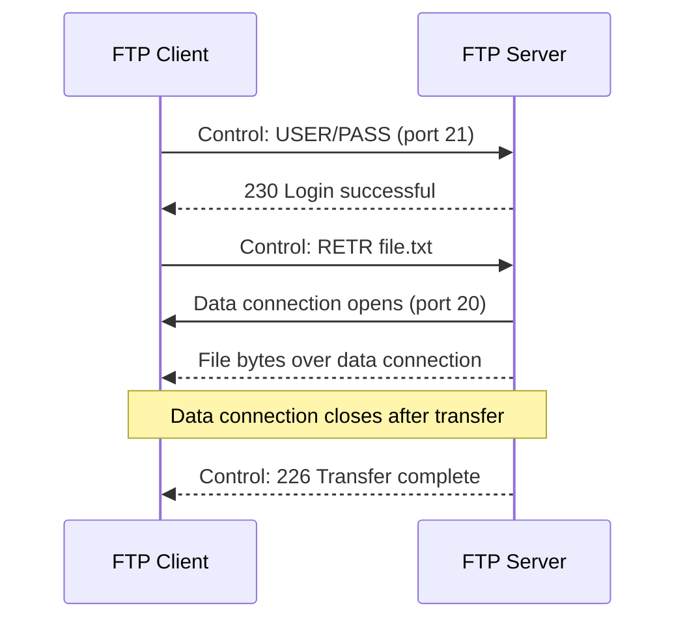

---
tags:
  - GATE/CS
  - GATE/ComputerNetworks
  - ApplicationLayer
  - EmailProtocols
  - FileTransfer
aliases:
  - Application Layer Protocols
  - SMTP
  - POP3
  - IMAP
  - MIME
  - FTP
  - SNMP
  - TFTP
  - DHCP
  - Telnet
  - Port Numbers
date_created: 2026-09-12
difficulty: ⭐⭐⭐
last_revised: 2026-09-12
pyq_frequency: Medium
---

## Syllabus Position

Subject: [[Computer Networks]]
Parent Topic: [[DNS, Recursive and Iterative Queries]]
Sibling Topics: [[TCP Header]], [[UDP Header]], [[DNS, Recursive and Iterative Queries]]
Leads To: [[HTTP]], [[Secure Email (S/MIME, TLS)]]

GATE Syllabus Line: "Application layer protocols: DNS, SMTP, POP, FTP, HTTP."

Exam Weight Note: Appears almost every year as a 1-mark conceptual MCQ — typically asking which protocol uses which transport-layer port, whether a protocol is "push" or "pull," or which one requires a persistent mailbox on the server versus downloading to the client. Occasionally combined with FTP's dual-connection model or MIME's role in extending SMTP to handle non-text data in a 2-mark question.

---
![[Screenshot 2026-09-13 at 1.55.06 PM.png]]
## The Problem This Solves

The internet needs standardized, agreed-upon "languages" for very specific everyday tasks: sending an email, picking up an email from your mailbox, transferring a large file between two machines, and describing what kind of data (text, image, video) is riding inside a message. Without a common protocol, your email client wouldn't know how to talk to Gmail's mail server, and a file transfer client wouldn't know how to negotiate with a remote FTP server. Each application-layer protocol solves one narrow, well-defined communication problem so that any two independently-built pieces of software — a browser, a mail client, an FTP tool — can interoperate as long as they both speak the same protocol.

**Analogy:** Think of application-layer protocols as different official forms you fill out at a government office — one form only for mailing a letter (SMTP), another only for picking up mail from your PO box (POP3/IMAP), another only for requesting a duplicate of a physical document (FTP). Each has its own agreed format and rules, and a clerk who only knows the "mail-sending form" can't process your "document request" — the protocols are deliberately narrow and specialized.

**Core Idea:** Each application-layer protocol defines a strict command-response grammar over a transport-layer connection (usually TCP) so that client and server software from different vendors can interoperate for one specific task — sending mail (SMTP), retrieving mail (POP3/IMAP), encoding non-text content (MIME), or transferring files (FTP).

---

## Formal Theory

**Application-layer protocols** sit at the top of the [[TCP Header|TCP]]/[[UDP Header|UDP]] stack and define the exact message formats and command sequences that client and server programs exchange to accomplish a specific user-facing task.

### SMTP (Simple Mail Transfer Protocol)

SMTP is a **push protocol** used to **send** mail from a client to its mail server, and between mail servers, en route to the recipient's mail server. It uses **TCP port 25** (587 for authenticated client submission, 465 for legacy SMTPS). SMTP is a **text-based, command-response** protocol — the client issues commands like `HELO`/`EHLO`, `MAIL FROM`, `RCPT TO`, `DATA`, and the server replies with numeric status codes (e.g., `250 OK`, `550 Mailbox unavailable`).

```
Algorithm SMTP_SEND(client, server, message):
    client -> server: HELO/EHLO (identify self)
    client -> server: MAIL FROM: <sender>
    client -> server: RCPT TO: <recipient>
    client -> server: DATA
    client -> server: message body, ended by a line with just "."
    server -> client: 250 OK (message queued)
    return
```

Critically, SMTP has **no built-in mechanism to retrieve or store mail for later pickup** — it only pushes mail forward. This is precisely why **retrieval protocols** (POP3, IMAP) exist as a separate concern.

### POP3 (Post Office Protocol version 3)

POP3 is a **pull protocol** used by a mail client to **retrieve** mail from a mailbox stored on a mail server, using **TCP port 110**. POP3 operates in three states: **Authorization** (client logs in with `USER`/`PASS`), **Transaction** (client issues `LIST`, `RETR`, `DELE` to list/download/mark for deletion), and **Update** (server actually deletes marked messages and closes the connection).

By default, POP3 **downloads messages to the client and deletes them from the server**, making the client's local machine the single copy of record — this was designed for an era of single-device email access.

### IMAP (Internet Message Access Protocol)

IMAP is also a **pull protocol** for retrieving mail, using **TCP port 143**, but it is designed around **mail staying on the server** and being synchronized across multiple devices. IMAP supports operations like partial message fetches, server-side folder management, message flags (read/unread/flagged) that persist across devices, and searching mail directly on the server without downloading everything.

### MIME (Multipurpose Internet Mail Extensions)

MIME is **not a transport or retrieval protocol** — it's a **content-description standard** that extends the original SMTP message format (which only supported 7-bit ASCII text) to support:
- Non-text content (images, audio, video, binary attachments) via encodings like **Base64**.
- Multiple parts in a single message (`multipart/mixed`, `multipart/alternative`) via the `Content-Type` and `Content-Transfer-Encoding` headers.

MIME headers are simply added to the standard email header block; SMTP itself doesn't need to understand MIME — it just transports the (now MIME-formatted) text body as before.

### FTP (File Transfer Protocol)

FTP transfers files between a client and server using **two separate TCP connections**:
- A **control connection** on **port 21**, kept open for the entire session, carrying commands (`USER`, `PASS`, `RETR`, `STOR`, `LIST`) and status replies.
- A **data connection** on **port 20** (active mode) or a negotiated ephemeral port (passive mode), opened fresh for each individual file transfer or directory listing, and closed once that transfer completes.

```
Algorithm FTP_DOWNLOAD(client, server, filename):
    client -> server (control, port 21): USER, PASS  // authenticate
    client -> server (control): RETR filename
    server opens data connection (port 20 or PASV port)
    server -> client (data connection): file bytes
    data connection closes after transfer
    server -> client (control): 226 Transfer complete
    return
```

This **separation of control and data** is FTP's single most distinctive and most-tested architectural feature.

**What GATE actually tests here:** Port numbers (25/587 SMTP, 110 POP3, 143 IMAP, 21+20 FTP), push vs. pull classification, whether mail stays on server (IMAP) or moves to client (POP3 default), MIME's role as a content-format extension rather than a transport mechanism, and FTP's unique two-connection model.

### Reference Table: Port Numbers and Transport Protocols

This is one of the single highest-yield memorization tables for GATE — a direct 1-mark question almost every year is "which transport protocol and port does protocol X use?"

| Application Layer Protocol | Well-Known Port(s)                  | Transport Protocol | Why This Transport Protocol                                                                 |
|------------------------------|----------------------------------------|-----------------------|-------------------------------------------------------------------------------------------------|
| [[DNS, Recursive and Iterative Queries\|DNS]] | 53                                     | UDP (primary), TCP (zone transfers, large/DNSSEC responses) | Small, fast queries favor UDP's low overhead; TCP needed for large data (zone transfers)          |
| [[Packet Switching and Circuit Switching\|FTP]] | 21 (control), 20 (data, active mode)    | TCP                    | File transfer needs reliable, ordered, error-checked delivery — no room for lost/corrupted bytes  |
| HTTP                          | 80 (HTTPS: 443)                        | TCP                    | Web pages/resources need reliable, in-order delivery over a connection-oriented session           |
| SMTP                          | 25 (relay), 587 (submission), 465 (legacy SMTPS) | TCP                    | Mail must arrive completely and correctly — reliability is essential, no tolerance for lost data  |
| POP3                          | 110 (995 for POP3S/TLS)                 | TCP                    | Mailbox retrieval requires reliable, complete transfer of message content                          |
| IMAP                          | 143 (993 for IMAPS/TLS)                 | TCP                    | Synchronized mailbox state and partial fetches require a reliable, ordered connection              |
| SNMP                          | 161 (agent queries), 162 (trap notifications) | UDP                    | Frequent, lightweight polling of many devices favors UDP's low overhead; occasional lost poll is tolerable |
| TFTP (Trivial File Transfer Protocol) | 69                                | UDP                    | Designed to be minimal/stateless (e.g., for booting diskless devices) — trades reliability for a tiny protocol footprint, adding its own simple ACK-based reliability at the application layer |
| DHCP                          | 67 (server), 68 (client)                | UDP                    | Client has no IP address yet at boot time, so a connectionless, broadcast-capable protocol is required — TCP's connection setup needs an IP already |
| Telnet                        | 23                                       | TCP                    | Interactive remote terminal sessions need reliable, ordered character-by-character delivery        |

**Trap to note:** TFTP and SNMP are the two classic UDP-based exceptions among otherwise mostly-TCP application protocols besides DNS — GATE frequently tests these three (DNS, SNMP, TFTP) together as "the UDP ones," alongside DHCP as a fourth UDP protocol needed specifically because the client lacks an IP address at the time of the request.

---

## Diagrams and Visuals

**SMTP push flow (sender's client to sender's server to receiver's server):**

```
Alice's Mail Client --SMTP push--> Alice's SMTP Server --SMTP push (relay)--> Bob's SMTP Server
                                                                                      |
                                                                          (mail sits in Bob's mailbox)
```

**POP3 vs IMAP retrieval — where mail physically ends up:**

```
POP3 (default):
  Bob's Mail Server [mailbox] --RETR, then DELE--> Bob's Laptop
  Result: mail now lives ONLY on the laptop; server mailbox emptied.

IMAP:
  Bob's Mail Server [mailbox, persists] <--FETCH/sync--> Bob's Laptop (view/cache)
  Bob's Mail Server [mailbox, persists] <--FETCH/sync--> Bob's Phone (view/cache)
  Result: mail stays on server; multiple devices see a synchronized view.
```

**FTP's dual-connection architecture:**

```
Client                                   Server
  |------ control connection (port 21, stays open) ------|
  |   USER, PASS, RETR file.txt, LIST                     |
  |                                                         |
  |------ data connection (port 20/ephemeral, per-transfer)-|
  |   <actual file bytes flow here, then connection closes> |
```



Label meanings: in the FTP diagram, the control connection (top) persists for the whole session handling commands, while the data connection (bottom) is opened and closed independently for every single file transfer or directory listing.

---

## Complexity Analysis

Application-layer protocols aren't typically analyzed via asymptotic time complexity; GATE instead tests **connection/message overhead** and **resource footprint on the server**.

### SMTP Message Overhead
For a single email with $k$ recipients on the same domain, SMTP requires exactly one `MAIL FROM` and $k$ separate `RCPT TO` commands within a single session, followed by one `DATA` block — giving $O(k)$ command overhead per message but only $O(1)$ connections (the same TCP session is reused for all recipients on that server).

### POP3 vs IMAP Server Storage Footprint
- **POP3 (default delete-after-retrieval):** Server storage is $O(1)$ per user in steady state, since mail doesn't accumulate once downloaded — but this comes at the cost of **no cross-device consistency**.
- **IMAP:** Server storage is $O(m)$ where $m$ is total accumulated mail per user, since everything persists on the server — but this cost buys full multi-device synchronization.

**Justification:** POP3 trades server storage for local storage and single-device access; IMAP trades server storage capacity for synchronization convenience. This is a direct space-vs-functionality trade-off, not a time-complexity one.

### FTP Connection Overhead
For transferring $n$ files in one session: $O(1)$ control connections (one, reused for the whole session) but $O(n)$ data connections (one freshly opened and closed per file), since each file transfer needs its own dedicated data channel.

### Complexity Summary Table

| Protocol | Connections per Session          | Server-Side Storage After Use              | Trigger Condition                             |
|----------|-----------------------------------|-----------------------------------------------|--------------------------------------------------|
| SMTP     | $O(1)$ TCP connection, $O(k)$ RCPT commands for $k$ recipients | $O(1)$ — mail is relayed forward, not retained by sender's server | Sending to multiple recipients on the same domain |
| POP3     | $O(1)$ TCP connection              | $O(1)$ — mail deleted from server after `DELE` (default) | Single-device access, don't need mail on server later |
| IMAP     | $O(1)$ TCP connection (often kept alive/idle) | $O(m)$ — mail persists on server for all $m$ messages | Multi-device access requiring synchronized state |
| FTP      | $O(1)$ control + $O(n)$ data connections for $n$ files | $O(1)$ — server just serves the filesystem, no protocol-specific accumulation | Transferring $n$ separate files or listings in one session |

---

## Worked Example

Bob uses IMAP on both his laptop and phone. He receives one new email with a 5 MB image attachment (MIME-encoded) via SMTP, then opens his laptop's mail client, and later checks his phone.

**Step 1 (SMTP delivery):** Alice's mail client sends `MAIL FROM: alice@x.com`, `RCPT TO: bob@y.com`, then `DATA` containing MIME headers `Content-Type: multipart/mixed`, a `text/plain` part, and an `image/jpeg` part Base64-encoded within a `Content-Transfer-Encoding: base64` block. Alice's server relays this via SMTP (further `MAIL FROM`/`RCPT TO`/`DATA` exchange) to Bob's mail server, where it lands in Bob's server-side mailbox.
State: `Bob's server mailbox = [new email, unread, MIME multipart, 5MB attachment]`.

**Step 2 (IMAP on laptop):** Bob's laptop mail client connects via IMAP (port 143), issues a `FETCH` command for headers first (to build the inbox list quickly), then a separate `FETCH BODY` command only when Bob actually opens the email — downloading the full MIME-encoded body including the attachment.
State: `Server mailbox = [email, now marked \Seen]`, `Laptop cache = [full email + attachment, viewed]`.

**Step 3 (IMAP on phone, later):** Bob's phone connects via IMAP independently and sees the message already flagged `\Seen` because that flag lives on the server, not on the laptop — perfect synchronization without ever needing the phone to have downloaded the attachment first.
State: `Phone view = [email marked as read, matches laptop state]`, attachment only downloaded on-demand if Bob opens it on the phone too.

**Verification:** Total server-side storage after both devices check mail: still just 1 copy of the email (IMAP keeps it centrally) — confirming the $O(m)$-per-user-on-server, $O(1)$-per-device-download-on-demand model. Total operations: 1 SMTP relay conversation (3 core commands) + 2 independent IMAP sessions (each with header FETCH, one with a body FETCH).

**What would change if Bob had used POP3 instead on his laptop?** The laptop would `RETR` and then (by default) `DELE` the message from the server — meaning by the time Bob checks his phone, the mailbox would already be empty there, and he would see no trace of the email at all. This is exactly why POP3 is a poor fit for multi-device users and IMAP has become the dominant choice for anyone checking mail from more than one device.

---

## Intuition Anchors

**The Analogy (restated and deepened):** Extending the "government forms" analogy: SMTP is the mail carrier who only delivers letters forward and never holds onto a copy once dropped in your mailbox — that's the "push, no retrieval" property. POP3 is like a PO box where you must physically take every letter home and the post office discards its copy — that's the "download and delete" default. IMAP is like a shared cloud-drive folder where every device just views the *same* physical folder — nothing is duplicated or displaced when you check it from a different device. MIME is simply the standardized packing-slip format that tells the mail carrier "this box contains an image, Base64-wrapped, don't treat it as plain text."

**The Mental Model:** For SMTP vs POP3/IMAP, picture a **one-way conveyor belt (SMTP push)** feeding into a **warehouse (mailbox)**, from which you either **haul boxes home permanently (POP3)** or **look at boxes in place through a window, leaving them in the warehouse (IMAP)**. For FTP, picture a **phone call (control connection) that stays open the whole time you're negotiating**, while every actual **package delivery (data connection)** is a separate courier trip that starts and ends independently.

**The One-Line Recall:** "SMTP pushes mail forward and never retrieves; POP3 pulls mail and deletes it from the server by default; IMAP pulls mail but keeps it centrally synchronized; MIME just describes non-text content riding inside the mail; FTP uniquely splits control and data into two separate TCP connections."

**The #1 Trap:** Students assume MIME is a protocol that "sends" or "retrieves" mail, confusing it with SMTP/POP3/IMAP. **It is not** — MIME is purely a **content-formatting standard** (headers and encoding rules) that rides inside whatever protocol is already transporting the message; it adds zero new connections, ports, or command sequences of its own.

---

## GATE Questions

---

**Question 1 — [GATE-style] — [1-mark]**

> Which of the following statements is TRUE regarding SMTP and POP3?

- (A) SMTP is used to retrieve mail from a server; POP3 is used to send mail.
- (B) SMTP is a pull protocol; POP3 is a push protocol.
- (C) SMTP is used to push mail from client to server (and between servers); POP3 is used to pull mail from a mailbox to a client.
- (D) Both SMTP and POP3 are used exclusively for sending mail between mail servers.

<details>
<summary>Solution</summary>

**Answer: (C)**

**Reasoning:** (A) reverses the roles entirely — SMTP sends/pushes, POP3 retrieves/pulls, not the other way around. (B) also reverses the push/pull labels. (D) is wrong because POP3 has nothing to do with sending mail between servers; it exists solely for a client to retrieve mail already sitting in its mailbox. (C) correctly captures that SMTP is exclusively a push mechanism (client→server, server→server) while POP3 is exclusively a pull mechanism (server mailbox→client).

**What this question is really testing:** Whether the student has memorized the push/pull direction correctly rather than just recognizing the protocol names.

**Trap to avoid:** Assuming "SMTP" sounds more like the one you'd use to "get" your mail simply because it's more commonly discussed — direction of data flow, not familiarity, is what matters.

</details>

---

**Question 2 — [Conceptual] — [1-mark]**

> A user wants to check their email from both a laptop and a phone and expects that marking an email as read on one device shows it as read on the other. Which retrieval protocol is more suitable, and why?

<details>
<summary>Solution</summary>

**IMAP** is the correct choice. IMAP keeps the actual mailbox and all message state (read/unread flags, folder structure) centrally on the server; each device only ever views or fetches a synchronized copy on demand. POP3, in its default configuration, downloads messages to a single client and deletes them from the server, meaning any second device would see an empty or inconsistent mailbox with no shared read/unread state, since there is no central server-side copy left after the first device retrieves it.

**Trap to avoid:** Assuming POP3 can be configured to "leave messages on server" and calling that equivalent to IMAP — even with that POP3 option enabled, POP3 still has no mechanism to synchronize flags (like read/unread) across devices the way IMAP natively does; it only prevents deletion, not full state synchronization.

</details>

---

**Question 3 — [Hard / Multi-concept] — [2-mark]**

> An FTP client opens a control connection to a server and requests a directory listing followed by two file downloads in the same session. How many total TCP connections are established, and which parts of this exchange use the control connection versus a data connection?

<details>
<summary>Solution</summary>

Total TCP connections established: **4** — one persistent control connection (port 21) that stays open for the entire session, plus three separate data connections: one for the directory listing (`LIST`) and one each for the two file downloads (`RETR` x2), since FTP opens and closes a fresh data connection for every individual data-carrying operation. The control connection carries only commands and status replies (`USER`, `PASS`, `LIST`, `RETR filename1`, `RETR filename2`, and their numeric response codes like `150`, `226`); the three data connections carry only the actual bytes (the directory listing text, and the two files' contents), and each closes immediately once its specific transfer finishes.

**What this question is really testing:** Whether the student understands that FTP's separation of control and data isn't just a one-time setup — every single data-bearing operation (not just every file) gets its own fresh data connection, including directory listings, not only file transfers.

**Trap to avoid:** Assuming only one data connection is reused across the listing and both downloads — FTP explicitly opens a new data connection per operation, it does not multiplex multiple data transfers over one persistent data channel the way the control connection persists.

</details>

---

---

**Question 4 — [PYQ-style] — [1-mark]**

> Match the following application-layer protocols with their default transport protocol:
> (i) DHCP (ii) Telnet (iii) SNMP (iv) HTTP
> (P) TCP (Q) UDP

<details>
<summary>Solution</summary>

**Answer: (i)-Q, (ii)-P, (iii)-Q, (iv)-P**

**Reasoning:** DHCP uses UDP (ports 67/68) because the client has no IP address yet at boot time and needs to broadcast its request — TCP's connection setup fundamentally requires an already-assigned IP, so it cannot be used here. Telnet uses TCP (port 23) because interactive terminal sessions need every keystroke delivered reliably and in order. SNMP uses UDP (ports 161/162) because it repeatedly polls potentially thousands of network devices, and the overhead of a TCP connection per poll would be wasteful — an occasional lost poll is tolerable since the next poll will simply happen again shortly. HTTP uses TCP (port 80/443) because web content must arrive completely and in order for a page to render correctly.

**What this question is really testing:** Whether the student has memorized the UDP-vs-TCP split correctly for the less commonly discussed protocols (DHCP, SNMP), not just the obvious ones (HTTP, Telnet).

**Trap to avoid:** Assuming all "management/monitoring" protocols must be TCP for "reliability" — SNMP is the counter-example, choosing UDP deliberately because periodic polling tolerates occasional loss far better than it tolerates per-poll connection overhead.

</details>

---

**Pattern Recognition:**
- When a GATE question mentions a specific port number (25/587, 110, 143, 21/20, 80), it's testing direct protocol-to-port recall — memorize these pairs cold.
- When a question describes "mail stays on the server and is synchronized across devices," the answer is always IMAP; "mail is downloaded and removed from the server" always signals POP3's default behavior.
- Questions about "how content like images or attachments travel inside an email" are testing MIME specifically — remember MIME adds headers/encoding, not a new connection or protocol.
- Any question describing "two separate connections, one persistent and one per-transfer" is testing FTP's control/data split — no other application-layer protocol in the GATE syllabus has this exact architecture.

---

## Edge Cases and Failure Modes

- [ ] **Assuming SMTP can retrieve mail:** SMTP has no `RETR`-like command; it is purely push. Fix: any retrieval-related question must point to POP3 or IMAP, never SMTP.
- [ ] **Assuming MIME requires a new port or connection:** MIME headers ride inside the existing SMTP `DATA` block; no new transport-layer resource is used. Fix: don't assign MIME a port number — it doesn't have one, since it isn't a transport protocol.
- [ ] **POP3 "leave mail on server" option confused with IMAP:** Even with this POP3 setting enabled, there's still no flag/state synchronization across devices — only the deletion behavior changes. Fix: distinguish "not deleting" (a POP3 option) from "full synchronization" (IMAP's core design).
- [ ] **Assuming FTP's data connection persists across multiple files:** Each `RETR`/`STOR`/`LIST` opens a fresh data connection that closes after that single operation completes. Fix: count data connections per operation, not per session.
- [ ] **Confusing FTP's active mode (server initiates data connection back to client) with passive mode (client initiates both connections):** GATE occasionally tests which mode is firewall-friendlier (passive mode, since the client initiates both connections outward). Fix: know that active mode requires the server to connect back to the client's port, which many firewalls block.
- [ ] **Assuming all application-layer protocols use TCP:** While SMTP, POP3, IMAP, and FTP all use TCP (since reliability matters for mail/files), DNS is the classic exception defaulting to UDP. Fix: don't overgeneralize "application layer = TCP" without checking the specific protocol.

---

## Comparisons

| Feature              | [[Application Layer Protocols\|SMTP]] | [[Application Layer Protocols\|POP3]] | [[Application Layer Protocols\|IMAP]] | [[Application Layer Protocols\|FTP]] |
|-----------------------|------------------------------------------|------------------------------------------|------------------------------------------|------------------------------------------|
| Direction             | Push (send mail forward)                  | Pull (retrieve mail)                      | Pull (retrieve mail)                      | Bidirectional (upload/download files)     |
| Port(s)               | 25 (relay), 587 (submission)               | 110                                       | 143                                       | 21 (control) + 20/ephemeral (data)        |
| Mail/data persistence on server | N/A (relayed forward, not stored by sender's server) | Deleted after retrieval (default)          | Persists on server, synchronized across devices | N/A — files remain wherever the filesystem places them |
| Connections per session | 1 (reused for all recipients on a domain) | 1                                          | 1 (often kept idle/alive for push notifications) | 1 control + 1 per file/listing operation |
| GATE Trap             | Assumed to also retrieve mail (it cannot)  | "Leave on server" option confused with full IMAP sync | Assumed to require more setup than it does (it's just persistent-state pull) | Assumed single connection handles both commands and data |

The most common GATE question comparing these pits **POP3 against IMAP** on the exact dimension of *where mail physically resides after retrieval* — the answer always hinges on POP3's default delete-on-retrieval behavior versus IMAP's server-side persistence enabling multi-device synchronization.

---

## Connections Web

**Must know before this topic:**
- [[TCP Header]] — nearly every protocol here (SMTP, POP3, IMAP, FTP) rides on a reliable TCP connection; understanding TCP's connection-oriented handshake explains why these protocols use persistent sessions
- [[DNS, Recursive and Iterative Queries]] — resolving a mail server's hostname to an IP address is the very first step before any SMTP/POP3/IMAP session can begin

**Topics that build on this:**
- [[HTTP]] — the other dominant application-layer protocol, sharing SMTP's request-response, text-based command style
- [[Secure Email (S/MIME, TLS)]] — modern mail systems wrap SMTP/IMAP/POP3 sessions in TLS and use S/MIME for encryption, both building directly on this note's base protocols

**GATE subject cross-links:**
- [[Computer Networks]] > [[Application Layer Protocols]]

**Cross-subject connections:**
- [[UDP Header]] — contrasts with this note's TCP-based protocols; DNS is the classic UDP-based application-layer exception worth comparing against SMTP/POP3/IMAP/FTP's TCP reliance
- [[Delay in Computer Networks]] — FTP's per-file data connection overhead directly composes with connection-establishment delay formulas for multi-file transfer scenarios

**Standard references:**
- [[Forouzan Chapter 26]] (Email: SMTP, POP3, IMAP, MIME)
- [[Forouzan Chapter 27]] (FTP)
- [[Tanenbaum Chapter 7]] (Application Layer)

---

## Quick Revision Sheet

**Definition (1 sentence):** SMTP pushes email from client to server (and server to server); POP3 and IMAP pull email from a mailbox to a client (POP3 deleting it from the server by default, IMAP keeping it centrally synchronized); MIME extends email message format to describe non-text content; FTP transfers files using two separate TCP connections for control and data.

**Core Idea / Analogy (1 sentence):** SMTP is a one-way mail carrier, POP3 is hauling PO box contents home permanently, IMAP is viewing a shared cloud folder from any device, MIME is the packing-slip format for non-text contents, and FTP is a phone call (control) plus separate courier trips (data) for each file.

**Steps (Generic mail send-then-retrieve flow, max 6):**
1. Sender's client relays mail to sender's SMTP server via `MAIL FROM`/`RCPT TO`/`DATA`.
2. Sender's server relays it further via SMTP to the recipient's mail server.
3. Mail sits in the recipient's server-side mailbox.
4. Recipient's client connects via POP3 (port 110) or IMAP (port 143) to retrieve it.
5. POP3: message downloaded and (by default) deleted from server. IMAP: message viewed/fetched, flags updated centrally, original stays on server.
6. Any MIME-encoded attachments are decoded by the client for display.

**Complexity:**
- SMTP: $O(1)$ connection, $O(k)$ commands for $k$ recipients on one domain.
- POP3/IMAP: $O(1)$ connection each; POP3 server storage $O(1)$ steady-state, IMAP server storage $O(m)$ for $m$ retained messages.
- FTP: $O(1)$ control connection + $O(n)$ data connections for $n$ file/listing operations.

**Key Properties (GATE-tested facts):**
- SMTP is push-only; it cannot retrieve mail.
- POP3 deletes from server by default; IMAP keeps mail centrally and synchronizes state across devices.
- MIME is a content-format standard, not a transport/retrieval protocol — no port of its own.
- FTP uniquely splits control (port 21, persistent) from data (port 20/ephemeral, per-operation).
- DNS is the notable UDP exception among application-layer protocols; SMTP/POP3/IMAP/FTP all use TCP.

**The #1 Trap:** Treating MIME as if it were a protocol that sends or retrieves mail on its own, rather than a content-formatting standard riding inside SMTP/POP3/IMAP messages.

**When to use over alternatives:** Use IMAP over POP3 whenever multi-device synchronized access is needed; use POP3 only for simple, single-device, storage-constrained scenarios; use FTP (not HTTP) when explicit directory browsing and large bulk file transfer semantics are required.

**Mnemonic:** "SMTP Sends, POP Plucks-and-deletes, IMAP Iterates-in-place (stays on server), MIME just Marks content type, FTP Forks into two connections" — one keyword per protocol capturing its defining behavior.

---

## Revision Checklist

- [ ] I can state the formal definition and port number of SMTP, POP3, IMAP, and FTP without looking.
- [ ] I can explain the mail-carrier/PO-box/cloud-folder analogy and map it to push vs. pull vs. synchronized-pull behavior.
- [ ] I can trace the worked example's IMAP multi-device synchronization scenario by hand in under 2 minutes.
- [ ] I can derive why FTP needs $O(n)$ data connections for $n$ file operations from scratch.
- [ ] I know what the Quick Revision Sheet says without reading it.
- [ ] I can solve all 3 GATE questions in this note without peeking.
- [ ] I know the #1 trap (MIME mistaken for a transport/retrieval protocol) and can articulate why students fall for it.
- [ ] I have linked this note correctly in my Obsidian vault.
- [ ] I have scheduled a spaced-repetition review in 3 days.
</content>
