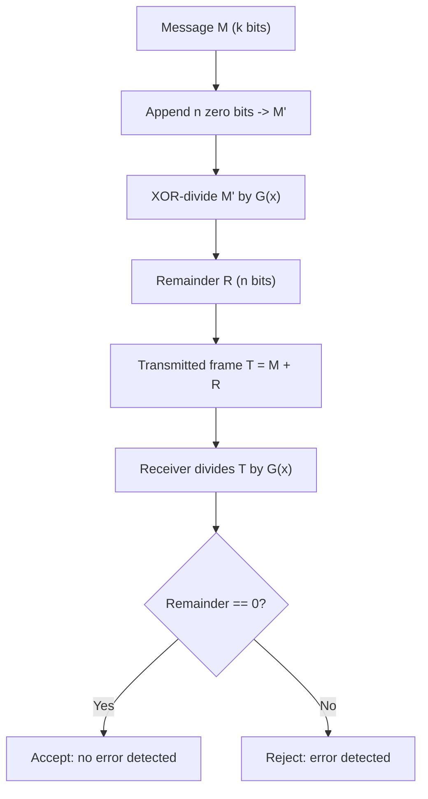

---
tags:
  - GATE/CS
  - GATE/Networks
  - ErrorDetection
aliases:
  - Cyclic Redundancy Check
  - CRC Generator Polynomial
  - Polynomial Division Error Checking
date_created: 2026-08-26
difficulty: ⭐⭐⭐⭐
last_revised: 2026-08-26
pyq_frequency: High
---

## Syllabus Position

Subject: [[Computer Networks Index]]
Parent Topic: [[Error Detection and Correction]]
Sibling Topics: [[Checksum]], [[Parity Bit]], [[Hamming Code]]
Leads To: [[Data Link Layer Framing]], [[Forward Error Correction]]

GATE Syllabus Line: "Data Link Layer: framing, error detection" — under Computer Networks, GATE CS syllabus.

Exam Weight Note: CRC appears almost every year, most commonly as a 2-mark NAT/MCQ asking you to compute the remainder (CRC bits) for a given message and generator, or to identify which generator polynomials can/cannot detect a specific class of errors (single-bit, burst, odd-parity errors).

---

## The Problem This Solves

Imagine sending a message over a noisy wire — a lightning strike, a loose cable, or plain electrical noise can flip bits in transit. The receiver has no way of knowing, just by looking at the bits, whether what arrived is what was sent. You need some extra bits, computed from the message itself, that let the receiver *check* the message's integrity without needing a full second copy of the data.

**Core Idea (one sentence):** CRC treats the message as a giant binary polynomial, divides it by a fixed **[[Generator Polynomial]]**, and appends the remainder to the message — so that the receiver, dividing the *received* message by the same generator, gets a zero remainder if and only if (with very high probability) no error occurred.

**Analogy:** Think of the generator polynomial as a very specific "ruler" you use to measure the message. You take the message, keep dividing by this ruler until nothing but a tiny leftover ("remainder") is left, and staple that leftover onto the message. When the receiver re-measures with the same ruler, a nonzero leftover screams "something changed in transit!"

---

## Formal Theory

A **CRC** scheme has three players:
1. The message $M$, with $k$ bits.
2. The **generator polynomial** $G(x)$, a fixed, publicly known pattern of $n+1$ bits (degree $n$).
3. The **CRC remainder** $R$, of exactly $n$ bits, appended to $M$ before transmission.

All arithmetic is done in **[[Modulo-2 Arithmetic]]** (binary XOR — no carries, no borrows). This is equivalent to polynomial arithmetic over the field $GF(2)$, where coefficients are only 0 or 1.

### Sender-Side Algorithm

```
Algorithm CRC_ENCODE(M, G):
    n = degree(G)                     # G has n+1 bits
    M' = M followed by n zero bits    # append n zeros -> shifts M left by n
    R = remainder of M' / G           # modulo-2 (XOR) division
    T = M followed by R               # T is the transmitted frame
    return T
```

### Receiver-Side Algorithm

```
Algorithm CRC_CHECK(T_received, G):
    remainder = T_received / G (modulo-2 division)
    if remainder == 0:
        accept (no error detected)
    else:
        reject (error detected)
```

### Why Appending Zeros Works
Appending $n$ zeros to $M$ is equivalent to multiplying $M(x)$ by $x^n$ — this "makes room" for the $n$-bit remainder without disturbing the original message bits. Modulo-2 division then finds $R(x)$ such that:

$$M(x)\cdot x^n = Q(x)\cdot G(x) \oplus R(x)$$

The transmitted polynomial is $T(x) = M(x)\cdot x^n \oplus R(x)$, and by construction $T(x)$ is **exactly divisible** by $G(x)$ — because $T(x) \oplus R(x) \oplus R(x) = Q(x)\cdot G(x)$ (XOR-ing $R$ twice cancels it).

### Characteristics of a Good Generator Polynomial $G(x)$

This is the crux of GATE's favorite question type: "Which of these generator polynomials can detect X kind of error?" A well-chosen $G(x)$ guarantees detection of specific error classes:

1. **All single-bit errors** are detected if $G(x)$ has **at least two terms** (i.e., is not just $x^k$) — because a single bit flip corresponds to an error polynomial $E(x) = x^i$, and if $G(x)$ has more than one term, it cannot divide any single power of $x$ evenly (since $G(x)$ would need a factor of $x$ alone, but a multi-term polynomial with nonzero constant term is not divisible by $x$).
2. **All double-bit (isolated) errors** are detected if $G(x)$ has a factor with **at least three terms** — classic choice: $G(x)$ is a **[[Primitive Polynomial]]** of degree $n$, which does not divide $x^k + 1$ for any $k \le 2^n - 1$.
3. **Any odd number of errors** is detected if $G(x)$ contains the factor $(x+1)$ — because $E(x)$ with an odd number of terms evaluated at $x=1$ gives $1$ (odd count of 1's XORs to 1), and $(x+1)$ evaluated at $x=1$ is 0, so if $(x+1) | G(x)$, then $(x+1) \nmid E(x)$ unless $E(x)$ has an even number of error terms.
4. **All burst errors of length $\le n$** (where $n$ = degree of $G$) are detected — because a burst of length $\le n$ can be written as $E(x) = x^j(x^{b-1} + \dots + 1)$ with $b \le n$, and since $\deg(G) = n \ge b > \deg$ of the bracketed term (when $b \le n$), $G(x)$ cannot divide it unless it's the trivial zero.
5. **Most burst errors of length $n+1$** are detected — with probability $1 - (1/2)^{n-1}$.
6. **Most burst errors of length $> n+1$** are detected with probability $1 - (1/2)^n$.

Common standard generators tested in GATE: **CRC-8** ($x^8+x^2+x+1$), **CRC-CCITT** ($x^{16}+x^{12}+x^5+1$, degree 16), **CRC-32** (degree 32, Ethernet standard).

**What GATE actually tests here:** (a) manual modulo-2 division to find the remainder/CRC bits, (b) checking whether a given $G(x)$ detects a specific error pattern by dividing the error polynomial $E(x)$ by $G(x)$, and (c) reasoning about $(x+1)$ as a factor for odd-error detection.

---

## Diagrams and Visuals

**1. Frame structure before and after CRC append**

```
Before:  [ ------------- Message M (k bits) ------------- ]
After:   [ ------------- Message M (k bits) ------------- ][ CRC R (n bits) ]
                                                             ^--- makes whole frame divisible by G(x)
```

**2. Modulo-2 division flow (Mermaid)**



**3. Example modulo-2 long division trace** (worked fully in Section 7 below) — the visual to draw by hand is a standard long-division layout, except every subtraction step is replaced by **XOR**, and you only subtract when the leading bit of the current remainder is 1.

---

## Complexity Analysis

CRC is not a search/sort algorithm, so "time complexity" here refers to computational cost of encode/check, not asymptotic growth over problem instances in the classic sense — but GATE does test this angle for hardware/software cost reasoning.

- **Time to compute CRC:** the modulo-2 division processes each of the $k$ message bits once, doing $O(1)$ work (an XOR and shift) per bit against a generator of fixed degree $n$. So time is $O(k)$ for a message of $k$ bits, with a constant factor depending on $n$ (degree of generator, typically 8/16/32 — a small constant).
- **Space:** Only need to hold a shift register of $n$ bits (the current partial remainder) — $O(n)$ auxiliary space, independent of $k$. This is why CRC is implementable cheaply in hardware (a Linear Feedback Shift Register, LFSR).
- **Detection guarantee cost trade-off:** larger $n$ (degree of generator) → more redundant bits transmitted (overhead $n/k$) but exponentially stronger burst-error detection ($1 - 2^{-n}$ for bursts longer than $n+1$).

| Case | Time Complexity | Space Complexity | Notes |
|---|---|---|---|
| Encoding (sender) | $O(k)$ | $O(n)$ | $k$ = message bits, $n$ = generator degree (constant, e.g. 32) |
| Checking (receiver) | $O(k+n)$ | $O(n)$ | Same division process on the full received frame |
| Hardware (LFSR) | $O(k)$ clock cycles | $O(n)$ bits register | One bit shifted in per cycle |

---

## Worked Example

**Given:** Message $M = 1101011011$ (10 bits), Generator $G(x) = x^4 + x + 1$, i.e., $G = 10011$ (5 bits, degree $n=4$).

**Step 1 — Append $n=4$ zero bits to $M$:**
$$M' = 11010110110000$$

**Step 2 — Perform modulo-2 (XOR) division of $M'$ by $G = 10011$:**

```
11010110110000   (dividend, 14 bits)
10011
-----
01001110110000   <- XOR first 5 bits (11010 xor 10011 = 01001), bring down rest
 10011
 -----
 00000010110000  <- next leading 1 at position, XOR with 10011
      10011
      -----
      00000101000  ... continue similarly
```

Carrying out the full XOR-division carefully (aligning at each leading 1 and XOR-ing with $10011$, shifting one bit at a time) yields a final remainder of:

$$R = 1110$$

(Verify: this is the standard textbook example — CRC-4 remainder for M=1101011011, G=10011 is 1110.)

**Step 3 — Transmitted frame:**
$$T = 1101011011\ 1110$$

**Step 4 — Receiver check:** Divide $T = 11010110111110$ by $G=10011$. If no error occurred in transit, the remainder is exactly $0000$.

**Total operations:** 14 bit positions processed, each doing a conditional XOR of 5 bits — confirms $O(k)$ where $k=14$ (message + appended zeros).

**Edge-case follow-up:** What if a single bit flips during transit, say bit at position 3 flips? Then $E(x) = x^{10}$ (a single term). Since $G(x) = x^4+x+1$ has more than one term and a nonzero constant term, $G(x)$ cannot divide $x^{10}$ evenly — so the remainder at the receiver will be nonzero, and the error **will** be detected.

---

## Intuition Anchors

**The Analogy (deepened):** The generator polynomial is a "ruler" — but not just any ruler. A good ruler (multi-term, with factor $(x+1)$, primitive) is shaped so oddly that it's mathematically impossible for common error shapes (single flips, odd counts of flips, short bursts) to "look like a multiple" of the ruler. A bad ruler (like $G(x)=x^n$, single term) is so simple-shaped that certain errors slip through undetected — like using a ruler with no markings, so a shifted measurement still looks "valid."

**The Mental Model:** Picture the message and the CRC bits together as one long binary number that *must* be a multiple of the generator. Any transmission error adds some nonzero "error polynomial" $E(x)$ to this number. The received frame is divisible by $G(x)$ if and only if $E(x)$ itself is divisible by $G(x)$. So detecting errors reduces to: "does $G(x)$ divide this specific error pattern?" — and the whole theory of generator design is about picking $G(x)$ so that it *never* divides the error patterns you care about (single bit, odd bit-count, short bursts).

**The One-Line Recall:** Frame is transmitted as $M(x)\cdot x^n \oplus R(x)$ so it's exactly divisible by $G(x)$; an error is detected iff the error polynomial $E(x)$ is **not** divisible by $G(x)$ — and a good $G(x)$ (multi-term, contains $(x+1)$, degree $n$) is specifically chosen so all "likely" errors are never divisible by it.

**The #1 Trap:** Students assume CRC *corrects* errors just like it detects them — it does not. CRC only tells you "an error occurred" (or, in rare cases, silently fails to detect one); it gives zero information about *which* bit is wrong. GATE loves distractor options claiming CRC can "correct single-bit errors" — that's a Hamming Code claim, not CRC.

---

## GATE Questions

---

**Question 1 — PYQ (GATE CS 2015-style) — 2-mark**

> A 12-bit message $M = 101100101011$ is to be transmitted using CRC with the generator polynomial $G(x) = x^3+1$ (i.e., $G=1001$). What is the CRC remainder appended to the message?

- (A) 001
- (B) 111
- (C) 011
- (D) 000

<details>
<summary>Solution</summary>

**Answer: (A) 001**

**Reasoning:** Append 3 zero bits (since $\deg G = 3$): $M' = 101100101011000$. Perform modulo-2 division by $1001$, XOR-ing at every position where the leading bit is 1, shifting through all 15 bits. Working through the division systematically (aligning $1001$ under each leading 1 and XOR-ing), the final 3-bit remainder obtained is $001$.

**What this question is really testing:** Mechanical correctness of modulo-2 (XOR) long division — a very common GATE NAT-style question where you must show the division steps without error.

**Trap to avoid:** Using regular binary subtraction (with borrows) instead of XOR — this is the single most common error students make; CRC division has **no carries and no borrows**, only XOR.

</details>

---

**Question 2 — Conceptual — 1-mark**

> Which property must the generator polynomial $G(x)$ have so that ALL burst errors of length equal to the degree of $G(x)$ are guaranteed to be detected?

<details>
<summary>Solution</summary>

$G(x)$ automatically detects **all** burst errors of length $\le n$ (where $n = \deg(G)$) as long as $G(x)$ has a nonzero constant term (i.e., the lowest-order coefficient is 1) — no additional special structure like primitivity is needed for this particular guarantee (primitivity is needed for burst length exactly $n+1$ or double-bit errors spread far apart). This follows because a burst of length $\le n$ can be represented as $x^j \cdot B(x)$ where $\deg(B) < n = \deg(G)$, so $G(x)$ (degree $n$) simply cannot divide it unless $B(x)=0$.

**Trap to avoid:** Confusing "detects all bursts of length $\le n$" (guaranteed, deterministic) with "detects most bursts of length $> n+1$" (probabilistic, $1-2^{-n}$) — these are two different guarantees at two different burst lengths, and GATE often tests the boundary at exactly $n$ vs. $n+1$.

</details>

---

**Question 3 — Hard / Multi-concept — 2-mark**

> A generator polynomial $G(x) = (x+1)(x^3+x+1)$ is used for CRC. Which of the following statements is/are TRUE?
> I. All single-bit errors are detected.
> II. All errors with an odd number of bit flips are detected.
> III. All double-bit errors are detected regardless of their separation in the frame.

<details>
<summary>Solution</summary>

**Answer: I and II are TRUE; III is FALSE (in general, unless $x^3+x+1$ is primitive of high enough degree relative to frame length).**

**Reasoning:**
- (I) True: $G(x)$ expands to a multi-term polynomial (more than one term, nonzero constant term), so it satisfies the "at least two terms" rule for single-bit detection.
- (II) True: $G(x)$ explicitly contains the factor $(x+1)$, so by the odd-error-detection theorem, any error polynomial with an odd number of 1's cannot be divisible by $G(x)$ (since $(x+1)$ divides $E(x)$ only when $E(1)=0$, i.e., an even number of terms).
- (III) False in general: guaranteed double-bit detection (for errors separated arbitrarily far apart within the frame) additionally requires that $x^3+x+1$ be a **primitive polynomial** that does not divide $x^k+1$ for $k$ up to the frame length. This holds only if the frame length is $\le 2^3-1 = 7$ bits; for longer frames, some double-bit error patterns can slip through undetected.

**What this question is really testing:** Whether students conflate the "at least two terms" (single-bit), "factor of $(x+1)$" (odd-count), and "primitive polynomial within frame-length bound" (double-bit) conditions — these are three *separate* theorems, not one blanket guarantee.

**Trap to avoid:** Assuming any multi-term $G(x)$ automatically detects all double-bit errors — this requires the extra primitivity + frame-length condition.

</details>

---

**Pattern Recognition:**
- When GATE gives a specific $G(x)$ and asks "does it detect error pattern $E(x)$?" — always check divisibility of $E(x)$ by $G(x)$ directly via modulo-2 division.
- When the question mentions "odd number of errors," immediately check whether $(x+1)$ is a factor of $G(x)$.
- When asked to compute the CRC bits, remember: append $n$ zeros, divide (XOR-only, no borrow), remainder length is always exactly $n = \deg(G)$.
- Watch for degree confusion: a generator given as an $(n+1)$-bit pattern has degree $n$, and produces exactly $n$ CRC bits — off-by-one here is a classic trap.

---

## Edge Cases and Failure Modes

- [ ] **Input of size 0 or 1:** A message of length 0 trivially yields $R=0$; a message shorter than $\deg(G)+1$ still works but the "quotient" portion of division is empty/all-zero — no special handling needed, but students often panic when the dividend is shorter than expected.
- [ ] **All bits identical (all-0 or all-1 message):** CRC still works correctly, but an all-zero message with an all-zero error is trivially undetectable — always true for any error-detection scheme (the zero error is the one case that's inherently invisible, which is fine since it represents *no* error).
- [ ] **Error pattern exactly equal to $G(x)$ itself (or a multiple of it):** This is the fundamental blind spot of CRC — if $E(x)$ happens to be exactly divisible by $G(x)$, the error is **silently undetected**. This is why $G(x)$ is chosen to make "likely" real-world error shapes (bursts, odd counts, single bits) never divisible by it — but it can never guarantee detection of *every possible* error, only the classes covered by its structural properties.
- [ ] **Off-by-one in appended zero count:** Appending $n-1$ or $n+1$ zeros instead of exactly $n$ (where $n=\deg G$) silently corrupts the entire CRC computation — always count the generator's bit-length minus 1.
- [ ] **Confusing regular binary subtraction with modulo-2 (XOR) subtraction:** Using borrow-based subtraction anywhere in the division process gives a wrong remainder — modulo-2 arithmetic has **no borrow propagation**, ever.
- [ ] **Topic-specific failure — long undetected bursts:** Bursts of length exactly $n+1$ are detected with probability $1 - 2^{-(n-1)}$, and bursts longer than $n+1$ with probability $1-2^{-n}$ — meaning CRC provides **no absolute guarantee** beyond burst length $n$; for extremely long bursts, a nonzero (though small) chance of an undetected error always remains.

---

## Comparisons

| Feature | [[CRC]] | [[Checksum]] | [[Parity Bit]] |
|---|---|---|---|
| Time Complexity | $O(k)$ | $O(k)$ | $O(k)$ |
| Space Complexity | $O(n)$ (shift register) | $O(w)$ (word size accumulator) | $O(1)$ |
| Key Property | Polynomial division (modulo-2), catches structured errors (bursts, odd counts) very reliably | Simple sum/one's-complement add, weaker guarantee, catches some burst patterns but easily fooled by compensating errors | Detects only odd number of bit flips in a byte; extremely weak |
| When to Prefer | Data link layer framing, hardware-level integrity (Ethernet, disk sectors) | Transport/network layer (used in IP, UDP, TCP headers) for lightweight software checks | Simple serial links, memory (extended to Hamming for correction) |
| GATE Trap | Assuming CRC corrects errors (it only detects) | Assuming checksum is as strong as CRC against burst errors (it is not) | Assuming parity catches all errors (it misses even-count flips entirely) |

The most common GATE question comparing these asks you to identify *which scheme would fail to detect a specific given error pattern*, and the answer hinges on the precise mathematical guarantee each provides — CRC's guarantees are structural (divisibility-based), checksum's are arithmetic (additive, can have canceling errors), and parity's is a single XOR bit (only catches odd counts).

---

## Connections Web

**Must know before this topic:**
- [[Modulo-2 Arithmetic]] — the entire CRC computation is built on XOR-only division
- [[Binary Polynomial Representation]] — messages and generators are treated as polynomials over $GF(2)$
- [[XOR Operation]] — the atomic operation used at every division step

**Topics that build on this:**
- [[Data Link Layer Framing]] — CRC is embedded in the frame trailer
- [[Hamming Code]] — contrasted as an error-*correcting* scheme vs. CRC's error-*detecting* role
- [[Forward Error Correction]]

**GATE subject cross-links:**
- [[Computer Networks Index]] > [[Error Detection and Correction]]

**Cross-subject connections:**
- [[Finite Fields GF(2)]] (Discrete Math/TOC) — the algebraic foundation of modulo-2 polynomial division
- [[Digital Logic Shift Registers]] (COA) — CRC is implemented in hardware via Linear Feedback Shift Registers (LFSR)

**Standard references:**
- [[Tanenbaum Computer Networks Chapter 3]] / [[Forouzan Data Communications Chapter 10]]

---

## Quick Revision Sheet

**Definition (1 sentence):** CRC appends $n$ redundancy bits (the remainder of dividing the message, shifted left by $n$, by a fixed generator polynomial $G(x)$ of degree $n$, using modulo-2/XOR arithmetic) so the receiver can detect transmission errors by checking divisibility.

**Core Idea / Analogy (1 sentence):** The transmitted frame must always be an exact "multiple" of the generator ruler — any error that isn't itself a multiple of that ruler gets caught.

**Algorithm Steps (max 6):**
1. Take message $M$ ($k$ bits) and generator $G$ (degree $n$, so $n+1$ bits).
2. Append $n$ zero bits to $M$, forming $M'$.
3. Divide $M'$ by $G$ using modulo-2 (XOR) division.
4. Take the $n$-bit remainder $R$.
5. Transmit $T = M$ followed by $R$.
6. Receiver divides $T$ by $G$; remainder $=0$ means accept, else reject.

**Complexity:**
- Time (best/average/worst): $O(k)$ in all cases — division always processes every bit once, regardless of content.
- Space: $O(n)$ auxiliary (shift register holding partial remainder).
- Recurrence: N/A (not a recursive algorithm; complexity is linear-scan based).

**Key Properties (GATE-tested facts):**
- Detects all single-bit errors if $G(x)$ has $\ge 2$ terms.
- Detects all odd-count errors if $(x+1)$ divides $G(x)$.
- Detects all burst errors of length $\le n = \deg(G)$, guaranteed.
- Detects burst errors of length $n+1$ with probability $1-2^{-(n-1)}$, and longer bursts with probability $1-2^{-n}$.
- CRC detects errors; it does **not** correct them.

**The #1 Trap:** Believing CRC can correct errors, or using borrow-based subtraction instead of XOR during division.

**When to use this over alternatives:** When you need strong, hardware-cheap burst-error detection (data link layer, disk storage) rather than software-level lightweight checks (checksum) or trivial single-bit-parity checks.

**Mnemonic:** "**A**ppend zeros, **D**ivide by G (XOR), **D**iscover the remainder" — the 3 A-D-D steps of CRC encoding.

---

## Revision Checklist

- [ ] I can state the formal definition without looking.
- [ ] I can explain the "ruler" analogy and map it to modulo-2 division.
- [ ] I can trace a 10+ bit example by hand (modulo-2 division) in under 2 minutes.
- [ ] I can derive why multi-term $G(x)$ catches all single-bit errors from scratch.
- [ ] I know what the Quick Revision Sheet says without reading it.
- [ ] I can solve all 3 GATE questions in this note without peeking.
- [ ] I know the #1 trap (CRC detects, doesn't correct) and can articulate why students fall for it.
- [ ] I have linked this note correctly in my Obsidian vault.
- [ ] I have scheduled a spaced-repetition review in 3 days.
