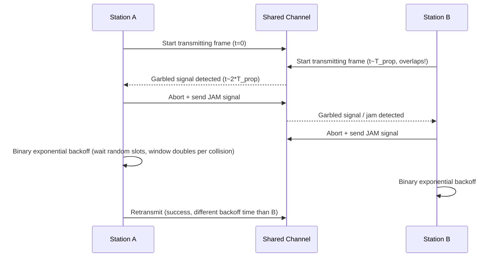
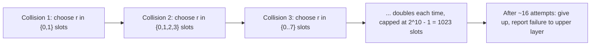

---
tags:
  - GATE/CS
  - GATE/ComputerNetworks
  - MediumAccessControl
  - RandomAccessProtocols
aliases:
  - CSMA/CD
  - Carrier Sense Multiple Access with Collision Detection
  - CSMA-CD
date_created: 2026-09-07
difficulty: ⭐⭐⭐⭐⭐
last_revised: 2026-09-07
pyq_frequency: High
---

## Syllabus Position

Subject: [[Computer Networks]]
Parent Topic: [[Medium Access Control]]
Sibling Topics: [[CSMA]], [[CSMA/CA]], [[Pure ALOHA]], [[Slotted ALOHA]]
Leads To: [[Ethernet]], [[Binary Exponential Backoff]]

GATE Syllabus Line: "Medium access control, LAN technologies (Ethernet), Random access protocols."

Exam Weight Note: One of the most heavily and *numerically* tested MAC topics in GATE — almost every year features a 2-mark NAT or MCQ computing minimum frame size, maximum network length/diameter, or round-trip propagation delay from the core relation $T_{fr} \geq 2T_{prop}$ + $T_{jam}$ Conceptual questions on jam signals, binary exponential backoff, and "why wireless can't use CSMA/CD" are also common.

---

## The Problem This Solves

Plain [[CSMA]] is a big improvement over ALOHA — sense before you send — but it still has one wasteful flaw: once a collision happens, a station has no way of knowing it *immediately*. It just keeps transmitting the entire doomed frame to completion, wasting the whole frame's transmission time on data that's already garbled and useless. That's like continuing to read out a full paragraph aloud even after you've realized someone else started talking over you at the very first word — you might as well stop the instant you notice, rather than finishing the whole thing for nothing.

CSMA/CD (Collision Detection) fixes exactly this: a station doesn't just sense the channel *before* transmitting, it keeps listening *while* transmitting, comparing what it's putting onto the wire against what's actually appearing on the wire. The moment it detects a mismatch (a collision), it **immediately aborts** the transmission, sends a short "jam signal" to make sure all other stations also notice the collision quickly, and then backs off before retrying. This is the classic access method of wired Ethernet for decades — simple, cheap in hardware, and remarkably effective as long as one crucial timing constraint is respected.

**Core Idea:** CSMA/CD has every station continue monitoring the channel *during* its own transmission, so that a collision is detected and the doomed frame aborted almost immediately — but this only works if the frame is transmitted for at least as long as it takes a collision signal from the farthest station to travel back, which is why CSMA/CD imposes a strict **minimum frame size**.

---

## Formal Theory

### Overview

CSMA/CD extends plain [[CSMA]] with exactly one additional capability: **collision detection during transmission**. It remains a random access protocol in the [[Medium Access Control]] sublayer, and it was the defining access method of classic (pre-switched) Ethernet (IEEE 802.3). It works specifically because, on a **wired** medium, a station can reliably compare its own outgoing signal against the actual signal level on the shared wire — a comparison that becomes unreliable over radio, which is precisely why wireless LANs use [[CSMA/CA]] instead.

### The Core Timing Constraint

For CSMA/CD to guarantee that a station detects a collision **before** it finishes transmitting a frame, the frame transmission time $T_{fr}$ must be at least as long as the **round-trip propagation delay** between the two farthest stations on the network:

$$T_{fr} \geq 2 \times T_{prop} + T_{jam}$$

**Why round-trip, not one-way?** Consider the worst case: station A (at one end of the network) starts transmitting at $t=0$. Its signal takes $T_{prop}$ to reach station B (at the far end). Suppose B senses the channel idle an instant before A's signal arrives and starts transmitting too, right at $t = T_{prop} - \epsilon$. A collision now occurs at B's location almost immediately, but the "news" of this collision (the garbled signal) must travel all the way back to A, taking another $T_{prop}$. So A only learns of the collision at time $\approx 2T_{prop}$ after it started transmitting. If A's frame had already finished transmitting before $2T_{prop}$ elapsed, A would never realize a collision happened to its frame at all — hence the strict requirement $T_{fr} \geq 2T_{prop}$.

### Consequence: Minimum Frame Size

Given a channel bandwidth $B$ and round-trip propagation delay $2T_{prop}$, the minimum frame size $L_{min}$ (in bits) is:

$$L_{min} = B \times 2T_{prop}$$

This is why Ethernet standards specify a **minimum frame size** (historically 64 bytes / 512 bits for classic 10 Mbps Ethernet) — any frame shorter than this must be padded, because a genuinely short frame could finish transmitting before a collision signal from the far end of the network has time to return.

### Consequence: Maximum Network Length (Diameter)

Rearranging the same relation, for a fixed frame size and bandwidth, there is a **maximum permissible network diameter** — beyond a certain physical distance, $T_{prop}$ becomes too large for any reasonably sized frame to satisfy $T_{fr} \geq 2T_{prop}$, which is exactly why classic Ethernet segments had strict maximum cable length rules.

### The Jam Signal

The instant a transmitting station detects a collision, it does not just stop silently — it transmits a short **jam signal** (typically 32–48 bits of a specific pattern) to ensure that **every other station** on the network also becomes aware a collision occurred, even ones that might not have directly detected the collision-inducing overlap themselves. This guarantees all involved parties correctly abort and schedule a retransmission, rather than some stations mistakenly assuming success.

### Binary Exponential Backoff

After a collision, a station cannot simply retry immediately (guaranteed re-collision) or after a fixed delay (repeated lockstep collisions among the same colliding stations). CSMA/CD Ethernet uses **binary exponential backoff**: after the $i$-th consecutive collision for the same frame, the station picks a random integer $r$ from $\{0, 1, \ldots, 2^{k}-1\}$ where $k = \min(i, 10)$, and waits $r$ slot times before retrying. The backoff window **doubles** (in expectation) with each successive collision, spreading out increasingly contentious retries further and further apart, and capping out (at $k=10$, i.e., a maximum window of $2^{10}-1 = 1023$ slots) to avoid unbounded growth. After typically 16 failed attempts, the frame is dropped and reported as a transmission failure to higher layers.

### How GATE Tests This Topic

GATE loves to test:
1. Computing minimum frame size given bandwidth and one-way propagation delay (always remember to **double** the propagation delay)
2. Computing maximum network length/diameter given frame size, bandwidth, and propagation speed
3. Explaining why the round-trip (not one-way) propagation delay is the relevant quantity
4. Reasoning about the jam signal's purpose (ensuring *all* stations detect the collision, not just the two directly involved)
5. Understanding binary exponential backoff's doubling behavior and why fixed/immediate retry would fail
6. Contrasting CSMA/CD (wired, detection-based) against [[CSMA/CA]] (wireless, avoidance-based) and explaining why detection fails wirelessly

---

## Diagrams and Visuals

### Worst-Case Collision Detection Timing

```
Station A (left end)                              Station B (right end)
      |                                                      |
t=0:  A starts transmitting ------------------------------->  (signal traveling, takes T_prop)
      |                                                      |
t=T_prop-ε: signal from A not yet arrived, B senses idle,
            B starts transmitting <----------------------- B
      |                                                      |
t=T_prop: A's signal arrives at B -> COLLISION at B's location
      |                                                      |
      Collision "news" (garbled signal) travels back to A -->
      |                                                      |
t=2*T_prop: A finally detects the collision at its own end

=> A must still be transmitting at t=2*T_prop for detection to succeed
=> T_fr >= 2*T_prop  (the core CSMA/CD timing constraint)
```

### Collision Detection and Jam Signal Sequence



### Binary Exponential Backoff Growth



---

## Complexity Analysis

Adapted for a protocol/timing concept rather than an algorithm's time/space complexity — the key "complexity" here is a timing constraint, not a Big-O bound.

### The Core Constraint, Derived

$$T_{fr} \geq 2 \times T_{prop}$$

**Justification:** As derived above, the worst-case time for a collision's effects to become visible back at the original sender is exactly one full round trip across the network's maximum span — $2T_{prop}$. If the frame transmission finishes before this time elapses, the sender has no way of ever learning its frame collided, defeating the entire purpose of collision detection. This inequality must hold with $\geq$, not just $=$, to provide a safety margin.

### Derived Quantities Table

| Quantity | Formula | Notes |
|----------|---------|-------|
| Minimum frame size | $L_{min} = B \times 2T_{prop}$ | $B$ = bandwidth, must pad shorter frames to this size |
| Maximum network diameter | Derived by solving $2T_{prop} \leq T_{fr}$ for distance, using propagation speed | Limits classic Ethernet cable lengths |
| Vulnerable/detection window | $2T_{prop}$ | Same round-trip logic as the minimum frame size derivation |
| Backoff window after $i$-th collision | $\{0, \ldots, 2^{\min(i,10)}-1\}$ slot times | Doubles per collision, capped at $2^{10}-1 = 1023$ |
| Max retry attempts before drop | Typically 16 | After this, failure reported to higher layers |

### Efficiency Under Load (Qualitative)

Because CSMA/CD aborts doomed frames early (rather than transmitting them fully, as plain [[CSMA]] would), it wastes strictly less time per collision than plain CSMA or ALOHA — the wasted time per collision is bounded by the detection window ($2T_{prop}$) rather than the full frame time $T_{fr}$. This is why CSMA/CD can approach channel capacity under light-to-moderate load, degrading only when repeated backoff delays start to dominate under very heavy contention.

---

## Worked Example

### Example: Computing Minimum Frame Size

**Scenario:** A wired Ethernet LAN using CSMA/CD has a one-way propagation delay of 25.6 microseconds between the two farthest stations, and the channel bandwidth is 10 Mbps.

**Step 1 — Compute round-trip propagation delay:**

$$2T_{prop} = 2 \times 25.6\,\mu s = 51.2\,\mu s$$

**Step 2 — Apply the core CSMA/CD constraint:**

$$T_{fr} \geq 2T_{prop} = 51.2\,\mu s$$

**Step 3 — Convert minimum frame transmission time into minimum frame size:**

$$L_{min} = T_{fr} \times \text{Bandwidth} = 51.2 \times 10^{-6} \text{ s} \times 10 \times 10^6 \text{ bps} = 512 \text{ bits}$$

**Verification:** This matches the well-known classic Ethernet minimum frame size of 512 bits (64 bytes) at 10 Mbps — this exact scenario is essentially how the historical Ethernet minimum frame size standard was derived.

**What would change if the bandwidth were increased to 100 Mbps with the same propagation delay?**

$$L_{min} = 51.2 \times 10^{-6} \times 100 \times 10^6 = 5120 \text{ bits}$$

The minimum frame size would need to **increase 10x** to 5120 bits — this is a real historical problem: as Ethernet speeds increased (Fast Ethernet, Gigabit Ethernet) while keeping the same 512-bit minimum frame size, engineers had to instead **shrink the maximum network diameter** (rather than growing minimum frame size indefinitely) to keep $2T_{prop}$ small enough, or add "carrier extension" padding in Gigabit Ethernet to artificially lengthen short frames.

---

## Intuition Anchors

**The Analogy (deepened):**

Extend the "reading aloud" analogy: CSMA/CD is a speaker who keeps one ear open even while talking, and the moment they hear their own words getting drowned out by someone else, they immediately stop mid-sentence and shout a quick "STOP, COLLISION!" (the jam signal) so everyone in the room knows to hush and retry — rather than finishing their entire paragraph pointlessly. But this only works if the speaker's sentence is long enough that the "stop" news has time to reach the farthest corner of the room and register before they'd have finished anyway — a whisper-short sentence might be over before anyone even realizes what happened, which is why there's a **minimum sentence length** rule.

**The Mental Model:**

Picture the network as a rope with people at both ends. If you tug your end (transmit), it takes time for the tug to be felt at the other end. If someone else tugs their end just before feeling your tug arrive, both tugs conflict — but you, at your end, won't feel *their* conflicting tug until it travels all the way back to you, a full round trip later. Your tug (frame) must last at least that long, or you'll let go (finish transmitting) before ever feeling the conflict.

**The One-Line Recall:**

CSMA/CD: sense before sending, keep listening while sending, and if a collision is detected mid-transmission, abort immediately and jam — this only works because $T_{fr} \geq 2T_{prop}$, which sets a strict minimum frame size $L_{min} = B \times 2T_{prop}$.

**The #1 Trap:**

Students use the **one-way** propagation delay instead of doubling it when computing minimum frame size or maximum network diameter. The correction: always double it — the relevant timing quantity is the full round trip, because the collision's "news" must travel all the way back to the original sender before that sender can react, not just reach the other station once.

---

## GATE Questions

---

**Question 1 — PYQ GATE-style — 2-mark NAT**

> A CSMA/CD LAN has a bandwidth of 10 Mbps and the maximum one-way propagation delay between the two farthest stations is 25.6 microseconds. What is the minimum frame size required, in bits?

<details>
<summary>Solution</summary>

**Answer: 512 bits**

**Reasoning:**

- Round-trip propagation delay: $2 \times 25.6\,\mu s = 51.2\,\mu s$.
- CSMA/CD requires $T_{fr} \geq 2T_{prop}$, so minimum $T_{fr} = 51.2\,\mu s$.
- Minimum frame size $= T_{fr} \times \text{Bandwidth} = 51.2 \times 10^{-6} \times 10 \times 10^{6} = 512$ bits.

**What this question is really testing:**

The core numeric application of $T_{fr} \geq 2T_{prop}$ converted into a frame size via bandwidth — the single most common CSMA/CD numeric pattern.

**Trap to avoid:**

Forgetting to double the one-way propagation delay, which would incorrectly give 256 bits instead of 512 bits.

</details>

---

**Question 2 — Conceptual — 1-mark MCQ**

> What is the primary purpose of the "jam signal" sent by a station immediately after detecting a collision in CSMA/CD?

- (A) To repair the corrupted frame so it can still be used
- (B) To ensure all stations on the network, including ones that may not have directly detected the overlap, become aware that a collision occurred
- (C) To request a higher transmission bandwidth from the network controller
- (D) To synchronize all stations' clocks after the collision

<details>
<summary>Solution</summary>

**Answer: (B)**

**Reasoning:**

The jam signal is a short, deliberately corrupted burst (typically 32-48 bits) sent immediately after collision detection, whose entire purpose is to guarantee that every station sharing the channel becomes unambiguously aware a collision took place — including stations that may only be partially affected or might otherwise assume their own transmission attempt was clean. Option (A) is false — a collided frame is never salvageable, it must be fully retransmitted. Option (C) is a fabricated function unrelated to jam signals. Option (D) is false — CSMA/CD (unlike Slotted ALOHA) does not rely on any global clock synchronization mechanism at all.

**What this question is really testing:**

Whether the student understands the jam signal's role in guaranteeing network-wide collision awareness, not just individual station detection.

**Trap to avoid:**

Assuming the jam signal "fixes" or "resends" the frame — it does neither; it purely serves as a network-wide collision announcement, and retransmission happens separately after backoff.

</details>

---

**Question 3 — Hard / Multi-concept — 2-mark NAT**

> A CSMA/CD network has a bandwidth of 1 Gbps and uses a minimum frame size of 512 bytes. What is the maximum permissible one-way propagation delay (in microseconds) between the two farthest stations for correct collision detection?

<details>
<summary>Solution</summary>

**Answer: 2.048 microseconds**

**Reasoning:**

- Minimum frame transmission time: $T_{fr} = \frac{512 \times 8 \text{ bits}}{10^9 \text{ bps}} = \frac{4096}{10^9} = 4.096\,\mu s$.
- CSMA/CD requires $T_{fr} \geq 2T_{prop}$, so the maximum permissible round-trip delay is $2T_{prop} \leq 4.096\,\mu s$, i.e., $2T_{prop} = 4.096\,\mu s$ at the boundary.
- Maximum one-way propagation delay: $T_{prop} = \frac{4.096}{2} = 2.048\,\mu s$.

**What this question is really testing:**

Whether the student can invert the standard formula — instead of finding minimum frame size from propagation delay, finding the maximum tolerable propagation delay (and by extension, maximum network diameter) from a fixed frame size and bandwidth. This inversion is exactly the reasoning behind why higher-speed Ethernet standards (Gigabit and beyond) had to shrink permissible network diameters or add carrier extension, since keeping the same 512-byte minimum frame size at much higher bandwidth would otherwise force impractically tiny propagation delays (hence tiny network diameters).

**Trap to avoid:**

Forgetting to divide the round-trip delay by 2 at the final step to recover the one-way propagation delay, which is what the question actually asks for.

</details>

---

**Pattern Recognition:**

- Whenever GATE gives bandwidth and one-way propagation delay, expect a minimum frame size question: double the delay, then multiply by bandwidth.
- Whenever GATE gives bandwidth and frame size and asks for propagation delay or network diameter, invert the same relation: divide frame transmission time by 2 to get maximum round-trip delay, then by 2 again if converting further to one-way delay or physical distance.
- Whenever GATE asks about the jam signal, the answer always centers on network-wide collision awareness, never frame repair or bandwidth requests.
- Whenever GATE asks why CSMA/CD doesn't work wirelessly, the answer always centers on the inability to reliably detect collisions mid-transmission (transmit-power self-masking + hidden terminal problem), motivating [[CSMA/CA]] instead.

---

## Edge Cases and Failure Modes

- [ ] **Using one-way propagation delay instead of round-trip:** The single most common CSMA/CD numeric error — always double the one-way delay before comparing against or deriving $T_{fr}$.
- [ ] **Frame shorter than the minimum required size:** Must be padded (e.g., classic Ethernet padding to 64 bytes) — transmitting a genuinely shorter frame risks finishing before a collision from the far end of the network can be detected, silently corrupting data without the sender ever knowing.
- [ ] **Very large network diameter:** As physical network span grows, $T_{prop}$ grows, forcing an ever-larger minimum frame size — this is precisely why classic Ethernet enforced strict maximum cable length limits (e.g., 2500m with repeaters for 10 Mbps Ethernet).
- [ ] **Fixed or immediate retry after collision:** Exactly as in ALOHA/CSMA, using a fixed delay causes repeated lockstep collisions among the same stations — CSMA/CD specifically uses **binary exponential backoff** (doubling window per collision) to avoid this.
- [ ] **Backoff window growing unboundedly:** Without a cap, the exponential backoff window would grow without limit under sustained heavy contention — hence the cap at $k = 10$ (window size $2^{10}-1 = 1023$ slots) and eventual frame drop after ~16 failed attempts.
- [ ] **Assuming CSMA/CD works over wireless:** It fundamentally does not, because a wireless transmitter's own signal is far stronger locally than any incoming signal, making reliable "listen while transmitting" collision detection impossible — this motivates [[CSMA/CA]] for wireless networks instead.
- [ ] **Increasing bandwidth without adjusting frame size or network diameter:** As shown in the worked example, scaling bandwidth up while keeping the same minimum frame size forces a proportionally smaller maximum network diameter — a real historical constraint addressed differently in Fast/Gigabit Ethernet standards (shrinking diameter, or carrier extension padding).

---

## Comparisons

| Feature | [[CSMA/CD]] | [[CSMA]] (no detection) | [[CSMA/CA]] |
|---------|----------------|----------------------------|----------------|
| Collision handling | Detects mid-transmission, aborts immediately + jams | No detection — frame transmitted fully even if colliding | Avoids collisions proactively (backoff + optional RTS/CTS), no detection during transmission |
| Medium | Wired (requires reliable self-signal comparison) | Either | Wireless (where detection is unreliable) |
| Wasted time per collision | Bounded by $2T_{prop}$ (detection window) | Full frame time $T_{fr}$ | N/A — collisions minimized proactively, not detected |
| Key constraint | $T_{fr} \geq 2T_{prop}$ (minimum frame size) | None beyond basic carrier sensing | Backoff timing, RTS/CTS overhead |
| Historical use | Classic (hub-based, pre-switch) Ethernet | Rarely deployed standalone | Wi-Fi (IEEE 802.11) |

The most common GATE question comparing these is: "Why can't CSMA/CD be used in wireless networks?" The answer hinges on the fact that a wireless transmitter's own outgoing signal is orders of magnitude stronger, locally, than any incoming signal from another station, making reliable mid-transmission collision detection physically impractical — compounded by the hidden terminal problem, where two stations may be unable to hear each other directly yet both interfere at a shared receiver.

---

## Connections Web

**Must know before this topic:**
- [[CSMA]] — the base carrier-sensing mechanism that CSMA/CD extends with mid-transmission detection
- [[Medium Access Control]] — the broader classification (random access vs. controlled access vs. channelization) this protocol fits into
- [[Delay in Computer Networks]] — propagation delay, transmission delay, and their formal definitions, essential for the core $T_{fr} \geq 2T_{prop}$ derivation

**Topics that build on this:**
- [[Ethernet]] — historically defined by CSMA/CD as its access method (IEEE 802.3)
- [[CSMA/CA]] — the wireless-adapted alternative, motivated directly by CSMA/CD's detection assumption failing over radio
- [[Binary Exponential Backoff]] — the specific retry-timing algorithm CSMA/CD Ethernet uses after a collision

**GATE subject cross-links:**
- [[Computer Networks]] > [[Medium Access Control]] > CSMA/CD

**Cross-subject connections:**
- [[Wrap Around Time]] — propagation delay and round-trip timing concepts recur in other network delay/throughput calculations
- [[Probability and Statistics]] — the randomized slot selection in binary exponential backoff is a discrete uniform random variable over a doubling range

**Standard references:**
- IEEE 802.3 — Ethernet / CSMA/CD standard
- [[Kurose & Ross]] Chapter 6 — The Link Layer and LANs
- [[Tanenbaum & Wetherall]] Chapter 4 — The Medium Access Control Sublayer

---

## Quick Revision Sheet

**Definition (1 sentence):** CSMA/CD is a wired random access MAC protocol where a station senses the channel before transmitting, continues monitoring during transmission, and immediately aborts and jams upon detecting a collision, requiring $T_{fr} \geq 2T_{prop}$ to guarantee reliable detection.

**Core Idea / Analogy (1 sentence):** It's a speaker who keeps listening while talking and stops mid-sentence the instant they notice being talked over — but only works if the sentence is long enough for the "stop" news to travel to the farthest listener and back.

**Algorithm Steps (numbered, maximum 6 steps):**
1. Sense the channel; if busy, defer (per chosen CSMA persistence strategy).
2. If idle, begin transmitting while continuing to monitor the channel.
3. If a collision is detected mid-transmission, abort immediately.
4. Send a jam signal to ensure all stations recognize the collision.
5. Wait using binary exponential backoff (window doubles per consecutive collision, capped at $2^{10}-1$ slots).
6. Retry from step 1; after ~16 failed attempts, drop the frame and report failure.

**Complexity:**
- Core constraint: $T_{fr} \geq 2T_{prop}$
- Minimum frame size: $L_{min} = B \times 2T_{prop}$
- Wasted time per collision: bounded by $2T_{prop}$, not full frame time

**Key Properties (3 to 5 bullet points):**
- Detects collisions mid-transmission and aborts early, unlike plain CSMA which transmits doomed frames fully.
- Requires round-trip (not one-way) propagation delay for its core timing constraint.
- Jam signal ensures network-wide collision awareness, not just detection by the colliding stations.
- Binary exponential backoff doubles the retry window per collision, capped and eventually giving up after ~16 attempts.
- Fundamentally wired-only — fails over wireless due to transmit-power self-masking, motivating [[CSMA/CA]].

**The #1 Trap:**
Using one-way propagation delay instead of round-trip ($2T_{prop}$) when computing minimum frame size or maximum network diameter.

**When to use this over alternatives:**
CSMA/CD is preferred over plain CSMA whenever the medium is wired (allowing reliable self-signal comparison) and minimizing wasted transmission time on doomed frames matters — historically the default for shared-medium Ethernet before switching became standard.

**Mnemonic:** "Sense, Send, Still Listen, Stop & Jam" — the four-step behavioral summary of CSMA/CD, plus "double the delay" as the numeric reminder for $2T_{prop}$.

---

## Revision Checklist

- [ ] I can state and derive $T_{fr} \geq 2T_{prop}$ from the worst-case collision timing scenario, not just recall it.
- [ ] I can compute minimum frame size given bandwidth and propagation delay, remembering to double the delay.
- [ ] I can invert the relation to compute maximum propagation delay or network diameter given a fixed frame size and bandwidth.
- [ ] I can explain the jam signal's purpose (network-wide collision awareness) without confusing it with frame repair.
- [ ] I can explain binary exponential backoff's doubling behavior and why fixed-delay retry fails.
- [ ] I can explain precisely why CSMA/CD does not work wirelessly, motivating [[CSMA/CA]].
- [ ] I have linked this note correctly in my Obsidian vault.
