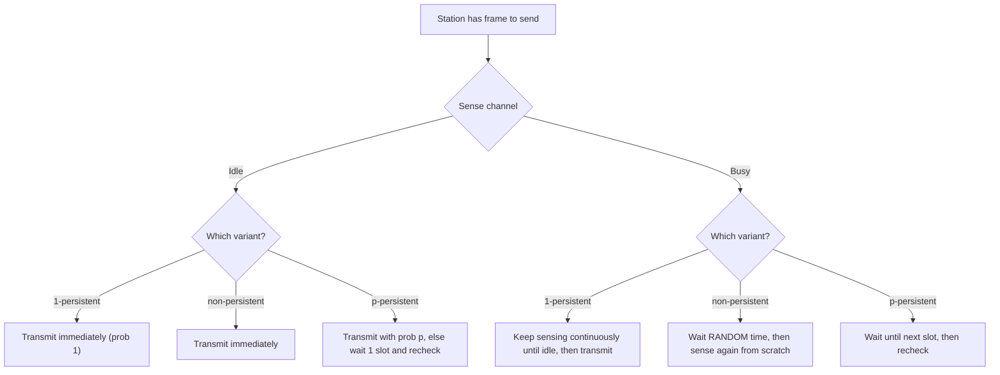
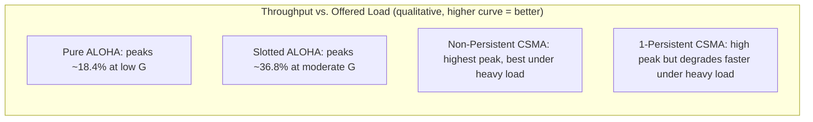

---
tags:
  - GATE/CS
  - GATE/ComputerNetworks
  - MediumAccessControl
  - RandomAccessProtocols
aliases:
  - CSMA
  - Carrier Sense Multiple Access
date_created: 2026-09-07
difficulty: ⭐⭐⭐⭐
last_revised: 2026-09-07
pyq_frequency: High
---

## Syllabus Position

Subject: [[Computer Networks]]
Parent Topic: [[Medium Access Control]]
Sibling Topics: [[Pure ALOHA]], [[Slotted ALOHA]], [[CSMA/CD]], [[CSMA/CA]]
Leads To: [[CSMA/CD]], [[CSMA/CA]], [[Ethernet]]

GATE Syllabus Line: "Medium access control, LAN technologies (Ethernet), Random access protocols."

Exam Weight Note: Tested somewhat less numerically than ALOHA (the throughput formulas are messier and rarely fully derived in an exam setting), but heavily tested **conceptually** — distinguishing 1-persistent, non-persistent, and p-persistent CSMA, explaining why CSMA still allows collisions despite carrier sensing, and serving as the essential stepping stone before [[CSMA/CD]] and [[CSMA/CA]] questions (which are numerically heavier and appear almost every year).

---

## The Problem This Solves

Both [[Pure ALOHA]] and [[Slotted ALOHA]] share a glaring inefficiency: a station transmits **completely blind** to what every other station is doing. It never even bothers to check if the channel is already busy before jumping in. That's like walking into a room and starting to talk without first checking whether someone else is already speaking — you'd interrupt constantly, purely out of not paying attention, even though the information ("is someone talking right now?") was trivially available just by listening for a moment.

Carrier Sense Multiple Access fixes exactly this wasted opportunity: before transmitting, a station **listens to the channel** ("senses the carrier") and only proceeds if the channel is idle. This is the single most obvious, common-sense improvement over ALOHA, and it dramatically cuts down (though never eliminates) collisions — because a collision is now only possible in the narrow timing window where multiple stations sense the channel idle nearly simultaneously and start transmitting before anyone's signal has had time to propagate and be sensed by the others.

**Core Idea:** CSMA has every station listen to the shared channel before transmitting, and only transmit if it senses the channel is idle — trading ALOHA's total blindness for one simple rule ("don't interrupt if someone's already talking"), which drastically reduces collisions but cannot eliminate them entirely because of propagation delay.

---

## Formal Theory

### Overview

CSMA belongs to the **random access protocol** family within [[Medium Access Control]], sitting directly between the ALOHA family (no listening at all) and [[CSMA/CD]] / [[CSMA/CA]] (listening plus additional collision-handling refinements). The core mechanism — "sense before you send" — is intuitive, but the *exact policy* for what to do when the channel is sensed **busy** defines three distinct variants, each with a different collision/idle-time tradeoff. GATE expects you to distinguish all three by name and behavior.

### Why Collisions Are Still Possible

Even with carrier sensing, collisions remain possible because of **non-zero propagation delay** $T_{prop}$. If station A starts transmitting at time $t_0$, that signal takes time to physically reach station B. If station B senses the channel *before* A's signal arrives (i.e., anywhere in the window $(t_0, t_0 + T_{prop})$), B will (incorrectly) sense the channel as idle and may also start transmitting — causing a collision. This window, roughly of length $T_{prop}$, is CSMA's vulnerable period, and it is why CSMA's performance depends heavily on the ratio $\frac{T_{prop}}{T_{fr}}$ (propagation delay relative to frame transmission time) — the smaller this ratio, the closer CSMA gets to collision-free operation.

### Variant 1: 1-Persistent CSMA

The station senses the channel continuously. The instant it senses the channel idle, it transmits **immediately with probability 1** (hence "1-persistent" — it is maximally eager/greedy).

- **Advantage:** No wasted idle time — the moment the channel frees up, a waiting station grabs it.
- **Disadvantage:** If multiple stations were all waiting for the channel to become idle, **all of them** transmit the instant it does, guaranteeing a collision whenever more than one station was waiting. This makes 1-persistent CSMA collision-prone precisely under moderate-to-heavy load.

### Variant 2: Non-Persistent CSMA

If the station senses the channel busy, it does **not** keep sensing continuously. Instead, it waits a **random** amount of time, then senses again.

- **Advantage:** Waiting stations are far less likely to all check at exactly the same instant and pile on simultaneously, reducing collision probability substantially compared to 1-persistent.
- **Disadvantage:** Because a station might wait even after the channel has already gone idle (it isn't sensing continuously), the channel can sit unused even when a station has data ready — reducing overall channel utilization efficiency compared to 1-persistent's greediness.

### Variant 3: p-Persistent CSMA

Applies specifically to **slotted channels** (time divided into slots, typically of length $\leq T_{prop}$). If the channel is sensed idle, the station transmits with probability $p$, or defers to the next slot with probability $(1-p)$ and re-evaluates. If the channel is sensed busy, the station waits until the next slot and repeats the same probabilistic check.

- **Tunable middle ground:** As $p \to 1$, behavior approaches 1-persistent (greedy); as $p \to 0$, behavior approaches non-persistent-like caution (rarely transmits immediately).
- Choosing the right $p$ balances collision probability against idle-time waste — this tunability is exactly why p-persistent is considered the most "engineered" of the three variants.

### How GATE Tests This Topic

GATE loves to test:
1. Distinguishing 1-persistent, non-persistent, and p-persistent CSMA by their exact behavior when the channel is sensed busy or idle
2. Explaining *why* CSMA still permits collisions despite carrier sensing (propagation delay argument)
3. Reasoning about which variant performs best under light vs. heavy load (non-persistent under heavy load, 1-persistent under light load)
4. Connecting CSMA's vulnerable period conceptually to the $\frac{T_{prop}}{T_{fr}}$ ratio, without necessarily requiring a closed-form throughput formula
5. Positioning CSMA correctly relative to [[Pure ALOHA]] (strictly better, since it listens first) and [[CSMA/CD]] (CSMA plus mid-transmission collision detection)

---

## Diagrams and Visuals

### Persistence Strategy Decision Flow



### Vulnerable Period Due to Propagation Delay

```
Station A transmits at t=0.
Signal physically reaches Station B only at t = T_prop.

Timeline at Station B's location:
t=0                          t=T_prop                    t=T_fr
 |----(A's signal not yet arrived, channel appears idle)--|----(A's signal now visible, channel busy)----|
 |<-------- B might sense "idle" and transmit here! ------>|
                 VULNERABLE WINDOW ≈ T_prop

If B transmits anywhere before T_prop, a collision occurs even though B "correctly"
sensed the channel as idle at the moment it checked.
```

### Throughput Comparison: ALOHA vs. CSMA Variants (Qualitative)



---

## Complexity Analysis

Adapted for a protocol/throughput concept rather than a single algorithm's time/space complexity.

### Qualitative Throughput Characterization

CSMA's exact throughput formula (as a function of $G$ and $a = \frac{T_{prop}}{T_{fr}}$) is considerably more complex than the clean closed forms for ALOHA, and GATE almost never requires deriving it from scratch — the qualitative comparison is what matters:

| Variant | Behavior when channel busy | Collision Risk | Idle-Time Waste | Best suited for |
|---------|------------------------------|-----------------|--------------------|--------------------|
| 1-Persistent | Sense continuously, transmit the instant idle | Highest (all waiting stations pounce simultaneously) | Lowest | Light load |
| Non-Persistent | Wait random time, re-sense | Lowest | Highest | Heavy load |
| p-Persistent | Wait for next slot, transmit with prob $p$ | Tunable (between the two extremes) | Tunable | Both, if $p$ is well-chosen |

### The Governing Ratio $a = \frac{T_{prop}}{T_{fr}}$

$$a = \frac{T_{prop}}{T_{fr}}$$

- As $a \to 0$ (propagation delay negligible relative to frame time — e.g., a short wired LAN with large frames), CSMA approaches ideal collision-free performance, since nearly every station "hears" an ongoing transmission almost instantly.
- As $a \to 1$ or larger (propagation delay comparable to or exceeding frame time — e.g., satellite links or very short frames), CSMA's advantage over ALOHA shrinks, because the vulnerable period (governed by $T_{prop}$) becomes a significant fraction of the frame time itself.
- This ratio $a$ is the single most important explanatory variable GATE expects you to reason about qualitatively when comparing CSMA's effectiveness across different network types.

---

## Worked Example

### Example: Reasoning About Persistence Strategy Choice

**Scenario:** A LAN administrator is deciding between 1-persistent and non-persistent CSMA for two different network segments:

- **Segment 1:** Typically has only 2–3 active stations, each transmitting infrequently (light load).
- **Segment 2:** Has 50 active stations, frequently all with data queued simultaneously (heavy load).

**Step 1 — Analyze Segment 1 (light load):**

With few stations rarely wanting to transmit at the same moment, the probability that multiple stations are simultaneously waiting for the channel to free up is low. 1-persistent CSMA's main weakness (all waiting stations transmitting the instant the channel frees) rarely triggers here, so its main strength — zero wasted idle time, immediate transmission the instant the channel is free — dominates. **1-persistent CSMA is the better choice for Segment 1.**

**Step 2 — Analyze Segment 2 (heavy load):**

With 50 stations frequently all queued up simultaneously, 1-persistent CSMA would cause a collision almost every single time the channel frees up (since all waiting stations pounce at once). Non-persistent CSMA's random backoff before re-sensing spreads out these attempts over time, drastically reducing simultaneous transmission attempts, even though it costs some wasted idle channel time. **Non-persistent CSMA is the better choice for Segment 2.**

**Step 3 — Verification:**

This matches the general GATE-tested principle: 1-persistent CSMA favors light load (greedy grabbing pays off when few are competing), non-persistent CSMA favors heavy load (caution prevents pile-ups when many are competing).

**What would change if Segment 2 switched to p-persistent CSMA with a well-tuned $p$?**

A well-tuned $p$ (smaller than 1, chosen based on the number of contending stations) can achieve a middle ground — better idle-time utilization than pure non-persistent, while avoiding 1-persistent's guaranteed-collision pileup under heavy load. This tunability is exactly why real slotted systems (like Wi-Fi's exponential backoff mechanisms, conceptually related) favor probabilistic, tunable approaches over the two rigid extremes.

---

## Intuition Anchors

**The Analogy (deepened):**

Extend the classroom analogy: 1-persistent CSMA is a student who stares intently at the current speaker and, the microsecond they stop talking, jumps in immediately — great when it's just you and one other person, but a guaranteed simultaneous shout-fest if five students are all staring and waiting for the same pause. Non-persistent CSMA is a student who, upon hearing someone else talking, looks away and does something else for a random while before checking back in — much less likely to collide with four other students doing the same, but sometimes the room goes awkwardly silent even though several students actually want to speak. p-Persistent CSMA is a student following a house rule: "if the room is quiet, flip a biased coin — heads, speak now; tails, wait one beat and flip again."

**The Mental Model:**

Picture carrier sensing as reducing (not eliminating) the "raindrop" collision model from ALOHA: instead of raindrops falling completely at random, each station now waits for visible gaps in the rain before dropping its own raindrop — but because the "visibility" (propagation delay) isn't instantaneous, a station can still misjudge a gap that's actually already been claimed by a raindrop still in flight.

**The One-Line Recall:**

CSMA = "listen before you speak" — 1-persistent transmits the instant it's idle (greedy, best light load), non-persistent waits a random time before re-checking (cautious, best heavy load), p-persistent probabilistically transmits per slot (tunable middle ground) — collisions still possible due to propagation delay.

**The #1 Trap:**

Students assume carrier sensing eliminates collisions entirely — it does not. Collisions remain possible whenever two stations sense the channel idle within each other's propagation delay window and both transmit before either one's signal has had time to reach the other. The correction: CSMA reduces collision *probability* dramatically compared to ALOHA, but the vulnerable period (roughly $T_{prop}$, not zero) never disappears — this is precisely the gap that [[CSMA/CD]] addresses by adding mid-transmission detection.

---

## GATE Questions

---

**Question 1 — GATE-style — 1-mark MCQ**

> In 1-persistent CSMA, what does a station do when it senses the channel is busy?

- (A) It waits a random amount of time before sensing again
- (B) It continuously senses the channel and transmits immediately once it becomes idle
- (C) It waits for the next time slot and transmits with probability $p$
- (D) It aborts the transmission attempt permanently

<details>
<summary>Solution</summary>

**Answer: (B)**

**Reasoning:**

By definition, "1-persistent" means the station persists in sensing the channel continuously (with "persistence probability" effectively 1) and transmits the very instant it senses the channel go idle — no randomization, no slot-waiting. Option (A) describes non-persistent CSMA. Option (C) describes p-persistent CSMA. Option (D) is not any standard CSMA behavior — CSMA variants always eventually retry, they don't permanently abort.

**What this question is really testing:**

Whether the student can correctly recall the exact defining behavior of each named variant without conflating them.

**Trap to avoid:**

Confusing "1-persistent" (transmit with certainty the instant idle) with "p-persistent" (transmit with probability $p$, a number less than 1) — the "1" in "1-persistent" literally refers to probability 1.

</details>

---

**Question 2 — Conceptual — 1-mark MCQ**

> Why can two stations still collide in CSMA even though both correctly sensed the channel as idle before transmitting?

- (A) Because CSMA does not actually check the channel state, it only estimates it
- (B) Because carrier sensing hardware occasionally malfunctions
- (C) Because propagation delay means a transmitting station's signal has not yet reached the other station at the moment the other station senses the channel
- (D) Because CSMA requires a shared global clock which may not be synchronized

<details>
<summary>Solution</summary>

**Answer: (C)**

**Reasoning:**

The channel truly *was* idle at the exact physical location of the second sensing station at the moment it checked — the first station's signal simply hadn't propagated there yet, due to non-zero propagation delay $T_{prop}$. Both stations sensed correctly and honestly, yet a collision still results once the two signals eventually meet. Option (A) is false — sensing does reflect the true (local) channel state. Option (B) is a distractor about hardware failure, not the fundamental protocol-level reason. Option (D) is false — CSMA (unlike Slotted ALOHA) does not fundamentally require a global clock for its basic sense-before-send operation.

**What this question is really testing:**

Whether the student understands that CSMA's residual collision risk is a fundamental consequence of finite propagation speed, not a flaw in the sensing mechanism itself.

**Trap to avoid:**

Blaming "faulty sensing" rather than the more precise and fundamental explanation: propagation delay creates an inherent information lag that no sensing mechanism, however reliable, can eliminate.

</details>

---

**Question 3 — Hard / Multi-concept — 2-mark MCQ**

> Under heavy network load with many stations frequently having data ready to send, which CSMA variant generally achieves the highest throughput, and why?

- (A) 1-persistent, because it never wastes idle channel time
- (B) Non-persistent, because randomizing the re-sensing delay spreads out transmission attempts and reduces simultaneous collisions among the many waiting stations
- (C) Both perform identically regardless of load
- (D) 1-persistent, because it uses a global time slot to synchronize transmissions

<details>
<summary>Solution</summary>

**Answer: (B)**

**Reasoning:**

Under heavy load, many stations are simultaneously waiting for the channel to become idle. 1-persistent CSMA guarantees that **all** such waiting stations transmit the instant the channel frees up, producing near-certain collisions whenever more than one station was waiting — this is precisely 1-persistent's weakness under heavy load, despite option (A)'s claim about zero idle-time waste (true, but irrelevant to the collision problem it creates). Non-persistent CSMA's randomized backoff before re-sensing spreads out the waiting stations' retry attempts over time, sharply reducing the chance of simultaneous transmission, which is why it outperforms 1-persistent specifically under heavy contention — even though it sacrifices some idle-time efficiency. Option (D) is false — CSMA persistence variants (1-persistent, non-persistent) do not inherently require global slotting; only p-persistent CSMA explicitly operates on a slotted channel.

**What this question is really testing:**

Whether the student can correctly reason about the load-dependent tradeoff between greediness (1-persistent) and caution (non-persistent), rather than assuming one variant is universally superior.

**Trap to avoid:**

Assuming "no wasted idle time" (1-persistent's advantage) automatically implies "higher throughput" — under heavy load, the collision cost from simultaneous pile-ups outweighs the idle-time savings.

</details>

---

**Pattern Recognition:**

- Whenever GATE describes "transmits the instant it senses the channel idle, otherwise keeps sensing continuously," identify it immediately as **1-persistent CSMA**.
- Whenever GATE describes "waits a random time before re-checking the channel," identify it as **non-persistent CSMA**.
- Whenever GATE mentions a **slotted channel** combined with a transmission **probability $p$**, identify it as **p-persistent CSMA**.
- Whenever GATE asks "why do collisions still occur in CSMA," the answer is always rooted in non-zero **propagation delay** creating a residual vulnerable window — never "sensing hardware failure" or similar distractors.
- Whenever GATE asks about performance under heavy vs. light load, recall: 1-persistent favors light load (greedy pays off), non-persistent favors heavy load (caution prevents pile-ups).

---

## Edge Cases and Failure Modes

- [ ] **Assuming carrier sensing eliminates collisions entirely:** It does not — propagation delay always leaves a residual vulnerable window of roughly $T_{prop}$, however small.
- [ ] **Propagation delay approaching or exceeding frame time ($a \geq 1$):** In this regime (e.g., satellite links with very short frames), CSMA's advantage over plain ALOHA shrinks dramatically, since the "listen first" benefit becomes negligible if the listening station can't reliably know the true current channel state before it itself must decide to transmit.
- [ ] **1-persistent CSMA under simultaneous multi-station contention:** If exactly $k > 1$ stations are all waiting for the same busy channel to clear, **all $k$** transmit the instant it does in pure 1-persistent CSMA — a guaranteed collision whenever $k > 1$, a frequently tested conceptual weak point.
- [ ] **Non-persistent CSMA's channel-idle-but-unused problem:** Because a station doesn't continuously re-sense, the channel may sit idle even when a station has data ready and the channel has already freed up — a real throughput cost that's easy to overlook when only thinking about collision avoidance.
- [ ] **p-Persistent CSMA requires careful choice of $p$:** Too high a $p$ degrades toward 1-persistent's pileup problem under heavy load; too low a $p$ wastes idle slots — there's no universally "correct" $p$, it must be tuned to expected contention levels.
- [ ] **Confusing CSMA with CSMA/CD:** Plain CSMA (this topic) only senses the channel **before** transmitting; it does not continue monitoring **during** transmission for a collision — that additional capability defines [[CSMA/CD]] specifically, and is a very common point of confusion in GATE-style questions.

---

## Comparisons

| Feature | [[CSMA]] (1-persistent) | [[CSMA]] (non-persistent) | [[Pure ALOHA]] |
|---------|----------------------------|-------------------------------|-------------------|
| Senses channel before transmitting? | Yes | Yes | No |
| Behavior when busy | Keeps sensing, transmits instantly when idle | Waits random time, then re-senses | N/A (transmits immediately regardless) |
| Collision risk under light load | Low | Low | High (relatively, given no sensing at all) |
| Collision risk under heavy load | High (simultaneous pileup) | Lower (randomized spread-out retries) | Very high |
| Idle-time waste | Minimal | Higher | None (no sensing delay at all) |
| GATE Preference | Tested for definition/behavior recall | Tested for heavy-load reasoning | Tested for numeric throughput derivation |

The most common GATE question comparing these is: "Which variant performs better under heavy contention, and why?" The answer always hinges on the pileup effect — 1-persistent's greediness guarantees simultaneous transmission among all waiting stations the instant the channel frees, while non-persistent's randomized re-sensing delay staggers those attempts across time, trading some idle-time efficiency for a substantial reduction in collision probability.

---

## Connections Web

**Must know before this topic:**
- [[Pure ALOHA]] — the baseline "no sensing at all" protocol that CSMA directly improves upon
- [[Slotted ALOHA]] — introduces the slotting concept that p-persistent CSMA borrows and adapts
- [[Medium Access Control]] — the broader random-access-vs-controlled-access-vs-channelization classification this protocol fits into

**Topics that build on this:**
- [[CSMA/CD]] — adds mid-transmission collision detection on top of CSMA's basic carrier sensing, used in classic wired Ethernet
- [[CSMA/CA]] — adds collision avoidance (backoff + optional RTS/CTS) for wireless networks where CSMA/CD's detection assumption breaks down
- [[Ethernet]] — historically built directly on CSMA/CD

**GATE subject cross-links:**
- [[Computer Networks]] > [[Medium Access Control]] > CSMA

**Cross-subject connections:**
- [[Probability and Statistics]] — the probabilistic transmission decision in p-persistent CSMA (Bernoulli trial with parameter $p$) draws directly on basic probability theory tested elsewhere in GATE
- [[Queueing Theory]] — the tradeoff between idle-time waste and collision probability parallels classic queueing system tuning problems

**Standard references:**
- Kleinrock, L. and Tobagi, F. (1975) — "Packet Switching in Radio Channels: Part I — Carrier Sense Multiple-Access Modes," the original CSMA analysis paper
- [[Kurose & Ross]] Chapter 6 — The Link Layer and LANs, Random Access Protocols
- [[Tanenbaum & Wetherall]] Chapter 4 — The Medium Access Control Sublayer

---

## Quick Revision Sheet

**Definition (1 sentence):** CSMA is a random access MAC protocol where a station listens to the shared channel before transmitting and only proceeds if the channel is sensed idle, drastically reducing (but not eliminating) collisions compared to ALOHA.

**Core Idea / Analogy (1 sentence):** It's "listen before you speak" in a shared conversation — you check if someone's already talking before jumping in, unlike ALOHA's total blindness.

**Algorithm Steps (numbered, maximum 6 steps):**
1. Station has a frame ready → sense the channel.
2. If idle: transmit (1-persistent: always; non-persistent: immediately upon this check; p-persistent: with probability $p$, per slot).
3. If busy: 1-persistent keeps sensing continuously; non-persistent waits a random time then re-senses from scratch; p-persistent waits for the next slot then rechecks.
4. If a collision still occurs (due to propagation delay overlap), sender detects failure via timeout/no-ACK.
5. Sender waits a random backoff time.
6. Retry from step 1.

**Complexity:**
- Vulnerable period: roughly $T_{prop}$ (propagation delay), not the full frame time.
- Governing ratio: $a = \frac{T_{prop}}{T_{fr}}$ — smaller $a$ means CSMA performs closer to ideal.
- No single clean closed-form throughput formula is typically expected on GATE (unlike ALOHA's $Ge^{-G}$/$Ge^{-2G}$).

**Key Properties (3 to 5 bullet points):**
- Collisions are still possible, caused specifically by non-zero propagation delay.
- 1-persistent: greedy, best under light load, guarantees collision if multiple stations are waiting.
- Non-persistent: cautious, best under heavy load, wastes some idle channel time.
- p-Persistent: tunable middle ground on a slotted channel.

**The #1 Trap:**
Believing carrier sensing eliminates collisions — it only reduces their probability; the residual vulnerable window (roughly $T_{prop}$) always remains, which is exactly what [[CSMA/CD]] is designed to detect and react to quickly.

**When to use this over alternatives:**
CSMA is preferred over ALOHA whenever carrier sensing hardware is feasible and propagation delay is small relative to frame time ($a \ll 1$, e.g., typical wired LANs) — it strictly improves throughput over both ALOHA variants in that regime.

**Mnemonic:** "1 is greedy, Non is cautious, p is a coin flip" — 1-persistent transmits with certainty the instant idle, non-persistent waits a random full re-check delay, p-persistent flips a biased coin each slot.

---

## Revision Checklist

- [ ] I can state the exact defining behavior of 1-persistent, non-persistent, and p-persistent CSMA when the channel is sensed busy or idle.
- [ ] I can explain why collisions are still possible in CSMA despite carrier sensing (propagation delay argument).
- [ ] I can reason about which variant performs better under light load vs. heavy load, and why.
- [ ] I can explain the significance of the ratio $a = \frac{T_{prop}}{T_{fr}}$ qualitatively.
- [ ] I can distinguish plain CSMA from [[CSMA/CD]] (adds mid-transmission detection) and [[CSMA/CA]] (adds proactive avoidance for wireless).
- [ ] I know CSMA strictly improves on [[Pure ALOHA]] by adding the "sense before send" rule.
- [ ] I have linked this note correctly in my Obsidian vault.
