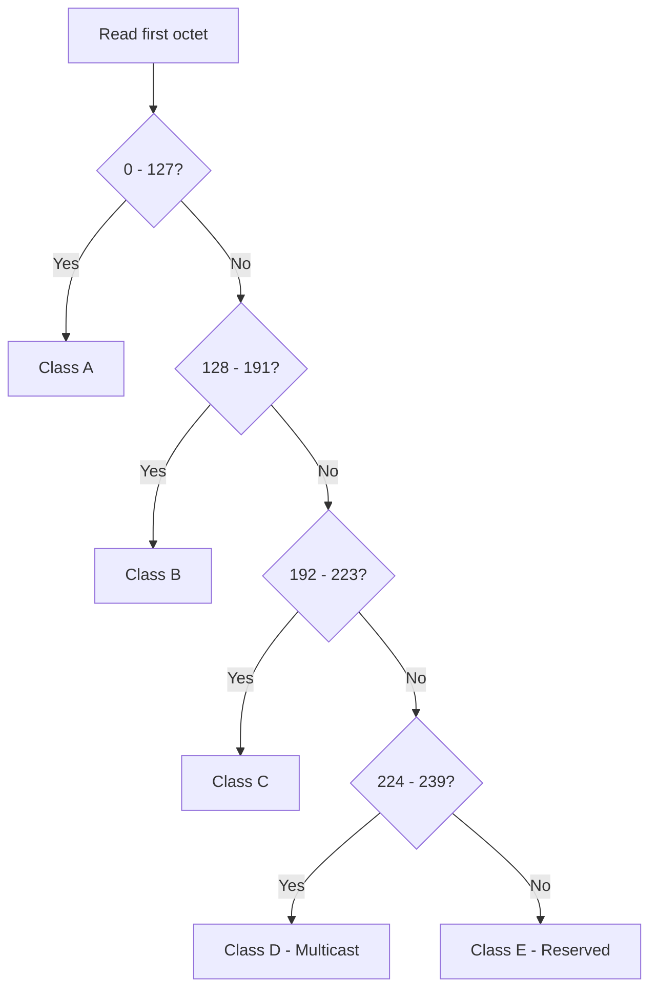

---
tags:
  - GATE/CS
  - GATE/Networks
  - IPAddressing
aliases:
  - Classful IP Addressing
  - IPv4 Classful Scheme
  - Class A B C D E Addressing
date_created: 2026-08-12
difficulty: ⭐⭐⭐
last_revised: 2026-08-12
pyq_frequency: Medium
---

## Syllabus Position

Subject: [[Computer Networks Index]]
Parent Topic: [[IPv4 Addressing]]
Sibling Topics: [[Classless Addressing (CIDR)]], [[Subnetting]], [[Supernetting]]
Leads To: [[Subnetting]], [[Variable Length Subnet Masking (VLSM)]], [[NAT]]

GATE Syllabus Line: "IPv4/IPv6, Routers and Routing algorithms" — Classful addressing is the
foundational scheme from which subnetting and CIDR are derived, and is implicitly tested whenever
GATE gives a raw IP address and asks you to identify its class, default mask, or network ID.

Exam Weight Note: Appears as a 1-mark MCQ asking to identify the class of an address, or embedded
inside a 2-mark NAT question on subnetting where you must first recognize the classful default
mask before applying custom subnet masks.

---

## The Problem This Solves

In the early Internet, routers needed a fast way to know how an IP address is split into a
**network part** and a **host part** — without exchanging extra information for every address.
If every network could have hosts of any arbitrary size with no fixed boundary, routers would need
a lookup table with a mask for literally every single address on the Internet, which does not
scale. Classful addressing solves this by **baking the network/host split directly into the first
few bits of the address itself**, so any router can look at the address alone and instantly know
how much of it is network and how much is host — no external mask needed.

Analogy: think of classful addressing like old telephone numbers where the first digit told you
the *region* of the country before you even dialed the rest — the region code was self-describing,
built into the number, not looked up separately.

Core Idea (one sentence): The leading bits of an IPv4 address determine a fixed, universally-known
network/host boundary (a "class"), removing the need to transmit a separate subnet mask.

---

## Formal Theory

A **classful address** is a 32-bit IPv4 address whose first few bits identify which of five
fixed **classes** (A, B, C, D, E) it belongs to, and that class fixes the boundary between the
**network ID** and the **host ID**.

### Class Identification Rules

| Class | Leading Bits | First Octet Range | Default Mask       | Network/Host Split |
|-------|--------------|--------------------|--------------------|---------------------|
| A     | `0`          | 0 – 127            | 255.0.0.0 (/8)     | 8 bits net, 24 host |
| B     | `10`         | 128 – 191          | 255.255.0.0 (/16)  | 16 bits net, 16 host|
| C     | `110`        | 192 – 223          | 255.255.255.0 (/24)| 24 bits net, 8 host |
| D     | `1110`       | 224 – 239          | N/A (multicast)    | No net/host split   |
| E     | `1111`       | 240 – 255          | N/A (reserved)     | No net/host split   |

Each class's leading bit pattern is called the **class prefix**. The prefix "steals" bits purely
to announce the class — those bits are not usable for addressing, which is one reason classful
addressing wastes address space.

### Class A

- 1 bit for class prefix (`0`), 7 bits for **network ID**, 24 bits for **host ID**.
- Total networks: $2^7 = 128$, but network `0` and network `127` (loopback) are reserved, giving
  126 usable networks.
- Hosts per network: $2^{24} - 2 = 16{,}777{,}214$ (subtract all-0s network address and all-1s
  broadcast address).
- Designed for a very small number of huge organizations (e.g., large ISPs, early government/
  military networks).

### Class B

- 2 bits for class prefix (`10`), 14 bits for network, 16 bits for host.
- Networks: $2^{14} = 16{,}384$. Hosts per network: $2^{16} - 2 = 65{,}534$.
- Designed for medium-to-large organizations — universities, mid-size corporations.

### Class C

- 3 bits for class prefix (`110`), 21 bits for network, 8 bits for host.
- Networks: $2^{21} = 2{,}097{,}152$. Hosts per network: $2^{8} - 2 = 254$.
- Designed for small networks/organizations — most common allocation for small businesses.

### Class D (Multicast)

- 4 bits prefix (`1110`), remaining 28 bits form a **multicast group address**, not a
  network/host split. Range: 224.0.0.0 to 239.255.255.255. Used for [[Multicasting]] protocols
  like IGMP.

### Class E (Reserved)

- 4 bits prefix (`1111`), remaining 28 bits reserved for experimental/future use. Range:
  240.0.0.0 to 255.255.255.255 (255.255.255.255 is the limited broadcast address).

### Special Address Rules Within Classes

- **Network address**: host bits all `0` — identifies the network itself, not a usable host.
- **Directed broadcast address**: host bits all `1` — sends to every host on that network.
- **Loopback**: entire 127.0.0.0/8 block (technically inside Class A) reserved for testing
  the local machine's own network stack (e.g., `127.0.0.1`).
- **Private address ranges** (not routable on the public Internet, defined in RFC 1918):
  - Class A: 10.0.0.0 – 10.255.255.255
  - Class B: 172.16.0.0 – 172.31.255.255
  - Class C: 192.168.0.0 – 192.168.255.255

**What GATE actually tests here:** Given a raw dotted-decimal address, identify its class from the
first octet, compute the default mask, then find the network ID via bitwise AND of the address
with the mask. GATE also loves testing the *waste* in classful addressing — e.g., "a company
needs 500 hosts, how many Class C blocks vs. one Class B block, and how much address space is
wasted either way?"

---

## Diagrams and Visuals

**1. Bit-layout of each class (32-bit address broken into prefix / network / host):**

```
Class A: 0 NNNNNNN HHHHHHHH HHHHHHHH HHHHHHHH
         |1|--7---|---------24 host bits------|

Class B: 10 NNNNNN NNNNNNNN HHHHHHHH HHHHHHHH
         |2|-----14 network bits----|---16 host bits---|

Class C: 110 NNNNN NNNNNNNN NNNNNNNN HHHHHHHH
         |3|--------21 network bits--------|--8 host--|

Class D: 1110 MMMM MMMMMMMM MMMMMMMM MMMMMMMM
         |4|-----------28-bit multicast group address----------|
```

**2. First-octet decision tree (Mermaid) — how a router classifies an address instantly:**



**3. Network ID extraction via AND operation:**

```
IP Address:     11000000.10101000.00000001.00000101   (192.168.1.5)
Subnet Mask:    11111111.11111111.11111111.00000000   (255.255.255.0, Class C default)
                --------------------------------------  AND
Network ID:     11000000.10101000.00000001.00000000   (192.168.1.0)
```
Label: The mask's `1`s "keep" the network bits and the `0`s "zero out" the host bits.

---

## Complexity Analysis

Classful addressing is not an algorithm with asymptotic time/space complexity in the traditional
sense; the equivalent GATE-relevant "complexity" is **address space utilization efficiency** and
**routing table lookup cost**.

- **Classification cost:** Determining the class of an address requires inspecting at most the
  first 4 bits — a constant-time, $O(1)$ operation, since the prefix length is bounded by a small
  constant (max 4 bits for Class D/E).
- **Network ID extraction cost:** A single bitwise AND between the 32-bit address and the fixed
  32-bit mask — $O(1)$ with respect to input size since IPv4 addresses are always 32 bits.
- **Address space efficiency (the real GATE angle):** Because block sizes are fixed at three
  values only (16M, 65K, or 254 hosts), an organization needing, say, 1000 hosts must take an
  entire Class B block (65,534 hosts), wasting roughly $65{,}534 - 1000 = 64{,}534$ addresses —
  this rigidity is the direct motivation for [[Classless Addressing (CIDR)]] and [[Subnetting]].
- **Routing table growth:** Since class boundaries don't allow arbitrary aggregation, the global
  routing table grows roughly linearly with the number of allocated networks, which historically
  caused router memory/lookup pressure — another reason CIDR replaced classful addressing in 1993.

### Complexity Summary Table

| Case                     | Time Complexity | Space Complexity | Trigger Condition                              |
|--------------------------|-----------------|-------------------|------------------------------------------------|
| Class identification     | $O(1)$          | $O(1)$            | Always — bounded by fixed prefix length         |
| Network ID computation   | $O(1)$          | $O(1)$            | Always — fixed 32-bit AND operation             |
| Address space waste      | N/A             | Up to ~99.6% waste| Host count far below the fixed class block size|

---

## Worked Example

**Given address: `172.16.5.200`**

Step 1 — Convert first octet to binary: `172` = `10101100`. Leading bits are `10`, so this is
**Class B**. (Range check confirms: 128 ≤ 172 ≤ 191 ✓)

Step 2 — Default mask for Class B: `255.255.0.0` = `/16`.

Step 3 — Convert full address to binary:
```
172.16.5.200 = 10101100.00010000.00000101.11001000
Mask         = 11111111.11111111.00000000.00000000
```

Step 4 — Bitwise AND to get network ID:
```
  10101100.00010000.00000101.11001000
& 11111111.11111111.00000000.00000000
------------------------------------
  10101100.00010000.00000000.00000000  =  172.16.0.0
```

Step 5 — Network ID = `172.16.0.0`. Host ID (last 16 bits) = `5.200` → host `5.200` within
that network.

Step 6 — Check special cases: host bits are not all-0 (not the network address itself) and not
all-1 (not broadcast), so `172.16.5.200` is a valid, assignable host address.

Step 7 — Compute capacity: Class B gives $2^{16} - 2 = 65{,}534$ usable hosts on network
`172.16.0.0`. Total operations to reach this answer: 1 classification check + 1 AND operation +
2 boundary checks = 4 conceptual steps, confirming the $O(1)$ claim.

**Edge case follow-up:** What if the address were `172.16.0.0` itself? Then host bits are all
`0`, so it is the **network address**, not assignable to any host — GATE frequently tests this
exact trap by giving you the network address and asking "how many hosts can this address serve,"
expecting you to recognize it as unusable.

---

## Intuition Anchors

**The Analogy (restated and deepened):** Just as an old telephone number's first digit told you
the region without a lookup table, a classful IP address's first few bits tell any router the
exact network/host split without exchanging a subnet mask over the wire. But just like a
region-code phone system can't finely allocate numbers (a tiny town and a huge city get the same
size number block), classful addressing forces a Class B company with only 300 hosts to take a
block sized for 65,534 — the granularity is the failure point of the analogy, and it is exactly
why CIDR replaced it.

**The Mental Model:** Picture the 32-bit address as a ruler with a moving cut point. Class A cuts
after bit 8, Class B after bit 16, Class C after bit 24 — and the *first few bits of the address
itself* tell you where that cut is, before you even know the rest of the number.

**The One-Line Recall:** "First octet 0–127 → Class A (/8), 128–191 → Class B (/16), 192–223 →
Class C (/24) — the leading bit pattern (`0`, `10`, `110`) both identifies the class and eats
bits from the network ID."

**The #1 Trap:** Students assume the number of *usable* hosts equals $2^{\text{host bits}}$
because they forget to subtract the all-0s network address and the all-1s broadcast address —
the correct usable host count is always $2^{\text{host bits}} - 2$. This single subtraction is
one of the most common silent point-losers in GATE subnetting questions.

---

## GATE Questions

---

**Question 1 — GATE-style — 1-mark**

> Which class does the IP address `191.10.20.30` belong to?

- (A) Class A
- (B) Class B
- (C) Class C
- (D) Class D

<details>
<summary>Solution</summary>

**Answer: (B)**

**Reasoning:** First octet = 191. Check ranges: Class A is 0–127 (191 is outside), Class B is
128–191 (191 is at the upper boundary, inclusive), Class C is 192–223 (191 is just below this).
Since 191 falls in the closed interval [128, 191], the address is Class B. Confirm via binary:
`191` = `10111111`, leading bits `10` → Class B. ✓

**What this question is really testing:** Whether the student memorizes the *exact* boundary
values (especially that 191, not 192, is the last Class B address).

**Trap to avoid:** Students often misremember 191/192 as the cutoff and pick Class C, forgetting
that 191 is inclusive to Class B, not Class C.

</details>

---

**Question 2 — Conceptual/Numerical — 2-mark**

> An organization is allocated the Class C network `200.10.5.0/24`. How many usable host
> addresses are available, and what is the broadcast address for this network?

<details>
<summary>Solution</summary>

Class C gives 8 host bits, so total addresses = $2^8 = 256$. Usable hosts = $256 - 2 = 254$
(subtracting the network address `200.10.5.0` and broadcast address `200.10.5.255`).

Broadcast address = network address with all host bits set to 1 = `200.10.5.255`.

**Answer: 254 usable hosts; broadcast address is `200.10.5.255`.**

</details>

---

**Question 3 — Hard/Multi-concept — 2-mark**

> A company is assigned the Class B network `150.100.0.0/16`. Due to classful addressing's
> rigid boundaries, the network admin instead uses a custom mask of `255.255.255.0` to create
> smaller subnets (this is now subnetting, not classful addressing). How many subnets are
> created, and how many hosts per subnet, and why can classful addressing alone never achieve
> this division?

<details>
<summary>Solution</summary>

Original Class B has 16 host bits (bits 17–32). Applying mask `/24` borrows 8 of those host bits
for subnetting, leaving 8 bits for host and turning 8 bits into subnet-identifying bits.

Number of subnets = $2^8 = 256$. Hosts per subnet = $2^8 - 2 = 254$.

**Why classful addressing alone cannot do this:** Classful addressing fixes the network/host
boundary purely based on the address's leading bits — it has no mechanism to "borrow" host bits
for extra subnet bits. That borrowing mechanism belongs to [[Subnetting]] and [[Classless
Addressing (CIDR)]], which use an explicitly transmitted subnet mask instead of relying on the
address's own leading bits. This is the core conceptual bridge GATE tests between classful
addressing and subnetting.

</details>

---

**Pattern Recognition:**
- When GATE gives a raw first octet, always check the *closed* interval boundaries carefully
  (127 is the last Class A address, not 128; 191 is the last Class B, not 192).
- Any question mentioning "how many hosts can this address serve" almost always hides a check
  for whether the address given is actually the network or broadcast address (unusable).
- Questions combining classful addressing with subnetting are testing whether you know classful
  addressing gives the *starting* default mask, which subnetting then further divides.

---

## Edge Cases and Failure Modes

- [ ] **Network address itself (`X.X.X.0` for /24, etc.):** Wrong assumption — students treat it
      as a usable host. Reality: all-0 host bits mean this identifies the network, not a host.
      Fix: always exclude it from usable host count.
- [ ] **Broadcast address (all host bits = 1):** Same trap in reverse — it is reserved for
      broadcasting to all hosts on the network, not assignable to any single device.
- [ ] **Loopback range (127.0.0.0/8):** Technically inside Class A's numeric range but entirely
      reserved for local loopback testing — GATE sometimes asks "how many Class A networks are
      usable," expecting you to exclude both network 0 and network 127.
- [ ] **Class D/E addresses mistaken for host-assignable:** These have no network/host split at
      all — Class D is multicast group addressing, Class E is reserved/experimental; assigning
      them as "hosts" is a fundamental misunderstanding of the class.
- [ ] **Off-by-one in range boundaries:** Confusing whether 127 belongs to Class A (it does,
      numerically, even though functionally reserved for loopback) versus assuming the boundary
      shifts to 126.
- [ ] **Assuming host bits directly give usable hosts without subtracting 2:** Always compute
      $2^{\text{host bits}} - 2$, never $2^{\text{host bits}}$ alone.
- [ ] **Classful-specific failure — address space waste:** A company needing just above a class
      boundary's host capacity (e.g., 255 hosts) is forced to jump to the next class entirely
      (Class B, wasting over 65,000 addresses) since classful addressing offers no intermediate
      block sizes — this exhaustion of IPv4 space was the historical driver for CIDR adoption.

---

## Comparisons

| Feature              | [[Classful Addressing]]              | [[Classless Addressing (CIDR)]]         | [[Subnetting]]                         |
|-----------------------|---------------------------------------|-------------------------------------------|-------------------------------------------|
| Time Complexity       | $O(1)$ classification via prefix bits | $O(1)$ but requires explicit mask lookup  | $O(1)$ but mask is custom, not default    |
| Space Complexity      | Larger routing tables (no aggregation)| Smaller tables via route aggregation      | Depends on subnet count within one network|
| Key Property          | Fixed block sizes (A/B/C only)        | Arbitrary prefix length (/0 to /32)       | Divides one classful/CIDR block further   |
| When to Prefer        | Legacy/historical systems only        | Modern Internet-wide addressing           | Internal organizational network division  |
| GATE Trap             | Assuming mask is always default       | Forgetting mask must be given explicitly  | Confusing subnet ID with network ID       |

The most common GATE question comparing these gives an address and a *non-default* mask, then
asks students to identify the network ID — the trap is applying the classful default mask out of
habit instead of the mask actually provided in the question, since a non-default mask signals
CIDR/subnetting is in play, not pure classful addressing.

---

## Connections Web

**Must know before this topic:**
- [[IPv4 Addressing]] — classful addressing is one specific historical scheme within IPv4
- [[Binary Number System]] — required to convert octets and compute AND operations
- [[Bitwise AND Operation]] — the core operation used to extract network IDs

**Topics that build on this:**
- [[Subnetting]]
- [[Variable Length Subnet Masking (VLSM)]]
- [[Classless Addressing (CIDR)]]
- [[NAT]]
- [[Supernetting]]

**GATE subject cross-links:**
- [[Computer Networks Index]] > [[IP Addressing and Subnetting]]

**Cross-subject connections:**
- [[Routing Algorithms]] — routers historically relied on classful boundaries before CIDR-based
  route aggregation reduced table sizes
- [[Multicasting]] — Class D addresses directly enable IP multicast group communication

**Standard references:**
- [[Forouzan Data Communications and Networking - IP Addressing Chapter]]
- [[Kurose and Ross - Network Layer Chapter]]
- [[RFC 791]] / [[RFC 1918]]

---

## Quick Revision Sheet

**Definition (1 sentence):** Classful addressing splits a 32-bit IPv4 address into network and
host portions based on fixed patterns in its leading bits, defining five classes (A–E).

**Core Idea / Analogy (1 sentence):** Like an old phone number's region code, the leading bits of
the address self-announce the network/host boundary without needing a separately transmitted mask.

**Algorithm Steps (identifying class and network ID):**
1. Convert the first octet to binary (or just check its decimal range).
2. Match against ranges: 0–127 (A), 128–191 (B), 192–223 (C), 224–239 (D), 240–255 (E).
3. Apply the default mask for that class (/8, /16, /24 for A/B/C respectively).
4. Bitwise AND the address with the mask to get the network ID.
5. Subtract 2 from $2^{\text{host bits}}$ to get usable host count (exclude network + broadcast).
6. Check if the address itself is the network address or broadcast address (unusable as host).

**Complexity:**
- Time (best / average / worst): $O(1)$ in all cases — fixed-size 32-bit operations.
- Space: $O(1)$ per address; overall routing table space grows with number of allocated networks.
- Recurrence (if applicable): Not applicable — classful addressing is not a recursive algorithm.

**Key Properties (facts GATE tests directly):**
- Class A/B/C have default masks /8, /16, /24 respectively.
- Class D (224–239) is multicast; Class E (240–255) is reserved/experimental.
- Usable hosts per network = $2^{\text{host bits}} - 2$.
- 127.0.0.0/8 is reserved for loopback despite being numerically inside Class A.

**The #1 Trap:** Forgetting to subtract 2 for the network and broadcast addresses when computing
usable host count.

**When to use this over alternatives:** Never in modern practice — classful addressing is
historical; CIDR and subnetting replaced it in 1993 due to address space waste. Understand it as
the foundation subnetting builds upon.

**Mnemonic or one-liner to remember the steps:** "**A**ll **B**ig **C**ompanies **D**o **M**ulticast,
**E**xperiment" → A (huge networks), B (big orgs), C (companies/small), D (multicast), E
(experimental) — first letters map directly to class purpose.

---

## Revision Checklist

- [ ] I can state the formal definition without looking.
- [ ] I can explain the analogy and map it to the algorithm or concept.
- [ ] I can trace a 6-element example (an IP address) by hand in under 2 minutes.
- [ ] I can derive the worst-case complexity from scratch.
- [ ] I know what the Quick Revision Sheet says without reading it.
- [ ] I can solve all 3 GATE questions in this note without peeking.
- [ ] I know the #1 trap and can articulate why students fall for it.
- [ ] I have linked this note correctly in my Obsidian vault.
- [ ] I have scheduled a spaced-repetition review in 3 days.
