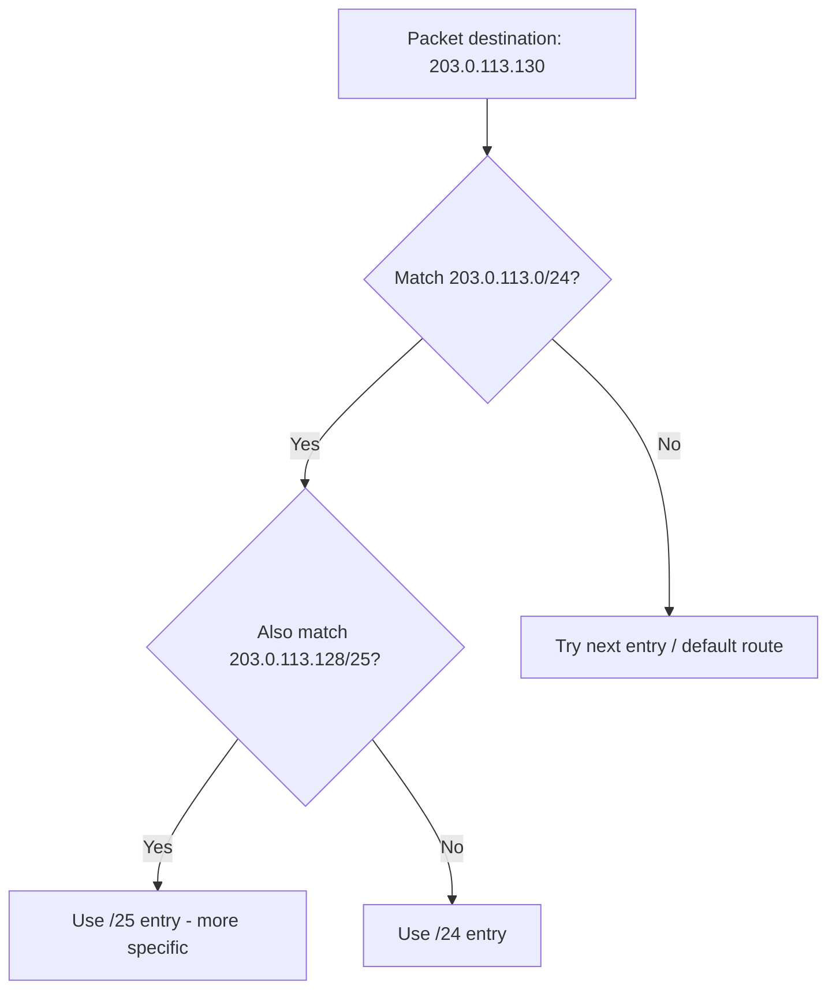

---
tags:
  - GATE/CS
  - GATE/Networks
  - IPAddressing
aliases:
  - CIDR
  - Classless Inter-Domain Routing
  - Variable Length Prefix Addressing
date_created: 2026-08-17
difficulty: ⭐⭐⭐⭐
last_revised: 2026-08-17
pyq_frequency: High
---

## Syllabus Position

Subject: [[Computer Networks Index]]
Parent Topic: [[IPv4 Addressing]]
Sibling Topics: [[Classful Addressing]], [[Subnetting]], [[Supernetting]]
Leads To: [[Variable Length Subnet Masking (VLSM)]], [[Route Aggregation]], [[Longest Prefix Matching]], [[IPv6 Addressing]]

GATE Syllabus Line: "IPv4/IPv6, Routers and Routing algorithms" — Classless addressing (CIDR) is
the modern replacement for the classful A/B/C/D/E scheme and is one of the most heavily tested
IP addressing topics in GATE, almost always appearing as a subnetting/block-allocation numerical.

Exam Weight Note: Appears very frequently as a 2-mark NAT question — given a block in CIDR
notation (e.g., `192.168.1.0/26`), compute the number of hosts, subnets, valid host range, or
find the smallest block that satisfies a set of host-count requirements (VLSM-style allocation).

---

## The Problem This Solves

[[Classful Addressing]] fixed network sizes to exactly three values: 16 million hosts (Class A),
65 thousand hosts (Class B), or 254 hosts (Class C). Real organizations rarely need exactly one
of those three sizes — a company needing 1000 hosts had to either waste an entire Class B block
(64,534 addresses wasted) or juggle four separate Class C blocks. As the Internet grew explosively
in the early 1990s, this rigidity meant the 32-bit IPv4 address space was being exhausted far
faster than the actual number of connected hosts justified, and global routing tables were
exploding because classful boundaries prevented merging adjacent small networks into one entry.

Analogy: think of classful addressing like a bakery that only sells bread in three fixed sizes —
small, medium, extra-large — so if you need bread for 6 people you're forced to buy the
extra-large loaf meant for 200. Classless addressing is like a bakery that slices bread to the
exact length you ask for, wasting almost nothing.

Core Idea (one sentence): CIDR removes the fixed class boundaries and instead lets the
network/host split happen at **any bit position**, explicitly announced by a **prefix length**
(e.g., `/26`) attached to the address, so block sizes can match real host-count needs almost
exactly.

---

## Formal Theory

A **classless address** is written as `IP address / prefix length` (e.g., `203.0.113.0/26`),
where the prefix length $n$ states that the first $n$ bits of the 32-bit address are the
**network ID** and the remaining $32 - n$ bits are the **host ID**. This notation is called
**CIDR (Classless Inter-Domain Routing) notation**, and $n$ can be any value from $0$ to $32$ —
not just the classful $8$, $16$, or $24$.

### The Subnet Mask Is Now Explicit, Not Implied

Unlike classful addressing where the mask was silently derived from the leading bits of the
address itself, CIDR requires the mask (or equivalently the prefix length) to be **explicitly
transmitted alongside the address** — routers can no longer guess the boundary just by reading
the address. This is the single biggest structural difference from classful addressing.

### Number of Addresses in a Block

For a prefix length $n$, the block contains:
$$\text{Total addresses} = 2^{32-n}$$
$$\text{Usable host addresses} = 2^{32-n} - 2$$
(subtracting the all-0s network address and the all-1s broadcast address, exactly as in
[[Classful Addressing]]).

### Finding the Network Address (Prefix)

Given any IP address and prefix length $n$, the network address is found by keeping the first
$n$ bits and zeroing the rest — the same bitwise AND with a mask that has $n$ leading 1s.

### Variable Length Subnet Masking (VLSM)

CIDR enables **VLSM**: a single classful/CIDR block can be sliced into subnets of *different
sizes*, each with its own prefix length, as long as no two subnets' address ranges overlap.

```
Algorithm ALLOCATE_VLSM(block, host_requirements[]):
    sort host_requirements in descending order
    current_address = block.start
    for each requirement r in sorted list:
        n = 32 - ceil(log2(r + 2))          # smallest prefix satisfying r hosts
        assign subnet [current_address, current_address + 2^(32-n) - 1] with prefix /n
        current_address = current_address + 2^(32-n)
    return allocated subnets
```

Allocating **largest requirements first** is essential — it minimizes fragmentation and wasted
address space, because smaller blocks slot neatly into the remaining space afterward.

### Route Aggregation (Supernetting)

CIDR also allows the reverse operation: **supernetting**, where multiple contiguous small blocks
(e.g., four `/24`s) are combined into one larger routing table entry (a single `/22`) if they
share a common prefix — this is what actually solved the routing table explosion problem, since
one router announcement can now represent thousands of individual classful networks.

### Longest Prefix Matching

Because CIDR allows overlapping-looking entries in a routing table (a `/16` and a more specific
`/24` inside it), routers use **[[Longest Prefix Matching]]**: among all matching table entries
for a destination address, the router forwards using the entry with the **longest (most
specific) prefix**, not the shortest.

**What GATE actually tests here:** Given a `/n` notation, compute host count and valid range;
given a set of host requirements, perform VLSM allocation correctly (largest-first ordering is
the classic trap); given multiple routing table entries, apply longest prefix matching to pick
the correct next hop.

---

## Diagrams and Visuals

**1. Bit layout for an arbitrary prefix length (e.g., /26):**

```
203.0.113.64/26
11001011.00000000.01110001.01 000000
|--------- 26 network bits --------|--6 host bits--|

Total addresses = 2^6 = 64
Usable hosts    = 2^6 - 2 = 62
```

**2. VLSM allocation of a /24 block into three subnets needing 100, 50, and 25 hosts:**

```
Original block: 192.168.10.0/24  (256 addresses)

Requirement 100 hosts -> needs /25 (126 usable) -> 192.168.10.0   - 192.168.10.127  (/25)
Requirement  50 hosts -> needs /26 (62 usable)  -> 192.168.10.128 - 192.168.10.191  (/26)
Requirement  25 hosts -> needs /27 (30 usable)  -> 192.168.10.192 - 192.168.10.223  (/27)
Remaining space (unused)                        -> 192.168.10.224 - 192.168.10.255  (/27)
```
Label: Largest requirement placed first at the lowest address; each subsequent subnet starts
immediately after the previous subnet's last address.

**3. Longest prefix matching decision (Mermaid):**



**4. Route aggregation (supernetting) — four /24s becoming one /22:**

```
192.168.0.0/24  \
192.168.1.0/24   \
192.168.2.0/24    >---- aggregated into ----> 192.168.0.0/22
192.168.3.0/24   /
```

---

## Complexity Analysis

Like classful addressing, CIDR itself is not an algorithm with traditional asymptotic time
complexity, but GATE-relevant costs come from the operations built on top of it.

- **Network address extraction:** A single 32-bit AND with a mask derived from prefix length $n$
  — $O(1)$, independent of $n$'s value, since IPv4 addresses are fixed at 32 bits.
- **VLSM allocation cost:** For $k$ subnet requirements, sorting them descending takes
  $O(k \log k)$, then allocation is a single linear pass, $O(k)$ — total $O(k \log k)$, dominated
  by the sort.
- **Longest prefix matching cost:** A naive linear scan of a routing table with $m$ entries is
  $O(m)$ per lookup; real routers use a **trie (Patricia trie)** structure achieving
  $O(32)$ per lookup regardless of table size, since IPv4 addresses are bounded at 32 bits — this
  is the actual reason CIDR scales where classful addressing did not.
- **Address space efficiency:** Because prefix length can be any value $0$–$32$, waste is bounded
  by at most $2^{32-n} - (\text{hosts needed}) < 2^{32-n}/2$ in the worst case (just crossing a
  power-of-two boundary), a dramatic improvement over classful addressing's fixed three sizes.

### Complexity Summary Table

| Case                       | Time Complexity      | Space Complexity | Trigger Condition                                  |
|----------------------------|-----------------------|-------------------|-----------------------------------------------------|
| Network ID extraction      | $O(1)$               | $O(1)$            | Always — fixed 32-bit AND                            |
| VLSM allocation ($k$ reqs) | $O(k \log k)$         | $O(k)$            | Sorting requirements descending before allocation    |
| Routing table lookup       | $O(32)$ via trie      | $O(m)$ table size | Longest prefix matching using Patricia trie          |
| Address space waste        | N/A                   | $< 50\%$ per block| Host requirement just above a power-of-two boundary  |

---

## Worked Example

**An ISP owns block `198.51.100.0/24` and must allocate subnets for four departments needing 100,
60, 25, and 10 hosts respectively, using VLSM.**

Step 1 — Sort requirements descending: `100, 60, 25, 10`.

Step 2 — Department A (100 hosts): need $2^{h} - 2 \geq 100 \Rightarrow 2^h \geq 102 \Rightarrow
h = 7$ ($2^7 - 2 = 126$). Prefix = $32 - 7 = 25$. Assign `198.51.100.0/25`
(covers `.0`–`.127`, 128 addresses, 126 usable).

Step 3 — Department B (60 hosts): $2^h - 2 \geq 60 \Rightarrow h = 6$ ($2^6-2=62$). Prefix =
$32-6=26$. Next free address is `.128`. Assign `198.51.100.128/26` (covers `.128`–`.191`, 64
addresses, 62 usable).

Step 4 — Department C (25 hosts): $2^h - 2 \geq 25 \Rightarrow h = 5$ ($2^5-2=30$). Prefix =
$32-5=27$. Next free address is `.192`. Assign `198.51.100.192/27` (covers `.192`–`.223`, 32
addresses, 30 usable).

Step 5 — Department D (10 hosts): $2^h - 2 \geq 10 \Rightarrow h = 4$ ($2^4-2=14$). Prefix =
$32-4=28$. Next free address is `.224`. Assign `198.51.100.224/28` (covers `.224`–`.239`, 16
addresses, 14 usable).

Step 6 — Remaining space: `.240`–`.255` (16 addresses) is unused, available for future growth.

Step 7 — Verify: total consumed = $128+64+32+16 = 240$ out of $256$, leaving 16 addresses
unused — no overlaps, all four ranges are contiguous and disjoint. Total operations: 4 sorts
implied by ordering + 4 allocation computations = confirms $O(k \log k)$ for $k=4$.

**Edge case follow-up:** What if Department A instead needed 130 hosts (just over the /25 limit
of 126)? Then $h$ must jump to $8$ (a full `/24`), consuming the entire original block by itself
and leaving zero room for the other three departments — this is exactly the kind of boundary-
crossing trap GATE loves to test in VLSM numericals.

---

## Intuition Anchors

**The Analogy (restated and deepened):** The custom-slice bakery analogy now extends further —
not only does CIDR slice bread to the exact length needed (VLSM), it can also **glue several
standard loaves back together** into one giant loaf when a bulk customer needs a lot (route
aggregation/supernetting), something the old three-fixed-sizes bakery could never do because its
sizes weren't designed to combine cleanly.

**The Mental Model:** Picture the address space as a single number line from $0$ to $2^{32}-1$.
A prefix length $n$ just draws a "cut" that splits the number line into blocks of size $2^{32-n}$.
VLSM is repeatedly re-cutting a block into smaller pieces of varying size; supernetting is erasing
cuts between adjacent equal-size blocks to make one bigger block.

**The One-Line Recall:** "Prefix length $n$ means $32-n$ host bits, giving $2^{32-n}$ total
addresses and $2^{32-n}-2$ usable hosts — always find the smallest $n$ such that
$2^{32-n} - 2 \geq \text{hosts needed}$."

**The #1 Trap:** Students perform VLSM by allocating requirements in the order given in the
question (or smallest-first) instead of sorting **largest requirement first**. Allocating
smallest-first fragments the address space and can make the largest requirement impossible to
fit contiguously later — always sort descending before allocating.

---

## GATE Questions

---

**Question 1 — GATE-style — 2-mark**

> An organization has a block `172.16.0.0/22`. It needs to create the maximum number of subnets
> such that each subnet can support at least 60 hosts. How many such subnets can be created?

- (A) 16
- (B) 32
- (C) 64
- (D) 128

<details>
<summary>Solution</summary>

**Answer: (C)**

**Reasoning:** `/22` gives $32-22=10$ host bits available in the whole block, total addresses
$=2^{10}=1024$. To support at least 60 usable hosts per subnet, find the smallest $h$ such that
$2^h - 2 \geq 60$: check $h=5 \Rightarrow 2^5-2=30 < 60$ (fails), $h=6 \Rightarrow 2^6-2=62 \geq
60$ (succeeds). So $h=6$ host bits are needed, giving new prefix $=32-6=26$. The number of subnet
bits *borrowed* from the original `/22` is $26-22=4$, so the number of subnets created is
$2^{(\text{new prefix}-\text{old prefix})}=2^4=16$.

**What this question is really testing:** Whether students correctly compute the minimum host
bits $h$ needed first, derive the new prefix $32-h$, and only then compute subnet count as
$2^{(\text{new prefix}-\text{old prefix})}$ — not host count directly.

**Trap to avoid:** Confusing "number of subnets" with "number of hosts per subnet" — these use
different exponents ($2^{(\text{new prefix}-\text{old prefix})}$ for subnets vs.
$2^{(32-\text{new prefix})}-2$ for hosts per subnet).

</details>

---

**Question 2 — Conceptual/Numerical — 1-mark**

> Which of the following is a valid CIDR block that can hold exactly 30 usable host addresses?

- (A) 10.0.0.0/26
- (B) 10.0.0.0/27
- (C) 10.0.0.0/28
- (D) 10.0.0.0/25

<details>
<summary>Solution</summary>

**Answer: (B)**

**Reasoning:** Usable hosts $=2^{32-n}-2$. For $n=27$: $2^{5}-2=30$ ✓. Check others: $n=26$ gives
$2^6-2=62$; $n=28$ gives $2^4-2=14$; $n=25$ gives $2^7-2=126$. Only `/27` yields exactly 30.

</details>

---

**Question 3 — Hard/Multi-concept — 2-mark**

> A routing table has two entries: `10.0.0.0/8` pointing to interface X, and `10.1.0.0/16`
> pointing to interface Y. A packet arrives for destination `10.1.2.3`. Which interface does the
> router forward it to, and why?

<details>
<summary>Solution</summary>

**Answer: Interface Y.**

**Reasoning:** Both entries match the destination address (`10.1.2.3` falls within both
`10.0.0.0/8` and `10.1.0.0/16`), but [[Longest Prefix Matching]] mandates choosing the entry with
the longest (most specific) prefix — `/16` is longer than `/8`, so interface Y is selected. This
combines CIDR's variable prefix lengths with the routing lookup algorithm GATE frequently pairs
with pure addressing numericals.

**What this question is really testing:** Whether the student understands that CIDR's variable-
length prefixes necessitate longest prefix matching instead of the simple exact-class match used
in classful routing.

</details>

---

**Pattern Recognition:**
- Any question giving a `/n` notation directly wants $2^{32-n}$ (total) or $2^{32-n}-2$ (usable
  hosts) — identify which one is asked before computing.
- VLSM questions almost always require sorting requirements **descending** before allocating —
  if the answer doesn't fit contiguously, re-check allocation order first.
- Multiple overlapping routing table entries always signal [[Longest Prefix Matching]] — GATE
  never expects you to average or combine matches, always pick the single longest prefix.

---

## Edge Cases and Failure Modes

- [ ] **Prefix length /31 and /32:** A `/32` is a single host address (no network/host split at
      all, used for point-to-point router links or host routes); a `/31` (only 2 addresses, no
      room for network + broadcast) is a special RFC 3021 case used for point-to-point links
      where both addresses are usable as hosts — naive $2^h-2$ formula gives 0, which is wrong
      for this specific case.
- [ ] **VLSM allocated smallest-first:** Fragments the block and may leave insufficient
      contiguous space for a later, larger requirement. Fix: always sort descending by host
      count before allocating.
- [ ] **Off-by-one in "smallest prefix satisfying host count":** Students compute
      $h = \lceil \log_2(\text{hosts}) \rceil$ instead of $\lceil \log_2(\text{hosts}+2) \rceil$,
      forgetting to reserve the network and broadcast addresses. Fix: always add 2 before taking
      the log.
- [ ] **Confusing subnet count formula with host count formula:** Subnet count uses
      $2^{(\text{new prefix} - \text{old prefix})}$; host count uses $2^{(32-\text{prefix})}-2$ —
      mixing these up is the single most common GATE CIDR mistake.
- [ ] **Assuming routing table entries can't overlap:** In CIDR they routinely do (a `/8` and a
      `/16` both matching); the router must apply longest prefix matching, not treat this as an
      error condition.
- [ ] **Non-contiguous VLSM allocation:** Skipping addresses between subnets breaks the
      assumption that later blocks start immediately after the previous block ends — always
      verify contiguity by summing block sizes against total block size.
- [ ] **Integer overflow / boundary check when prefix = 0 or 32:** `/0` means the entire address
      space (default route), `/32` means a single address — both are valid edge prefixes GATE
      may test in default-route or host-route questions.

---

## Comparisons

| Feature              | [[Classless Addressing]] (CIDR)          | [[Classful Addressing]]                | [[Subnetting]]                          |
|-----------------------|--------------------------------------------|-------------------------------------------|---------------------------------------------|
| Time Complexity       | $O(1)$ per lookup with explicit mask       | $O(1)$ classification via leading bits    | $O(1)$ but mask is custom, derived from CIDR |
| Space Complexity      | Smaller routing tables via aggregation     | Larger tables (no aggregation possible)   | Depends on number of subnets created         |
| Key Property          | Arbitrary prefix length ($/0$ to $/32$)    | Fixed block sizes (only /8, /16, /24)     | Divides a classful or CIDR block further     |
| When to Prefer        | Modern Internet-wide addressing (default)  | Legacy/historical systems only            | Internal organizational network division     |
| GATE Trap             | Confusing subnet-count vs. host-count math | Assuming mask is always the default class | Confusing subnet ID with network ID           |

The most common GATE question comparing these gives a VLSM allocation scenario and asks students
to identify how many total addresses are wasted — the trap hinges on correctly computing the
smallest sufficient prefix for each requirement ($\lceil \log_2(\text{hosts}+2)\rceil$) rather
than rounding informally.

---

## Connections Web

**Must know before this topic:**
- [[Classful Addressing]] — CIDR is defined specifically as the fix for classful addressing's
  rigidity, so understanding the old scheme is required to appreciate the new one
- [[Binary Number System]] — needed to compute prefix boundaries and bitwise AND operations
- [[Bitwise AND Operation]] — core operation for extracting network addresses from a prefix

**Topics that build on this:**
- [[Variable Length Subnet Masking (VLSM)]]
- [[Longest Prefix Matching]]
- [[Route Aggregation]]
- [[Supernetting]]
- [[IPv6 Addressing]]

**GATE subject cross-links:**
- [[Computer Networks Index]] > [[IP Addressing and Subnetting]]

**Cross-subject connections:**
- [[Routing Algorithms]] — longest prefix matching is implemented using trie-based lookup
  structures directly relevant to router forwarding tables
- [[Trees]] (Data Structures) — Patricia tries used for efficient CIDR-based routing lookups
  connect this topic directly to trie data structures taught in DS

**Standard references:**
- [[Forouzan Data Communications and Networking - IP Addressing Chapter]]
- [[Kurose and Ross - Network Layer Chapter]]
- [[RFC 4632]] (CIDR) / [[RFC 3021]] (/31 point-to-point links)

---

## Quick Revision Sheet

**Definition (1 sentence):** Classless addressing (CIDR) splits a 32-bit IPv4 address into
network and host parts at an arbitrary bit position $n$, explicitly stated as `/n`, instead of
relying on fixed classful boundaries.

**Core Idea / Analogy (1 sentence):** Like a bakery slicing bread to the exact length requested,
CIDR carves address blocks to the exact size needed instead of forcing a choice among three fixed
sizes.

**Algorithm Steps (allocating a CIDR/VLSM block):**
1. Determine host requirement for each subnet.
2. Sort all requirements in descending order.
3. For each, find smallest $h$ such that $2^h - 2 \geq \text{hosts needed}$; new prefix
   $= 32 - h$.
4. Assign the next available contiguous address range of size $2^{32-\text{prefix}}$.
5. Advance the current address pointer past the assigned block.
6. Repeat until all requirements are allocated; leftover space remains for future growth.

**Complexity:**
- Time (best / average / worst): $O(1)$ for a single lookup; $O(k \log k)$ for VLSM allocation
  of $k$ subnets; $O(32)$ per routing lookup using a trie.
- Space: $O(1)$ per address; $O(m)$ for a routing table with $m$ entries.
- Recurrence (if applicable): Not applicable — CIDR allocation is not recursive.

**Key Properties (facts GATE tests directly):**
- Total addresses in a `/n` block: $2^{32-n}$; usable hosts: $2^{32-n}-2$.
- Subnet count when subdividing: $2^{(\text{new prefix}-\text{old prefix})}$.
- Longest prefix match wins when multiple routing entries overlap.
- VLSM must allocate largest requirements first to avoid fragmentation.
- `/31` is a special 2-address case (RFC 3021) where both addresses are usable hosts.

**The #1 Trap:** Sorting VLSM requirements in the wrong order (not largest-first), causing
fragmentation that makes a later, larger requirement impossible to fit.

**When to use this over alternatives:** Always in modern practice — CIDR (RFC 4632, 1993) fully
replaced classful addressing for all real-world IPv4 allocation and routing.

**Mnemonic or one-liner to remember the steps:** "**S**ort **D**escending, **F**ind smallest $h$,
**A**ssign next block, **A**dvance pointer" (SDFA) — captures the four-step VLSM allocation loop.

---

## Revision Checklist

- [ ] I can state the formal definition without looking.
- [ ] I can explain the bakery analogy and map it to VLSM and supernetting both.
- [ ] I can trace a 4-subnet VLSM allocation by hand in under 2 minutes.
- [ ] I can derive the usable-host and subnet-count formulas from scratch, not from memory.
- [ ] I know what the Quick Revision Sheet says without reading it.
- [ ] I can solve all 3 GATE questions in this note without peeking.
- [ ] I know the #1 trap (allocation ordering) and can articulate why students fall for it.
- [ ] I have linked this note correctly in my Obsidian vault.
- [ ] I have scheduled a spaced-repetition review in 3 days.
</content>
