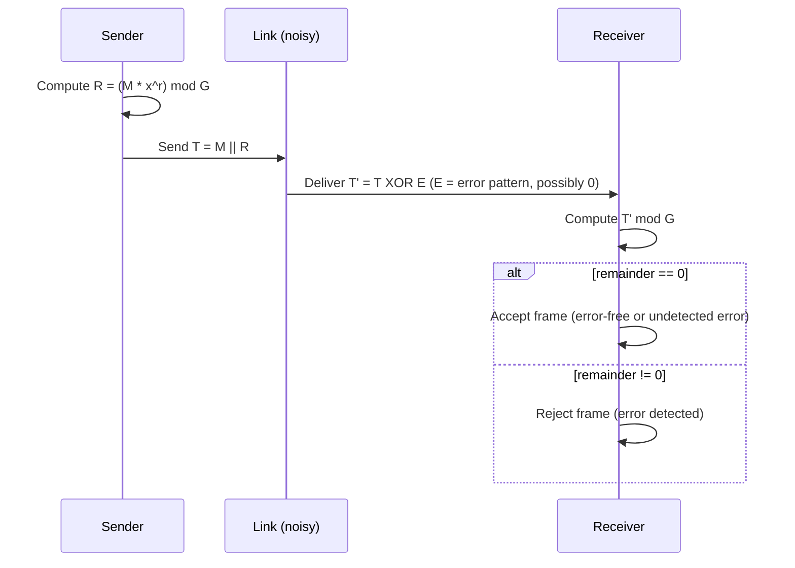

---
tags:
  - GATE/CS
  - GATE/Networks
  - ErrorDetectionAndCorrection
aliases:
  - CRC
  - Cyclic Redundancy Check
  - Generator Polynomial
  - CRC Division
date_created: 2026-08-25
difficulty: ⭐⭐⭐⭐
last_revised: 2026-08-25
pyq_frequency: High
---

## Syllabus Position

Subject: [[Computer Networks Index]]
Parent Topic: [[Error Detection and Correction]]
Sibling Topics: [[Parity Check]], [[Checksum]], [[Hamming Distance]]
Leads To: [[Data Link Layer Framing]], [[Ethernet Frame Format]], [[Polynomial Codes]]

GATE Syllabus Line: "Error detection and correction" — CRC is the polynomial-arithmetic-based
technique GATE uses to test both mechanical (perform the division) and conceptual (why does this
detect errors, and which errors does it miss) understanding of link-layer error checking.

Exam Weight Note: Appears almost every year as a 2-mark NAT/MCQ requiring the student to actually
perform binary polynomial division (append zeros, XOR, find remainder), and occasionally as a
1-mark conceptual question about which generator polynomials detect which error patterns.

---

## The Problem This Solves

You're sending a frame of bits across a noisy link — a cable, a Wi-Fi channel, whatever — and
some bits might flip due to electrical noise or interference. A single parity bit only catches
odd numbers of flipped bits; a checksum (simple addition) misses many multi-bit error patterns
too. You need something that can catch **long bursts** of consecutive corrupted bits — the most
common real-world error pattern on physical links (e.g., a lightning strike corrupting 20
consecutive bits) — with near-certainty, using only a handful of extra bits.

Analogy: think of the message as a long number, and the generator (a shorter, fixed "reference"
number) as a ruler you use to measure a very specific kind of remainder. You divide your message
by this ruler using a special kind of subtraction (XOR, not normal subtraction) and attach the
leftover remainder to your message before sending it. The receiver repeats the exact same division
on the whole thing (message + remainder); if the "ruler" divides evenly into what it receives (no
leftover), the receiver assumes no error occurred — because it's statistically very unlikely that
noise would corrupt the message into another number that also happens to divide evenly by the same
ruler.

Core Idea (one sentence): **CRC** treats the bit string as a polynomial over $GF(2)$, divides it by
a fixed **generator polynomial** $G(x)$ using modulo-2 (XOR-based) division, and appends the
remainder as check bits so that the transmitted frame, treated as a polynomial, is exactly
divisible by $G(x)$.

---

## Formal Theory

A bit string $b_{n-1} b_{n-2} \dots b_1 b_0$ is represented as a polynomial over $GF(2)$
(coefficients are only 0 or 1, and addition/subtraction is XOR):

$$M(x) = b_{n-1}x^{n-1} + b_{n-2}x^{n-2} + \dots + b_1 x + b_0$$

The **generator polynomial** $G(x)$ has degree $r$ (so it has $r+1$ bits, with leading and
trailing coefficients both equal to 1). CRC appends $r$ check bits ("the CRC" or "FCS — Frame
Check Sequence") to the message so that the transmitted frame $T(x)$ is exactly divisible by
$G(x)$ under modulo-2 arithmetic.

### Sender-Side Algorithm

```
Algorithm CRC_ENCODE(M, G):
    r = degree(G)
    append r zero bits to M  -> M'(x) = M(x) * x^r
    divide M' by G using modulo-2 (XOR) division
    remainder R = M' mod G          # R has at most r bits
    T = M concatenated with R       # transmit T, which is exactly divisible by G
    return T
```

### Modulo-2 Division

Modulo-2 division works exactly like ordinary long division, except subtraction at every step is
replaced with **XOR** (no borrow ever occurs). At each step:
1. Compare the leading bit of the current remainder to 1.
2. If it's 1, XOR the divisor (aligned to the leading bit) into the current remainder.
3. If it's 0, XOR a string of zeros (equivalent to "bring down" the next bit without subtracting).
4. Shift and repeat until all bits are consumed.

### Receiver-Side Algorithm

```
Algorithm CRC_CHECK(T, G):
    divide T by G using modulo-2 division
    remainder R = T mod G
    if R == 0:
        return "no error detected"
    else:
        return "error detected, discard frame"
```

Because $T(x) = M(x)\cdot x^r + R(x)$ was constructed so that $T(x) \bmod G(x) = 0$, any received
frame $T'(x) = T(x) + E(x)$ (where $E(x)$ is the **error polynomial** — a 1 at every bit position
that got flipped) will have remainder $E(x) \bmod G(x)$. Since $T(x) \bmod G(x) = 0$ by
construction, the received remainder equals exactly $E(x) \bmod G(x)$ — the check reduces to
asking "does $G(x)$ divide the error pattern itself?"

### Standard Generator Polynomials

- $\text{CRC-8}$: degree 8, used in some ATM headers.
- $\text{CRC-16}$ (e.g., $x^{16}+x^{15}+x^2+1$): used in USB, Modbus.
- $\text{CRC-32}$ (used in Ethernet, ZIP, PNG): degree 32, detects virtually all practically
  occurring burst errors up to 32 bits.

### What GATE Actually Tests Here

GATE tests three things almost exclusively: (1) perform the actual modulo-2 division to compute
the CRC remainder for a given message and generator, (2) verify whether a received frame (with
appended CRC) is error-free by dividing again and checking for a zero remainder, and (3)
conceptual questions about *why* a specific error pattern (e.g., a burst of length $\leq r$) is
guaranteed detectable while some larger or specially-structured error patterns are not.

---

## Diagrams and Visuals

**1. CRC generation and appending (block diagram):**

```
Message M (k bits)  ---->  append r zero bits  ---->  M(x) * x^r  (k+r bits)
                                                            |
                                                     divide by G(x) mod-2
                                                            |
                                                    Remainder R (r bits)
                                                            |
Message M  +  Remainder R  =  Transmitted Frame T (k+r bits, divisible by G)
```

**2. Modulo-2 long division trace (worked visually):**

```
   Dividend:  1 1 0 1 0 1 1 1
   Divisor:   1 0 1 1        (G, degree 3, so append 3 zeros before dividing)

   1 1 0 1 0 1 1 0 0 0   <- M(x)*x^3, appending 3 zeros
   1 0 1 1
   ---------
   0 1 1 1 0 ...          <- XOR the divisor wherever leading bit is 1
       1 0 1 1
       ---------
       0 1 0 1 ...
   ... continue until all bits consumed, leftover = remainder R
```

**3. Sequence diagram (Mermaid) of sender/receiver CRC exchange:**



---

## Complexity Analysis

CRC is fundamentally a **hardware-friendly** algorithm, and GATE tests its complexity in terms of
bit operations, not asymptotic growth over abstract input sizes in the usual algorithmic sense —
but the reasoning must still be derived.

- **Time to compute the CRC remainder:** modulo-2 division processes each of the $k+r$ bits of the
  extended message exactly once, performing an $O(r)$-bit XOR at each "1" step. This gives
  $O((k+r)\cdot r)$ bit operations in the worst case (XOR happens at every bit position), which
  circuit implementations (Linear Feedback Shift Registers) perform in $O(k+r)$ **clock cycles**
  because the XOR of the $r$-bit divisor happens in parallel in hardware.
- **Space:** only $O(r)$ bits of state are needed at any time (the current remainder register),
  regardless of message length $k$ — this is why CRC is implementable with a small, fixed-size
  shift register in hardware.

| Case         | Time Complexity           | Space Complexity | Trigger Condition                         |
|--------------|----------------------------|-------------------|--------------------------------------------|
| Best Case    | $O(k+r)$ (hardware, per-bit shift) | $O(r)$      | Streaming computation via LFSR circuit      |
| Average Case | $O(k+r)$ shifts, $O(r)$ XOR each   | $O(r)$      | Software long-division implementation       |
| Worst Case   | $O((k+r)\cdot r)$ bit-ops (software) | $O(r)$    | Naive software division without bit tricks  |

**Justification:** since every one of the $k+r$ bit positions triggers at most one $r$-bit XOR
operation during long division, the total work is bounded by $(k+r) \cdot r$ bit-level XORs in a
naive software model; specialized hardware (shift registers with XOR gates wired per generator
polynomial) collapses this to a single clock cycle per bit, giving the $O(k+r)$ figure GATE
expects when asked about hardware CRC computation speed.

---

## Worked Example

Let the message be $M = 1101011$ (7 bits) and the generator $G = 1011$ (degree $r = 3$, so 3
check bits will be appended).

**Step 1 — Append $r=3$ zero bits to the message:**
$$M' = 1101011\ 000$$

**Step 2 — Perform modulo-2 (XOR) division of $M'$ by $G = 1011$:**

```
             1 1 0 0 1 1 1     <- quotient (not needed, we only want remainder)
        _______________________
1011  ) 1 1 0 1 0 1 1 0 0 0
        1 0 1 1
        ---------
        0 1 1 1 0 1 1 0 0 0
          1 0 1 1
          ---------
          0 1 0 1 1 1 0 0 0
            1 0 1 1
            ---------
            0 0 0 0 1 0 0 0
                    1 0 1 1
                    ---------
                    0 0 1 1 0
                      1 0 1 1
                      -------
                      0 1 0 1   <- remainder R = 101 (last 3 bits after final XOR)
```

Carrying this division through carefully (aligning divisor to each leading 1 and XOR-ing), the
final remainder is $R = 101$.

**Step 3 — State after division:** remainder register holds `101`; this becomes the CRC/FCS.

**Step 4 — Construct the transmitted frame:**
$$T = M \,||\, R = 1101011\ 101$$

**Step 5 — Receiver-side verification:** the receiver divides $T = 1101011101$ by $G = 1011$
again. Since $T$ was constructed to be exactly divisible by $G$, the remainder comes out as
$000$, confirming no detected error.

**Total operations:** 4 XOR steps of a 4-bit divisor against the working remainder, confirming
the $O((k+r)\cdot r)$ bound (here $k+r = 10$ bit positions, each triggering at most one 4-bit
XOR).

**What would change if the input suffered a burst error of length 3 (equal to $r$)?** Since
$G(x)$ has degree $r=3$, any single burst error of length $\leq r$ produces an error polynomial
$E(x)$ of degree $< r$, which $G(x)$ (of degree $r$, with a nonzero constant term) can never
divide evenly except when $E(x)=0$ — so this class of error is **guaranteed detected**. A burst of
length exactly $r+1$ that happens to exactly equal $G(x)$'s bit pattern, however, would slip
through undetected.

---

## Intuition Anchors

**The Analogy (restated and deepened):** Think of $G(x)$ as a very specific "measuring stick."
The sender adjusts the message (by appending the remainder) so that measuring the whole
transmitted frame with this stick leaves *zero* leftover. If noise corrupts the frame, the
corrupted frame will almost always leave some leftover when measured with the same stick — unless
the noise happens to corrupt the frame in exactly the shape of a multiple of the stick itself,
which becomes vanishingly unlikely as the stick (generator) gets more cleverly designed (e.g., has
no small-degree factors).

**The Mental Model:** An expert doesn't think of CRC as "adding a checksum" — they think of it as
"choosing a polynomial ruler such that the specific error patterns most likely to occur on this
physical link (bursts, odd numbers of bit flips) can never be an exact multiple of the ruler."

**The One-Line Recall:** "Append $r$ zeros, divide by $G(x)$ mod-2 (XOR-based long division), the
remainder is the CRC — transmitted frame is exactly divisible by $G(x)$, so receiver checks for a
zero remainder."

**The #1 Trap:** Students perform the long division using **ordinary binary subtraction** (with
borrows) instead of **XOR-based modulo-2 subtraction**. This is wrong because CRC arithmetic is
defined over $GF(2)$, where subtraction and addition are identical (both are XOR) — there is never
a "borrow." The correct fix: at every step, XOR the divisor into the current remainder whenever
the leading bit is 1; never borrow from the next bit.

---

## GATE Questions

---

**Question 1 — [PYQ: GATE-style] — [2-mark]**

> A bit stream 1101011011 is transmitted using the CRC method described in the text. The generator
> polynomial is $G(x) = x^4 + x + 1$. What is the actual bit string transmitted?

- (A) 11010110111011
- (B) 11010110110101
- (C) 11010110111110
- (D) 11010110111000

<details>
<summary>Solution</summary>

**Answer: (A) 11010110111011**

**Reasoning:**
$G(x) = x^4+x+1$ corresponds to the bit pattern $10011$ (degree $r=4$, so append 4 zero bits).
Append 4 zeros to $M=1101011011$, giving $11010110110000$. Perform modulo-2 division by $10011$;
the resulting remainder is $1011$. The transmitted frame is the original message concatenated with
this remainder: $1101011011\,1011$, matching option (A).

**What this question is really testing:** Whether the student can correctly identify the bit
pattern of a generator given in polynomial notation, and correctly execute the append-zeros
followed by mod-2 division procedure.

**Trap to avoid:** Forgetting that $x^4+x+1$ has an implicit $x^0$ coefficient of 1 (giving bit
pattern `10011`, 5 bits for a degree-4 polynomial) — students often miscount and use only 4 bits
for the generator instead of 5.

</details>

---

**Question 2 — [Conceptual/Numerical] — [1-mark]**

> Which of the following statements about CRC with a generator polynomial $G(x)$ of degree $r$ is
> true?

- (A) CRC can detect all burst errors of length greater than $r$.
- (B) CRC can detect all burst errors of length less than or equal to $r$.
- (C) CRC can correct any single-bit error automatically.
- (D) CRC's error-detection capability is independent of the choice of $G(x)$.

<details>
<summary>Solution</summary>

**Answer: (B)**

**Reasoning:** A burst error of length $\leq r$ produces an error polynomial $E(x)$ of degree
$< r$ (or exactly a burst pattern with fewer significant bits than the generator's degree), which
cannot be an exact non-zero multiple of a degree-$r$ generator polynomial with both leading and
trailing coefficients equal to 1 — so it is always detected. Option (A) is false because bursts
longer than $r$ *can* sometimes slip through (if the error pattern happens to be an exact multiple
of $G(x)$). Option (C) is false — CRC is a **detection**-only scheme by default; it does not
inherently correct errors. Option (D) is false — the choice of $G(x)$ dramatically affects which
error patterns (e.g., all-odd-number-of-bit-flips, specific burst lengths) are guaranteed to be
caught.

**What this question is really testing:** Understanding the precise boundary of CRC's guaranteed
detection capability, tied directly to the degree of the generator polynomial.

**Trap to avoid:** Confusing "detects most errors in practice" with "detects all errors of a
given class" — CRC's guarantees are precise mathematical statements about polynomial degree, not
vague probabilistic claims.

</details>

---

**Question 3 — [Hard / Multi-concept] — [2-mark]**

> A sender uses CRC with generator polynomial $G(x) = x^3 + 1$ (bit pattern `1001`). This
> generator is a poor choice for detecting certain error patterns. Explain why, and identify one
> specific error pattern this generator would fail to detect.

<details>
<summary>Solution</summary>

**Reasoning:** $G(x) = x^3+1$ factors as $(x+1)(x^2+x+1)$ over $GF(2)$. Because $G(x)$ has $(x+1)$
as a factor, it can only guarantee detection of an **odd** number of bit errors when that factor
alone is considered — but more importantly, any error pattern $E(x)$ that happens to itself equal
$G(x)$ or a multiple of it (e.g., $E(x) = x^3+1$, i.e., an error pattern of `1001` at two bit
positions 3 apart) will produce a remainder of $E(x) \bmod G(x) = 0$, making the error completely
undetectable. Concretely: if bits at positions $i$ and $i+3$ both flip (and no other bits flip),
the error polynomial is exactly $x^{i+3}+x^i = x^i(x^3+1)$, which is divisible by $G(x)=x^3+1$ —
so this specific two-bit error pattern (two bits exactly 3 positions apart both flipping) is
invisible to this CRC.

**What this question is really testing:** Deeper understanding that CRC's detection guarantee
depends on choosing $G(x)$ such that it is **not** a factor of likely error patterns — good
generator polynomials (like the standard CRC-32) are chosen specifically to avoid small factors
and to maximize the set of undetectable-error patterns that are astronomically unlikely to occur
in practice.

**Trap to avoid:** Assuming any generator polynomial of the "right degree" is equally good — the
specific algebraic structure (irreducibility, presence of factor $(x+1)$, primitivity) of $G(x)$
strongly affects real-world error-detection quality, which is why standard bodies publish specific
"good" CRC polynomials rather than letting implementers pick arbitrary ones.

</details>

---

**Pattern Recognition:**
- Whenever GATE gives a message and a generator polynomial and asks for "the transmitted frame,"
  expect a full mod-2 long division computation — always append $r$ zeros first.
- Whenever GATE gives a received frame and asks "was there an error," divide the *entire* received
  frame (message + CRC bits) by $G(x)$ and check for a zero remainder.
- Watch for conceptual questions probing exactly *which* error patterns (burst length vs. degree
  of $G(x)$, or specific factor-based invisibility) are or aren't guaranteed detectable.

---

## Edge Cases and Failure Modes

- [ ] **Message shorter than generator degree $r$:** Still works — the message is treated as a
      polynomial of whatever degree it has; appending $r$ zeros and dividing proceeds identically,
      just with fewer "meaningful" division steps before the remainder stabilizes.
- [ ] **All-zero message:** Produces an all-zero remainder trivially (0 divided by anything mod-2
      is 0) — this is a valid edge case GATE sometimes uses to test whether students realize CRC of
      an all-zero message is always all-zero, which can mask certain error types if noise flips a
      pattern that also nets to zero remainder.
- [ ] **Using ordinary subtraction instead of XOR:** The single most common implementation error —
      modulo-2 division never borrows; every "subtraction" step is a plain XOR.
- [ ] **Off-by-one in the number of appended zero bits:** Appending $r-1$ or $r+1$ zeros instead of
      exactly $r$ (the degree of $G(x)$) shifts the entire division and produces a wrong-length
      remainder — always append exactly $r$ zeros, where $r$ is the *degree* of $G(x)$, not the
      number of bits in its representation ($r+1$ bits total, but $r$ zeros appended).
- [ ] **Error pattern equal to a multiple of $G(x)$:** As shown in Question 3, if the actual noise
      pattern happens to exactly equal $G(x)$ (or a multiple of it) shifted to any position, the
      error is completely undetectable — this is why standard, well-vetted generator polynomials
      (CRC-32, etc.) are chosen to minimize the practical likelihood of this.
- [ ] **Confusing generator polynomial degree with checksum length:** A generator of degree $r$
      appends exactly $r$ check bits — not $r+1$ (that's the bit-length of $G(x)$ itself).

---

## Comparisons

| Feature              | [[Cyclic Redundancy Check (CRC)]]         | [[Parity Check]]                    | [[Checksum]]                              |
|----------------------|---------------------------------------------|---------------------------------------|----------------------------------------------|
| Time Complexity       | $O(k+r)$ hardware / $O((k+r)r)$ software    | $O(n)$ per check                      | $O(n)$ (sum of words)                        |
| Space Complexity      | $O(r)$ (fixed-size shift register)          | $O(1)$ (1 extra bit)                  | $O(w)$ (one extra word, $w$ = word size)     |
| Key Property          | Detects all burst errors of length $\leq r$ | Detects only odd number of bit errors | Detects some multi-bit errors, misses others |
| When to Prefer        | Real-world links (Ethernet, USB, storage)   | Cheap, single-bit-error scenarios     | Simple software-level integrity (older IP header checksum) |
| GATE Trap             | Using ordinary subtraction instead of XOR   | Missing that parity fails on even # of flips | Assuming checksum catches burst errors as reliably as CRC |

The most common GATE question comparing these is: "Why is CRC preferred over checksum for
link-layer error detection despite similar overhead?" The answer hinges on the fact that CRC's
polynomial-division structure gives a *provable* guarantee against all burst errors up to the
generator's degree, whereas checksum (simple modular addition) has no such structural guarantee
and can silently miss common error patterns like reordered words or certain bit-flip
combinations that sum to the same value.

---

## Connections Web

**Must know before this topic:**
- [[Binary Representation]] — CRC operates directly on bit strings interpreted as polynomials.
- [[XOR Operation]] — the core operation replacing subtraction in modulo-2 division.
- [[Error Detection and Correction]] — the parent framework CRC belongs to.
- [[Hamming Distance]] — the general metric framework CRC's guarantees can be related back to.

**Topics that build on this:**
- [[Ethernet Frame Format]] — uses CRC-32 as its Frame Check Sequence (FCS).
- [[Data Link Layer Framing]] — CRC is a core building block of reliable framing at this layer.
- [[Polynomial Codes]] — the general algebraic theory (over $GF(2^m)$) that CRC is a special case
  of.

**GATE subject cross-links:**
- [[Computer Networks Index]] > [[Error Detection and Correction]]

**Cross-subject connections:**
- [[Finite Fields]] — CRC arithmetic is arithmetic over $GF(2)$, connecting this topic to
  algebraic structures studied in discrete mathematics.
- [[Linear Feedback Shift Registers]] — the standard hardware circuit implementation of CRC
  computation, relevant to [[Computer Architecture and Organisation]] discussions of digital logic.
- [[Master Theorem]] — not directly used, but the bit-operation counting technique used to derive
  CRC's $O((k+r)r)$ bound mirrors general complexity-analysis reasoning patterns.

**Standard references:**
- [[Forouzan Chapter on Error Detection and Correction]]
- [[Tanenbaum Chapter on the Data Link Layer]]

---

## Quick Revision Sheet

**Definition (1 sentence):** CRC treats a bit string as a polynomial over $GF(2)$ and appends a
remainder (from dividing the message, shifted by $r$ zero bits, by a fixed degree-$r$ generator
polynomial using XOR-based division) so the transmitted frame is exactly divisible by the
generator.

**Core Idea / Analogy (1 sentence):** Divide the message by a fixed "polynomial ruler" using XOR
instead of subtraction, attach the leftover remainder, and the receiver re-divides to check for a
zero leftover.

**Algorithm Steps (numbered, maximum 6 steps):**
1. Represent the generator $G(x)$ as an $r+1$-bit pattern (degree $r$).
2. Append $r$ zero bits to the message $M$.
3. Perform modulo-2 (XOR-based) long division of the extended message by $G$.
4. The remainder (at most $r$ bits) is the CRC/FCS.
5. Transmit $T = M \,||\, \text{remainder}$.
6. Receiver divides $T$ by $G$ again; a zero remainder means no detected error.

**Complexity:**
- Time (best / average / worst): $O(k+r)$ hardware (LFSR) / $O((k+r)\cdot r)$ software worst case
- Space: $O(r)$ auxiliary (fixed-size remainder register)
- Recurrence (if applicable): N/A (not a recursive algorithm)

**Key Properties (3 to 5 bullet points):**
- All arithmetic is modulo-2 (XOR), never ordinary subtraction — no borrows ever occur.
- Guarantees detection of every burst error of length $\leq r$ (degree of the generator).
- Detection fails only when the error polynomial itself is an exact multiple of $G(x)$.
- Standard generator polynomials (CRC-8/16/32) are chosen to avoid small factors and maximize
  practical error-catching ability.

**The #1 Trap:** Using ordinary binary subtraction (with borrowing) instead of XOR during the
division, or miscounting the number of zero bits to append (must equal exactly $r$, the degree
of $G(x)$).

**When to use this over alternatives:** Use CRC whenever burst errors are the dominant error mode
(as on most real physical links) and a strong, provable detection guarantee is needed with
minimal overhead — prefer it over parity or simple checksums for link-layer framing.

**Mnemonic or one-liner to remember the steps:** "Pad with $r$ zeros, XOR-divide by $G$, remainder
is the CRC, receiver re-divides and checks for zero."

---

## Revision Checklist

- [ ] I can state the formal definition without looking.
- [ ] I can explain the analogy and map it to the algorithm or concept.
- [ ] I can trace a full mod-2 division by hand in under 2 minutes.
- [ ] I can derive the worst-case complexity from scratch.
- [ ] I know what the Quick Revision Sheet says without reading it.
- [ ] I can solve all 3 GATE questions in this note without peeking.
- [ ] I know the #1 trap and can articulate why students fall for it.
- [ ] I have linked this note correctly in my Obsidian vault.
- [ ] I have scheduled a spaced-repetition review in 3 days.
</content>
