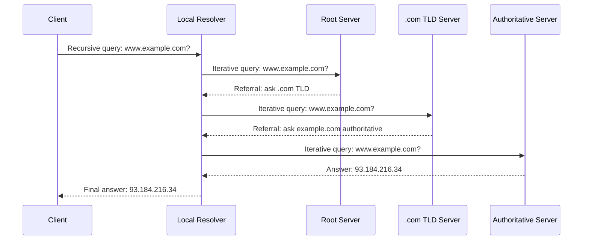

---
tags:
  - GATE/CS
  - GATE/ComputerNetworks
  - ApplicationLayer
  - NameResolution
aliases:
  - DNS
  - Domain Name System
  - Recursive Query
  - Iterative Query
date_created: 2026-09-12
difficulty: ⭐⭐⭐
last_revised: 2026-09-12
pyq_frequency: Medium
---

## Syllabus Position

Subject: [[Computer Networks]]
Parent Topic: [[TCP Header]]
Sibling Topics: [[UDP Header]], [[TCP Header]], [[Types of Communication]]
Leads To: [[HTTP]], [[Application Layer Protocols]]

GATE Syllabus Line: "Application layer protocols: DNS, SMTP, POP, FTP, HTTP."

Exam Weight Note: Appears as a 1-mark conceptual MCQ almost every year — usually testing whether DNS uses UDP or TCP, the resource record types, or the distinction between recursive and iterative resolution. Occasionally appears as a 2-mark question asking you to trace the full resolution chain (root → TLD → authoritative) given a hostname and count the number of messages exchanged.

---

## The Problem This Solves

Computers route packets using numeric IP addresses like `142.250.183.14`, but humans want to type `www.example.com`. Somebody, somewhere, needs to translate the human-friendly name into the machine-friendly address before a single packet can even be sent. Doing this translation with one giant central table would be a single point of failure and an update nightmare for billions of names — every new website registered anywhere in the world would require updating one master list that every computer on Earth consults.

**Analogy:** DNS is like a hierarchical phone directory system: instead of one giant global phone book, you first ask a librarian which *section* of the library covers ".com" numbers, that section directs you to the specific shelf for "example.com," and that shelf finally gives you the actual phone number for "www." No single book contains everything — each level only knows enough to point you one level closer to the answer.

**Core Idea:** DNS is a distributed, hierarchical, cached naming system that resolves human-readable domain names into IP addresses by delegating authority for different parts of the name space to different servers, queried either recursively (server does the work for you) or iteratively (server tells you who to ask next).

---

## Formal Theory

The **Domain Name System (DNS)** is an application-layer protocol and distributed database that maps domain names to IP addresses (and other records) using a hierarchical namespace and a hierarchy of **name servers**.

### The DNS Namespace Hierarchy

The namespace is a tree, read right-to-left in a domain name:
- **Root servers** (represented by the invisible trailing `.`, e.g., `www.example.com.`) — know only the addresses of all **Top-Level Domain (TLD)** servers.
- **TLD servers** (`.com`, `.org`, `.in`, etc.) — know the addresses of the **authoritative name servers** for domains registered under them.
- **Authoritative name servers** — hold the actual **[[Resource Records]]** (A, AAAA, CNAME, MX, NS, etc.) for a specific domain, e.g., `example.com`.
- **Local/Recursive resolver (ISP or OS-configured DNS server, e.g., `8.8.8.8`)** — the first point of contact for a client; it does the actual work of walking the hierarchy on the client's behalf and caches results.

### Recursive Query

In a **recursive query**, the client asks its local resolver a single question and expects a **complete final answer** (the IP address) or an authoritative "does not exist" — the resolver takes full responsibility for chasing down the answer through as many other servers as necessary, and the client is not involved in any of the intermediate steps.

```
Algorithm RECURSIVE_RESOLVE(hostname, resolver):
    client sends query for hostname to resolver
    resolver internally performs (possibly many) iterative queries to root, TLD, authoritative servers
    resolver returns final IP address (or error) directly to client
    return final_answer
```

### Iterative Query

In an **iterative query**, the server being asked does **not** chase the answer itself — instead, if it doesn't know the answer, it responds with a referral: "I don't know, but here is the address of a server that knows more." The querier (usually the recursive resolver itself, on behalf of the client) must then send a new query to that referred server, repeating until an authoritative answer is found.

```
Algorithm ITERATIVE_RESOLVE(hostname):
    server = ROOT_SERVER
    loop:
        response = query(server, hostname)
        if response is authoritative_answer:
            return response.ip_address
        else:
            server = response.referral_server   // "ask this one next"
    // repeats: root -> TLD -> authoritative
```

### How the Two Combine in Practice

Almost every real-world DNS resolution is a **hybrid**: the client makes exactly **one recursive query** to its local resolver, and the local resolver then performs a **chain of iterative queries** (root → TLD → authoritative) to construct the final answer, which it caches and returns to the client. Root and TLD servers essentially never perform recursive lookups themselves (to avoid overload); they only ever answer iteratively with a referral.

DNS predominantly uses **[[UDP Header|UDP]]** on port 53 for queries (since messages are small and speed matters more than reliability, and the application layer can retry), but falls back to **[[TCP Header|TCP]]** for zone transfers between servers or when a response exceeds 512 bytes (now more common with DNSSEC and EDNS0 extensions).

**What GATE actually tests here:** GATE loves to test (a) whether you know DNS uses UDP by default, (b) whether you can correctly identify a query as recursive vs. iterative from a description of "who does the work," and (c) tracing/counting the number of messages in a full resolution chain from client to root to TLD to authoritative server.

---

## Diagrams and Visuals

**Recursive query — client asks once, resolver does everything:**

```
Client -------------------(1) recursive query: "IP of www.example.com?"-----------------> Local Resolver
Client <-----------------------------(8) final answer: 93.184.216.34---------------------- Local Resolver
```

**Iterative chain inside the resolver — resolver asks root, TLD, authoritative one at a time:**

```
Local Resolver --(2) query "www.example.com"--> Root Server
Root Server --(3) referral: "ask .com TLD server"--> Local Resolver

Local Resolver --(4) query "www.example.com"--> .com TLD Server
.com TLD Server --(5) referral: "ask example.com's authoritative server"--> Local Resolver

Local Resolver --(6) query "www.example.com"--> Authoritative Server (example.com)
Authoritative Server --(7) answer: 93.184.216.34--> Local Resolver
```



Label meanings: the client's single arrow to the resolver is the **recursive** leg (client never talks to root/TLD/authoritative directly); every arrow from the resolver outward and back is an **iterative** leg, because each server either answers authoritatively or refers, never chasing further on the resolver's behalf.

---

## Complexity Analysis

Here, "complexity" is best expressed as **number of messages / round trips**, since that is what GATE numerically tests, plus the effect of **caching** on that count.

### Cold Cache (Worst Case)
For a fully uncached name with $d$ levels of delegation (root, TLD, authoritative for a typical 2-level domain, $d = 3$):
$$\text{Total messages} = 2 \;(\text{client}\leftrightarrow\text{resolver}) + 2d \;(\text{resolver}\leftrightarrow\text{each server, query + response})$$
For `www.example.com` with $d = 3$: $2 + 2(3) = 8$ messages total, matching the worked diagram above.

### Warm Cache (Best Case)
If the local resolver has a **cached** A record for the exact hostname (within its **[[Time to Live (TTL)]]**), it answers the client immediately:
$$\text{Total messages} = 2 \;(\text{client}\leftrightarrow\text{resolver only})$$

### Partially Warm Cache (Average Case)
If the resolver has cached the **TLD referral** but not the final authoritative answer, it skips the root query:
$$\text{Total messages} = 2 + 2(d - 1)$$

**Justification:** Each hop in the delegation hierarchy costs exactly one query + one response (or referral) round trip; caching short-circuits the hierarchy starting from whichever level is already known, so the number of iterative legs shrinks exactly by the number of cached levels.

### Complexity Summary Table

| Case                    | Messages                      | Space Complexity          | Trigger Condition                                         |
|--------------------------|-------------------------------|-----------------------------|--------------------------------------------------------------|
| Best Case (fully cached) | $O(1)$ — just 2 messages       | $O(1)$ resolver cache lookup | Hostname's A record still within TTL in resolver's cache      |
| Average Case (partial cache) | $O(d)$, reduced by cached levels | $O(1)$ per cached entry     | Some upper delegation level (root/TLD) cached, final answer not |
| Worst Case (cold cache)  | $O(d)$ full chain              | $O(1)$ resolver, $O(1)$ per server | Nothing cached — resolver must walk root → TLD → authoritative |

---

## Worked Example

A client wants to resolve `mail.cs.iitb.ac.in` for the first time (fully cold cache), a 4-level delegation: root → `.in` → `.ac.in` → `iitb.ac.in` (authoritative for `cs.iitb.ac.in`/`mail...`).

**Step 1:** Client sends **recursive** query to local resolver: "What is the IP of `mail.cs.iitb.ac.in`?"
State: Resolver has no cached entries; begins iterative resolution.

**Step 2:** Resolver sends iterative query to a **root server**. Root server does not know `.in` domain internals, responds with a **referral**: "Ask the `.in` TLD server at address X."
State: Resolver cache now stores `{.in -> TLD server X}`.

**Step 3:** Resolver sends iterative query to the `.in` **TLD server**. It responds with a referral: "Ask the `ac.in` server at address Y."
State: Resolver cache now stores `{ac.in -> server Y}`.

**Step 4:** Resolver sends iterative query to the `ac.in` server, which refers further to `iitb.ac.in`'s authoritative server at address Z.
State: Resolver cache now stores `{iitb.ac.in -> server Z}`.

**Step 5:** Resolver sends iterative query to `iitb.ac.in`'s authoritative server, which **authoritatively answers** with the A record: `mail.cs.iitb.ac.in -> 202.x.x.x`.
State: Resolver caches the final A record with its TTL.

**Step 6:** Resolver returns the final IP address to the client in a single response to the client's original recursive query.

**Total operations:** 1 client-resolver exchange (2 messages) + 4 iterative exchanges (8 messages) = **10 messages total**, confirming the $O(d)$ claim with $d = 4$ delegation levels since one message pair is spent per hierarchy level plus one pair for the client-resolver leg.

**What would change if the input were a repeat query for the same hostname 2 minutes later (within TTL)?** The resolver would find the A record already cached and answer the client immediately with just the original 2 messages — no iterative legs at all — demonstrating why DNS caching is essential for keeping the system fast at internet scale.

---

## Intuition Anchors

**The Analogy (restated and deepened):** Extending the hierarchical-directory analogy: the client asking the local resolver is like calling a single receptionist and asking "what's Bob's number?" — you never personally have to know which department, floor, or building Bob works in. The receptionist (recursive resolver) is the one who calls the main switchboard (root), then the department directory (TLD), then Bob's direct floor extension (authoritative server), and only then reports back the number to you. Each of *those* intermediate calls the receptionist makes is iterative — the switchboard doesn't call the department for the receptionist, it just says "call this extension next."

**The Mental Model:** Picture DNS resolution as a **funnel that narrows one level at a time** — root knows the widest, vaguest scope (all TLDs); each subsequent server knows a narrower slice, until the last server (authoritative) knows the exact, final answer. The client only ever sees the top of the funnel; the resolver walks the whole funnel.

**The One-Line Recall:** "Recursive = 'you ask once, I do all the work and give you the final answer'; Iterative = 'I tell you who to ask next, you do the follow-up yourself.'"

**The #1 Trap:** Students believe root and TLD servers "do the resolving" the same way the local resolver does. **They do not** — root and TLD servers only ever respond iteratively (referral only), never recursively, specifically because if millions of clients' resolvers all forced root servers to fully chase every answer recursively, root servers would be overwhelmed. Only the local/recursive resolver takes on the recursive burden, precisely to shield the rest of the hierarchy from that load.

---

## GATE Questions

---

**Question 1 — [GATE-style] — [1-mark]**

> In a DNS query, a client sends a request to its local DNS server. If the local DNS server does not have the answer cached, it queries the root server, which responds with a referral to a TLD server rather than fully resolving the query itself. This behavior of the root server is best described as:

- (A) Recursive query
- (B) Iterative query
- (C) Reverse query
- (D) Inverse query

<details>
<summary>Solution</summary>

**Answer: (B)**

**Reasoning:** (A) is wrong because a recursive query means the server contacted takes full responsibility for producing the final answer — the root server here explicitly does *not* do this; it merely refers the resolver elsewhere. (C) and (D) are both distractors referring to unrelated DNS query types (a "reverse"/"inverse" query resolves an IP address back to a hostname via PTR records, which is a completely different concept from recursive/iterative resolution). (B) is correct because the root server's behavior — "here's who to ask next" — is the textbook definition of iterative resolution.

**What this question is really testing:** Whether the student can distinguish the *behavior of the responding server* (iterative referral vs. recursive full-answer) from unrelated DNS query classifications like reverse lookups.

**Trap to avoid:** Confusing "iterative" with "inverse" purely because both start with "i" — read the actual described behavior, not just the word that sounds similar.

</details>

---

**Question 2 — [Conceptual] — [1-mark]**

> Which transport-layer protocol does DNS predominantly use for regular name resolution queries, and why?

<details>
<summary>Solution</summary>

DNS predominantly uses **UDP** on port 53. Regular queries and responses are small (well under UDP's typical size limits) and resolution needs to be fast — establishing a full TCP three-way handshake for every single lookup would add unnecessary round-trip overhead for a query that's often just a single request-response pair. If reliability is needed (e.g., a response is lost), the application layer (the resolver itself) simply retransmits the query, rather than relying on TCP's connection-oriented guarantees. DNS falls back to **TCP** only for zone transfers between authoritative servers (which involve large data transfers) or when a response would exceed the traditional 512-byte UDP message size limit (mitigated somewhat today by EDNS0, but TCP fallback still exists for compatibility and for DNSSEC-signed responses).

**Trap to avoid:** Assuming DNS "always uses UDP" without qualification — GATE occasionally tests the TCP-fallback-for-zone-transfers exception specifically.

</details>

---

**Question 3 — [Hard / Multi-concept] — [2-mark]**

> A client resolves `www.example.com` for the first time (cold cache, 3 levels: root, `.com` TLD, authoritative). Two minutes later, the same client's browser requests `mail.example.com` (a different hostname, same domain) from the same local resolver, well within any relevant TTLs. Assuming the resolver caches referrals as well as final answers, how many total messages (client-resolver + resolver-to-external-servers) are exchanged for the *second* request, and why?

<details>
<summary>Solution</summary>

For the second request, the resolver already has the `.com` TLD referral cached (learned while resolving `www.example.com`) *and*, more importantly, it likely also has the `example.com` authoritative server's address cached (since that's the same authoritative server that would handle `mail.example.com` too — both are subdomains under the same delegated zone). So the resolver can skip both the root query and the TLD query, going **directly to the already-known authoritative server** for `example.com` to ask about `mail.example.com`. This gives: 2 messages (client↔resolver) + 2 messages (resolver↔authoritative server) = **4 messages total**, versus the 8 messages the fully cold first request would have required.

**What this question is really testing:** Whether the student understands that DNS caching operates at the level of *delegation points* (which server is authoritative for a zone), not just individual full hostnames — so caching benefits extend to *other* names under the same already-resolved zone, not just exact repeat lookups.

**Trap to avoid:** Assuming a "new" hostname always requires a full cold resolution from root — the key insight is that the *authoritative server for the zone* was already discovered and cached, and that discovery is reusable across every hostname under that same zone.

</details>

---

**Pattern Recognition:**
- When a GATE question describes a server "referring you elsewhere instead of finishing the job," identify it as iterative — this phrasing is the standard signature.
- When a question asks "who does the client talk to only once," the answer is always the local/recursive resolver — the client never directly talks to root, TLD, or authoritative servers.
- Numerical/counting questions about DNS almost always reduce to "count 2 messages per hop in the delegation chain, plus 2 for the client-resolver leg," with caching reducing the effective chain length.
- Questions distinguishing DNS transport protocol nearly always hinge on the UDP-default-with-TCP-fallback-for-zone-transfers/large-responses rule.

---

## Edge Cases and Failure Modes

- [ ] **Assuming root servers ever answer recursively:** They never do — by design, root and TLD servers only ever respond iteratively (final answer or referral), to avoid being overwhelmed by full recursive resolution work for every query on the internet. Fix: remember only the local resolver performs recursive work on the client's behalf.
- [ ] **Confusing "iterative" with "inverse"/"reverse" DNS queries:** These are unrelated concepts — inverse/reverse DNS resolves an IP back to a hostname via PTR records, and has nothing to do with the recursive-vs-iterative resolution *strategy*. Fix: iterative/recursive describes *how* a query is resolved; reverse/inverse describes *what* is being looked up (IP→name instead of name→IP).
- [ ] **TTL expiration ignored:** A cached record isn't cached forever — once its **[[Time to Live (TTL)]]** expires, the resolver must re-query even for a previously-resolved hostname. Fix: always check whether a GATE question specifies "within TTL" or "TTL just expired" before assuming a cache hit.
- [ ] **Assuming one authoritative server per domain forever:** Domains can have multiple authoritative servers (primary/secondary) for redundancy — a query may succeed even if one authoritative server is down. Fix: don't assume single point of failure at the authoritative level.
- [ ] **Off-by-one in message counting:** Forgetting to count the initial client→resolver message or the final resolver→client message when computing total message counts for a resolution chain. Fix: always account for 2 messages for the client-resolver leg separately from the $2d$ messages for the iterative chain.
- [ ] **Assuming UDP always suffices:** Large DNSSEC-signed responses or zone transfers exceed UDP's practical size limits and must fall back to TCP. Fix: don't blindly answer "DNS = UDP" without the caveat.

---

## Comparisons

| Feature                  | [[DNS, Recursive and Iterative Queries\|Recursive Query]] | [[DNS, Recursive and Iterative Queries\|Iterative Query]] | [[TCP Header\|TCP-based transfer]] |
|---------------------------|--------------------------------------------------------------|--------------------------------------------------------------|--------------------------------------|
| Who does the resolving work | The queried server itself, on behalf of the querier         | The querier itself, following referrals                       | N/A — transport-layer concept, not resolution strategy |
| Typical user              | Client to local resolver                                     | Local resolver to root/TLD/authoritative servers               | Zone transfers, large DNS responses  |
| Number of messages seen by original client | Always exactly 1 request + 1 response, regardless of chain length | The querier itself sends/receives one message pair per hop     | N/A                                    |
| Load on the queried server | High — must fully resolve or fail                             | Low — only needs local knowledge to answer or refer            | N/A                                    |
| GATE Trap                 | Confused with "the client walking the hierarchy itself" (it does not) | Confused with "inverse"/"reverse" DNS lookups                  | Confused as DNS's *only* transport protocol |

The most common GATE question comparing these pits **recursive vs. iterative query behavior at the same server**, and the answer always hinges on **who performs the follow-up work**: in a recursive query, the server contacted keeps chasing the answer through other servers itself; in an iterative query, it simply hands back a referral and lets the original querier make the next move.

---

## Connections Web

**Must know before this topic:**
- [[UDP Header]] — DNS's default transport protocol; understanding UDP's connectionless, low-overhead nature explains why DNS prefers it
- [[TCP Header]] — needed to understand DNS's fallback for zone transfers and oversized responses
- [[Types of Communication]] — client-server request-response model underlying every DNS query

**Topics that build on this:**
- [[HTTP]] — every HTTP request to a domain name begins with a DNS resolution step
- [[Application Layer Protocols]] — DNS is a foundational example alongside SMTP, POP3, FTP

**GATE subject cross-links:**
- [[Computer Networks]] > [[Application Layer Protocols]]

**Cross-subject connections:**
- [[Distance Vector Routing]] — both DNS and routing protocols use a form of hierarchical/distributed delegation to avoid a single central authority, though the mechanisms differ
- [[Delay in Computer Networks]] — DNS resolution adds to overall end-to-end latency for any new connection, directly composing with transmission/propagation delay formulas

**Standard references:**
- [[Forouzan Chapter 25]] (Domain Name System)
- [[Tanenbaum Chapter 7]] (DNS)

---

## Quick Revision Sheet

**Definition (1 sentence):** DNS is a distributed, hierarchical system that translates human-readable domain names into IP addresses using delegated authority across root, TLD, and authoritative name servers.

**Core Idea / Analogy (1 sentence):** DNS is a hierarchical directory: the client asks a receptionist (local resolver) once, and the receptionist makes as many follow-up calls (root → TLD → authoritative) as needed to get the final number.

**Steps (max 6):**
1. Client sends one recursive query to its local/recursive resolver.
2. Resolver checks its cache; if hit, returns answer immediately.
3. On a miss, resolver iteratively queries a root server, which refers to the correct TLD server.
4. Resolver iteratively queries the TLD server, which refers to the correct authoritative server.
5. Resolver iteratively queries the authoritative server, which returns the final A record.
6. Resolver caches the result (per its TTL) and returns the final answer to the client.

**Complexity:**
- Messages (cold cache, $d$ delegation levels): $2 + 2d$
- Messages (fully cached): $O(1) = 2$
- Space: $O(1)$ per cached record at the resolver (TTL-bounded)

**Key Properties (GATE-tested facts):**
- Client always makes exactly one recursive query; it never talks to root/TLD/authoritative directly.
- Root and TLD servers only ever respond iteratively (answer or referral), never recursively.
- DNS defaults to UDP port 53; falls back to TCP for zone transfers or oversized responses.
- Caching operates at the delegation-point level, so it benefits *other* hostnames under an already-resolved zone too.

**The #1 Trap:** Confusing "iterative" with "inverse/reverse" DNS lookups — they describe unrelated aspects of DNS (resolution strategy vs. direction of lookup).

**When to use over alternatives:** N/A — DNS itself has no direct substitute in the application layer; the recursive/iterative distinction is about *how* a single DNS resolution is carried out, not a choice between competing systems.

**Mnemonic:** "Recursive = Resolver does the Running; Iterative = I chase it myself" — the querier (usually the resolver acting on the client's behalf) is the one who repeats ("iterates") the process of asking each referred server in turn.

---

## Revision Checklist

- [ ] I can state the formal definition of DNS, recursive query, and iterative query without looking.
- [ ] I can explain the receptionist/directory analogy and map it to root, TLD, and authoritative servers.
- [ ] I can trace the full 8-message cold-cache resolution chain by hand in under 2 minutes.
- [ ] I can derive the message-count formula ($2 + 2d$) from scratch and explain how caching reduces it.
- [ ] I know what the Quick Revision Sheet says without reading it.
- [ ] I can solve all 3 GATE questions in this note without peeking.
- [ ] I know the #1 trap (iterative vs. inverse/reverse DNS) and can articulate why students fall for it.
- [ ] I have linked this note correctly in my Obsidian vault.
- [ ] I have scheduled a spaced-repetition review in 3 days.
</content>
