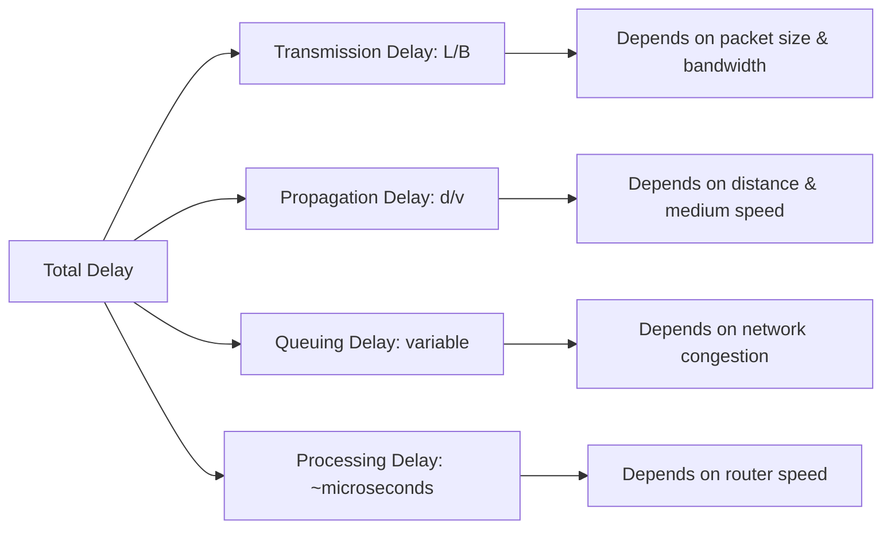

---
tags:
  - GATE/CS
  - GATE/Networks
  - Delay
aliases:
  - Network Delay
  - Latency
  - Propagation Delay
  - Transmission Delay
  - Queuing Delay
  - Processing Delay
date_created: 2026-08-26
difficulty: ⭐⭐⭐⭐
last_revised: 2026-08-26
pyq_frequency: High
---

## Syllabus Position

Subject: [[Computer Networks Index]]
Parent Topic: [[Layering and Protocol Stack]]
Sibling Topics: [[Throughput]], [[Bandwidth-Delay Product]]
Leads To: [[Sliding Window Protocol]], [[TCP Congestion Control]], [[Efficiency of Protocols]]

GATE Syllabus Line: "Networking devices and protocols... Routing algorithms... Network security... **Delay, throughput** in networks."

Exam Weight Note: Almost always appears as a 2-mark NAT question requiring you to compute transmission delay, propagation delay, or total end-to-end delay for a link, sometimes combined with the [[Bandwidth-Delay Product]] or [[Sliding Window Protocol]] efficiency calculations.

---

## The Problem This Solves

Imagine you send a text message to a friend across the country. The message doesn't teleport — it takes time to leave your phone, time to travel through cables and towers, and time to be processed at every stop along the way. If we want to design networks that are fast and predict how long communication takes, we need to break down "how long does it take for data to get there" into precise, measurable components. Without this breakdown, you cannot answer questions like "how big should my TCP window be?" or "why does a satellite call have that awkward pause?"

Think of sending a truck full of packages from Delhi to Mumbai. The time to load the truck (transmission delay), the time the truck spends driving on the highway (propagation delay), the time it waits at toll booths (queuing delay), and the time officials spend checking the paperwork at each checkpoint (processing delay) — all of these add up to the total time your packages take to arrive.

Core Idea (one sentence): **Total network delay** is the sum of four independent, physically distinct delays — transmission, propagation, queuing, and processing — each governed by a different physical or systemic factor.

---

## Formal Theory

**Delay** (or **latency**) in a computer network is the time taken for a unit of data (a packet, frame, or bit) to travel from a source to a destination across a link or network. GATE decomposes total delay into four components:

### 1. Transmission Delay ($T_{trans}$)
This is the time required to push all the bits of a packet onto the transmission link. It depends on the **packet size** ($L$, in bits) and the **link bandwidth** ($B$, in bits per second).

$$T_{trans} = \frac{L}{B}$$

Think of it as: how long does it take to "type out" the message onto the wire? A bigger packet or a slower link means more transmission delay.

### 2. Propagation Delay ($T_{prop}$)
This is the time taken for a single bit to physically travel across the medium (copper, fiber, air) from sender to receiver, once it's on the wire. It depends on the **distance** ($d$) and the **propagation speed** ($v$) of the medium (typically $2 \times 10^8$ m/s for copper/fiber, close to $3 \times 10^8$ m/s for satellite links through air/vacuum).

$$T_{prop} = \frac{d}{v}$$

This is a function of physics — the speed of light in the medium — and is completely independent of how much data you send.

### 3. Queuing Delay ($T_{queue}$)
This is the time a packet spends waiting in a router's or switch's buffer before it can be transmitted, because the outgoing link is busy with other traffic. It depends on network **congestion** and is highly variable — it cannot be computed by a simple formula; it depends on queue theory (e.g., M/M/1 queue models) and traffic load.

### 4. Processing Delay ($T_{proc}$)
This is the time a router takes to examine a packet's header, check for bit errors, and determine the outgoing link (routing table lookup). Typically on the order of microseconds and often considered negligible or given directly in GATE problems.

### Total End-to-End Delay
For a single link:

$$T_{total} = T_{trans} + T_{prop} + T_{queue} + T_{proc}$$

For a message crossing **multiple hops** (say $k$ links, each with its own bandwidth and distance), you sum transmission and propagation delay per hop. A classic GATE trick: if you're sending a single packet across $k$ hops (store-and-forward routing), the total delay is:

$$T_{total} = \sum_{i=1}^{k} (T_{trans,i} + T_{prop,i}) + \text{processing delays}$$

But if a **large message is broken into packets** and pipelined across hops, the formula changes — only the *last* packet's transmission delay on each hop matters after the pipeline fills up (see Worked Example).

### Store-and-Forward vs. Cut-Through Switching
- **[[Store-and-Forward Switching]]**: A router waits to receive the *entire* packet before starting to forward it. Adds full $T_{trans}$ at every hop.
- **[[Cut-Through Switching]]**: A router starts forwarding as soon as it reads the header, without waiting for the whole packet. Reduces delay for large messages over many hops.

**What GATE actually tests here:** GATE loves multi-hop, multi-packet scenarios where you must correctly identify whether delays overlap (pipeline) or add up (store-and-forward), and problems combining propagation delay with the [[Bandwidth-Delay Product]] to test if a [[Sliding Window Protocol]] can keep the pipe full.

---

## Diagrams and Visuals

**Visual 1: Single Packet, Single Link — Delay Components**

```
Sender                                          Receiver
  |------------------- distance d --------------------|
  |                                                    |
  | <--- T_trans ---> <---------- T_prop ------------> |
  | (pushing bits)     (bits traveling on the wire)    |
  |                                                    |
Time --->
```
- $T_{trans}$: happens at the sender, proportional to packet size / bandwidth.
- $T_{prop}$: happens on the wire itself, proportional to distance / speed.
- The **last bit** of the packet arrives at $T_{trans} + T_{prop}$.

**Visual 2: Multi-Hop Store-and-Forward (2 hops, 1 packet)**

```
Node A ---- Link 1 ---- Node B ---- Link 2 ---- Node C

Time:
A sends:        [--Ttrans1--]
Link1 prop:                  [--Tprop1--]
B receives full packet, then forwards:
B sends:                                [--Ttrans2--]
Link2 prop:                                          [--Tprop2--]

Total = Ttrans1 + Tprop1 + Ttrans2 + Tprop2 (+ processing at B)
```
Each hop's transmission delay is fully paid before the next hop begins (store-and-forward).

**Mermaid: Delay Component Breakdown**



**Visual 3: Pipelined Multi-Packet Transfer**

```
Node A ---- Link 1 (fast) ---- Node B ---- Link 2 (slow) ---- Node C

Packet 1: [Ttrans1]--[Tprop1]--> arrives at B, B starts forwarding
Packet 2:          [Ttrans1]--[Tprop1]--> arrives at B (queues if B still sending pkt1)
...
```
Here, delay for the *whole message* is NOT simply (number of packets × per-packet delay summed serially) — later packets overlap with earlier ones' propagation, so the message finishes faster than naive summation suggests.

---

## Complexity Analysis

Delay isn't "complexity" in the algorithmic sense, but GATE tests it the same way — as a formula to be derived and applied, with best/worst-case-like reasoning replaced by **scenario-based reasoning**.

**Transmission Delay per packet:** $T_{trans} = L/B$ — this is fixed and deterministic given $L$ and $B$; no "best/worst case" variation exists for a single well-defined packet size.

**Propagation Delay:** $T_{prop} = d/v$ — deterministic given distance and medium; doesn't change with load.

**Queuing Delay:** This is the only "variable" component — analogous to *average-case* analysis in algorithms. Modeled via queuing theory: if average packet arrival rate is $\lambda$ and service rate is $\mu$, for an M/M/1 queue, average queuing delay is:

$$T_{queue} = \frac{1}{\mu - \lambda} - \frac{1}{\mu} = \frac{\rho}{\mu(1-\rho)}, \quad \rho = \lambda/\mu$$

This blows up (→ ∞) as $\rho \to 1$ (utilization approaching 100%) — this is why routers drop packets or apply congestion control before hitting saturation.

**Total Delay for N packets, single link (non-pipelined naive case):**
$$T_{total} = N \cdot T_{trans} + T_{prop}$$
(Only one propagation delay is paid because all bits travel together once transmission starts, and the *last* bit's arrival marks message completion — you don't pay $T_{prop}$ per packet since they're back-to-back on the wire.)

**For $k$ hops, 1 packet, store-and-forward:**
$$T_{total} = \sum_{i=1}^{k} T_{trans,i} + \sum_{i=1}^{k} T_{prop,i}$$

**For $k$ hops, message split into $P$ packets, pipelined:**
$$T_{total} = P \cdot T_{trans} + \sum_{i=1}^{k}(T_{trans,i} + T_{prop,i}) - T_{trans}$$
(Intuition: the first packet takes the full multi-hop delay to arrive, then each subsequent packet only adds one more $T_{trans}$ at the bottleneck since hops pipeline.)

### Complexity Summary Table

| Delay Type       | Formula           | Depends On                  | Notes                                    |
|------------------|-------------------|------------------------------|-------------------------------------------|
| Transmission     | $L/B$             | Packet size, Bandwidth       | Zero if $L \to 0$ or $B \to \infty$        |
| Propagation      | $d/v$             | Distance, Medium speed       | Zero only if $d = 0$ (same location)       |
| Queuing          | Variable (M/M/1)  | Traffic load, buffer state   | Diverges as utilization $\to 1$            |
| Processing       | ~constant, small  | Router CPU speed             | Often given/ignored in GATE problems       |

---

## Worked Example

**Setup:** A message of size $L = 10^6$ bits needs to travel from Host A to Host C via an intermediate router B. Link A–B has bandwidth $B_1 = 10^6$ bps and distance $d_1 = 2000$ km. Link B–C has bandwidth $B_2 = 2 \times 10^6$ bps and distance $d_2 = 1000$ km. Propagation speed on both links is $v = 2 \times 10^8$ m/s. Assume **store-and-forward switching**, negligible processing/queuing delay, and the message is sent as a **single packet**.

**Step 1: Compute Transmission Delay on Link 1 (A→B)**
$$T_{trans,1} = \frac{L}{B_1} = \frac{10^6}{10^6} = 1 \text{ second}$$

**Step 2: Compute Propagation Delay on Link 1**
$$T_{prop,1} = \frac{d_1}{v} = \frac{2000 \times 10^3}{2 \times 10^8} = \frac{2 \times 10^6}{2 \times 10^8} = 0.01 \text{ s} = 10 \text{ ms}$$

**Step 3: Node B receives entire packet at time:**
$$1\text{ s} + 0.01\text{ s} = 1.01\text{ s}$$
(Store-and-forward: B must have every bit before forwarding.)

**Step 4: Compute Transmission Delay on Link 2 (B→C)**
$$T_{trans,2} = \frac{L}{B_2} = \frac{10^6}{2\times 10^6} = 0.5 \text{ s}$$

**Step 5: Compute Propagation Delay on Link 2**
$$T_{prop,2} = \frac{d_2}{v} = \frac{1000\times10^3}{2\times10^8} = 0.005 \text{ s} = 5 \text{ ms}$$

**Step 6: Total time for message to fully arrive at C**
$$T_{total} = T_{trans,1} + T_{prop,1} + T_{trans,2} + T_{prop,2}$$
$$T_{total} = 1 + 0.01 + 0.5 + 0.005 = 1.515 \text{ seconds}$$

**State check:** At $t=1.01\text{s}$, node B has the full packet and begins retransmitting. At $t = 1.01 + 0.5 = 1.51\text{s}$, the last bit leaves B. At $t = 1.51 + 0.005 = 1.515\text{s}$, the last bit reaches C. **Verified: Total operations (delay segments) = 4, confirming $T_{total} = 1.515$ s.**

**What would change if the input were split into 10 equal packets and pipelined?** Each packet would be $10^5$ bits. $T_{trans,1}$ per packet becomes $0.1$s, and the first packet reaches B at $0.1 + 0.01 = 0.11$s, starts forwarding on link 2 immediately (cut-through-like pipelining across packets even in store-and-forward per-packet). The total finish time becomes approximately: (time for last packet to finish link 1) + (its transmission + propagation on link 2) = $[10 \times 0.1 + 0.01] + [0.05 + 0.005] = 1.01 + 0.055 = 1.065\text{s}$ — significantly faster than sending as one giant packet, because pipelining overlaps transmission on link 2 with ongoing transmission on link 1.

---

## Intuition Anchors

**The Analogy (restated and deepened):** Picture the Delhi-to-Mumbai truck delivery again, now with a relay depot in Nagpur (like router B). The time to *load* each truck is transmission delay — it depends on how much cargo (packet size) and how fast your loading dock works (bandwidth). The time the truck spends *driving* is propagation delay — fixed by the distance and the truck's speed, regardless of cargo size. If the depot in Nagpur must **unload and reload** entirely before sending onward (store-and-forward), you pay full loading time twice. But if you send the cargo in small batches (packets) so the depot can start reloading the first batch onto the next truck while the second batch is still arriving, you save huge amounts of time — that's pipelining.

**The Mental Model:** For any delay problem, immediately draw a timeline. Mark when the *first bit* leaves, when the *last bit* leaves (that's $T_{trans}$ later), when the *first bit* arrives (add $T_{prop}$), and when the *last bit* arrives (that's when the receiver has everything). Multi-hop problems are just this timeline repeated at each node, with a check on whether hops overlap (pipeline) or don't (store-and-forward with single packet).

**The One-Line Recall:** "Transmission delay is $L/B$ (how long to push the bits out), propagation delay is $d/v$ (how long the bits travel), and for single-packet store-and-forward across $k$ hops, you sum both across every hop."

**The #1 Trap:** Students confuse transmission delay and propagation delay, or assume propagation delay depends on bandwidth. It does NOT — propagation delay is purely $d/v$, a physical constant of the link, and has nothing to do with how fast you push bits onto it. The correct fix: always ask "is this about pushing bits out (transmission, needs $L$ and $B$) or about bits traveling (propagation, needs $d$ and $v$)?" before writing any formula.

---

## GATE Questions

---

**Question 1 — [PYQ: GATE 2015] — [Difficulty: 2-mark]**

> Consider a network with a link of bandwidth 10 Mbps and a one-way propagation delay of 50 ms between two hosts A and B, connected via a single link. Host A wants to send a file of size 1 Mbit (1 × 10⁶ bits) to Host B. What is the total time (in ms) taken to transmit the file (from the moment A starts sending the first bit until B receives the last bit)?

- (A) 50 ms
- (B) 100 ms
- (C) 150 ms
- (D) 200 ms

<details>
<summary>Solution</summary>

**Answer: (C) 150 ms**

**Reasoning:**
$T_{trans} = L/B = (1 \times 10^6)/(10 \times 10^6) = 0.1\text{s} = 100\text{ms}$.
$T_{prop} = 50\text{ms}$ (given directly).
$T_{total} = T_{trans} + T_{prop} = 100 + 50 = 150\text{ms}$.
Option (A) only accounts for propagation, ignoring transmission. Option (B) mistakes transmission delay alone as the answer. Option (D) results from doubling propagation delay incorrectly (confusing with RTT).

**What this question is really testing:** Whether the student can correctly identify and add the two deterministic delay components for a single-link, single-packet transfer.

**Trap to avoid:** Do NOT double the propagation delay unless the question explicitly asks for round-trip time (RTT); "B receives the last bit" is a one-way event.

</details>

---

**Question 2 — [Conceptual / Numerical] — [2-mark]**

> A 5000-bit packet is sent over a link with bandwidth 100 kbps. The link has a propagation delay of 20 ms. Assuming the sender waits for an acknowledgment (stop-and-wait) that is negligible in size and the ACK's propagation delay is also 20 ms, what is the total round-trip time before the sender can send the next packet (ignore processing and ACK transmission delay)?

<details>
<summary>Solution</summary>

$T_{trans} = 5000 / (100 \times 10^3) = 0.05\text{s} = 50\text{ms}$.
Data travel: $T_{trans} + T_{prop} = 50 + 20 = 70\text{ms}$ for the packet to arrive.
ACK travel back: $T_{prop} = 20\text{ms}$ (ACK transmission delay ignored as stated).
Total RTT for sender to be free to send next packet: $70 + 20 = 90\text{ms}$.

This models the basic [[Stop and Wait Protocol]] cycle time, directly relevant to computing protocol [[Efficiency of Protocols|efficiency]] as $T_{trans}/(T_{trans}+2T_{prop})$.

</details>

---

**Question 3 — [Hard / Multi-concept] — [2-mark]**

> A message of size 10⁷ bits is to be transmitted from Host A to Host D through two intermediate routers B and C, forming a chain A–B–C–D. Each link has bandwidth 10 Mbps and propagation delay 10 ms. Using store-and-forward switching, and assuming the message is sent as a single packet with negligible processing delay, what is the total time for the message to reach D?

<details>
<summary>Solution</summary>

**Answer:** There are 3 links (A-B, B-C, C-D), each identical.
$T_{trans}$ per link $= 10^7 / (10\times10^6) = 1\text{s}$.
$T_{prop}$ per link $= 10\text{ms} = 0.01\text{s}$.
Since it's a single packet with store-and-forward, delays across all 3 hops add serially (no pipelining possible with just 1 packet):
$$T_{total} = 3 \times (T_{trans} + T_{prop}) = 3 \times (1 + 0.01) = 3.03\text{s}$$

**What this question is really testing:** Multi-hop store-and-forward reasoning combined with correctly recognizing that a *single* packet cannot be pipelined — every hop must fully receive before forwarding.

**Trap to avoid:** Students sometimes only count propagation delay once (as if it were one long wire) — but each hop is a separate store-and-forward link, so transmission delay is paid at *every* hop, not just once.

</details>

---

**Pattern Recognition:**
- When GATE gives bandwidth and packet size together, expect a transmission delay calculation.
- When GATE gives distance and a "speed of signal" or says "propagation delay is X ms," it's testing whether you add it correctly to transmission delay (not multiply, and not confuse it with RTT).
- Multi-hop problems test whether you know when delays overlap (pipelined multi-packet) vs. add serially (single packet, store-and-forward).
- Any mention of "acknowledgment" or "waits for response" signals a Round-Trip Time (RTT) calculation, often combined with [[Stop and Wait Protocol]] or [[Sliding Window Protocol]] efficiency.

---

## Edge Cases and Failure Modes

- [ ] **Packet size = 0 or negligible (e.g., ACK):** Transmission delay ≈ 0; only propagation delay matters. GATE often exploits this by saying "ignore ACK transmission time."
- [ ] **Distance = 0 (same LAN segment, extremely short link):** Propagation delay ≈ 0; total delay is dominated entirely by transmission delay.
- [ ] **Confusing one-way delay with RTT:** A question asking "time until B receives" is one-way; a question asking "time until sender gets a response" is RTT (usually $2\times T_{prop} + T_{trans} + T_{ack,trans}$).
- [ ] **Single packet vs. pipelined packets across multiple hops:** For a single packet, delays add serially per hop (store-and-forward). For many small packets, later packets overlap with earlier ones' propagation — total time is much less than naive multiplication.
- [ ] **Utilization $\rho \to 1$ in queuing delay models:** Queuing delay doesn't grow linearly — it diverges towards infinity as the link approaches full utilization, per the M/M/1 formula. Naively assuming "double the load doubles the delay" is wrong near saturation.
- [ ] **Mixing units:** Bandwidth in Mbps vs. packet size in Bytes — always convert to bits before dividing. A very common GATE trap uses "KB" for packet size and "Kbps" for bandwidth in the same question, requiring a ×8 conversion.
- [ ] **Ignoring processing delay when explicitly given:** If a question states a router's processing delay in ms, it must be added per hop — don't assume it's always negligible just because many problems ignore it.

---

## Comparisons

| Feature              | [[Transmission Delay]]        | [[Propagation Delay]]         | [[Queuing Delay]]                |
|----------------------|-------------------------------|--------------------------------|-----------------------------------|
| Formula              | $L/B$                          | $d/v$                          | M/M/1 model, variable             |
| Depends on           | Packet size, Bandwidth         | Distance, Medium                | Network congestion, buffer state  |
| Deterministic?        | Yes                             | Yes                             | No (probabilistic/load-dependent) |
| When to Prefer (i.e., dominates) | Short distance, large packets | Long distance (e.g., satellite) | High-traffic, congested networks  |
| GATE Trap            | Confusing with propagation      | Assuming it depends on bandwidth| Assuming linear growth with load  |

The most common GATE question comparing these is a scenario contrasting a **satellite link** (huge propagation delay, ~270ms one-way, small transmission delay if bandwidth is high) versus a **terrestrial fiber link** (small propagation delay, but transmission delay dominates for large files on low-bandwidth links) — and the answer hinges on correctly identifying which delay term is negligible given the specific numbers in the problem.

---

## Connections Web

**Must know before this topic:**
- [[Bits and Bytes]] — delay formulas require converting packet sizes to bits
- [[Bandwidth]] — defines the transmission rate used in $T_{trans} = L/B$
- [[Layering and Protocol Stack]] — delay is analyzed per-link, which maps to the physical/data-link layer

**Topics that build on this:**
- [[Bandwidth-Delay Product]] — combines bandwidth and RTT to determine how much data can be "in flight"
- [[Sliding Window Protocol]] — window size must be chosen based on bandwidth-delay product to keep the link fully utilized
- [[TCP Congestion Control]] — reacts to increasing queuing delay/packet loss as a congestion signal
- [[Throughput]] — actual achieved data rate, which is capped by delay and window size interactions
- [[Efficiency of Protocols]] — stop-and-wait and sliding window efficiency formulas directly use $T_{trans}$ and $T_{prop}$

**GATE subject cross-links:**
- [[Computer Networks Index]] > [[Data Link Layer Index]]
- [[Computer Networks Index]] > [[Transport Layer Index]]

**Cross-subject connections:**
- [[Queuing Theory]] (from Probability/Operating Systems) — the mathematical basis for queuing delay models
- [[Amdahl's Law]] (Computer Organization) — conceptually similar in that both compute a total time as a sum of independent component times

**Standard references:**
- [[Kurose and Ross Chapter 1]] — Delay, Loss, and Throughput in Packet-Switched Networks
- [[Tanenbaum Chapter 2]] — Physical Layer and transmission media speed

---

## Quick Revision Sheet

**Definition (1 sentence):** Network delay is the total time for data to travel from source to destination, composed of transmission, propagation, queuing, and processing delays.

**Core Idea / Analogy (1 sentence):** Transmission delay is how long it takes to load a truck; propagation delay is how long the truck takes to drive; both add up per hop in store-and-forward networks.

**Algorithm Steps (numbered, maximum 6 steps):**
1. Identify packet size $L$ and bandwidth $B$ for each link → compute $T_{trans} = L/B$.
2. Identify distance $d$ and propagation speed $v$ for each link → compute $T_{prop} = d/v$.
3. Identify if switching is store-and-forward (single packet) or pipelined (multiple packets).
4. If single packet, multi-hop: sum $(T_{trans} + T_{prop})$ across all hops.
5. If pipelined: only the bottleneck link's transmission delay repeats per packet after the pipeline fills.
6. Add queuing/processing delay only if explicitly given in the problem.

**Complexity:**
- Time (best / average / worst): N/A (delay is a deterministic sum, except queuing delay which is load-dependent)
- Space: N/A
- Recurrence (if applicable): Not applicable; delay is additive, not recursive.

**Key Properties (3 to 5 bullet points):**
- Propagation delay is independent of bandwidth; transmission delay is independent of distance.
- For $k$ hops with a single packet (store-and-forward), total delay = sum of all transmission and propagation delays across every hop.
- Queuing delay diverges as network utilization approaches 100% (M/M/1 model).
- RTT = one-way delay × 2, only when explicitly asked about acknowledgment round trips.

**The #1 Trap:** Confusing transmission delay ($L/B$, depends on packet size and bandwidth) with propagation delay ($d/v$, depends on distance and medium speed) — they are independent physical quantities.

**When to use this over alternatives:** N/A — this is foundational; used whenever any networking problem involves timing, protocol efficiency, or bandwidth-delay product calculations.

**Mnemonic or one-liner to remember the steps:** "**T**rucks **P**ack **Q**uickly **P**lease" → **T**ransmission, **P**ropagation, **Q**ueuing, **P**rocessing, in typical order of magnitude importance for most terrestrial links.

---

## Revision Checklist

- [ ] I can state the formal definition without looking.
- [ ] I can explain the analogy and map it to the algorithm or concept.
- [ ] I can trace a 6-element example (multi-hop delay) by hand in under 2 minutes.
- [ ] I can derive the worst-case complexity (queuing delay divergence) from scratch.
- [ ] I know what the Quick Revision Sheet says without reading it.
- [ ] I can solve all 3 GATE questions in this note without peeking.
- [ ] I know the #1 trap and can articulate why students fall for it.
- [ ] I have linked this note correctly in my Obsidian vault.
- [ ] I have scheduled a spaced-repetition review in 3 days.
