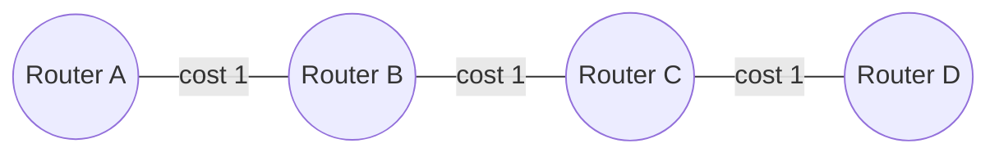

---
tags:
  - GATE/CS
  - GATE/Networks
  - Routing
aliases:
  - DVR
  - Bellman-Ford Routing
  - Distributed Bellman-Ford
date_created: 2026-09-08
difficulty: ⭐⭐⭐⭐
last_revised: 2026-09-08
pyq_frequency: Medium
---

## Syllabus Position

Subject: [[Computer Networks Index]]
Parent Topic: [[Routing Algorithms]]
Sibling Topics: [[Link State Routing]], [[Path Vector Routing]]
Leads To: [[RIP Protocol]], [[Count to Infinity Problem]], [[Split Horizon]]

GATE Syllabus Line: "Routing (Network Layer)" — under Computer Networks, GATE CS syllabus explicitly lists routing algorithms including distance vector and link state as testable concepts.

Exam Weight Note: Appears most often as a 2-mark NAT/MCQ asking you to compute a router's distance vector table after one or two rounds of exchange, or as a conceptual MCQ on the count-to-infinity problem and its fixes.

---

## The Problem This Solves

Imagine a city with hundreds of intersections but no master map — each intersection only knows the roads directly connected to it and how long those roads take to drive. To find the shortest route to a distant intersection, every intersection must talk to its immediate neighbors, share what it currently believes is the fastest way to reach everywhere, and slowly update its own beliefs. Over time, correct information propagates outward like a rumor spreading through a network of people who only talk to their immediate friends. This is exactly the situation a router faces: it doesn't have a global map of the network, only knowledge of its directly attached links and their costs.

**Analogy:** Think of Distance Vector Routing like gossip among neighbors on a street. Each house only talks to the houses immediately next to it and shares "here's what I currently think is the fastest way to reach every other house in the city." No one ever sees the full city map — the routing information is entirely rumor-based, built up purely from neighbor-to-neighbor exchange.

**Core Idea (one sentence):** Each router maintains a table of best-known distances to every destination and periodically shares this entire table with its immediate neighbors, updating its own table whenever a neighbor's advertised distance plus the link cost to that neighbor produces a shorter path.

---

## Formal Theory

**[[Distance Vector Routing]]** is a decentralized routing algorithm in which each router maintains a vector (table) of distances — one entry per destination in the network — and periodically exchanges this vector with its directly connected neighbors. Each router updates its own vector using the [[Bellman-Ford Algorithm]] applied in a distributed, iterative fashion: this is why DVR is also called the **Distributed Bellman-Ford Algorithm**.

### The Bellman-Ford Update Rule

Each router $x$ maintains, for every destination $y$, a distance estimate $D_x(y)$, and for every neighbor $v$, the direct link cost $c(x,v)$. The update rule applied by router $x$ upon receiving neighbor $v$'s vector is:

$$D_x(y) = \min_{v \in N(x)} \big[ c(x,v) + D_v(y) \big]$$

where $N(x)$ is the set of $x$'s directly connected neighbors. This equation says: "My best distance to $y$ is the minimum, over all my neighbors $v$, of the cost to reach $v$ plus whatever $v$ currently believes is its distance to $y$."

### Algorithm (Distributed, Asynchronous)

```
Algorithm DistanceVectorRouting(router x):
    initialize D_x(y) = c(x,y) for all direct neighbors y
    initialize D_x(y) = infinity for all non-neighbors y
    D_x(x) = 0
    loop forever:
        send D_x (full vector) to all neighbors
        wait for a neighbor v's vector D_v
        for each destination y:
            new_dist = c(x,v) + D_v(y)
            if new_dist < D_x(y):
                D_x(y) = new_dist
                next_hop(y) = v
        if D_x changed:
            notify all neighbors (send updated vector)
    return D_x, next_hop table
```

### Variant: Synchronous vs. Asynchronous Updates

In the **synchronous** model (used in most GATE numericals for simplicity), all routers exchange vectors simultaneously in discrete rounds, and every router updates once per round using the *previous* round's vectors from all neighbors. In the **asynchronous** (real-world) model, updates happen whenever a router receives new information, with no global clock — this is closer to actual RIP behavior but is harder to hand-trace, so GATE questions almost always use the synchronous framing.

### What GATE Actually Tests Here

GATE examiners love giving you a small network topology (4–6 nodes) with link costs, and asking you to compute the distance vector table after exactly 1 or 2 rounds of exchange, or asking you to identify the **count-to-infinity problem** by removing a link and tracing what happens to the affected router's vector over successive rounds.

---

## Diagrams and Visuals

**Network Topology and Initial Vectors**

Draw four routers A, B, C, D in a line: A—B—C—D, with link costs A-B = 1, B-C = 1, C-D = 1.

```
   A ---1--- B ---1--- C ---1--- D
```

Initial distance vectors (round 0), each router knows only direct neighbors:

```
A: [A:0, B:1, C:inf, D:inf]
B: [A:1, B:0, C:1,   D:inf]
C: [A:inf, B:1, C:0, D:1]
D: [A:inf, B:inf, C:1, D:0]
```

**Mermaid state diagram of the exchange process:**



**Convergence propagation (round by round):** each round, information about a destination travels exactly one hop further. After round $k$, every router within $k$ hops of a piece of information has learned it — this is why convergence time is proportional to the network diameter.

```
Round 0: only direct neighbor info known
Round 1: A learns about C (via B); D learns about B (via C)
Round 2: A learns about D (via B); D learns about A (via C)
```

---

## Complexity Analysis

Unlike a typical algorithm running on one machine, DVR's "complexity" is measured in **convergence time** and **message complexity**, not time/space on a single processor.

- **Convergence Time (Time Complexity equivalent):** In the synchronous model, information about a new or changed route propagates exactly one hop per round. If the network has diameter $d$ (the longest shortest path between any two nodes), then in the worst case it takes $O(d)$ rounds for every router to learn the shortest distance to every other router. This is because the update rule only lets a router learn about node $y$ once at least one neighbor already has a finite estimate to $y$ — so information spreads at exactly one hop per round, just like a breadth-first search wave.
- **Space Complexity:** Each router stores a vector of size $O(n)$ where $n$ is the number of destinations in the network (plus a next-hop entry per destination), so total space per router is $O(n)$, and total space across the whole network is $O(n^2)$.
- **Message Complexity:** Each round, every router sends its full vector (size $O(n)$) to every neighbor, so each round costs $O(n \cdot E)$ messages where $E$ is the number of links — this is far more expensive than [[Link State Routing]], which floods much smaller link-cost messages.
- **Failure-case Complexity (Count-to-Infinity):** When a link fails, the algorithm does **not** converge in $O(d)$ rounds — it can take $O(\infty)$ in the worst theoretical case (bounded only by an artificial "infinity" cap like 16 in RIP), because routers can temporarily believe a failed route still exists via a neighbor who is itself relying on them (a routing loop).

#### Complexity Summary Table

| Case                          | Convergence Time | Message Complexity | Notes                                            |
|-------------------------------|-------------------|---------------------|---------------------------------------------------|
| Normal (link added/no failure)| $O(d)$ rounds     | $O(nE)$ per round   | $d$ = network diameter, good news travels fast     |
| Link cost decreases (good news)| $O(d)$ rounds    | $O(nE)$ per round   | Propagates outward at 1 hop/round                  |
| Link failure (bad news)       | Up to $O(\infty)$, capped at 16 in RIP | High, repeated | Count-to-infinity problem                          |

---

## Worked Example

Consider four routers in a line: A—B—C—D with costs A-B=1, B-C=1, C-D=1 (as diagrammed above). We trace the synchronous algorithm for destination D as seen from A.

**Round 0 (initial):**
```
A: D = infinity   (A doesn't know D yet, no direct link)
B: D = infinity
C: D = 1           (C is directly connected to D)
D: D = 0
```

**Round 1:** Each router exchanges vectors with neighbors and applies the Bellman-Ford update.
- B receives C's vector, sees $D_C(D) = 1$, computes $c(B,C) + D_C(D) = 1 + 1 = 2$. B updates $D_B(D) = 2$.
- A receives B's vector (round 0 value, $D_B(D) = \infty$), so A's estimate stays $\infty$ this round.

```
A: D = infinity
B: D = 2
C: D = 1
D: D = 0
```

**Round 2:**
- A receives B's *updated* vector from round 1 ($D_B(D)=2$), computes $c(A,B) + D_B(D) = 1 + 2 = 3$. A updates $D_A(D) = 3$.

```
A: D = 3    <-- converged
B: D = 2
C: D = 1
D: D = 0
```

**Verification:** The actual shortest path from A to D is A→B→C→D with total cost $1+1+1=3$, matching $D_A(D)=3$. Total rounds needed for A to learn the correct distance to D = 3, which equals the hop distance (network diameter contribution) between A and D — confirming the $O(d)$ convergence claim.

**Edge-case follow-up:** What if the link C-D fails (cost becomes infinity) after convergence? Now C no longer has a valid direct route to D, but C might still hear from B that "B can reach D at cost 2" — except B's cost 2 route was itself *through* C, so C would recompute using its own stale advertisement of cost 1, causing B to think $D_B(D) = c(B,C) + 1 = 2$ still, even though that path no longer exists. This bounce-back miscommunication is exactly the **count-to-infinity problem**, where the distance estimate slowly climbs (2, 3, 4, 5, ...) over many rounds instead of quickly detecting the route is gone.

---

## Intuition Anchors

**The Analogy (restated and deepened):** Recall the gossiping neighbors analogy. Now extend it to the failure scenario: if the house at the end of the street burns down, the neighbor right next to it might briefly still believe "I can reach that house because my neighbor said they can" — not realizing that the neighbor's belief was based on *them* in the first place. This circular gossip is the count-to-infinity problem: bad news travels slowly because everyone is quoting each other without realizing the original source is gone.

**The Mental Model:** Picture distance vector routing as a wave of "good news" (shorter routes) that always propagates correctly and quickly, hop by hop, but a wave of "bad news" (a route disappearing) that can get trapped in a loop of mutual misinformation, because routers don't know the *path* their neighbor used — only the *distance* — so they can't detect when they themselves are part of the problem.

**The One-Line Recall:** "Each router updates $D_x(y) = \min_v [c(x,v) + D_v(y)]$ using only its neighbors' vectors — good news (shorter paths) converges in $O(d)$ rounds, but bad news (link failures) can loop indefinitely, causing count-to-infinity."

**The #1 Trap:** Students assume DVR always converges in $O(d)$ rounds like a clean BFS, because that's true for link additions/cost decreases. But they forget that link *failures* break this guarantee entirely — the correct answer on a GATE MCQ about convergence after a link failure is "count-to-infinity: no guaranteed bound without split horizon or similar fixes," not "$O(d)$ rounds," because DVR carries no path information, only a scalar distance, so it cannot detect when a route depends on itself.

---

## GATE Questions

---

**Question 1 — [GATE-style, based on common PYQ pattern] — [2-mark]**

> Consider a network with four routers P, Q, R, S connected as P—Q (cost 2), Q—R (cost 1), R—S (cost 3), and a direct link P—S (cost 8). Using distance vector routing with the Bellman-Ford update rule, what is the distance from P to S after the algorithm converges?

- (A) 8
- (B) 6
- (C) 5
- (D) 3

<details>
<summary>Solution</summary>

**Answer: (B) 6**

**Reasoning:**
The direct link P-S costs 8. But the path P→Q→R→S costs $2+1+3=6$, which is shorter. Distance vector routing always converges to the shortest path, computed via the min operation over all neighbor advertisements, so P will learn (over a few rounds) that going through Q is cheaper than the direct link. Option (A) is the trap for someone who assumes the direct link is automatically preferred. Option (C) miscalculates the path sum. Option (D) ignores one segment of the path entirely.

**What this question is really testing:** Whether the student understands that DVR compares *all* neighbor-advertised paths against the direct link cost, not just accepts a direct connection as optimal.

**Trap to avoid:** Assuming a direct link is always the shortest path — always compute $c(x,v) + D_v(y)$ for every neighbor $v$ and take the minimum.

</details>

---

**Question 2 — [Conceptual] — [1-mark]**

> Which of the following statements about the count-to-infinity problem in distance vector routing is TRUE?

- (A) It occurs because routers exchange only link costs, never distances.
- (B) It occurs because a router advertises a route without indicating the path used, so a neighbor may unknowingly use a broken route through itself.
- (C) It is completely eliminated by using the Bellman-Ford equation instead of Dijkstra's algorithm.
- (D) It only occurs in networks with more than 100 routers.

<details>
<summary>Solution</summary>

**Answer: (B)**

**Reasoning:** Distance vector routing only exchanges scalar distance estimates, not the actual path taken. This means a router cannot detect that a neighbor's "shortest distance" advertisement was actually computed using itself as an intermediate hop — leading to a routing loop where bad news (link failure) propagates extremely slowly as routers keep incrementing counted distances based on stale information from each other. (A) is false — DVR does exchange full distance vectors, not just link costs (that's link state's job with LSAs). (C) is false — Bellman-Ford is precisely the algorithm *causing* the problem in its distributed form; Dijkstra is unrelated since it's used in link state routing, which doesn't have this issue. (D) is false — the problem is a structural property of the algorithm, independent of network size, though it worsens with size.

**What this question is really testing:** Understanding of *why* count-to-infinity happens — because the algorithm carries distances, not full paths.

**Trap to avoid:** Confusing distance vector's "distance exchange" with link state's "topology exchange" — these are the two fundamentally different routing philosophies GATE loves to contrast.

</details>

---

**Question 3 — [Hard, multi-concept] — [2-mark]**

> A network engineer replaces standard distance vector routing with "split horizon with poisoned reverse." Which of the following best explains how this modification helps, and what limitation remains?

- (A) It eliminates count-to-infinity in all topologies, including those with three or more routers in a loop.
- (B) It prevents a router from advertising a route back to the neighbor it learned that route from (by advertising infinity instead), which fixes 2-router loops, but larger loops (3+ routers) can still suffer from count-to-infinity.
- (C) It converts distance vector routing into link state routing, permanently fixing the problem.
- (D) It only works if all link costs in the network are equal.

<details>
<summary>Solution</summary>

**Answer: (B)**

**Reasoning:** Split horizon with poisoned reverse means a router will never advertise a usable route back to the neighbor it originally learned that route from — instead it advertises that destination as unreachable (cost infinity) to that specific neighbor. This directly breaks the simplest 2-node mutual-misinformation loop. However, it does **not** solve the general count-to-infinity problem for loops involving three or more routers, because a router C might not know that a route came (indirectly) from itself through routers B and A, and thus might still re-advertise stale information into a longer cycle. (A) is too strong — it overclaims full elimination. (C) confuses two entirely separate protocols; split horizon is a patch on DV, not a conversion to LS. (D) is a fabricated, irrelevant constraint.

**What this question is really testing:** Whether students understand that split horizon is a partial mitigation, not a complete fix — GATE frequently tests the *limits* of a fix, not just its existence.

**Trap to avoid:** Assuming any named "fix" (split horizon, poisoned reverse, hold-down timers) fully solves count-to-infinity in all cases — always ask "does this work for loops longer than 2 hops?"

</details>

---

**Pattern Recognition:**
- When GATE gives you a topology and link costs and asks for the converged distance, always compute the sum over *every* candidate path via each neighbor and take the minimum — don't assume the direct link is shortest.
- When GATE asks about round-by-round vector values, remember information propagates exactly one hop per synchronous round — use this to count how many rounds are needed for convergence given the network diameter.
- When GATE tests count-to-infinity or its fixes (split horizon, poisoned reverse, hold-down timers, triggered updates), always check if the fix works for loops of 3+ routers — most partial fixes only handle the 2-router case.

---

## Edge Cases and Failure Modes

- [ ] **Input of size 0 or 1 (single router, no neighbors):** The router's vector is trivially just itself at distance 0; there is nothing to exchange, and the algorithm degenerates immediately — no convergence issue possible.
- [ ] **All link costs identical / symmetric topology:** Multiple equal-cost shortest paths can exist, and different routers may pick different (equally valid) next hops, which is fine for correctness but can cause routing table "flapping" (oscillation) if tie-breaking isn't consistent.
- [ ] **Best case that may also be worst case (fully connected mesh):** With every router directly connected to every other, convergence is extremely fast (diameter $=1$), but the number of vector exchange messages is very high ($O(n^2)$ links), so message complexity can dominate even though convergence time is minimal.
- [ ] **Integer/cost overflow (infinity representation):** Real protocols like RIP cap "infinity" at a small number (16) specifically to bound the worst-case duration of count-to-infinity — without this cap, distances could in theory increment indefinitely.
- [ ] **Off-by-one in round counting:** Students often miscount whether "round 0" is the initial state or the first exchange — always clarify whether the question wants the vector *before* or *after* the first exchange when computing round-by-round tables.
- [ ] **Infinite loops / non-termination:** In the presence of link failures without split horizon or hold-down timers, the algorithm may not converge within any fixed number of rounds — this is the count-to-infinity failure mode, and it is the single most GATE-tested failure mode for this topic.
- [ ] **Topic-specific failure — Routing Loops:** Even without a link failure, transient routing loops can form during convergence if two routers briefly point to each other as the "next hop" for the same destination, causing a packet to bounce back and forth until TTL expiry or the next round of updates corrects it.

---

## Comparisons

| Feature              | [[Distance Vector Routing]]           | [[Link State Routing]]                  | [[Path Vector Routing]]                 |
|----------------------|-----------------------------------------|-------------------------------------------|--------------------------------------------|
| Time Complexity      | $O(d)$ rounds to converge (good news)   | $O(E \log V)$ per router (Dijkstra)       | Similar to DV but with loop detection via AS-path |
| Space Complexity     | $O(n)$ per router (distance vector)     | $O(n)$ per router but needs full topology map | $O(n)$ per router plus path history            |
| Key Property         | Only knows distance, not path            | Knows entire network topology              | Knows the full sequence of ASes traversed  |
| When to Prefer       | Small networks, low overhead needed      | Larger networks needing fast, loop-free convergence | Inter-domain routing (e.g., BGP) where policy and loop prevention matter |
| GATE Trap            | Assuming $O(d)$ convergence always holds (fails on link removal) | Assuming Dijkstra always used identically to shortest path trees in graphs | Assuming path vector behaves exactly like distance vector (it doesn't loop because paths are explicit) |

The most common GATE question comparing these is: "Why does distance vector routing suffer from count-to-infinity, but link state routing does not?" — and the answer hinges on the precise distinguishing property that **link state routing floods full topology information to every router, so each router independently computes shortest paths using complete, first-hand knowledge (via Dijkstra's algorithm), whereas distance vector routing only exchanges scalar distances between immediate neighbors, meaning no router ever knows the actual path being taken, which is precisely what allows undetected routing loops to form.**

---

## Connections Web

**Must know before this topic:**
- [[Bellman-Ford Algorithm]] — DVR is literally a distributed, iterative application of this shortest-path algorithm
- [[Shortest Path Problem]] — the underlying graph-theoretic problem DVR is solving
- [[Graph Theory Basics]] — needed to understand nodes, edges, weighted graphs

**Builds Upon This Topic / Topics that build on this:**
- [[RIP Protocol]] — the real-world implementation of distance vector routing
- [[Count to Infinity Problem]] — the central failure mode of DVR
- [[Split Horizon]] — a partial fix for count-to-infinity
- [[Path Vector Routing]] — BGP's approach, designed to fully solve DVR's looping issue by carrying explicit paths

**GATE Subject Links:**
- [[Computer Networks Index]] > [[Network Layer]]

**Cross-Subject Connections:**
- [[Dijkstra's Algorithm]] — the centralized counterpart used in link state routing, useful for contrast
- [[Graph Algorithms]] (Algorithms subject) — Bellman-Ford is a standard algorithms-course topic reused here in a distributed setting
- [[Distributed Systems Consensus]] — conceptually similar challenges of reaching agreement without global knowledge

**Standard References:**
- [[Kurose and Ross Chapter 4]] (Network Layer — Routing Algorithms)
- [[CLRS Chapter 24]] (Bellman-Ford Algorithm)

---

## Quick Revision Sheet

**Definition (1 sentence):** Distance Vector Routing is a distributed routing algorithm where each router maintains and periodically shares a table of its best-known distances to every destination, updating it using the Bellman-Ford rule based only on its immediate neighbors' advertised distances.

**Core Idea / Analogy (1 sentence):** It's neighbor-to-neighbor gossip about "how far away is everywhere," with no router ever seeing the full map — like street neighbors sharing rumors about travel times without ever seeing a city map.

**Algorithm Steps (numbered, maximum 6 steps):**
1. Initialize distance to self = 0, to direct neighbors = link cost, to everyone else = infinity.
2. Periodically send your full distance vector to all directly connected neighbors.
3. On receiving a neighbor's vector, for each destination, compute $c(x,v) + D_v(y)$.
4. If this is less than your current estimate, update your distance and record the neighbor as next hop.
5. If your vector changed, forward the updated vector to your neighbors on the next exchange.
6. Repeat until no router's vector changes (convergence).

**Complexity:**
- Time (best / average / worst): $O(d)$ rounds for good news (link additions/cost decreases); potentially unbounded (count-to-infinity) for bad news (link failures) without mitigation.
- Space: $O(n)$ per router (one entry per destination).
- Recurrence (if applicable): $D_x(y) = \min_{v \in N(x)} [c(x,v) + D_v(y)]$ (Bellman-Ford update, applied iteratively).

**Key Properties (3 to 5 bullet points):**
- Each router only knows distances, never actual paths — this is the root cause of count-to-infinity.
- Convergence for "good news" (shorter routes) is fast and bounded by network diameter $d$.
- Convergence for "bad news" (link failures) can be arbitrarily slow without fixes like split horizon.
- Requires periodic full-vector exchange with neighbors — higher message overhead than link state for large $n$.
- Forms the basis of the real-world RIP protocol, which caps "infinity" at 16 hops to bound worst-case delay.

**The #1 Trap:** Assuming distance vector routing always converges in $O(d)$ rounds like a clean BFS — this only holds for good news; link failures can cause indefinite delay (count-to-infinity) because no path information is exchanged, only distances.

**When to use this over alternatives:** Prefer distance vector routing in small networks with limited router memory/CPU, where the simplicity of only tracking distances (not full topology) outweighs its slower failure-recovery behavior; link state is preferred for larger, more dynamic networks needing fast, loop-free convergence.

**Mnemonic or one-liner to remember the steps:** "Ask your neighbors, add your cost, keep the minimum" — $D_x(y) = \min_v[c(x,v) + D_v(y)]$.

---

## Revision Checklist

- [ ] I can state the formal definition without looking.
- [ ] I can explain the gossiping-neighbors analogy and map it to the Bellman-Ford update rule.
- [ ] I can trace a 4-router linear topology by hand, round by round, in under 2 minutes.
- [ ] I can derive the $O(d)$ convergence claim for good news from scratch.
- [ ] I know what the Quick Revision Sheet says without reading it.
- [ ] I can solve all 3 GATE questions in this note without peeking.
- [ ] I know the #1 trap (assuming $O(d)$ always holds) and can articulate why students fall for it.
- [ ] I have linked this note correctly in my Obsidian vault.
- [ ] I have scheduled a spaced-repetition review in 3 days.
