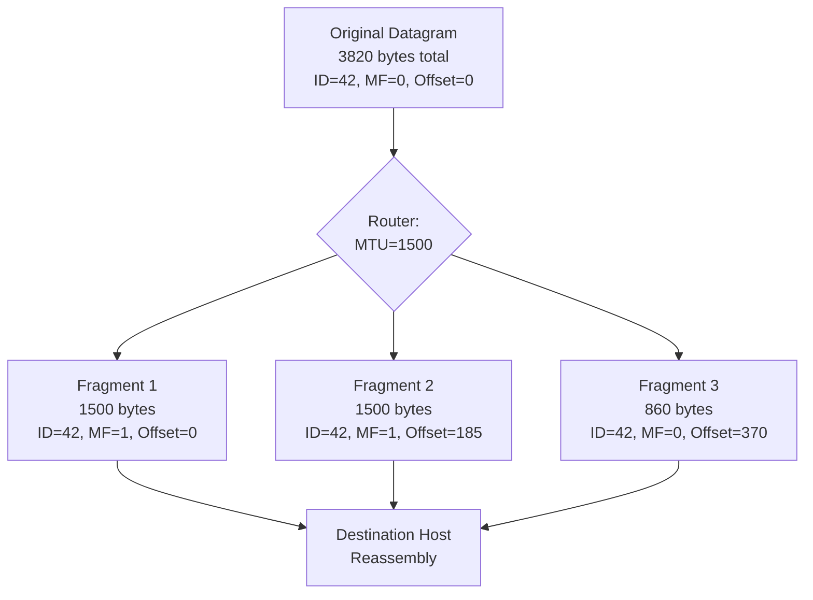

---
tags:
  - GATE/CS
  - GATE/Networks
  - IPv4
  - Fragmentation
aliases:
  - IP Fragmentation
  - IPv4 Fragmentation
date_created: 2025-09-02
difficulty: ⭐⭐⭐
last_revised: 2025-09-02
pyq_frequency: High
---

## Syllabus Position

Subject: [[Computer Networks]]
Parent Topic: [[Network Layer]]
Sibling Topics: [[IPv4 Addressing]], [[Subnetting]], [[CIDR]], [[NAT]]
Leads To: [[IPv6]], [[MTU Discovery]], [[TCP Segmentation]]

GATE Syllabus Line: "IPv4: Design of an IPv4 datagram; CIDR notation; Fragmentation in IPv4."

Exam Weight Note: Appears as 1-2 mark MCQs on fragmentation fields, offset calculations, and MTU constraints. Occasionally as 2-mark NAT for computing fragment counts or header sizes.

---

## The Problem This Solves

Imagine you're shipping a large painting through a courier service that only accepts packages up to 5kg. If your painting weighs 12kg, you can't send it whole—you must split it into smaller pieces, label each piece with its position in the original painting, and let the receiver reassemble it. That's exactly what happens when an IP packet is too large to traverse a network link with a smaller [[Maximum Transmission Unit|MTU]].

A router connecting a 1500-byte Ethernet LAN to a 576-byte dial-up link can't push the entire 1500-byte frame through. IPv4 solves this at the network layer by allowing the packet to be **fragmented** into smaller pieces, each carrying enough information for the destination host to reassemble them.

**Core Idea:** IPv4 fragmentation breaks an oversized datagram into smaller pieces that fit within the MTU of a bottleneck link, and reassembles them at the destination.

---

## Formal Theory

### What is Fragmentation?

**Fragmentation** is the process performed by a router (or the originating host) when an IPv4 datagram's total length exceeds the MTU of the outgoing link. The datagram is split into multiple smaller fragments, each an independent IP datagram with its own header.

Key distinction: fragmentation occurs at the **network layer** (Layer 3), not the transport layer. This is a fundamental design choice in [[IPv4]] that differs from [[TCP Segmentation]].

### IPv4 Header Fields Involved

The fragmentation process uses three fields in the IPv4 header:

1. **Identification (16 bits):** A unique identifier assigned by the sender to all fragments of a single datagram. All fragments of the same original packet share the same Identification value.

2. **Flags (3 bits):**
   - Bit 0: Reserved (must be 0)
   - Bit 1: **Don't Fragment (DF)** — if set to 1, the router must NOT fragment the packet. If fragmentation is required and DF=1, the router sends an [[ICMP]] "Fragmentation Needed" error back to the source.
   - Bit 2: **More Fragments (MF)** — set to 1 in all fragments except the last one. The last fragment has MF=0.

3. **Fragment Offset (13 bits):** Specifies the position of this fragment's data relative to the original datagram's data, measured in units of **8 bytes** (64 bits). This means every fragment's data (except possibly the last) must be a multiple of 8 bytes.

### How Fragmentation Works

```
Original Datagram: [IPv4 Header (20B) | Data (3800B)]
Total = 3820 bytes

Link MTU = 1500 bytes → Each fragment ≤ 1500 bytes (including header)

Fragment 1: [Header (20B) | Data (1480B)]  → Offset=0, MF=1
Fragment 2: [Header (20B) | Data (1480B)]  → Offset=185 (1480/8), MF=1
Fragment 3: [Header (20B) | Data (840B)]   → Offset=370 (2960/8), MF=0
```

### Reassembly

Reassembly happens **only at the destination host**, not at intermediate routers. This is a deliberate design decision — it reduces router processing overhead and allows fragments to take different paths through the network.

The destination uses:
- **Identification** to group fragments belonging to the same datagram
- **Fragment Offset** to place each fragment's data at the correct position
- **MF flag** to know when the last fragment has arrived

### Maximum Fragment Data Size

The maximum data in a fragment is constrained by:
- MTU of the link (typically 1500 bytes for Ethernet)
- Minus IPv4 header (20 bytes minimum)
- So maximum data per fragment = **1480 bytes** for standard Ethernet

### Number of Fragments Formula

For a datagram of total size $L$ bytes (including 20-byte header) and MTU $M$ bytes:

$$\text{Number of fragments} = \left\lceil \frac{L - 20}{M - 20} \right\rceil$$

### Fragment Offset Values

- First fragment: offset = 0
- Second fragment: offset = $\frac{M - 20}{8}$
- $n$-th fragment: offset = $\frac{(n-1) \times (M - 20)}{8}$

The last fragment has MF = 0; all others have MF = 1.

### What GATE Actually Tests Here

GATE focuses on: (1) computing the number of fragments given packet size and MTU, (2) identifying the Identification, MF, and Offset fields for a specific fragment, (3) understanding that reassembly happens only at the destination, and (4) the DF flag's role and ICMP error generation.

---

## Diagrams and Visuals

### IPv4 Header Fields for Fragmentation

```
 0                   1                   2                   3
 0 1 2 3 4 5 6 7 8 9 0 1 2 3 4 5 6 7 8 9 0 1 2 3 4 5 6 7 8 9 0 1
+-+-+-+-+-+-+-+-+-+-+-+-+-+-+-+-+-+-+-+-+-+-+-+-+-+-+-+-+-+-+-+-+
|Version|  IHL  |    DSCP   ECN |         Total Length          |
+-+-+-+-+-+-+-+-+-+-+-+-+-+-+-+-+-+-+-+-+-+-+-+-+-+-+-+-+-+-+-+-+
|         Identification        |Flags|    Fragment Offset      |
+-+-+-+-+-+-+-+-+-+-+-+-+-+-+-+-+-+-+-+-+-+-+-+-+-+-+-+-+-+-+-+-+
|  Time to Live |    Protocol   |       Header Checksum         |
+-+-+-+-+-+-+-+-+-+-+-+-+-+-+-+-+-+-+-+-+-+-+-+-+-+-+-+-+-+-+-+-+
|                       Source Address                          |
+-+-+-+-+-+-+-+-+-+-+-+-+-+-+-+-+-+-+-+-+-+-+-+-+-+-+-+-+-+-+-+-+
|                    Destination Address                        |
+-+-+-+-+-+-+-+-+-+-+-+-+-+-+-+-+-+-+-+-+-+-+-+-+-+-+-+-+-+-+-+-+
```

The fragmentation fields are highlighted in the Identification, Flags, and Fragment Offset rows.

### Fragmentation Process Diagram



### Fragment Offset Visualization

```
Original Data (3800 bytes):
|-------- 1480B --------|-------- 1480B --------|--- 840B ---|
0                      1480                    2960         3800

Fragment 1: offset=0     (byte 0 to 1479)
Fragment 2: offset=185   (byte 1480 to 2959) → 1480/8 = 185
Fragment 3: offset=370   (byte 2960 to 3799) → 2960/8 = 370
```

---

## Complexity Analysis

Fragmentation is not an algorithm per se, but a protocol mechanism. Its "complexity" is best understood in terms of overhead:

**Time Complexity:** Fragmentation at the router is $O(n)$ where $n$ is the number of fragments — each fragment requires copying header fields and slicing the data.

**Space Complexity:** Each fragment carries a full 20-byte header, so the total bytes transmitted increases:

$$\text{Total transmitted} = \text{Original size} + (\text{number of fragments} \times \text{header size})$$

For our example: original = 3820B, but transmitted = $1500 + 1500 + 860 = 3860$ bytes (40 extra bytes for the two additional headers).

**Reassembly Complexity:** The destination must buffer fragments until all arrive (or timeout). This is $O(n)$ per datagram for $n$ fragments.

| Aspect | Complexity | Notes |
|--------|-----------|-------|
| Fragmentation | $O(n)$ | $n$ = number of fragments |
| Reassembly | $O(n)$ | Buffer and sort fragments |
| Header Overhead | $+20B$ per fragment | Each fragment has full header |
| Bandwidth Waste | Increases with fragmentation | Redundant headers |

---

## Worked Example

**Problem:** A 4000-byte IPv4 datagram (20B header + 3980B data) arrives at a router. The outgoing link has MTU = 1500 bytes. Determine the number of fragments and their header fields.

**Step 1: Compute number of fragments**

$$\text{Fragments} = \left\lceil \frac{4000 - 20}{1500 - 20} \right\rceil = \left\lceil \frac{3980}{1480} \right\rceil = \left\lceil 2.689 \right\rceil = 3$$

**Step 2: Determine data in each fragment**

| Fragment | Data Size | Cumulative Data |
|----------|-----------|-----------------|
| 1 | 1480 bytes | 0–1479 |
| 2 | 1480 bytes | 1480–2959 |
| 3 | 1020 bytes | 2960–3979 |

**Step 3: Compute header fields**

Assume original Identification = 0x7A3F, DF = 0, TTL = 64, Protocol = 6 (TCP).

| Field | Fragment 1 | Fragment 2 | Fragment 3 |
|-------|------------|------------|------------|
| Total Length | 1500 | 1500 | 1040 |
| Identification | 0x7A3F | 0x7A3F | 0x7A3F |
| MF | 1 | 1 | 0 |
| Fragment Offset | 0 | 185 | 370 |
| TTL | 64 | 64 | 64 |
| Protocol | 6 | 6 | 6 |

**Step 4: Verify offset calculations**

- Fragment 1: offset = 0 (starts at byte 0)
- Fragment 2: offset = 1480/8 = 185 (starts at byte 1480)
- Fragment 3: offset = 2960/8 = 370 (starts at byte 2960)

**Total bytes transmitted:** 1500 + 1500 + 1040 = 4040 bytes (40 bytes overhead from extra headers).

**What if the original packet had DF=1?** The router would reject fragmentation, send an ICMP Type 3 Code 4 message to the source, and drop the packet.

---

## Intuition Anchors

**The Analogy (extended):** Think of fragmentation like splitting a long novel into chapters for a courier who can only carry 20 pages at a time. Each chapter (fragment) gets a cover page (header) with: the novel's ID number (Identification), whether there are more chapters coming (MF flag), and which page number of the original novel this chapter starts at (Fragment Offset, in units of 8 pages). The recipient collects all chapters and reassembles them using the page numbers.

**The Mental Model:** When you see "fragmentation" on GATE, immediately visualize: original packet → router with smaller MTU → multiple smaller packets → destination reassembly. Track three numbers: total size, MTU, and how many 8-byte-aligned chunks the data splits into.

**The One-Line Recall:** IPv4 fragmentation splits oversized datagrams at routers using Identification (same for all fragments), MF flag (1 for all but last), and Fragment Offset (in 8-byte units); reassembly happens only at the destination.

**The #1 Trap:** Students confuse **fragment offset units** with bytes. The offset is measured in **8-byte blocks**, not individual bytes. If a fragment starts at byte 1480, the offset is 1480/8 = 185, not 1480. GATE loves testing this.

---

## GATE Questions

### Question 1 — PYQ: GATE 2016 — 1-mark MCQ

> An IPv4 packet has a 20-byte header and a total length of 1000 bytes. It arrives at a link with MTU 500 bytes. What is the offset field value (in decimal) of the second fragment?

- (A) 0
- (B) 60
- (C) 120
- (D) 600

<details>
<summary>Solution</summary>

**Answer: (C) 120**

**Reasoning:**
- Original packet: 1000 bytes total → 980 bytes data
- MTU = 500 → max data per fragment = 480 bytes
- Fragment 1: data = 480 bytes (offset = 0, MF = 1)
- Fragment 2: data = 500 bytes (offset = 480/8 = 60, MF = 0)

Wait — let me recalculate: 980 data bytes / 480 per fragment = 2.04 → 3 fragments.

- Fragment 1: 480 bytes data, offset = 0
- Fragment 2: 480 bytes data, offset = 480/8 = 60
- Fragment 3: 20 bytes data, offset = 960/8 = 120

Actually the second fragment's offset is 60. But the options show 120 as (C). Let me re-read the question: "second fragment" — that would be offset = 60, which is option (B).

**Answer: (B) 60**

**Reasoning:**
- Data = 1000 - 20 = 980 bytes
- MTU = 500 → max data per fragment = 500 - 20 = 480 bytes
- Fragment 1: 480 bytes data, offset = 0/8 = 0, MF = 1
- Fragment 2: 480 bytes data, offset = 480/8 = 60, MF = 1
- Fragment 3: 20 bytes data, offset = 960/8 = 120, MF = 0

The second fragment has offset = 60.

**What this question is really testing:** Whether you remember that fragment offset is in 8-byte units, not bytes.

**Trap to avoid:** Dividing by 1 instead of 8, which would give offset = 480 (not an option, but a common mental error).

</details>

---

### Question 2 — Conceptual: Fragment Count

> A 5000-byte IP datagram (including 20-byte header) needs to be fragmented on a link with MTU 1500 bytes. How many fragments are produced?

- (A) 3
- (B) 4
- (C) 5
- (D) 6

<details>
<summary>Solution</summary>

**Answer: (B) 4**

**Reasoning:**
- Data = 5000 - 20 = 4980 bytes
- Max data per fragment = 1500 - 20 = 1480 bytes
- Fragments = ⌈4980/1480⌉ = ⌈3.36⌉ = 4

**What this question is really testing:** The formula ⌈(L - header) / (MTU - header)⌉ and the fact that you must subtract the header from both the total length and the MTU.

**Trap to avoid:** Computing ⌈5000/1500⌉ = 4 (correct by coincidence) or ⌈5000/1480⌉ = 4 (wrong formula). Always subtract headers first.

</details>

---

### Question 3 — Hard: Fragment Reassembly

> An IPv4 datagram is fragmented into 3 fragments. The original datagram had Identification = 1234, Total Length = 3000 (including 20-byte header). The MTU of the bottleneck link is 1000 bytes. A router along the path reorders the fragments as they arrive. At the destination, the fragments arrive in this order: Fragment 3, Fragment 1, Fragment 2. What are the values of MF, Offset, and Identification for each arriving fragment?

<details>
<summary>Solution</summary>

**Answer:**

| Fragment | Identification | MF | Offset | Total Length |
|----------|---------------|----|---------|--------------|
| Fragment 3 (last) | 1234 | 0 | 245 | 560 |
| Fragment 1 (first) | 1234 | 1 | 0 | 1000 |
| Fragment 2 (middle) | 1234 | 1 | 120 | 1000 |

**Reasoning:**
- Data = 3000 - 20 = 2980 bytes
- Max data per fragment = 1000 - 20 = 980 bytes
- Fragment 1: 980 bytes data, offset = 0, MF = 1, Total = 1000
- Fragment 2: 980 bytes data, offset = 980/8 = 122.5 → must be multiple of 8, so 980 bytes → 980/8 = 122.5 is not integer.

Wait — 980 is not divisible by 8! Let me reconsider. The fragment data must be a multiple of 8 for all fragments except the last.

- Max data per fragment (multiple of 8) = ⌊980/8⌋ × 8 = 122 × 8 = 976 bytes
- Fragment 1: 976 bytes data, offset = 0, MF = 1
- Fragment 2: 976 bytes data, offset = 976/8 = 122, MF = 1
- Fragment 3: 2980 - 976 - 976 = 1028 bytes data, offset = 1952/8 = 244, MF = 0

Actually, re-reading the problem: MTU = 1000, so max fragment size = 1000 bytes total. Data = 980 bytes. Since 980/8 = 122.5, the maximum data per fragment that is a multiple of 8 is 976 bytes (122 × 8).

But the problem states 3 fragments with total data 2980. If each of first two fragments carries 976 bytes, that's 1952 bytes, leaving 1028 for fragment 3. Total = 976 + 976 + 1028 = 2980. ✓

**Revised table:**

| Fragment | ID | MF | Offset | Data | Total Length |
|----------|-----|----|---------|------|--------------|
| 1 | 1234 | 1 | 0 | 976 | 996 |
| 2 | 1234 | 1 | 122 | 976 | 996 |
| 3 | 1234 | 0 | 244 | 1028 | 1048 |

The fragments arrive out of order, but the destination uses Identification to group them and Offset to reassemble.

**What this question is really testing:** The 8-byte alignment constraint on fragment data, and that reassembly uses Identification + Offset regardless of arrival order.

**Trap to avoid:** Assuming each fragment can carry exactly 980 bytes without checking divisibility by 8.

</details>

---

### Question 4 — PYQ-style: DF Flag

> A router receives an IPv4 packet of 5000 bytes (including header) on a link with MTU 1500 bytes. The DF flag is set. What does the router do?

- (A) Fragments the packet and forwards all fragments
- (B) Drops the packet and sends ICMP "Fragmentation Needed" to the source
- (C) Drops the packet silently
- (D) Reassembles the packet before forwarding

<details>
<summary>Solution</summary>

**Answer: (B)**

**Reasoning:**
The DF (Don't Fragment) flag, when set to 1, tells the router: do not fragment this packet. If the packet is too large for the outgoing link's MTU, the router must drop it and send an ICMP Type 3 (Destination Unreachable), Code 4 (Fragmentation Needed) message back to the source. This is the mechanism behind [[Path MTU Discovery]].

**What this question is really testing:** The purpose of the DF flag and the ICMP error mechanism.

**Trap to avoid:** Thinking DF=1 means the packet is forwarded without changes — it's dropped if fragmentation is needed.

</details>

---

**Pattern Recognition:**
- When given a packet size and MTU, immediately compute ⌈(L-20)/(MTU-20)⌉ for fragment count.
- If the question asks about a specific fragment's offset, compute (cumulative data before this fragment) / 8.
- Questions about DF flag always involve ICMP "Fragmentation Needed" — this is the only error message directly tied to fragmentation.
- Remember: fragment offset is in **8-byte units**, not bytes.

---

## Edge Cases and Failure Modes

- [ ] **Data not divisible by 8:** The last fragment can have data that is not a multiple of 8. All other fragments must have data that is a multiple of 8. If you forget this, offset calculations will be wrong.
- [ ] **Minimum fragment size:** Each fragment must contain at least 8 bytes of data (the minimum offset increment), except when the original data is very small.
- [ ] **Fragment of a fragment:** IPv4 does not support fragmentation of fragments. If a fragment is still too large for a subsequent link, it must be fragmented again — but this means re-fragmenting with new Identification, MF, and Offset values.
- [ ] **MTU = 576 bytes:** The minimum MTU guaranteed by IPv4 is 576 bytes. Many legacy systems assume this.
- [ ] **Reassembly timeout:** The destination waits a limited time for all fragments. If some are lost, the entire datagram is discarded — partial reassembly is not delivered.
- [ ] **Fragment overlap attacks:** Malicious overlapping fragments can exploit reassembly bugs (Teardrop attack). This is why modern systems validate fragment offsets.
- [ ] **Total length field overflow:** The 16-bit Total Length field limits IPv4 datagrams to 65535 bytes. With fragmentation, the original data can be up to 65535 - 20 = 65515 bytes.

---

## Comparisons

| Feature | IPv4 Fragmentation | TCP Segmentation | IPv6 (no fragmentation) |
|---------|-------------------|------------------|------------------------|
| Layer | Network (Layer 3) | Transport (Layer 4) | Network (Layer 3) |
| Who fragments | Routers (or source) | Sender only | Sender only (via PMTUD) |
| Reassembly | Destination only | Receiver (TCP) | Destination only |
| Overhead | Full header per fragment | TCP header per segment | Jumbogram option |
| Identification | 16-bit IP ID | TCP Sequence Number | 32-bit Flow Label |
| DF flag | Optional | N/A | Always (no in-network frag) |
| GATE Trap | Offset in 8-byte units | MSS vs MTU confusion | Assumes IPv6 has fragmentation |

**The most common GATE question comparing these** asks about the difference between where fragmentation happens (routers vs. endpoints) and who performs reassembly. The answer hinges on the layer: IPv4 can fragment at routers, TCP always segments at the sender.

---

## Connections Web

**Must know before this topic:**
- [[IPv4 Header]] — the header format where fragmentation fields live
- [[Maximum Transmission Unit|MTU]] — the constraint that forces fragmentation
- [[ICMP]] — used to signal "Fragmentation Needed" errors

**Topics that build on this:**
- [[Path MTU Discovery]] — uses DF flag to find the smallest MTU along a path
- [[IPv6]] — eliminated in-network fragmentation entirely
- [[TCP Segmentation]] — transport-layer equivalent, done only at endpoints

**GATE subject cross-links:**
- [[Computer Networks]] > [[Network Layer]] > [[IPv4]]

**Cross-subject connections:**
- [[OS]] — fragmentation is analogous to memory fragmentation (both involve splitting units)
- [[COA]] — MTU relates to bus width and data path constraints

**Standard references:**
- [[Forouzan Chapter 19]] — IP Datagram Fragmentation
- [[Kurose & Ross Chapter 4]] — Network Layer: IPv4
- [[RFC 791]] — Internet Protocol (original IPv4 specification)

---

## Quick Revision Sheet

**Definition (1 sentence):** IPv4 fragmentation splits an oversized datagram into smaller pieces at routers (or source) when the MTU is too small, using Identification, MF flag, and Fragment Offset fields.

**Core Idea / Analogy (1 sentence):** Like splitting a long novel into chapters for a courier with a page limit — each chapter gets a cover page with the novel's ID, whether more chapters follow, and which page of the original it starts at.

**Algorithm Steps:**
1. Check if packet length > MTU of outgoing link
2. If DF=1, drop and send ICMP "Fragmentation Needed"
3. Compute max data per fragment (multiple of 8, ≤ MTU - 20)
4. Slice original data into chunks; copy header to each fragment
5. Set MF=1 for all fragments except last; set offset = (cumulative data before this fragment) / 8
6. Forward fragments independently

**Complexity:**
- Fragmentation: O(n) time, O(n) space for n fragments
- Reassembly: O(n) time, O(L) buffer for original data
- Overhead: +20 bytes per extra fragment

**Key Properties:**
- Reassembly happens only at the destination, not at routers
- Fragment offset is in units of **8 bytes**, not bytes
- All fragments share the same Identification value
- DF=1 forces ICMP error instead of fragmentation
- Last fragment has MF=0; all others have MF=1

**The #1 Trap:** Confusing fragment offset units — remember, divide cumulative byte position by 8.

**When to use this over alternatives:** IPv4 fragmentation is a fallback; [[Path MTU Discovery]] with DF=1 is preferred in modern networks.

**Mnemonic:** **I-M-O** — **I**dentification (same for all), **M**ore Fragments (1 except last), **O**ffset (in 8-byte blocks).

---

## Revision Checklist

- [ ] I can state the formal definition of IPv4 fragmentation without looking.
- [ ] I can explain the analogy and map it to the protocol fields.
- [ ] I can compute the number of fragments given packet size and MTU.
- [ ] I can calculate the Fragment Offset for any fragment.
- [ ] I know what the Quick Revision Sheet says without reading it.
- [ ] I can solve all 4 GATE questions in this note without peeking.
- [ ] I know the #1 trap (8-byte offset units) and can articulate why students fall for it.
- [ ] I have linked this note correctly in my Obsidian vault.
- [ ] I have scheduled a spaced-repetition review in 3 days.