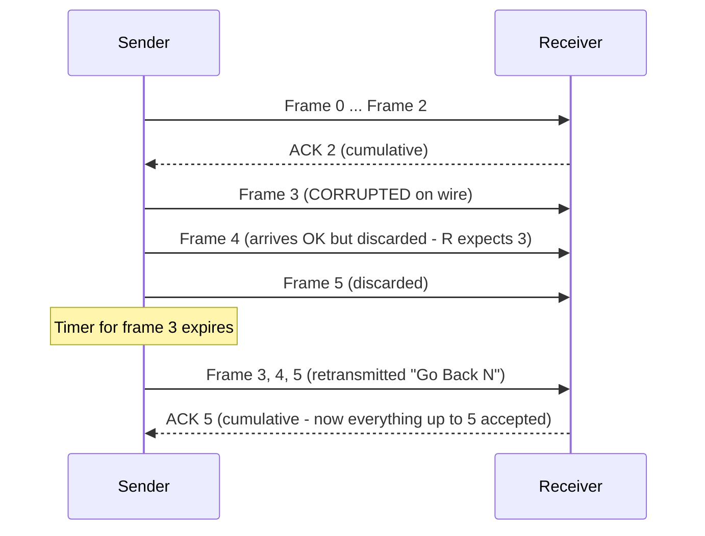

---
tags:
  - GATE/CS
  - GATE/Networks
  - SlidingWindow
aliases:
  - Go-Back-N
  - Go Back N
  - GBN
  - Go-Back-N ARQ
  - GBN ARQ
  - Go-Back-N Protocol
date_created: 2026-08-30
difficulty: ⭐⭐⭐⭐
last_revised: 2026-08-30
pyq_frequency: High
---

## Syllabus Position

Subject: [[Computer Networks Index]]
Parent Topic: [[Data Link Layer Index]]
Sibling Topics: [[Stop and Wait Protocol]], [[Selective Repeat ARQ]], [[Sliding Window Protocol]], [[Efficiency of Protocols]]
Leads To: [[TCP Congestion Control]], [[Bandwidth-Delay Product]], [[Pipelining]]

GATE Syllabus Line: "Data link layer protocols: Stop-and-Wait, **Gliding/sliding window, Go-Back-N, Selective Repeat**... Flow control."

Exam Weight Note: Appears almost every year — 1-mark MCQ on the sequence-number bound $W \leq 2^n - 1$ (why GBN needs **one less** than $2^n$ window) and 2-mark NAT computing utilization $\eta = W/(1+2a)$, minimum window size for 100% utilization, or counting exactly how many frames get retransmitted after a loss. Know the "discard everything after the error" rule cold — it drives every trap.

---

## The Problem This Solves

[[Stop and Wait Protocol]] fixed reliability but left the link idle most of the time: it puts exactly **one frame** on the wire and refuses to release the next until the ACK returns. On a satellite link with 270 ms one-way delay, the sender transmits for a millisecond and then stares at an empty line for half a second. The problem: **how do we keep many frames in flight so the pipe stays full, while still recovering cleanly when one is lost?**

Think of a cargo train. Stop-and-wait is a one-car train that won't leave the station until the previous car's receipt comes back — so the track sits mostly empty. Go-Back-N is a full train of $W$ cars that rolls out together. The catch: if the shipper discovers car 3 was wrecked in transit, he doesn't just send a new car 3 — he **recalls the entire train from car 3 onward** and re-sends the whole tail, even the cars that were perfectly fine. That looks wasteful, but it makes the receiver's job trivially simple: it keeps no spare buffers and just throws away anything out of order.

Core Idea (one sentence): **Go-Back-N keeps up to $W$ frames in flight; when any frame is lost or corrupted, the sender "goes back" and retransmits that frame and every frame that followed it.**

---

## Formal Theory

**[[Go-Back-N Protocol]]** is a [[Sliding Window Protocol|sliding window]] [[Automatic Repeat Request|ARQ]] scheme with sender window size $W$ and **receiver window size exactly 1**. The sender transmits up to $W$ frames back-to-back without waiting for individual ACKs; the receiver accepts frames **only in order**. Any out-of-order frame is **silently discarded** (no buffering), and the receiver keeps sending the [[Cumulative Acknowledgement|cumulative ACK]] of the last correctly received frame.

### Sender Side Logic
```
Algorithm GBN_SENDER:      # window size W
    send(W frames)         # fill window: frames base ... base+W-1
    while (base < next_frame_to_send):
        if (ACK(base) received):   # cumulative: also ACKs base+1, ...
            base = ACKed_seq_no + 1
        if (timer for base expires):
            retransmit(base)       # AND every frame with seq in [base, base+W)
            restart_timer()
```

### Receiver Side Logic
```
Algorithm GBN_RECEIVER:    # window size 1, expects seq E
    while (true):
        frame = receive()
        if (frame.seq == E and checksum valid):
            deliver(frame)
            send(ACK(E))
            E = (E + 1) mod 2^n
        else:                        # wrong seq: discarded! No buffering
            discard(frame)
            send(ACK(E - 1))         # re-confirm last good frame (cumulative)
```

### The Three Rules That Define GBN
1. **Receiver window = 1, in-order delivery, zero buffers.** Any frame arriving out of order is thrown away even if it's valid. This is the *defining* difference from [[Selective Repeat ARQ]], which buffers out-of-order frames.
2. **Cumulative ACK.** $\text{ACK}(k)$ means *"I received everything up to and including $k$."* One ACK can acknowledge an entire window — this is why GBN tolerates lost ACKs so well.
3. **Retransmit from the point of failure.** On timeout, the sender re-sends the timed-out frame **and all $W-1$ frames after it** ($W$ frames total when the window is full).

### Important Formulas — THE Master Box

Define: frame size $L$ (bits), bandwidth $B$ (bps), one-way propagation delay $T_{prop}$, and the **propagation-to-transmission ratio**:

$$T_{trans} = \frac{L}{B}, \qquad a = \frac{T_{prop}}{T_{trans}} = \frac{T_{prop} \cdot B}{L}$$

**F1 — Utilization (no errors):**
$$\eta = \begin{cases} \dfrac{W}{1 + 2a} = \dfrac{W \cdot T_{trans}}{T_{trans} + 2T_{prop}}, & W < 1 + 2a \\[1.2em] 1, & W \geq 1 + 2a \end{cases}$$
Equivalently, $\boxed{\eta = \min\left(1,\; \dfrac{W \cdot T_{trans}}{T_{trans} + 2T_{prop}}\right)}$.

**F2 — Minimum window for 100% utilization (fill the pipe):**
$$\boxed{W_{min} = \left\lceil 1 + 2a \right\rceil = \left\lceil \frac{T_{trans} + 2T_{prop}}{T_{trans}} \right\rceil}$$

**F3 — Throughput:** $$\text{Throughput} = \eta \cdot B$$

**F4 — Sequence-number bits (GBN):**  window + receiver-window $\leq 2^n$, and receiver window $= 1$:
$$W + 1 \leq 2^n \;\Rightarrow\; \boxed{W \leq 2^n - 1}, \qquad n = \lceil \log_2(W+1) \rceil$$
Contrast: [[Selective Repeat ARQ]] needs $2W \leq 2^n \Rightarrow W \leq 2^{n-1}$, because *both* sides buffer $W$ frames.

**F5 — Pipe-fill in bits:** the [[Bandwidth-Delay Product]] is $B \times \text{RTT} = 2BT_{prop}$ bits. GBN keeps the pipe full iff
$$W \cdot L \;\geq\; 2BT_{prop} \;\iff\; W \geq \frac{2BT_{prop}}{L} \;(\approx W_{min})$$

**F6 — Total time to ship $M$ frames (window not full, $W < 1+2a$):**
$$T_{total} \approx \frac{M}{W} \cdot (T_{trans} + 2T_{prop})$$
Each window of $W$ frames consumes roughly one cycle $T_{trans} + 2T_{prop}$. Sanity check: Time = Data/Utilization $\Rightarrow M \cdot T_{trans} / \eta = M(T_{trans}+2T_{prop})/W$. ✓

**F7 — Frame error probability $p$ (first-order, full-pipeline regime):**
GBN waste is brutal under errors: each failure resends up to $W$ frames, so
$$\eta_{GBN} \approx \eta \cdot \frac{1-p}{1+(W-1)p}$$
For $W = 1$ this correctly degenerates to the stop-and-wait result $(1-p)/(1+2a)$. [[Selective Repeat ARQ]] only pays for the one bad frame: $\eta_{SR} \approx \eta (1-p)$. **GATE caveat:** the exact GBN-with-errors analysis is regime-dependent and rarely asked; what GATE *does* ask is F1–F4 and retransmission counts.

### Retransmission Counting — The Rule
If the window is full and frame $k$ is corrupted, the sender retransmits **from $k$ inclusive onward — exactly $W$ frames**. With [[Selective Repeat ARQ]], only frame $k$ itself is retransmitted.

**What GATE actually tests here:** (1) F1–F3 utilization/throughput numbers, (2) F4 seq-bit bounds with the "$2^n - 1$ not $2^n$" trap, (3) F6 total transfer time, and (4) counting retransmissions — always via the "receiver discards everything after the error" property.

---

## Diagrams and Visuals

**Visual 1: Sliding window state (sender & receiver)**

```
SENDER window:         [3][4][5][6][7][8][9]          <- W = 7
                       ^base  frames in flight
RECEIVER window:             [6]                      <- size 1, expects seq 6 only
Buffers:      (none — anything that isn't the expected seq is thrown away)
```

**Visual 2: Timeline showing error at frame 3 and "Go Back"**

```
Sender:  0 1 2 3 4 5 6  |  7 8 9  (window slides on ACK0,1,2)
Receiver:        ✗Xc     |           <- frame 3 corrupted
Tokens on wire past 3: 4 5 6 7 8 9  (all received LATE and DISCARDED)
Timeout on 3  -->  retransmit 3 4 5 6 7 8 9     (Go Back W = 7 frames)
```

**Visual 3: Mermaid sequence diagram (lost frame → resend tail)**



---

## Complexity Analysis

Go-Back-N is a protocol, not a computational algorithm, so we analyze **utilization, buffer cost, and error behavior** instead of Big-O.

**Step 1 — Utilization (the derivation).** Time to transmit one frame: $T_{trans}$. Time from starting frame $k$ to the ACK enabling the next window: $T_{trans} + 2T_{prop}$. Without pipelining gaps, the best the sender can do with a window of $W$ frames is:
$$\eta = \frac{\text{useful transmit time}}{\text{total owne time}} = \frac{W \cdot T_{trans}}{T_{trans} + 2T_{prop}}$$
**Justification:** over one cycle the sender transmits $W$ frames of $T_{trans}$ each; the cycle is dominated by the round-trip $2T_{prop}$. Because $\eta$ is a fraction, it can never exceed 1, hence the min with 1 in F1. When the window is large enough that $W \cdot T_{trans} \geq T_{trans} + 2T_{prop}$, each ACK arrives before the sender runs out of window space → utilization hits 100%.

**Step 2 — Space/buffer complexity.** Sender: $O(W)$ frames in the window (must hold them for possible retransmission). Receiver: $O(1)$ — a single buffer and a single expected sequence number. **GBN's entire design exists to buy receiver simplicity at the cost of retransmission waste.**

**Step 3 — Error behavior.** With frame-error probability $p$ and a full window, each failed frame triggers $W$ retransmissions, so wasted bandwidth grows linearly with $W$ (F7). Best case on errors: $p=0$, where only F1 applies.

### Complexity Summary Table

| Case               | Utilization $\eta$        | Retransmission Waste | Trigger Condition                                    |
|--------------------|---------------------------|----------------------|------------------------------------------------------|
| Best Case          | $1$                       | none                 | $W \geq 1+2a$ (window $\geq$ length of the pipe)     |
| Average Case       | $\dfrac{W}{1+2a}$         | $\approx W \cdot p$ per error | Moderate RTT, small loss probability          |
| Worst Case         | $\dfrac{W}{1+2a} \cdot \dfrac{1-p}{1+(W-1)p}$ | $W$ frames per error | Corrupted frame while window is full (satellite RTT) |

---

## Worked Example

**Setup:** Bandwidth $B = 1$ Mbps, frame size $L = 1000$ bits, one-way propagation $T_{prop} = 10$ ms, window $W = 7$.

**Step 1 — transmission delay & ratio:**
$$T_{trans} = \frac{1000}{10^6} = 1 \text{ ms}, \qquad a = \frac{T_{prop}}{T_{trans}} = 10, \qquad 1 + 2a = 21$$
Since $W = 7 < 21$, the pipe is **not** full by default.

**Step 2 — utilization (F1):**
$$\eta = \frac{W}{1+2a} = \frac{7}{21} = \frac{1}{3} \approx 33.3\%$$

**Step 3 — throughput (F3):** $\text{Throughput} = \frac{1}{3} \times 10^6 \approx 333{,}333$ bps.

**Step 4 — minimum window (F2):** $W_{min} = \lceil 21 \rceil = 21$ frames. Cross-check with the [[Bandwidth-Delay Product]]: pipe holds $2BT_{prop} = 2 \times 10^6 \times 0.01 = 20{,}000$ bits = 20 frames, so 21 frames (adding the +1) keeps it just full. ✓

**Step 5 — timeline trace (validates $\eta$):**

| Time (ms) | Event                                                                  |
|-----------|------------------------------------------------------------------------|
| 0–7       | Sender transmits frames 0,1,2,3,4,5,6 (window full at $t=7$)           |
| 10–16     | Receiver gets frames 0–6, returns ACKs                                 |
| 20        | ACK0 reaches sender → window slides, sender transmits frame 7          |
| 21–26     | Sender receives ACK1…ACK6, transmitting one new frame per ms (busy)    |
|           | Idle from $t=7$ to $t=20$ (13 ms) out of the first 21 ms               |

First cycle: 7 frames transmitted in a 21 ms cycle → exactly $\eta = 7/21$. After the first cycle the sender stays continuously busy; on a *long* run the utilization settles at $7/21$ because the pipeline startup is amortized away.

**Step 6 — failure trace (the counting rule in action):** Suppose frame 3 is corrupted.
- Receiver discards frames 4,5,6 (and any that arrive while expecting 3).
- ACKs for 0,1,2 arrive at $t = 20, 21, 22$ ms → window slides to $[3 \ldots 9]$.
- Timer on frame 3 fires → sender retransmits **frames 3,4,5,6,7,8,9 = exactly 7 frames** (the whole window, from the failed frame on). Frames 7,8,9 were never lost — they are duplicate transmissions, which is exactly the "go back" waste.

**Total operations: 6 computed quantities (3 formula evaluations, 1 cross-check, 1 timeline, 1 failure count). This confirms $\eta = W/(1+2a)$ and the rule "corrupted frame $k$ → resend $k$ through $k+W-1$."**

**What changes if the input has $T_{prop} = 1$ ms?** Then $a=1$, $1+2a = 3$, and $W=7 > 3$ → $\eta = 1$ (100%, capped). GATE's favorite "what-if": once $W$ exceeds the pipe length, *increasing the window further buys nothing* — utilization stays exactly 1.

---

## Intuition Anchors

**The Analogy (restated and deepened):** The cargo train returns. You fill the train with $W$ cars. If car 3 is found wrecked, the crew don't splice the train — they uncouple at car 3 and drag **every car from 3 to the caboose** back, then re-send that whole tail. It wastes the good cars, but the station clerk (receiver) never needs a side-yard to park cars out of order; he just waves cars through only when the number matches what he expects next. The longer the round-trip, the more cars you must pack per trip to keep the track busy — that's $W_{min} = \lceil 1 + 2a \rceil$.

**The Mental Model:** Picture a tape of sequence numbers sliding past a fixed window frame. The frame spans $W$ numbers; anything left of the frame is ACKed and forgotten. The **one thing** the receiver tracks is a single tick "I expect seq $E$." When you see a GBN problem, immediately draw the receiver as a lone dot on the number line — a dot that never moves backward and discards everything before its reach. That single mental picture answers every retransmission-count question.

**The One-Line Recall:** "GBN: window $W$ frames in flight; $\eta = \min(1, W/(1+2a))$; send $= W$ frames when frame $k$ fails; seq bits $n$ with $W \le 2^n - 1$."

**The #1 Trap:** **Students pick the window $= 2^n$ instead of $2^n - 1$.** It seems right because "$n$ bits give $2^n$ numbers, so use all of them." But the receiver window also uses sequence space: sender window $(W)$ + receiver window $(1)$ must fit in $2^n$, so $W \le 2^n - 1$. At $W = 2^n$, after all ACKs are lost and the sender retransmits its window, the receiver cannot tell the retransmission of frame 0 from a brand-new frame 0 — sequence space is exhausted.

---

## GATE Questions

---

**Question 1 — [PYQ: GATE 2009] — [2-mark MCQ]**

> In a sliding window ARQ scheme, the transmitter's window size is $N$ and the receiver's window size is $M$. The minimum number of distinct sequence numbers required to ensure correct operation of the ARQ scheme is:
>
> - (A) $M + N$
> - (B) $M \times N$
> - (C) $2^N + M$
> - (D) $N - M + 1$

<details>
<summary>Solution</summary>

**Answer: (A) $M + N$**

**Reasoning:** Correct operation requires that at any instant, the sender's outstanding window ($N$ frames) and the receiver's expected window ($M$ frames) can never overlap ambiguously — so their combined span must fit inside the sequence space, requiring at least $N + M$ distinct sequence numbers. For GBN specifically, $M = 1$, giving the familiar $W + 1 \leq 2^n \Rightarrow W \leq 2^n - 1$.

- (B) $M \times N$ overcounts — windows add, they don't multiply.
- (C) mixes a power with an offset; garbage.
- (D) $N - M + 1$ undercounts — for GBN ($M=1$) it gives only $N$, which we know allows ambiguity at $W = 2^n$.

**What this question is really testing:** The window-fits-in-sequence-space constraint, F4's parent.

**Trap to avoid:** Memorizing "$2^n - 1$" without its meaning. This question generalizes it to *any* receiver window: you need sender-window + receiver-window unique numbers.

</details>

---

**Question 2 — [GATE-style] — [2-mark NAT]**

> A Go-Back-N protocol with window size 8 is used over a link with bandwidth 1 Mbps and one-way propagation delay of 15 ms. Frame size is 2000 bits. What is the link utilization (as a percentage)?

<details>
<summary>Solution</summary>

**Answer: 50%**

**Reasoning:**
$$T_{trans} = \frac{2000}{10^6} = 2 \text{ ms}, \qquad a = \frac{15}{2} = 7.5, \qquad 1 + 2a = 16$$
$$W = 8 < 16 \Rightarrow \eta = \frac{W}{1+2a} = \frac{8}{16} = 0.5 = 50\%$$
Throughput (if asked) would be $0.5 \times 10^6 = 500$ kbps, and the minimum window for 100% utilization is $\lceil 16 \rceil = 16$ frames.

**What this question is really testing:** F1 cold — the window is *not* large enough to fill the pipe, so you must divide (not cap at 1).

**Trap to avoid:** Adding 1 to the window when comparing ($W=8$ vs $1+2a=16$), or computing $\eta = T_{trans}/(T_{trans}+2T_{prop}) = 2/32 = 6.25\%$ as if it were stop-and-wait. The window multiplies the numerator — that's the entire point of GBN.

</details>

---

**Question 3 — [Hard / Multi-concept] — [2-mark]**

> Consider a Go-Back-N protocol with sender window size 4. The sender transmits frames with sequence numbers $0,1,2,3,4,5$ and the frame with sequence number 2 is corrupted in transit. How many frames does the sender retransmit in total, and what is the minimum number of sequence-number bits needed for this window size? How does the answer change under Selective Repeat?

<details>
<summary>Solution</summary>

**Answer: GBN retransmits 4 frames; needs 3 sequence bits; SR would retransmit only 1.**

**Reasoning (count step by step):**
- After frame 2 is corrupted, the receiver discards frames 3,4,5 (out-of-order, no buffering).
- ACKs for 0,1 arrive, so the window slides; the sender's window at timeout holds 4 frames starting at the old base. The corrupted frame is the *oldest unacknowledged* one, so the retransmission set is the entire current window: **frames 2,3,4,5 = exactly $W = 4$ frames**.
- Under [[Selective Repeat ARQ]], the receiver buffered 3,4,5, so only frame 2 would be resent — 1 frame.
- Sequence bits: $W = 4 \Rightarrow n = \lceil \log_2(4+1) \rceil = \lceil 2.32 \rceil = 3$ bits (values $0\ldots7$, max window $2^3 - 1 = 7$). Two bits would give $2^2 - 1 = 3 < 4$ — insufficient.

**What this question is really testing:** The retransmission-counting rule (F6/W context) fused with F4. Two marks, two formulas, one scenario.

**Trap to avoid:** Counting only the corrupted frame (the SR answer) or the frames after it excluding the corrupted one (frames 3,4,5 = 3 frames). GBN re-sends **from the corrupted frame through the top of the current window**.

</details>

---

**Pattern Recognition:**
- "Maximum window size / minimum bits for GBN" → always $W \leq 2^n - 1$; never write $2^n$.
- Utilization questions give $(B, L, T_{prop}, W)$ → first compute $a = T_{prop} \cdot B/L$, then $\eta = \min(1, W/(1+2a))$. If $B$ and $L$ are absent but $T_{trans}$ is given, use it directly.
- "How many frames retransmitted after corruption of frame $k$" → count from $k$ to $k + W - 1$ for GBN, just $k$ for SR.
- Total-time questions ($M$ frames) → either $M \cdot T_{trans} + 2T_{prop}$ (window fills pipe) or $\frac{M}{W}(T_{trans}+2T_{prop})$ (window too small).
- GBN favours **large windows on clean links**; switch to SR on noisy links — the "when to prefer" sub-question appears as a paired choice.

---

## Edge Cases and Failure Modes

- [ ] **Window exactly $= 1$:** GBN degenerates to [[Stop and Wait Protocol]] — verify the formulas agree (F1: $\eta = 1/(1+2a)$, F4: $n = \lceil \log_2 2 \rceil = 1$ bit). A common "category" trap.
- [ ] **$W > 2^n - 1$:** Ambiguity: after total ACK loss, a retransmitted frame is indistinguishable from a new frame. Fix: cap $W$; never assume more window than seq space.
- [ ] **Window ≥ pipe length ($W \geq 1+2a$):** $\eta$ caps at 1; bigger windows help **nothing** (GATE "what-if"). Many students keep throttling throughput with the formula instead of clamping.
- [ ] **Corrupted ACK treated as lost:** a corrupted cumulative ACK forces a full-window resend under GBN — the exact reason GBN underperforms SR on lossy links.
- [ ] **Timer too short:** retransmissions fire while the original frames are still in flight → duplicate floods. Timer must exceed $T_{trans} + 2T_{prop}$ (round trip + transmission).
- [ ] **Lost ACK for the oldest frame but later ACKs fine:** the cumulative ACK covering it rescues the window — one ACK acknowledges all ≤ its number. GBN is *designed* for this, do not auto-resend.
- [ ] **Modulo wrap-around off-by-one:** sequence numbers are taken $\bmod 2^n$; after frame $2^n - 1$ comes frame 0. Tracing retransmissions across the wrap is the #1 tracing mistake.
- [ ] **Out-of-order receiver behavior:** GBN's receiver *discards* valid out-of-order frames. The fix is not "ask again" — it's silently re-ACKing the last good frame so the sender's cumulative view is refreshed.

---

## Comparisons

| Feature                | [[Go-Back-N Protocol]]     | [[Stop and Wait Protocol]]  | [[Selective Repeat ARQ]]    |
|------------------------|----------------------------|------------------------------|-----------------------------|
| Frames in flight       | Up to $W$                  | Exactly 1                    | Up to $W$                   |
| Receiver buffer        | None (size 1, discards)    | None                         | Buffers up to $W$           |
| Utilization (no error) | $\min(1, W/(1+2a))$        | $\dfrac{1}{1+2a}$            | $\min(1, W/(1+2a))$         |
| Retransmit on error    | $W$ frames from failure    | 1 frame                      | 1 frame only                |
| Max window ($n$ bits)  | $2^n - 1$                  | 1 ($n=1$)                    | $2^{n-1}$                   |
| Ordering                | Strictly in-order          | In-order                     | Reordered → buffered        |
| When to prefer          | Clean links, simple receiver | Tiny RTT, small data       | Noisy links, large BDP      |
| GATE Trap               | Using $2^n$ not $2^n-1$     | Forgetting $2T_{prop}$       | Confusing with GBN's discard |

The most common GATE comparison question presents a link with given $B$, $T_{prop}$, $L$ and asks *"which of GBN / SR / Stop-and-Wait should be used, and at what window size?"* — the hinge is **receiver buffering vs. pipe length**: GBN shines when the receiver must be cheap, SR wins whenever loss is non-negligible because GBN wastes $W$ transmissions per error, and Stop-and-Wait loses every match once the RTT dwarfs $T_{trans}$.

---

## Connections Web

**Must know before this topic:**
- [[Stop and Wait Protocol]] — GBN is its windowed generalization (W=1 collapses to it)
- [[Sliding Window Protocol]] — the window/slide mechanism GBN instantiates
- [[Transmission Delay]] — $T_{trans} = L/B$, the ratio denominator
- [[Propagation Delay]] — $T_{prop}$ that gets doubled for the round trip
- [[Round Trip Time]] — the $2T_{prop}$ cycle in every formula
- [[Automatic Repeat Request]] — timeout/retransmit machinery GBN uses

**Topics that build on this:**
- [[Selective Repeat ARQ]] — the buffered alternative (max window $2^{n-1}$)
- [[TCP Congestion Control]] — TCP's cumulative ACK + "fast retransmit" inherits GBN window semantics
- [[Pipelining]] — the reason windows exist at all
- [[Bandwidth-Delay Product]] — what the window must fill to hit 100%

**GATE subject cross-links:**
- [[Computer Networks Index]] > [[Data Link Layer Index]]
- [[Computer Networks Index]] > [[Transport Layer Index]]

**Cross-subject connections:**
- [[Cumulative Acknowledgement]] — the same concept drives TCP's window updates
- [[Sequence Number]] — comparing seq-bit budgets across [[Flow Control]] schemes
- [[Sliding Window Protocol]] ([[Routing Algorithms]]) — sliding-window ideas reappear in [[Nagel's Algorithm]] / congestion-window reasoning

**Standard references:**
- [[Kurose and Ross Chapter 3]] — reliable data transfer (rdt 3.0 → pipelined versions)
- [[Tanenbaum Chapter 3]] — data link ARQ and the source of the "go back N" name

---

## Quick Revision Sheet

**Definition (1 sentence):** Go-Back-N sends up to $W$ frames without waiting, and on any error retransmits the failed frame and every frame that followed it.

**Core Idea / Analogy (1 sentence):** Like recalling a cargo train from the damaged car to the caboose — wasteful, but the receiver needs no buffer at all.

**Algorithm Steps (numbered):**
1. Fill the window: send frames $base \ldots base+W-1$.
2. Receiver accepts **only in-order** frames; discards everything else, re-ACKs last good frame.
3. On ACK($k$), slide window past $k$ (cumulative).
4. On timeout of base, retransmit the whole window from base.
5. Repeat with a single timer per window base.

**Complexity (well-known numbers):**
- Utilization: $\eta = \min(1,\, W/(1+2a))$, with $a = T_{prop}/T_{trans} = T_{prop}B/L$.
- Space: sender $O(W)$, receiver $O(1)$.
- Min window for 100%: $W_{min} = \lceil 1+2a \rceil$; pipe bits: $B \cdot 2T_{prop}$.

**Key Properties:**
- Max window with $n$ seq bits: $W \leq 2^n - 1$ (sender + receiver window ≤ $2^n$).
- One error while the window is full ⇒ exactly $W$ frames retransmitted.
- Throughput $= \eta \cdot B$; total time for $M$ frames $\approx \frac{M}{W}(T_{trans}+2T_{prop})$ (or $MT_{trans} + 2T_{prop}$ if pipe full).
- With error prob $p$: $\eta \approx \eta(1-p)/\big(1+(W-1)p\big)$.

**The #1 Trap:** Writing $2^n$ for the max GBN window instead of $2^n - 1$ — the receiver's window occupies one slot of sequence space.

**When to use this over alternatives:** Clean links + a receiver you want to keep dead-simple; noisy links demand [[Selective Repeat ARQ]].

**Mnemonic:** "**G**o **B**ack **N** — resend the whole **N**eighborhood." And $\eta = \min(1, W/(1+2a))$: "**W**indow over one-plus-**tw**o-ay, never over one."

---

## Revision Checklist

- [ ] I can state the formal definition without looking.
- [ ] I can explain the cargo-train analogy and map it to the sliding window and retransmission count.
- [ ] I can trace a W=7 example with one corrupted frame by hand in under 2 minutes, counting retransmissions.
- [ ] I can derive $\eta = \min(1, W/(1+2a))$ and $W_{min} = \lceil 1+2a \rceil$ from scratch.
- [ ] I know why the max window is $2^n - 1$ (not $2^n$) and can prove it.
- [ ] I know what the Quick Revision Sheet says without reading it.
- [ ] I can solve all 3 GATE questions in this note without peeking.
- [ ] I know the #1 trap (the missing minus-one) and can articulate why students fall for it.
- [ ] I have linked this note correctly in my Obsidian vault ([[Stop and Wait Protocol]], [[Selective Repeat ARQ]], [[Sliding Window Protocol]]).
- [ ] I have scheduled a spaced-repetition review in 3 days.

---

*Follow-up topic to create next: [[Selective Repeat ARQ]] — same window, half the seq space, full receiver buffering.*