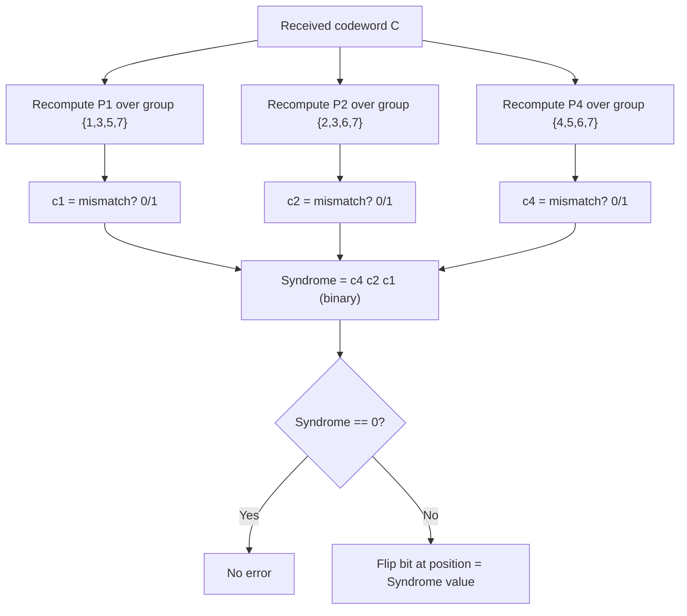

---
tags:
  - GATE/CS
  - GATE/Networks
  - ErrorCorrection
aliases:
  - Hamming Distance Code
  - Single Error Correction Code
  - SEC-DED
date_created: 2026-08-26
difficulty: ⭐⭐⭐⭐
last_revised: 2026-08-26
pyq_frequency: High
---

## Syllabus Position

Subject: [[Computer Networks Index]]
Parent Topic: [[Error Detection and Correction]]
Sibling Topics: [[CRC Analysis, Characteristics of Generator Function]], [[Checksum]], [[Parity Bit]]
Leads To: [[SEC-DED Codes]], [[Reed-Solomon Codes]], [[Convolutional Codes]]

GATE Syllabus Line: "Data Link Layer: framing, error detection" — under Computer Networks, GATE CS syllabus (Hamming Code also crosses into COA for memory error correction).

Exam Weight Note: Hamming Code appears almost every year, most commonly as a 2-mark NAT/MCQ asking you to compute the minimum number of check bits for a given data length, to construct the encoded codeword, or to detect-and-correct a single-bit error given a received codeword.

---

## The Problem This Solves

CRC is great at *detecting* that something went wrong, but it can't tell you *which* bit flipped — so the receiver has to ask the sender to retransmit the whole message. That's fine over a network, but what about inside RAM chips, deep-space probes, or satellite links where retransmission is expensive, slow, or impossible? You need a code that doesn't just scream "error!" — it needs to say "error at position 5, please flip it back."

**Core Idea (one sentence):** Hamming Code sprinkles carefully-positioned parity bits throughout the message so that if exactly one bit flips, the pattern of parity failures (read as a binary number) directly points to the exact position of the faulty bit.

**Analogy:** Imagine a group of detectives (the parity bits), each covering a different, overlapping subset of suspects (data bit positions) using powers-of-2 spacing. When a crime (bit flip) happens, each detective who was "watching" that suspect reports "something's off in my group." Combine only the detectives who report a problem, read their ID numbers as a binary address, and you get the exact suspect's identity — no need to interrogate everyone.

---

## Formal Theory

**Hamming Code** is a linear error-correcting code that places $r$ **parity bits** at positions that are powers of 2 ($1, 2, 4, 8, \dots$) within a codeword of total length $n = k + r$, where $k$ is the number of data bits. Each parity bit checks a specific, overlapping subset of positions determined by its binary index.

### The Hamming Bound (finding $r$)

To correct any single-bit error in a codeword of $k$ data bits plus $r$ parity bits, the $r$ parity bits must be able to represent, in binary, **every possible single error position** (including the "no error" case). Since there are $n = k+r$ possible bit positions that *could* be wrong, plus 1 "no error" state, we need:

$$2^r \ge k + r + 1$$

This is the **[[Hamming Bound]]**. GATE always tests: given $k$, find the smallest $r$ satisfying this inequality.

### Bit Position Numbering

Positions are numbered starting from **1** (not 0). Any position that is a power of 2 ($1, 2, 4, 8, 16, \dots$) is a **[[Parity Bit]]**; all other positions hold **data bits**.

### Which Parity Bit Covers Which Position

Bit position $j$ (in binary) is checked by parity bit $P_i$ (at position $2^{i-1}$) if and only if the $i$-th bit (from the right, 0-indexed) of $j$'s binary representation is 1. Equivalently: parity bit at position $2^{i-1}$ covers all positions $j$ where bit $i$ of $j$'s binary form is set.

```
Algorithm HAMMING_ENCODE(D, k):
    r = smallest integer satisfying 2^r >= k + r + 1
    place data bits D into all non-power-of-2 positions of an (k+r)-bit codeword
    for each parity bit position p = 2^(i-1), i = 1..r:
        set P_i = XOR of all data bits at positions whose binary rep. has bit i set
    return the completed (k+r)-bit codeword
```

```
Algorithm HAMMING_DECODE(C, r):
    for each parity bit position p = 2^(i-1), i = 1..r:
        recompute parity over its covered group (including P_i itself)
        record 0 (match) or 1 (mismatch) as c_i
    error_position = binary number formed by (c_r c_{r-1} ... c_1)
    if error_position == 0:
        no error
    else:
        flip bit at 'error_position' -> corrected codeword
```

### Even vs. Odd Parity

Standard Hamming Code as above uses **even parity** (each group's total count of 1's, including the parity bit, is even). GATE occasionally asks the odd-parity variant — the mechanics are identical, just flip the target parity from 0 to 1.

### Extended Hamming Code (SEC-DED)

Adding **one overall parity bit** over the entire codeword extends single-error-correction to also **detect** (not correct) double-bit errors — this is the **[[SEC-DED Codes|SEC-DED (Single Error Correct, Double Error Detect)]]** variant, common in ECC RAM.

**What GATE actually tests here:** (a) computing minimum $r$ from the Hamming bound inequality, (b) constructing the codeword by placing data/parity bits and computing parity values, (c) given a received codeword, computing the syndrome (error position) and correcting it, (d) reasoning about SEC-DED with the extra overall parity bit.

---

## Diagrams and Visuals

**1. Codeword layout for $k=4$ data bits, $r=3$ parity bits (total $n=7$, the classic Hamming(7,4) code)**

```
Position:   1    2    3    4    5    6    7
Content:    P1   P2   D1   P4   D2   D3   D4
             ^    ^         ^
          (2^0) (2^1)     (2^2)
```

**2. Coverage groups (which parity bit checks which positions)**

```
P1 (pos 1) covers positions: 1, 3, 5, 7   (binary rep. has bit-0 set: 001, 011, 101, 111)
P2 (pos 2) covers positions: 2, 3, 6, 7   (bit-1 set:               010, 011, 110, 111)
P4 (pos 4) covers positions: 4, 5, 6, 7   (bit-2 set:               100, 101, 110, 111)
```

**3. Decoding / syndrome computation flow (Mermaid)**



**4. Venn-diagram style overlap (text approximation)** — draw three overlapping circles labeled P1, P2, P4; place data bits D1-D4 and parity bits P1,P2,P4 in the appropriate overlap regions exactly as the position table in visual 1 shows. This is the classic textbook image and is worth hand-drawing once.

---

## Complexity Analysis

Hamming Code operations are linear scans over fixed-size groups, so complexity is dominated by codeword length $n = k+r$.

- **Encoding time:** For each of the $r$ parity bits, XOR over roughly $n/2$ covered positions — overall $O(r \cdot n) = O(n \log n)$ since $r = O(\log n)$ (from the Hamming bound, $r$ grows logarithmically with $k$).
- **Decoding time:** Same as encoding — recompute $r$ parity checks, each over $O(n)$ bits — $O(n \log n)$.
- **Space:** $O(n)$ to hold the codeword; $O(r) = O(\log n)$ for the syndrome.
- **Redundancy overhead:** $r$ grows as $O(\log k)$ — this is why Hamming Code is efficient: correcting a single error costs only logarithmically many extra bits, not a linear duplication (like simple repetition codes would need).

| Case | Time Complexity | Space Complexity | Trigger Condition |
|---|---|---|---|
| Encoding | $O(n \log n)$ | $O(n)$ | Always — proportional to codeword length and $\log$ parity groups |
| Decoding (no error) | $O(n \log n)$ | $O(\log n)$ syndrome | Syndrome evaluates to 0 |
| Decoding (single-bit error) | $O(n \log n)$ | $O(\log n)$ syndrome | Syndrome is nonzero and $\le n$ — corrects in place |
| Decoding (double-bit error, plain Hamming) | $O(n \log n)$ | $O(\log n)$ | Syndrome nonzero but points to WRONG position — miscorrects silently! |

---

## Worked Example

**Given:** 4 data bits $D = 1011$ (i.e., $D_1 D_2 D_3 D_4 = 1,0,1,1$), using Hamming(7,4).

**Step 1 — Find $r$:** Need $2^r \ge k+r+1 = 4+r+1$. Try $r=3$: $2^3=8 \ge 4+3+1=8$. ✓ So $r=3$ (positions 1,2,4 are parity).

**Step 2 — Place data bits into non-power-of-2 positions:**

```
Position: 1    2    3    4    5    6    7
Content:  P1   P2   D1=1 P4   D2=0 D3=1 D4=1
```

**Step 3 — Compute each parity bit (even parity — total 1's in group including parity bit must be even):**

- $P1$ covers {1,3,5,7} = {P1, 1, 0, 1}. Sum of known data bits (3,5,7) = 1+0+1 = 2 (even) → $P1 = 0$.
- $P2$ covers {2,3,6,7} = {P2, 1, 1, 1}. Sum of known (3,6,7) = 1+1+1 = 3 (odd) → $P2 = 1$ (to make total even).
- $P4$ covers {4,5,6,7} = {P4, 0, 1, 1}. Sum of known (5,6,7) = 0+1+1 = 2 (even) → $P4 = 0$.

**Final transmitted codeword:**
```
Position: 1  2  3  4  5  6  7
Bit:      0  1  1  0  0  1  1
```

**Step 4 — Simulate a single-bit error:** Suppose bit at position 6 flips during transmission: received codeword becomes `0 1 1 0 0 0 1` (position 6 changed from 1 to 0).

**Step 5 — Decode: recompute each parity check on the received codeword:**

- $P1$ check over {1,3,5,7} = {0,1,0,1}: sum = 0+1+0+1 = 2 (even) → $c_1 = 0$ (match).
- $P2$ check over {2,3,6,7} = {1,1,0,1}: sum = 1+1+0+1 = 3 (odd) → $c_2 = 1$ (mismatch).
- $P4$ check over {4,5,6,7} = {0,0,0,1}: sum = 0+0+0+1 = 1 (odd) → $c_4 = 1$ (mismatch).

**Step 6 — Syndrome = $c_4 c_2 c_1$ (binary) = $1\,1\,0_2 = 6$.** This directly points to position 6 — exactly the bit that was flipped! Flip it back: `0 1 1 0 0 1 1` — original codeword restored.

**Total operations:** 3 parity recomputations, each over 4 positions = 12 XOR operations, confirming the $O(n \log n)$ claim for $n=7$ (since $r=3=\log_2(n{+}1)$ roughly).

**Edge-case follow-up:** What if **two** bits flip simultaneously? The syndrome will point to some position (nonzero), but it will be the WRONG position — plain Hamming Code will "correct" a bit that was never wrong, silently corrupting the data further. This is exactly why SEC-DED adds an extra overall parity bit — to distinguish "one error" (fixable) from "two errors" (detectable but not fixable) scenarios.

---

## Intuition Anchors

**The Analogy (deepened):** Each detective (parity bit) is assigned suspects based on a binary "membership card" — detective $P_1$ only watches suspects whose ID has bit-0 set, $P_2$ watches bit-1, $P_4$ watches bit-2, and so on. When exactly one suspect misbehaves, the *unique combination* of detectives who notice trouble spells out that suspect's binary ID directly. This is why the bound $2^r \ge n+1$ matters: you need enough distinct detective-combinations (namely $2^r$) to uniquely identify every possible suspect (including "nobody did it").

**The Mental Model:** Think of the syndrome computation as building a binary number bit-by-bit, where each parity check contributes one bit (0 = "my group is fine," 1 = "something's wrong in my group"). The final binary number, read directly, IS the position of the error — no lookup table needed, no searching. It's a direct, constructive "address" of the fault.

**The One-Line Recall:** Parity bit at position $2^{i-1}$ covers all positions whose binary form has bit $i$ set; the syndrome (recomputed mismatches, read as binary $c_r \dots c_2 c_1$) directly gives the error position — this works because $2^r \ge k+r+1$ guarantees enough unique syndromes for every position plus "no error."

**The #1 Trap:** Students forget that positions are numbered starting from **1**, not 0 — and that parity bits sit at *positions* $1, 2, 4, 8, \dots$ (not indices in a 0-based array). Getting the position numbering wrong cascades into every subsequent parity-group calculation being wrong. Always explicitly number positions 1-indexed before doing anything else.

---

## GATE Questions

---

**Question 1 — PYQ (GATE CS 2007-style) — 2-mark**

> The message $1101\,1011$ (8 data bits) is to be transmitted using Hamming Code for single-bit error correction. How many parity bits are required, and what is the total codeword length?

- (A) $r=3$, total length 11
- (B) $r=4$, total length 12
- (C) $r=4$, total length 11
- (D) $r=5$, total length 13

<details>
<summary>Solution</summary>

**Answer: (B) $r=4$, total length 12**

**Reasoning:** $k=8$. Test $r=3$: $2^3=8$, need $\ge k+r+1 = 8+3+1=12$. Since $8 < 12$, $r=3$ fails. Test $r=4$: $2^4=16 \ge k+r+1 = 8+4+1=13$. This holds, so $r=4$ is the smallest valid value. Total codeword length $n = k+r = 8+4 = 12$.

**What this question is really testing:** Correct application of the Hamming bound inequality $2^r \ge k+r+1$, and NOT off-by-one errors in computing total length $n=k+r$.

**Trap to avoid:** Stopping at the first $r$ that "looks close" without verifying the inequality holds strictly; also miscounting $n = k+r$ vs. just $r$.

</details>

---

**Question 2 — Conceptual/Numerical — 1-mark**

> In a Hamming(7,4) code, a receiver computes the syndrome bits as $c_1=1, c_2=0, c_4=1$. Which bit position is in error?

<details>
<summary>Solution</summary>

**Answer: Position 5.**

**Reasoning:** Syndrome $= c_4\,c_2\,c_1$ (binary, most significant bit first) $= 1\,0\,1_2 = 5$. So the bit at position 5 should be flipped to correct the single-bit error.

**Trap to avoid:** Reversing the bit order when forming the syndrome (writing $c_1 c_2 c_4$ instead of $c_4 c_2 c_1$) — always order from the highest-index parity bit down to $P_1$ to get the correct binary value.

</details>

---

**Question 3 — Hard / Multi-concept — 2-mark**

> A Hamming(7,4) codeword is extended to SEC-DED by adding one overall even-parity bit (position 8) covering all 7 original bits. During transmission, exactly 2 bits flip. What will the receiver observe?

<details>
<summary>Solution</summary>

**Answer: The 3-bit syndrome (from P1, P2, P4) will be nonzero, but the overall parity bit (position 8) check will ALSO fail (mismatch) — this combination (nonzero syndrome + overall parity mismatch) signals "double error detected, do NOT attempt correction," rather than a single correctable error.**

**Reasoning:** With a genuine single-bit error, the overall parity bit recomputation matches the received overall parity bit (both are affected consistently by exactly one flip, an odd number, so overall parity check fails only when total incorrect bits is odd... more precisely): the key SEC-DED rule is — if syndrome is nonzero AND overall parity fails → single error, correctable at syndrome position. If syndrome is nonzero AND overall parity matches → **double error detected**, but position unknown, so no correction is attempted (just flag/report). This decision table is the entire point of the extra parity bit — it distinguishes the "1 error, fix it" case from "2 errors, don't touch it" case, which plain Hamming(7,4) alone cannot do.

**What this question is really testing:** Whether students understand that adding just ONE overall parity bit is sufficient to upgrade single-error-correction into "single error correct + double error detect," at the cost of only one extra bit.

**Trap to avoid:** Assuming SEC-DED can also CORRECT double-bit errors — it can only detect them, not correct them (correcting would require even more redundant bits, e.g., BCH or Reed-Solomon codes).

</details>

---

**Pattern Recognition:**
- When GATE asks "how many parity bits for $k$ data bits" — always solve $2^r \ge k+r+1$ by testing successive small values of $r$ (rarely more than $r=5$ or $6$ in GATE-scale problems).
- When given a received codeword and asked to find/correct the error — always recompute each parity group's parity and build the syndrome as $c_r \dots c_2 c_1$ in binary.
- When SEC-DED is mentioned, immediately think "one extra overall parity bit → can now also detect (not correct) 2-bit errors."
- Watch for 1-indexed vs 0-indexed position confusion — Hamming Code positions always start at 1.

---

## Edge Cases and Failure Modes

- [ ] **Input of size 0 or 1:** With $k=1$ data bit, the Hamming bound gives $r=2$ (since $2^2=4 \ge 1+2+1=4$), producing a 3-bit codeword — this is the minimal nontrivial Hamming code; verify by hand once.
- [ ] **All data bits identical (all-0 or all-1):** Works correctly — parity computation doesn't care about the specific pattern, only counts of 1's per group.
- [ ] **Exactly two bits flip simultaneously (plain Hamming, no extended parity):** The syndrome will be nonzero but point to the WRONG position — the decoder will "correct" a bit that wasn't actually wrong, silently introducing a THIRD error. This is the single most dangerous failure mode of plain Hamming Code and the core motivation for SEC-DED.
- [ ] **Off-by-one in position numbering:** Using 0-indexed positions (starting parity bits at position 0, 1, 2 instead of 1, 2, 4) completely breaks the power-of-2 placement rule — always start numbering at 1.
- [ ] **Miscounting parity bit count $r$:** Using the smallest $r$ that "seems to fit" without verifying $2^r \ge k+r+1$ strictly can under-allocate parity bits, leaving some error positions un-representable by the syndrome.
- [ ] **Syndrome value exceeds codeword length $n$:** If the syndrome computes to a value $> n$ (shouldn't happen with correctly-sized $r$, but can happen if $r$ was miscalculated), this signals a fundamental encoding/decoding mismatch — always double check $r$ satisfies the Hamming bound first.
- [ ] **Topic-specific failure — burst errors:** Hamming Code (in its basic single-error-correcting form) offers NO guarantee against burst errors (multiple adjacent bits flipping together) — it is designed and proven only for the single-bit-error model; for bursts, interleaving or CRC-style schemes are preferred.

---

## Comparisons

| Feature | [[Hamming Code]] | [[CRC Analysis, Characteristics of Generator Function\|CRC]] | [[Parity Bit]] |
|---|---|---|---|
| Time Complexity | $O(n \log n)$ | $O(k)$ | $O(k)$ |
| Space Complexity | $O(n)$ codeword, $O(\log n)$ syndrome | $O(n)$ generator degree | $O(1)$ |
| Key Property | Corrects single-bit errors directly via syndrome; needs SEC-DED extension for double-error detection | Detects errors (bursts, odd-counts) very reliably but never corrects | Detects only odd-count bit flips; no correction |
| When to Prefer | Memory/storage (ECC RAM), deep-space links where retransmission is costly | Data link layer framing (Ethernet), disk sector checks | Simple serial transmission, cheap sanity check |
| GATE Trap | Assuming plain Hamming(7,4) can correct 2-bit errors (it cannot — it may miscorrect) | Assuming CRC corrects errors (it only detects) | Assuming parity catches even-count flips (it does not) |

The most common GATE question comparing these asks: "Given this error scenario (single-bit vs. double-bit vs. burst), which scheme correctly handles it?" — and the answer hinges on remembering that Hamming Code's guarantee is strictly for the single-error model (unless extended), while CRC's guarantee is purely about detection (never correction), and parity is a strict subset of both (only catches odd counts, corrects nothing).

---

## Connections Web

**Must know before this topic:**
- [[Modulo-2 Arithmetic]] — parity computation is XOR-based, same foundation as CRC
- [[Binary Number Representation]] — positions and syndromes are read/interpreted in binary
- [[Parity Bit]] — Hamming Code generalizes the single parity bit into multiple overlapping parity groups

**Topics that build on this:**
- [[SEC-DED Codes]] — direct one-bit extension of plain Hamming Code
- [[Reed-Solomon Codes]] — generalizes error correction to multi-bit symbol errors
- [[Convolutional Codes]] — used for streaming error correction in modern communication systems

**GATE subject cross-links:**
- [[Computer Networks Index]] > [[Error Detection and Correction]]
- [[Computer Organization Index]] > [[Memory Error Correction (ECC)]]

**Cross-subject connections:**
- [[CRC Analysis, Characteristics of Generator Function]] — sibling error-handling scheme, contrasted directly in Comparisons section above
- [[Digital Logic XOR Gates]] (COA) — hardware implementation of parity computation uses XOR gate trees
- [[Linear Algebra over GF(2)]] (Discrete Math) — Hamming Code is formally a linear code over the binary field

**Standard references:**
- [[Tanenbaum Computer Networks Chapter 3]] / [[Forouzan Data Communications Chapter 10]] / [[Hamming 1950 Original Paper]]

---

## Quick Revision Sheet

**Definition (1 sentence):** Hamming Code places $r$ parity bits at power-of-2 positions among $k$ data bits (total length $n=k+r$, satisfying $2^r \ge k+r+1$), so that the pattern of parity-check mismatches (read as a binary syndrome) directly identifies and corrects any single-bit error.

**Core Idea / Analogy (1 sentence):** Overlapping "detective" parity groups, each assigned by a bit of the position's binary address, combine their mismatch reports into the exact binary address of the faulty bit.

**Algorithm Steps (max 6):**
1. Find smallest $r$ satisfying $2^r \ge k+r+1$.
2. Number codeword positions 1 to $n=k+r$; place parity bits at powers of 2.
3. Fill remaining positions with data bits.
4. Compute each parity bit as XOR (even parity) over its covered group.
5. Receiver recomputes each parity check, forms syndrome $= c_r \dots c_2 c_1$ (binary).
6. If syndrome $\ne 0$, flip the bit at that position; if $=0$, no error.

**Complexity:**
- Time (best/average/worst): $O(n \log n)$ in all cases — always recompute $r=O(\log n)$ parity groups.
- Space: $O(n)$ codeword, $O(\log n)$ syndrome.
- Recurrence: N/A (iterative parity computation, not recursive).

**Key Properties (GATE-tested facts):**
- $2^r \ge k+r+1$ is the Hamming bound — always solve for smallest valid $r$.
- Positions are 1-indexed; parity bits sit at positions $1,2,4,8,\dots$
- Corrects exactly ONE bit error; miscorrects on 2-bit errors (wrong position "fixed").
- SEC-DED adds one overall parity bit to additionally detect (not correct) double-bit errors.
- No guarantee against burst errors — Hamming Code assumes the single-error model only.

**The #1 Trap:** Believing plain Hamming Code corrects double-bit errors, or using 0-indexed positions instead of 1-indexed.

**When to use this over alternatives:** When retransmission is expensive/impossible (RAM ECC, deep-space telemetry) and you specifically need to CORRECT (not just detect) isolated single-bit errors.

**Mnemonic:** "**P**owers of 2 hold the **P**arity; **S**yndrome **S**pells the **S**uspect" — parity bits sit at power-of-2 spots, and the syndrome directly spells out the faulty position in binary.

---

## Revision Checklist

- [ ] I can state the formal definition without looking.
- [ ] I can explain the "detective/overlapping groups" analogy and map it to the coverage rule (bit $i$ of position $j$ set).
- [ ] I can trace a full Hamming(7,4) encode + single-bit-error decode by hand in under 2 minutes.
- [ ] I can derive the Hamming bound $2^r \ge k+r+1$ from scratch and explain why it must hold.
- [ ] I know what the Quick Revision Sheet says without reading it.
- [ ] I can solve all 3 GATE questions in this note without peeking.
- [ ] I know the #1 trap (miscorrection on 2-bit errors) and can articulate why students fall for it.
- [ ] I have linked this note correctly in my Obsidian vault.
- [ ] I have scheduled a spaced-repetition review in 3 days.
