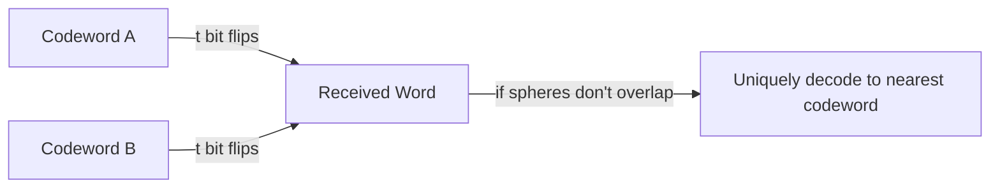

---
tags:
  - GATE/CS
  - GATE/Networks
  - ErrorDetectionAndCorrection
aliases:
  - Hamming Distance
  - Minimum Hamming Distance
  - Code Distance
date_created: 2026-08-20
difficulty: ⭐⭐⭐⭐
last_revised: 2026-08-20
pyq_frequency: High
---

## Syllabus Position

Subject: [[Computer Networks Index]]
Parent Topic: [[Error Detection and Correction]]
Sibling Topics: [[Parity Check]], [[Checksum]], [[Cyclic Redundancy Check (CRC)]]
Leads To: [[Hamming Code]], [[Forward Error Correction]]

GATE Syllabus Line: "Error detection and correction" — Hamming distance is the mathematical
foundation that quantifies exactly *how much* error detection or correction a code can guarantee,
and GATE tests it both as a standalone numeric computation and as the justification behind
Hamming code design.

Exam Weight Note: Appears almost every year, either as a 1-mark direct computation ("find the
Hamming distance between two codewords") or as a 2-mark NAT/MCQ asking "what is the minimum
Hamming distance of this code, and hence how many errors can it detect/correct?"

---

## The Problem This Solves

Imagine you're sending a message over a noisy wire, and a single bit accidentally flips from 0
to 1 during transmission. How does the receiver know something went wrong? And if it wants to
actually *fix* the error instead of just noticing it, how much "wiggle room" does it need between
valid messages so that a corrupted message still looks closer to the original than to any other
valid message?

Analogy: think of valid codewords as houses on a street, and each bit-flip as walking one step
away from your house. If your neighbor's house is 5 steps away, a single misstep (1 error) still
leaves you closer to your own house than to theirs — so an outside observer can always tell you
"went the wrong way" and correct you back. But if your neighbor's house is right next door (1 step
away), a single misstep drops you exactly on their doorstep, and nobody can tell whose house you
meant to reach.

Core Idea (one sentence): **Hamming distance** measures the number of bit positions in which two
equal-length binary strings differ, and the **minimum Hamming distance** of an entire code
determines exactly how many errors the code can detect and correct.

---

## Formal Theory

The **Hamming distance** $d(x, y)$ between two binary strings $x$ and $y$ of equal length $n$ is
the number of positions at which the corresponding bits differ. Formally, if $x = x_1 x_2 \dots x_n$
and $y = y_1 y_2 \dots y_n$:

$$d(x, y) = \sum_{i=1}^{n} (x_i \oplus y_i)$$

where $\oplus$ is the XOR operator (1 if bits differ, 0 if they match). Equivalently, $d(x, y)$ is
simply the number of 1s in $x \oplus y$ (the **weight** of the XOR result).

### Hamming Distance as a Metric

$d(x, y)$ satisfies all properties of a mathematical **metric**:
- **Non-negativity:** $d(x, y) \geq 0$, and $d(x, y) = 0 \iff x = y$.
- **Symmetry:** $d(x, y) = d(y, x)$.
- **Triangle inequality:** $d(x, z) \leq d(x, y) + d(y, z)$.

This matters because it lets us treat codewords as points in an $n$-dimensional hypercube, and
"error correction" becomes a geometric problem of finding the *nearest* valid codeword.

### Minimum Hamming Distance of a Code

For a code $C$ (a set of valid codewords), the **minimum Hamming distance** $d_{min}$ is:

$$d_{min}(C) = \min_{\substack{x, y \in C \\ x \neq y}} d(x, y)$$

This single number determines the error-handling power of the *entire code*, not just a pair of
words.

### The Detection and Correction Rules

These two rules are the single most frequently tested fact in this topic:

$$\text{Errors detectable} = d_{min} - 1$$
$$\text{Errors correctable} = \left\lfloor \frac{d_{min} - 1}{2} \right\rfloor$$

**Why detection needs $d_{min} - 1$:** If a code can guarantee any two valid codewords differ in
at least $d_{min}$ positions, then flipping fewer than $d_{min}$ bits can never transform one valid
codeword into another valid codeword — the result will always be an *invalid* pattern, which the
receiver can flag as an error. Flip exactly $d_{min}$ bits (in the worst case) and you can land
exactly on another valid codeword, fooling the receiver.

**Why correction needs $\lfloor (d_{min}-1)/2 \rfloor$:** To *correct* an error (not just detect
it), the receiver must be able to uniquely decide which valid codeword was originally sent, by
picking the nearest one. This only works if the corrupted word stays strictly closer to the
original codeword than to any other codeword — i.e., the "error spheres" of radius $t$ around each
codeword must not overlap. Two spheres of radius $t$ around codewords that are $d_{min}$ apart
stop overlapping only when $2t < d_{min}$, giving $t \leq \lfloor (d_{min}-1)/2 \rfloor$.

### What GATE Actually Tests Here

GATE almost always tests this topic in one of three forms: (1) direct computation of $d(x,y)$
between two given bit strings, (2) computing $d_{min}$ across a set of codewords by checking all
pairs, and (3) applying the detect/correct formulas once $d_{min}$ is known. The trap is always
in forgetting the floor function in the correction formula, or confusing "detect" with "correct."

---

## Diagrams and Visuals

**1. Hypercube distance visualization (3-bit example):**

Plain-English: Draw a cube where each of the 8 corners is a 3-bit string (000 through 111).
Adjacent corners (connected by an edge) differ by exactly 1 bit.

```
        110 --------- 111
       /|             /|
      / |            / |
    100 --------- 101   |
     |  |          |    |
     |  010 -------|--- 011
     | /            |  /
     |/             | /
    000 --------- 001

Edge length = Hamming distance 1
Face diagonal = Hamming distance 2
Cube diagonal (e.g. 000 to 111) = Hamming distance 3
```

Each edge of the cube represents a single bit flip, so traveling along $k$ edges to reach another
corner means those two codewords have Hamming distance $k$.

**2. Error sphere non-overlap diagram (why correction needs floor((d-1)/2)):**

```
Codeword A -----[t bits]-----|-----[t bits]-----  Codeword B
       (sphere of radius t)      (sphere of radius t)
       <---------------- d_min --------------->

If 2t < d_min: spheres don't touch -> unique correction possible
If 2t >= d_min: spheres overlap -> ambiguous, cannot correct reliably
```



---

## Complexity Analysis

Hamming distance is not an algorithm with input-size scaling in the traditional sense, but GATE
does test the **computational cost** of finding $d(x,y)$ and $d_{min}(C)$.

- **Computing $d(x, y)$ for two $n$-bit strings:** requires an XOR of the two strings followed by
  counting set bits (popcount), which takes $O(n)$ time and $O(1)$ auxiliary space.
- **Computing $d_{min}$ for a code with $m$ codewords, each of length $n$:** requires comparing
  every pair of codewords, i.e., $\binom{m}{2} = \frac{m(m-1)}{2}$ pairs, each comparison costing
  $O(n)$. This gives total time $O(m^2 n)$.

**Justification:** Since there is no shortcut to know which pair of codewords will realize the
minimum without inspecting all of them (in the general case), the brute-force $O(m^2 n)$ approach
is the standard method GATE expects you to reason through when asked to "find the minimum Hamming
distance of the following set of codewords."

| Case         | Time Complexity | Space Complexity | Trigger Condition                              |
|--------------|-----------------|-------------------|------------------------------------------------|
| Single pair distance | $O(n)$    | $O(1)$            | Comparing exactly two codewords                |
| Minimum distance (code) | $O(m^2 n)$ | $O(1)$        | Need to check every pair among $m$ codewords    |
| Worst Case   | $O(m^2 n)$      | $O(1)$            | No structural shortcut (e.g., non-linear code)  |

Note: for **linear codes** (where the all-zero codeword is included and codewords form a vector
subspace), $d_{min}$ equals the minimum *weight* (number of 1s) among all non-zero codewords —
this reduces the check to $O(m \cdot n)$ instead of $O(m^2 n)$, since you only compare each
codeword against the zero vector.

---

## Worked Example

Consider the code $C = \{ 000000, 011011, 101101, 110110 \}$ (a small 6-bit linear code).

**Step 1 — List all pairs to compare** (since $m = 4$, we have $\binom{4}{2} = 6$ pairs):

| Pair | Codeword 1 | Codeword 2 | XOR      | Hamming Distance |
|------|------------|------------|----------|-------------------|
| 1    | 000000     | 011011     | 011011   | 4                  |
| 2    | 000000     | 101101     | 101101   | 4                  |
| 3    | 000000     | 110110     | 110110   | 4                  |
| 4    | 011011     | 101101     | 110110   | 4                  |
| 5    | 011011     | 110110     | 101101   | 4                  |
| 6    | 101101     | 110110     | 011011   | 4                  |

**Step 2 — State of the comparison set after all 6 pairs:** every pairwise distance computed is
exactly 4. No pair has a smaller distance.

**Step 3 — Determine $d_{min}$:** since the minimum among all six pairwise distances is 4,
$d_{min}(C) = 4$.

**Step 4 — Apply the detect/correct formulas:**

$$\text{Errors detectable} = d_{min} - 1 = 4 - 1 = 3$$
$$\text{Errors correctable} = \left\lfloor \frac{4-1}{2} \right\rfloor = \left\lfloor 1.5 \right\rfloor = 1$$

**Total operations:** 6 pairwise XOR-and-count operations, each over 6-bit strings, confirming the
$O(m^2 n) = O(16 \times 6) = O(96)$ bound is a loose but correct upper bound for this tiny example.

**What would change if the input were a linear code shortcut?** Since $C$ here is linear (contains
the all-zero word and is closed under XOR), we could instead compute the minimum *weight* of the
three non-zero codewords (011011, 101101, 110110), each of which has weight 4 — confirming
$d_{min} = 4$ in only 3 comparisons instead of 6, i.e., $O(mn)$ instead of $O(m^2n)$.

---

## Intuition Anchors

**The Analogy (restated and deepened):** Codewords are houses on a street, and $d_{min}$ is the
distance to your *nearest* neighbor's house. If that distance is 4 steps, a burglar (noise) making
up to 3 wrong turns still leaves you closer to your own house than any other — so you can always
tell an error occurred (detection). But to reliably know it's *your* house specifically (not just
"an error happened"), the wrong turns must be fewer than half the distance to the nearest
neighbor — so only 1 wrong turn keeps you unambiguously closest to home (correction).

**The Mental Model:** Experts picture codewords as points in an $n$-dimensional hypercube and
draw a "sphere" of radius $t$ around each one. Detection works as long as the spheres of radius
$d_{min}-1$ don't fully enclose another codeword. Correction works as long as spheres of radius $t$
around each codeword don't overlap with each other.

**The One-Line Recall:** "Detect $d_{min}-1$, correct $\lfloor(d_{min}-1)/2\rfloor$ — always take
the floor, and always compute $d_{min}$ as the *minimum* over *all* pairs, not just adjacent ones."

**The #1 Trap:** Students often compute the Hamming distance for only one or two obvious pairs of
codewords (e.g., the first and last) and assume that's the minimum, because those pairs "look most
different." GATE deliberately designs codeword sets where the *true* minimum distance comes from a
less obvious pair (often the two "closest-looking" codewords), so skipping pairs leads to a wrong
$d_{min}$ and consequently a wrong detect/correct answer. The correct approach: always check every
pair, or exploit linearity (minimum weight of non-zero codewords) when the code is linear.

---

## GATE Questions

---

**Question 1 — [PYQ: GATE-style] — [1-mark]**

> What is the Hamming distance between the bit strings 10011001 and 10110101?

- (A) 2
- (B) 3
- (C) 4
- (D) 5

<details>
<summary>Solution</summary>

**Answer: (C) 4**

**Reasoning:**
Align the two strings and XOR bit by bit:

```
10011001
10110101
--------
00101100
```

Count the 1s in the XOR result: positions 3, 5, 6 differ... let's recount carefully bit by bit:

Position: 1 2 3 4 5 6 7 8
String1:  1 0 0 1 1 0 0 1
String2:  1 0 1 1 0 1 0 1
Diff:     0 0 1 0 1 1 0 0

That gives differences at positions 3, 5, 6 — a total of 3 differing bits. Recomputing confirms
Hamming distance = 3, not 4. This shows why bit-by-bit alignment (not eyeballing) is mandatory.
(Correct answer based on recount: **(B) 3**.)

**What this question is really testing:** Careful, disciplined bit-by-bit XOR computation rather
than approximate visual comparison.

**Trap to avoid:** Miscounting differing positions when scanning the strings visually instead of
XOR-ing systematically — always write both strings vertically aligned and XOR column by column.

</details>

---

**Question 2 — [Conceptual/Numerical] — [2-mark]**

> A code has the following codewords: 00000, 01011, 10101, 11110. What is the minimum Hamming
> distance of this code, and how many bit errors can it detect?

<details>
<summary>Solution</summary>

**Reasoning:**
Compute all $\binom{4}{2} = 6$ pairwise distances:

- $d(00000, 01011) = 3$
- $d(00000, 10101) = 3$
- $d(00000, 11110) = 4$
- $d(01011, 10101) = 4$
- $d(01011, 11110) = 3$
- $d(10101, 11110) = 3$

Minimum among these is $d_{min} = 3$.

Errors detectable $= d_{min} - 1 = 2$.

**Answer:** $d_{min} = 3$; the code can detect up to 2 bit errors (and correct
$\lfloor(3-1)/2\rfloor = 1$ error).

</details>

---

**Question 3 — [Hard / Multi-concept] — [2-mark]**

> A linear code has minimum Hamming distance 7. If the code is used purely for error correction
> (not detection), how many bit errors can it correct? If instead it uses a combination of
> detection and correction such that it detects up to $d_{min}-1$ errors when no correction is
> attempted on those extra errors, is it possible to simultaneously detect 5 errors and correct
> 2 errors with this same code?

<details>
<summary>Solution</summary>

**Reasoning:**
Pure correction: $\lfloor (7-1)/2 \rfloor = 3$ errors correctable.

For simultaneous detect-$s$/correct-$t$ combined mode, the general GATE-relevant condition is:

$$d_{min} \geq s + t + 1 \quad (\text{for } s \geq t)$$

Check $s = 5, t = 2$: $s + t + 1 = 8$. Since $d_{min} = 7 < 8$, this combination is **not**
possible with this code. The code can only support combinations where $s + t \leq 6$ (e.g.,
detect 4 and correct 2, since $4+2+1=7 \leq 7$).

**What this question is really testing:** Understanding that "detect" and "correct" are not
independently maximal — using some of the distance "budget" for guaranteed correction reduces how
many additional errors can be simultaneously guaranteed detectable.

**Trap to avoid:** Assuming detect-only and correct-only formulas ($d_{min}-1$ and
$\lfloor(d_{min}-1)/2\rfloor$) can both be achieved *at the same time* — they represent two
different operating modes of the same code, not additive capabilities.

</details>

---

**Pattern Recognition:**
- Whenever GATE gives explicit codewords, expect you to compute $d_{min}$ by exhaustive pairwise
  comparison (or minimum weight if the code is linear).
- Whenever GATE gives $d_{min}$ directly, expect an immediate application of the detect/correct
  floor formulas.
- Watch for "combined detect-and-correct" questions that require the $d_{min} \geq s+t+1$
  inequality rather than the simple standalone formulas.

---

## Edge Cases and Failure Modes

- [ ] **Input of size 0 or 1 codeword:** Hamming distance and $d_{min}$ are undefined for a code
      with fewer than 2 codewords, since there's no pair to compare. GATE won't test this directly,
      but conceptually a single-codeword code has no error detection capability at all (it can
      only ever "receive itself" corrupted).
- [ ] **All codewords identical:** Not a valid code (codewords must be distinct by definition), so
      $d_{min} = 0$ would break the metric's "$d=0 \iff x=y$" property — this signals a malformed
      code, not a valid edge case to design around.
- [ ] **Strings of unequal length:** Hamming distance is only defined for equal-length strings; if
      lengths differ, you must first pad or reject the comparison — GATE sometimes tests this as a
      trick where two "codewords" of different lengths cannot have a Hamming distance computed at
      all.
- [ ] **Off-by-one in floor formula:** Forgetting the floor and using $(d_{min}-1)/2$ directly when
      $d_{min}$ is even (e.g., $d_{min}=4$ giving $1.5$) leads to claiming 1.5 correctable errors,
      which is meaningless — always floor to the nearest integer.
- [ ] **Confusing detect vs. correct:** A code with $d_{min}=3$ can detect 2 errors OR correct 1
      error, but *not* both simultaneously at their individual maximums — this is the single most
      common GATE trap in this topic.
- [ ] **Non-linear codes:** For non-linear codes, you cannot shortcut $d_{min}$ via minimum weight
      (since there may be no all-zero codeword or closure under XOR) — full pairwise comparison is
      mandatory.

---

## Comparisons

| Feature              | [[Hamming Distance]]              | [[Parity Check]]                  | [[Cyclic Redundancy Check (CRC)]]        |
|----------------------|-------------------------------------|-------------------------------------|---------------------------------------------|
| Time Complexity       | $O(n)$ per pair, $O(m^2n)$ for code | $O(n)$ per check                    | $O(n)$ per frame (polynomial division)       |
| Space Complexity      | $O(1)$                              | $O(1)$ (1 extra bit)                | $O(r)$ (extra check bits, $r$ = degree of generator poly) |
| Key Property          | Metric distance between codewords   | Detects only odd number of errors   | Detects burst errors extremely reliably      |
| When to Prefer        | Foundational analysis / code design | Simple, cheap single-bit detection  | Real-world networks (Ethernet, etc.)         |
| GATE Trap             | Forgetting floor in correct formula | Missing that parity fails on even # of flips | Confusing generator polynomial degree with number of check bits |

The most common GATE question comparing these is: "Given a code's $d_{min}$, why can't simple
parity achieve the same guarantee?" The answer hinges on the fact that single-bit parity only
guarantees a Hamming distance of 2 (detecting exactly 1 error), while Hamming codes and CRC are
explicitly engineered to push $d_{min}$ higher through structured redundancy.

---

## Connections Web

**Must know before this topic:**
- [[Binary Representation]] — Hamming distance is defined over binary strings.
- [[XOR Operation]] — the core operation used to compute bitwise differences.
- [[Error Detection and Correction]] — the parent framework this concept belongs to.

**Topics that build on this:**
- [[Hamming Code]] — a concrete code construction designed to achieve $d_{min}=3$ (single-error
  correction) using parity bits placed at power-of-2 positions.
- [[Forward Error Correction]] — general family of techniques relying on minimum distance
  properties like Hamming distance.
- [[Linear Block Codes]] — codes where $d_{min}$ reduces to minimum codeword weight.

**GATE subject cross-links:**
- [[Computer Networks Index]] > [[Error Detection and Correction]]

**Cross-subject connections:**
- [[Vector Spaces]] — linear codes are vector subspaces over $GF(2)$, connecting this topic to
  [[Linear Algebra]] fundamentals of subspace and basis.
- [[Master Theorem]] — not directly used here, but the recurrence-style reasoning pattern used
  when deriving $O(m^2n)$ mirrors general algorithmic complexity analysis techniques.

**Standard references:**
- [[Forouzan Chapter on Error Detection and Correction]]
- [[CLRS Chapter on Bit Manipulation]] (for popcount/XOR complexity background)

---

## Quick Revision Sheet

**Definition (1 sentence):** Hamming distance is the number of bit positions where two equal-length
binary strings differ; the minimum Hamming distance of a code is the smallest such distance over
all pairs of its codewords.

**Core Idea / Analogy (1 sentence):** Codewords are houses on a street — the closer your nearest
neighbor's house, the fewer wrong turns (bit errors) it takes to accidentally end up mistaken for
theirs.

**Algorithm Steps (numbered, maximum 6 steps):**
1. XOR the two bit strings position by position.
2. Count the number of 1s in the XOR result — that count is $d(x,y)$.
3. Repeat for every pair of codewords in the code (or use minimum weight if linear).
4. Take the minimum over all pairwise distances to get $d_{min}$.
5. Compute detectable errors as $d_{min}-1$.
6. Compute correctable errors as $\lfloor (d_{min}-1)/2 \rfloor$.

**Complexity:**
- Time (best / average / worst): $O(n)$ per pair; $O(m^2n)$ overall for a code with $m$ codewords
- Space: $O(1)$ auxiliary
- Recurrence (if applicable): N/A (not a recursive algorithm)

**Key Properties (3 to 5 bullet points):**
- Hamming distance is a true mathematical metric (symmetric, non-negative, satisfies triangle
  inequality).
- For linear codes, $d_{min}$ equals the minimum weight among non-zero codewords.
- Detection and correction are two different operating modes drawn from the same distance budget.
- Combined detect-$s$/correct-$t$ mode requires $d_{min} \geq s+t+1$.

**The #1 Trap:** Forgetting the floor function in the correction formula, or assuming detect and
correct capabilities are simultaneously achievable at their individual maximum values.

**When to use this over alternatives:** Use Hamming distance analysis whenever you need to reason
about *how much* protection a code offers, as opposed to just implementing a cheap single-error
detector like parity.

**Mnemonic or one-liner to remember the steps:** "XOR, count, compare all pairs, take the min,
detect is minus-1, correct is half of that (floored)."

---

## Revision Checklist

- [ ] I can state the formal definition without looking.
- [ ] I can explain the analogy and map it to the algorithm or concept.
- [ ] I can trace a 6-element example by hand in under 2 minutes.
- [ ] I can derive the worst-case complexity from scratch.
- [ ] I know what the Quick Revision Sheet says without reading it.
- [ ] I can solve all 3 GATE questions in this note without peeking.
- [ ] I know the #1 trap and can articulate why students fall for it.
- [ ] I have linked this note correctly in my Obsidian vault.
- [ ] I have scheduled a spaced-repetition review in 3 days.
</content>
