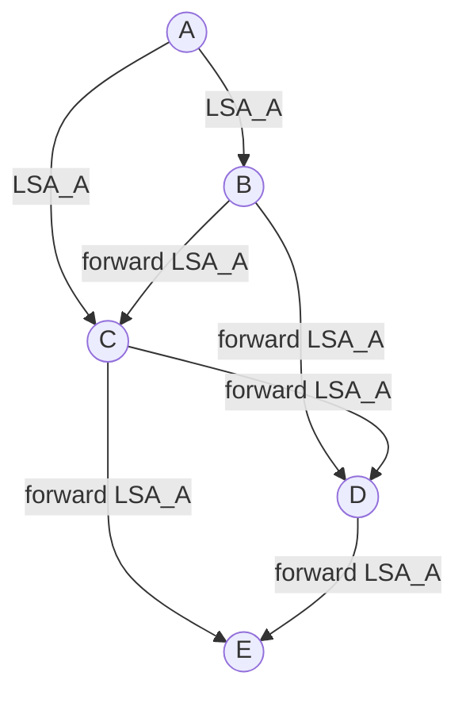
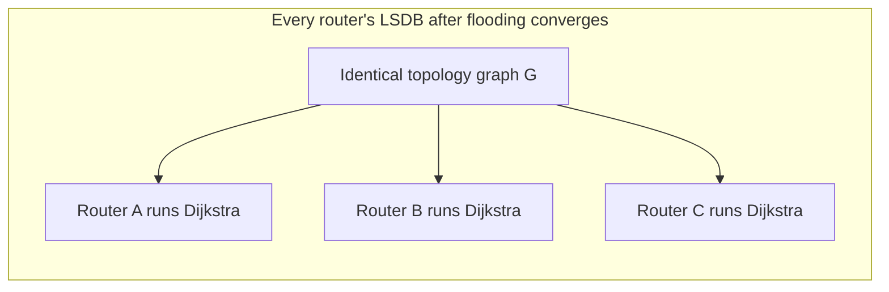

---
tags:
  - GATE/CS
  - GATE/Networks
  - Routing
aliases:
  - LSR
  - Link State Algorithm
  - Dijkstra-based Routing
date_created: 2026-09-10
difficulty: ⭐⭐⭐⭐
last_revised: 2026-09-10
pyq_frequency: Medium
---

## Syllabus Position

Subject: [[Computer Networks Index]]
Parent Topic: [[Routing Algorithms]]
Sibling Topics: [[Distance Vector Routing]], [[Path Vector Routing]]
Leads To: [[OSPF]], [[Dijkstra's Algorithm]], [[Shortest Path Tree]]

GATE Syllabus Line: "Routing (Network Layer)" — under Computer Networks, GATE CS syllabus explicitly lists routing algorithms including distance vector and link state as testable concepts.

Exam Weight Note: Appears as a 1-mark conceptual MCQ contrasting link state with distance vector, or as a 2-mark NAT/MCQ asking you to run Dijkstra's algorithm on a small weighted graph to build a router's shortest-path tree.

---

## The Problem This Solves

Imagine that instead of relying on rumor-based, neighbor-to-neighbor gossip about "how far away is everywhere" (as in [[Distance Vector Routing]]), every intersection in a city was handed a complete, accurate street map — showing every intersection and every road segment with its exact travel time. With the full map in hand, each intersection could independently work out the fastest route to every destination, with no dependence on what its neighbors *believe*, only on what the map *actually shows*. This is the core shift link state routing makes: instead of trusting second-hand distance estimates, every router first learns the entire network topology, then computes shortest paths itself.

**Analogy:** Think of link state routing like every router being handed the *same* GPS map of the entire city, updated whenever any road changes. No gossip, no rumors — every router independently runs its own route-planning on an identical, first-hand copy of the map.

**Core Idea (one sentence):** Every router floods information about its directly connected links to every other router in the network, so that all routers build an identical map of the full topology, and each router then independently runs [[Dijkstra's Algorithm]] on that map to compute the shortest-path tree rooted at itself.

---

## Formal Theory

**[[Link State Routing]]** is a routing algorithm in which each router (1) discovers its directly connected neighbors and the cost of each link, (2) broadcasts this local information — packaged as a **Link State Packet (LSP)** or **Link State Advertisement (LSA)** — to *every* other router in the network via **reliable flooding**, and (3) uses the resulting complete topology map (identical across all routers, assuming convergence) to independently compute the shortest path to every destination using **[[Dijkstra's Algorithm]]**.

### Step 1 — Neighbor Discovery

Each router sends periodic "HELLO" packets on every interface to discover which routers are directly reachable and measures the cost (delay, bandwidth-based metric, or hop count) of each link.

### Step 2 — Building and Flooding Link State Packets (LSAs)

Each router builds an **LSA** containing:
- The router's own identity.
- A list of its directly connected neighbors and the cost to each.
- A sequence number (to distinguish newer LSAs from older ones) and a time-to-live (TTL) / age field.

This LSA is **flooded** — sent out on every link except the one it arrived on — so that every router in the network eventually receives a copy from every other router. Flooding uses the sequence number to avoid infinite retransmission: a router only re-floods an LSA if it has a *higher* sequence number than the last one it saw from that source, discarding duplicates or stale copies.

```
Algorithm FloodLSA(router x, LSA L):
    if L.sequence_number > stored_sequence_number[L.source]:
        store L
        stored_sequence_number[L.source] = L.sequence_number
        forward L on all links except the one it arrived on
    else:
        discard L (duplicate or stale)
```

### Step 3 — Building the Topology Database

Every router accumulates the LSAs it receives into a **link state database (LSDB)** — a table mapping every known router to its neighbor list and link costs. Once every router has received an LSA from every other router (i.e., the flood has converged), all routers hold an **identical** map of the full network graph $G = (V, E)$.

### Step 4 — Running Dijkstra's Algorithm

Each router runs **[[Dijkstra's Algorithm]]** locally, using itself as the source, on the topology graph stored in its LSDB, to compute the shortest-path tree to every other router.

```
Algorithm LinkStateShortestPath(source s, graph G):
    dist[s] = 0; dist[v] = infinity for all v != s
    visited = {}
    while visited != V:
        u = vertex not in visited with minimum dist[u]
        add u to visited
        for each neighbor v of u:
            if dist[u] + cost(u,v) < dist[v]:
                dist[v] = dist[u] + cost(u,v)
                next_hop(v) = next_hop(u) if u != s else v
    return dist, next_hop table
```

### Variant: Link State vs. Source Routing Framing

Some textbooks describe link state as building a full **shortest-path tree** rooted at the router itself (used for standard hop-by-hop forwarding), versus a **source-routed** variant where the *entire path* is embedded in the packet header. GATE almost exclusively tests the shortest-path-tree framing, since that is what real protocols like [[OSPF]] use.

### What GATE Actually Tests Here

GATE examiners test link state routing in two ways: (1) conceptually, by contrasting it with distance vector routing on dimensions like *what information is exchanged* (full topology vs. scalar distances) and *why it doesn't suffer count-to-infinity*; and (2) numerically, by giving a small weighted graph and asking you to trace Dijkstra's algorithm step by step to build the shortest-path tree from a given source router.

---

## Diagrams and Visuals

**Network Topology for Flooding**

Draw five routers A, B, C, D, E arranged so A is connected to B and C; B is connected to C and D; C is connected to D and E; D is connected to E.

```
        A
       / \
      B---C
      |  / \
      D-----E
```

**Mermaid diagram of LSA flooding from router A:**



Each router forwards the LSA on every link except the one it arrived from — so LSA_A reaches every router within a few hops, and duplicate copies (e.g., C receiving LSA_A from both A directly and via B) are discarded using the sequence number check.

**Shortest-Path Tree computed by Dijkstra (rooted at A), ASCII representation:**

```
        A (dist=0)
       /          \
   B(dist=1)   C(dist=1)
      |            \
  D(dist=?)     E(dist=?)
```

(Exact distances depend on the worked-example weights below — see Section 7 for the full trace.)

**Mermaid state view of the topology database convergence:**



---

## Complexity Analysis

Link state routing has two distinct complexity dimensions: the **flooding cost** (distributing LSAs) and the **computation cost** (running Dijkstra locally at each router).

- **Flooding Time/Message Complexity:** In the worst case, each of the $E$ links in the network carries each of the $V$ routers' LSAs (once in each direction, minus the arriving link), giving a flooding message complexity of $O(V \cdot E)$ across the whole network. This is much higher in absolute message count per LSA than distance vector's incremental exchange, but it happens only when the topology *changes*, not on every periodic exchange round.
- **Computation Time Complexity (Dijkstra):** Each router independently runs Dijkstra's algorithm on a graph with $V$ vertices and $E$ edges. Using a simple array-based minimum extraction, this costs $O(V^2)$; using a binary min-heap, it costs $O((V + E)\log V)$, which reduces to $O(E \log V)$ for connected graphs where $E \geq V - 1$. GATE almost always expects the $O(E \log V)$ or $O(V^2)$ bound depending on the stated implementation.
  - This is because Dijkstra performs $V$ extract-min operations (each $O(\log V)$ with a heap) and processes each edge once for a possible relaxation (each $O(\log V)$ to update the heap), giving $O(V \log V + E \log V) = O((V+E)\log V)$.
- **Space Complexity:** Every router stores a full copy of the network topology — the link state database — requiring $O(V + E)$ space per router (compare this to distance vector's much smaller $O(n)$ vector per router). Total space across the network is $O(V(V+E))$, since every one of the $V$ routers separately stores the full graph.
- **Convergence Time:** Once flooding completes (bounded by the network diameter $d$, since each LSA propagates outward one hop at a time, just like in distance vector), every router can *immediately* compute correct shortest paths in one Dijkstra run — there is no iterative "wave of updates" needed, unlike distance vector's incremental convergence.

#### Complexity Summary Table

| Case                        | Time Complexity                     | Space Complexity | Trigger Condition                                   |
|------------------------------|--------------------------------------|-------------------|-------------------------------------------------------|
| LSA Flooding (per topology change) | $O(V \cdot E)$ total messages     | —                 | Any link cost change or link up/down event             |
| Dijkstra Computation (per router)  | $O(V^2)$ array or $O(E \log V)$ heap | $O(V+E)$ per router | Runs once per router after LSDB is up to date |
| Convergence Time             | $O(d)$ hops for flooding + one Dijkstra run | $O(V(V+E))$ total | $d$ = network diameter                                |

---

## Worked Example

Consider a 7-router network with routers $\{A, B, C, D, E, F, G\}$ and the following weighted links:

```
A-B = 4      A-C = 2
B-C = 1      B-D = 5
C-D = 8      C-E = 10
D-E = 2      D-F = 6
E-F = 3      E-G = 6
F-G = 1
```

We trace **Dijkstra's algorithm** from source router **A**, exactly as router A would run it locally after its LSDB has converged (i.e., after A has received LSAs from every other router).

**Initialization:**
```
dist[A]=0, dist[B]=inf, dist[C]=inf, dist[D]=inf, dist[E]=inf, dist[F]=inf, dist[G]=inf
visited = {}
```

**Step 1 — Extract min (A, dist=0). Relax A's edges:**
- $dist[B] = \min(\infty, 0+4) = 4$
- $dist[C] = \min(\infty, 0+2) = 2$
```
visited={A}  dist: A=0, B=4, C=2, D=inf, E=inf, F=inf, G=inf
```

**Step 2 — Extract min among unvisited (C, dist=2). Relax C's edges (B, D, E):**
- $dist[B] = \min(4, 2+1) = 3$  (updated: C-B=1 gives cheaper path)
- $dist[D] = \min(\infty, 2+8) = 10$
- $dist[E] = \min(\infty, 2+10) = 12$
```
visited={A,C}  dist: A=0, B=3, C=2, D=10, E=12, F=inf, G=inf
```

**Step 3 — Extract min (B, dist=3). Relax B's edges (D):**
- $dist[D] = \min(10, 3+5) = 8$  (updated: via B is cheaper than via C)
```
visited={A,C,B}  dist: A=0, B=3, C=2, D=8, E=12, F=inf, G=inf
```

**Step 4 — Extract min (D, dist=8). Relax D's edges (E, F):**
- $dist[E] = \min(12, 8+2) = 10$  (updated: via D is cheaper)
- $dist[F] = \min(\infty, 8+6) = 14$
```
visited={A,C,B,D}  dist: A=0, B=3, C=2, D=8, E=10, F=14, G=inf
```

**Step 5 — Extract min (E, dist=10). Relax E's edges (F, G):**
- $dist[F] = \min(14, 10+3) = 13$  (updated)
- $dist[G] = \min(\infty, 10+6) = 16$
```
visited={A,C,B,D,E}  dist: A=0, B=3, C=2, D=8, E=10, F=13, G=16
```

**Step 6 — Extract min (F, dist=13). Relax F's edges (G):**
- $dist[G] = \min(16, 13+1) = 14$  (updated: via F is cheaper)
```
visited={A,C,B,D,E,F}  dist: A=0, B=3, C=2, D=8, E=10, F=13, G=14
```

**Step 7 — Extract min (G, dist=14). No unvisited neighbors left to relax.**
```
visited={A,C,B,D,E,F,G}  FINAL: A=0, B=3, C=2, D=8, E=10, F=13, G=14
```

**Verification:** The shortest path from A to G is $A \to C \to B \to D \to E \to F \to G$ with cost $2+1+5+2+3+1=14$, matching $dist[G]=14$. Total operations: 7 extract-min steps and 11 edge relaxations (matching $|E|=11$ in this graph), consistent with the $O((V+E)\log V)$ heap-based bound.

**Edge-case follow-up:** What would change if the link C-D (cost 8) were removed entirely? Router A would simply never consider that edge during relaxation — the shortest path to D would then only be reachable via B (cost $3+5=8$, same value here coincidentally), so $dist[D]$ would remain 8 in this specific case, but in general removing an edge can only ever *increase or keep equal* the shortest distances, never decrease them, since Dijkstra only relaxes edges that actually exist in the graph.

---

## Intuition Anchors

**The Analogy (restated and deepened):** Recall the "everyone has the same GPS map" analogy. Now extend it: whenever a road closes or a new road opens anywhere in the city, that single change is broadcast to *every* GPS device simultaneously (via flooding), so every device updates its map identically and re-runs its own route planner. Compare this to distance vector's gossip model — in link state, there is no rumor mill; there is one authoritative, universally shared map, and any disagreement between routers can only be due to LSAs not yet having propagated, not due to conflicting beliefs about distances.

**The Mental Model:** Picture link state routing as a "fire spreading outward" during Dijkstra's execution — the algorithm always finalizes the *closest* unvisited node next, so the wavefront of "settled, confirmed-shortest" routers expands outward strictly by increasing distance, guaranteeing correctness the moment a node is marked visited (as long as edge weights are non-negative).

**The One-Line Recall:** "Every router floods its link costs to build an identical topology map, then runs Dijkstra locally — $O(E \log V)$ per router — giving loop-free, fast-converging shortest paths, unlike [[Distance Vector Routing]]'s neighbor-only gossip."

**The #1 Trap:** Students assume link state routing is "free" of all convergence problems because it doesn't have count-to-infinity — but they forget that link state has its own failure modes: **stale or corrupted LSAs**, **sequence number wraparound**, and **transient loops during the flooding window** before all routers have an identical, fully-updated LSDB. The correct GATE answer is that link state avoids count-to-infinity specifically (because every router computes routes independently from a shared, path-aware topology map, not from second-hand distance estimates) — not that it's immune to all forms of temporary inconsistency.

---

## GATE Questions

---

**Question 1 — [GATE-style, based on common PYQ pattern] — [1-mark]**

> Which of the following is the primary reason link state routing does NOT suffer from the count-to-infinity problem that affects distance vector routing?

- (A) Link state routing uses TCP instead of UDP for exchanging routing information.
- (B) Every router in link state routing has a complete, first-hand copy of the network topology and independently computes shortest paths, rather than relying on second-hand distance estimates from neighbors.
- (C) Link state routing never allows link costs to change once the network is deployed.
- (D) Link state routing uses a smaller maximum hop count than distance vector routing.

<details>
<summary>Solution</summary>

**Answer: (B)**

**Reasoning:**
Count-to-infinity arises in distance vector routing because routers only exchange scalar distances (not paths), so a router cannot detect when a neighbor's advertised "shortest distance" secretly depends on a route through itself. In link state routing, every router floods its *actual* link costs to every other router, so each router builds an identical, complete topology graph and computes shortest paths independently using Dijkstra — there is no dependency chain of "trusting" a neighbor's summary distance. (A) is a red herring — the transport protocol used is irrelevant to the algorithmic cause of count-to-infinity. (C) is false — link costs absolutely can and do change in link state routing (that's exactly what triggers new LSA floods). (D) is false and confuses this with RIP's artificial hop-count cap of 16, which is a mitigation for distance vector, not a property of link state.

**What this question is really testing:** Whether the student understands the *structural* reason (full topology vs. scalar distance) behind the count-to-infinity distinction, not surface-level protocol details.

**Trap to avoid:** Attributing the fix to some unrelated protocol mechanism (transport layer, hop limits) rather than the core algorithmic difference — always trace it back to "does the router know the actual topology/path, or just a distance?"

</details>

---

**Question 2 — [Numerical] — [2-mark]**

> A network has 5 routers and 7 bidirectional links (so $|E| = 7$). If each router runs Dijkstra's algorithm using a binary min-heap after its link state database has converged, what is the time complexity of the shortest-path computation at a single router, expressed using $V$ and $E$?

- (A) $O(V^2)$
- (B) $O(V + E)$
- (C) $O((V+E)\log V)$
- (D) $O(V \cdot E^2)$

<details>
<summary>Solution</summary>

**Answer: (C) $O((V+E)\log V)$**

**Reasoning:**
With a binary min-heap implementation, Dijkstra's algorithm performs $V$ extract-min operations, each costing $O(\log V)$, contributing $O(V \log V)$. It also performs at most one decrease-key/insert operation per edge (during relaxation), each costing $O(\log V)$, contributing $O(E \log V)$. Summing these gives $O(V\log V + E\log V) = O((V+E)\log V)$. Option (A), $O(V^2)$, is the correct bound only for the *array-based* (non-heap) implementation of Dijkstra, which is a common trap when students don't check which implementation the question specifies. Option (B) ignores the $\log V$ factor entirely, treating extract-min as $O(1)$, which is incorrect for a heap. Option (D) is a fabricated, incorrect bound with no basis in the standard algorithm.

**What this question is really testing:** Whether the student can distinguish between the array-based $O(V^2)$ and heap-based $O((V+E)\log V)$ implementations of Dijkstra, and apply the correct one based on the stated data structure.

**Trap to avoid:** Defaulting to $O(V^2)$ out of habit without checking whether the question specifies a heap-based implementation — GATE frequently specifies the data structure precisely to test this distinction.

</details>

---

**Question 3 — [Hard, multi-concept] — [2-mark]**

> Consider a network where link state routing is used. A link between routers X and Y fails. Which of the following correctly describes what happens, and how it differs from the equivalent scenario in distance vector routing?

- (A) In both algorithms, the failure is undetectable until a fixed timeout of 16 hops is reached.
- (B) In link state routing, X and Y each generate a new LSA reflecting the failed link, flood it to all routers, and every router recomputes Dijkstra with the updated topology — this can create loop-free convergence once flooding completes; in distance vector routing, the same failure can trigger the count-to-infinity problem because routers only propagate distances, not the fact that a specific link is gone.
- (C) Link state routing requires manual reconfiguration by a network administrator after any link failure, while distance vector routing recovers automatically.
- (D) Both algorithms are equally likely to suffer from count-to-infinity, since both rely on periodic updates.

<details>
<summary>Solution</summary>

**Answer: (B)**

**Reasoning:** When a link fails in link state routing, the two routers adjacent to that link (X and Y) detect the failure (e.g., via missed HELLO packets) and immediately generate new LSAs with updated (or removed) link entries and a higher sequence number. These LSAs are flooded to every router, and each router recomputes its shortest-path tree via Dijkstra using the corrected topology — since the topology information itself is now accurate everywhere, there is no possibility of a router mistakenly using a stale, self-referential route (which is exactly what causes count-to-infinity in distance vector). In distance vector, by contrast, routers only exchange scalar distances, so after a link failure, a neighbor might still advertise a "valid" distance that was secretly computed through the now-broken path, causing the classic count-to-infinity climb. (A) incorrectly imports RIP's artificial 16-hop cap into link state, which doesn't use that mechanism at all. (C) is false — link state recovers automatically via flooding and re-computation, requiring no manual step. (D) incorrectly claims both are equally vulnerable, ignoring the structural reason (path-aware topology vs. path-unaware distances) that link state avoids this specific failure mode.

**What this question is really testing:** Whether the student can apply the count-to-infinity vs. link-state-recovery distinction to a *specific failure scenario*, not just recite the general difference abstractly.

**Trap to avoid:** Assuming any routing algorithm using "periodic updates" is automatically vulnerable to count-to-infinity — the vulnerability is specifically caused by exchanging distances instead of topology/paths, which link state does not do.

</details>

---

**Pattern Recognition:**
- When GATE gives a weighted graph and asks for a shortest-path table from a specific source router, it wants a full Dijkstra trace — always extract the true minimum unvisited distance at each step, and double-check every relaxation against *all* edges of the newly visited node.
- When GATE asks "why doesn't link state suffer from count-to-infinity," the answer always hinges on **full topology knowledge and independent computation** vs. distance vector's **second-hand scalar distances**.
- When GATE specifies the data structure used for Dijkstra (array vs. binary heap vs. Fibonacci heap), it is testing whether you know the corresponding time complexity — $O(V^2)$, $O((V+E)\log V)$, and $O(E + V\log V)$ respectively.

---

## Edge Cases and Failure Modes

- [ ] **Input of size 0 or 1 (single router, no neighbors):** No links exist, so there is nothing to flood and Dijkstra trivially returns distance 0 to itself and infinity to everyone else — no convergence issue arises.
- [ ] **All link costs identical:** Multiple equal-cost shortest paths can exist to the same destination; different routers might independently break ties differently (e.g., by router ID), leading to asymmetric routing where the forward and reverse paths between two routers differ, even though costs are equal.
- [ ] **Negative edge weights (not physically meaningful here, but a common trap):** Dijkstra's algorithm is only correct for **non-negative** edge weights; if a "cost" were somehow negative (never valid for real link metrics like delay or bandwidth), Dijkstra could produce an incorrect shortest-path tree — GATE sometimes tests this as a pure algorithms question disguised as a networking one.
- [ ] **Sequence number wraparound:** LSAs use sequence numbers to distinguish newer updates from stale ones; if a router's sequence number counter overflows and wraps back to a small value, other routers might incorrectly discard the new LSA as "stale" — real protocols like OSPF use large sequence number spaces and special reset procedures to avoid this.
- [ ] **Off-by-one in extract-min ordering:** A common student error is decreasing a neighbor's distance *before* checking whether that neighbor has already been finalized (visited) — always relax edges only toward *unvisited* nodes, or the shortest-path guarantee breaks.
- [ ] **Transient loops during flooding:** Before all routers have received every LSA (i.e., mid-flood), routers may temporarily hold inconsistent topology views, which can cause brief, self-correcting micro-loops until flooding fully converges — unlike distance vector's count-to-infinity, this resolves in $O(d)$ hops, not indefinitely.
- [ ] **Topic-specific failure — LSA flooding storm:** If sequence number comparison logic is buggy or a malicious/faulty router keeps re-originating LSAs, the network can suffer a flooding storm, consuming excessive bandwidth — real protocols mitigate this using aging/TTL fields and rate limiting on LSA origination.

---

## Comparisons

| Feature              | [[Link State Routing]]                    | [[Distance Vector Routing]]                     | [[Path Vector Routing]]                    |
|-----------------------|--------------------------------------------|---------------------------------------------------|-----------------------------------------------|
| Time Complexity       | $O((V+E)\log V)$ per router (Dijkstra, heap-based) | $O(d)$ rounds to converge (good news only)   | Similar to DV but with explicit path tracking |
| Space Complexity      | $O(V+E)$ per router (full topology map)     | $O(n)$ per router (distance vector only)          | $O(n)$ per router plus full path history       |
| Key Property          | Knows entire network topology, first-hand   | Only knows distance, not path                      | Knows the full sequence of ASes traversed      |
| When to Prefer        | Larger, dynamic networks needing fast, loop-free convergence (e.g., [[OSPF]]) | Small networks, low overhead, simple implementation | Inter-domain routing (e.g., BGP) where policy and explicit loop prevention matter |
| GATE Trap             | Assuming link state is immune to *all* transient inconsistency (it isn't — flooding takes time) | Assuming $O(d)$ convergence always holds (fails on link removal, causing count-to-infinity) | Assuming path vector behaves exactly like distance vector (it doesn't loop, since paths are explicit) |

The most common GATE question comparing these is: "Why does distance vector routing suffer from count-to-infinity, but link state routing does not?" — and the answer hinges on the precise distinguishing property that **link state routing floods full topology information to every router, so each router independently computes shortest paths using complete, first-hand knowledge (via Dijkstra's algorithm), whereas distance vector routing only exchanges scalar distances between immediate neighbors, meaning no router ever knows the actual path being taken, which is precisely what allows undetected routing loops to form.** See [[Distance Vector Routing]] for the full count-to-infinity derivation from the other side of this comparison.

---

## Connections Web

**Must know before this topic:**
- [[Dijkstra's Algorithm]] — the exact shortest-path algorithm every router runs locally on its topology database
- [[Graph Theory Basics]] — needed to understand nodes, edges, weighted graphs, and shortest-path trees
- [[Shortest Path Problem]] — the underlying graph-theoretic problem link state routing is solving
- [[Priority Queue]] — the data structure (min-heap) used to achieve Dijkstra's $O((V+E)\log V)$ bound

**Topics that build on this:**
- [[OSPF]] — the real-world protocol implementation of link state routing, adding hierarchical areas and detailed LSA types
- [[Shortest Path Tree]] — the direct output structure Dijkstra produces at each router
- [[IS-IS]] — another real-world link state protocol, conceptually parallel to OSPF

**GATE Subject Links:**
- [[Computer Networks Index]] > [[Network Layer]]

**Cross-Subject Connections:**
- [[Bellman-Ford Algorithm]] — the centralized/distributed counterpart used in distance vector routing, useful for contrast
- [[Graph Algorithms]] (Algorithms subject) — Dijkstra is a standard algorithms-course topic reused here in a networking context
- [[Minimum Spanning Tree]] — a related but distinct graph problem often confused with shortest-path tree by students

**Standard References:**
- [[Kurose and Ross Chapter 4]] (Network Layer — Routing Algorithms)
- [[CLRS Chapter 24]] (Dijkstra's Algorithm)

---

## Quick Revision Sheet

**Definition (1 sentence):** Link State Routing is a routing algorithm where every router floods its directly connected link costs to all other routers via LSAs, so that every router builds an identical, complete topology map and independently computes shortest paths using Dijkstra's algorithm.

**Core Idea / Analogy (1 sentence):** Every router gets the same complete GPS map of the network (via flooding) instead of relying on neighbor gossip — like every driver having an identical, authoritative city map rather than trading rumors about travel times.

**Algorithm Steps (numbered, maximum 6 steps):**
1. Discover directly connected neighbors and link costs via HELLO packets.
2. Package this local info into an LSA with a sequence number.
3. Flood the LSA to every router in the network (forward on all links except the arrival link, skip duplicates/stale copies).
4. Every router accumulates received LSAs into its link state database (LSDB).
5. Once flooding converges, every router holds an identical topology graph $G=(V,E)$.
6. Each router independently runs Dijkstra's algorithm on $G$, rooted at itself, to build its shortest-path tree.

**Complexity:**
- Time (best / average / worst): $O(V^2)$ array-based or $O((V+E)\log V)$ heap-based Dijkstra per router; $O(V \cdot E)$ total flooding messages per topology change.
- Space: $O(V+E)$ per router (full topology map); $O(V(V+E))$ total across the network.
- Recurrence (if applicable): Not a recurrence — Dijkstra is iterative; core relaxation step is $dist[v] = \min(dist[v], dist[u]+cost(u,v))$.

**Key Properties (3 to 5 bullet points):**
- Every router has complete, first-hand topology knowledge — no reliance on neighbor-reported distances.
- Convergence requires flooding (bounded by network diameter $d$) plus one Dijkstra run per router — no iterative wave of updates needed.
- Does NOT suffer from count-to-infinity, because paths (not just distances) are implicitly known via the full topology graph.
- Higher per-router space cost ($O(V+E)$) than distance vector ($O(n)$), since the full map must be stored.
- Forms the basis of real-world protocols [[OSPF]] and IS-IS.

**The #1 Trap:** Assuming link state routing is immune to *all* inconsistency because it avoids count-to-infinity — it can still suffer transient loops during the flooding window, sequence number wraparound issues, and flooding storms; "no count-to-infinity" is not the same as "always perfectly consistent at every instant."

**When to use this over alternatives:** Prefer link state routing in larger, more dynamic networks needing fast, loop-free convergence and where routers have enough memory/CPU to store the full topology and run Dijkstra — distance vector is preferred only when router resources are extremely limited and the network is small.

**Mnemonic or one-liner to remember the steps:** "Flood the map, then find your own shortest path" — flood LSAs to build the shared graph $G$, then run Dijkstra locally: $dist[v] = \min(dist[v], dist[u]+cost(u,v))$.

---

## Revision Checklist

- [ ] I can state the formal definition without looking.
- [ ] I can explain the "shared GPS map" analogy and map it to LSA flooding + Dijkstra.
- [ ] I can trace a 6-to-8-node weighted graph through Dijkstra by hand in under 3 minutes.
- [ ] I can derive both the $O(V^2)$ and $O((V+E)\log V)$ complexity bounds from scratch, depending on implementation.
- [ ] I know what the Quick Revision Sheet says without reading it.
- [ ] I can solve all 3 GATE questions in this note without peeking.
- [ ] I know the #1 trap (assuming full immunity to inconsistency) and can articulate why students fall for it.
- [ ] I have linked this note correctly to [[Distance Vector Routing]] and [[OSPF]] in my Obsidian vault.
- [ ] I have scheduled a spaced-repetition review in 3 days.
</content>
