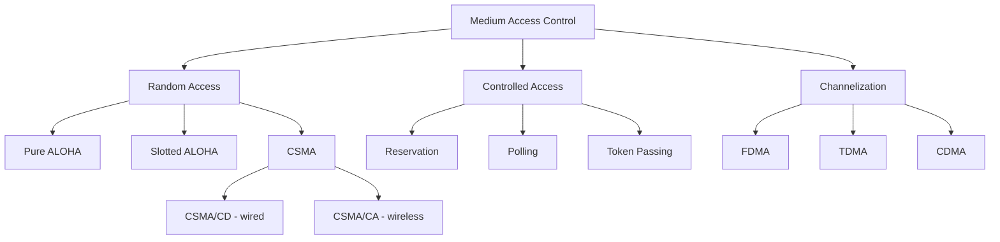

---
tags:
  - GATE/CS
  - GATE/ComputerNetworks
  - DataLinkLayer
  - MediumAccessControl
aliases:
  - MAC Sublayer
  - Multiple Access Protocols
  - Channel Access Methods
date_created: 2026-09-07
difficulty: ⭐⭐⭐
last_revised: 2026-09-07
pyq_frequency: High
---

## Syllabus Position

Subject: [[Computer Networks]]
Parent Topic: [[Data Link Layer]]
Sibling Topics: [[Error Detection and Correction]], [[Flow Control Protocols]], [[Ethernet]]
Leads To: [[Pure ALOHA]], [[Slotted ALOHA]], [[CSMA]], [[CSMA/CD]], [[CSMA/CA]], [[Token Passing]]

GATE Syllabus Line: "Medium access control, LAN technologies (Ethernet)."

Exam Weight Note: This topic itself is mostly tested through its individual protocols (ALOHA variants, CSMA/CD backoff math), but GATE also directly tests the **classification** of MAC protocols (random access vs. controlled access vs. channelization) and conceptual questions distinguishing them — usually 1-mark MCQs that serve as a gateway to the numerically heavier ALOHA/CSMA questions.

---

## The Problem This Solves

Picture a single shared wire, a single radio frequency band, or a single fiber strand that many devices need to use to talk to each other. Unlike a phone call where each pair of people gets a dedicated line, here everyone shares the *same* physical channel — if two devices transmit signals onto it at the same time, the signals mix together (collide) and both become unreadable garbage at the receiver. Someone or something has to decide **who gets to transmit, and when**, so that the shared medium doesn't turn into permanent noise.

Think of Medium Access Control like traffic rules at an unmarked intersection with no traffic lights. Without any rule, cars from every direction would just drive through simultaneously and crash. MAC protocols are the different traffic-management philosophies you could adopt: some say "just go, and if you crash, back up and try again later" (random access), some say "take turns in a fixed order" (controlled access), and some say "each direction gets a permanently reserved lane" (channelization) — never possible with just physical traffic lanes shared over time, but very possible for network channels split by frequency, time, or code.

**Core Idea:** Medium Access Control is the sublayer of the Data Link Layer that decides which station gets to use a shared communication channel at any given moment, resolving the fundamental problem that two simultaneous transmissions on the same channel corrupt each other.

---

## Formal Theory

### Overview

The **MAC sublayer** sits at the lower half of the [[Data Link Layer]] (the upper half being **Logical Link Control**, or LLC) in the OSI model, and it exists specifically for **broadcast (multi-access) networks** — networks where the channel is shared among more than two stations, such as classic Ethernet (before switches), Wi-Fi, and satellite links. Point-to-point links (like a direct serial cable between two routers) don't need a MAC protocol at all, because there's no contention to resolve.

MAC protocols are classified into three broad families, and GATE expects the student to place any named protocol into the correct family instantly.

### Category 1: Random Access Protocols

No station has priority or a scheduled turn. Any station may attempt to transmit whenever it has data, and collisions are handled after the fact through retransmission strategies. This family trades simplicity and low latency (when the channel is lightly loaded) for degraded performance under heavy load.

- **[[Pure ALOHA]]** — transmit immediately whenever ready, no synchronization at all. Vulnerable period $2T_{fr}$, max throughput $\frac{1}{2e} \approx 18.4\%$.
- **[[Slotted ALOHA]]** — time is divided into discrete slots equal to frame transmission time; stations may only begin transmitting at a slot boundary. Vulnerable period $T_{fr}$, max throughput $\frac{1}{e} \approx 36.8\%$.
- **CSMA (Carrier Sense Multiple Access)** — a station **listens to the channel first** ("senses the carrier") and only transmits if the channel is sensed idle, drastically reducing (but not eliminating) collisions compared to ALOHA.
- **CSMA/CD (Collision Detection)** — extends CSMA by having stations **continue listening while transmitting**; if a collision is detected mid-transmission, the station stops immediately and sends a jam signal, saving time compared to transmitting a doomed frame to completion. This is the classic wired Ethernet approach.
- **CSMA/CA (Collision Avoidance)** — used where collision detection is impractical (e.g., wireless, where a transmitting station can't reliably hear over its own signal — the "hidden terminal problem"). Instead of detecting collisions, it tries to avoid them proactively, typically via random backoff before transmitting and optional RTS/CTS (Request to Send / Clear to Send) handshakes.

### Category 2: Controlled Access Protocols

Stations coordinate explicitly so that only one station transmits at a time, by construction — collisions are structurally prevented rather than resolved after occurring.

- **Reservation** — stations reserve a time slot in advance before actually transmitting data.
- **Polling** — a central controller (primary station) asks each station in turn "do you have data to send?"
- **Token Passing** — a special frame (the **token**) circulates among stations in a logical ring; only the station currently holding the token may transmit. Used in Token Ring and Token Bus LANs.

### Category 3: Channelization Protocols

The available bandwidth is **split** among stations along some dimension, so that each station effectively gets its own private sub-channel — collisions become structurally impossible because no two stations ever share the same frequency, time slot, or code simultaneously.

- **FDMA (Frequency Division Multiple Access)** — the frequency spectrum is divided into non-overlapping bands, one per station, used simultaneously.
- **TDMA (Time Division Multiple Access)** — the entire bandwidth is available to each station, but only during its assigned, non-overlapping time slot.
- **CDMA (Code Division Multiple Access)** — every station transmits simultaneously over the **same** frequency and time, but each station's data is modulated with a unique orthogonal code so receivers can separate the signals mathematically (via the ["near-orthogonal" spreading code property] — bitwise inner product of two different codes ≈ 0, of a code with itself = 1).

### How GATE Tests This Topic

GATE loves to test:
1. Classifying a named protocol (e.g., "Token Ring is ___") into random access / controlled access / channelization
2. Numerically deriving throughput and vulnerable periods for [[Pure ALOHA]] and [[Slotted ALOHA]]
3. Computing minimum frame size or backoff timing for [[CSMA/CD]] given bandwidth and propagation delay
4. Explaining why CSMA/CD doesn't work over wireless (leading into [[CSMA/CA]] and the hidden terminal problem)
5. Contrasting persistent vs. non-persistent vs. p-persistent CSMA variants and their collision/idle-time tradeoffs

---

## Diagrams and Visuals

### MAC Protocol Family Tree



### CSMA Persistence Strategies (Timing Behavior)

```
1-Persistent CSMA:
  Channel busy? --Yes--> Keep sensing continuously --> transmit the instant it's idle
  (Greedy: high collision chance if multiple stations waiting, but no wasted idle time)

Non-Persistent CSMA:
  Channel busy? --Yes--> Wait a RANDOM time, then sense again
  (Cautious: less collision-prone, but channel may sit idle even when stations are waiting)

p-Persistent CSMA (slotted channel):
  Channel idle? --Yes--> Transmit with probability p, or wait one slot with probability (1-p)
  (Tunable middle ground between the two extremes above)
```

### Channelization: How Three Stations Share One Channel

```
FDMA:  |--Station A--|--Station B--|--Station C--|   (frequency axis, all simultaneous in time)

TDMA:  Time slot 1: A transmits (full bandwidth)
       Time slot 2: B transmits (full bandwidth)
       Time slot 3: C transmits (full bandwidth)
       (repeats — one shared frequency, divided by time)

CDMA:  A, B, C all transmit at the SAME time AND frequency,
       each using a unique orthogonal code — receiver mathematically
       separates the signals using each station's known code.
```

---

## Complexity Analysis

Adapted for a protocol-classification concept rather than a single algorithm — the relevant "complexity" is channel utilization efficiency and coordination overhead.

### Efficiency Comparison Across Families

| Protocol Family | Coordination Overhead | Peak Channel Utilization | Behavior Under Heavy Load |
|-----------------|------------------------|----------------------------|------------------------------|
| Pure ALOHA | None (fully independent) | $\frac{1}{2e} \approx 18.4\%$ | Degrades sharply — collisions dominate |
| Slotted ALOHA | Minimal (global clock only) | $\frac{1}{e} \approx 36.8\%$ | Degrades, but slower than Pure ALOHA |
| CSMA (1-persistent) | Low (carrier sensing hardware) | Higher than ALOHA, but still collision-prone under load | Better than ALOHA, still degrades |
| CSMA/CD | Low-Moderate (sense + detect mid-transmission) | Can approach channel capacity under light-moderate load | Wasted time per collision bounded by detection speed, not full frame time |
| Token Passing | Moderate (token circulation overhead) | Can approach 100% under heavy, well-behaved load | Degrades gracefully — no collisions possible by construction |
| FDMA / TDMA / CDMA | High (requires pre-allocation/synchronization) | Deterministic, collision-free by design | Stable regardless of load, but wastes capacity if a station's allocated share goes unused |

### Key Structural Formula

For CSMA/CD (the most heavily quantitatively tested variant), the minimum frame size relates to round-trip propagation delay:

$$T_{fr} \geq 2 \times T_{prop}$$

This ensures a station can detect a collision **before** it finishes transmitting — if the frame were shorter than the round-trip propagation time, a station could finish sending before a collision signal from the far end of the network even arrives back, defeating the entire purpose of collision detection.

---

## Worked Example

### Example: Classifying and Distinguishing Protocols Given a Scenario

**Scenario:** A network engineer describes three separate systems:

1. **System X:** Devices transmit whenever ready; if two signals overlap in any way, both are lost and must be resent after a random wait; no clock synchronization exists.
2. **System Y:** A single controller cycles through all devices in a fixed order, asking each one in turn if it has data to send.
3. **System Z:** All devices share the same frequency and time, but each device's signal is spread using a unique code, and the receiver uses that code to extract just that device's data from the combined signal.

**Step 1 — Classify System X:**

No synchronization ("transmits whenever ready"), collisions handled reactively via retransmission → this is **Pure ALOHA**, a random access protocol.

**Step 2 — Classify System Y:**

A central controller explicitly asks each station in turn → this is **Polling**, a controlled access protocol.

**Step 3 — Classify System Z:**

Same frequency, same time, separated by unique codes → this is **CDMA**, a channelization protocol.

**Verification:** Each system maps to exactly one family based on its defining mechanism — reactive collision handling (random access), explicit turn-taking (controlled access), or pre-allocated orthogonal resource sharing (channelization). No overlap between categories.

**What would change if System X added a rule "only transmit at the start of a fixed time slot"?**

It would become **Slotted ALOHA** instead of Pure ALOHA — the vulnerable period would halve from $2T_{fr}$ to $T_{fr}$, and the maximum theoretical throughput would double from $\frac{1}{2e} \approx 18.4\%$ to $\frac{1}{e} \approx 36.8\%$.

---

## Intuition Anchors

**The Analogy (deepened):**

Extend the unmarked-intersection analogy: Random access protocols are cars that just go and apologize (via honking and backing up) if they crash — Pure ALOHA cars don't even look both ways (no carrier sensing), while CSMA cars at least glance before entering. Controlled access is a police officer physically directing traffic (polling) or a single relay baton passed car-to-car granting right of way (token passing) — no crashes possible by construction. Channelization is like giving each direction its own dedicated overpass (FDMA/TDMA) or, more cleverly, letting everyone drive through the same intersection simultaneously but painting each car's path in a unique invisible-to-others color that only that car's destination camera can detect (CDMA).

**The Mental Model:**

When you see a MAC protocol question, ask three questions in order: (1) Is there any pre-agreed schedule or resource split? If yes → channelization. (2) If no schedule, is there an explicit "whose turn is it" mechanism (token, polling)? If yes → controlled access. (3) If neither, it's random access — then ask whether it listens before transmitting (CSMA family) or not (ALOHA family).

**The One-Line Recall:**

MAC protocols split into three families — random access (ALOHA, CSMA — collide and retry), controlled access (polling, token passing — take turns, no collisions), and channelization (FDMA/TDMA/CDMA — pre-split resource, no collisions by design).

**The #1 Trap:**

Students often think "no central controller" automatically means "random access," but **token passing has no single central controller either** — the token itself is the coordination mechanism, distributed among all stations, yet it fully prevents collisions and belongs to **controlled access**, not random access. The distinguishing question isn't "is there a controller" but "can two stations ever transmit and collide" — if collisions are structurally impossible, it's controlled access or channelization, not random access.

---

## GATE Questions

---

**Question 1 — GATE-style — 1-mark MCQ**

> Which of the following protocols belongs to the "controlled access" category of Medium Access Control?

- (A) Pure ALOHA
- (B) CSMA/CD
- (C) Token Passing
- (D) CDMA

<details>
<summary>Solution</summary>

**Answer: (C) Token Passing**

**Reasoning:**

Token Passing structurally prevents collisions by granting transmission rights via a circulating token — exactly one station can transmit at a time, by construction, making it a controlled access protocol. Pure ALOHA (A) and CSMA/CD (B) are both random access protocols — they permit collisions and resolve them reactively. CDMA (D) is a channelization protocol — it pre-splits the shared resource (via orthogonal codes) rather than coordinating turns.

**What this question is really testing:**

Whether the student can correctly place a named protocol into one of the three MAC families based on its defining mechanism, not just memorized association.

**Trap to avoid:**

Assuming Token Passing is random access because "there's no single central controller" — the token itself is a distributed coordination mechanism that still fully prevents collisions.

</details>

---

**Question 2 — Conceptual — 1-mark MCQ**

> Why is CSMA/CD unsuitable for typical wireless LANs, motivating the use of CSMA/CA instead?

- (A) Wireless channels cannot support carrier sensing at all
- (B) A wireless transmitter cannot reliably detect a collision while transmitting, because its own strong outgoing signal drowns out the weak incoming signals from other stations (compounded by the hidden terminal problem)
- (C) CSMA/CD requires wired connections by definition and cannot function over any radio medium
- (D) Wireless stations cannot generate random backoff delays

<details>
<summary>Solution</summary>

**Answer: (B)**

**Reasoning:**

In a wired medium, a transmitting station can compare the signal it's sending against what's actually on the wire and detect discrepancies caused by a collision. In wireless, a station's own transmission is so much stronger locally than any incoming signal that it effectively can't "hear" a collision happening at the receiver's end — this is worsened by the **hidden terminal problem**, where two stations may be unable to hear each other directly (each hidden from the other by distance or obstruction) yet both interfere at a shared receiver. Option (A) is false — carrier sensing (listening before transmitting) works fine wirelessly; it's collision *detection while transmitting* that fails. Option (C) is an overstatement — the issue isn't a hard technical prohibition against radio, it's the physical asymmetry between transmit and receive signal strength. Option (D) is irrelevant — backoff generation isn't the blocking issue.

**What this question is really testing:**

Deep understanding of why detection (not just sensing) fails wirelessly, connecting the hidden terminal problem to the specific mechanism of CSMA/CD.

**Trap to avoid:**

Vaguely answering "wireless is unreliable" without pinpointing the actual mechanism (transmit-power self-masking + hidden terminal problem).

</details>

---

**Question 3 — Hard / Multi-concept — 2-mark NAT**

> A wired Ethernet LAN using CSMA/CD has a one-way propagation delay of 25 microseconds between the two farthest stations, and the channel bandwidth is 10 Mbps. What is the minimum frame size (in bits) required to guarantee that a collision is detected before a station finishes transmitting?

<details>
<summary>Solution</summary>

**Answer: 500 bits**

**Reasoning:**

- For CSMA/CD to guarantee collision detection before transmission completes, the frame transmission time must be at least the **round-trip** propagation delay: $T_{fr} \geq 2 \times T_{prop}$.
- Round-trip propagation delay $= 2 \times 25\,\mu s = 50\,\mu s$.
- Minimum frame transmission time: $T_{fr} = 50\,\mu s = 50 \times 10^{-6}$ s.
- Minimum frame size $= T_{fr} \times \text{Bandwidth} = 50 \times 10^{-6} \times 10 \times 10^{6} = 500$ bits.

**What this question is really testing:**

Whether the student connects the abstract rule "$T_{fr} \geq 2T_{prop}$" to a concrete numeric computation involving bandwidth and one-way vs. round-trip propagation delay — a very common GATE numerical pattern for CSMA/CD.

**Trap to avoid:**

Using the one-way propagation delay (25 μs) directly instead of doubling it to get round-trip delay — this halves the answer incorrectly to 250 bits, a very common arithmetic slip.

</details>

---

**Pattern Recognition:**

- Whenever GATE names a specific protocol, immediately classify it into random access / controlled access / channelization before answering — this narrows down plausible answer choices fast.
- Whenever GATE gives bandwidth + propagation delay for CSMA/CD, expect a minimum frame size question using $T_{fr} \geq 2T_{prop}$.
- Whenever GATE contrasts wired vs. wireless MAC, the answer almost always centers on the hidden terminal problem and the transmit-power self-masking issue that breaks collision *detection* (not sensing) over radio.
- Whenever GATE asks "does this protocol allow collisions," random access = yes (by design, resolved reactively); controlled access and channelization = no (prevented structurally).

---

## Edge Cases and Failure Modes

- [ ] **Confusing "no central controller" with "random access":** Token passing and distributed reservation schemes can be fully controlled-access without any single central authority — the coordination is distributed, not absent.
- [ ] **Assuming CSMA eliminates all collisions:** Carrier sensing reduces but does not eliminate collisions — two stations can both sense an idle channel and transmit almost simultaneously if their sensing happens within the propagation delay window of each other (this residual risk is exactly what CSMA/CD's mid-transmission detection addresses).
- [ ] **Forgetting the hidden terminal problem is a wireless-specific issue:** It doesn't apply to a single shared wire (where every station can, by physical construction, sense every other station's transmission), which is why CSMA/CD works fine wired but not wirelessly.
- [ ] **Confusing FDMA/TDMA/CDMA (channelization, pre-allocated, no runtime contention) with polling/token passing (controlled access, runtime coordination but no collisions):** Both prevent collisions, but channelization does so by static resource division decided in advance, while controlled access does so by dynamic turn-granting at runtime.
- [ ] **CSMA/CD minimum frame size assuming only one-way propagation delay:** Always use round-trip ($2T_{prop}$), since a collision signal from the far end must travel back to the sender before transmission completion.
- [ ] **Assuming higher coordination overhead always means higher throughput:** Channelization guarantees collision-free operation but can waste capacity if a station's dedicated slot/frequency/code goes unused — under bursty, uneven traffic, random access protocols can sometimes outperform static channelization in practice, despite channelization's theoretical collision-freedom.
- [ ] **Token loss or corruption in Token Passing:** A lost token (e.g., due to a station failure while holding it) halts the entire network unless a token-regeneration timeout mechanism exists — a structural failure mode unique to controlled access schemes that random access protocols don't have (since no single point of coordination exists to lose).

---

## Comparisons

| Feature | [[Pure ALOHA]] / [[Slotted ALOHA]] | [[CSMA/CD]] | Token Passing | FDMA / TDMA / CDMA |
|---------|--------------------------------------|----------------|------------------|------------------------|
| Family | Random Access | Random Access | Controlled Access | Channelization |
| Collisions possible? | Yes (resolved by retransmission) | Yes (detected and aborted early) | No (structurally prevented) | No (pre-allocated resources) |
| Needs synchronization? | No (Pure) / Global clock only (Slotted) | No (just carrier sensing) | Yes (token circulation order) | Yes (frequency/time/code pre-assignment) |
| Peak efficiency | 18.4% / 36.8% | Can approach capacity under light-moderate load | Can approach 100% under heavy uniform load | Deterministic, but can waste unused allocations |
| Best suited for | Low-traffic, simple/legacy shared channels | Wired LANs (classic Ethernet) | Ring topologies with fairness requirements | Cellular networks, satellite, scenarios needing guaranteed bandwidth |

The most common GATE question comparing these is: "Rank these protocols by their behavior under heavy load." The answer hinges on the fact that random access protocols (ALOHA, CSMA) **degrade** under heavy load because collision probability rises with more attempts, while controlled access (token passing) and channelization protocols remain **stable** under heavy load because collisions are structurally impossible regardless of how much traffic each station generates.

---

## Connections Web

**Must know before this topic:**
- [[Data Link Layer]] — MAC is specifically the lower sublayer of this layer, responsible for shared-medium access
- [[Types of Communication]] — broadcast vs. point-to-point distinction explains exactly when a MAC protocol is even needed
- [[Poisson Process]] — the statistical model underlying throughput derivations for ALOHA-family protocols

**Topics that build on this:**
- [[Pure ALOHA]] — the simplest random access protocol, foundational throughput derivation ($S = Ge^{-2G}$)
- [[Slotted ALOHA]] — direct improvement via slot synchronization, doubling max throughput to $\frac{1}{e}$
- [[CSMA]] / [[CSMA/CD]] / [[CSMA/CA]] — carrier-sensing random access family, the backbone of classic Ethernet and modern Wi-Fi
- [[Ethernet]] — historically built on CSMA/CD, now largely switched (point-to-point, avoiding MAC contention entirely in most modern deployments)
- [[Token Passing]] — the canonical controlled access protocol, used in legacy Token Ring/Token Bus LANs

**GATE subject cross-links:**
- [[Computer Networks]] > [[Data Link Layer]] > Medium Access Control

**Cross-subject connections:**
- [[Queueing Theory]] — channel contention and throughput-vs-load analysis mirror queueing system performance modeling
- [[Probability and Statistics]] — Poisson/exponential distribution mechanics underlie ALOHA-family throughput derivations

**Standard references:**
- Abramson, N. (1970) — "The ALOHA System"
- IEEE 802.3 — Ethernet / CSMA/CD standard
- IEEE 802.11 — Wireless LAN / CSMA/CA standard
- [[Kurose & Ross]] Chapter 6 — The Link Layer and LANs
- [[Tanenbaum & Wetherall]] Chapter 4 — The Medium Access Control Sublayer

---

## Quick Revision Sheet

**Definition (1 sentence):** Medium Access Control is the Data Link sublayer responsible for deciding which station may use a shared communication channel at any given time, preventing or resolving collisions between simultaneous transmissions.

**Core Idea / Analogy (1 sentence):** It's the traffic-management philosophy at a shared, unmarked intersection — go-and-apologize (random access), take-turns (controlled access), or permanently-separated-lanes (channelization).

**Algorithm Steps (the classification decision, maximum 6 steps):**
1. Is the shared resource (frequency/time/code) pre-split among stations in advance? → Channelization.
2. If not, is there an explicit runtime turn-granting mechanism (token, polling)? → Controlled Access.
3. If neither, any station may attempt to transmit whenever ready → Random Access.
4. Within Random Access: does the station listen before transmitting? No → ALOHA family. Yes → CSMA family.
5. Within CSMA: can it detect collisions mid-transmission (wired)? → CSMA/CD. Can it only avoid them proactively (wireless)? → CSMA/CA.
6. Within Channelization: split by frequency → FDMA; by time → TDMA; by orthogonal code → CDMA.

**Complexity:**
- Random access: peak efficiency capped well below 100% (18.4%–36.8% for ALOHA variants), degrades further under heavy load.
- Controlled access / Channelization: collision-free by design, can approach or guarantee high utilization but with added coordination overhead.

**Key Properties (GATE-tested facts):**
- Random access protocols permit collisions and resolve them via retransmission; controlled access and channelization prevent them structurally.
- Token Passing is controlled access despite having no single central controller.
- CSMA/CD requires wired media (reliable self-collision detection); wireless uses CSMA/CA instead due to the hidden terminal problem.
- $T_{fr} \geq 2T_{prop}$ is the minimum frame size condition for guaranteed collision detection in CSMA/CD.

**The #1 Trap:**
Equating "no central controller" with "random access" — token passing is a counterexample, being fully controlled access via distributed token coordination.

**When to use this over alternatives:**
Random access suits lightly loaded, simple, low-infrastructure networks; controlled access suits networks needing fairness guarantees under heavy uniform load; channelization suits networks needing guaranteed, predictable bandwidth per station regardless of traffic patterns (e.g., cellular telephony).

**Mnemonic:** "RCC — Race, Cooperate, or Carve" → Random access (race and retry), Controlled access (cooperate via turns), Channelization (carve up the resource in advance).

---

## Revision Checklist

- [ ] I can name all three MAC protocol families and give at least two example protocols per family.
- [ ] I can classify any newly described protocol into one of the three families based on its defining mechanism.
- [ ] I can explain why token passing is controlled access despite lacking a single central controller.
- [ ] I can derive the minimum frame size condition for CSMA/CD ($T_{fr} \geq 2T_{prop}$) and apply it numerically.
- [ ] I can explain the hidden terminal problem and why it forces wireless networks to use CSMA/CA instead of CSMA/CD.
- [ ] I can compare random access vs. controlled access vs. channelization behavior under heavy load.
- [ ] I know where [[Pure ALOHA]] and [[Slotted ALOHA]] fit into this bigger picture and can recall their throughput formulas.
- [ ] I have linked this note correctly in my Obsidian vault.
</content>
