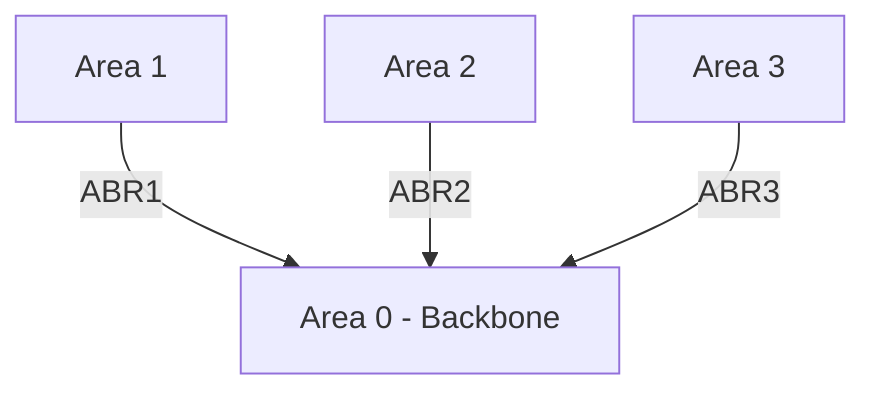
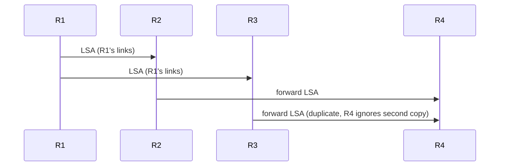
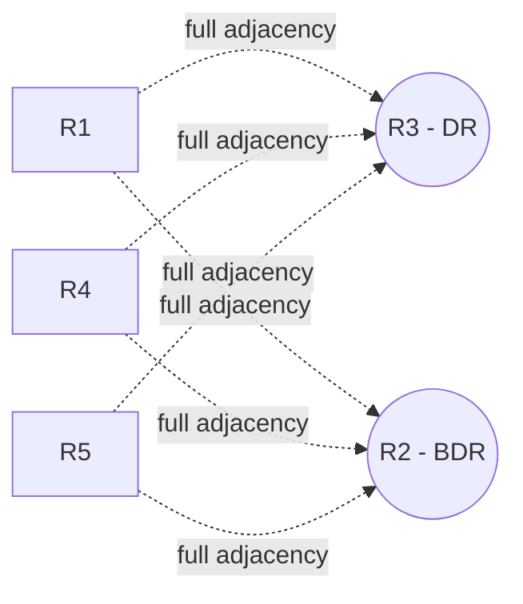
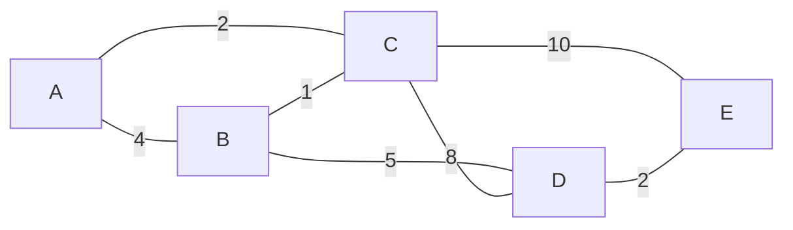

---
tags:
  - GATE/CS
  - GATE/Networks
  - Routing Protocols
aliases:
  - OSPF
  - Open Shortest Path First
  - Link State Interior Gateway Protocol
date_created: 2026-09-10
difficulty: ⭐⭐⭐⭐
last_revised: 2026-09-10
pyq_frequency: Medium
---

## Syllabus Position

Subject: [[Computer Networks Index]]
Parent Topic: [[Link State Routing]]
Sibling Topics: [[RIP]], [[Distance Vector Routing]], [[Path Vector Routing]]
Leads To: [[BGP]], [[Hierarchical Routing]], [[Multi-Area Networks]]

GATE Syllabus Line: "Routing protocols" — under Computer Networks, GATE CS syllabus lists routing protocols (link state, distance vector, path vector) as testable, with OSPF explicitly named as the canonical link-state protocol example.

Exam Weight Note: Appears as a 1-mark conceptual MCQ on OSPF properties (protocol number, area hierarchy, DR/BDR role, metric basis) or occasionally as a 2-mark MCQ contrasting OSPF with RIP/BGP on convergence, scalability, or the algorithm used internally (Dijkstra vs. Bellman-Ford).

---

## The Problem This Solves

Imagine a large corporate network with hundreds of routers spread across many buildings. If every router only gossips distances with its immediate neighbors (like [[Distance Vector Routing]]), the network converges slowly after failures, wastes bandwidth on periodic full-table exchanges, and is vulnerable to routing loops (count-to-infinity) that can take a long time to resolve. A network this large needs every router to have a complete, accurate, and rapidly-updated picture of the entire topology, and to independently compute its own shortest paths — not rely on second-hand rumors from neighbors. OSPF was designed to solve exactly this problem for large, dynamic, autonomous-system-scale networks.

**Analogy:** Think of OSPF like giving every router its own complete, always-current road atlas of the entire city, rather than relying on word-of-mouth directions from neighbors. Whenever a road closes or opens (a link changes state), every router "photocopies" that specific update and passes it on unchanged to everyone else (flooding), so all routers eventually hold an identical atlas. Each router then privately plans its own best route from that atlas using [[Dijkstra's Algorithm]] — no one else's calculation is trusted, only the raw map data.

**Core Idea (one sentence):** OSPF is a link-state interior gateway protocol in which every router floods information about its own directly connected links to all other routers in its area, builds an identical link-state database (topology map), and independently runs Dijkstra's shortest-path-first algorithm on that database to compute its own routing table.

---

## Formal Theory

**[[OSPF]]** (Open Shortest Path First) is a link-state, intra-domain (interior gateway) routing protocol that maintains a synchronized topological map — the **[[Link State Database]]** (LSDB) — at every router within a routing domain, and computes shortest paths locally using **[[Dijkstra's Algorithm]]**. It is "open" because it is a non-proprietary, publicly specified standard (RFC 2328), contrasted with Cisco's proprietary EIGRP.

### Link-State Advertisements and Flooding

Each router periodically (and immediately upon any change) generates a **[[Link State Advertisement]]** (LSA) describing its own directly connected links, their state (up/down), and their cost. This LSA is **flooded** — forwarded unmodified to every other router in the area — so that every router eventually builds the identical **Link State Database**. Flooding uses sequence numbers and aging to prevent stale or duplicate LSAs from circulating indefinitely.

### The SPF (Dijkstra) Computation

Once a router's LSDB is complete, it treats the LSDB as a weighted graph (routers and networks as vertices, links as weighted edges) and runs Dijkstra's algorithm rooted at itself to build a **Shortest Path Tree (SPT)**. The routing table is then derived directly from this tree — the next hop toward every destination is read off the first edge on the shortest path from the root.

$$\text{Cost}(link) = \frac{\text{Reference Bandwidth}}{\text{Interface Bandwidth}}$$

By default, Cisco's reference bandwidth is $10^8 \text{ bps} = 100 \text{ Mbps}$, so a 10 Mbps interface gets cost $10$, and a 100 Mbps interface gets cost $1$. This is a deliberate design choice: unlike [[RIP]]'s hop count, OSPF's metric reflects actual link speed, so it prefers fast links over merely "fewer-hop" links.

### Hierarchical Areas and the Backbone

To keep the LSDB and SPF computation tractable in very large networks, OSPF divides a routing domain into **Areas**. **Area 0** is mandatorily the **Backbone Area**, and every other area must connect to it (directly or via a virtual link), forming a strict two-level hierarchy. Routers are classified by role:
- **Internal Router** — all interfaces in a single area.
- **Area Border Router (ABR)** — connects two or more areas, holds a separate LSDB per attached area, summarizes routes between them.
- **Backbone Router** — has at least one interface in Area 0.
- **Autonomous System Boundary Router (ASBR)** — injects external routes (e.g., from [[BGP]] or [[RIP]]) into the OSPF domain.

This hierarchy exists precisely because flooding every LSA to every router in a flat, domain-wide network does not scale — areas bound the flooding scope and shrink each router's Dijkstra computation to just its own area's topology.

### DR/BDR Election on Broadcast Networks

On a multi-access broadcast segment (like Ethernet), if every router formed a full adjacency and exchanged LSAs with every other router on the segment, the number of adjacencies would grow as $O(n^2)$. OSPF avoids this by electing a **Designated Router (DR)** and **Backup Designated Router (BDR)** on each such segment; every other router forms a full adjacency only with the DR and BDR, and all LSA flooding on the segment funnels through the DR. Election is based on a router's configured **priority** (higher wins), with the highest **Router ID** as tiebreaker.

### Hello Protocol

OSPF routers discover neighbors and maintain adjacency using periodic **Hello packets**, sent every 10 seconds on broadcast networks by default (30 seconds on NBMA). If a router fails to hear a Hello within the **Dead Interval** (typically 4× the Hello interval, i.e., 40 seconds), it declares the neighbor down and triggers a new SPF computation.

### Transport

OSPF runs directly over **IP protocol number 89** — it does not use TCP or UDP, and instead implements its own reliable flooding and acknowledgment mechanism at the IP layer.

```
Algorithm OSPF_SPF(router R):
    build LSDB from all received LSAs (flooded)
    treat LSDB as weighted graph G
    run Dijkstra(G, source = R)
    for each destination D:
        next_hop(D) = first edge on shortest path R -> D in SPT
    install routes into routing table
    return routing table
```

### What GATE Actually Tests Here

GATE examiners test: the protocol number (89), the fact that OSPF uses Dijkstra internally (contrasted with RIP's Bellman-Ford), the role and mandatory nature of Area 0, the purpose of DR/BDR election on broadcast segments, and OSPF's superior convergence speed and lack of hop-count limit compared to RIP.

---

## Diagrams and Visuals

**OSPF Area Hierarchy**

Draw a central circle labeled "Area 0 (Backbone)" with three satellite circles labeled "Area 1", "Area 2", "Area 3" each connected to Area 0 by an ABR node sitting on the boundary between the two circles.

```
                +-------------------+
                |     Area 0        |
                |    (Backbone)     |
                +----+----+----+----+
                 ABR1|    |ABR2|    |ABR3
                     |    |    |    |
              +------+  +-+----+  +-+------+
              | Area 1 | | Area 2 | | Area 3 |
              +--------+ +--------+ +--------+
```



**LSA Flooding**

Draw four routers R1, R2, R3, R4 in a mesh. R1 originates an LSA describing its own links; the LSA is copied and forwarded unmodified out every interface except the one it arrived on ("flood and forward"), reaching every router exactly once (after duplicate suppression via sequence numbers).



**DR/BDR Election on a Broadcast LAN**

Draw five routers R1..R5 all attached to a single Ethernet segment. R3 has the highest priority and becomes DR; R2 has the second-highest and becomes BDR. Dashed lines show that R1, R4, R5 only form full adjacencies with R3 (DR) and R2 (BDR), not with each other.

```
        R1        R4        R5
         \         |         /
          \        |        /
           \       |       /
            +------+------+
            |             |
           R3 (DR)     R2 (BDR)
```



---

## Complexity Analysis

OSPF's per-router computational cost is dominated by the SPF (Dijkstra) run, while its network-wide cost is dominated by LSA flooding.

- **SPF Computation Time:** Each router runs [[Dijkstra's Algorithm]] on its area's LSDB graph with $V$ vertices (routers/networks) and $E$ edges (links). Using a binary heap priority queue, this costs $O((V+E)\log V)$, and with a Fibonacci heap it improves to $O(E + V \log V)$. This is why OSPF is described as converging faster than distance vector protocols on large topologies — each router does one bounded local computation instead of waiting for iterative rounds of neighbor gossip.
- **Space Complexity:** Each router stores a full LSDB for its own area(s), of size $O(V + E)$ — proportional to the topology size, not just the number of destinations. This is strictly more memory-hungry per router than [[Distance Vector Routing]]'s $O(n)$ vector, but it is what enables loop-free, single-shot shortest-path computation.
- **Message/Flooding Complexity:** In the worst case (initial flood), each LSA reaches every router in the area exactly once (duplicates are suppressed via sequence numbers), giving $O(V \cdot E)$ total LSA transmissions across the area in the worst case — but this only happens on topology changes, not periodically like RIP's full-table broadcasts.
- **Convergence Time:** Detecting a failure takes up to the Dead Interval (40s default) if Hello packets alone are relied upon, but modern implementations use faster failure detection (e.g., BFD) to trigger flooding sooner. Once a change is flooded, every router recomputes SPF in $O((V+E)\log V)$ — this is why OSPF converges in seconds rather than the tens of seconds to minutes RIP can take.

#### Complexity Summary Table

| Case                    | Time Complexity            | Space Complexity | Trigger Condition                                  |
|-------------------------|-----------------------------|-------------------|------------------------------------------------------|
| SPF Computation (per router) | $O((V+E)\log V)$ (binary heap) | $O(V+E)$ (LSDB)   | Runs on every topology change (new/failed LSA)       |
| Steady state (no change) | $O(1)$ (no recomputation)  | $O(V+E)$ (LSDB stored) | No new LSAs received                                |
| Initial flood / major change | $O(V \cdot E)$ total messages | $O(V+E)$ per router | Network startup or large-scale link failure          |

---

## Worked Example

Consider a single-area OSPF network with five routers A, B, C, D, E and the following link costs (derived from bandwidth):

```
A-B = 4, A-C = 2, B-C = 1, B-D = 5, C-D = 8, C-E = 10, D-E = 2
```



Every router has already flooded its LSA and built an identical LSDB representing this exact graph. We trace router A's SPF (Dijkstra) computation.

**Initialization:**
```
dist[A]=0, dist[B]=inf, dist[C]=inf, dist[D]=inf, dist[E]=inf
Unvisited = {A, B, C, D, E}
```

**Step 1 — process A (dist 0):** relax neighbors B and C.
```
dist[B] = min(inf, 0+4) = 4   (via A)
dist[C] = min(inf, 0+2) = 2   (via A)
Unvisited = {B, C, D, E}
```

**Step 2 — pick minimum unvisited: C (dist 2).** Relax C's neighbors B, D, E.
```
dist[B] = min(4, 2+1) = 3     (via C, improved!)
dist[D] = min(inf, 2+8) = 10  (via C)
dist[E] = min(inf, 2+10) = 12 (via C)
Unvisited = {B, D, E}
```

**Step 3 — pick minimum unvisited: B (dist 3).** Relax B's neighbors D.
```
dist[D] = min(10, 3+5) = 8    (via B, improved!)
Unvisited = {D, E}
```

**Step 4 — pick minimum unvisited: D (dist 8).** Relax D's neighbor E.
```
dist[E] = min(12, 8+2) = 10   (via D, improved!)
Unvisited = {E}
```

**Step 5 — pick minimum unvisited: E (dist 10).** No unvisited neighbors remain to relax.
```
Unvisited = {}  -- SPF complete
```

**Final Shortest Path Tree rooted at A:**
```
A -> B : cost 3   (path A-C-B)
A -> C : cost 2   (path A-C)
A -> D : cost 8   (path A-C-B-D)
A -> E : cost 10  (path A-C-B-D-E)
```

**Verification:** Total relaxation operations performed: 2 (step 1) + 3 (step 2) + 1 (step 3) + 1 (step 4) = 7, consistent with $O(E) = O(7 \text{ edges})$ edge relaxations across the run, confirming the $O((V+E)\log V)$ claim for $V=5, E=7$. Router A installs next-hop C for all of B, C, D, E, since C is the first hop on every shortest path from A.

**Edge-case follow-up:** What changes if link B-D fails? A must re-flood is not needed by A itself (B originates the change LSA), but once A receives the updated LSA (B-D removed), A reruns the entire Dijkstra computation from scratch on the updated LSDB — OSPF does not do incremental patching of the SPT, it fully recomputes. The new path to D becomes A-C-D at cost $2+8=10$ instead of $8$, and E's path updates accordingly to cost $12$ via C directly (since C-B-D-E is now more expensive than C-E direct).

---

## Intuition Anchors

**The Analogy (restated and deepened):** Recall the road-atlas analogy. Now extend it: when a road closes, it's like a specific city office issuing an official, timestamped bulletin ("Road B-D is closed") that gets photocopied and handed to every citizen exactly once (LSA flooding with sequence numbers preventing duplicates). Every citizen then independently re-plans their entire route from scratch using their now-updated atlas (full SPF recomputation) — nobody trusts a neighbor's opinion on the best route, only the raw, agreed-upon map data.

**The Mental Model:** For OSPF, picture a "wave" that washes outward from the origin of a change (the router whose link changed), reaching every other router in the area exactly once via flooding, after which every router independently re-runs its own private Dijkstra "fire spreading from itself" to rebuild its own shortest-path tree. There is no distributed negotiation — just synchronized, identical raw data feeding independent, deterministic computations.

**The One-Line Recall:** "OSPF is link-state: every router floods its own link info to build an identical LSDB, then independently runs Dijkstra rooted at itself — cost is bandwidth-based, Area 0 is the mandatory backbone, DR/BDR limit adjacencies on broadcast segments, and it rides directly over IP protocol 89."

**The #1 Trap:** Students conflate OSPF's internal algorithm with RIP's. The wrong belief: "OSPF uses Bellman-Ford like other IP routing protocols." The correct fact: OSPF is a **link-state** protocol using **Dijkstra's algorithm** on a locally-built LSDB, while [[RIP]] is a **distance-vector** protocol using distributed Bellman-Ford — this pairing (OSPF↔Dijkstra, RIP↔Bellman-Ford) is one of the single most frequently tested facts in GATE routing questions.

---

## GATE Questions

---

**Question 1 — [GATE-style] — [1-mark]**

> OSPF (Open Shortest Path First) messages are encapsulated directly inside which of the following?

- (A) UDP datagrams
- (B) TCP segments
- (C) IP datagrams, using protocol number 89
- (D) Ethernet frames without any network-layer header

<details>
<summary>Solution</summary>

**Answer: (C)**

**Reasoning:** OSPF runs directly on top of IP, using IP protocol number 89, rather than riding over a transport-layer protocol like UDP or TCP. This is a deliberate design choice that lets OSPF implement its own custom reliability and flooding mechanism rather than relying on TCP's connection-oriented guarantees or UDP's unreliable best-effort delivery. (A) is the trap — many other routing protocols like RIP do use UDP (port 520), so students often assume OSPF follows the same pattern. (B) is wrong for the same reason — no routing protocol commonly discussed at this level uses raw TCP for updates because TCP's connection setup overhead is unsuitable for periodic/triggered flooding. (D) is wrong because OSPF absolutely requires an IP header for addressing and routing across the network.

**What this question is really testing:** Whether the student has memorized OSPF's specific transport-layer placement, since it is an exception among common IP routing protocols (RIP uses UDP, BGP uses TCP).

**Trap to avoid:** Assuming all routing protocols use UDP just because RIP does — OSPF is the standard counterexample GATE uses to test this distinction.

</details>

---

**Question 2 — [Conceptual] — [1-mark]**

> Which of the following statements about OSPF's Area 0 is correct?

- (A) Area 0 is optional and only required in networks with more than 50 routers.
- (B) Area 0 is the mandatory backbone area, and every other area must connect to it directly or via a virtual link.
- (C) Area 0 is used only for external route redistribution from BGP.
- (D) Area 0 always contains exactly one router, the ASBR.

<details>
<summary>Solution</summary>

**Answer: (B)**

**Reasoning:** OSPF's two-level hierarchy mandates that Area 0 (the backbone) be the central hub through which all inter-area traffic passes; every other area must attach to Area 0 either directly through an Area Border Router (ABR) or, if physical connectivity isn't possible, through a virtual link tunneled across another area. This constraint exists precisely to prevent routing loops between areas and to bound the scope of intra-area flooding. (A) is false — Area 0 is mandatory in any multi-area OSPF deployment, regardless of router count; even a single-area network is implicitly "all Area 0." (C) is false — external route redistribution is the job of an ASBR, which can exist in any area, not specifically tied to Area 0's function. (D) is false — Area 0 can contain any number of routers and doesn't require an ASBR to exist at all.

**What this question is really testing:** Whether the student understands OSPF's mandatory two-level area hierarchy and why it exists (loop prevention, flooding scope reduction).

**Trap to avoid:** Thinking Area 0 is merely a convention or best-practice recommendation — it is a hard protocol requirement, not an optional design choice.

</details>

---

**Question 3 — [Hard, multi-concept] — [2-mark]**

> Consider a broadcast (Ethernet) LAN segment with 6 OSPF routers attached. Without DR/BDR election, how many full OSPF adjacencies would need to form on this segment, and what problem does DR/BDR election solve?

- (A) 6 adjacencies; DR/BDR eliminates the need for Hello packets entirely.
- (B) 15 adjacencies ($\binom{6}{2}$); DR/BDR reduces this to at most 10 adjacencies (each router only adjacent to DR and BDR), preventing $O(n^2)$ LSA flooding overhead on the segment.
- (C) 30 adjacencies; DR/BDR eliminates LSA flooding entirely by replacing it with distance-vector updates.
- (D) 1 adjacency; DR/BDR is only relevant for point-to-point links, not broadcast segments.

<details>
<summary>Solution</summary>

**Answer: (B)**

**Reasoning:** Without DR/BDR, every pair of the 6 routers on the shared segment would need to form a full adjacency to exchange LSAs directly, giving $\binom{6}{2} = 15$ adjacencies — and each adjacency independently floods and re-floods LSAs, causing massive redundant traffic that scales as $O(n^2)$ in the number of routers on the segment. With DR/BDR election, every non-DR/BDR router forms a full adjacency only with the DR and the BDR (at most $2$ each, so at most $6 + (6-2) = 10$ total meaningful adjacencies, since DR and BDR themselves form one adjacency with each other and with every other router — the exact count depends on convention, but the key insight is the reduction from quadratic to linear-ish adjacency count), and all flooding is funneled through the DR, which redistributes to everyone else. (A) is false — Hello packets are still required for neighbor discovery and DR/BDR election itself. (C) is false — DR/BDR does not change OSPF from link-state to distance-vector; it only restricts which routers form full adjacencies. (D) is false — DR/BDR election is specifically a broadcast/NBMA segment mechanism and does not apply to point-to-point links, where exactly one adjacency naturally forms between the two endpoints.

**What this question is really testing:** Understanding of *why* DR/BDR election exists — to avoid the $O(n^2)$ adjacency and flooding explosion on multi-access broadcast segments.

**Trap to avoid:** Assuming DR/BDR changes the fundamental link-state flooding mechanism (it does not) — it only restricts the *topology of adjacencies* over which flooding occurs, reducing redundant transmissions.

</details>

---

**Pattern Recognition:**
- When GATE asks about OSPF's internal algorithm, immediately recall the pairing: OSPF → link-state → Dijkstra; RIP → distance-vector → Bellman-Ford.
- When GATE asks about OSPF's transport, remember it rides directly over IP (protocol 89) — not UDP (unlike RIP) or TCP (unlike BGP).
- When GATE tests area hierarchy questions, check whether the option treats Area 0 as mandatory (correct) or optional/convention-only (a common wrong distractor).
- When GATE tests DR/BDR, look for the "$O(n^2)$ adjacency reduction" framing — this is the core justification examiners test for its existence.

---

## Edge Cases and Failure Modes

- [ ] **Single-router or trivial network (no neighbors):** With no neighbors, a router's LSDB contains only its own trivial LSA; SPF computation is trivial ($O(1)$) since there is nothing to flood or relax — no adjacency or DR/BDR logic is triggered.
- [ ] **All link costs identical:** Multiple equal-cost shortest paths can exist; OSPF supports Equal-Cost Multi-Path (ECMP) and may install multiple next hops for the same destination, unlike a naive Dijkstra that picks just one arbitrarily.
- [ ] **Point-to-point link mistaken for broadcast:** Students sometimes assume DR/BDR election happens on every link type — it does NOT occur on point-to-point (e.g., serial) links, since exactly two routers exist and a full adjacency forms directly between them without election overhead.
- [ ] **Backbone (Area 0) partitioned:** If Area 0 itself becomes physically disconnected (e.g., due to a core link failure), inter-area routing breaks even if individual areas remain internally connected — this is why virtual links exist, to logically stitch a partitioned backbone back together across a transit area.
- [ ] **Off-by-one in Dead Interval vs. Hello Interval:** Students often forget the Dead Interval (typically 4× Hello Interval, e.g., 40s for a 10s Hello) is what triggers neighbor-down detection, not the Hello Interval itself — confusing the two leads to wrong failure-detection-time calculations.
- [ ] **LSA sequence number wraparound / stale LSA flooding:** Without sequence numbers and a maximum-age field, old LSAs could circulate indefinitely or overwrite newer information — OSPF ages out LSAs (MaxAge, typically 3600s) and uses strictly increasing sequence numbers to guarantee the newest information always wins.
- [ ] **Topic-specific failure — full SPF recomputation cost on frequent flapping:** If a link "flaps" (goes up/down repeatedly), every single change triggers a fresh, non-incremental Dijkstra run at every affected router — unlike some modern incremental SPF implementations, textbook/GATE-level OSPF assumes a full recomputation each time, which can be computationally expensive under unstable links.

---

## Comparisons

| Feature              | [[OSPF]]                                  | [[RIP]]                                     | [[Link State Routing]] (generic)          |
|----------------------|---------------------------------------------|------------------------------------------------|------------------------------------------------|
| Time Complexity      | $O((V+E)\log V)$ per SPF run (Dijkstra)     | $O(d)$ rounds to converge (Bellman-Ford)       | $O((V+E)\log V)$ per router (generic Dijkstra) |
| Space Complexity     | $O(V+E)$ per router (full area LSDB)        | $O(n)$ per router (distance vector only)       | $O(V+E)$ per router (full topology map)        |
| Key Property         | Hierarchical areas, DR/BDR, bandwidth-based cost, runs over IP protocol 89 | Hop-count metric (max 15), runs over UDP port 520 | Abstract algorithm class OSPF is an instance of |
| When to Prefer       | Large, fast-converging intra-domain networks | Very small, simple networks with low config overhead | Conceptual baseline — OSPF and IS-IS are its real-world implementations |
| GATE Trap            | Assuming OSPF uses Bellman-Ford like RIP (it uses Dijkstra) | Assuming RIP has no hop limit (it caps at 15, "16" = unreachable) | Assuming "link state routing" and "OSPF" are always fully synonymous — OSPF adds areas, DR/BDR, and specific metrics on top of the generic algorithm |

The most common GATE question comparing these is: "Why does OSPF converge faster and scale better than RIP?" — and the answer hinges on the precise distinguishing property that **OSPF gives every router a complete, first-hand topology map (via flooded LSAs) enabling an independent, single-shot Dijkstra computation with no hop-count ceiling, whereas RIP relies on slow, iterative neighbor-to-neighbor distance exchange bounded by a maximum hop count of 15, making it unsuitable for large networks.**

---

## Connections Web

**Must know before this topic:**
- [[Dijkstra's Algorithm]] — the exact shortest-path algorithm every OSPF router runs locally on its LSDB
- [[Link State Routing]] — the generic algorithmic class OSPF is a real-world implementation of
- [[Graph Theory Basics]] — needed to model the LSDB as a weighted graph of vertices and edges

**Topics that build on this:**
- [[BGP]] — the inter-domain counterpart that OSPF hands external routes to via an ASBR
- [[Hierarchical Routing]] — OSPF's Area 0 / non-backbone-area structure is a concrete instance of this general concept
- [[Multi-Area Networks]] — advanced OSPF deployments built on the Area 0 hierarchy

**GATE Subject Links:**
- [[Computer Networks Index]] > [[Network Layer]]

**Cross-Subject Connections:**
- [[Distance Vector Routing]] — the contrasting philosophy GATE loves to pit against OSPF's link-state approach
- [[Priority Queue]] (Data Structures subject) — the binary/Fibonacci heap used to implement Dijkstra efficiently in SPF computation
- [[Shortest Path Problem]] (Algorithms subject) — the underlying graph problem OSPF solves at every router

**Standard References:**
- [[Kurose and Ross Chapter 4]] (Network Layer — Routing Algorithms and OSPF)
- [[CLRS Chapter 24]] (Dijkstra's Algorithm)
- [[RFC 2328]] (OSPF Version 2 specification)

---

## Quick Revision Sheet

**Definition (1 sentence):** OSPF is a link-state interior gateway routing protocol in which every router floods LSAs describing its own links to build an identical Link State Database, then independently runs Dijkstra's algorithm on that database to compute its own shortest-path routing table.

**Core Idea / Analogy (1 sentence):** Every router gets an identical, always-current road atlas (via LSA flooding) and privately plans its own best route from it (via Dijkstra), rather than trusting neighbor rumors like distance vector routing does.

**Algorithm Steps (numbered, maximum 6 steps):**
1. Discover neighbors and establish adjacency using periodic Hello packets.
2. Elect DR/BDR on broadcast segments to limit adjacency count.
3. Generate an LSA describing your own directly connected links and their bandwidth-based costs.
4. Flood the LSA to all routers in the area; every router builds an identical LSDB.
5. Run Dijkstra's algorithm on the LSDB, rooted at yourself, to build a Shortest Path Tree.
6. Install next hops from the SPT into your routing table; recompute fully on any LSA change.

**Complexity:**
- Time (best / average / worst): $O((V+E)\log V)$ per SPF run using a binary heap; $O(1)$ in steady state with no topology change.
- Space: $O(V+E)$ per router for the area's LSDB.
- Recurrence (if applicable): Not recurrence-based — uses Dijkstra's greedy relaxation, $\text{dist}[v] = \min(\text{dist}[v],\ \text{dist}[u] + w(u,v))$.

**Key Properties (3 to 5 bullet points):**
- Uses Dijkstra's algorithm internally (contrast with RIP's Bellman-Ford).
- Cost metric is bandwidth-based ($\text{RefBW}/\text{InterfaceBW}$), not hop count — no artificial hop limit exists.
- Area 0 (backbone) is mandatory; all other areas must connect to it.
- DR/BDR election on broadcast segments avoids $O(n^2)$ adjacency/flooding overhead.
- Runs directly over IP protocol number 89, not UDP or TCP.

**The #1 Trap:** Assuming OSPF uses the same distance-vector/Bellman-Ford approach as RIP — OSPF is strictly link-state and uses Dijkstra, which is the single most tested distinguishing fact between the two protocols.

**When to use this over alternatives:** Prefer OSPF over RIP in large, fast-changing intra-domain networks where quick convergence and no artificial hop-count ceiling matter; prefer RIP only in small, simple networks where configuration simplicity outweighs scalability and convergence speed.

**Mnemonic or one-liner to remember the steps:** "Hello, elect a DR, flood your LSA, everyone runs Dijkstra" — H-E-F-D captures Hello → Election → Flooding → Dijkstra.

---

## Revision Checklist

- [ ] I can state the formal definition without looking.
- [ ] I can explain the road-atlas analogy and map it to LSA flooding and independent Dijkstra computation.
- [ ] I can trace the 5-router SPF example by hand in under 2 minutes.
- [ ] I can derive the $O((V+E)\log V)$ SPF complexity from scratch, citing the heap-based Dijkstra implementation.
- [ ] I know what the Quick Revision Sheet says without reading it.
- [ ] I can solve all 3 GATE questions in this note without peeking.
- [ ] I know the #1 trap (OSPF uses Dijkstra, not Bellman-Ford) and can articulate why students confuse it with RIP.
- [ ] I have linked this note correctly in my Obsidian vault.
- [ ] I have scheduled a spaced-repetition review in 3 days.
</content>
