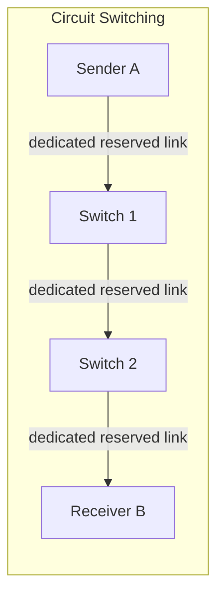
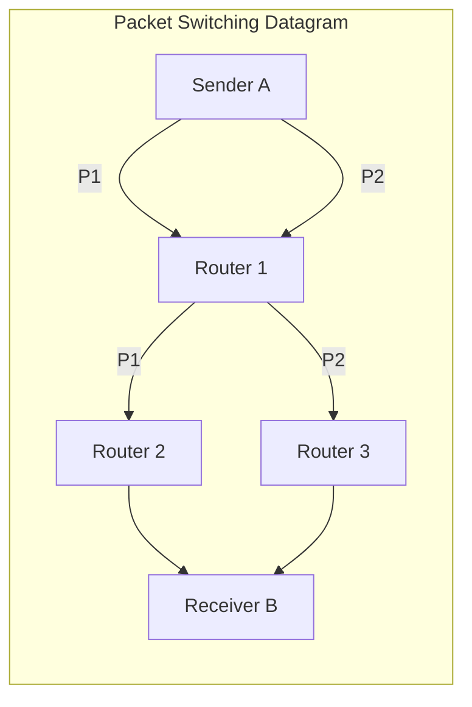

---
tags:
  - GATE/CS
  - GATE/ComputerNetworks
  - SwitchingTechniques
  - NetworkArchitecture
aliases:
  - Packet Switching vs Circuit Switching
  - Switching Techniques
  - Message Switching
date_created: 2026-09-12
difficulty: ⭐⭐⭐
last_revised: 2026-09-12
pyq_frequency: Medium
---

## Syllabus Position

Subject: [[Computer Networks]]
Parent Topic: [[Delay in Computer Networks]]
Sibling Topics: [[Types of Communication]], [[Stop and Wait Protocol]], [[TCP Header]]
Leads To: [[TCP Header]], [[UDP Header]], [[Fragmentation in IPv4]]

GATE Syllabus Line: "Networking devices... Switching. Basics of packet, circuit, and virtual circuit switching."

Exam Weight Note: Appears almost every year as a 1-mark conceptual MCQ (true/false statements about setup delay, bandwidth reservation, or dedicated paths) and occasionally as a 2-mark NAT question computing total transfer/delay time for circuit vs. packet switching over a link with given bandwidth, propagation delay, and message size.

---

## The Problem This Solves

Imagine a phone network and the internet both need to move data from A to B across a shared physical infrastructure of wires, switches, and routers. A phone call needs a *guaranteed*, uninterrupted, low-jitter path for the entire duration of the conversation — nobody wants their voice call to randomly queue behind someone else's data. But a web browser sending a burst of small requests doesn't need (and can't justify) reserving an entire path for itself for minutes at a time — that would waste enormous capacity while it's idle between bursts. These two very different traffic patterns — "long, continuous, latency-sensitive" versus "bursty, tolerant of variable delay" — demand two fundamentally different philosophies for sharing a network's finite links among many users.

**Analogy:** Circuit switching is like reserving an entire private lane on a highway for your car's entire trip, even during the red lights when you're not moving — nobody else can use that lane, but your travel time is perfectly predictable once you're on it. Packet switching is like breaking your journey into individually addressed parcels and letting each one find its own way through general traffic, sharing the road with everyone else's parcels — cheaper and more flexible, but each parcel might take a different route and arrive at a different time.

**Core Idea:** Circuit switching pre-reserves a dedicated, fixed-bandwidth path for the entire duration of a session before any data flows, while packet switching splits data into independently routed packets that share link bandwidth on demand with no dedicated path.

---

## Formal Theory

**Switching** is the mechanism by which a network decides how to move data from a source to a destination across a shared set of intermediate links and nodes. The three principal answers to this problem examined in GATE syllabi are **circuit switching**, **packet switching**, and the hybrid **virtual circuit switching**.

### Circuit Switching

In circuit switching, before any user data is transmitted, the network performs a three-phase process:
1. **Circuit establishment** — a dedicated end-to-end physical/logical path is set up, and bandwidth is reserved on every link along that path.
2. **Data transfer** — data flows continuously at the reserved rate; no addressing or routing decisions are needed per unit of data since the path is fixed.
3. **Circuit teardown** — the path is released and the reserved bandwidth returned to the pool for other users.

The classic example is the **Public Switched Telephone Network (PSTN)**. The reserved bandwidth can be implemented via **[[Frequency Division Multiplexing]]** (each circuit gets a frequency band) or **[[Time Division Multiplexing]]** (each circuit gets a recurring time slot).

### Packet Switching

In packet switching, data is broken into **packets**, each carrying a header with source/destination addressing information. There is no reservation phase. Two sub-models exist:

#### Datagram (Connectionless) Packet Switching
Each packet is routed **independently**, based purely on its destination address and the current state of the router's routing table. Packets belonging to the same message may take different paths and may arrive **out of order**. This is the model used by **[[IPv4 Header|IP]]** — the underlying protocol of the internet.

#### Virtual Circuit Packet Switching
A **setup phase** establishes a logical path (a sequence of virtual-circuit identifiers, or VCIs, stored in each router's table) before data transfer, but — critically — **no bandwidth is reserved**; the path is shared with other traffic. All packets of a session follow this fixed logical path and arrive in order, but the underlying physical bandwidth is still statistically shared, unlike true circuit switching. **[[ATM]]** and traditional telephone-style packet networks like X.25 use this model.

### Pseudocode: Store-and-Forward Packet Switching at a Router

```
Algorithm PACKET_SWITCH_FORWARD(packet):
    receive packet fully into buffer      // store
    read destination address from header
    lookup next-hop in routing table
    if link to next-hop is busy:
        queue packet                       // wait for turn
    transmit packet onto outgoing link      // forward
    return
```

**What GATE actually tests here:** GATE loves numerical questions comparing *total time* to send a message under circuit switching (setup delay + transmission delay, at full reserved bandwidth) versus packet switching (transmission delay per packet + per-hop store-and-forward delays, summed across hops, at shared bandwidth) — and conceptual MCQs testing whether you know that circuit switching guarantees bandwidth but wastes it during silence, while datagram packet switching has no guaranteed order or bandwidth but uses links efficiently.

---

## Diagrams and Visuals

**Circuit Switching — dedicated path reserved end to end:**

```
Phase 1: SETUP
  A ==reserve==> S1 ==reserve==> S2 ==reserve==> B
  (signaling message finds path, reserves slot/frequency on each link)

Phase 2: DATA TRANSFER (path fixed, bandwidth guaranteed)
  A --------[continuous stream, dedicated bandwidth]--------> B
       via S1 --------------------------> S2

Phase 3: TEARDOWN
  A ==release==> S1 ==release==> S2 ==release==> B
```

**Packet Switching (Datagram) — each packet routed independently, no reservation:**

```
Message split into packets P1, P2, P3 at A

  P1 -> S1 -> S2 -> B     (routes via S1, S2)
  P2 -> S1 -> S3 -> B     (routes via S1, S3 -- different path!)
  P3 -> S1 -> S2 -> B     (arrives before P2 despite being sent after -- reordering)

Each Si buffers the packet (store), reads header, decides next hop, forwards (forward).
```





Label meanings: solid dedicated arrows in circuit switching represent bandwidth that is reserved and unusable by any other session even when idle; the packet-switching diagram shows two packets from the same message taking genuinely different router paths, illustrating why reordering can occur.

---

## Complexity Analysis

Here "complexity" means **total delay to transfer a message**, since that is what GATE numerically tests, rather than algorithmic time complexity.

### Circuit Switching Total Time
$$T_{circuit} = T_{setup} + T_{transmission} + T_{propagation}$$
- $T_{setup}$: time to establish the path across $k$ hops (signaling delay per hop $\times$ hops, round trip).
- $T_{transmission} = \dfrac{M}{B}$, where $M$ is message size and $B$ is the reserved bandwidth of the circuit (data flows once, continuously, since the whole path is already reserved and doesn't need per-hop store-and-forward).
- $T_{propagation}$: signal propagation delay over the total path length, counted once since the circuit behaves like one continuous pipe.

**Justification:** Because the path is fully reserved before data flows, once transmission begins, the message flows through it like water through a fixed pipe — you do not add per-hop transmission delay again, only the propagation delay across the whole path plus one transmission delay at the source.

### Packet Switching (Store-and-Forward) Total Time
For a message split into $p$ packets sent over $k$ hops, each hop of bandwidth $B$:
$$T_{packet} = k \cdot t_{trans}(\text{first packet}) + (p-1) \cdot t_{trans}(\text{one packet}) + k \cdot t_{prop}$$
where $t_{trans} = \dfrac{L}{B}$ for packet length $L$.

**Justification:** Each router must **fully receive** a packet before forwarding it (store-and-forward), so the first packet incurs $k$ full transmission delays (one per hop) before reaching the destination. After that, packets are pipelined — while packet 1 is being transmitted on hop 2, packet 2 can already start on hop 1 — so only one additional transmission delay is needed per subsequent packet. Propagation delay is incurred once per hop for the last bit to arrive.

### Complexity Summary Table

| Case                     | Time Complexity                                      | Space Complexity                     | Trigger Condition                                              |
|--------------------------|-------------------------------------------------------|---------------------------------------|------------------------------------------------------------------|
| Circuit Switching        | $O(T_{setup} + M/B + T_{prop})$                       | $O(1)$ buffering (no store-and-forward) | Long, continuous session — cost dominated by fixed setup overhead |
| Packet Switching (small p) | $O(k \cdot L/B + T_{prop})$                          | $O(L)$ per router (one packet buffered) | Few short packets — per-hop delay dominates, no pipelining benefit |
| Packet Switching (large p) | $O(k \cdot L/B + (p-1)\cdot L/B + k\cdot T_{prop})$   | $O(L)$ per router, pipelined          | Long messages split into many packets — pipelining amortizes per-hop delay |

---

## Worked Example

Consider a message of $M = 3200$ bits to be sent from A to B over $k = 2$ hops (A→S1→B), each link with bandwidth $B = 800$ bits/sec, and propagation delay $t_{prop} = 5\text{ ms}$ per hop. Assume circuit setup takes $T_{setup} = 10\text{ ms}$ (round trip signaling over both hops), and for packet switching the message is split into $p = 4$ packets of $L = 800$ bits each.

**Circuit Switching:**
- $T_{setup} = 10\text{ ms}$
- $T_{transmission} = 3200 / 800 = 4\text{ s} = 4000\text{ ms}$ (sent once, continuously, at reserved rate)
- $T_{propagation} = 2 \times 5\text{ ms} = 10\text{ ms}$ (once, across the whole path)
- **Total** $= 10 + 4000 + 10 = 4020\text{ ms}$

**Packet Switching (store-and-forward, pipelined):**
- $t_{trans}$ per packet $= 800/800 = 1\text{ s} = 1000\text{ ms}$
- First packet takes $k \times t_{trans} = 2 \times 1000 = 2000\text{ ms}$ to reach B (must be fully received and re-transmitted at S1).
- State after first packet arrives at B: `[P1 delivered]`, S1 buffer now transmitting P2 to B, A already finished sending P2 onto link A-S1 and is sending P3.
- Remaining $p - 1 = 3$ packets each add one $t_{trans} = 1000\text{ ms}$ (pipelined — no need to wait full round trip again): $3 \times 1000 = 3000\text{ ms}$.
- Propagation: $k \times t_{prop} = 2 \times 5 = 10\text{ ms}$.
- **Total** $= 2000 + 3000 + 10 = 5010\text{ ms}$

**Verification:** Circuit switching (4020 ms) beats packet switching (5010 ms) here because the message is long and continuous relative to the setup overhead — exactly the regime where reserving a dedicated pipe pays off. Total operations: 1 continuous transmission (circuit) vs. 4 discrete store-and-forward hops (packet), confirming the $O(M/B)$ vs. $O(k \cdot L/B + (p-1)L/B)$ claims.

**What would change if the message were tiny (say $M = 100$ bits, one packet)?** Circuit switching would still pay the full $10\text{ ms}$ setup cost for a message that transmits in a fraction of a millisecond — making packet switching (no setup phase at all) dramatically faster for small, bursty messages. This is precisely why the internet, dominated by short bursty transfers, uses packet switching rather than circuit switching.

---

## Intuition Anchors

**The Analogy (restated and deepened):** The private-highway-lane vs. shared-road analogy now extends further: the "setup" phase in circuit switching is like the toll booth process of reserving your lane before you drive — it costs you time up front regardless of trip length, which is why it only pays off for long trips (long messages). The "store-and-forward" delay in packet switching is like each parcel needing to be fully unpacked and re-addressed at every sorting depot before continuing — that's the $k \times t_{trans}$ term for the first packet. Pipelining is like a conveyor belt of parcels moving through the depot — once the belt is full, parcels arrive at a steady rate of one depot-transit-time apart.

**The Mental Model:** Picture circuit switching as **committing first, then a hose flows freely with zero interruption**. Picture packet switching as **many independent envelopes finding their own way, each one fully re-examined at every post office along the route** — you trade guaranteed timing for flexibility and efficient sharing.

**The One-Line Recall:** "Circuit switching pays a fixed setup cost for a guaranteed dedicated pipe; packet switching pays no setup cost but pays a per-hop store-and-forward cost per packet — so circuit switching wins for long continuous transfers, packet switching wins for short bursty ones."

**The #1 Trap:** Students assume virtual circuit switching is the same as circuit switching because both have a "setup phase." **It is not** — virtual circuit switching only sets up a logical *routing path* (VCIs in tables), while the actual bandwidth on each physical link is still statistically shared with other traffic, exactly like datagram switching. Only true circuit switching reserves physical bandwidth. This distinction is the single most-tested trap on this topic.

---

## GATE Questions

---

**Question 1 — [GATE-style] — [1-mark]**

> Which of the following statements about circuit switching is FALSE?

- (A) Bandwidth is reserved for the entire duration of the connection, even during idle periods.
- (B) A dedicated path is established before data transfer begins.
- (C) It is well suited to bursty traffic with long idle gaps between transmissions.
- (D) The path remains fixed for the whole session and is released only at teardown.

<details>
<summary>Solution</summary>

**Answer: (C)**

**Reasoning:** (A), (B), and (D) are all defining properties of circuit switching directly from the theory: bandwidth reservation for the whole session, an explicit setup phase, and a fixed path until teardown. (C) is false — bursty traffic (long idle periods interspersed with short bursts) is exactly the worst case for circuit switching, because the reserved bandwidth sits unused during idle periods while no one else can use it. Bursty traffic is what packet switching (with statistical multiplexing) handles efficiently instead.

**What this question is really testing:** Whether the student understands *why* circuit switching wastes bandwidth on bursty traffic, not just that it "reserves bandwidth."

**Trap to avoid:** Assuming all four options sound like generic circuit-switching facts and picking one at random without checking which one contradicts the wasted-idle-bandwidth property specifically.

</details>

---

**Question 2 — [Numerical] — [2-mark]**

> A message of length 1000 bits is to be transmitted from source to destination through 4 intermediate routers using store-and-forward packet switching, with the message sent as a single packet. Each link has a bandwidth of 1000 bits/sec, and propagation delay per link is negligible. What is the total time to deliver the message?

<details>
<summary>Solution</summary>

Since the message is sent as a **single packet**, it must be fully received and re-transmitted at each of the 4 routers before reaching the destination, so there are $4 + 1 = 5$ hops total (source→R1→R2→R3→R4→destination). Each hop transmission takes $1000/1000 = 1\text{ s}$. Since propagation delay is negligible and there is only one packet (no pipelining possible with a single packet), total time $= 5 \times 1\text{ s} = 5\text{ s}$.

**Trap to avoid:** Forgetting to count the hop from the last router to the destination, or assuming pipelining reduces this time — pipelining only helps when there are *multiple* packets, so a single-packet message always incurs the full $k \times t_{trans}$ with no savings.

</details>

---

**Question 3 — [Hard / Multi-concept] — [2-mark]**

> A network engineer must choose between circuit switching and datagram packet switching for a new application that streams continuous, latency-sensitive voice data for long durations. However, the underlying physical network already carries many other bursty data-only sessions on the same links. Which switching approach should be preferred, and what trade-off does it force on the *other* sessions?

<details>
<summary>Solution</summary>

Circuit switching should be preferred for the voice application, because it is long-duration, continuous, and latency-sensitive — exactly the profile where a dedicated, jitter-free reserved path is worth the fixed setup cost. However, this comes at a direct cost to the other bursty sessions sharing the same physical links: the bandwidth reserved for the voice circuit is **unavailable to them even during voice's silent periods** (e.g., pauses in speech), reducing the total statistically-multiplexed capacity available for everyone else's bursty traffic. This is the fundamental trade-off between guaranteed QoS for one flow and overall network utilization for all flows — the same reason real telephone-over-IP systems increasingly use packet switching with QoS prioritization instead of true circuit reservation, trying to get the best of both.

**What this question is really testing:** Whether the student can reason about switching choice as a system-level trade-off (one flow's guarantee vs. aggregate network efficiency), combining Sections on both circuit switching properties and packet switching's statistical multiplexing advantage.

**Trap to avoid:** Answering only "circuit switching is better for voice" without identifying the *cost imposed on other sessions* — GATE 2-mark hard questions specifically reward reasoning about second-order effects, not just picking the obviously "correct" technique.

</details>

---

**Pattern Recognition:**
- When GATE gives you a numerical question with setup delay explicitly mentioned, it's testing circuit switching's $T_{setup} + T_{trans} + T_{prop}$ formula — always check whether setup is a one-time round-trip cost.
- When GATE describes a message "split into packets" traveling through routers, immediately identify it as store-and-forward and expect a pipelining calculation: first packet costs $k$ hops, remaining packets cost $1$ hop each.
- When a question mentions "packets may arrive out of order" or "each packet routed independently," this is the signature phrase for **datagram** packet switching, distinguishing it from virtual circuit switching.
- Watch for questions that use the phrase "logical path" or "VCI" — these signal virtual circuit switching, the most commonly confused hybrid with true circuit switching.

---

## Edge Cases and Failure Modes

- [ ] **Single-packet message:** Naive assumption is that pipelining always helps; in reality, with $p = 1$ there is no pipelining benefit at all — total time is still $k \times t_{trans}$ with no discount. Fix: always check $p$ before assuming amortized per-hop cost.
- [ ] **Very short message under circuit switching:** Assuming circuit switching is "always efficient" ignores that the fixed setup cost can dominate total time for tiny messages, making it worse than packet switching. Fix: always compare $T_{setup}$ against $T_{transmission}$ before concluding which is faster.
- [ ] **Virtual circuit switching mistaken for circuit switching:** As detailed in the trap above, VC switching sets up only a *logical* path with shared bandwidth, not a reserved physical one. Fix: check whether the question explicitly says "bandwidth reserved" (circuit) vs. "fixed logical path, no reservation" (virtual circuit).
- [ ] **Assuming propagation delay is negligible by default:** Some GATE questions give nonzero per-hop propagation delay that must be multiplied by the number of hops for packet switching but counted only once (over the whole path) for circuit switching if treated as one continuous flow. Fix: read carefully whether propagation is per-hop or a total path.
- [ ] **All packets assumed to take the same route:** In datagram switching, don't assume $p$ packets always follow identical paths — GATE may ask conceptual questions exploiting the fact that packets *can* arrive out of order due to different routing decisions at intermediate routers.
- [ ] **Ignoring queuing delay:** Real store-and-forward delay also includes queuing delay at busy routers, which this note's simplified formulas omit — GATE occasionally adds a queuing delay term explicitly, which must be added per hop, not assumed away.

---

## Comparisons

| Feature              | [[Packet Switching and Circuit Switching\|Circuit Switching]] | [[Packet Switching and Circuit Switching\|Datagram Packet Switching]] | [[Packet Switching and Circuit Switching\|Virtual Circuit Switching]] |
|-----------------------|-----------------------------------------------------------------|---------------------------------------------------------------------|------------------------------------------------------------------------|
| Setup Phase           | Yes — reserves bandwidth on every link                          | No setup phase at all                                                | Yes — sets up logical path (VCIs), no bandwidth reserved                |
| Bandwidth Guarantee   | Guaranteed, dedicated for entire session                        | None — fully shared, best-effort                                     | None — shared, but path is fixed                                       |
| Packet Ordering       | N/A (continuous stream, not packetized)                          | Not guaranteed — packets may arrive out of order                      | Guaranteed in order — fixed logical path per session                   |
| Efficiency (bursty traffic) | Poor — wastes reserved bandwidth during idle periods       | Excellent — statistical multiplexing shares idle capacity              | Good — still statistically shares, but with some path overhead         |
| GATE Trap             | Confused with virtual circuit due to "setup phase" similarity     | Confused with virtual circuit due to "packet-based" similarity         | Assumed to reserve bandwidth like circuit switching (it does not)       |

The most common GATE question comparing these three pits **virtual circuit switching against true circuit switching**, since both have an explicit setup phase — the answer always hinges on the single distinguishing property that only true circuit switching **reserves physical bandwidth**, while virtual circuit switching only fixes the **logical route**, leaving the link bandwidth statistically shared with other traffic.

---

## Connections Web

**Must know before this topic:**
- [[Delay in Computer Networks]] — propagation, transmission, and queuing delay formulas are the building blocks of every numerical comparison here
- [[Types of Communication]] — unicast/broadcast context for how switching decisions get made at each node

**Topics that build on this:**
- [[IPv4 Header]] — the real-world datagram packet switching protocol of the internet
- [[Fragmentation in IPv4]] — packets may need splitting further at routers with smaller MTU, directly extending the packet-switching model
- [[TCP Header]] — builds a reliable, ordered stream on top of unreliable, unordered datagram packet switching
- [[UDP Header]] — uses datagram packet switching directly without adding ordering guarantees

**GATE subject cross-links:**
- [[Computer Networks]] > [[Delay in Computer Networks]]

**Cross-subject connections:**
- [[Stop and Wait Protocol]] — reliable delivery protocols exist precisely because packet switching offers no delivery guarantee, unlike circuit switching's inherently ordered continuous stream
- [[CSMA]] — medium access control governs how packets contend for a *shared* link, a concept that only matters because packet switching does not reserve bandwidth like circuit switching does

**Standard references:**
- [[Forouzan Chapter 8]] (Switching)
- [[Tanenbaum Chapter 1]] (Network types and switching)

---

## Quick Revision Sheet

**Definition (1 sentence):** Circuit switching reserves a dedicated end-to-end path and bandwidth before data flows; packet switching splits data into independently addressed packets that share link bandwidth on demand with no reservation.

**Core Idea / Analogy (1 sentence):** Circuit switching is a private reserved highway lane for your whole trip; packet switching is sending individually addressed parcels through shared general traffic.

**Steps (Circuit Switching, max 6):**
1. Sender requests a path (signaling message).
2. Every intermediate switch reserves bandwidth on its outgoing link for this path.
3. An acknowledgment confirms the path is fully established (setup phase ends).
4. Data flows continuously at the reserved rate — no further routing decisions.
5. Sender/receiver signal completion.
6. All reserved bandwidth on the path is released (teardown).

**Complexity:**
- Time (Circuit): $T_{setup} + M/B + T_{prop}$ (one continuous flow, setup paid once)
- Time (Packet, p packets, k hops): $k \cdot t_{trans} + (p-1)\cdot t_{trans} + k \cdot t_{prop}$
- Space: Circuit needs $O(1)$ buffering per switch (no store-and-forward); Packet needs $O(L)$ buffer per router per packet in transit.

**Key Properties (GATE-tested facts):**
- Circuit switching wastes reserved bandwidth during idle gaps (bad for bursty traffic).
- Datagram packet switching gives no ordering or bandwidth guarantee.
- Virtual circuit switching fixes the *logical route* only — bandwidth is still shared, unlike true circuit switching.
- Store-and-forward means the first packet incurs one full transmission delay *per hop*, but subsequent packets pipeline at one transmission delay each.

**The #1 Trap:** Thinking virtual circuit switching reserves bandwidth like circuit switching — it only fixes the path, not the bandwidth.

**When to use over alternatives:** Prefer circuit switching for long, continuous, latency-sensitive sessions (e.g., voice); prefer packet switching for short, bursty, delay-tolerant traffic (e.g., typical internet data) since it shares capacity far more efficiently via statistical multiplexing.

**Mnemonic:** "Circuit Commits, Packet Ponders per hop" — Circuit switching commits bandwidth once up front; packet switching ponders (buffers, checks header, decides route) independently at every hop.

---

## Revision Checklist

- [ ] I can state the formal definition of circuit switching and packet switching without looking.
- [ ] I can explain the private-lane vs. shared-road analogy and map it to setup delay and store-and-forward delay.
- [ ] I can trace the worked example's total-time calculation for both switching types by hand in under 2 minutes.
- [ ] I can derive the store-and-forward pipelining formula ($k \cdot t_{trans} + (p-1)\cdot t_{trans}$) from scratch.
- [ ] I know what the Quick Revision Sheet says without reading it.
- [ ] I can solve all 3 GATE questions in this note without peeking.
- [ ] I know the #1 trap (virtual circuit ≠ circuit switching) and can articulate why students fall for it.
- [ ] I have linked this note correctly in my Obsidian vault.
- [ ] I have scheduled a spaced-repetition review in 3 days.
</content>
