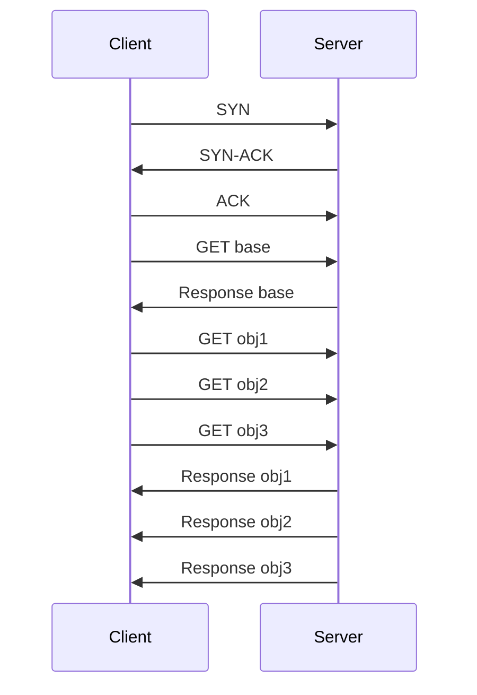

---
tags:
  - GATE/CS
  - GATE/ComputerNetworks
  - ApplicationLayer
aliases:
  - Persistent HTTP
  - Non-Persistent HTTP
  - HTTP 1.0 vs HTTP 1.1 connections
  - Persistent vs Non-Persistent Connection
date_created: 2026-09-14
difficulty: ⭐⭐⭐
last_revised: 2026-09-14
pyq_frequency: Medium
---

## Syllabus Position

Subject: [[Computer Networks]]
Parent Topic: [[Application Layer Protocols]]
Sibling Topics: [[DNS, Recursive and Iterative Queries]], [[TCP Header]]
Leads To: [[HTTP Pipelining]], [[Round Trip Time (RTT) Analysis]]

GATE Syllabus Line: "Application layer protocols: DNS, SMTP, POP, FTP, HTTP" — under Computer Networks.

Exam Weight Note: Appears mostly as a 1-mark or 2-mark NAT question asking to compute total time (in terms of RTT) to fetch a webpage with objects, given whether the connection is persistent or non-persistent, and whether requests are pipelined or sequential.

---

## The Problem This Solves

Imagine you want to fetch a webpage that has one HTML file and ten embedded images. Each time your browser wants to talk to the server, it first has to set up a **TCP connection** — a process involving a three-way handshake that costs time (an RTT). If your browser tears down the connection after every single file and rebuilds a fresh one for the next file, you pay the handshake cost eleven times just to load one page. That is wasteful, especially on high-latency links.

Think of it like calling a shop: **non-persistent** connections are like hanging up the phone after asking for one item and calling back fresh for every other item — you repeat the greeting ("hello, is this the shop?") every single time. **Persistent** connections are like staying on the same call and asking for item after item without hanging up.

Core Idea (one sentence): A **persistent connection** reuses one TCP connection for multiple HTTP requests/responses, while a **non-persistent connection** opens and closes a new TCP connection for every single object requested.

---

## Formal Theory

### Non-Persistent HTTP Connections

In **non-persistent HTTP** (the default behavior in HTTP/1.0), the server opens a TCP connection, sends exactly one object (e.g., the base HTML file or one image), and then closes the connection. To fetch any additional object referenced by the page, the client must open a brand-new [[TCP Connection Establishment]] (a fresh three-way handshake) for each object.

If a page has the base HTML file plus $n$ referenced objects, the browser establishes $n+1$ separate TCP connections in the strict non-persistent, non-parallel case.

**Time cost per object:** each object requires 1 RTT to establish the TCP connection (handshake) + 1 RTT to request and receive the object (assuming negligible transmission time for small objects and file size). So each object effectively costs $2 \times \text{RTT}$.

- **Without parallel connections:** total time $\approx (n+1) \times 2 \times \text{RTT}$
- **With parallel connections** (browser opens multiple TCP connections simultaneously, common in real browsers): total time $\approx 2 \times \text{RTT}$ (for the base file) $+ 2 \times \text{RTT}$ (for all objects fetched in parallel, assuming enough parallel connections) — GATE questions usually specify how many parallel connections are permitted.

### Persistent HTTP Connections (Non-Pipelined)

In **persistent HTTP** (default in HTTP/1.1), one TCP connection is opened and kept alive across multiple requests. The server does not close the connection after sending a response; it waits for further requests over the same connection.

In the **non-pipelined** variant, the client sends a new request only after it has fully received the response to the previous request. So requests are serialized over a single connection, but the handshake cost is paid only once.

**Time cost:**
- $2 \times \text{RTT}$ to establish the single TCP connection and fetch the base HTML file.
- $1 \times \text{RTT}$ per subsequent object (since no new handshake is needed — you only pay for request + response).

Total time $\approx 2 \times \text{RTT} + n \times \text{RTT} = (n+2) \times \text{RTT}$

### Persistent HTTP with Pipelining

In the **pipelined** variant, the client does not wait for a response before sending the next request — it fires off requests for all objects back-to-back over the same open connection.

**Time cost:**
- $2 \times \text{RTT}$ to open the connection and get the base file.
- $1 \times \text{RTT}$ total for **all** remaining $n$ objects combined (since requests are pipelined and responses stream back without additional round trips).

Total time $\approx 2 \times \text{RTT} + 1 \times \text{RTT} = 3 \times \text{RTT}$

**Pseudocode (conceptual client behavior):**
```
Algorithm FETCH_PAGE(connection_type, n_objects):
    if connection_type == NON_PERSISTENT:
        for each object in [base] + objects:
            open_TCP_connection()      # 1 RTT
            request_and_receive()      # 1 RTT
            close_TCP_connection()
    else if connection_type == PERSISTENT_NO_PIPELINE:
        open_TCP_connection()          # 1 RTT (shared)
        request_and_receive(base)      # 1 RTT
        for each object in objects:
            request_and_receive(object)  # 1 RTT each, sequential
    else if connection_type == PERSISTENT_PIPELINED:
        open_TCP_connection()          # 1 RTT (shared)
        request_and_receive(base)      # 1 RTT
        send_all_requests(objects)     # fired without waiting
        receive_all_responses()        # 1 RTT total
    return total_time
```

**What GATE actually tests here:** GATE loves to give a webpage with a base HTML and $n$ embedded objects, specify RTT value, and ask you to compute total download time under different connection/pipelining assumptions, and how many TCP connections are opened. The trap is forgetting that establishing a TCP connection itself costs 1 RTT (handshake) *before* any HTTP request-response RTT is counted.

---

## Diagrams and Visuals

**Diagram 1 — Non-Persistent (Serial) Connection Timeline**

Draw a timeline with client on the left, server on the right. For each object, draw a full handshake (SYN, SYN-ACK, ACK) followed by GET/response, then a close.

```
Client                          Server
  |---- SYN --------------------->|   \
  |<--- SYN-ACK -------------------|    } 1 RTT (handshake)
  |---- ACK --------------------->|   /
  |---- GET obj1 ----------------->|   \
  |<--- Response obj1 -------------|    } 1 RTT (request/response)
  |         [connection closes]    |
  |---- SYN (new conn) ----------->|   ... repeats for obj2, obj3, ...
```
Each object = one full block = 2 RTT. Total = $(n+1) \times 2\,RTT$.

**Diagram 2 — Persistent, Non-Pipelined**

```
Client                          Server
  |---- SYN --------------------->|   \
  |<--- SYN-ACK -------------------|    } 1 RTT (handshake, ONCE)
  |---- ACK --------------------->|   /
  |---- GET base ------------------>|   \
  |<--- Response base --------------|    } 1 RTT
  |---- GET obj1 ------------------>|   \
  |<--- Response obj1 --------------|    } 1 RTT
  |---- GET obj2 ------------------>|   \
  |<--- Response obj2 --------------|    } 1 RTT
  ... (connection stays open, no new handshake)
```

**Diagram 3 — Persistent, Pipelined**


Notice: all object GET requests are fired without waiting for prior responses — they arrive back essentially within one extra RTT window.

---

## Complexity Analysis

Here "complexity" is measured in units of **RTT** (Round Trip Time), not asymptotic notation, since this is a networking timing topic rather than an algorithmic one.

- **Non-Persistent, serial:** $(n+1) \times 2 \times \text{RTT}$ — justified because each of the $n+1$ objects (base + $n$ embedded) requires its own handshake (1 RTT) and its own request/response (1 RTT), with zero overlap.
- **Non-Persistent, with $k$ parallel connections:** roughly $2 \times \text{RTT} + \lceil n/k \rceil \times 2 \times \text{RTT}$ — the base page is fetched first (or in parallel with the first batch), and then remaining objects are fetched in batches of $k$ parallel connections.
- **Persistent, non-pipelined:** $(n+2) \times \text{RTT}$ — one handshake (1 RTT) + base fetch (1 RTT) + $n$ sequential object fetches (1 RTT each).
- **Persistent, pipelined:** $3 \times \text{RTT}$ — one handshake (1 RTT) + base fetch (1 RTT) + one shared RTT for all pipelined object requests/responses combined (assuming responses can be sent back-to-back without additional round trips).

### Complexity Summary Table

| Case                          | Time (in RTT)              | TCP Connections Opened | Notes                                   |
|-------------------------------|-----------------------------|--------------------------|------------------------------------------|
| Non-Persistent (serial)       | $(n+1) \times 2$            | $n+1$                     | Worst case; handshake repeated every time |
| Non-Persistent (parallel, k)  | $\approx 2 + \lceil n/k \rceil \times 2$ | up to $n+1$ (bounded by $k$ at a time) | Real browsers do this by default (HTTP/1.0-era workaround) |
| Persistent, non-pipelined     | $n+2$                       | 1                         | Sequential requests over reused connection |
| Persistent, pipelined         | $3$                         | 1                         | Best case; all requests fired together    |

---

## Worked Example

**Setup:** A webpage consists of 1 base HTML file and $n = 5$ embedded images, all hosted on the same server. Assume $\text{RTT} = 100\,\text{ms}$, and transmission/processing time for each object is negligible.

**Case A — Non-Persistent, no parallelism:**

1. Client opens TCP connection to fetch base file: handshake takes 1 RTT = 100 ms. Connection state: `SYN sent → SYN-ACK received → ACK sent`.
2. Client sends GET for base file, server responds: 1 RTT = 100 ms. Base file received. Connection closes.
3. Repeat steps 1–2 for image 1: another 2 RTT = 200 ms.
4. Repeat for image 2, 3, 4, 5: each costs 2 RTT = 200 ms.

Total connections opened: $6$ (1 base + 5 images).
Total time: $6 \times 200\,\text{ms} = 1200\,\text{ms}$.

Verify against formula: $(n+1) \times 2 \times \text{RTT} = (5+1) \times 2 \times 100 = 1200\,\text{ms}$. ✅ Matches.

**Case B — Persistent, non-pipelined:**

1. Open TCP connection once: 1 RTT = 100 ms.
2. Request + receive base file: 1 RTT = 100 ms.
3. Request + receive image 1 (same connection, no new handshake): 1 RTT = 100 ms.
4. Repeat for images 2–5: 4 more RTTs = 400 ms.

Total: $100 + 100 + 100 \times 4 = 700\,\text{ms}$.

Verify: $(n+2) \times \text{RTT} = (5+2) \times 100 = 700\,\text{ms}$. ✅ Matches.

**Case C — Persistent, pipelined:**

1. Open TCP connection: 1 RTT = 100 ms.
2. Request + receive base file: 1 RTT = 100 ms.
3. Client immediately pipelines GET requests for all 5 images without waiting. Server sends back all 5 responses; because they are fired together, this takes roughly 1 more RTT = 100 ms (in the idealized GATE model).

Total: $100 + 100 + 100 = 300\,\text{ms}$.

Verify: $3 \times \text{RTT} = 3 \times 100 = 300\,\text{ms}$. ✅ Matches.

**Total operations confirmed:** Persistent pipelined is 4× faster than non-persistent serial in this example (300 ms vs 1200 ms), which confirms the $O(1)$-in-RTT-count nature of pipelining versus the $O(n)$ growth of non-persistent connections.

**Edge-case follow-up:** What if the images were hosted on a **different server** (e.g., a CDN)? Then persistence on the main connection does not help fetch the CDN images — a **separate** TCP connection (persistent or not) must be opened to the CDN server, adding its own handshake RTT independently.

---

## Intuition Anchors

**The Analogy (restated and deepened):** Calling a shop and hanging up after every item (non-persistent) means repeating "hello, is this the shop?" every time — that greeting is the TCP handshake. Staying on one call and listing all items back-to-back without waiting for the shopkeeper to finish packing before naming the next item (pipelined) is the fastest — you say "I want milk, bread, eggs, butter" all at once and only wait once for the shopkeeper to gather everything.

**The Mental Model:** Picture a single "phone line" (TCP connection) as the expensive resource. Every time you have to redial, you pay a fixed connection tax (1 RTT). The real question is always: how many times do I redial, and how many round trips of "ask-then-wait" happen on the line I keep open?

**The One-Line Recall:** Non-persistent = $2(n+1) \times \text{RTT}$ (redial for every object); persistent non-pipelined = $(n+2) \times \text{RTT}$ (one redial, sequential asks); persistent pipelined = $3 \times \text{RTT}$ (one redial, all asks fired together).

**The #1 Trap:** Students forget that the very first object (the base HTML) *always* costs $2 \times \text{RTT}$ in every scheme (1 RTT to open the connection + 1 RTT to fetch it) — the savings only kick in for the *remaining* $n$ objects. A common mistake is writing persistent time as $n \times \text{RTT}$ instead of $(n+2) \times \text{RTT}$, forgetting to add the handshake and the base-file fetch separately.

---

## GATE Questions

---

**Question 1 — GATE-style — 2-mark**

> A browser fetches a webpage consisting of a base HTML file and 4 embedded images, all from the same server. The client uses non-persistent HTTP with no parallel connections. Assuming RTT = 50 ms and negligible transmission time, what is the total time to fully load the page?

- (A) 200 ms
- (B) 250 ms
- (C) 500 ms
- (D) 450 ms

<details>
<summary>Solution</summary>

**Answer: (C) 500 ms**

**Reasoning:**
Total objects = base + 4 images = 5 objects. Non-persistent, serial connections: each object costs $2 \times \text{RTT}$ (1 RTT handshake + 1 RTT request/response).

$\text{Total} = 5 \times 2 \times 50\,\text{ms} = 500\,\text{ms}$

(A) 200 ms — likely mistake: forgetting to double for handshake, or only counting 2 objects.
(B) 250 ms — likely mistake: using $(n+1) \times \text{RTT}$ instead of $\times 2 \times \text{RTT}$ (forgetting handshake cost entirely for extra objects).
(D) 450 ms — likely mistake: counting only 4.5 "effective" objects or an arithmetic slip.

**What this question is really testing:** Whether the student correctly multiplies every object (not just the base file) by $2 \times \text{RTT}$ in the non-persistent, non-parallel case.

**Trap to avoid:** Do not assume only the first connection needs a handshake — in true non-persistent mode, every single object pays the handshake cost again.

</details>

---

**Question 2 — Conceptual/Numerical — 2-mark**

> Same page as above (1 base + 4 images), but now using persistent HTTP with pipelining, RTT = 50 ms. What is the total load time, and how many TCP connections are opened?

<details>
<summary>Solution</summary>

Total time = $3 \times \text{RTT} = 3 \times 50 = 150\,\text{ms}$.
TCP connections opened = **1** (the single persistent connection is reused for the base file and all 4 pipelined image requests).

This follows directly from the pipelined formula: $2 \times \text{RTT}$ (handshake + base fetch) $+ 1 \times \text{RTT}$ (all pipelined image requests/responses combined) $= 3 \times \text{RTT}$.

</details>

---

**Question 3 — Hard / Multi-concept — 2-mark**

> A webpage has a base HTML file (on server A) and 6 embedded images: 3 hosted on server A and 3 hosted on a different CDN server B. The client uses persistent, pipelined HTTP to each server independently, and connections to A and B can be established in parallel. RTT to server A is 40 ms and RTT to server B is 60 ms. What is the total page load time?

<details>
<summary>Solution</summary>

Since connections to A and B happen in parallel, total load time = max(time for A's objects, time for B's objects).

**Server A:** base file + 3 images, persistent pipelined = $3 \times \text{RTT}_A = 3 \times 40 = 120\,\text{ms}$.
**Server B:** 3 images only, persistent pipelined. Since there's no separate "base file," the first request to B still costs $2 \times \text{RTT}_B$ (handshake + first response), and the remaining 2 images pipeline within that same round trip in the idealized model, so total = $2 \times \text{RTT}_B = 120\,\text{ms}$ if all 3 requests are pipelined together (treating the very first fetch + pipelined batch as one shared 2-RTT block, similar to the base-file case).

Total page load time = $\max(120, 120) = 120\,\text{ms}$.

**What this tests:** Combining [[Parallel TCP Connections]] with pipelining across multiple servers — a favorite GATE combination question.

**Trap to avoid:** Forgetting that parallel connections to different servers overlap in time (take the max, not the sum), unlike sequential fetches on a single connection.

</details>

---

**Pattern Recognition:**
- When a question gives "$n$ objects, RTT = X ms," immediately identify whether it's asking for non-persistent (multiply by $2\times\text{RTT}$ per object), persistent non-pipelined ($(n+2)\times\text{RTT}$), or persistent pipelined ($3\times\text{RTT}$).
- If multiple servers are involved, check whether connections are parallel (take max) or sequential (take sum).
- Watch for whether the question wants "total time" or "number of TCP connections opened" — these have different formulas.
- If the question explicitly gives "k parallel connections allowed" in non-persistent mode, batch the $n$ objects into groups of $k$.

---

## Edge Cases and Failure Modes

- [ ] **Input of size 0 (only base file, no embedded objects):** All three schemes converge to $2 \times \text{RTT}$ since there are no extra objects to differentiate pipelining benefits.
- [ ] **All objects on different servers:** Persistence on one connection does not help across servers — each server needs its own connection and its own handshake, though these can happen in parallel if the browser supports it.
- [ ] **Very small number of parallel connections allowed (k=1) in "parallel" non-persistent mode:** Degenerates back to fully serial non-persistent behavior.
- [ ] **Assuming pipelining always saves exactly $(n-1) \times \text{RTT}$ compared to non-pipelined persistent:** True only under the idealized GATE assumption that all pipelined responses return within a single shared RTT — real networks have bandwidth and processing limits that GATE questions typically ignore unless stated.
- [ ] **Off-by-one in counting objects:** Always double check whether "n objects" includes or excludes the base HTML file — GATE questions are often ambiguous here and expect you to read carefully whether "webpage with n objects" means n total or n embedded plus 1 base.
- [ ] **Topic-specific failure — connection timeout/idle close:** In real persistent HTTP, if the connection sits idle too long (no requests), the server may close it, forcing a new handshake on the next request — GATE rarely tests this but it's a real-world caveat worth knowing for OS/Networks interviews.

---

## Comparisons

| Feature           | [[Persistent and Non Persistent HTTP Connections#Persistent HTTP Connections (Non-Pipelined)|Persistent (Non-Pipelined)]] | [[Persistent and Non Persistent HTTP Connections#Non-Persistent HTTP Connections|Non-Persistent]] | [[Persistent and Non Persistent HTTP Connections#Persistent HTTP with Pipelining|Persistent (Pipelined)]] |
|-------------------|--------------------|---------------------|---------------------|
| Time for n objects | $(n+2) \times \text{RTT}$ | $2(n+1) \times \text{RTT}$ | $3 \times \text{RTT}$ |
| TCP Connections   | 1                  | $n+1$               | 1                    |
| Handshake overhead paid | Once         | Every object         | Once                 |
| Default in        | HTTP/1.1           | HTTP/1.0             | HTTP/1.1 (optional)  |
| GATE Trap         | Forgetting the +2 base cost | Forgetting handshake per object | Assuming all responses take 0 extra time |

The most common GATE question comparing these gives an RTT and object count, then asks the student to compute all three totals and pick out how many RTTs are "saved" by moving from non-persistent to persistent pipelined — the answer hinges precisely on recognizing that persistence removes the repeated handshake cost, while pipelining additionally removes the repeated "wait-then-ask" sequential cost.

---

## Connections Web

**Must know before this topic:**
- [[TCP Connection Establishment]] — the three-way handshake is the "1 RTT" unit used throughout this note
- [[Round Trip Time (RTT) Analysis]] — the fundamental unit of measurement for all timing calculations here
- [[Application Layer Protocols]] — HTTP is one specific application-layer protocol

**Topics that build on this:**
- [[HTTP Pipelining]] — deeper dive into how pipelined requests are processed server-side
- [[HTTP/2 Multiplexing]] — the modern evolution that solves head-of-line blocking present in pipelining

**GATE subject cross-links:**
- [[Computer Networks]] > [[Application Layer Protocols]]

**Cross-subject connections:**
- [[TCP Header]] — the SYN/SYN-ACK/ACK flags referenced in the handshake diagrams come from this header structure
- [[Delay in Computer Networks]] — RTT is a specific instance of the general propagation + transmission delay model

**Standard references:**
- [[Kurose and Ross Chapter 2]] (Application Layer) — the canonical textbook treatment of persistent vs. non-persistent HTTP with RTT-based timing diagrams

---

## Quick Revision Sheet

**Definition (1 sentence):** Persistent HTTP reuses a single TCP connection for multiple requests/responses; non-persistent HTTP opens and closes a new TCP connection for every single object.

**Core Idea / Analogy (1 sentence):** Non-persistent = redialing the shop for every item; persistent = staying on one call; pipelined = listing all items in the same call without waiting between each.

**Algorithm Steps (numbered, maximum 6 steps):**
1. Determine if the connection scheme is non-persistent, persistent non-pipelined, or persistent pipelined.
2. Identify $n$ = number of embedded objects (excluding base file unless stated otherwise).
3. Base file always costs $2 \times \text{RTT}$ (handshake + fetch) in every scheme.
4. Non-persistent: add $2 \times \text{RTT}$ per remaining object.
5. Persistent non-pipelined: add $1 \times \text{RTT}$ per remaining object (sequential).
6. Persistent pipelined: add just $1 \times \text{RTT}$ total for all remaining objects combined.

**Complexity:**
- Time (non-persistent / persistent-seq / persistent-pipelined): $2(n+1)\text{RTT}$ / $(n+2)\text{RTT}$ / $3\,\text{RTT}$
- Space: N/A (this is a timing/connection-count model, not a memory model)
- Recurrence: N/A

**Key Properties (3 to 5 bullet points):**
- Handshake cost (1 RTT) is paid once per TCP connection, not once per object.
- Persistent connections reduce the number of TCP connections to 1 regardless of object count.
- Pipelining removes the sequential "wait for response before next request" cost.
- HTTP/1.1 defaults to persistent connections; HTTP/1.0 defaults to non-persistent.

**The #1 Trap:** Forgetting the base file always costs $2 \times \text{RTT}$ in every scheme — students often write persistent time as $n \times \text{RTT}$ instead of $(n+2) \times \text{RTT}$.

**When to use this over alternatives:** Persistent pipelined connections are strictly better whenever multiple objects are fetched from the same server and the server supports pipelining/HTTP-1.1 — there is no scenario where non-persistent is faster for multi-object pages.

**Mnemonic or one-liner to remember the steps:** "One call, list everything, wait once" = persistent + pipelined = $3\,\text{RTT}$ flat, regardless of $n$.

---

## Revision Checklist

- [ ] I can state the formal definition without looking.
- [ ] I can explain the analogy and map it to the algorithm or concept.
- [ ] I can trace a 6-element example (1 base + 5 objects) by hand in under 2 minutes for all three schemes.
- [ ] I can derive the worst-case complexity ($2(n+1)\times\text{RTT}$) from scratch.
- [ ] I know what the Quick Revision Sheet says without reading it.
- [ ] I can solve all 3 GATE questions in this note without peeking.
- [ ] I know the #1 trap and can articulate why students fall for it.
- [ ] I have linked this note correctly in my Obsidian vault.
- [ ] I have scheduled a spaced-repetition review in 3 days.
