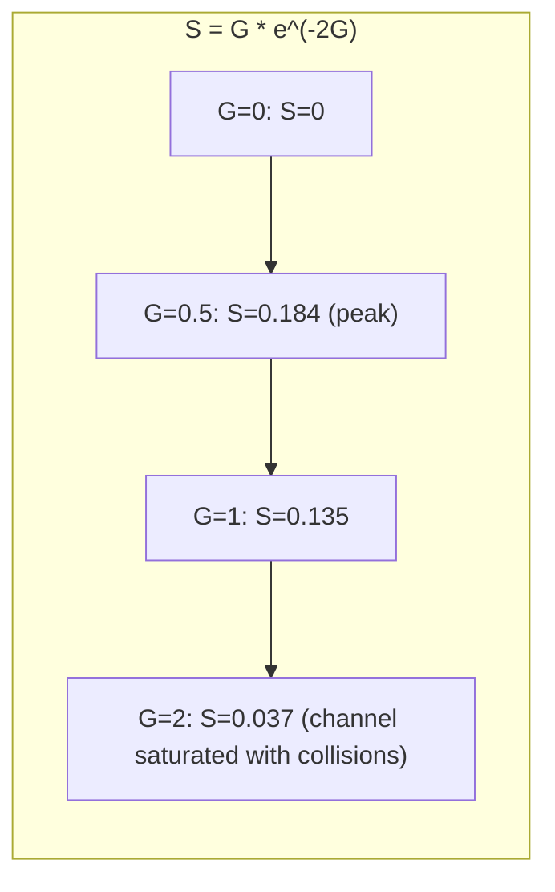
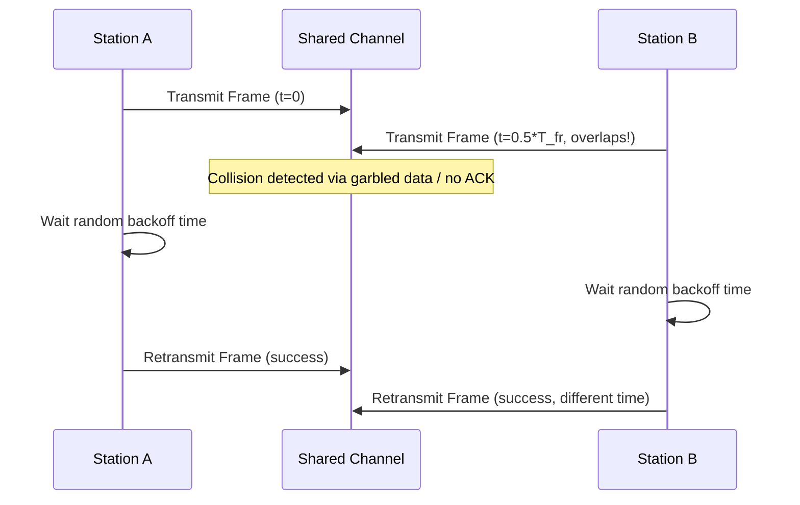

---
tags:
  - GATE/CS
  - GATE/ComputerNetworks
  - MediumAccessControl
  - RandomAccessProtocols
aliases:
  - Pure ALOHA
  - ALOHA Protocol
  - Unslotted ALOHA
date_created: 2026-09-07
difficulty: ⭐⭐⭐⭐
last_revised: 2026-09-07
pyq_frequency: High
---

## Syllabus Position

Subject: [[Computer Networks]]
Parent Topic: [[Medium Access Control]]
Sibling Topics: [[Slotted ALOHA]], [[CSMA]], [[CSMA/CD]], [[CSMA/CA]]
Leads To: [[Slotted ALOHA]], [[Ethernet]], [[Wireless MAC Protocols]]

GATE Syllabus Line: "Medium access control, LAN technologies (Ethernet), Random access protocols."

Exam Weight Note: Appears heavily as 1-mark and 2-mark MCQ/NAT questions computing maximum throughput (18.4%), efficiency at a given load $G$, and vulnerable period length — almost always paired with a comparison against [[Slotted ALOHA]] in the same question set.

---

## The Problem This Solves

Imagine a room full of people who all share one radio channel and no one can hear anyone else talking except when they collide — like a shared broadcast medium (early radio networks, satellite links, or a single Ethernet cable in the days before switches). If everyone waits for a "turn" using some central coordinator, you need extra infrastructure and extra delay. But if everyone just says "I'll talk whenever I have something to say, and if I get garbled because someone else spoke at the same time, I'll just repeat myself after waiting a random amount of time" — that's radically simple and needs zero coordination.

Think of Pure ALOHA like a noisy classroom with no hand-raising rule: any student blurts out their answer the instant they think of it. If two students speak at exactly the same time (or their speech overlaps at all, even partially), both answers are garbled and both students have to guess again later, waiting a random amount of time before retrying so they don't collide again in lockstep.

**Core Idea:** Pure ALOHA lets any station transmit a frame the instant it has data ready, with no coordination or synchronization whatsoever — and resolves the resulting collisions purely through random retransmission delays, trading simplicity for a hard cap on maximum channel efficiency of about 18.4%.

---

## Formal Theory

### Overview

Pure ALOHA was developed at the University of Hawaii (1970) to let scattered islands communicate over a shared radio channel without a central controller. It belongs to the family of **random access protocols** in the [[Medium Access Control]] sublayer — protocols where stations contend for the channel without a fixed schedule, as opposed to **channelization protocols** (FDMA/TDMA/CDMA) or **controlled access protocols** (token passing, polling).

Pure ALOHA is **unslotted**: there is no global clock, no notion of discrete time slots. A station transmits **the instant** it has a frame ready, completely independent of what any other station is doing.

### Collision Model

A collision occurs whenever **any part** of two frames' transmission times overlap — even a single bit of overlap destroys both frames, because Pure ALOHA has no way to distinguish "mostly successful" from "corrupted." All colliding frames must be **entirely retransmitted**.

### The Vulnerable Period

Let $T_{fr}$ be the time to transmit one frame (frame transmission time). For a frame sent starting at time $t_0$, ending at $t_0 + T_{fr}$, any other station that starts transmitting in the interval $(t_0 - T_{fr}, \ t_0 + T_{fr})$ will cause a collision:

- A frame starting up to $T_{fr}$ **before** $t_0$ is still transmitting when our frame begins → collision at the start.
- A frame starting up to $T_{fr}$ **after** $t_0$ begins before our frame finishes → collision at the end.

$$\text{Vulnerable Period} = 2 \times T_{fr}$$

This is the single most important derived fact in this topic — **double** the frame time, because collisions can happen from a neighbor starting either just before or just after your own transmission.

### Throughput Derivation (Poisson Model)

Assume the combined arrival process (new frames + retransmissions) across all stations follows a **Poisson distribution** with an average of $G$ transmission attempts per frame-time $T_{fr}$ (this $G$ is called the **offered load**, and it is normalized so $T_{fr} = 1$ unit of time).

The probability of exactly $k$ arrivals during any interval of length $\tau$ (in units of frame time) is:

$$P(k \text{ arrivals in } \tau) = \frac{(G\tau)^k \, e^{-G\tau}}{k!}$$

For a given frame to survive, **zero** other frames may start anywhere in the vulnerable period of length $2T_{fr}$ (i.e., $\tau = 2$ in normalized units):

$$P(\text{success}) = P(0 \text{ arrivals in } 2T_{fr}) = e^{-2G}$$

**Throughput** $S$ is the offered load that gets through successfully:

$$S = G \cdot e^{-2G}$$

### Maximizing Throughput

Differentiate $S$ with respect to $G$ and set to zero:

$$\frac{dS}{dG} = e^{-2G}(1 - 2G) = 0 \implies G = \frac{1}{2}$$

Substituting back:

$$S_{max} = \frac{1}{2} \cdot e^{-1} = \frac{1}{2e} \approx 0.184$$

**This is the famous "18.4%" result** — even at the mathematically optimal offered load, Pure ALOHA can only successfully deliver about 18.4% of the channel's raw capacity; the rest is lost to collisions or channel idle time.

### How GATE Tests This Topic

GATE loves to test:
1. Deriving or directly recalling $S = G e^{-2G}$ and the maximum throughput $\frac{1}{2e} \approx 0.184$
2. Computing the vulnerable period as $2T_{fr}$ and explaining why it's double the frame time
3. Comparing Pure ALOHA's $2T_{fr}$ vulnerable period against [[Slotted ALOHA]]'s $T_{fr}$ vulnerable period and the resulting doubled throughput ($\frac{1}{e} \approx 0.368$)
4. Computing frame transmission time $T_{fr}$ from given bandwidth and frame size, then plugging into throughput formulas
5. Reasoning about backoff behavior — why retransmission delay must be random, not fixed

---

## Diagrams and Visuals

### Vulnerable Period Illustration

```
Timeline (each station's frame shown as a horizontal bar):

Station A:                    |------T_fr------|
                          t0-T_fr            t0+T_fr
                               (frame starts at t0)

Any OTHER station starting anywhere in this shaded window collides with A's frame:

        <-------- Vulnerable Period = 2 x T_fr -------->
   t0-T_fr                    t0                    t0+T_fr
        |___________________|___________________|
        Station starts here    A's frame          Station starts here
        -> collides with       (this frame)        -> collides with
           A's start                                  A's end
```

### Throughput vs. Offered Load Curve



### Sequence of Events: Collision and Retransmission



---

## Complexity Analysis

Adapted for a protocol/throughput concept rather than an algorithm's time/space complexity.

### Throughput and Delay Characterization

| Metric | Formula | Notes |
|--------|---------|-------|
| Vulnerable period | $2T_{fr}$ | Collisions possible from neighbors starting up to $T_{fr}$ before or after |
| Success probability | $P(\text{success}) = e^{-2G}$ | Zero arrivals in the vulnerable period (Poisson model) |
| Throughput | $S = G e^{-2G}$ | Peaks at $G = 0.5$ |
| Maximum throughput | $S_{max} = \frac{1}{2e} \approx 0.184$ (18.4%) | Absolute upper bound — cannot be improved without changing the protocol |
| Access delay (informal) | Grows unboundedly as $G$ increases past $0.5$ | More collisions → more retransmissions → more attempts → more collisions (a runaway/unstable regime) |

### Trigger Conditions

| Case | Throughput Behavior | Condition |
|------|---------------------|-----------|
| Best (theoretical peak) | $S = 0.184$ | Offered load precisely tuned to $G = 0.5$ |
| Underloaded | $S < 0.184$, wasted idle channel time | $G \ll 0.5$: few stations transmitting, channel mostly idle |
| Overloaded | $S \to 0$ as $G \to \infty$ | $G \gg 0.5$: constant collisions, effective throughput collapses despite high offered load |

---

## Worked Example

### Example: Computing Throughput for a Given Offered Load

**Scenario:** A shared channel has bandwidth 1 Mbps. All frames are a fixed 1000 bits long. Stations collectively generate new frames (plus retransmissions) following a Poisson process, and measurements show the combined offered load is $G = 0.5$ attempts per frame time — i.e., the network happens to be operating exactly at the theoretical sweet spot.

**Step 1 — Compute frame transmission time:**

$$T_{fr} = \frac{\text{Frame Size}}{\text{Bandwidth}} = \frac{1000 \text{ bits}}{10^6 \text{ bps}} = 1 \text{ ms}$$

**Step 2 — Compute the vulnerable period:**

$$\text{Vulnerable Period} = 2 \times T_{fr} = 2 \text{ ms}$$

Any station starting a transmission within this 2 ms window (1 ms before or 1 ms after our frame starts) will cause a collision.

**Step 3 — Compute throughput at $G = 0.5$:**

$$S = G \cdot e^{-2G} = 0.5 \times e^{-1} = 0.5 \times 0.3679 \approx 0.184$$

**Step 4 — Convert to actual successful data rate:**

$$\text{Effective Throughput} = S \times \text{Bandwidth} = 0.184 \times 10^6 \text{ bps} \approx 184{,}000 \text{ bps}$$

**Verification:** Even though the raw channel supports 1 Mbps, only about 184 kbps of *useful* data gets through successfully at the optimal load — this confirms the theoretical maximum of $\frac{1}{2e} \approx 18.4\%$ channel utilization.

**What would change if $G$ were doubled to 1.0 instead?**

$$S = 1.0 \times e^{-2} \approx 1.0 \times 0.1353 = 0.135$$

Throughput would actually **decrease** from 0.184 to 0.135, despite stations attempting to send more traffic — a counter-intuitive but GATE-favorite result: pushing more load into an already-busy ALOHA channel makes things worse, not better, because collision probability grows faster than the extra attempts can compensate for.

---

## Intuition Anchors

**The Analogy (deepened):**

Extend the noisy classroom analogy: the "vulnerable period" is the fact that a student's answer gets garbled not just if someone starts talking *while* they're speaking, but also if someone starts talking in the moment just *before* they open their mouth (their voice would still be finishing when the other one begins) — hence double the danger window. The 18.4% ceiling is like saying: even if every student picks the mathematically optimal rate of blurting out (not too eager, not too shy), on average barely one in five attempts actually gets heard cleanly — the rest are wasted on collisions or silence.

**The Mental Model:**

Picture a Poisson "rain" of transmission attempts falling onto a timeline. For your frame to survive, no other raindrop can land anywhere within a window of $2T_{fr}$ centered on your frame. As the rain gets heavier (higher $G$), the chance of an empty window shrinks exponentially — that's why $S = Ge^{-2G}$ has an exponential decay term multiplying the linear "more attempts" term.

**The One-Line Recall:**

Pure ALOHA: vulnerable period $= 2T_{fr}$, throughput $S = Ge^{-2G}$, maximum throughput $= \frac{1}{2e} \approx 18.4\%$ at $G = 0.5$ — unslotted, so collisions can come from either side.

**The #1 Trap:**

Students confuse Pure ALOHA's vulnerable period ($2T_{fr}$) with [[Slotted ALOHA]]'s ($T_{fr}$), or mix up which protocol achieves $\frac{1}{2e}$ (18.4%) versus $\frac{1}{e}$ (36.8%). The mnemonic fix: Pure ALOHA is "unslotted, so double trouble" — no synchronization means collisions can come from both directions, hence twice the vulnerable window and half the maximum throughput compared to Slotted ALOHA.

---

## GATE Questions

---

**Question 1 — PYQ GATE-style — 2-mark MCQ**

> In a Pure ALOHA network, 100 stations share a channel, each generating frames according to a Poisson process. If the average number of transmission attempts (including retransmissions) per frame time across all stations is $G = 0.5$, what is the approximate throughput of the channel?

- (A) 0.368
- (B) 0.184
- (C) 0.135
- (D) 0.500

<details>
<summary>Solution</summary>

**Answer: (B) 0.184**

**Reasoning:**

- Pure ALOHA throughput: $S = G e^{-2G}$.
- At $G = 0.5$: $S = 0.5 \times e^{-1} = 0.5 \times 0.3679 \approx 0.184$.
- This is precisely the maximum achievable throughput for Pure ALOHA, since $G=0.5$ is the value that maximizes $S$.
- Option (A) 0.368 is the maximum throughput of **Slotted ALOHA** ($\frac{1}{e}$), a classic trap for mixing up the two protocols.
- Option (C) 0.135 is the throughput at $G=1$, not $G=0.5$.
- Option (D) 0.5 is just the value of $G$ itself, not the throughput.

**What this question is really testing:**

Whether the student can correctly recall and evaluate $S = Ge^{-2G}$ at the specific optimal $G$, without confusing it with Slotted ALOHA's formula.

**Trap to avoid:**

Selecting 0.368 by misremembering the exponent as $e^{-G}$ instead of $e^{-2G}$ — always double-check whether the protocol is slotted or unslotted before choosing the exponent's coefficient.

</details>

---

**Question 2 — Conceptual — 1-mark MCQ**

> Why is the vulnerable period in Pure ALOHA equal to $2T_{fr}$ rather than $T_{fr}$?

- (A) Because each frame must be transmitted twice for reliability
- (B) Because a collision can occur if another station starts transmitting either up to one frame-time before, or up to one frame-time after, the given frame starts
- (C) Because Pure ALOHA requires two time slots per frame
- (D) Because the propagation delay is always twice the frame transmission time

<details>
<summary>Solution</summary>

**Answer: (B)**

**Reasoning:**

Pure ALOHA has no time slots — a station can begin transmitting at any instant. A frame beginning at $t_0$ can be corrupted by another station that starts up to $T_{fr}$ **before** $t_0$ (still transmitting into our frame's start) or up to $T_{fr}$ **after** $t_0$ (starting before our frame ends). This gives a total unsafe window of $2T_{fr}$. Option (A) is false — there's no mandatory double transmission. Option (C) is false — that describes a slotted scheme, which Pure ALOHA explicitly is not. Option (D) confuses propagation delay (a separate, usually negligible-relative-to-frame-time factor in this basic model) with the vulnerable period concept entirely.

**What this question is really testing:**

Deep understanding of *why* the vulnerable period is doubled, not just rote memorization of the "$2T_{fr}$" fact.

**Trap to avoid:**

Assuming the doubling comes from some transmission redundancy requirement rather than from the lack of synchronization allowing collisions from both temporal directions.

</details>

---

**Question 3 — Hard / Multi-concept — 2-mark NAT**

> A Pure ALOHA network has a channel bandwidth of 2 Mbps, and all frames are 2000 bits long. The combined offered load (new + retransmitted frames) is such that the channel achieves its maximum possible throughput. What is the effective successful data rate, in kbps (rounded to the nearest integer)?

<details>
<summary>Solution</summary>

**Answer: ≈368 kbps**

**Reasoning:**

- Frame transmission time: $T_{fr} = \frac{2000 \text{ bits}}{2 \times 10^6 \text{ bps}} = 1 \text{ ms}$ (this value is not actually needed for the throughput fraction itself, only to confirm $G$ is measured in units of this frame time — a distractor detail).
- "Maximum possible throughput" for Pure ALOHA occurs at $G = 0.5$, giving $S_{max} = \frac{1}{2e} \approx 0.184$.
- Effective successful data rate $= S_{max} \times \text{Bandwidth} = 0.184 \times 2 \times 10^6 \text{ bps} = 368{,}000 \text{ bps} = 368 \text{ kbps}$.

**What this question is really testing:**

Whether the student recognizes that "maximum possible throughput" is a fixed fraction ($\approx 18.4\%$) independent of the specific frame size or bandwidth values given — those numbers are needed only to convert the fraction into an absolute bps figure, not to recompute $G$ or $S$ from scratch.

**Trap to avoid:**

Wasting time trying to compute $G$ or the vulnerable period numerically when the question only asks for maximum throughput — at maximum throughput, $S$ is always $\frac{1}{2e}$ regardless of bandwidth or frame size, by definition of what "maximum" means for this protocol.

</details>

---

**Pattern Recognition:**

- Whenever GATE says "Pure ALOHA" and asks for maximum throughput, the answer is always $\frac{1}{2e} \approx 0.184$ (18.4%), independent of the specific numbers given, achieved specifically at $G=0.5$.
- Whenever GATE gives a specific $G$ value (not necessarily 0.5), plug directly into $S = Ge^{-2G}$ rather than assuming it's asking for the maximum.
- Whenever GATE asks about vulnerable period, recall unslotted = $2T_{fr}$ (Pure ALOHA) vs. slotted = $T_{fr}$ ([[Slotted ALOHA]]) — the factor-of-2 relationship propagates directly into the factor-of-2 relationship between their maximum throughputs ($\frac{1}{2e}$ vs. $\frac{1}{e}$).
- Whenever GATE increases $G$ beyond 0.5 and asks about throughput trend, remember throughput **decreases** past the peak — more offered load does not mean more successful delivery in ALOHA-family protocols.

---

## Edge Cases and Failure Modes

- [ ] **$G = 0$ (no traffic):** Throughput $S = 0$ trivially — no frames sent, none succeed. Sanity check for the formula, not a GATE trap by itself, but sometimes used as a boundary condition in NAT questions.
- [ ] **Very small $G$ (underloaded channel):** Throughput approaches $G$ itself (since $e^{-2G} \to 1$ for small $G$), meaning almost every attempt succeeds, but the *absolute* useful throughput is still low because so few attempts are made — channel capacity is wasted sitting idle.
- [ ] **$G$ much greater than 0.5 (overloaded channel):** Throughput collapses toward zero as $G \to \infty$, because $e^{-2G}$ decays faster than $G$ grows — a runaway collision regime. This is why real ALOHA-based systems need adaptive backoff to avoid pushing $G$ too high.
- [ ] **Fixed (non-random) retransmission delay:** If all colliding stations retransmit after the exact same fixed delay, they will collide again in lockstep forever — this is precisely why the backoff delay **must** be randomized (typically uniform or exponential), a frequently tested conceptual point.
- [ ] **Partial frame overlap still counts as a full collision:** Unlike some error-correcting schemes, Pure ALOHA treats *any* bit-level overlap as total frame corruption — there's no partial-success recovery, the entire frame must be retransmitted.
- [ ] **Propagation delay ignored in the basic model:** The classic derivation assumes propagation delay is negligible compared to $T_{fr}$; in networks where this doesn't hold (e.g., satellite links with very small frames), the effective vulnerable period can be larger than $2T_{fr}$ in practice, though GATE questions almost always use the idealized model.
- [ ] **No acknowledgment mechanism defined:** Pure ALOHA relies on some out-of-band or higher-layer mechanism (e.g., listening for an ACK, or detecting silence) to know a collision occurred — the basic protocol itself only defines the transmission and backoff behavior, not detection.

---

## Comparisons

| Feature | [[Pure ALOHA]] | [[Slotted ALOHA]] | [[CSMA]] |
|---------|-----------------|---------------------|-------------|
| Synchronization | None (unslotted) | Global time slots required | None, but senses carrier first |
| Vulnerable Period | $2T_{fr}$ | $T_{fr}$ | Much smaller (depends on propagation delay) |
| Max Throughput | $\frac{1}{2e} \approx 18.4\%$ | $\frac{1}{e} \approx 36.8\%$ | Significantly higher (depends on variant, often >50%) |
| Collision Detection | None (pure retransmission-based) | None (pure retransmission-based) | Can include collision detection (CSMA/CD) |
| Complexity | Very simple, no infrastructure | Requires synchronized clock across all stations | Requires carrier-sensing hardware |
| GATE Preference | Very heavily tested (formula derivation) | Very heavily tested (paired comparison) | Tested, especially CSMA/CD backoff math |

The most common GATE question comparing these is: "Why does Slotted ALOHA achieve exactly double the maximum throughput of Pure ALOHA?" The answer hinges on the vulnerable period being halved — from $2T_{fr}$ to $T_{fr}$ — because slotting forces all stations to align their transmission starts to slot boundaries, eliminating the "collision from a neighbor starting mid-frame" half of Pure ALOHA's risk window.

---

## Connections Web

**Must know before this topic:**
- [[Medium Access Control]] — the broader sublayer and problem space (who gets to use a shared channel and when) that ALOHA is one solution within
- [[Types of Communication]] — broadcast vs. point-to-point delivery models that make channel contention a problem in the first place
- [[Poisson Process]] — the statistical arrival model underlying the entire throughput derivation

**Topics that build on this:**
- [[Slotted ALOHA]] — direct evolutionary improvement, adds time synchronization to halve the vulnerable period
- [[CSMA]] — adds carrier sensing before transmission, dramatically reducing (but not eliminating) collisions compared to ALOHA
- [[CSMA/CD]] — further adds collision detection mid-transmission, used historically in classic Ethernet
- [[Ethernet]] — historically evolved from ALOHA-style random access ideas combined with carrier sensing

**GATE subject cross-links:**
- [[Computer Networks]] > [[Medium Access Control]] > Pure ALOHA

**Cross-subject connections:**
- [[Queueing Theory]] — the Poisson arrival model and throughput-vs-load curves parallel queueing system analysis in performance modeling
- [[Probability and Statistics]] — the exponential/Poisson distribution mechanics used to derive $S = Ge^{-2G}$ are shared with GATE's probability syllabus

**Standard references:**
- Abramson, N. (1970) — "The ALOHA System," original paper introducing Pure ALOHA
- [[Kurose & Ross]] Chapter 6 — The Link Layer and LANs, Random Access Protocols
- [[Tanenbaum & Wetherall]] Chapter 4 — The Medium Access Control Sublayer

---

## Quick Revision Sheet

**Definition (1 sentence):** Pure ALOHA is an unslotted random access MAC protocol where any station transmits a frame immediately whenever it has data ready, resolving collisions purely through random retransmission delays.

**Core Idea / Analogy (1 sentence):** It's a noisy classroom where anyone blurts out an answer the instant they think of it, with garbled overlapping answers simply repeated later after a random wait.

**Algorithm Steps (numbered, maximum 6 steps):**
1. Station has a frame ready → transmit immediately, no waiting for any slot or carrier check.
2. If a collision occurs (any overlap with another transmission), both frames are corrupted.
3. Sender detects failure (e.g., no ACK received within a timeout).
4. Sender waits a **random** backoff time (never fixed, to avoid repeated lockstep collisions).
5. Sender retransmits the same frame after the backoff period.
6. Repeat from step 2 if another collision occurs.

**Complexity:**
- Vulnerable period: $2T_{fr}$
- Throughput: $S = Ge^{-2G}$
- Maximum throughput: $S_{max} = \frac{1}{2e} \approx 0.184$ at $G = 0.5$

**Key Properties (3 to 5 bullet points):**
- Fully unslotted — no global clock or synchronization needed among stations.
- Vulnerable period is double the frame time because collisions can come from either temporal direction.
- Maximum theoretical channel utilization is capped at 18.4%, regardless of how well-tuned the offered load is.
- Requires randomized (not fixed) backoff delays to avoid deterministic repeated collisions.

**The #1 Trap:**
Confusing Pure ALOHA's $2T_{fr}$ vulnerable period and $\frac{1}{2e}$ maximum throughput with [[Slotted ALOHA]]'s $T_{fr}$ vulnerable period and $\frac{1}{e}$ maximum throughput.

**When to use this over alternatives:**
Pure ALOHA is preferred only when infrastructure must be minimal (no shared clock, no carrier sensing hardware) and low channel utilization is acceptable — real systems almost always upgrade to Slotted ALOHA or CSMA variants for better throughput.

**Mnemonic:** "Un-slotted, so Un-lucky twice" — no slots means the vulnerable period doubles ($2T_{fr}$) and the max throughput halves compared to Slotted ALOHA.

---

## Revision Checklist

- [ ] I can state the vulnerable period formula ($2T_{fr}$) and explain why it's doubled, not just recall it.
- [ ] I can derive $S = Ge^{-2G}$ from the Poisson "zero arrivals in vulnerable period" argument.
- [ ] I can find the maximizing $G$ (0.5) via differentiation and compute $S_{max} = \frac{1}{2e} \approx 0.184$.
- [ ] I can explain why increasing $G$ past 0.5 decreases throughput instead of increasing it.
- [ ] I can compare Pure ALOHA's vulnerable period and max throughput against Slotted ALOHA's without mixing them up.
- [ ] I understand why retransmission backoff must be random, not fixed.
- [ ] I can convert a throughput fraction into an absolute bps value given bandwidth.
- [ ] I have linked this note correctly in my Obsidian vault.
</content>
