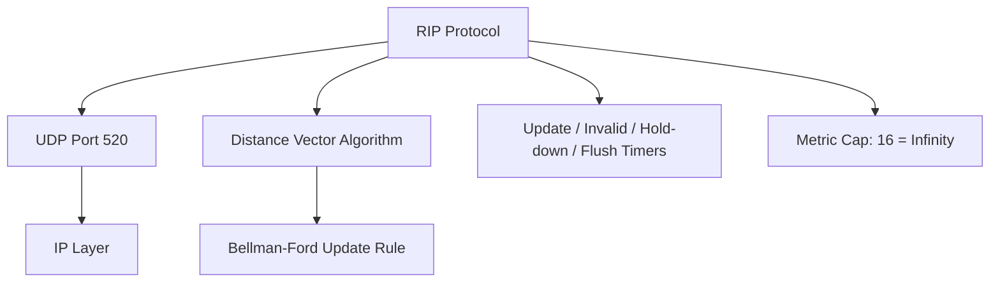

---
tags:
  - GATE/CS
  - GATE/Networks
  - Routing Protocols
aliases:
  - RIP
  - Routing Information Protocol
  - RIPv1
  - RIPv2
date_created: 2026-09-10
difficulty: ⭐⭐⭐
last_revised: 2026-09-10
pyq_frequency: Medium
---

## Syllabus Position

Subject: [[Computer Networks Index]]
Parent Topic: [[Distance Vector Routing]]
Sibling Topics: [[Link State Routing]], [[OSPF]], [[Path Vector Routing]]
Leads To: [[BGP]], [[Interior Gateway Protocols vs Exterior Gateway Protocols]]

GATE Syllabus Line: "Routing (Network Layer)" — RIP is the canonical real-world instance of distance vector routing that GATE uses to test protocol-specific numbers (hop limit, timers, port) on top of the general DV algorithm.

Exam Weight Note: Appears as a 1-mark MCQ testing protocol facts (max hop count 15, infinity = 16, UDP port 520, RIPv1 vs RIPv2), or occasionally as a 2-mark conceptual question combining RIP with the count-to-infinity problem from [[Distance Vector Routing]].

---

## The Problem This Solves

You already know from [[Distance Vector Routing]] that routers can gossip about distances to converge on shortest paths without a global map. But an *algorithm* is not a *protocol* — nobody has yet specified what packet format to use, which transport protocol carries it, how often to gossip, how big the network is allowed to get, or what to do about the count-to-infinity problem in practice. RIP is the answer: it takes the abstract Bellman-Ford gossip and pins down every operational detail into a deployable protocol that shipped inside early Unix systems (`routed`) and became one of the first widely used interior gateway protocols.

**Analogy:** If [[Distance Vector Routing]] is "neighbors gossiping about travel times," RIP is the specific etiquette rulebook for that gossip: talk every 30 seconds, never claim a route takes more than 15 hops (beyond that, just say "unreachable"), and use a specific postcard format (UDP packets on port 520) to pass the message.

**Core Idea (one sentence):** RIP is a concrete, deployable implementation of distance vector routing that uses hop count as its only metric, caps the maximum path length at 15 hops (16 = infinity) to bound the count-to-infinity problem, and runs over UDP with periodic 30-second updates.

---

## Formal Theory

**RIP (Routing Information Protocol)** is an **Interior Gateway Protocol (IGP)** — used for routing *within* a single autonomous system — based directly on the [[Distance Vector Routing]] algorithm and the [[Bellman-Ford Algorithm]] update rule you already derived: $D_x(y) = \min_{v \in N(x)} [c(x,v) + D_v(y)]$. RIP does not reinvent this math; it fixes every metric cost at $1$ per hop, so the update rule simplifies to counting hops rather than arbitrary weighted costs.

### Metric: Hop Count Only

Unlike generic DV, which can use any link cost, RIP's metric $c(x,v) = 1$ for every link, regardless of actual bandwidth or delay. This means RIP cannot distinguish a slow 56 kbps link from a fast 10 Gbps link — both count as "1 hop." This simplicity is also RIP's biggest real-world weakness, addressed by later protocols like **[[OSPF]]** (link state, cost-aware).

### The 15-Hop Limit and Infinity = 16

RIP defines **infinity as 16**. Any route with a hop count of 16 or more is considered unreachable. This directly bounds the worst-case duration of the **[[Count to Infinity Problem]]** you studied in [[Distance Vector Routing]]: instead of distances climbing forever, RIP forces convergence (to "unreachable") once a route's advertised hop count hits 16. The tradeoff is a hard network diameter limit — **RIP cannot support any path longer than 15 hops**, making it unsuitable for large networks.

### RIP Timers

RIP relies on four timers to manage route freshness and to accelerate recovery from count-to-infinity:

- **Update Timer (30 seconds):** every router broadcasts/multicasts its full routing table to neighbors every 30 seconds, regardless of whether anything changed.
- **Invalid (Timeout) Timer (180 seconds):** if no update is received for a route within 180 seconds (6 missed update cycles), the route is marked invalid (unreachable) but kept in the table temporarily.
- **Hold-down Timer (180 seconds, RIP-dependent, ~180s typical):** once a route is marked invalid or its metric increases, the router refuses to accept any *new* route to that destination for this duration, to suppress flapping and reduce the chance of installing a route based on stale, looping information.
- **Flush Timer (240 seconds):** if a route remains invalid for 240 seconds total (60 seconds after the invalid timer expires), it is completely removed from the routing table.

### RIPv1 vs. RIPv2

| Feature | RIPv1 | RIPv2 |
|---|---|---|
| Subnet mask support | No (classful only) | Yes — carries subnet mask per route, so supports [[Classless Addressing]] / [[Subnet Masking]] |
| Authentication | None | Supports plaintext/MD5 authentication |
| Delivery method | Broadcast | Multicast (224.0.0.9) — reduces unnecessary processing on non-RIP hosts |
| Next-hop field | Not carried | Carries explicit next-hop address, allowing optimization when the advertising router isn't the best next hop |
| VLSM/CIDR support | No | Yes |

RIPv2 is backward compatible with RIPv1 at the packet-format level (extra fields reuse previously "must be zero" fields) but is the version actually deployed wherever RIP still survives today.

### Split Horizon and Poison Reverse in RIP

RIP implements the mitigation strategies already introduced conceptually in [[Distance Vector Routing]] and [[Split Horizon]]: a router will not advertise a route back out the same interface it learned it from (**split horizon**), or will advertise it back with a metric of infinity (16) to explicitly signal "this path is broken from my side" (**poison reverse**). As established there, this fixes 2-router loops but not longer cycles — RIP additionally leans on the hold-down timer to slow down the damage from longer loops.

### Transport

RIP runs over **UDP, port 520** — a deliberate choice reflecting that periodic, best-effort broadcast/multicast updates don't need TCP's reliability; a lost update is simply corrected by the next periodic broadcast 30 seconds later.

### What GATE Actually Tests Here

GATE questions on RIP are almost always **fact-recall MCQs**: "What is the maximum hop count RIP allows?", "What does a metric of 16 signify?", "Which transport protocol and port does RIP use?", or comparison questions pitting RIPv1 against RIPv2 (subnet mask support being the most tested distinguishing feature). Less commonly, GATE embeds RIP inside a distance-vector numerical, asking you to apply the general DV update rule but interpret the answer using RIP's hop-count semantics and 16-as-infinity rule.

---

## Diagrams and Visuals

**Network Topology (same 4-router line as in [[Distance Vector Routing]], reused for continuity):**

```
   A ---1--- B ---1--- C ---1--- D
```

Every link is implicitly "1 hop" under RIP's metric — the numbers above are hop counts, not arbitrary costs.

**Mermaid diagram of RIP's protocol stack:**



**Count-to-infinity trace under RIP's hop-count metric (link C–D fails):**

```
Before failure, converged state (hop counts to D):
A: 3    B: 2    C: 1    D: 0

Link C-D fails. C marks D unreachable (16), but B has NOT yet
heard this update. B still advertises D:2 to C (stale info).

Round 1: C hears B's stale advertisement "D is 2 hops via me(B)".
         C updates: D_C(D) = 1 + 2 = 3   (WRONG — route no longer exists)
Round 2: B hears C's new advertisement "D is 3 hops via me(C)".
         B updates: D_B(D) = 1 + 3 = 4
Round 3: C hears B's new value again: D_C(D) = 1 + 4 = 5
Round 4: B updates: D_B(D) = 1 + 5 = 6
...
Round 13: metric reaches 16 -> both B and C mark D unreachable.
          Count-to-infinity terminates because RIP caps infinity at 16.
```

Each labeled arrow in the trace above is exactly the same mutual-misinformation loop described abstractly in [[Distance Vector Routing]] — RIP's only addition is the hard ceiling that forces termination.

---

## Complexity Analysis

RIP inherits its convergence behavior directly from [[Distance Vector Routing]]; refer there for the full derivation of $O(d)$ convergence for "good news." Here we focus on what RIP specifically adds: hard bounds.

- **Good news (route added / link cost decreases):** Same as generic DV — $O(d)$ rounds, where $d$ is network diameter, but RIP additionally caps $d \le 15$, so convergence for good news is bounded above by $O(15) = O(1)$ in the worst case for any legal RIP network.
- **Bad news (link failure, count-to-infinity):** Without RIP's cap, this would be unbounded, as shown in [[Distance Vector Routing]]. With the cap, the metric can climb at most from its converged value up to 16, so the number of "counting" rounds is bounded by $16 - \text{(original hop count)}$, which is at most 16 rounds. Combined with split horizon/poison reverse, in practice most 2-node loops resolve in a single round via poison reverse; the residual multi-router loops are exactly what the 16-hop cap bounds.
- **Update overhead (Space/Message complexity):** Every 30 seconds, each RIP router broadcasts its *entire* routing table to all neighbors regardless of change — this periodic full-table broadcast is $O(n)$ per router per update, identical to the general DV message complexity from [[Distance Vector Routing]], but incurred unconditionally on a fixed timer rather than only on change.
- **Why 15, not more:** The choice of 15 is a direct engineering tradeoff — large enough for most enterprise networks of that era, small enough that count-to-infinity (bounded at 16 steps) resolves within a few minutes rather than growing unboundedly.

#### Complexity Summary Table

| Case | Time (rounds to resolve) | Space | Trigger Condition |
|---|---|---|---|
| Best Case (good news, adjacent link) | $O(1)$ | $O(n)$ per router | Direct neighbor link added/improved |
| Average Case (good news, general) | $O(d)$, $d \le 15$ | $O(n)$ per router | New/shorter route propagating across network |
| Worst Case (count-to-infinity, capped) | $O(16)$ rounds bounded | $O(n)$ per router | Link failure without split horizon coverage (3+ router loop) |

---

## Worked Example

We reuse the exact 4-router linear topology from [[Distance Vector Routing]] — A—B—C—D, each link now interpreted with RIP's hop-count metric (cost 1 per hop).

**Step 0 — Converged state (before any failure), using RIP hop counts to destination D:**

```
A: hopcount(D) = 3, next-hop = B
B: hopcount(D) = 2, next-hop = C
C: hopcount(D) = 1, next-hop = D
D: hopcount(D) = 0
```

This matches exactly the converged result derived step-by-step in the [[Distance Vector Routing]] worked example — RIP adds no new math here, only the protocol wrapper (UDP packets every 30s carrying these values).

**Step 1 — Link C–D fails.** C detects the failure (missed updates past its invalid timer, or physical link-down signal) and sets its own route to D as unreachable: `hopcount_C(D) = 16`.

**Step 2 — C's next scheduled update (or triggered update) goes out.** If C's link to B implements poison reverse correctly, C would advertise `D: 16` toward B (since C learned about D from... actually C is directly connected to D, so poison reverse doesn't apply on this side — poison reverse only suppresses advertising a route *back* to the neighbor you learned it from). C advertises `D: 16` to B honestly since C has no split-horizon conflict here.

**Step 3 — But suppose B's update to C, sent just before C's failure detection, is still in flight / B hasn't yet re-converged and continues periodically re-advertising `D: 2` to C** (this is the scenario where split horizon has NOT yet been applied, or a race condition occurs — the classic setup for illustrating count-to-infinity even with mitigations in place, since perfect synchronization can't be assumed):

```
C receives B's stale advertisement: D_B(D) = 2
C recomputes: c(C,B) + D_B(D) = 1 + 2 = 3
C updates: hopcount_C(D) = 3   (WRONG — route is actually gone)
```

**Step 4 onward — the count climbs exactly as traced in the Diagrams section above:** C:3 → B:4 → C:5 → B:6 → ... → hits 16, at which point both routers mark D unreachable and the false route is purged.

**Total operations:** Assuming one increment per round exchange, the metric climbs from 2 up to 16, i.e., 14 increments, confirming the claim that RIP bounds count-to-infinity at $O(16)$ rounds rather than allowing indefinite growth — this is the entire reason RIP hard-codes infinity at 16 instead of leaving it unbounded.

**Edge-case follow-up:** What changes if split horizon with poison reverse is correctly and immediately applied by every router? Then B, having learned its route to D *through* C, would never advertise a usable `D: 2` back to C in the first place — B would advertise `D: 16` (poisoned) toward C. This collapses the entire count-to-infinity sequence above into a single round: C sees B's poisoned route, confirms D is genuinely unreachable, and both converge to "unreachable" immediately. This is exactly the 2-router-loop fix noted in [[Distance Vector Routing]] and [[Split Horizon]] — the slow climb only happens for 3+ router loops or transient timing races.

---

## Intuition Anchors

**The Analogy (restated and deepened):** Recall RIP as "the specific gossip etiquette" on top of DV's general gossiping-neighbors analogy. Now extend it: RIP additionally says "if a rumor about the same destination has been repeated more than 15 times through the chain, stop believing it — treat it as false" — this is the 16-as-infinity cap acting as a built-in rumor-decay mechanism, ensuring even the worst-case circular gossip session eventually terminates.

**The Mental Model:** Picture RIP as [[Distance Vector Routing]]'s Bellman-Ford engine running inside a strict operational cage: hop-count-only costs, a 30-second heartbeat, and a hard ceiling at 16. Every RIP fact GATE tests is really just "what is the specific number written on one wall of that cage?"

**The One-Line Recall:** "RIP = Distance Vector + hop-count metric + max 15 hops (16 = infinity) + UDP port 520 + 30s update timer — everything else is the DV algorithm you already know from [[Distance Vector Routing]]."

**The #1 Trap:** Students confuse RIP's 16-as-infinity cap with a "fix" for count-to-infinity, but it is only a **bound**, not a **prevention** — the metric still climbs incorrectly round by round exactly as in plain DV (see the Worked Example trace); RIP just guarantees the climb stops at 16 instead of continuing forever. The actual prevention mechanisms are split horizon/poison reverse, which are separate features layered on top, not something inherent to the 16-hop cap itself.

---

## GATE Questions

---

**Question 1 — [GATE-style, fact recall] — [1-mark]**

> RIP (Routing Information Protocol) uses which of the following as its maximum allowable hop count before a destination is considered unreachable?

- (A) 15
- (B) 16
- (C) 32
- (D) 255

<details>
<summary>Solution</summary>

**Answer: (A) 15**

**Reasoning:** RIP allows a maximum path length of **15 hops**; any route requiring 16 or more hops is treated as **infinity**, i.e., unreachable. So the maximum *allowed* hop count is 15, while 16 is the value used to *represent* infinity/unreachability — a subtle but frequently tested distinction. Option (B) is a common trap, since many students remember "16" but forget it represents infinity, not the maximum allowed value. Option (C) confuses RIP with unrelated protocol limits (e.g., TTL-related numbers). Option (D) is the max value of a single byte, unrelated to RIP's hop limit.

**What this question is really testing:** Precise recall of RIP's core numeric constant and the distinction between "max allowed hops" (15) and "value representing infinity" (16).

**Trap to avoid:** Answering "16" without checking whether the question asks for the maximum *allowed* hop count (15) or the value that *represents* infinity (16) — GATE questions are worded carefully to test exactly this distinction.

</details>

---

**Question 2 — [Conceptual] — [1-mark]**

> RIP is classified as which type of routing protocol, and which transport protocol does it use?

- (A) Exterior Gateway Protocol, TCP
- (B) Interior Gateway Protocol, UDP
- (C) Interior Gateway Protocol, TCP
- (D) Exterior Gateway Protocol, UDP

<details>
<summary>Solution</summary>

**Answer: (B) Interior Gateway Protocol, UDP**

**Reasoning:** RIP is an **Interior Gateway Protocol (IGP)** — designed for routing within a single autonomous system, not between autonomous systems (that role belongs to protocols like [[BGP]], an Exterior Gateway Protocol / path vector protocol). RIP uses **UDP on port 520** for its periodic table exchanges, because losing an occasional update is tolerable — the next periodic broadcast 30 seconds later will correct it, so TCP's reliability and connection overhead aren't needed. Option (A) and (C) incorrectly pair RIP with TCP — RIP never uses TCP. Option (D) and (A) incorrectly classify RIP as an Exterior Gateway Protocol, confusing it with BGP's role.

**What this question is really testing:** Whether the student knows RIP's protocol classification (IGP vs EGP) and its specific transport-layer choice, both frequently tested facts.

**Trap to avoid:** Assuming any "important" or "reliable-sounding" routing protocol must use TCP — periodic, self-healing broadcast protocols like RIP deliberately choose UDP.

</details>

---

**Question 3 — [Hard, multi-concept] — [2-mark]**

> A network running RIPv1 is being upgraded to RIPv2 primarily to support Variable Length Subnet Masking (VLSM) in a network with non-contiguous subnet masks. Which of the following correctly explains why RIPv1 fails in this scenario while RIPv2 succeeds, and connects this to the underlying distance-vector mechanism?

- (A) RIPv1 cannot run the Bellman-Ford algorithm at all, while RIPv2 replaces it with Dijkstra's algorithm.
- (B) RIPv1 does not carry a subnet mask field in its route advertisements (it is a classful protocol), so a router receiving a route cannot correctly determine which subnet is being advertised when VLSM is used; RIPv2 adds an explicit subnet mask field to each route entry, fixing this while still using the same underlying Bellman-Ford distance-vector update rule.
- (C) RIPv1 fails because it does not support the 16-hop infinity cap, while RIPv2 introduces it for the first time.
- (D) RIPv1 fails only because it uses broadcast instead of multicast, which is unrelated to subnet masks.

<details>
<summary>Solution</summary>

**Answer: (B)**

**Reasoning:** RIPv1 is a **classful** routing protocol — it does not transmit a subnet mask alongside each route in its update packets, so it implicitly assumes the subnet mask matches the "natural" class of the IP address (per [[Classful Addressing]]). This breaks down whenever a network uses **VLSM** or non-contiguous subnetting (see [[Classless Addressing]] and [[Subnet Masking]]), because a receiving router literally cannot tell whether `10.1.2.0` is a /24, /26, or /30 network without an explicit mask. RIPv2 fixes exactly this by adding a subnet mask field to every route entry — nothing about the core distance-vector engine (the Bellman-Ford update rule from [[Distance Vector Routing]]) changes; only the packet format and the information carried per route improve. Option (A) is false — both RIPv1 and RIPv2 use the same distributed Bellman-Ford update rule; neither uses Dijkstra (that's link state territory). Option (C) is false — the 16-hop infinity cap exists in both RIPv1 and RIPv2; it is not a RIPv2-only addition. Option (D) is a real RIPv1→RIPv2 difference (broadcast vs. multicast) but is irrelevant to the VLSM/subnet-mask issue specifically being asked about.

**What this question is really testing:** Whether the student can connect a protocol-level feature (subnet mask field) to a networking concept from a different topic ([[Classless Addressing]]) while correctly recognizing that the core distance-vector algorithm is untouched between versions.

**Trap to avoid:** Assuming every RIPv1-vs-RIPv2 difference (authentication, multicast, next-hop field) is equally relevant to any given RIPv1 failure scenario — always match the *specific* failure described (VLSM support) to the *specific* fix (subnet mask field), not just any RIPv2 improvement.

</details>

---

**Pattern Recognition:**
- GATE almost always tests RIP as isolated **fact recall**: hop limit (15), infinity value (16), transport (UDP/520), update timer (30s) — memorize these exactly, since options are designed to swap in plausible-but-wrong nearby numbers.
- When GATE compares RIPv1 vs RIPv2, the single most-tested differentiator is **subnet mask support** (classful vs. classless) — always check if the question scenario involves VLSM/non-contiguous subnetting, since that's the tell that RIPv2's subnet mask field is the answer.
- When GATE combines RIP with count-to-infinity, remember RIP does not *prevent* the problem by itself — the 16-cap only *bounds* it; split horizon/poison reverse are the actual mitigations, inherited unchanged from [[Distance Vector Routing]].

---

## Edge Cases and Failure Modes

- [ ] **Network diameter exceeds 15 hops:** RIP simply cannot support such a network — any destination requiring 16+ hops is permanently marked unreachable, even if a valid physical path exists. Fix: use a protocol without a hard hop limit, such as [[OSPF]] (link state) for larger networks.
- [ ] **All routers report identical hop counts to a destination (perfectly symmetric network):** multiple next-hops become equally valid, and RIP implementations may pick arbitrarily or round-robin, which is correctness-safe but can cause path instability ("route flapping") if tie-breaking isn't deterministic across restarts.
- [ ] **Timer misconfiguration (update timer too long relative to invalid timer):** if the update timer (30s) and invalid timer (180s, i.e., 6 update cycles) are not properly proportioned, a router may prematurely mark a healthy route as invalid due to normal network jitter, causing unnecessary route flapping — the standard 30s/180s/240s ratios exist precisely to avoid this failure mode.
- [ ] **Split horizon does not apply on the same physical failure it's meant to prevent when NBMA (non-broadcast multi-access) links are used:** on certain shared-media topologies, split horizon may need to be manually disabled for RIP to function, since not every neighbor relationship is a simple point-to-point link — a subtlety rarely tested at GATE level but worth knowing conceptually.
- [ ] **Off-by-one on hop count semantics:** students often confuse "15 is the max allowed" with "15 means unreachable" — always remember 15 is a *valid, reachable* hop count; 16 is the first *unreachable* value.
- [ ] **Non-termination without the 16-cap:** as shown in the Worked Example, the underlying Bellman-Ford count-to-infinity mechanism from [[Distance Vector Routing]] has no inherent termination guarantee — RIP's entire practical value depends on the artificial 16-cap forcing termination.
- [ ] **Topic-specific failure — Classful assumption breaking VLSM (RIPv1 only):** as detailed in GATE Question 3 above, RIPv1's lack of a subnet mask field causes silent misrouting (not a crash, but incorrect route interpretation) whenever VLSM is used — always check RIP version before assuming subnetting will work correctly.

---

## Comparisons

| Feature | [[RIP]] | [[OSPF]] | [[Distance Vector Routing]] (generic) |
|---|---|---|---|
| Time Complexity | $O(d)$ rounds, $d \le 15$ (capped) | $O(E \log V)$ per router (Dijkstra) | $O(d)$ rounds, no upper cap on $d$ |
| Space Complexity | $O(n)$ per router (hop-count vector) | $O(n)$ per router but needs full topology map | $O(n)$ per router (generic distance vector) |
| Key Property | Hop-count metric only; hard 15-hop diameter limit | Cost-aware metric; no hop limit; fast convergence | Arbitrary link costs; no built-in infinity cap |
| When to Prefer | Small, simple, legacy IGP deployments | Larger, performance-sensitive interior networks | Theoretical/textbook baseline; not directly deployed |
| GATE Trap | Assuming the 16-cap *prevents* count-to-infinity rather than just *bounding* it | Assuming OSPF uses hop count like RIP (it uses configurable cost) | Assuming generic DV has any hop limit at all (it doesn't — that's RIP-specific) |

The most common GATE question comparing these is: "Why was OSPF developed despite RIP already existing?" — and the answer hinges on the precise distinguishing property that **RIP's hop-count-only metric cannot express differing link speeds/costs and hard-caps network diameter at 15 hops, whereas OSPF (link state, using Dijkstra as in [[Link State Routing]]) supports arbitrary configurable costs, has no diameter limit, and converges faster because every router computes shortest paths from complete topology knowledge rather than iterative neighbor gossip.**

---

## Connections Web

**Must know before this topic:**
- [[Distance Vector Routing]] — RIP is a direct real-world implementation of this algorithm; all convergence/count-to-infinity math is inherited from there
- [[Bellman-Ford Algorithm]] — the underlying update rule RIP executes in distributed form
- [[Count to Infinity Problem]] — the specific failure mode RIP's 16-hop cap is designed to bound
- [[Split Horizon]] — the mitigation technique RIP layers on top of plain DV

**Topics that build on this:**
- [[OSPF]] — developed specifically to overcome RIP's hop-limit and slow-convergence weaknesses
- [[BGP]] — the exterior-gateway counterpart, using path vector routing instead of pure distance vector
- [[Interior Gateway Protocols vs Exterior Gateway Protocols]] — the classification framework RIP sits within

**GATE Subject Links:**
- [[Computer Networks Index]] > [[Network Layer]] > [[Routing Algorithms]]

**Cross-Subject Connections:**
- [[Classful Addressing]] — why RIPv1 fails with VLSM (no subnet mask carried)
- [[Classless Addressing]] / [[Subnet Masking]] — what RIPv2's subnet mask field enables
- [[UDP Header]] — the transport protocol RIP rides on (port 520)

**Standard References:**
- [[Kurose and Ross Chapter 4]] (Network Layer — Routing Algorithms)
- [[Tanenbaum Chapter 5]] (Network Layer — Interior Gateway Routing)

---

## Quick Revision Sheet

**Definition (1 sentence):** RIP is a real-world Interior Gateway Protocol implementing [[Distance Vector Routing]] with a hop-count-only metric, a maximum path length of 15 hops (16 = infinity), and periodic UDP-based (port 520) table exchanges every 30 seconds.

**Core Idea / Analogy (1 sentence):** It's the [[Distance Vector Routing]] gossip protocol with a strict etiquette rulebook attached: hop counts only, broadcast every 30 seconds, and stop believing a rumor once it's been repeated 16 times.

**Algorithm Steps (numbered, maximum 6 steps):**
1. Every router initializes its distance vector using hop count = 1 for direct neighbors, 0 for itself, infinity (16) for everyone else.
2. Every 30 seconds (update timer), broadcast/multicast the full routing table to all directly connected neighbors.
3. Apply the [[Bellman-Ford Algorithm]] update rule with cost = 1 per hop: $D_x(y) = \min_v [1 + D_v(y)]$.
4. Apply split horizon / poison reverse before advertising, to suppress the simplest 2-router loops.
5. If no update arrives for a route within 180 seconds (invalid timer), mark it unreachable; purge after 240 seconds (flush timer).
6. Cap any metric at 16 — treat as unreachable — bounding the worst-case count-to-infinity duration.

**Complexity:**
- Time (best / average / worst): $O(1)$ for adjacent good news; $O(d)$, $d \le 15$ for general good news; bounded by $O(16)$ rounds for count-to-infinity (worst case).
- Space: $O(n)$ per router (one hop-count entry per destination).
- Recurrence (if applicable): $D_x(y) = \min_{v \in N(x)} [1 + D_v(y)]$ (Bellman-Ford, hop count = 1 per link).

**Key Properties (3 to 5 bullet points):**
- Metric is hop count only — cannot express bandwidth or delay differences between links.
- Maximum usable path length is 15 hops; 16 explicitly represents "unreachable."
- Runs over UDP port 520 — periodic, best-effort, self-correcting via the next 30-second update.
- RIPv2 adds subnet mask support, multicast delivery, authentication, and next-hop field over RIPv1.
- The 16-hop cap bounds count-to-infinity but does not prevent it — split horizon/poison reverse are the actual loop-breaking mechanisms.

**The #1 Trap:** Confusing the 16-hop infinity cap with a *fix* for count-to-infinity — it is only a bound on how long the false-metric climb can last, not a prevention mechanism; the metric still climbs incorrectly round by round exactly as in generic [[Distance Vector Routing]] until it hits the cap.

**When to use this over alternatives:** Prefer RIP only in small, simple, legacy-compatible interior networks where the 15-hop diameter limit is acceptable; prefer [[OSPF]] for larger or performance-sensitive networks, and [[BGP]] for inter-AS (exterior) routing.

**Mnemonic or one-liner to remember the steps:** "Hop, cap at 15, shout every 30, silence for 180 kills it, 240 buries it" — encoding update (30s) / invalid (180s) / flush (240s) timers plus the 15-hop cap.

---

## Revision Checklist

- [ ] I can state RIP's formal definition without looking, and explain how it relates to [[Distance Vector Routing]].
- [ ] I can explain the "gossip etiquette rulebook" analogy and map it to RIP's specific timers and hop cap.
- [ ] I can trace the count-to-infinity example on the A—B—C—D topology by hand in under 2 minutes, including where the 16-cap terminates it.
- [ ] I can state all four RIP timers (update/invalid/hold-down/flush) and their standard values from memory.
- [ ] I know what the Quick Revision Sheet says without reading it.
- [ ] I can solve all 3 GATE questions in this note without peeking.
- [ ] I know the #1 trap (16-cap bounds, doesn't prevent, count-to-infinity) and can articulate why students fall for it.
- [ ] I can list at least 3 differences between RIPv1 and RIPv2, especially the subnet mask issue.
- [ ] I have linked this note correctly in my Obsidian vault against [[Distance Vector Routing]].
- [ ] I have scheduled a spaced-repetition review in 3 days.
