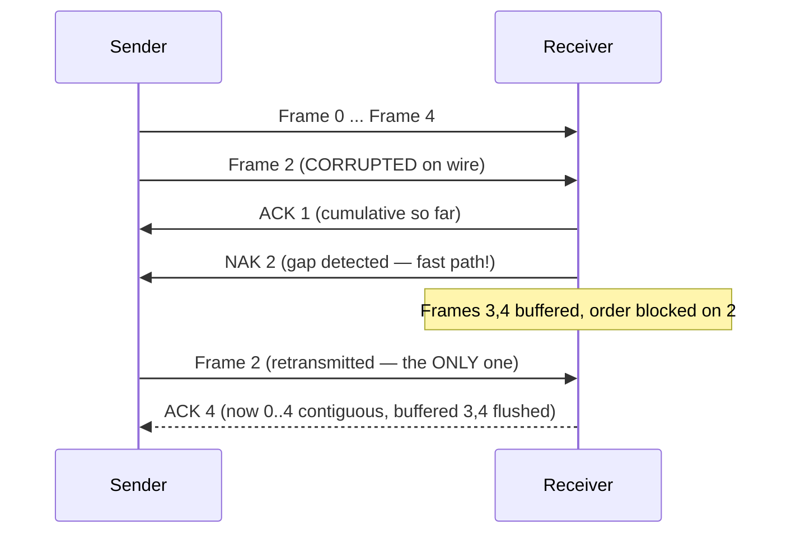

---
tags:
  - GATE/CS
  - GATE/Networks
  - SlidingWindow
aliases:
  - Selective Repeat
  - Selective Repeat ARQ
  - SR ARQ
  - Selective Reject ARQ
  - SR Protocol
date_created: 2026-08-30
difficulty: ⭐⭐⭐⭐⭐
last_revised: 2026-08-30
pyq_frequency: High
---

## Syllabus Position

Subject: [[Computer Networks Index]]
Parent Topic: [[Data Link Layer Index]]
Sibling Topics: [[Stop and Wait Protocol]], [[Go-Back-N Protocol]], [[Sliding Window Protocol]], [[Efficiency of Protocols]]
Leads To: [[TCP Congestion Control]], [[Bandwidth-Delay Product]], [[Pipelining]]

GATE Syllabus Line: "Data link layer protocols: Stop-and-Wait, sliding window, Go-Back-N, **Selective Repeat**... Flow control."

Exam Weight Note: Appears almost every year — the favourite GATE fact is the sequence-space split: for the **same $n$ bits**, SR's max window is $2^{n-1}$, exactly **half** of GBN's $2^n - 1$. 1-mark MCQs test "max window size / min bits", 2-mark NATs test utilization/throughput or "how many frames retransmitted when frame $k$ is lost" where the answer collapses to just $1$ (vs. GBN's $W$). Expect at least one SR-vs-GBN comparison in most papers.

---

## The Problem This Solves

[[Go-Back-N Protocol]] recovered from errors but did it with a sledgehammer: one corrupted frame meant resending the entire window — even perfectly received frames (the receiver had thrown them away). On a clean link that waste is rare and tolerable; on a noisy link where errors are common, GBN's throughput collapses because every error costs $W$ retransmissions. The problem: **how do we recover from a single lost frame without re-sending everything?**

Think of a supply warehouse filling an order. Instead of throwing working boxes aside when one box in the middle is damaged, the clerk keeps the good boxes on a side shelf, phones the factory only about the *one* damaged box, and ships the whole shelf only once the missing box arrives. The cost: the warehouse needs shelf space (buffers) and a clerk who tracks the order (bookkeeping). That is the entire contract of Selective Repeat — you pay for receiver memory in exchange for not re-sending good data.

Core Idea (one sentence): **Selective Repeat keeps a sliding window at both sender and receiver, buffers out-of-order frames, and retransmits only the single frame that was lost or corrupted.**

---

## Formal Theory

**[[Selective Repeat ARQ]]** is a [[Sliding Window Protocol|sliding window]] [[Automatic Repeat Request|ARQ]] scheme with **sender window of size $W$ and receiver window of size $W$**. The receiver accepts any frame whose sequence number falls inside its window, buffers out-of-order frames, and delivers them to the upper layer only when they become contiguous in order. When a frame is detected missing, the receiver explicitly asks for **that one frame** (NAK), and the sender retransmits only it.

### Key Differences From GBN (memorize these four)
1. **Receiver buffers** out-of-order frames instead of discarding them → $O(W)$ buffer on both ends.
2. **Only the errored frame** is ever retransmitted → $1$ retransmission per error, not $W$.
3. **Receiver window slides independently** as it delivers frames in order; frames *outside* the receiver window are still rejected.
4. **Every frame gets its own timer** (multiple timers may run at once), plus an optional **NAK** for fast recovery.

### Sender Side Logic
```
Algorithm SR_SENDER:           # window size W; per-frame timers
    while (base < next_to_send):
        if frame i timed out:  retransmit(i); restart timer(i)
        if NAK(i) received:    retransmit(i); restart timer(i)
        if ACK(i) received:    mark i ACKed;
            while (base is ACKed): base++      # slide sender window forward
```

### Receiver Side Logic
```
Algorithm SR_RECEIVER:         # window [E, E+W-1]; buffers out-of-order
    while (true):
        frame = receive()
        if checksum invalid:   send(NAK(E))               # ask for the missing one
        elif seq in [E, E+W-1]:
            buffer(frame)                                # park beside the shelf
            while (frame E buffered):                    # contiguous? deliver!
                deliver(E); E++                          # slide receiver window
            send(ACK(last delivered))
        else:                  discard(frame)            # outside window
```

### Why the Receiver Window Primed for Buffering Needs NA-Ks
In GBN a missing frame silently blocks progress until a timeout. SR detects the gap immediately: as soon as frame $E$ is expected but a later frame arrives, the receiver knows $E$ was lost and sends a **negative acknowledgment (NAK)** for $E$. NAK triggers instant retransmission — recovery in one round-trip instead of waiting for the full timeout ($RTO \approx RTT + $ margins).

### The Sequence Number Constraint — Why SR Gets Half the Window
Sender window $W$ + receiver window $W$ must both fit in the sequence space:

$$2W \leq 2^n \quad\Rightarrow\quad \boxed{W \leq 2^{n-1}}, \qquad n = \lceil \log_2(2W) \rceil$$

**Proof of the bound:** suppose $2W > 2^n$ and all ACKs for the sender's current window are lost. The sender's window still covers its last $W$ frames. Meanwhile the receiver has already received them, ACKed, and slid its own window ahead by $W$. The two windows now overlap in sequence space, so a retransmitted frame is indistinguishable from a brand-new frame. Collapse. Keeping $2W \leq 2^n$ guarantees the sender's retransmission set and the receiver's expectation set can never overlap. Compare GBN: receiver window $= 1$, so $W + 1 \leq 2^n \Rightarrow W \leq 2^n - 1$.

### Important Formulas — THE Master Box
Same delay vocabulary as its siblings: frame size $L$, bandwidth $B$, $T_{trans} = L/B$, and the ratio $a = T_{prop}/T_{trans} = T_{prop}B/L$.

**F1 — Utilization (no errors):** identical to GBN because both fill the pipe the same way:
$$\boxed{\eta = \min\left(1, \; \frac{W}{1+2a}\right) = \min\left(1, \; \frac{W \cdot T_{trans}}{T_{trans} + 2T_{prop}}\right)}$$

**F2 — Minimum window for 100%:** $\;W_{min} = \lceil 1 + 2a \rceil = \lceil (T_{trans}+2T_{prop})/T_{trans} \rceil$.

**F3 — Throughput:** $\;\text{Throughput} = \eta \cdot B$.

**F4 — Sequence bits (SR):** $\;W \leq 2^{n-1}$, $n = \lceil \log_2(2W) \rceil$. Max window with $n$ bits $= 2^{n-1}$ (GBN gets $2^n - 1$).

**F5 — Total time for $M$ frames:**
$$T_{total} \approx \begin{cases} \dfrac{M}{W}(T_{trans} + 2T_{prop}), & W < 1 + 2a \\[1em] M \cdot T_{trans} + 2T_{prop}, & W \geq 1 + 2a \end{cases}$$

**F6 — Frame error probability $p$ (the big SR advantage):** each frame's transmissions are independent, expected transmissions per frame $= 1/(1-p)$. Efficiency divides by that, so:
$$\boxed{\eta_{SR} \approx \eta \cdot (1-p)}, \qquad \text{Throughput}_{SR} \approx (1-p)\,\eta\,B$$
GBN with the same $p$ wastes up to $W$ frames per error (F7 of the GBN note), so SR's throughput edges ahead exactly when $\frac{1}{1+(W-1)p} > 1$, i.e., whenever $p > 0$ and $W > 1$.

**F7 — Retransmission count on losing frame $k$:** exactly **1** (frame $k$), versus exactly $W$ for GBN. This is the single most direct GATE question on SR.

**What GATE actually tests here:** (1) F4's $2^{n-1}$ vs GBN's $2^n-1$ discrimination, (2) F1/F3 utilization & throughput numbers, (3) F7's "only one frame resent" counting, and (4) the receiver-buffering/deliver-in-order behaviour in diagram-style questions.

---

## Diagrams and Visuals

**Visual 1: Receiver buffering — the shelf**

```
Arriving:    0 accepted   1 accepted   2 LOST      3 buffered   4 buffered
                                                                    |   5 buffered
Side shelf (buffer):                          [3][4][5]
Window E: initially 0, then 1, then 2 (stuck at 2 waiting for frame 2)
NAK sent for frame 2  -->  retransmit 2  -->  [0][1][2][3][4][5] all delivered in order
```

**Visual 2: Windows at both ends (same size $W$ now)**

```
SENDER   window:    [2][3][4][5]      (only 2 outstanding/resent individually)
RECEIVER window:    [2][3][4][5]      (2 missing; 3,4,5 parked in buffer)
                     E = 2            (window can't slide past missing 2)
```

**Visual 3: Mermaid sequence diagram (NAK fast recovery)**



---

## Complexity Analysis

Selective Repeat is a protocol; as with its siblings we analyze **utilization, buffer cost, and error tolerance** rather than traditional Big-O.

**Step 1 — Utilization derivation.** The sender can keep the pipe as full as GBN (both allow $W$ frames in flight between ACK advances), so the no-error utilization is identical:
$$\eta = \frac{\text{useful transmit time}}{\text{cycle time}} = \frac{W \cdot T_{trans}}{T_{trans} + 2T_{prop}}, \quad \text{capped at } 1.$$
The cap is forced: $\eta$ is a fraction of total time, so it cannot exceed 1 no matter how large $W$ grows.

**Step 2 — Buffer/space complexity.** Sender: $O(W)$ to hold unacknowledged frames. Receiver: **also $O(W)$** now — this is the price of not resending good frames. Contrast GBN's receiver, $O(1)$. GATE loves this asymmetry: "SR has higher memory requirement at receiver" is a legit description.

**Step 3 — Error behaviour.** Each frame is retransmitted until it succeeds; attempts are i.i.d. with success probability $1-p$, so the expected number of transmissions of any frame is $1/(1-p)$. Efficiency is the ratio of useful to total transmissions:
$$\eta_{SR} = \frac{\eta}{1/(1-p)} = \eta(1-p).$$
GBN pays $W$ transmissions per error instead of 1, which is why SR strictly dominates on lossy links and the margin widens with $W$.

### Complexity Summary Table

| Case               | Utilization $\eta$ | Retransmissions / error | Trigger Condition                                   |
|--------------------|--------------------|-------------------------|-----------------------------------------------------|
| Best Case ($p=0$)  | $\min(1, W/(1+2a))$ | $0$                     | Clean link, window sized to the pipe                |
| Average Case       | $\eta(1-p)$         | $1$ (approx., the failed frame) | Frequent losses, moderate $p$                 |
| Worst Case         | $\to 0$ as $p\to 1$ | every frame ends up alone | Very noisy link; buffering still caps waste at 1/error |

---

## Worked Example

**Setup:** Bandwidth $B = 1$ Mbps, frame size $L = 1000$ bits, one-way propagation $T_{prop} = 10$ ms, window $W = 4$.

**Step 1 — transmission delay & ratio:**
$$T_{trans} = \frac{1000}{10^6} = 1 \text{ ms}, \qquad a = \frac{T_{prop}}{T_{trans}} = 10, \qquad 1+2a = 21.$$

**Step 2 — utilization (F1):** since $W = 4 < 21$,
$$\eta = \frac{W}{1+2a} = \frac{4}{21} \approx 19.05\%, \qquad \text{Throughput} = 0.1905 \times 10^6 \approx 190{,}500 \text{ bps}.$$

**Step 3 — timeline with an error at frame 2.** Sender transmits frames $0,1,2,3$ ($t = 0 \ldots 4$ ms; window $[0\ldots3]$ full). Events from $t=10$ ms onward:

| Time (ms) | Sender side                        | Receiver side                                    |
|-----------|------------------------------------|--------------------------------------------------|
| 10–13     | —                                  | Gets 0 (deliver), 1 (deliver), 2 **corrupted**, 3 (buffer — window stuck at $E=2$) |
| 12        | —                                  | Detects gap → sends **NAK 2** immediately        |
| 20        | ACK0 arrives → slide to window $[1\ldots4]$, send frame 4 | —                        |
| 21        | ACK1 arrives → window $[2\ldots5]$ | —                                                |
| 22        | **NAK 2 arrives → retransmit only frame 2** | —                                          |
| 32        | —                                  | Frame 2 arrives → deliver 2, then **flush buffered 3,4 in order**, send ACK4 |

**Step 4 — retransmission count:** exactly **1** (frame 2). Run the same scenario under GBN (same $W=4$, same loss): the sender would retransmit $2,3,4,5$ — **4 frames**. The receiver's shelf saved 3 transmissions.

**Step 5 — with loss probability $p = 0.1$ (F6):**
$$\eta_{SR} \approx 0.1905 \times (1 - 0.1) \approx 0.1714 \Rightarrow 17.14\%, \quad \text{Throughput} \approx 171{,}400 \text{ bps}.$$
GBN at the same $W, p$ would be $\approx \eta \cdot (1-p)/(1+(W-1)p) = 0.1905 \times 0.9/1.3 \approx 13.2\%$ — SR wins by ~4 percentage points on this lossy link.

**Total operations: 5 quantities computed + a 5-event trace. This confirms $\eta = W/(1+2a)$, retransmit-only-frame-2, and the $\eta(1-p)$ error scaling.**

**What changes if the input has $W = 8$ instead?** Then $n = \lceil \log_2(2 \times 8) \rceil = 4$ bits needed (vs 3 for $W=4$), and utilization jumps to $8/21 \approx 38.1\%$ because more frames ride each 21 ms cycle. But the window is still below $W_{min} = 21$, so the pipe is still not saturated.

---

## Intuition Anchors

**The Analogy (restated and deepened):** The shelf now maps to every formula. The warehouse clerk (receiver) holds up to $W$ good boxes in his window; the moment box $E$ goes missing he phones on the intercom (NAK) for exactly that box, never the trainload. His shelf holds at most $W$ boxes ($O(W)$ buffer), which is *why* the sequence-field budget only allows $2^{n-1}$ — the same floor space at the other end eats half the addresses. The traveller in time: how full the track stays is still governed by window length vs. $1+2a$; SR and GBN are identical there. The isolation of loss is the only difference.

**The Mental Model:** Picture two identical sliding tapes — sender's and receiver's — each $W$ long. The sender's tape slides on ACKs. The receiver's tape slides only when its head $E$ gets its frame; in the meantime arrived frames file into a parking lot beside the tape. GATE question detection rule: *any* SR problem that mentions a lost frame → mentally park everything after it in the receiver buffer, retransmit count $= 1$. No exceptions, no "go back."

**The One-Line Recall:** "SR: window $W$ both ends, buffer the good, resend only the one bad — $\eta = \min(1, W/(1+2a))$, $2W \le 2^n$, one retransmission per error."

**The #1 Trap:** **Reusing the GBN sequence bound.** Students write $W \le 2^n - 1$ because they memorized the GBN result and assume windows work the same. But SR's *receiver* buffers $W$ frames too, so the budget is $2W \le 2^n$, i.e. $W \le 2^{n-1}$ — for $n$ bits, SR's ceiling is **exactly half** of GBN's. The fix: always ask "does the receiver buffer?" — if yes, the receiver window eats its own $W$ out of the sequence space.

---

## GATE Questions

---

**Question 1 — [GATE-style] — [1-mark MCQ]**

> A Selective Repeat ARQ protocol uses 4-bit sequence numbers. The maximum possible window size is:
>
> - (A) 8
> - (B) 7
> - (C) 15
> - (D) 16

<details>
<summary>Solution</summary>

**Answer: (A) 8**

**Reasoning:** Sequence space $= 2^4 = 16$. Both sender and receiver retain windows of size $W$, so $2W \le 16 \Rightarrow W \le 8$. 
- (B) 7 is the GBN value ($2^4 - 1$) — the classic decoy.
- (C) 15 is the GBN maximum, wrong for SR.
- (D) 16 uses the entire space for one side; impossible because the receiver must buffer too.

**What this question is really testing:** F4 and the discipline to check whether the receiver buffers before applying a window formula.

**Trap to avoid:** Instinctively answering 15 from the GBN habit. If the question says "Selective Repeat / SR / buffering", you are locked into $2^{n-1}$.

</details>

---

**Question 2 — [GATE-style] — [2-mark NAT]**

> A Selective Repeat protocol with window size 8 runs over a link with bandwidth 1 Mbps, frame size 2000 bits, and one-way propagation delay 15 ms. Assuming a frame error probability of 0.2, what is the throughput in kbps (rounded)?

<details>
<summary>Solution</summary>

**Answer: 400 kbps**

**Reasoning:**
$$T_{trans} = \frac{2000}{10^6} = 2 \text{ ms}, \qquad a = \frac{15}{2} = 7.5, \qquad 1 + 2a = 16.$$
$W = 8 < 16$, so the pipe is not full:
$$\eta = \frac{8}{16} = 0.5, \qquad \text{Throughput (no errors)} = 0.5 \times 10^6 = 500 \text{ kbps}.$$
With $p = 0.2$: $\eta_{SR} = \eta (1-p) = 0.5 \times 0.8 = 0.4$, so throughput $= 0.4 \times 10^6 = 400$ kbps.

**What this question is really testing:** F1 + F6 in sequence — most students remember the utilization correctly but forget to degrade it by $(1-p)$.

**Trap to avoid:** Applying the GBN error formula (dividing by $1 + (W-1)p$) here — that is the wrong protocol's formula. SR only multiplies by $(1-p)$.

</details>

---

**Question 3 — [Hard / Multi-concept] — [2-mark]**

> A Selective Repeat sender with window size 4 transmits frames $0,1,2,\ldots,7$. Frame 5 is corrupted and its ACK timer later expires because the ACK of the retransmitted frame is also lost. The receiver had buffered frames 6 and 7. What frames does the sender ultimately retransmit, and how does the answer differ under Go-Back-N on the same link? Which protocol's receiver window is "blocked" while 6, 7 sit in the buffer?

<details>
<summary>Solution</summary>

**Answer: SR retransmits frame 5 (twice — once for the NAK/loss, once for the lost ACK); GBN would retransmit $5,6,7,8$; the SR receiver is the one with a blocked window.**

**Reasoning:**
- SR receiver buffer: 6 and 7 parked, window stuck at $E=5$ — it cannot slide, that's the "blocked" window. It delivers all of 6,7 only after frame 5 finally arrives.
- SR sender: first the NAK (or timeout) for 5 makes it retransmit just frame 5. That retransmission succeeds at the receiver, but its ACK is lost → per-frame timer on 5 expires → frame 5 retransmitted a second time. The receiver detects the duplicate via its sequence number and discards it. **Total retransmissions: frame 5 twice = 2 frames**, *never* 6 or 7.
- GBN on the same link: receiver would have discarded 6,7 (no buffer), so a timeout on 5 forces retransmission of the whole window $5,6,7,8 = 4$ frames.

**What this question is really testing:** F7 (retransmit count = 1 per independent failure), per-frame timers, duplicate detection on lost ACKs, and the receiver-window-blocking behaviour — four SR facts fused in one frame-loss scenario.

**Trap to avoid:** Adding 6 and 7 to the retransmission count "because they were buffered" — buffered frames are *never* resent; they just wait. And forgetting that a lost ACK spawns its own retransmission of the *same single frame*.

</details>

---

**Pattern Recognition:**
- "Max window / min bits" in an SR question → $2W \le 2^n$; if the options mirror GBN numbers (7, 15), the answer is the halved one (8, 4, $\ldots$).
- Utilization questions give $(B, L, T_{prop}, W)$ → compute $a = T_{prop}B/L$, then $\eta = \min(1, W/(1+2a))$. Identical to GBN — if the paper gives you an SR loss scenario they'll then make you multiply by $(1-p)$.
- "How many frames retransmitted?" → for SR the answer is always about the failed frame (plus duplicates if ACKs failed); never the window.
- Whenever a receiver "buffers", sequence-space budget halves — this pairing is GATE's favourite two-concept combo.
- NAK appears only in SR-style protocols; its purpose is to cut recovery from one full timeout down to roughly one RTT.

---

## Edge Cases and Failure Modes

- [ ] **$2W = 2^n$ boundary:** allowed, but *only just* — the overlap-proof in the theory section shows why one more frame breaks the protocol. Never round a computed window up past $2^{n-1}$.
- [ ] **Frame outside the receiver window (too far ahead):** correctly **discarded**, not buffered. Buffering applies only within $[E,\, E + W - 1]$. Students over-buffer and "park" everything.
- [ ] **Lost ACK + per-frame timer:** duplicate retransmission of the same single frame; harmless due to sequence numbers, but it is the reason SR needs *per-frame* timers (GBN's single timer would stall the entire window on one lost ACK).
- [ ] **Stale NAK:** a NAK arrives for frame $k$ after $k$ was already retransmitted and ACKed → must be ignored. Naïve senders double-retransmit for nothing.
- [ ] **Timer shorter than $T_{trans} + 2T_{prop}$:** premature retransmission of healthy frames → duplicate floods; timer must exceed one round trip plus transmission.
- [ ] **Window $= 1$:** SR degenerates to [[Stop and Wait Protocol]] (confirm F4: $n=\lceil\log_2 2\rceil = 1$). Consistent with GBN — a good cross-check on both.
- [ ] **Delivery order guarantee:** SR delivers **in order to the upper layer only after buffering closes the gap**; the network layer sees bursts of reordered-then-flushed frames. Don't claim out-of-order delivery.
- [ ] **Corrupted ACK:** treated like a lost ACK → that single frame's timer handles it; all other frames proceed because timers are independent. This is precisely what GBN cannot do.

---

## Comparisons

| Feature                 | [[Selective Repeat ARQ]]    | [[Go-Back-N Protocol]]      | [[Stop and Wait Protocol]]   |
|-------------------------|-----------------------------|------------------------------|-------------------------------|
| Sender window           | $W$                         | $W$                          | 1                             |
| Receiver window / buffer| $W$ (buffers!)              | 1 (discards)                 | 1                             |
| Utilization (no error)  | $\min(1, W/(1+2a))$         | $\min(1, W/(1+2a))$          | $\dfrac{1}{1+2a}$             |
| Retransmit per error    | 1 frame                     | $W$ frames                   | 1 frame                       |
| Max window, $n$ bits    | $2^{n-1}$                   | $2^n - 1$                    | 1 ($n=1$)                     |
| NAK / fast recovery     | Yes                         | No (timeout only)            | No                            |
| Recovery mechanism      | Per-frame timers + NAK      | One timer on oldest frame    | One timer                     |
| When to prefer          | Noisy links, large BDP, buffering affordable | Clean links, minimal receiver | Tiny RTT, negligible data |
| GATE Trap               | Using $2^n-1$ (the GBN bound)| Using $2^n$ (the SR double)  | Forgetting $2T_{prop}$        |

The most common GATE comparison question states the same link parameters twice and asks *"frame 3 is lost — compare retransmissions and receiver behaviour under GBN vs. SR"*. The answer always hinges on **receiver buffering**: SR parks the good frames and re-sends only the bad one; GBN discards the good ones and re-sends the whole tail. Same utilisation, opposite memory philosophy — and exactly a factor-of-two difference in the max window for identical sequence bits.

---

## Connections Web

**Must know before this topic:**
- [[Go-Back-N Protocol]] — the direct sibling; SR fixes its retransmission waste
- [[Stop and Wait Protocol]] — the degenerate case (window 1) of both windowed schemes
- [[Sliding Window Protocol]] — the window/slide machinery both schemes share
- [[Transmission Delay]] — $T_{trans} = L/B$, the ratio denominator
- [[Propagation Delay]] — $T_{prop}$, doubled for the round trip
- [[Round Trip Time]] — the $2T_{prop}$ in every cycle formula
- [[Bandwidth-Delay Product]] — what a window must fill for $\eta = 1$

**Topics that build on this:**
- [[TCP Congestion Control]] — TCP's selective-ACK (SACK) option is SR-style recovery at the transport layer
- [[Pipelining]] — the shared design goal of all windowed ARQs
- [[Efficiency of Protocols]] — the general utilization framework this note plugs into

**GATE subject cross-links:**
- [[Computer Networks Index]] > [[Data Link Layer Index]]
- [[Computer Networks Index]] > [[Transport Layer Index]]

**Cross-subject connections:**
- [[Cumulative Acknowledgement]] — SR's ACKs/NAKs generalize the cumulative-ACK idea from GBN
- [[Sequence Number]] — comparing seq-bit budgets across all three ARQ schemes
- [[Flow Control]] — SR is the richest flow-control instance in the data link layer

**Standard references:**
- [[Kurose and Ross Chapter 3]] — reliable data transfer (pipelined rdt variants)
- [[Tanenbaum Chapter 3]] — data link ARQ schemes including selective repeat

---

## Quick Revision Sheet

**Definition (1 sentence):** Selective Repeat is a sliding-window ARQ where both ends window $W$ frames, the receiver buffers out-of-order frames, and only the single failed frame is retransmitted.

**Core Idea / Analogy (1 sentence):** A warehouse clerk who shelves the good boxes and re-orders only the one damaged box — memory instead of rework.

**Algorithm Steps (numbered):**
1. Sender fills window, one timer per frame.
2. Receiver accepts frames inside its window; buffers out-of-order ones.
3. Receiver sends ACKs for in-order progress, NAK for the missing frame.
4. NAK (or timeout) → sender retransmits **only that frame**.
5. Receiver slides its window and flushes the buffer once the gap closes.

**Complexity:**
- Utilization: $\eta = \min(1, W/(1+2a))$, $a = T_{prop}B/L$; with errors $\eta(1-p)$.
- Space: sender $O(W)$, receiver $O(W)$.
- Min window for 100%: $W_{min} = \lceil 1+2a \rceil$; Throughput $= \eta B$.

**Key Properties:**
- Sequence budget: $2W \le 2^n \Rightarrow W \le 2^{n-1}$, $n = \lceil \log_2(2W) \rceil$ (half of GBN's ceiling).
- Exactly 1 retransmission per lost/corrupted frame.
- Recovery via NAK ≈ one RTT, no full timeout wait.
- Delivers to upper layer only in order; buffer flush at gap close.
- Per-frame timers; stale NAKs and lost ACKs handled by sequence numbers.

**The #1 Trap:** Copying GBN's $2^n - 1$ ceiling — SR's receiver buffers $W$ frames, so the bound is $2^{n-1}$.

**When to use this over alternatives:** Any noisy link or large window; GBN only if the receiver must stay trivial (low memory).

**Mnemonic:** "Selective = **S**helf the good, **R**esend the **R**ejected **one** — and sign the window with **half the address space**."

---

## Revision Checklist

- [ ] I can state the formal definition without looking.
- [ ] I can explain the shelf/clerk analogy and map it to the receiver buffer and NAK.
- [ ] I can trace a W=4 example with one corrupted frame and one lost ACK by hand in under 2 minutes.
- [ ] I can derive $\eta = \min(1, W/(1+2a))$, $\eta(1-p)$, and $W \le 2^{n-1}$ from scratch.
- [ ] I can prove why SR's max window is half of GBN's for the same $n$ bits.
- [ ] I know what the Quick Revision Sheet says without reading it.
- [ ] I can solve all 3 GATE questions in this note without peeking.
- [ ] I know the #1 trap (using the GBN $2^n-1$ bound) and can articulate why students fall for it.
- [ ] I have linked this note correctly in my Obsidian vault ([[Go-Back-N Protocol]], [[Stop and Wait Protocol]], [[Sliding Window Protocol]]).
- [ ] I have scheduled a spaced-repetition review in 3 days.

---

*Follow-up topic to create next: [[Bandwidth-Delay Product]] — the single quantity that explains why windows of any kind exist and how big they must be.*