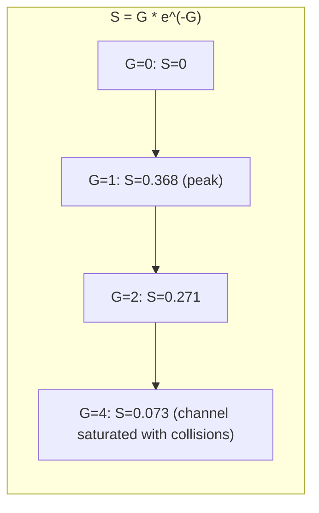
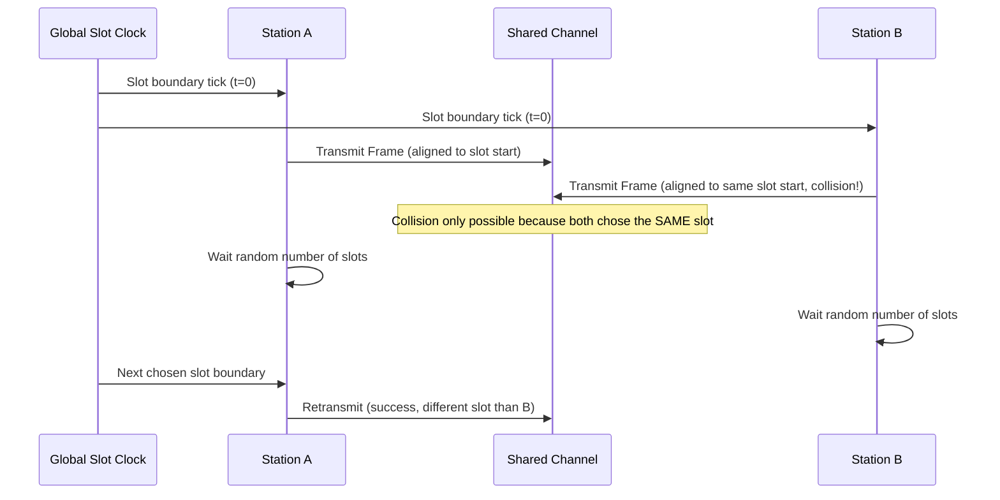

---
tags:
  - GATE/CS
  - GATE/ComputerNetworks
  - MediumAccessControl
  - RandomAccessProtocols
aliases:
  - Slotted ALOHA
  - Slotted ALOHA Protocol
date_created: 2026-09-07
difficulty: ⭐⭐⭐⭐
last_revised: 2026-09-07
pyq_frequency: High
---

## Syllabus Position

Subject: [[Computer Networks]]
Parent Topic: [[Medium Access Control]]
Sibling Topics: [[Pure ALOHA]], [[CSMA]], [[CSMA/CD]], [[CSMA/CA]]
Leads To: [[CSMA]], [[Ethernet]], [[Wireless MAC Protocols]]

GATE Syllabus Line: "Medium access control, LAN technologies (Ethernet), Random access protocols."

Exam Weight Note: Appears heavily as 1-mark and 2-mark MCQ/NAT questions computing maximum throughput (36.8%), efficiency at a given load $G$, and vulnerable period length — almost always paired directly against [[Pure ALOHA]] in the same question, testing whether the student can articulate exactly *why* slotting halves the vulnerable period and doubles the throughput.

---

## The Problem This Solves

Pure ALOHA is beautifully simple — no coordination needed — but it pays a steep price: any station can start transmitting at any instant, so a neighbor's frame can clash with either the beginning or the end of your frame. What if we could cut that risk in half without giving up the "no central controller" philosophy? Slotted ALOHA answers this by adding just one small piece of structure: a shared, global clock that divides time into discrete slots exactly one frame-time long, and every station is required to start transmitting **only at the beginning of a slot**.

Think of it like the noisy classroom again, but now with a metronome ticking in the background: everyone is still free to blurt out an answer whenever they want, but they can only *start* speaking exactly when the metronome ticks. Two students can still speak at the same tick and collide entirely, but a student can no longer collide with someone who started talking mid-sentence a moment before or after — the metronome eliminates half of the collision danger by forcing all speech to begin in lockstep.

**Core Idea:** Slotted ALOHA forces every station to align frame transmissions to the start of discrete time slots equal to the frame transmission time, which halves the vulnerable period compared to [[Pure ALOHA]] and doubles the maximum achievable channel throughput to about 36.8%.

---

## Formal Theory

### Overview

Slotted ALOHA (Roberts, 1972) is a direct refinement of [[Pure ALOHA]], introduced specifically to fix its low channel utilization. It remains a **random access protocol** in the [[Medium Access Control]] sublayer — stations still contend for the channel without a fixed schedule or reservation — but it adds exactly one piece of global infrastructure: **time slotting**.

### Slotting Rule

Time is divided into discrete slots, each exactly $T_{fr}$ long (the frame transmission time). Every station in the network is synchronized to this same slot boundary (via a shared clock signal, e.g., from a satellite beacon in the original application). A station with a frame ready to send must **wait until the start of the next slot boundary** before transmitting — it cannot begin mid-slot.

### Collision Model

Because every transmission must begin exactly at a slot boundary, two frames can only collide if **two or more stations choose to transmit in the same slot**. There is no possibility of a "partial" collision straddling two slots the way Pure ALOHA allows — collisions are now an all-or-nothing event **per slot**, not per arbitrary instant.

### The Vulnerable Period

Because a frame occupies exactly one full slot of length $T_{fr}$, and any other station transmitting in that **same slot** (not before, not after — since no one can start mid-slot) causes a collision:

$$\text{Vulnerable Period} = T_{fr}$$

This is **half** the $2T_{fr}$ vulnerable period of [[Pure ALOHA]] — the single most important derived fact in this topic. Slotting eliminates exactly the "neighbor starts just before me" half of the collision risk, because a neighbor starting "just before" you would actually be starting in the *previous* slot, which does not overlap your slot at all.

### Throughput Derivation (Poisson Model)

Using the same Poisson offered-load model as Pure ALOHA, with $G$ transmission attempts (new + retransmitted) per frame-time $T_{fr}$, normalized so $T_{fr} = 1$:

For a given frame to survive, **zero other stations** may choose to transmit in the **same slot** — i.e., zero arrivals in an interval of length $T_{fr}$ (so $\tau = 1$, not $2$, unlike Pure ALOHA):

$$P(\text{success}) = P(0 \text{ arrivals in } T_{fr}) = e^{-G}$$

**Throughput** is:

$$S = G \cdot e^{-G}$$

### Maximizing Throughput

Differentiate $S$ with respect to $G$ and set to zero:

$$\frac{dS}{dG} = e^{-G}(1 - G) = 0 \implies G = 1$$

Substituting back:

$$S_{max} = 1 \cdot e^{-1} = \frac{1}{e} \approx 0.368$$

**This is the famous "36.8%" result** — exactly double Pure ALOHA's $\frac{1}{2e} \approx 0.184$, achieved at $G=1$ instead of $G=0.5$, since removing half the vulnerable period lets the optimal load double before collisions dominate.

### How GATE Tests This Topic

GATE loves to test:
1. Deriving or directly recalling $S = Ge^{-G}$ and the maximum throughput $\frac{1}{e} \approx 0.368$
2. Computing the vulnerable period as exactly $T_{fr}$ and explaining *why* it is half of Pure ALOHA's
3. Directly comparing Slotted ALOHA against [[Pure ALOHA]] in the same question — this is the single most common question pattern for this topic
4. Computing frame transmission time and slot duration from given bandwidth/frame size, then plugging into the throughput formula
5. Recognizing that the optimizing load doubles from $G=0.5$ to $G=1$ compared to Pure ALOHA

---

## Diagrams and Visuals

### Slot Alignment vs. Pure ALOHA's Free Start Times

```
Pure ALOHA (any instant):
    ...--|-----A-----|--------------...
    ...------|-----B-----|----------...     <- B can start ANYWHERE, including mid-A

Slotted ALOHA (aligned to slot boundaries):
    Slot 1      Slot 2      Slot 3      Slot 4
    |-----A-----|-----B-----|-----------|-----------|
                            ^ B must wait for next slot start, cannot begin mid-slot

Collision only possible if two stations pick the SAME slot:
    Slot 1      Slot 2      Slot 3
    |-----A-----|-----------|-----------|
                |-----C-----|                <- A and C both chose Slot 1 -> COLLISION
```

### Throughput vs. Offered Load Curve



### Sequence of Events: Slot-Synchronized Transmission



---

## Complexity Analysis

Adapted for a protocol/throughput concept rather than an algorithm's time/space complexity.

### Throughput and Delay Characterization

| Metric | Formula | Notes |
|--------|---------|-------|
| Vulnerable period | $T_{fr}$ | Collision only if another station picks the exact same slot |
| Success probability | $P(\text{success}) = e^{-G}$ | Zero arrivals in one slot-length interval (Poisson model) |
| Throughput | $S = G e^{-G}$ | Peaks at $G = 1$ |
| Maximum throughput | $S_{max} = \frac{1}{e} \approx 0.368$ (36.8%) | Double Pure ALOHA's $\frac{1}{2e}$ — direct consequence of halved vulnerable period |
| Access delay (informal) | Grows unboundedly as $G$ increases past $1$ | Same runaway/unstable regime as Pure ALOHA, just shifted to a higher tolerable load |

### Trigger Conditions

| Case | Throughput Behavior | Condition |
|------|---------------------|-----------|
| Best (theoretical peak) | $S = 0.368$ | Offered load precisely tuned to $G = 1$ |
| Underloaded | $S < 0.368$, wasted idle slots | $G \ll 1$: few stations transmitting, many empty slots |
| Overloaded | $S \to 0$ as $G \to \infty$ | $G \gg 1$: nearly every slot has multiple contenders, constant collisions |

---

## Worked Example

### Example: Computing Throughput for a Given Offered Load

**Scenario:** A shared channel has bandwidth 1 Mbps. All frames are a fixed 1000 bits long. Stations collectively generate new frames (plus retransmissions) following a Poisson process, and the combined offered load happens to be exactly $G = 1$ — the theoretical sweet spot for Slotted ALOHA.

**Step 1 — Compute frame transmission time (= slot duration):**

$$T_{fr} = \frac{\text{Frame Size}}{\text{Bandwidth}} = \frac{1000 \text{ bits}}{10^6 \text{ bps}} = 1 \text{ ms}$$

Note that in Slotted ALOHA, this same value **is** the slot duration — the protocol requires every slot to be exactly one frame-time long.

**Step 2 — Compute the vulnerable period:**

$$\text{Vulnerable Period} = T_{fr} = 1 \text{ ms}$$

Compare against Pure ALOHA, where the same frame size and bandwidth would give a vulnerable period of $2 \text{ ms}$ — slotting has cut the risk window in half.

**Step 3 — Compute throughput at $G = 1$:**

$$S = G \cdot e^{-G} = 1 \times e^{-1} \approx 0.368$$

**Step 4 — Convert to actual successful data rate:**

$$\text{Effective Throughput} = S \times \text{Bandwidth} = 0.368 \times 10^6 \text{ bps} \approx 368{,}000 \text{ bps}$$

**Verification:** Out of the 1 Mbps raw channel, about 368 kbps of *useful* data gets through at the optimal load — exactly double the 184 kbps Pure ALOHA would achieve under the same bandwidth and frame size, confirming the $\frac{1}{e} \approx 36.8\%$ theoretical maximum.

**What would change if $G$ were doubled to 2.0 instead?**

$$S = 2.0 \times e^{-2} \approx 2.0 \times 0.1353 = 0.271$$

Throughput decreases from 0.368 to 0.271 — same counter-intuitive GATE-favorite pattern as Pure ALOHA: pushing more load past the optimal point makes the channel *less* productive, not more, because collision probability grows faster than the additional attempts can compensate for.

---

## Intuition Anchors

**The Analogy (deepened):**

Extend the metronome classroom: now, students can only start speaking exactly on a metronome tick, never mid-beat. This doesn't stop two students from both deciding to speak on the *same* tick (still a collision), but it completely eliminates the case where one student's answer trails into the start of another's — that source of garbling, which existed in the free-for-all classroom, is now structurally impossible. The result: on average, roughly 2 out of every 5 metronome ticks carry a clean, successful answer at the optimal speaking rate — nearly double the noisy classroom's success rate.

**The Mental Model:**

Picture the same Poisson "rain" of transmission attempts as in Pure ALOHA, but now the rain can only fall at discrete, evenly-spaced instants (the slot boundaries) instead of continuously. For your frame to survive, no other raindrop can land in the **same instant** as yours — a much easier condition to satisfy than "no raindrop within an entire window around you," which is why the success probability $e^{-G}$ has half the exponential decay rate of Pure ALOHA's $e^{-2G}$.

**The One-Line Recall:**

Slotted ALOHA: vulnerable period $= T_{fr}$, throughput $S = Ge^{-G}$, maximum throughput $= \frac{1}{e} \approx 36.8\%$ at $G = 1$ — slotting removes the "collision from a neighbor starting mid-frame" risk entirely.

**The #1 Trap:**

Students confuse Slotted ALOHA's vulnerable period ($T_{fr}$) and optimal load ($G=1$) with [[Pure ALOHA]]'s ($2T_{fr}$, $G=0.5$), or mix up which formula has the factor of 2 in the exponent. The mnemonic fix: "Slotted, so only one side" — synchronization means collisions can only come from stations picking the exact same slot, never from a neighbor straddling the boundary, hence a single $T_{fr}$ vulnerable window and double the throughput ceiling.

---

## GATE Questions

---

**Question 1 — PYQ GATE-style — 2-mark MCQ**

> In a Slotted ALOHA network, the combined offered load (new + retransmitted frames) across all stations is $G = 1$ attempt per frame time. What is the approximate throughput of the channel?

- (A) 0.184
- (B) 0.271
- (C) 0.368
- (D) 1.000

<details>
<summary>Solution</summary>

**Answer: (C) 0.368**

**Reasoning:**

- Slotted ALOHA throughput: $S = G e^{-G}$.
- At $G = 1$: $S = 1 \times e^{-1} \approx 0.368$.
- This is precisely the maximum achievable throughput for Slotted ALOHA, since $G=1$ is the value that maximizes $S$.
- Option (A) 0.184 is the maximum throughput of **Pure ALOHA** ($\frac{1}{2e}$), a classic trap for mixing up the two protocols.
- Option (B) 0.271 is the throughput at $G=2$, not $G=1$.
- Option (D) 1.000 is just the value of $G$ itself, not the throughput.

**What this question is really testing:**

Whether the student can correctly recall and evaluate $S = Ge^{-G}$ at the specific optimal $G$, without confusing it with Pure ALOHA's formula.

**Trap to avoid:**

Selecting 0.184 by misremembering the exponent as $e^{-2G}$ instead of $e^{-G}$ — always confirm whether the protocol is slotted (single exponent) or unslotted (double exponent) before evaluating.

</details>

---

**Question 2 — Conceptual — 1-mark MCQ**

> Why does slotting reduce the vulnerable period from $2T_{fr}$ (Pure ALOHA) to $T_{fr}$ (Slotted ALOHA)?

- (A) Because Slotted ALOHA transmits frames at half the size
- (B) Because all stations must start transmitting only at slot boundaries, eliminating the possibility of a neighbor starting mid-frame just before or after
- (C) Because Slotted ALOHA uses two channels instead of one
- (D) Because propagation delay is halved by synchronization

<details>
<summary>Solution</summary>

**Answer: (B)**

**Reasoning:**

Since every station is forced to align its transmission start to a common slot boundary, a "neighbor starting just before my frame begins" scenario (which caused half of Pure ALOHA's collisions) becomes impossible — that neighbor would actually be starting in the *previous* slot, entirely separate from mine. Only a station choosing to start in **exactly my slot** can collide with me, halving the risk window to $T_{fr}$. Option (A) is false — frame size is unrelated to slotting. Option (C) is false — Slotted ALOHA uses a single shared channel, same as Pure ALOHA. Option (D) confuses propagation delay (a separate factor, generally assumed negligible in this basic model) with the vulnerable-period concept.

**What this question is really testing:**

Deep understanding of *why* slot alignment specifically removes the "before" half of the collision risk, not just rote memorization of "$T_{fr}$."

**Trap to avoid:**

Assuming slotting eliminates collisions entirely (it does not — same-slot collisions are still fully possible) rather than understanding it only removes the cross-slot overlap case.

</details>

---

**Question 3 — Hard / Multi-concept — 2-mark NAT**

> A Slotted ALOHA network has a channel bandwidth of 2 Mbps, and all frames are 2000 bits long. The combined offered load is such that the channel achieves its maximum possible throughput. What is the effective successful data rate, in kbps (rounded to the nearest integer)?

<details>
<summary>Solution</summary>

**Answer: ≈736 kbps**

**Reasoning:**

- Frame transmission time (= slot duration): $T_{fr} = \frac{2000 \text{ bits}}{2 \times 10^6 \text{ bps}} = 1 \text{ ms}$ (not needed for the throughput fraction itself, only to confirm the slot duration matches the frame size — a distractor detail).
- "Maximum possible throughput" for Slotted ALOHA occurs at $G = 1$, giving $S_{max} = \frac{1}{e} \approx 0.368$.
- Effective successful data rate $= S_{max} \times \text{Bandwidth} = 0.368 \times 2 \times 10^6 \text{ bps} = 736{,}000 \text{ bps} = 736 \text{ kbps}$.

**What this question is really testing:**

Whether the student recognizes that "maximum possible throughput" is a fixed fraction ($\approx 36.8\%$) independent of the specific frame size or bandwidth given — those numbers only convert the fraction into an absolute bps figure.

**Trap to avoid:**

Using Pure ALOHA's $\frac{1}{2e} \approx 0.184$ fraction by mistake (yielding 368 kbps instead of 736 kbps) — always check whether the question specifies "slotted" before picking the multiplier.

</details>

---

**Pattern Recognition:**

- Whenever GATE says "Slotted ALOHA" and asks for maximum throughput, the answer is always $\frac{1}{e} \approx 0.368$ (36.8%), achieved at $G=1$, independent of the specific bandwidth/frame-size numbers given.
- Whenever GATE gives a specific $G$ value (not necessarily 1), plug directly into $S = Ge^{-G}$ rather than assuming it's asking for the maximum.
- Whenever GATE pairs Slotted ALOHA with [[Pure ALOHA]] in the same question, the entire answer hinges on the factor-of-2 relationship: vulnerable period $T_{fr}$ vs. $2T_{fr}$, optimal $G=1$ vs. $G=0.5$, max throughput $\frac{1}{e}$ vs. $\frac{1}{2e}$.
- Whenever GATE increases $G$ beyond 1 and asks about throughput trend, remember throughput **decreases** past the peak, mirroring the same runaway-collision behavior as Pure ALOHA, just shifted to a higher threshold.

---

## Edge Cases and Failure Modes

- [ ] **$G = 0$ (no traffic):** Throughput $S = 0$ trivially — no frames sent, none succeed. A sanity boundary condition, occasionally used in NAT questions.
- [ ] **Very small $G$ (underloaded channel):** Throughput approaches $G$ itself (since $e^{-G} \to 1$ for small $G$), meaning almost every attempt succeeds, but many slots go completely empty — capacity is wasted on idle slots rather than collisions.
- [ ] **$G$ much greater than 1 (overloaded channel):** Throughput collapses toward zero as $G \to \infty$, because $e^{-G}$ decays faster than $G$ grows — the same runaway collision regime as Pure ALOHA, just requiring a higher load to trigger.
- [ ] **Fixed (non-random) retransmission delay:** Exactly as in Pure ALOHA, if all colliding stations retransmit after the same fixed number of slots, they collide again in lockstep forever — backoff must be randomized (typically a random number of slot-widths).
- [ ] **Same-slot collision is still total, not partial:** Even though slotting removes cross-slot overlap, two stations choosing the identical slot still produce a fully corrupted collision for both frames — slotting reduces the *probability* of collision, it does not make same-slot collisions any less destructive.
- [ ] **Clock synchronization failure:** Slotted ALOHA's entire advantage depends on all stations sharing an accurate, common notion of slot boundaries; if synchronization drifts or fails, stations may begin transmitting off-boundary, degrading the protocol back toward Pure ALOHA-like behavior — a real-world caveat GATE occasionally references conceptually.
- [ ] **Propagation delay ignored in the basic model:** As with Pure ALOHA, the classic derivation assumes propagation delay is negligible relative to $T_{fr}$; GATE questions almost always use this idealized assumption.

---

## Comparisons

| Feature | [[Slotted ALOHA]] | [[Pure ALOHA]] | [[CSMA]] |
|---------|---------------------|-----------------|-------------|
| Synchronization | Global slot clock required | None (unslotted) | None, but senses carrier first |
| Vulnerable Period | $T_{fr}$ | $2T_{fr}$ | Much smaller (depends on propagation delay) |
| Optimal Offered Load | $G = 1$ | $G = 0.5$ | N/A (different model) |
| Max Throughput | $\frac{1}{e} \approx 36.8\%$ | $\frac{1}{2e} \approx 18.4\%$ | Significantly higher (depends on variant, often >50%) |
| Collision Detection | None (pure retransmission-based) | None (pure retransmission-based) | Can include collision detection (CSMA/CD) |
| Complexity | Requires synchronized clock across all stations | Very simple, no infrastructure | Requires carrier-sensing hardware |
| GATE Preference | Very heavily tested (paired comparison) | Very heavily tested (formula derivation) | Tested, especially CSMA/CD backoff math |

The most common GATE question comparing these is: "Why does Slotted ALOHA achieve exactly double the maximum throughput of Pure ALOHA?" The answer hinges on the vulnerable period being halved — from $2T_{fr}$ to $T_{fr}$ — because slotting forces all stations to align their transmission starts to slot boundaries, eliminating the "collision from a neighbor starting mid-frame" half of Pure ALOHA's risk window, which in turn doubles the tolerable optimal load from $G=0.5$ to $G=1$.

---

## Connections Web

**Must know before this topic:**
- [[Pure ALOHA]] — the unslotted predecessor; understanding its $2T_{fr}$ vulnerable period is essential to appreciating what slotting fixes
- [[Medium Access Control]] — the broader sublayer and problem space (who gets to use a shared channel and when)
- [[Poisson Process]] — the statistical arrival model underlying the entire throughput derivation

**Topics that build on this:**
- [[CSMA]] — adds carrier sensing before transmission, further reducing (but not eliminating) collisions compared to any ALOHA variant
- [[CSMA/CD]] — further adds mid-transmission collision detection, used historically in classic Ethernet
- [[Ethernet]] — historically evolved from ALOHA-style random access ideas combined with carrier sensing

**GATE subject cross-links:**
- [[Computer Networks]] > [[Medium Access Control]] > Slotted ALOHA

**Cross-subject connections:**
- [[Queueing Theory]] — the Poisson arrival model and throughput-vs-load curves parallel queueing system analysis in performance modeling
- [[Probability and Statistics]] — the exponential/Poisson distribution mechanics used to derive $S = Ge^{-G}$ are shared with GATE's probability syllabus

**Standard references:**
- Roberts, L. (1972) — "ALOHA Packet System with and without Slots and Capture," the paper introducing Slotted ALOHA
- [[Kurose & Ross]] Chapter 6 — The Link Layer and LANs, Random Access Protocols
- [[Tanenbaum & Wetherall]] Chapter 4 — The Medium Access Control Sublayer

---

## Quick Revision Sheet

**Definition (1 sentence):** Slotted ALOHA is a random access MAC protocol where every station must align frame transmissions to the start of globally synchronized time slots of length $T_{fr}$, halving the collision risk window compared to Pure ALOHA.

**Core Idea / Analogy (1 sentence):** It's a noisy classroom with a metronome — anyone can still blurt out an answer, but only exactly on a tick, eliminating the "someone started mid-sentence" source of collisions.

**Algorithm Steps (numbered, maximum 6 steps):**
1. Station has a frame ready → wait until the next slot boundary (cannot start mid-slot).
2. At the slot boundary, transmit the frame for the full slot duration $T_{fr}$.
3. If another station also transmitted in the same slot, both frames are corrupted (collision).
4. Sender detects failure (e.g., no ACK received within a timeout).
5. Sender waits a **random** number of slot-widths before retrying (never fixed).
6. Retransmit at the next chosen slot boundary; repeat from step 3 if collision recurs.

**Complexity:**
- Vulnerable period: $T_{fr}$
- Throughput: $S = Ge^{-G}$
- Maximum throughput: $S_{max} = \frac{1}{e} \approx 0.368$ at $G = 1$

**Key Properties (3 to 5 bullet points):**
- Requires a global slot clock shared by all stations — the one piece of infrastructure Pure ALOHA lacks.
- Vulnerable period is exactly the frame time, half of Pure ALOHA's, because cross-slot overlap is structurally impossible.
- Maximum theoretical channel utilization is capped at 36.8%, exactly double Pure ALOHA's 18.4%.
- Still requires randomized (not fixed) backoff delays to avoid deterministic repeated collisions.

**The #1 Trap:**
Confusing Slotted ALOHA's $T_{fr}$ vulnerable period, $G=1$ optimal load, and $\frac{1}{e}$ maximum throughput with [[Pure ALOHA]]'s $2T_{fr}$, $G=0.5$, and $\frac{1}{2e}$ respectively.

**When to use this over alternatives:**
Slotted ALOHA is preferred over Pure ALOHA whenever a shared global clock is feasible (e.g., satellite systems with a common time reference) and the doubled throughput justifies the added synchronization infrastructure; real systems still often upgrade further to CSMA variants when carrier sensing is possible.

**Mnemonic:** "Slotted, so only one side" — synchronization removes half the vulnerable window (only same-slot collisions remain), doubling both the optimal load and the max throughput compared to Pure ALOHA.

---

## Revision Checklist

- [ ] I can state the vulnerable period formula ($T_{fr}$) and explain why slotting halves it compared to Pure ALOHA.
- [ ] I can derive $S = Ge^{-G}$ from the Poisson "zero arrivals in one slot" argument.
- [ ] I can find the maximizing $G$ (1) via differentiation and compute $S_{max} = \frac{1}{e} \approx 0.368$.
- [ ] I can explain why increasing $G$ past 1 decreases throughput instead of increasing it.
- [ ] I can compare Slotted ALOHA's vulnerable period and max throughput against Pure ALOHA's without mixing them up.
- [ ] I understand why retransmission backoff must be random, not fixed, even with slotting.
- [ ] I can convert a throughput fraction into an absolute bps value given bandwidth.
- [ ] I have linked this note correctly in my Obsidian vault.
