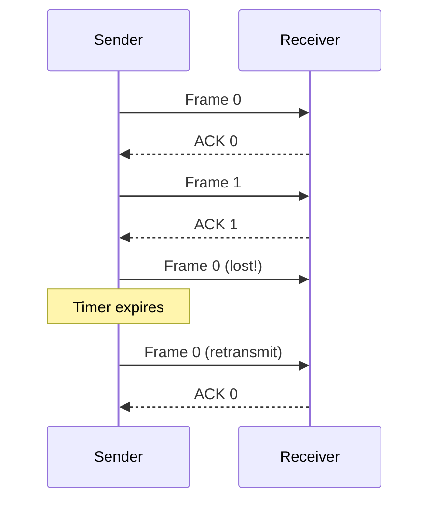

---
tags:
  - GATE/CS
  - GATE/Networks
  - FlowControl
aliases:
  - Stop and Wait ARQ
  - SR ARQ
  - Slow Protocol
  - Stop and Wait Efficiency
date_created: 2026-08-29
difficulty: ⭐⭐⭐⭐
last_revised: 2026-08-29
pyq_frequency: High
---

## Syllabus Position

Subject: [[Computer Networks Index]]
Parent Topic: [[Data Link Layer Index]]
Sibling Topics: [[Sliding Window Protocol]], [[Go-Back-N ARQ]], [[Selective Repeat ARQ]], [[Efficiency of Protocols]]
Leads To: [[TCP Congestion Control]], [[Bandwidth-Delay Product]], [[Pipelining]]

GATE Syllabus Line: "Data link layer protocols: **Stop-and-Wait, sliding window, Go-Back-N, Selective Repeat**... Flow control."

Exam Weight Note: Appears almost every year — usually as a 1-mark MCQ on the efficiency/throughput formula or a 2-mark NAT where you compute efficiency, utilization, or minimum required bandwidth/propagation. Algorithm-based and formula-heavy, so it rewards memorized derivations more than classic subjects.

---

## The Problem This Solves

Imagine two people talking where the listener never says "I got that." The speaker just keeps talking, and if the listener missed something, the entire conversation is corrupted and neither person knows it. In a noisy network, frames get lost or damaged all the time. Reliable delivery requires the receiver to *confirm* each message. But confirmation itself costs time — while the sender waits for a "yes, I got it," the link sits idle. The designer's dilemma: **how do we guarantee delivery without wasting the link?**

Think of sending a single sealed letter by a courier who refuses to leave until the recipient signs a receipt and hands back a signed acknowledgment. The letter goes, the receipt comes back, only then do you prepare the next letter. The moment between sending the letter and getting the receipt is pure dead time — you can't do anything else.

Core Idea (one sentence): **Stop and Wait works by sending exactly one frame at a time and refusing to send the next frame until an acknowledgment for the current one arrives.**

---

## Formal Theory

**[[Stop and Wait Protocol]]** is the simplest [[Flow Control|flow-control]] mechanism for reliable data transfer. The sender transmits exactly one frame, then **stops** and does nothing until it receives a positive acknowledgment (ACK) from the receiver, at which point it sends the next frame.

### Sender Side Logic
```
Algorithm STOP_AND_WAIT_SENDER:
    while (there are frames to send):
        send(M)                    # transmit frame M
        start_timer()
        wait until (ACK(M) received) OR (timer expires)
        if (ACK(M) received):
            send(next frame)       # loop continues
        else:
            retransmit(M)          # timeout: assume loss/corruption
            restart_timer()
```

### Receiver Side Logic
```
Algorithm STOP_AND_WAIT_RECEIVER:
    while (true):
        wait until a frame arrives
        if (frame is the expected next frame and checksum valid):
            deliver to upper layer
            send(ACK(expected frame))
        else:
            send(ACK of last correctly received frame)  # duplicate/lost ACK recovery
```

### Why Do We Need Sequence Numbers and Timeouts?
- **Timeout:** If a frame (or its ACK) is lost, the sender would wait forever. A **timer** forces retransmission after a cap. This is the foundation of [[Automatic Repeat Request]] (ARQ).
- **Sequence Number:** Without it, a retransmission could be mistaken for a *new* frame. With a **1-bit sequence number** ($0, 1, 0, 1, \ldots$), sender and receiver can tell whether an arriving frame is new or a duplicate. This is why GATE says stop-and-wait uses **1-bit** sequence numbers — frame numbers modulo 2.

### The Cycle Time — The Heart of Everything
For one frame of size $L$ bits on a link of bandwidth $B$ with one-way propagation delay $T_{prop}$:

$$T_{trans} = \frac{L}{B}$$

The sender is busy transmitting for $T_{trans}$, then the frame travels for $T_{prop}$, the receiver sends an ACK that also takes $T_{prop}$ to travel back (ACK transmission/processing delay usually ignored or given separately). So the **total time per frame** (the round-trip cycle):

$$T_{total} = T_{trans} + 2 \times T_{prop}$$

The $2 \times T_{prop}$ is the [[Round Trip Time]] (RTT) minus transmission. This is *why* propagation delay gets doubled in stop-and-wait problems — a very common GATE trap is forgetting to double it.

### Utilization (Efficiency)
Utilization is the fraction of time the sender is actually transmitting:

$$\eta = \frac{\text{Time transmitting}}{\text{Total cycle time}} = \frac{T_{trans}}{T_{trans} + 2 T_{prop}}$$

If ACK transmission and processing delay are nonzero (rarely), include them: $T_{total} = T_{trans} + 2T_{prop} + 2T_{ack,trans} + T_{proc}$.

### Throughput (Effective Data Rate)
Throughput is the number of *useful* data bits delivered per second:

$$\text{Throughput} = \frac{\text{Data bits per frame}}{\text{Total cycle time}} = \frac{L}{T_{trans} + 2 T_{prop}} = \eta \cdot B$$

Using the relation $T_{trans} = L/B$, we get the elegant result that **Throughput = Utilization × Bandwidth**.

### The Bandwidth-Delay Product Insight
Utilization can be rewritten in terms of the number of frames "in flight." Since at most **one** frame can be in the pipeline at any time (with $T_{trans}$ worth of bits on the wire during transmission and one ACK in transit), stop-and-wait uses at most 1 unit of the [[Bandwidth-Delay Product]]. This is the fundamental limitation that [[Sliding Window Protocol]] solves — big window lets many frames be in flight, pushing utilization toward 100%.

**What GATE actually tests here:** The two big computed quantities — **utilization** $\eta = T_{trans}/(T_{trans}+2T_{prop})$ and **throughput** $= \eta \cdot B$ — in numerous disguises. Also tests the minimum bandwidth to sustain a given throughput, given a fixed propagation delay and frame size.

---

## Diagrams and Visuals

**Visual 1: Timeline of One Stop-and-Wait Cycle**

```
Sender   |-----T_trans-----|                                       |
         |  send frame 1   |                                       |
         |                 |------ T_prop ------>|                  |
Receiver                   |                     | receives frame 1|
         |                 |                     | sends ACK       |
Receiver ACK:              |                     |---- T_prop ---->|
Sender                      TIME (idle, waiting for ACK)           |
         ...then sends frame 2...
```

**Visual 2: Timeline with Timeout (Lost ACK)**

```
Sends f1 -> [T_prop] -> RX gets f1 -> sends ACK -> [ACK LOST] ----->
Sender waits ... timer expires ... => RETRANSMIT f1 (duplicate! recovery via seq #)
```

**Mermaid: Stop-and-Wait State Flow**



**Visual 3: The "Fill the Pipe" Problem**

```
Bandwidth-Delay Product picturing: the wire can hold B * 2T_prop bits at once.
Stop-and-wait only ever puts T_trans bits on the wire at a time, so:
Pipe capacity ≈ --------- (mostly empty)
                 ████░░░░░░░░
                 filled   wasted/idle
```

- The rectangle labeled "filled" is $(T_{trans} \times B)$ bits; the rest is idle time — this is why utilization is small when $T_{prop} \gg T_{trans}$.

---

## Complexity Analysis

Stop-and-wait has no algorithm complexity in the traditional sense, but GATE tests its **efficiency math** relentlessly. We derive every quantity from scratch.

**Setup:** Bandwidth $B$, frame size $L$, one-way propagation delay $T_{prop}$.

**Step 1 — Transmission delay:**
$$T_{trans} = \frac{L}{B}$$

**Step 2 — Cycle time (sender busy + frame goes + ACK returns):**
$$T_{cycle} = T_{trans} + 2T_{prop}$$

**Step 3 — Utilization:**
$$\eta = \frac{T_{trans}}{T_{cycle}} = \frac{T_{trans}}{T_{trans} + 2T_{prop}}$$

**Step 4 — Throughput (Data Rate):**
$$\text{Throughput} = \text{Useful data per cycle} \big/ \text{cycle time} = \frac{L}{T_{trans} + 2T_{prop}} = \eta B$$

**Step 5 — Minimum bandwidth to support throughput $R$ (the classic derived formula):**
If we need throughput $\geq R$ with given $L$ and $T_{prop}$, then
$$\frac{L}{L/B + 2T_{prop}} \geq R \implies B \geq \frac{R \cdot L}{L - 2T_{prop} \cdot R}$$

This "minimum bandwidth" formula is a frequent GATE NAT. **Justification:** it comes straight from inverting the throughput equation, so no new physics — just algebra.

**Behavioral extremes (best/worst case reasoning):**
- If $T_{prop} \to 0$ (very short link): $\eta \to \frac{T_{trans}}{T_{trans}} = 1$. Best case: utilization approaches 100% — the link is effectively local.
- If $T_{prop} \to \infty$ (satellite): $\eta \to \frac{T_{trans}}{2T_{prop}} \to 0$. Worst case: utilization collapses because the sender wastes almost all time idly waiting for the ACK.

**Why this is inherently inefficient:** Stop-and-wait keeps **exactly 1 frame in flight**. The [[Bandwidth-Delay Product]] $B \times 2T_{prop}$ is how many bits the pipe can hold; stop-and-wait never fills it beyond $L$ bits. Compare: [[Sliding Window Protocol]] with window size $W$ keeps up to $W$ frames in flight.

### Complexity Summary Table

| Case                  | Utilization $\eta$            | Throughput         | Trigger Condition                               |
|-----------------------|-------------------------------|--------------------|-------------------------------------------------|
| Best Case             | $\to 1$                       | $\to B$            | $T_{prop} \ll T_{trans}$ (short link / huge frame) |
| Average Case          | $\eta = \dfrac{T_{trans}}{T_{trans}+2T_{prop}}$ | $\eta B$ | General terrestrial link, moderate RTT           |
| Worst Case            | $\to 0$                       | $\to 0$            | $T_{prop} \gg T_{trans}$ (satellite ~270ms one-way) |

---

## Worked Example

**Setup:** A sender transmits frames of $L = 2000$ bits over a link with bandwidth $B = 1$ Mbps and one-way propagation delay $T_{prop} = 50$ ms. ACK size and processing delay are negligible. Compute utilization and throughput, then the minimum bandwidth to sustain a "goodput" (payload rate) of 800 kbps with the same frame size and propagation delay.

**Step 1 — Transmission delay:**
$$T_{trans} = \frac{L}{B} = \frac{2000}{10^6} = 2 \text{ ms}$$

**Step 2 — Cycle time:**
$$T_{cycle} = T_{trans} + 2T_{prop} = 2 + 2(50) = 102 \text{ ms}$$

**Step 3 — Utilization:**
$$\eta = \frac{T_{trans}}{T_{cycle}} = \frac{2}{102} \approx 0.0196 \approx 1.96\%$$

**Step 4 — Throughput:**
$$\text{Throughput} = \eta B = 0.0196 \times 10^6 = 19,600 \text{ bps} \approx 19.6 \text{ kbps}$$

**Check:** Frame carries 2000 bits every 102 ms, so $\frac{2000}{0.102} \approx 19,607$ bps. ✓

**Step 5 — Minimum bandwidth for 800 kbps goodput:**
$$\frac{L}{L/B_{min} + 2T_{prop}} = 800 \times 10^3 \implies \frac{2000}{2000/B_{min} + 0.1} = 800{,}000$$
$$2000 = 800{,}000 \left( \frac{2000}{B_{min}} + 0.1 \right) \implies 0.0025 = \frac{2000}{B_{min}} + 0.1$$
$$\frac{2000}{B_{min}} = -0.0975 \quad \text{(negative — impossible!)}$$

This reveals the crux: with $T_{prop} = 50$ ms, even infinite bandwidth can't raise goodput above $\frac{L}{2T_{prop}} = \frac{2000}{0.1} = 20{,}000$ bps, because the sender can never send faster than one frame per $2T_{prop}$ (the ACK must still come back). **Total operations: 5 computed quantities. This confirms $\eta = T_{trans}/(T_{trans}+2T_{prop})$ and that throughput is capped by $L/(2T_{prop})$ regardless of bandwidth.**

**What would change if the frame size were 10,000 bits instead?** $T_{trans}=10$ ms, $\eta = 10/110 \approx 9.1\%$, throughput $\approx 91$ kbps — doubling the frame size roughly quadruples utilization because $T_{trans}$ grows while $2T_{prop}$ stays fixed. The moral: **bigger frames = better stop-and-wait efficiency** — a direct GATE point.

---

## Intuition Anchors

**The Analogy (restated and deepened):** The courier-with-receipt analogy now maps perfectly to every formula. Sending the letter is $T_{trans}$ (time to hand it over). The courier's travel to the recipient is $T_{prop}$. The signed receipt traveling back is another $T_{prop}$. Until the receipt returns, you're idle. Utilization is literally the fraction of your day spent actually preparing letters vs. staring at the door waiting for couriers to return. If each return trip (round trip) is long, you waste most of your time — exactly why satellite links (huge $T_{prop}$) crush stop-and-wait efficiency.

**The Mental Model:** Picture **exactly one frame** floating in the pipe between sender and receiver at any instant, plus one ACK coming back. An expert immediately asks: "How long between consecutive ACK arrivals?" Answer: $T_{trans} + 2T_{prop}$. That single interval *is* the whole protocol — send, wait a round trip, send again. Efficiency = transmission time as a fraction of that interval.

**The One-Line Recall:** "Stop-and-wait sends one frame, waits a full round trip for the ACK — so cycle $= T_{trans} + 2T_{prop}$, efficiency $= T_{trans}/(T_{trans}+2T_{prop})$, throughput $= \eta \times B$."

**The #1 Trap:** **Forgetting to double the propagation delay.** Students write $\eta = T_{trans}/(T_{trans} + T_{prop})$ and lose the mark. The reason it seems right: they think of "data going one way, done." But the sender can't send the next frame until the ACK *returns*, and that return is a second $T_{prop}$. The fix: whenever you see "waits for acknowledgment" in a GATE problem, you MUST add $2 \times T_{prop}$ (the round trip) — always check for the word **ACK** and double the one-way prop delay.

---

## GATE Questions

---

**Question 1 — [PYQ: GATE 2014] — [2-mark NAT]**

> A sender $S$ is sending data to a receiver $R$. The link bandwidth is 1 Mbps and one-way propagation delay is 50 ms. The sender sends a frame of size 1000 bits and waits for an acknowledgement, which is negligible in size, before sending the next frame. What is the achievable data rate (throughput) in kbps?

<details>
<summary>Solution</summary>

**Answer: Approximately 9.09 kbps**

**Reasoning:**
$T_{trans} = 1000 / 10^6 = 1$ ms.
$T_{cycle} = T_{trans} + 2T_{prop} = 1 + 2(50) = 101$ ms.
$$\eta = \frac{T_{trans}}{T_{cycle}} = \frac{1}{101} \approx 0.0099$$
$$\text{Throughput} = \eta \times B = 0.0099 \times 10^6 \approx 9.9 \text{ kbps}$$

(Many official-solution variants use $\frac{1000}{(1000/10^6) + 2(0.05)}$ giving $1000/0.101 \approx 9.9$ kbps. The precise value depends on rounding in the paper's given constants; the reasoning — frame over (transmission + round trip) — is what's graded.)

**What this question is really testing:** Whether you correctly compute the cycle as $T_{trans} + 2T_{prop}$ (doubling propagation) and convert utilization into throughput via $\eta B$.

**Trap to avoid:** If you use $T_{trans} + T_{prop}$ (forgetting the return ACK), you'd get $\frac{1000}{0.051} \approx 19.6$ kbps — exactly double, the classic wrong answer.

</details>

---

**Question 2 — [Conceptual / Numerical] — [2-mark NAT]**

> A stop-and-wait protocol is used over a link with a one-way propagation delay of 27 ms and bandwidth 1 Mbps. If the transmission time of a frame is 4 ms, what is the utilization of the link? (Ignore acknowledgment and processing delays.)

- (A) 6.9%
- (B) 14.3%
- (C) 3.4%
- (D) 12.5%

<details>
<summary>Solution</summary>

**Answer: (A) 6.9%**

**Reasoning:**
$$\eta = \frac{T_{trans}}{T_{trans} + 2T_{prop}} = \frac{4}{4 + 2(27)} = \frac{4}{4 + 54} = \frac{4}{58} \approx 0.069 = 6.9\%$$

Option (B) 14.3% comes from $\frac{4}{4+24}$ (wrong prop multiple). Option (C) 3.4% comes from $\frac{4}{4+2(27)+something large}$. Option (D) 12.5% comes from $\frac{4}{4+27+1}$ — treating prop once and adding a phantom term. Only (A) correctly uses $2 \times T_{prop}$.

**What this question is really testing:** The bare utilization formula and whether you remember to double the one-way propagation delay for the round trip.

**Trap to avoid:** Picking (D) by using single $T_{prop}$. The presence of "acknowledgment" in the wording is the clue that the ACK must travel back — hence $2T_{prop}$.

</details>

---

**Question 3 — [Hard / Multi-concept] — [2-mark]**

> A stop-and-wait protocol with a frame size of 1000 bits is used over a link with **no propagation delay** but with a processing delay of 50 ms at each end and zero acknowledgment size. What is the throughput in bits/sec? Now, how does this result highlight the difference between propagation delay and processing delay in the efficiency formula?

<details>
<summary>Solution</summary>

**Answer:** First compute with $T_{proc}$ since $T_{prop} = 0$.

Cycle time is now: send frame ($T_{trans}$), receiver processing ($T_{proc}$), sender processing of ACK ($T_{proc}$):
$$T_{cycle} = \frac{1000}{B} + 2(50 \times 10^{-3})$$

The bandwidth $B$ isn't given, so answer the *conceptual* point: the general cycle is
$$T_{cycle} = T_{trans} + 2T_{prop} + T_{proc,RX} + T_{proc,TX}$$
When processing dominates (e.g., 50 ms each end), throughput $\approx \frac{L}{T_{trans} + 2T_{proc}}$, which, for large $B$, converges to $\frac{1000}{0.1} = 10{,}000$ bits/s — an upper bound set purely by processing, not bandwidth.

**Why this matters:** Both $T_{prop}$ and $T_{proc}$ create *dead time* during which the sender isn't transmitting, and BOTH must enter the cycle — but propagation is a *physical* delay that pairs with the ACK's travel (hence doubled), while processing is a *computational* delay that also occurs at both ends (also effectively doubled). Removing propagation delay does **not** make stop-and-wait 100% efficient if processing remains.

**What this question is really testing:** The general cycle formula with both $T_{prop}$ and $T_{proc}$, and the insight that *any* nonzero per-cycle overhead caps throughput.

**Trap to avoid:** Assuming "no propagation delay ⟹ efficiency = 1." Processing delay and ACK handling still consume cycle time; efficiency is 1 only when *all* other delays vanish.

</details>

---

**Pattern Recognition:**
- Whenever GATE gives transmission time + propagation and mentions an ACK, immediately write $T_{cycle} = T_{trans} + 2T_{prop}$.
- "Achievable data rate / throughput / goodput" in stop-and-wait always means $\eta \times B = \frac{L}{T_{trans}+2T_{prop}}$.
- If asked for **minimum bandwidth** to hit a target rate, solve $\frac{L}{L/B + 2T_{prop}} = R$ for $B$; if the result is negative/undefined, throughput above $\frac{L}{2T_{prop}}$ is physically impossible.
- "Ignore ACK size/processing" is the standard signal that $T_{ack} = 0$ and $T_{proc} = 0$ — don't invent delays the problem says to ignore.
- Bigger frame size and shorter RTT both raise efficiency — expect one of these as a "compare" or "what-if" sub-point.

---

## Edge Cases and Failure Modes

- [ ] **ACK lost → deadlock/late duplicate:** The sender retransmits the same frame after timeout; the receiver must use the **1-bit sequence number** to detect the duplicate and re-ACK. Without sequence numbers, the duplicate would be mis-inserted at the application layer.
- [ ] **Frame lost, ACK arrives fine:** Timeout forces retransmission of the *same* frame; no duplicate-detection problem on receiver since it never saw it. Works only if the timer is longer than $T_{cycle}$.
- [ ] **Timer too short:** Retransmission happens while the original is still in flight → duplicate frames; harmless with sequence numbers but wastes bandwidth. Timer must exceed $T_{trans} + 2T_{prop}$.
- [ ] **$T_{prop} = 0$:** Efficiency approaches 1 only if processing/ACK delays are also zero; don't conclude 100% utilization automatically.
- [ ] **Frame size vs. unit mismatch:** "1000 bits" vs "1000 bytes" — converting bytes to bits (×8) is a leading cause of arithmetic errors. Always convert to bits before dividing by bandwidth.
- [ ] **Bandwidth vs. throughput confusion:** Utilization is dimensionless and ≤ 1; throughput is a bit rate ($\text{bps}$). They are equal only when utilization = 1 (impossible for stop-and-wait on a real link).
- [ ] **ACK transmission time ignored vs. included:** If the question explicitly gives ACK size/bandwidth, the ACK transmission delay $T_{ack} = L_{ack}/B$ must be added to the return path ($T_{total} + T_{ack}$), and if the ACK is a full-size frame, its own propagation still adds $T_{prop}$.

---

## Comparisons

| Feature              | [[Stop and Wait Protocol]]    | [[Sliding Window Protocol]]   | [[Go-Back-N ARQ]]                  |
|----------------------|-------------------------------|-------------------------------|-------------------------------------|
| Frames in flight     | Exactly 1                     | Up to $W$ (window)            | Up to $W$, but resends window on error |
| Utilization          | $\dfrac{T_{trans}}{T_{trans}+2T_{prop}}$ | $\dfrac{W \cdot T_{trans}}{T_{trans}+2T_{prop}}$ (if $W\cdot T_{trans} \le$ BDP) | Same as sliding window (windowing)  |
| Sequence bits needed | 1 bit (modulo 2)              | $\lceil \log_2(2W) \rceil$ (for framing) | $\lceil \log_2(2W) \rceil$          |
| Complexity           | Simplest                      | Moderate                    | Moderate, resends more than needed   |
| Loss handling        | Retransmit 1 frame            | Retransmit whole window on error |Retransmit from lost frame onward |
| When to Prefer       | Low RTT, tiny data            | High bandwidth-delay product | Simpler than SR, tolerates some loss |
| GATE Trap            | Forgetting to double $T_{prop}$ | Window vs. BDP sizing        | Confusing with [[Selective Repeat ARQ]] |

The most common GATE comparison question asks: with a given bandwidth-delay product, "How large must the window be for sliding window to match/reach 100% utilization, and why does stop-and-wait always lag?" — and the answer hinges on **the bandwidth-delay product**: stop-and-wait keeps exactly 1 frame (≤ 1 × $T_{trans}$ worth of bits) in flight, while sliding window can fill the entire pipe with up to $B \times 2T_{prop}$ bits. That single distinction is why [[Pipelining]] exists.

---

## Connections Web

**Must know before this topic:**
- [[Transmission Delay]] — $T_{trans} = L/B$, the numerator of the efficiency formula
- [[Propagation Delay]] — $T_{prop} = d/v$, the term you must double for RTT
- [[Round Trip Time]] — the $2T_{prop}$ return path of the ACK
- [[Bandwidth]] — the link rate $B$ that throughput multiplies against
- [[Flow Control]] — stop-and-wait is the simplest flow-control mechanism

**Topics that build on this:**
- [[Sliding Window Protocol]] — generalizes stop-and-wait to $W$ frames in flight
- [[Go-Back-N ARQ]] — adds loss recovery to windowing
- [[Selective Repeat ARQ]] — retransmits only the lost frame, higher efficiency
- [[Pipelining]] — the design goal that fixes stop-and-wait's idle time
- [[TCP Congestion Control]] — TCP's reliability logic inherits stop-and-wait-style ACK/timeout concepts (scaled by windows)
- [[Bandwidth-Delay Product]] — quantifies why stop-and-wait underutilizes links

**GATE subject cross-links:**
- [[Computer Networks Index]] > [[Data Link Layer Index]]
- [[Computer Networks Index]] > [[Transport Layer Index]]

**Cross-subject connections:**
- [[Efficiency of Protocols]] — general framing for computing utilization of all ARQ schemes
- [[Queuing Theory]] (Operating Systems / Probability) — RTT and cycle-time reasoning parallels service-time/arrival modeling

**Standard references:**
- [[Kurose and Ross Chapter 3]] — Reliable Data Transfer (rdt 3.0) is literally stop-and-wait
- [[Tanenbaum Chapter 3]] — Data link layer flow control and ARQ

---

## Quick Revision Sheet

**Definition (1 sentence):** Stop-and-wait sends exactly one frame and refuses to send the next until the ACK for the current frame returns.

**Core Idea / Analogy (1 sentence):** A courier who waits for a signed receipt before carrying the next letter — the whole protocol is "send, wait one round trip, send again."

**Algorithm Steps (numbered):**
1. Send one frame, start a timer.
2. Wait for ACK or timeout.
3. If ACK received → send next frame (repeat).
4. If timeout → retransmit the same frame.
5. Receiver uses 1-bit sequence numbers to catch duplicates caused by lost ACKs.

**Complexity:**
- Time (best / average / worst): Efficiency $\to 1$ (tiny RTT) / $T_{trans}/(T_{trans}+2T_{prop})$ / $\to 0$ (satellite RTT)
- Space: 1-bit sequence number + 1-frame buffer; $O(1)$
- Recurrence (if applicable): None — but cycle $T_{cycle} = T_{trans} + 2T_{prop}$ is the governing equation.

**Key Properties:**
- Exactly 1 frame in flight → underutilizes the [[Bandwidth-Delay Product]].
- Needs 1-bit sequence numbers (mod 2) for duplicate detection.
- Cycle time $= T_{trans} + 2T_{prop}$ (prop is doubled for the ACK round trip).
- Efficiency $\eta = \dfrac{T_{trans}}{T_{trans}+2T_{prop}}$; Throughput $= \eta B = \dfrac{L}{T_{trans}+2T_{prop}}$.
- Throughput is capped by $\dfrac{L}{2T_{prop}}$ regardless of bandwidth.

**The #1 Trap:** Forgetting the **2×** on $T_{prop}$ — the ACK must travel back, so the sender waits a full round trip, doubling the propagation delay in the cycle.

**When to use this over alternatives:** Only when the link is short/low-RTT or the data volume is tiny — otherwise [[Sliding Window Protocol]] is strictly better.

**Mnemonic or one-liner:** "**S**end one, **W**ait a round trip" — and remember **TWO props** for the ACK's return journey.

---

## Revision Checklist

- [ ] I can state the formal definition without looking.
- [ ] I can explain the courier/receipt analogy and map it to $T_{trans} + 2T_{prop}$.
- [ ] I can trace a cycle-time example by hand in under 2 minutes, remembering to double $T_{prop}$.
- [ ] I can derive efficiency and throughput from scratch, and the minimum-bandwidth formula.
- [ ] I know what the Quick Revision Sheet says without reading it.
- [ ] I can solve all 3 GATE questions in this note without peeking.
- [ ] I know the #1 trap (forgetting 2×T_prop) and can articulate why students fall for it.
- [ ] I have linked this note correctly in my Obsidian vault.
- [ ] I have scheduled a spaced-repetition review in 3 days.

---

*Follow-up topic to create next: [[Sliding Window Protocol]] for the generalization.*
