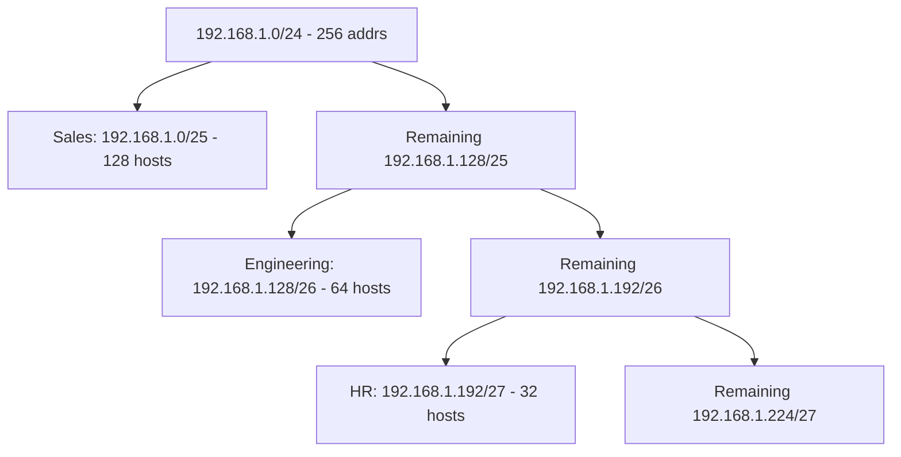

---
tags:
  - GATE/CS
  - GATE/Networks
  - Subnetting
aliases:
  - Subnetting
  - Subnet Mask
  - CIDR Subnetting
date_created: 2026-08-13
difficulty: ⭐⭐⭐⭐
last_revised: 2026-08-13
pyq_frequency: High
---

## Syllabus Position

Subject: [[Computer Networks Index]]
Parent Topic: [[IP Addressing]]
Sibling Topics: [[Classful Addressing]], [[CIDR]], [[Supernetting]]
Leads To: [[Routing Tables]], [[Longest Prefix Matching]], [[NAT]]

GATE Syllabus Line: "Routing, IP Addressing (IPv4/IPv6), Sub-netting" — under Computer Networks section of the official GATE CS syllabus.

Exam Weight Note: Appears almost every year — usually as a 2-mark NAT question asking for number of hosts/subnets/usable addresses, or a 2-mark MCQ combining subnetting with routing table lookups.

---

## The Problem This Solves

Imagine an organization is handed one big IP address block — say 1024 addresses — but it actually has 8 separate departments (Sales, HR, Engineering, etc.), each needing its own isolated broadcast domain. If you dump all 1024 addresses into one flat network, every broadcast packet (ARP requests, etc.) floods all 1024 hosts, wasting bandwidth and creating security blind spots. You need a way to **carve one large address block into smaller, independent sub-networks** without asking the Internet registry for more address space.

**Analogy:** Think of an IP address block like a large apartment building's shared mailbox range (addresses 100–1123). Subnetting is like installing floor-level locked mail rooms — floor 1 gets addresses 100–227, floor 2 gets 228–355, and so on. The mail is still delivered using the same overall building address, but each floor manages its own local delivery and its own "everyone on this floor" announcements (broadcasts) stay confined to that floor.

**Core Idea (one sentence):** A **subnet mask** splits an IP address into a network+subnet portion and a host portion by defining how many leading bits identify the (sub)network, letting one address block be divided into multiple smaller, independently routable networks.

---

## Formal Theory

A **[[Subnet Mask]]** is a 32-bit number (same length as an IPv4 address) where a `1` bit marks a **network/subnet ID** bit and a `0` bit marks a **host ID** bit. Bitwise-ANDing an IP address with its subnet mask yields the **network address** of that subnet.

$$\text{Network Address} = \text{IP Address} \; \text{AND} \; \text{Subnet Mask}$$

### Classful Background
Originally, IPv4 used [[Classful Addressing]] (Class A/B/C) with fixed masks: Class A = `/8`, Class B = `/16`, Class C = `/24`. Subnetting was introduced to "borrow" bits from the host portion to create smaller networks within a class, since fixed class sizes wasted enormous numbers of addresses.

### Fixed-Length Subnet Masking (FLSM)
All subnets carved from the block get **equal size**. If you borrow $s$ bits from the host portion of a `/n` network:
- Number of subnets created: $2^s$
- Host bits remaining: $h - s$ (where $h$ was the original host bit count)
- Usable hosts per subnet: $2^{h-s} - 2$ (subtracting network address and broadcast address)

### Variable-Length Subnet Masking (VLSM)
Different subnets are given **different sizes** based on actual host requirements, avoiding the waste of FLSM when department sizes differ wildly (e.g., one subnet needs 500 hosts, another needs 10). VLSM allocates the largest requirement first, then recursively subnets the remainder — this is the standard technique tested in GATE for "design a subnetting scheme."

### CIDR Notation
Modern subnetting is expressed via **[[CIDR]]** (Classless Inter-Domain Routing) notation `a.b.c.d/n`, where $n$ is the number of leading 1-bits in the mask (the **prefix length**). E.g., `/26` = mask `255.255.255.192`.

Pseudocode for computing subnet details from CIDR:
```
Algorithm SubnetInfo(ip, prefixLength):
    mask = (0xFFFFFFFF << (32 - prefixLength)) & 0xFFFFFFFF
    networkAddress = ip AND mask
    broadcastAddress = networkAddress OR (NOT mask)
    usableHosts = 2^(32 - prefixLength) - 2
    return networkAddress, broadcastAddress, usableHosts
```

**What GATE actually tests here:** GATE loves combining subnetting with (a) computing the number of subnets/hosts given a mask, (b) determining whether two IPs lie in the same subnet, and (c) VLSM design problems where you must allocate blocks of decreasing size without overlap — often disguised inside a **routing table / longest prefix match** question.

---

## Diagrams and Visuals

**Visual 1 — Bit-level structure of an IP address under subnetting:**

Draw a 32-bit strip, split into three colored sections: Network bits | Subnet bits | Host bits.

```
| Network ID (from class) | Subnet ID (borrowed) |     Host ID      |
|<------ n bits --------->|<---- s bits --------->|<--- h-s bits --->|
Example: 172.16.0.0/16 borrowing 4 bits for subnets => /20
| 172.16 (16 bits network) | 4 bits subnet | 12 bits host |
```

**Visual 2 — VLSM allocation tree (packet flow style):**


Each node shows how the address space is split top-down, largest requirement first — the classic VLSM allocation pattern.

**Visual 3 — AND operation for network address extraction:**

```
IP:    11000000.10101000.00000001.01000101   (192.168.1.69)
Mask:  11111111.11111111.11111111.11000000   (255.255.255.192, /26)
AND:   11000000.10101000.00000001.01000000   (192.168.1.64 = network address)
```

---

## Complexity Analysis

Subnetting is not an algorithm with asymptotic time/space complexity in the traditional sense, but GATE tests **address-space complexity** — how counts scale with bits borrowed.

- Borrowing $s$ bits from a host field of size $h$ creates $2^s$ subnets, each with $2^{h-s}$ total addresses.
- **Time to compute** subnet/network/broadcast address for a single IP is $O(1)$ — it's a fixed 32-bit AND/OR operation regardless of input, since IPv4 addresses have constant length.
- **Space** for storing a routing table entry per subnet is $O(1)$ per subnet, so total space for $2^s$ subnets is $O(2^s)$ — this is why VLSM (avoiding unnecessary subnet proliferation) matters for router memory in large deployments.
- For VLSM design problems, the "trigger condition" analog is the **order of allocation**: allocating from largest to smallest requirement is what guarantees no address overlap and no wasted space (this is the greedy correctness argument GATE questions rely on, similar to interval scheduling).

| Case | Time Complexity | Space Complexity | Trigger Condition |
|------|-----------------|-------------------|--------------------|
| Single address lookup | $O(1)$ | $O(1)$ | Any IPv4 address (fixed 32-bit AND) |
| Building $2^s$ equal subnets (FLSM) | $O(2^s)$ | $O(2^s)$ | Borrowing $s$ bits uniformly |
| VLSM design for $k$ unequal requirements | $O(k \log k)$ | $O(k)$ | Sort requirements descending, then allocate greedily |

---

## Worked Example

**Given:** Block `192.168.10.0/24`. Four departments need: Engineering = 100 hosts, Sales = 50 hosts, HR = 20 hosts, Guest = 10 hosts. Design a VLSM scheme.

**Step 1 — Sort by size (largest first):** Engineering(100), Sales(50), HR(20), Guest(10).

**Step 2 — Allocate Engineering (100 hosts):**
Need $2^h - 2 \geq 100 \Rightarrow h = 7$ ($2^7-2=126 \geq 100$). Prefix = $32 - 7 = /25$.
→ `192.168.10.0/25` (addresses .0 – .127). Network=.0, Broadcast=.127, usable=.1–.126 (126 hosts).
Remaining pool starts at `192.168.10.128`.

**Step 3 — Allocate Sales (50 hosts):**
Need $2^h - 2 \geq 50 \Rightarrow h = 6$ ($2^6-2=62 \geq 50$). Prefix = `/26`.
→ `192.168.10.128/26` (.128–.191). Network=.128, Broadcast=.191, usable=.129–.190 (62 hosts).
Remaining pool starts at `192.168.10.192`.

**Step 4 — Allocate HR (20 hosts):**
Need $2^h-2 \geq 20 \Rightarrow h=5$ ($2^5-2=30$). Prefix = `/27`.
→ `192.168.10.192/27` (.192–.223). Network=.192, Broadcast=.223, usable=.193–.222 (30 hosts).
Remaining pool starts at `192.168.10.224`.

**Step 5 — Allocate Guest (10 hosts):**
Need $2^h-2 \geq 10 \Rightarrow h=4$ ($2^4-2=14$). Prefix = `/28`.
→ `192.168.10.224/28` (.224–.239). Network=.224, Broadcast=.239, usable=.225–.238 (14 hosts).

**Final state (data structure = allocation table):**

| Dept | Subnet | Range | Usable Hosts |
|------|--------|-------|---------------|
| Engineering | 192.168.10.0/25 | .0–.127 | 126 |
| Sales | 192.168.10.128/26 | .128–.191 | 62 |
| HR | 192.168.10.192/27 | .192–.223 | 30 |
| Guest | 192.168.10.224/28 | .224–.239 | 14 |

**Verification:** Total allocated addresses = 128+64+32+16 = 240 out of 256 in the `/24` block — no overlaps, 16 addresses (`.240–.255`) left unused for future growth. This confirms the allocation is valid because each block's size is a power of two aligned to its own boundary.

**Edge-case follow-up:** What if Engineering needed exactly 126 hosts and grew to 127 tomorrow? Then `/25` (126 usable) is no longer sufficient — you'd need `/24` for that department alone, which would consume the *entire* original block, forcing a redesign or requesting a new address block. This is why real-world VLSM plans over-provision slightly.

---

## Intuition Anchors

**The Analogy (restated and deepened):** Recall the apartment building with locked mail rooms per floor. The subnet mask is the "instructions on the master key" that tells you how many digits of the mailbox number identify the floor vs. the individual unit. A `/25` mask is a building split into 2 floors of 128 rooms each; a `/26` is 4 floors of 64 rooms each. VLSM is giving the penthouse floor (big department) more rooms and the ground floor kiosk (guest network) just a few — you don't force every floor to be identical size just because the building has one street address.

**The Mental Model:** Expert network engineers picture subnetting as **binary tree splitting** — the original block is the root; each subnetting decision splits it in half (or into $2^s$ pieces); each leaf is a subnet. When solving on paper, they think in powers of two, not decimal arithmetic — "I need 100 hosts" instantly maps to "next power of two minus 2 that covers it → 128, so borrow to leave 7 host bits."

**The One-Line Recall:** "To fit $H$ hosts, find smallest $h$ with $2^h - 2 \geq H$; that gives prefix $/(32-h)$; network = IP AND mask, broadcast = network OR (NOT mask)."

**The #1 Trap:** Students forget to **subtract 2** for the network and broadcast addresses, computing $2^h$ usable hosts instead of $2^h - 2$. This seems right because "the mask defines $2^h$ addresses" — true, but two of those ($2^h$ addresses' first and last) are reserved and cannot be assigned to hosts. The correction: always report usable hosts as $2^h - 2$ unless the question explicitly says "point-to-point /31" or asks for total addresses rather than usable hosts.

---

## GATE Questions

---

**Question 1 — PYQ: GATE 2015 (paraphrased) — 2-mark**

> A router uses subnet mask 255.255.255.224 for a network. What is the maximum number of hosts possible in each subnet?

- (A) 14
- (B) 16
- (C) 30
- (D) 32

<details>
<summary>Solution</summary>

**Answer: (C) 30**

**Reasoning:**
Mask `255.255.255.224` in binary is `11100000` for the last octet — 3 bits are network/subnet bits, leaving 5 host bits. Usable hosts = $2^5 - 2 = 32 - 2 = 30$.
- (A) 14 confuses this with a `/28` mask (4 host bits: $2^4-2=14$) — wrong mask interpretation.
- (B) 16 is $2^4$, forgetting the subtraction and using wrong bit count.
- (D) 32 is $2^5$ without subtracting network/broadcast addresses — the classic trap.

**What this question is really testing:** Direct conversion from dotted-decimal mask to host-bit count and correct application of the $2^h-2$ formula.

**Trap to avoid:** Forgetting to subtract 2, or miscounting host bits from the mask octet.

</details>

---

**Question 2 — Conceptual/Numerical — 2-mark**

> Two hosts have IP addresses 172.16.45.10 and 172.16.47.20, both using subnet mask 255.255.240.0. Are they on the same subnet?

<details>
<summary>Solution</summary>

Mask `255.255.240.0` = `/20`. Third octet mask bits = `11110000`, so subnet boundaries in the third octet occur every 16 (256/16=16 subnets, size 16 each: 0,16,32,...).
- 45 falls in range 32–47 (since $32 \leq 45 < 48$).
- 47 falls in range 32–47 as well (since $32 \leq 47 < 48$).

Both third-octet values fall in the same 16-wide block (32–47), so both IPs belong to network `172.16.32.0/20`. **Answer: Yes, same subnet.**

**Trap to avoid:** Assuming "different third octet number automatically means different subnet" — the actual test is which block boundary (multiple of block size) the address falls into, not whether the numbers are literally equal.

</details>

---

**Question 3 — Hard / Multi-concept — 2-mark**

> A router's forwarding table has entries for 10.0.0.0/8, 10.1.0.0/16, and 10.1.2.0/24. A packet arrives destined for 10.1.2.5. Which entry does the router use, and why?

<details>
<summary>Solution</summary>

**Answer:** The router uses `10.1.2.0/24` — the entry with the **longest prefix match**.

**Reasoning:** All three entries match the destination (10.1.2.5 falls within 10.0.0.0/8, within 10.1.0.0/16, and within 10.1.2.0/24), but [[Longest Prefix Matching]] routing dictates that when multiple routing table entries match, the router always selects the one with the most specific (longest) prefix, since it represents the most precise known path.

**What this question is really testing:** Understanding that subnetting/CIDR creates *overlapping* possible matches in routing tables, and that longest-prefix-match — not first match or shortest match — is the resolution rule.

**Trap to avoid:** Picking the /8 entry because it "was listed first" or assuming the broadest match is preferred (opposite is true).

</details>

---

**Pattern Recognition:**
- When given a subnet mask in dotted-decimal, GATE expects instant conversion to binary/CIDR prefix length — practice this until it's automatic.
- "How many subnets / how many hosts" questions almost always reduce to $2^s$ and $2^{h}-2$ — identify $s$ (subnet bits) vs. $h$ (host bits) correctly first.
- "Same subnet or not" questions test whether you compute network addresses via AND, not by eyeballing decimal similarity.
- Multi-entry routing table questions test [[Longest Prefix Matching]] as the tiebreaker — this is a favorite hybrid question combining subnetting with routing.

---

## Edge Cases and Failure Modes

- [ ] **Input size 0 or 1 (host requirement of 0 or 1):** A subnet needing only 1 usable host still requires at least a `/30` (2 usable hosts) in classic addressing since `/31` traditionally had no usable hosts under the $2^h-2$ rule — however, RFC 3021 allows `/31` for point-to-point links (2 addresses, both usable, no network/broadcast reserved). GATE typically expects the classic $2^h-2$ rule unless it explicitly mentions point-to-point links.
- [ ] **All-zero or all-one host portion:** These are reserved as the network address and broadcast address respectively — never assignable to a host. Naive students count them as usable, inflating the host count by 2.
- [ ] **Subnet boundary alignment:** A subnet's starting address MUST be a multiple of its block size (e.g., a `/26` block must start at a multiple of 64). Picking an arbitrary starting address that isn't aligned produces an invalid subnet — GATE VLSM questions sometimes include a wrong-looking option that violates alignment to test this.
- [ ] **Integer overflow / bit-shift errors:** When computing masks via `(0xFFFFFFFF << (32-n))`, shifting by 32 is undefined behavior in some languages/architectures — always guard the case $n=0$.
- [ ] **Off-by-one in prefix length vs. host bits:** Confusing "borrow $s$ bits" with "prefix length is $s$" — the prefix length is $n_{original} + s$, not just $s$. Always recompute host bits as $32 - \text{new prefix}$.
- [ ] **VLSM allocation order:** Allocating smallest-to-largest instead of largest-to-first can cause a smaller subnet to occupy space needed for later larger boundary-aligned allocations, leading to fragmentation or failure to fit all requirements — always sort descending by size first.

---

## Comparisons

| Feature              | [[Subnet Masking]] (FLSM) | [[VLSM]]                     | [[CIDR]] / Supernetting          |
|----------------------|----------------------------|-------------------------------|-----------------------------------|
| Time Complexity      | $O(1)$ per lookup          | $O(1)$ per lookup             | $O(1)$ per lookup                |
| Space Complexity     | $O(2^s)$ equal subnets     | $O(k)$ for $k$ unequal blocks | $O(1)$ — aggregates many routes into one |
| Key Property         | All subnets identical size | Subnets sized to actual need  | Combines multiple networks into fewer routing entries |
| When to Prefer       | Quick uniform allocation, small deployments | Real-world ISP/enterprise design with varying dept sizes | Reducing routing table size across many networks (route aggregation) |
| GATE Trap            | Forgetting $2^h-2$          | Wrong allocation order causing overlap | Confusing supernetting (combining) with subnetting (splitting) |

The most common GATE question comparing these is a scenario where students must decide whether uniform subnetting (FLSM) wastes addresses compared to VLSM for unequal department sizes, and the answer hinges on **whether host-count requirements vary significantly across subnets** — if they do, FLSM wastes exponentially more addresses than VLSM.

---

## Connections Web

**Must know before this topic:**
- [[IPv4 Addressing]] — subnetting operates on the 32-bit IPv4 address structure
- [[Binary Number Representation]] — masks and AND/OR operations require binary fluency
- [[Classful Addressing]] — historical context for why subnetting was introduced

**Topics that build on this:**
- [[CIDR]] — generalizes subnetting/supernetting into classless prefix notation
- [[Routing Tables]] — subnet definitions populate router forwarding entries
- [[Longest Prefix Matching]] — resolves overlapping subnet matches during routing
- [[NAT]] — often applied at subnet boundaries to conserve public address space
- [[VLSM]] — the practical, size-aware extension of basic subnetting

**GATE subject cross-links:**
- [[Computer Networks Index]] > [[IP Addressing]]

**Cross-subject connections:**
- [[Operating Systems Network Stack]] — the OS's networking layer applies subnet masks to determine local vs. remote destinations before routing decisions
- [[Data Link Layer Broadcast Domains]] — subnetting directly defines the scope of Layer 2 broadcast domains

**Standard references:**
- [[Forouzan Data Communications and Networking Chapter 19]]
- [[Kurose and Ross Chapter 4 - Network Layer]]

---

## Quick Revision Sheet

**Definition (1 sentence):** A subnet mask is a 32-bit pattern of 1s (network/subnet bits) and 0s (host bits) that, when ANDed with an IP address, yields the network address, allowing one address block to be split into smaller independent subnetworks.

**Core Idea / Analogy (1 sentence):** Like splitting one building's mailbox range into per-floor mail rooms — the mask decides how many leading digits identify the floor vs. the individual unit.

**Algorithm Steps (numbered, maximum 6 steps):**
1. Determine required hosts $H$ per subnet.
2. Find smallest $h$ such that $2^h - 2 \geq H$.
3. New prefix length = $32 - h$.
4. Sort multiple requirements largest-to-smallest (VLSM).
5. Allocate blocks sequentially, aligning each start address to its block size.
6. Compute network address (AND) and broadcast address (OR with inverted mask) for verification.

**Complexity:**
- Time (best/average/worst): $O(1)$ per address lookup; $O(k \log k)$ for VLSM design of $k$ subnets
- Space: $O(2^s)$ for $s$ borrowed bits (FLSM); $O(k)$ for VLSM
- Recurrence (if applicable): N/A — not a recursive algorithm

**Key Properties (3 to 5 bullet points):**
- Usable hosts per subnet = $2^h - 2$ where $h$ = host bits.
- Number of subnets from borrowing $s$ bits = $2^s$.
- Network address = IP AND Mask; Broadcast address = Network OR (NOT Mask).
- Longer prefix (more 1-bits) = smaller subnet, fewer hosts.
- Routing always prefers the longest matching prefix among overlapping entries.

**The #1 Trap:** Forgetting to subtract 2 for network/broadcast reserved addresses.

**When to use this over alternatives:** Use VLSM (not FLSM) whenever subnet host requirements differ significantly — it avoids wasting large blocks of addresses on small departments.

**Mnemonic or one-liner to remember the steps:** "Borrow bits, block aligns, minus two remains" — reminds you to borrow host bits for subnets, keep allocations aligned to block size, and always subtract 2 for usable hosts.

---

## Revision Checklist

- [ ] I can state the formal definition without looking.
- [ ] I can explain the analogy and map it to the algorithm or concept.
- [ ] I can trace a 6-element example by hand in under 2 minutes.
- [ ] I can derive the worst-case complexity from scratch.
- [ ] I know what the Quick Revision Sheet says without reading it.
- [ ] I can solve all 3 GATE questions in this note without peeking.
- [ ] I know the #1 trap and can articulate why students fall for it.
- [ ] I have linked this note correctly in my Obsidian vault.
- [ ] I have scheduled a spaced-repetition review in 3 days.
