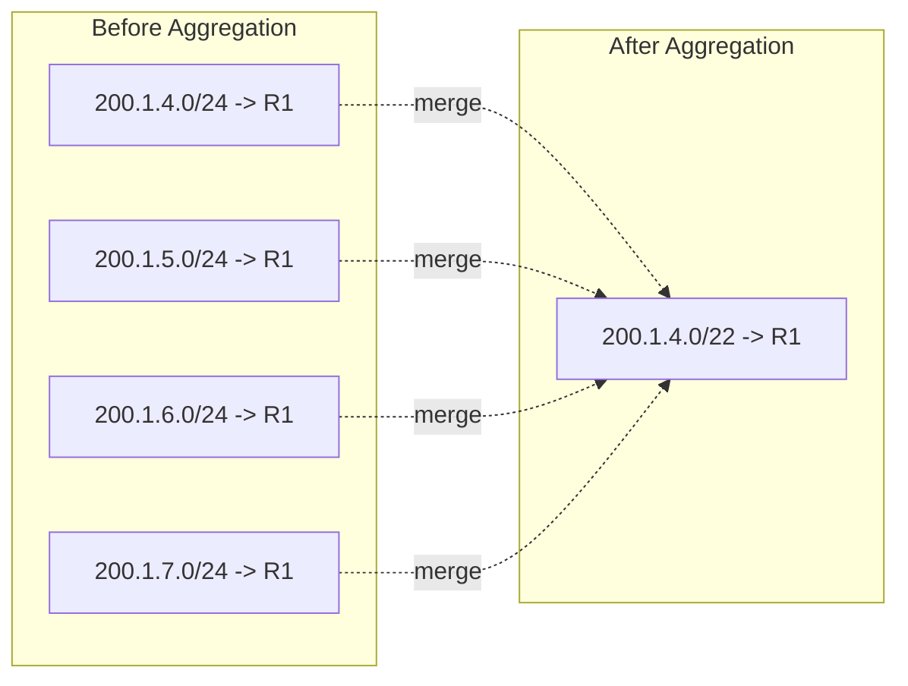
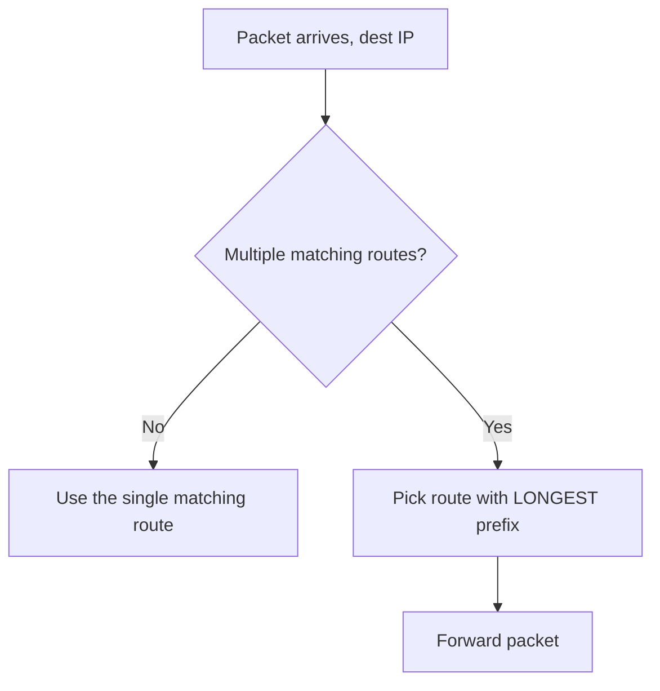

---
tags:
  - GATE/CS
  - GATE/Networks
  - IPAddressing
aliases:
  - Route Aggregation
  - CIDR Aggregation
  - Route Summarization
date_created: 2026-08-19
difficulty: ⭐⭐⭐⭐
last_revised: 2026-08-19
pyq_frequency: High
---

## Syllabus Position

Subject: [[Computer Networks Index]]
Parent Topic: [[IP Addressing]]
Sibling Topics: [[Subnetting]], [[CIDR]], [[Classful Addressing]]
Leads To: [[Routing Table Aggregation]], [[Longest Prefix Matching]], [[BGP Route Summarization]]

GATE Syllabus Line: "IP addressing" under the Computer Networks section (Network Layer topics: routing, IP addressing, CIDR).

Exam Weight Note: Appears almost every year as a 1- or 2-mark NAT/MCQ requiring computation of a supernet mask, block size, or number of aggregatable networks — often combined with [[Subnetting]] in the same question paper.

---

## The Problem This Solves

Imagine an ISP hands out IP address blocks to hundreds of small organizations. Each organization gets its own tiny network (say a /24 block). Now every router on the internet backbone needs an entry for *each* of these hundreds of small blocks in its routing table — that's hundreds of rows just for one ISP's customers. Routing tables would explode in size, lookups would slow down, and memory on core routers would be wasted on redundant information, since all these small blocks are reachable through the same upstream link anyway.

Supernetting flips subnetting on its head: instead of breaking one large network into many small ones, it **combines several small, contiguous networks into one large route** so that a single routing table entry can represent all of them.

Core Idea (one sentence): Supernetting merges multiple contiguous, same-size classful or CIDR blocks into a single larger block by shortening the network prefix, reducing routing table size through aggregation.

---

## Formal Theory

**Supernetting** (also called **route aggregation** or **route summarization**) is the process of combining multiple contiguous network blocks that share a common prefix into one advertised route with a *shorter* subnet mask (fewer network bits, more host bits) than the original blocks.

This is the classic answer to **classful addressing** exhaustion problems — the internet ran out of Class B addresses fast, so ISPs started giving multiple Class C (/24) blocks to organizations instead. But that created huge routing tables. **[[CIDR]] (Classless Inter-Domain Routing)** made supernetting formally possible by removing the rigid class boundaries and allowing arbitrary prefix lengths, denoted as `a.b.c.d/n`.

### Rules for Valid Supernetting

For a set of $2^k$ networks to be supernetted into one block, **all** of the following must hold:

1. **Contiguity:** The networks must have contiguous address ranges (no gaps).
2. **Count is a power of two:** You can only combine $2^k$ networks at a time (2, 4, 8, 16, ...), because you are stealing $k$ bits from the network portion to become "free" (wildcard) bits.
3. **Alignment:** The first network's address, when the network ID is divided by the block size of the *combined* supernet, must give a remainder of 0. Formally, the first network address must be a multiple of $(\text{original block size} \times 2^k)$.
4. **Same original prefix length:** All networks being merged must have originally had the same subnet mask.

### The Masking Mechanism

If you're merging $2^k$ networks each of prefix length $/p$, the resulting supernet has prefix length:

$$/(p - k)$$

The new **subnet mask** is obtained by taking the common mask and clearing the leftmost $k$ bits that used to distinguish the individual networks (counting from the right of the network portion).

### Worked Mini-Derivation

Suppose four **Class C** networks (natively $/24$) are contiguous:
`200.1.4.0/24`, `200.1.5.0/24`, `200.1.6.0/24`, `200.1.7.0/24`

Look at the third octet in binary:
- `4` = `00000100`
- `5` = `00000101`
- `6` = `00000110`
- `7` = `00000111`

The **last two bits** vary (00, 01, 10, 11) while the top six bits (`000001`) stay fixed. Since $2^2 = 4$ networks are merging, $k = 2$, so the new prefix is $/(24 - 2) = /22$.

**Supernet route: `200.1.4.0/22`** — one single routing table entry replaces four.

### [[Longest Prefix Matching]]

Because supernetting creates overlapping-looking routes (a `/22` entry conceptually "contains" `/24` entries), routers use **Longest Prefix Matching**: when multiple routing entries match a destination address, the router picks the entry with the *longest* (most specific) prefix. This lets an ISP advertise the aggregate `/22` while still allowing a more specific `/24` route to be preferred if one customer needs special routing (e.g., multihoming).

**What GATE actually tests:** GATE loves giving you a set of IP blocks and asking (a) whether they can be supernetted at all (checking contiguity/alignment), (b) what the resulting supernet mask/prefix is, or (c) how many original networks a given supernet mask represents. It also tests conceptual confusion between [[Subnetting]] (splitting, prefix gets *longer*) and supernetting (merging, prefix gets *shorter*).

---

## Diagrams and Visuals

**1. Bit-level view of merging four /24 networks into a /22 supernet**

```
Network        3rd Octet (binary)     Prefix
200.1.4.0      000001 00              /24
200.1.5.0      000001 01              /24
200.1.6.0      000001 10              /24
200.1.7.0      000001 11              /24
               ^^^^^^ fixed | ^^ varies (2 bits = k)

Supernet: 200.1.4.0 / 22   (top 6 bits of octet + first 2 octets = 22 bits fixed)
```

**2. Routing table before vs. after aggregation**



**3. Longest Prefix Matching decision flow**



---

## Complexity Analysis

Supernetting is not an algorithm with runtime complexity in the CPU-cycle sense; GATE instead tests **structural/computational complexity of the aggregation problem** and the resulting **routing table size reduction**.

- **Best Case (aggregation):** $N$ contiguous, aligned, same-size blocks collapse into **1** routing entry — reduction factor of $N$. Triggered when all four validity rules (contiguity, power-of-two count, alignment, equal original prefix) hold perfectly.
- **Average Case:** Real-world address allocations are rarely perfectly aligned; partial aggregation occurs, and routing tables shrink but not maximally. Some blocks may need to stay unaggregated because of non-contiguity or misalignment.
- **Worst Case (no aggregation possible):** If blocks are non-contiguous or not power-of-two aligned, **zero** aggregation happens — you're back to one entry per block, $O(N)$ table size for $N$ networks.

**Space Complexity of the routing table:** Each entry costs $O(1)$ storage (prefix + mask + next-hop), so total table space is $O(N)$ before aggregation and $O(N/2^k)$ after aggregating groups of $2^k$. This directly reduces **lookup time** too, since fewer entries means faster longest-prefix-match tries (e.g., a compressed trie/[[Patricia Trie]]).

### Complexity Summary Table

| Case         | Table Size (Time to search) | Space Complexity | Trigger Condition                                     |
|--------------|------------------------------|-------------------|--------------------------------------------------------|
| Best Case    | $O(1)$ effective entry        | $O(1)$ per group  | All $N$ blocks contiguous, aligned, same original prefix |
| Average Case | $O(N/2^k)$                    | $O(N/2^k)$        | Partial contiguity/alignment among allocated blocks     |
| Worst Case   | $O(N)$                        | $O(N)$            | Non-contiguous or misaligned blocks — no merge possible |

---

## Worked Example

**Problem:** An ISP has been assigned eight contiguous Class C blocks: `198.16.0.0/24` through `198.16.7.0/24`. Aggregate them into the smallest number of supernet routes.

**Step 1 — Write out the third octet in binary for each block:**

| Block             | 3rd Octet | Binary     |
|-------------------|-----------|------------|
| 198.16.0.0/24      | 0         | 00000000   |
| 198.16.1.0/24      | 1         | 00000001   |
| 198.16.2.0/24      | 2         | 00000010   |
| 198.16.3.0/24      | 3         | 00000011   |
| 198.16.4.0/24      | 4         | 00000100   |
| 198.16.5.0/24      | 5         | 00000101   |
| 198.16.6.0/24      | 6         | 00000110   |
| 198.16.7.0/24      | 7         | 00000111   |

**Step 2 — Find the common fixed prefix bits.** The top 5 bits (`00000`) are identical across all eight rows; the bottom 3 bits vary through all combinations `000`–`111`. That's exactly $2^3 = 8$ combinations — matches our 8 networks. Good: contiguity and power-of-two count confirmed.

**Step 3 — Check alignment.** The starting network address's 3rd octet is `0`, which is a multiple of $8$ (the block count) — alignment confirmed. (If the ISP instead started at `198.16.1.0`, this alignment check would FAIL, because 8 blocks starting at 1 would only be aligned if 1 were divisible by 8, which it isn't — that set could NOT be fully aggregated into one supernet.)

**Step 4 — Compute new prefix.** $k = 3$ bits stolen from the network portion: new prefix $= 24 - 3 = 21$.

**Step 5 — Final answer:** **Supernet = `198.16.0.0/21`**, covering addresses `198.16.0.0` to `198.16.7.255`.

**Verification / operation count:** We replaced 8 routing entries with 1 — an $8\times$ reduction, matching $2^k = 2^3 = 8$. The subnet mask in dotted decimal is `255.255.248.0` (since $/21$ = `11111111.11111111.11111000.00000000`).

**Edge-case follow-up — "What if the blocks were `198.16.1.0` through `198.16.8.0` instead (shifted by one)?"** Now the range straddles two different 8-block-aligned groups (`0–7` and `8–15`), so a single clean `/21` supernet is impossible. You'd need to aggregate what you can (e.g., `198.16.1.0` through `198.16.7.0` might split into smaller aligned chunks like a `/23` for 2–3, a /24 for 1, etc.) — this is exactly the kind of "can they be aggregated or not" trap GATE sets.

---

## Intuition Anchors

**The Analogy (restated and deepened):** Think of postal codes. Instead of a national mail hub keeping a separate entry for every single street in a city, it keeps ONE entry: "everything starting with ZIP prefix 400xx goes to Mumbai sorting office." That only works if all the ZIP codes with that prefix truly belong to Mumbai (contiguity) and the prefix range aligns to a clean block (alignment) — you can't say "everything from 40012 to 40019" is one clean group unless it's a power-of-two-sized, aligned chunk. Supernetting is the network-layer version of this ZIP-code prefix trick.

**The Mental Model:** When I see a set of IP blocks, I mentally line up their binary network portions like a table (as in the Worked Example) and scan top-to-bottom, looking for the point where all bit columns start disagreeing consistently across every combination — that column boundary IS my new prefix length.

**The One-Line Recall:** "Supernetting merges $2^k$ contiguous, aligned, same-size blocks into one route by shortening the prefix by $k$ bits — new prefix $= p - k$."

**The #1 Trap:** Students assume that *any* set of contiguous blocks can always be supernetted into one entry as long as they're consecutive — but forget the **alignment** rule. Contiguous is necessary but NOT sufficient. E.g., blocks starting at `198.16.2.0` through `198.16.5.0` (4 blocks) look contiguous, but $2$ is not a multiple of $4$, so this set is misaligned and cannot form one clean `/22` supernet — you'd need to check the binary alignment explicitly, not just "consecutiveness."

---

## GATE Questions

---

**Question 1 — [PYQ: GATE 2007-style, adapted] — [2-mark]**

> An organization has 4 contiguous Class C networks: `192.168.4.0/24`, `192.168.5.0/24`, `192.168.6.0/24`, `192.168.7.0/24`. What is the CIDR supernet notation that represents exactly these four networks?

- (A) 192.168.4.0/23
- (B) 192.168.4.0/22
- (C) 192.168.4.0/21
- (D) 192.168.0.0/22

<details>
<summary>Solution</summary>

**Answer: (B)**

**Reasoning:** 4 networks need $k = \log_2 4 = 2$ bits merged. New prefix $= 24 - 2 = 22$. Check alignment: 3rd octet starts at 4, and $4 \bmod 4 = 0$ — aligned. So `192.168.4.0/22` is correct.
- (A) `/23` only merges 2 networks ($k=1$), not 4 — wrong bit count.
- (C) `/21` merges 8 networks ($k=3$) — too broad, would also include 192.168.0.0–3.0 or 8.0–11.0 depending on alignment, not matching exactly these 4.
- (D) Wrong starting address — `192.168.0.0/22` covers networks 0–3, not 4–7.

**What this question is really testing:** Whether the student can correctly compute $k$ from the count of networks AND verify starting-address alignment, not just prefix arithmetic.

**Trap to avoid:** Picking a mask based on network count alone without checking that the starting address is a proper multiple of the block size.
</details>

---

**Question 2 — [Conceptual/Numerical] — [1-mark]**

> A supernet has the CIDR notation `172.16.32.0/20`. How many original Class C (/24) networks does this supernet represent, and what is the range of the last /24 network in this block?

<details>
<summary>Solution</summary>

$k = 24 - 20 = 4$, so number of /24 networks $= 2^4 = 16$.

Block size of the /20 supernet $= 2^{32-20} = 2^{12} = 4096$ addresses, spanning `172.16.32.0` to `172.16.47.255`.

The 16 individual /24 networks are `172.16.32.0/24, 172.16.33.0/24, ..., 172.16.47.0/24`. The last one is **`172.16.47.0/24`**, ranging from `172.16.47.0` to `172.16.47.255`.
</details>

---

**Question 3 — [Hard / Multi-concept] — [2-mark]**

> A router has two routing table entries: `10.1.0.0/16 -> Interface A` (an aggregated supernet route) and `10.1.5.0/24 -> Interface B` (a more specific route, perhaps for a multihomed customer). A packet arrives destined for `10.1.5.200`. Which interface does the router forward it to, and why? What networking principle governs this decision?

<details>
<summary>Solution</summary>

**Answer: Interface B.**

**Reasoning:** Both entries technically match `10.1.5.200` (it falls within both the `/16` and the `/24` ranges), but routers apply **[[Longest Prefix Matching]]** — they always prefer the entry with the longest (most specific) matching prefix. `/24` is longer (more specific) than `/16`, so Interface B wins even though the `/16` supernet route also "contains" this address.

**What this question is really testing:** Understanding that supernetting/aggregation doesn't eliminate the need for more specific routes — it coexists with them, and Longest Prefix Matching is the tiebreaker mechanism that makes this coexistence work.

**Trap to avoid:** Assuming the aggregated (broader) route is always used because it was "created later" or is the "summary" — specificity, not recency or hierarchy position, decides the match.
</details>

---

**Pattern Recognition:**
- GATE often gives 2, 4, or 8 contiguous blocks and asks you to compute the resulting supernet prefix — always check power-of-two count first.
- Questions frequently hide the alignment trap: contiguous blocks that are NOT power-of-two aligned starting points cannot be merged cleanly — watch for a shifted starting address.
- Questions may combine supernetting with [[Longest Prefix Matching]] to test whether merging routes breaks more specific routing — it doesn't, LPM handles it.
- Reverse questions ("given this supernet mask, how many original networks does it represent, and what's the address range?") are equally common as forward questions.

---

## Edge Cases and Failure Modes

- [ ] **Non-power-of-two count of networks:** If you have 3 or 5 (not 2, 4, 8, 16...) contiguous blocks, you CANNOT supernet them into a single clean CIDR block — you'd need multiple supernet entries or leave some unaggregated.
- [ ] **Misalignment:** Contiguous blocks whose starting address isn't a multiple of the target block size cannot form one supernet, even if the count is a power of two (e.g., blocks starting at network #2 trying to merge 4 blocks — $2 \bmod 4 \neq 0$).
- [ ] **Non-contiguous blocks:** Even with the right count and alignment, if there's a gap (a block missing from the sequence, perhaps because it's assigned to a different customer), aggregation is impossible without incorrectly including unrelated address space.
- [ ] **Overlapping routes and ambiguity:** Two identically-specific routes (same prefix length) pointing to different next-hops for overlapping ranges is a configuration error — LPM only resolves *different*-length prefix conflicts, not same-length ones.
- [ ] **Off-by-one in block size calculation:** Remember block size $= 2^{(32-n)}$ for prefix $/n$; forgetting this exponential relationship leads to wrong ranges (a common GATE numerical slip).
- [ ] **Supernetting across original prefix-length boundaries:** All networks being merged must share the SAME original mask length — you cannot supernet a /24 network together with a /23 network directly without first normalizing them.
- [ ] **Confusing supernetting direction with subnetting:** Subnetting makes the prefix LONGER (splitting one network into many); supernetting makes it SHORTER (merging many into one) — mixing these up flips every answer's sign.

---

## Comparisons

| Feature              | [[Supernetting]]                        | [[Subnetting]]                          | [[CIDR]]                                  |
|----------------------|------------------------------------------|-------------------------------------------|---------------------------------------------|
| Time Complexity      | Reduces table search to $O(N/2^k)$        | Increases table entries, $O(N \times 2^k)$ | Enables both operations via variable-length masks |
| Space Complexity      | Reduces routing table storage $O(N/2^k)$  | Increases routing table storage $O(N \times 2^k)$ | Neutral — it's the addressing framework, not an operation |
| Key Property          | Merges blocks, prefix gets shorter        | Splits one block, prefix gets longer      | Removes rigid class boundaries entirely      |
| When to Prefer        | ISP/backbone routers aggregating customer routes | Organizations partitioning internal address space by department/floor | Whenever flexible, non-classful prefix lengths are needed |
| GATE Trap             | Forgetting the alignment condition        | Forgetting host bits must allow at least 2 usable addresses | Confusing CIDR notation `/n` with a specific subnetting or supernetting operation |

The most common GATE question comparing these is a "given blocks, is this supernetting or subnetting, and what's the resulting prefix," and the answer hinges on **whether the prefix length increases (subnetting) or decreases (supernetting)** relative to the original blocks — always check the direction of the bit count change first.

---

## Connections Web

**Must know before this topic:**
- [[IP Addressing]] — the foundational addressing scheme these operations manipulate
- [[Subnet Mask]] — the mechanism that defines network vs. host bits
- [[Classful Addressing]] — the historical system supernetting was invented to work around
- [[Binary Number System]] — needed to compute bit-level alignment and prefixes

**Topics that build on this:**
- [[Longest Prefix Matching]]
- [[BGP Route Summarization]]
- [[Routing Table Aggregation]]
- [[Classless Inter-Domain Routing]]

**GATE subject cross-links:**
- [[Computer Networks Index]] > [[IP Addressing]]

**Cross-subject connections:**
- [[Patricia Trie]] — the data structure often used to implement fast longest-prefix-matching lookups, connecting this networking topic to [[Data Structures]]
- [[Routing Algorithms]] — supernetting affects how routing protocols like OSPF and BGP propagate and store routes

**Standard references:**
- [[Forouzan Chapter on IP Addressing]]
- [[Kurose and Ross Network Layer Chapter]]
- [[CLRS]] (for Patricia Trie / prefix-matching data structures, cross-reference only)

---

## Quick Revision Sheet

**Definition (1 sentence):** Supernetting merges multiple contiguous, aligned, same-size network blocks into a single larger CIDR block by shortening the network prefix.

**Core Idea / Analogy (1 sentence):** Like merging multiple ZIP codes with a common prefix into one postal routing rule — one entry replaces many, as long as the codes are contiguous and properly aligned.

**Algorithm Steps (numbered, maximum 6 steps):**
1. List the network addresses to be merged; confirm they all share the same original prefix length $p$.
2. Confirm the count of networks is a power of two, $2^k$.
3. Write the differing octet(s) in binary and confirm the top bits are constant while the bottom $k$ bits vary through all combinations.
4. Check alignment: starting network's relevant field must be divisible by $2^k$.
5. Compute new prefix $= p - k$.
6. Write the supernet as `<starting address>/<p-k>`.

**Complexity:**
- Time (best / average / worst): $O(1)$ / $O(N/2^k)$ / $O(N)$ table lookup cost
- Space: reduces routing table from $O(N)$ to $O(N/2^k)$ entries
- Recurrence (if applicable): Not applicable (not a recursive algorithm)

**Key Properties (3 to 5 bullet points):**
- New prefix length $= p - k$ where $2^k$ = number of merged networks.
- Requires contiguity + power-of-two count + starting-address alignment — all three must hold.
- Coexists with more specific routes via [[Longest Prefix Matching]].
- Reduces routing table size and speeds up lookups on core/backbone routers.

**The #1 Trap:** Assuming contiguous blocks can always merge — forgetting to check the alignment condition (starting address divisible by block count).

**When to use this over alternatives:** Used by ISPs/backbone routers to aggregate many small customer allocations into fewer advertised routes; never used inside a single organization's LAN (that's [[Subnetting]]'s job).

**Mnemonic or one-liner to remember the steps:** "**C-A-A-P**: Count is power of two, Alignment check, All same original prefix, Prefix shortens by $k$."

---

## Revision Checklist

- [ ] I can state the formal definition without looking.
- [ ] I can explain the ZIP-code analogy and map it to contiguity + alignment + power-of-two count.
- [ ] I can trace a 4-block or 8-block supernetting example by hand in under 2 minutes.
- [ ] I can derive the new prefix length from the number of merged networks from scratch.
- [ ] I know what the Quick Revision Sheet says without reading it.
- [ ] I can solve all 3 GATE questions in this note without peeking.
- [ ] I know the #1 trap (alignment) and can articulate why students fall for it.
- [ ] I have linked this note correctly in my Obsidian vault.
- [ ] I have scheduled a spaced-repetition review in 3 days.
