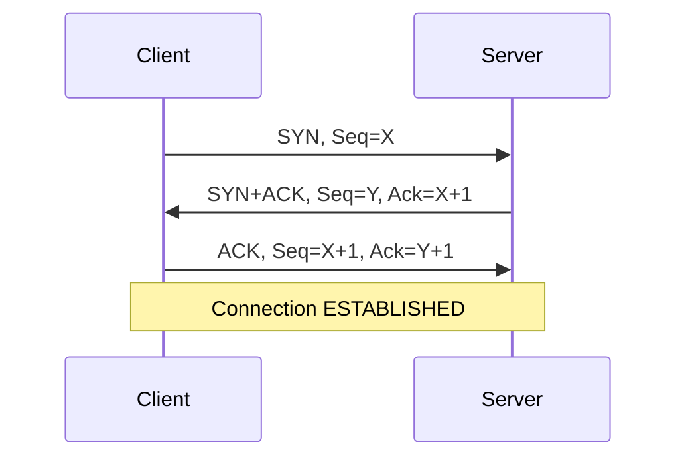
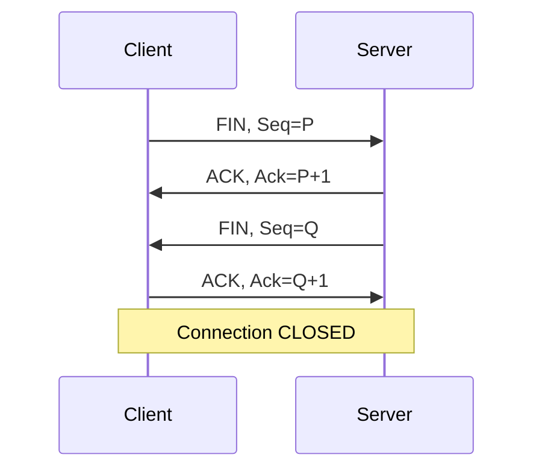

---
tags:
  - GATE/CS
  - GATE/ComputerNetworks
  - TransportLayer
  - ReliableDataTransfer
aliases:
  - TCP Segment Header
  - Transmission Control Protocol Header
  - TCP Header Format
date_created: 2026-09-06
difficulty: ⭐⭐⭐⭐
last_revised: 2026-09-06
pyq_frequency: High
---

## Syllabus Position

Subject: [[Computer Networks]]
Parent Topic: [[Transport Layer]]
Sibling Topics: [[UDP Header]], [[Go-Back-N Protocol]], [[Selective Repeat Protocol]], [[IPv4 Header]]
Leads To: [[TCP Congestion Control]], [[TCP Flow Control]], [[Sliding Window Protocol]], [[TCP Connection Establishment]]

GATE Syllabus Line: "Transport layer: Flow control and congestion control, UDP, TCP."

Exam Weight Note: Appears as 1-mark MCQs on field sizes (source/destination port, sequence/ack numbers) and header length calculations, and as 2-mark NAT/MCQ questions combining sequence number arithmetic, window size, and three-way handshake behavior.

---

## The Problem This Solves

IP only promises "best effort" delivery — packets can arrive out of order, get duplicated, or vanish entirely, and IP has no concept of "processes" on either end, only host-to-host addressing. Applications like a web browser or an email client need something stronger: a byte stream that arrives in order, without gaps, without duplicates, and delivered to the *correct process* on a machine running dozens of them at once.

Think of TCP like a registered courier service layered on top of a regular postal system (IP). The regular post (IP) just drops packages at the right building; the registered courier (TCP) numbers every package, gets a signed receipt for each one, resends anything that's lost, reorders anything that arrives out of sequence, and hands the package to the right person's desk (port number) inside that building.

**Core Idea:** The TCP header is a 20-byte (minimum) segment header carrying sequence and acknowledgment numbers, control flags, and a window size — the metadata that turns IP's unreliable datagram service into a reliable, ordered, flow-controlled byte stream between two processes.

---

## Formal Theory

### Overview

The TCP header is defined in RFC 793 (updated by RFC 3168 for ECN and others). It sits between the IP header and the application data, forming a **TCP segment**. The header is a minimum of 20 bytes and can extend up to 60 bytes with options — structurally mirroring the [[IPv4 Header]] in this respect, though the fields serve entirely different purposes.

Unlike IP, which is connectionless, TCP is **connection-oriented**: the header fields exist to support a full-duplex, reliable, ordered, flow-controlled, congestion-aware byte stream, not just point-to-point forwarding.

### Field-by-Field Breakdown

### Source Port (16 bits)

Identifies the sending process's port number. Combined with the source IP address (from the [[IPv4 Header]]), this forms half of the socket pair that uniquely identifies a connection.

Range: $0$ to $65535$ (since $2^{16} - 1 = 65535$).

### Destination Port (16 bits)

Identifies the receiving process's port number. Well-known ports (0–1023) are reserved for standard services — e.g., port 80 for HTTP, port 443 for HTTPS, port 21 for FTP control.

**Key GATE fact:** A TCP connection is uniquely identified by the 4-tuple (Source IP, Source Port, Destination IP, Destination Port) — **not** by port number alone. This is why a server can handle thousands of simultaneous connections on the same port 80.

### Sequence Number (32 bits)

Identifies the byte-stream position of the **first data byte** in this segment. TCP treats data as a stream of bytes, not messages, so every byte gets an implicit number.

- During connection setup, each side picks an **Initial Sequence Number (ISN)** — not zero, for security reasons (to prevent sequence number prediction/hijacking).
- If SYN is set, the sequence number is the ISN itself, and the first actual data byte is ISN + 1.

**Key formula:**

$$\text{Next Expected Sequence Number} = \text{Current Seq} + \text{Data Length (bytes)}$$

GATE frequently tests: "A segment carries sequence number 1000 and 200 bytes of data. What is the sequence number of the next segment?" Answer: $1000 + 200 = 1200$.

### Acknowledgment Number (32 bits)

Valid only when the ACK flag is set (almost always, after the handshake). It specifies the **next byte the receiver expects** — i.e., cumulative acknowledgment of all bytes up to (Ack Number − 1).

$$\text{Ack Number} = \text{Highest contiguous byte received} + 1$$

GATE trap: TCP uses **cumulative ACKs**. If bytes 1000–1199 arrive but 1200–1399 are lost while 1400–1599 arrive out of order, the ACK still says "1200" (not acknowledging the out-of-order segment), because TCP (in its basic form) only acknowledges contiguous data.

### Data Offset / Header Length (4 bits)

Specifies the TCP header length in **32-bit words**, exactly analogous to IHL in the [[IPv4 Header]]. Minimum value 5 (20 bytes), maximum value 15 (60 bytes).

$$\text{Header Size (bytes)} = \text{Data Offset} \times 4$$

This field exists because TCP options are variable length, so the receiver needs to know where the header ends and data begins.

### Reserved (3 bits)

Reserved for future use; must be set to 0.

### Control Flags (9 bits total)

This is the field GATE tests most heavily. Six classic flags plus three modern ones (CWR, ECE, NS — rarely asked):

| Flag | Full Name | Meaning |
|------|-----------|---------|
| URG | Urgent | Urgent Pointer field is significant |
| ACK | Acknowledgment | Acknowledgment Number field is valid |
| PSH | Push | Push buffered data to the application immediately, don't wait to fill buffer |
| RST | Reset | Abruptly terminates connection (e.g., connecting to a closed port) |
| SYN | Synchronize | Used to establish a connection; synchronizes sequence numbers |
| FIN | Finish | Sender has no more data; used to gracefully terminate connection |

**Common flag combinations GATE tests:**

- Connection request: `SYN=1, ACK=0`
- Connection accept: `SYN=1, ACK=1`
- Normal data segment: `ACK=1` (SYN, FIN, RST all 0)
- Graceful close: `FIN=1, ACK=1`
- Abrupt reset: `RST=1`

### Window Size (16 bits)

Advertises the **receive window** — the number of bytes the sender is permitted to send before receiving further acknowledgment, used for **flow control** (preventing a fast sender from overwhelming a slow receiver).

$$\text{Max Window Size} = 2^{16} - 1 = 65535 \text{ bytes}$$

GATE angle: Larger windows (beyond 65535, e.g., over high-bandwidth-delay-product links) require the **Window Scale option**, which multiplies this field by a scaling factor.

### Checksum (16 bits)

Covers the TCP header, TCP data, **and** a 96-bit pseudo-header (source IP, destination IP, protocol number, TCP segment length) borrowed conceptually from the IP layer. This is fundamentally different from the [[IPv4 Header]]'s checksum, which covers only its own header.

**Why the pseudo-header?** It lets TCP verify that the segment reached the correct destination IP and used the correct protocol number (6), catching misdelivery errors that a header-only checksum would miss.

### Urgent Pointer (16 bits)

Valid only when URG=1. Points to the last byte of urgent data, offset from the sequence number, allowing the receiver to process time-critical data (e.g., a Telnet interrupt) ahead of normal buffered data.

### Options (variable, 0–40 bytes)

Common options include:

- **MSS (Maximum Segment Size):** negotiated during the handshake; caps the largest segment of data (excludes header).
- **Window Scale:** extends the 16-bit Window field for high-throughput links.
- **SACK (Selective Acknowledgment):** allows acknowledging non-contiguous blocks of received data, unlike the default cumulative ACK.
- **Timestamps:** used for RTT estimation and protection against wrapped sequence numbers.

### How GATE Tests This Topic

GATE loves to test:
1. Calculating header size from Data Offset
2. Computing next sequence number / ack number arithmetic
3. Interpreting flag combinations (SYN/ACK/FIN/RST) for connection state
4. Understanding cumulative ACK semantics and how it differs from selective repeat
5. Reasoning about the three-way handshake sequence/ack number exchange
6. Comparing TCP checksum (with pseudo-header) against IPv4/UDP checksum scope

---

## Diagrams and Visuals

### TCP Header Layout

```
Byte:  0          1          2          3
      +----------+----------+----------+----------+
  0   |     Source Port     |  Destination Port    |
      +----------+----------+----------+----------+
  4   |            Sequence Number (32 bits)        |
      +----------+----------+----------+----------+
  8   |         Acknowledgment Number (32 bits)     |
      +----------+----------+----------+----------+
 12   |DataOff|Res|U A P R S F|   Window Size       |
      | 4 bits|3 b|R C S S Y I|     (16 bits)       |
      |       |   |G K H T N N|                     |
      +----------+----------+----------+----------+
 16   |      Checksum        |   Urgent Pointer     |
      +----------+----------+----------+----------+
 20   |          Options (if Data Offset > 5) ...   |
      +----------+----------+----------+----------+
```

### Three-Way Handshake (Sequence Diagram)



### Connection Termination (Four-Way)



### Cumulative ACK Example

```
Sender sends bytes:  [1000-1199]  [1200-1399]  [1400-1599]
                          ✓            ✗ (lost)      ✓ (buffered, out of order)

Receiver's ACK stream:
  After segment 1: ACK = 1200  (next expected byte)
  Segment 2 lost, segment 3 arrives out of order
  Receiver still sends: ACK = 1200  (duplicate ACK — cannot acknowledge 1400-1599
                                      because 1200-1399 is still missing)

Sender sees duplicate ACKs → triggers fast retransmit of [1200-1399]
```

---

## Complexity Analysis

Adapted for a protocol/header concept rather than an algorithm.

### Header Processing Complexity

| Operation | Time Complexity | Notes |
|-----------|-----------------|-------|
| Header parsing | $O(1)$ | Fixed-size fields, no iteration |
| Checksum computation | $O(h + d)$ where $h$=header words, $d$=data words | Includes pseudo-header + data |
| Option parsing | $O(k)$ where $k$ = number of options | Variable-length TLV options |
| Cumulative ACK processing | $O(1)$ | Just compares against expected byte |
| SACK block processing | $O(b)$ where $b$ = number of SACK blocks | Must merge non-contiguous ranges |

### Field Size Constraints

| Parameter | Value | Formula |
|-----------|-------|---------|
| Min header | 20 bytes | 5 × 4 (Data Offset = 5) |
| Max header | 60 bytes | 15 × 4 (Data Offset = 15) |
| Max sequence number | $2^{32}-1 = 4294967295$ | 32-bit field, wraps around |
| Max window (no scaling) | 65535 bytes | 16-bit field |
| Max window (with scaling) | up to $2^{30}$ bytes | Window Scale option shifts up to 14 bits |
| Max segment options | 40 bytes | 60 − 20 |

---

## Worked Example

### Example: Three-Way Handshake with Sequence/Ack Arithmetic

**Scenario:** Client initiates a connection to a server. Client's ISN = 5000. Server's ISN = 9000.

**Step 1 — Client sends SYN:**

- Flags: SYN=1, ACK=0
- Seq = 5000 (the ISN itself, no data yet)
- Ack = (not valid, ACK flag is 0)

**Step 2 — Server responds SYN+ACK:**

- Flags: SYN=1, ACK=1
- Seq = 9000 (server's own ISN)
- Ack = 5001 (client's ISN + 1, acknowledging the SYN which consumes one sequence number)

**Step 3 — Client responds ACK:**

- Flags: ACK=1
- Seq = 5001 (next byte after its own ISN)
- Ack = 9001 (server's ISN + 1)

**Step 4 — Client now sends 500 bytes of data:**

- Seq = 5001
- After this segment: next expected client seq = $5001 + 500 = 5501$

**Verification:**

- Each SYN (and FIN) consumes exactly 1 sequence number, even with 0 data bytes — this is why Ack in step 2 is ISN+1, not ISN.
- Total handshake overhead: 3 segments before any data flows.

**What would change if this were a simultaneous open (both sides send SYN at once)?**

Both sides would send SYN (not SYN+ACK) at first, then both would respond with SYN+ACK, taking 4 segments total instead of 3, but the connection would still reach ESTABLISHED state — a rare but GATE-testable edge case.

---

## Intuition Anchors

**The Analogy (deepened):**

The registered courier analogy extends further: the Sequence Number is the "item #47 of 200" label on each package. The Acknowledgment Number is the receipt saying "I've received everything up through item #46, send me #47 next" — even if you already have item #48 sitting in your warehouse, you can't say so with a plain receipt (cumulative ACK). The SYN flag is the courier's opening handshake ("let's agree on a shipment numbering scheme starting from your chosen number"), and FIN is the closing paperwork.

**The Mental Model:**

When you see a TCP header question, picture two people passing numbered index cards back and forth. Every card (segment) says "here's data starting at card #X" and the receiver's reply says "I have everything up to card #(X-1), send #X next." SYN and FIN each burn one card number even though they carry no data — that's the detail that trips people up.

**The One-Line Recall:**

TCP header is 20–60 bytes; Seq Number marks the first data byte of this segment; Ack Number is cumulative (next expected byte); SYN and FIN each consume one sequence number; checksum covers header+data+pseudo-header.

**The #1 Trap:**

Students forget that **SYN and FIN each consume exactly one sequence number**, even though they carry zero data bytes. This is why, after a SYN with Seq=X, the ACK in the reply is X+1, not X — and it's the single most common source of off-by-one errors in GATE sequence-number NAT questions.

---

## GATE Questions

---

**Question 1 — PYQ GATE 2015 — 2-mark MCQ**

> Consider a TCP connection in which the client sends a SYN with sequence number 100. The server responds with SYN+ACK, and the connection completes the three-way handshake. If the client then sends 200 bytes of data, what is the sequence number of this data segment, and what acknowledgment number will the server send back (assuming no other data flows)?

- (A) Seq = 100, Ack = 300
- (B) Seq = 101, Ack = 301
- (C) Seq = 101, Ack = 300
- (D) Seq = 100, Ack = 301

<details>
<summary>Solution</summary>

**Answer: (B) Seq = 101, Ack = 301**

**Reasoning:**

- Client's SYN has Seq = 100. This SYN consumes 1 sequence number.
- After the handshake, the client's next sequence number is $100 + 1 = 101$.
- The client sends 200 bytes of data starting at Seq = 101.
- The server, having received bytes 101 through 300, sends back Ack = $101 + 200 = 301$ (next expected byte).

**What this question is really testing:**

Whether the student remembers that SYN consumes a sequence number before any data is sent.

**Trap to avoid:**

Assuming the data segment starts at Seq = 100 (forgetting the SYN increment), which leads to option (A) or (D).

</details>

---

**Question 2 — Conceptual — 1-mark MCQ**

> Which of the following TCP header fields is used to prevent a fast sender from overwhelming a slow receiver's buffer?

- (A) Sequence Number
- (B) Checksum
- (C) Window Size
- (D) Urgent Pointer

<details>
<summary>Solution</summary>

**Answer: (C) Window Size**

**Reasoning:**

Window Size implements **flow control** — the receiver advertises how many more bytes it can currently buffer, and the sender must not exceed this limit. This is distinct from congestion control (which protects the network, not the receiver) and is not directly encoded as a single header field but influenced by the same Window field combined with congestion window logic at the sender.

**What this question is really testing:**

Distinguishing flow control (Window field, receiver-driven) from congestion control (sender-side algorithm, not a single header field) and from error detection (Checksum).

**Trap to avoid:**

Confusing Window Size (flow control) with congestion control mechanisms — GATE often asks this distinction directly.

</details>

---

**Question 3 — Hard / Multi-concept — 2-mark NAT**

> A TCP sender transmits three segments with sequence numbers 1000, 1200, and 1400, each carrying 200 bytes of data. The segment with sequence number 1200 is lost in transit; the other two arrive successfully and out of order at the receiver. Assuming the receiver does NOT support Selective Acknowledgment (SACK), what acknowledgment number does the receiver send after receiving the segment with sequence number 1400?

- (A) 1200
- (B) 1400
- (C) 1600
- (D) 1800

<details>
<summary>Solution</summary>

**Answer: (A) 1200**

**Reasoning:**

- Segment at Seq=1000 (bytes 1000–1199) arrives → receiver has contiguous data up to byte 1199 → sends Ack = 1200.
- Segment at Seq=1200 (bytes 1200–1399) is **lost**.
- Segment at Seq=1400 (bytes 1400–1599) arrives, but it is **out of order** — byte 1200 is still missing.
- Without SACK, the receiver can only send **cumulative ACKs**. Since the gap at 1200–1399 still exists, the receiver re-sends Ack = 1200 (a duplicate ACK), even though it has buffered the 1400–1599 data.
- This duplicate ACK is exactly the signal that triggers TCP's **fast retransmit** mechanism at the sender.

**What this question is really testing:**

Whether the student understands that plain (non-SACK) TCP cannot acknowledge out-of-order data — it must wait for the gap to be filled, combining knowledge of ACK semantics with [[Selective Repeat Protocol]] concepts.

**Trap to avoid:**

Assuming the receiver acknowledges the highest byte received so far (1600), which is how [[Selective Repeat Protocol]] behaves but NOT how default cumulative-ACK TCP behaves.

</details>

---

**Pattern Recognition:**

- When GATE gives a Data Offset value, immediately compute Header = Data Offset × 4, same pattern as IHL in [[IPv4 Header]].
- When GATE asks about sequence number progression, always check whether SYN or FIN is involved — each consumes exactly 1 sequence number even with zero data bytes.
- When GATE describes lost/out-of-order segments, default to **cumulative ACK** behavior unless SACK is explicitly mentioned.
- When GATE asks "what prevents overwhelming the receiver" the answer is Window Size (flow control); "what prevents overwhelming the network" is congestion control (not a single field).

---

## Edge Cases and Failure Modes

- [ ] **Sequence number wraparound:** After $2^{32}-1$ bytes, the sequence number wraps to 0. GATE questions rarely test the arithmetic directly but expect awareness that this exists (PAWS — Protect Against Wrapped Sequence numbers — uses the Timestamp option to handle this).
- [ ] **SYN/FIN with zero data still consume 1 sequence number:** The most common off-by-one error source; forgetting this misaligns every subsequent Seq/Ack calculation.
- [ ] **Duplicate ACKs due to out-of-order (not lost) segments:** Three duplicate ACKs trigger fast retransmit even if the segment was merely delayed, not actually lost — a false-alarm retransmission is possible.
- [ ] **Data Offset < 5:** Invalid; minimum header is always 20 bytes (Data Offset = 5).
- [ ] **Window Size = 0:** Sender must stop transmitting (a "zero window" condition); receiver later sends a Window Update once buffer space frees up. Failure to persist-probe this can cause deadlock (solved by TCP's persist timer).
- [ ] **RST received unexpectedly:** Indicates the connection was aborted (e.g., port not listening or protocol violation) — no graceful FIN handshake occurs.
- [ ] **Checksum covers pseudo-header:** If NAT rewrites the IP address but doesn't recompute the TCP checksum, the segment appears corrupted — a common NAT/TCP interaction gotcha.
- [ ] **Urgent Pointer without URG flag set:** The Urgent Pointer field is present in every header but is only meaningful when URG=1; otherwise it must be ignored.

---

## Comparisons

| Feature | [[TCP Header]] | [[IPv4 Header]] | [[UDP Header]] |
|---------|-----------------|-------------------|-------------------|
| Min Size | 20 bytes | 20 bytes | 8 bytes (fixed) |
| Max Size | 60 bytes | 60 bytes | 8 bytes (fixed) |
| Connection State | Connection-oriented | Connectionless | Connectionless |
| Sequencing | Yes (Seq/Ack numbers) | No | No |
| Flow Control | Yes (Window field) | No | No |
| Checksum Scope | Header + data + pseudo-header | Header only | Header + data + pseudo-header (optional in IPv4) |
| GATE Preference | Very heavily tested | Most tested | Tested but simpler |

The most common GATE question comparing these is: "Why does TCP need a checksum covering the pseudo-header while IPv4 does not?" The answer hinges on the fact that TCP must verify end-to-end correctness (correct source/destination IP and protocol), a job the IP layer's own header checksum does not do, since IPv4's checksum protects only its own header fields.

---

## Connections Web

**Must know before this topic:**
- [[IPv4 Header]] — TCP segments are encapsulated inside IP datagrams; the pseudo-header borrows IP addressing fields
- [[Go-Back-N Protocol]] — foundational sliding window and cumulative ACK concepts that TCP's Seq/Ack fields implement
- [[Selective Repeat Protocol]] — contrasts with TCP's default cumulative-only ACK behavior; relevant when SACK option is discussed
- [[Stop and Wait Protocol]] — simplest ARQ scheme, conceptual ancestor of TCP's reliability mechanism

**Topics that build on this:**
- [[TCP Congestion Control]] — uses Window field alongside congestion window (cwnd) computed at the sender
- [[TCP Flow Control]] — directly implemented via the Window Size field
- [[TCP Connection Establishment]] — the three-way handshake mechanics detailed in the Worked Example
- [[Sliding Window Protocol]] — generalizes the Seq/Ack + Window mechanism seen here

**GATE subject cross-links:**
- [[Computer Networks]] > [[Transport Layer]] > TCP Header

**Cross-subject connections:**
- [[Hamming Code]] — error detection concepts parallel TCP's checksum computation
- [[Cyclic Redundancy Check (CRC)]] — alternative error-detection scheme used at the Data Link Layer, contrasted with TCP's Internet checksum

**Standard references:**
- RFC 793 — Transmission Control Protocol (original specification)
- [[Kurose & Ross]] Chapter 3 — Transport Layer
- [[Tanenbaum & Wetherall]] Chapter 6 — Transport Layer

---

## Quick Revision Sheet

**Definition (1 sentence):** The TCP header is a 20–60 byte segment header carrying sequence/acknowledgment numbers, control flags, and window size, turning IP's unreliable delivery into a reliable, ordered, flow-controlled byte stream.

**Core Idea / Analogy (1 sentence):** It's a registered courier's numbered receipt system layered over the regular (unreliable) post — every byte is numbered, every receipt is cumulative, and lost items get resent.

**Key Field Sizes:**

| Field | Size | Key Detail |
|-------|------|------------|
| Source Port | 16 bits | Identifies sending process |
| Destination Port | 16 bits | Identifies receiving process |
| Sequence Number | 32 bits | Position of first data byte; SYN/FIN consume 1 |
| Acknowledgment Number | 32 bits | Next expected byte; valid only if ACK=1 |
| Data Offset | 4 bits | Header size in 4-byte words (min=5, max=15) |
| Flags | 9 bits | URG, ACK, PSH, RST, SYN, FIN (+CWR, ECE, NS) |
| Window Size | 16 bits | Flow control; max 65535 without scaling |
| Checksum | 16 bits | Covers header + data + pseudo-header |
| Urgent Pointer | 16 bits | Valid only if URG=1 |

**The #1 Trap:**
SYN and FIN each consume exactly one sequence number, even with zero data bytes — misaligning every downstream Seq/Ack calculation if forgotten.

**When to use this over alternatives:**
TCP is used whenever reliability, ordering, and flow control matter (web, email, file transfer); UDP is preferred when latency matters more than reliability (DNS, video streaming, VoIP).

**Mnemonic for flags order:** "Ugly Aunts Push Really Silly Faces" → URG, ACK, PSH, RST, SYN, FIN (in header bit order).

---

## Revision Checklist

- [ ] I can state the minimum and maximum header sizes without looking (20 and 60 bytes).
- [ ] I can compute header size from any Data Offset value.
- [ ] I can perform Seq/Ack arithmetic across a three-way handshake including SYN/FIN increments.
- [ ] I can decode all six classic flag bits and describe what each means.
- [ ] I understand why TCP's ACK is cumulative and how this differs from Selective Repeat/SACK.
- [ ] I know why the checksum includes a pseudo-header and what that pseudo-header contains.
- [ ] I can explain Window Size's role in flow control versus congestion control.
- [ ] I can trace a full three-way handshake and four-way termination by hand.
- [ ] I have linked this note correctly in my Obsidian vault.
</content>
</invoke>
