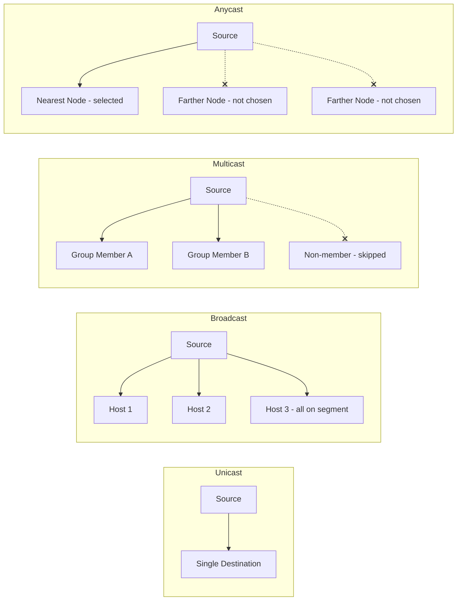

---
tags:
  - GATE/CS
  - GATE/Networks
  - CommunicationModes
aliases:
  - Unicast Multicast Broadcast Anycast
  - Network Communication Types
  - Transmission Modes (Addressing)
date_created: 2026-08-12
difficulty: ⭐⭐
last_revised: 2026-08-12
pyq_frequency: Medium
---

## Syllabus Position

Subject: [[Computer Networks Index]]
Parent Topic: [[IPv4 Addressing]]
Sibling Topics: [[Classful Addressing]], [[Classless Addressing (CIDR)]], [[Routing Algorithms]]
Leads To: [[Multicasting]], [[IGMP]], [[Content Delivery Networks (CDN)]], [[Anycast Routing]]

GATE Syllabus Line: "IPv4/IPv6, Routers and Routing algorithms" — the types of communication
(unicast, multicast, broadcast, anycast) determine how routers and switches forward packets, and
GATE tests this through address-range identification (e.g., recognizing Class D as multicast) and
conceptual questions on how each mode scales.

Exam Weight Note: Appears as a 1-mark conceptual MCQ distinguishing unicast/multicast/broadcast/
anycast, or embedded inside a Class D addressing question that requires knowing multicast
semantics.

---

## The Problem This Solves

Imagine a teacher in a classroom. Sometimes the teacher wants to talk to **one specific student**
privately. Sometimes she wants to talk to **an entire study group** that opted into a topic.
Sometimes she needs to make an announcement to **every single student in the room**, whether they
care or not. And sometimes she just needs *any one* of several available teaching assistants to
respond, and doesn't care which one. Networks face the exact same problem when one machine needs
to send data — should it go to one destination, to a subscribed group, to everyone, or to the
"nearest available" among several equivalent destinations? Without distinct communication types,
every network protocol would have to solve this addressing problem from scratch, and networks
would either waste massive bandwidth by always broadcasting or would have no efficient way to
reach subscribed groups at all.

Analogy: think of unicast as a phone call (one caller, one receiver), multicast as a group text
message (only opted-in members receive it), broadcast as a loudspeaker announcement (everyone
hears it, wanted or not), and anycast as calling a company's general support line where the call
routes to *whichever* available agent is closest/fastest to answer.

Core Idea (one sentence): The type of communication defines **how many destinations** a single
packet is meant to reach and **how the network decides who those destinations are**.

---

## Formal Theory

A **communication type** (or transmission mode) is the addressing and delivery model that
determines whether a packet sent by a source is intended for one, some, all, or the "nearest one"
of potential destinations on a network.

### Unicast

**Unicast** communication is a **one-to-one** transmission: exactly one source sends to exactly
one specific destination, identified by a single, unique destination address.

- Uses standard [[Classful Addressing|Class A, B, or C]] host addresses.
- The overwhelming majority of Internet traffic (web browsing, file transfer, most video calls
  in a 1:1 sense) is unicast.
- Routing is straightforward: forward the packet toward the single destination using normal
  routing tables (e.g., via [[Dijkstra's Algorithm|shortest path routing]]).

```
Algorithm UNICAST_SEND(source, destination, packet):
    lookup route to destination in routing table
    forward packet along that single path
    return delivery confirmation to destination only
```

### Broadcast

**Broadcast** communication is a **one-to-all** transmission: a single source sends a packet that
is delivered to **every host** on a given network segment, regardless of whether they want it.

- **Limited broadcast address:** `255.255.255.255` — delivered to all hosts on the *local*
  network only; routers never forward it beyond the local subnet.
- **Directed broadcast address:** the address with all host bits set to 1 for a specific network
  (e.g., `192.168.1.255` for network `192.168.1.0/24`) — reaches all hosts on that *specific*
  remote network, though many routers block this by default (used historically in
  [[Smurf Attack|Smurf DDoS attacks]]).
- Broadcast does not scale to the entire Internet — it is restricted to a single network/subnet
  because forwarding it globally would flood every router on Earth.

```
Algorithm BROADCAST_SEND(source, network, packet):
    set destination address = network's broadcast address (all host bits = 1)
    deliver packet to every host within that single network segment
    do not forward across router boundaries (for directed broadcast, often blocked)
```

### Multicast

**Multicast** communication is a **one-to-many (subscribed group)** transmission: a source sends
one packet, and it is delivered only to hosts that have explicitly **joined a multicast group**,
regardless of their physical location on the network.

- Uses [[Classful Addressing|Class D addresses]] (224.0.0.0 – 239.255.255.255) as **group
  addresses**, not host addresses — the address identifies a *group*, not a device.
- Hosts join/leave groups using **IGMP** ([[IGMP]] — Internet Group Management Protocol), which
  tells the local router "I want packets sent to group X."
- Routers use multicast routing protocols (e.g., PIM) to build efficient delivery trees so the
  source sends the packet only once, and routers replicate it only where needed — dramatically
  more efficient than broadcast for large-scale group delivery (e.g., IPTV, video conferencing,
  stock ticker feeds).

```
Algorithm MULTICAST_SEND(source, group_address, packet):
    source sends packet once, addressed to group_address
    each router along the path checks: does any downstream link lead to a group member?
    replicate packet only along branches that lead to at least one subscribed member
    deliver to all current members of group_address
```

### Anycast

**Anycast** communication is a **one-to-nearest** transmission: a single destination address is
assigned to **multiple physical servers/nodes**, and the network's routing infrastructure delivers
the packet to whichever one of those nodes is "nearest" according to the routing metric (usually
fewest hops or lowest latency).

- Commonly used for **DNS root servers** and [[Content Delivery Networks (CDN)|CDNs]] — the same
  IP address is announced from many geographically distributed locations, and BGP routing
  naturally sends each client to the topologically closest instance.
- Unlike multicast, only **one** of the multiple nodes actually receives and responds to any
  given packet — it is not group delivery, it is nearest-instance selection.
- Improves both **latency** (shorter path to nearest server) and **fault tolerance** (if one
  anycast node fails, routing automatically redirects to the next-nearest one).

```
Algorithm ANYCAST_SEND(source, anycast_address, packet):
    routing infrastructure identifies all nodes announcing anycast_address
    select the topologically nearest node per current routing table (e.g., BGP path length)
    deliver packet to that single nearest node only
```

**What GATE actually tests here:** Recognizing which class of address maps to which communication
type (Class D → multicast), understanding that broadcast doesn't cross router boundaries by
default, and distinguishing multicast (many receive, group-based) from anycast (only one receives,
proximity-based) — this last distinction is the most commonly confused pair on GATE-style
questions.

---

## Diagrams and Visuals

**1. Delivery pattern comparison (Mermaid):**



**2. ASCII summary of "who receives":**

```
Unicast:    [Source] ----------> [ONE specific host]

Broadcast:  [Source] ----------> [Host A]
                       ----------> [Host B]
                       ----------> [Host C]   (ALL hosts on segment, opted-in or not)

Multicast:  [Source] ----------> [Host A - joined group]
                       ----------> [Host C - joined group]
                    (Host B skipped - did not join group via IGMP)

Anycast:    [Source] ----------> [Nearest of {Node1, Node2, Node3}]
                                  (only ONE of the identical-address nodes responds)
```

**3. Class D multicast group addressing layout:**

```
1110 GGGGGGG GGGGGGGG GGGGGGGG GGGGGGGG
|4-bit prefix|--------28-bit group ID--------|
```
Label: unlike Class A/B/C, these 28 bits do not split into network/host — they directly identify
a multicast group that any number of hosts anywhere may join.

---

## Complexity Analysis

These are not algorithms with classic asymptotic complexity, but GATE expects you to reason about
**delivery cost** in terms of number of transmissions and router replication work, which is the
direct analogue of "complexity" for this topic.

- **Unicast:** Cost to deliver to $1$ destination is $O(1)$ transmissions from the source's
  perspective; routing lookup itself is $O(1)$ per hop (table lookup), and total path cost is
  $O(h)$ where $h$ = number of hops to the destination.
- **Broadcast:** Cost to reach all $n$ hosts on a local segment is technically $O(1)$ from the
  source (it sends once), but the **network-wide replication cost** is $O(n)$ since every host on
  the segment processes the packet — this is the core reason broadcast doesn't scale to $n$ =
  entire Internet.
- **Multicast:** If $m$ hosts out of $n$ total have joined the group ($m \le n$), delivery cost is
  bounded by the multicast tree's edges, which is at most $O(m)$ replication points — strictly
  better than broadcast's $O(n)$ when $m \ll n$, since routers skip branches with no group members.
- **Anycast:** Delivery cost is effectively $O(1)$ transmissions (source sends once, exactly one
  node responds), but the *selection* cost depends on routing table convergence — typically
  $O(\log n)$ to $O(n)$ depending on the underlying routing protocol's path computation, though
  in practice BGP path selection is treated as already computed/cached.

### Complexity Summary Table

| Communication Type | Receivers                  | Delivery Cost                  | Scales To Whole Internet?          |
|---------------------|-----------------------------|----------------------------------|-------------------------------------|
| Unicast             | Exactly 1                  | $O(h)$ — h = hops to destination | Yes — default mode of the Internet  |
| Broadcast           | All hosts on segment ($n$)  | $O(n)$ replication on segment    | No — blocked/restricted globally    |
| Multicast           | Subscribed members ($m \le n$) | $O(m)$ via multicast tree      | Yes — with multicast routing (PIM)  |
| Anycast             | Exactly 1 (nearest of many)| $O(1)$ send, routing pre-computed| Yes — used by DNS root servers, CDNs|

---

## Worked Example

**Scenario:** A video conferencing service wants to send a live stream to 3 specific participants
who joined a call (out of 50 people in the office network), while a separate fire-alarm system
must alert *every* device on that same office network, and a DNS query needs to reach the fastest
available root server.

Step 1 — Identify the video conference requirement: only 3 out of 50 want the data → this is a
**group-based, subscribed delivery** → use **multicast**.
- Assign a Class D group address, e.g., `230.1.1.1`.
- The 3 participants' devices send IGMP "join" messages for group `230.1.1.1`.
- The router builds a delivery tree only to branches containing these 3 devices.
- Data sent once by the source is replicated by routers only along those 3 relevant paths —
  the other 47 devices never see this traffic.

Step 2 — Identify the fire-alarm requirement: every device on the segment must be alerted,
opted-in or not → this is **broadcast**.
- The alarm system sends to the local broadcast address, e.g., `192.168.1.255` (assuming
  `192.168.1.0/24` network).
- All 50 devices on that segment receive and process the alert packet, whether they "want" it
  or not.

Step 3 — Identify the DNS requirement: client wants an answer from *any* nearest available root
server, not a specific one, and definitely not all of them → this is **anycast**.
- Multiple root server instances worldwide announce the exact same anycast IP address.
- BGP routing automatically forwards the client's query to the topologically nearest instance.
- Only that one nearest instance replies — the client neither knows nor cares which physical
  server actually answered.

Step 4 — Contrast with unicast: if instead one participant privately messages one other specific
participant (not the whole group), this reverts to plain **unicast** — one source, one
destination address, no group or broadcast semantics involved.

**Total operations to classify all 3 scenarios: 3 conceptual classification decisions** — this
confirms the $O(1)$ conceptual classification cost, since deciding "which type is this" only
requires checking how many intended receivers exist and whether membership/proximity matters.

**Edge case follow-up:** What if the video conference had subscribed 49 out of 50 devices (nearly
everyone)? Multicast is technically still more correct semantically (opted-in delivery), but its
efficiency advantage over broadcast shrinks since $m \approx n$ — this is exactly the trade-off
GATE likes to probe: multicast is not "always better," it's better specifically when $m \ll n$.

---

## Intuition Anchors

**The Analogy (restated and deepened):** The phone-call (unicast), group-text (multicast),
loudspeaker (broadcast), and general-support-line (anycast) analogy extends naturally to the
complexity numbers too — a phone call scales fine to millions of simultaneous 1:1 calls
($O(h)$ each, independent of others), a loudspeaker doesn't scale beyond the room it's placed in
($O(n)$ within that room only), a group text scales well as long as the group stays much smaller
than "everyone" ($O(m)$, $m \ll n$), and a general support line scales because it's really just
smart call-routing to the *nearest* available agent ($O(1)$ per call, load spread across many
identical agents).

**The Mental Model:** For multicast, picture a delivery tree that "prunes" itself — routers ask
"does any leaf below me want this?" and if the answer is no, that whole branch is cut, saving
bandwidth. For anycast, picture GPS-style "find nearest" logic baked directly into routing tables,
so the same destination address silently resolves to different physical machines depending on
where you're standing (routing-wise).

**The One-Line Recall:** "Unicast = 1-to-1, Broadcast = 1-to-all-on-segment, Multicast = 1-to-
subscribed-group (Class D), Anycast = 1-to-nearest-of-many-identical."

**The #1 Trap:** Students confuse multicast and anycast because both involve "multiple possible
destinations" sharing something in common. The correction: in **multicast**, potentially *many*
group members *all* receive the same packet; in **anycast**, *only one* of the many candidate
nodes ever receives it — anycast is about *selecting one*, multicast is about *reaching many*.

---

## GATE Questions

---

**Question 1 — GATE-style — 1-mark**

> A router receives a packet destined for the address `230.5.6.7`. What kind of communication
> does this represent?

- (A) Unicast
- (B) Broadcast
- (C) Multicast
- (D) Anycast

<details>
<summary>Solution</summary>

**Answer: (C)**

**Reasoning:** `230.5.6.7` falls in the range 224.0.0.0 – 239.255.255.255, which is [[Classful
Addressing|Class D]], reserved exclusively for multicast group addressing. It cannot be unicast
(Class D addresses are never assigned to individual hosts), cannot be broadcast (broadcast uses
all-1s host bits within a Class A/B/C network or the limited broadcast `255.255.255.255`, not a
Class D address), and cannot be anycast (anycast addresses are drawn from normal unicast address
space, not Class D — anycast is a *routing behavior* applied to ordinary-looking addresses, not
a separate address class).

**What this question is really testing:** Whether the student connects Class D addressing
directly to the multicast communication type.

**Trap to avoid:** Assuming any address with "many possible receivers" implies multicast —
anycast also has multiple candidate nodes but uses ordinary unicast-looking addresses, not Class D.

</details>

---

**Question 2 — Conceptual/Numerical — 2-mark**

> A company network has 100 hosts. A software update server multicasts an update to 20 hosts
> that have subscribed via IGMP, while a separate legacy alert system broadcasts a message to
> the entire segment. Approximately how many total packet deliveries (replication events) occur
> at the network layer for each scheme, and which one is more bandwidth-efficient here?

<details>
<summary>Solution</summary>

For multicast: only the 20 subscribed hosts are on the delivery tree, so replication events are
bounded by $O(m) = O(20)$ — routers only forward along branches leading to these 20 hosts.

For broadcast: all 100 hosts on the segment receive the packet regardless of interest, so
replication events are $O(n) = O(100)$.

**Answer:** Multicast requires roughly 20 delivery events vs. broadcast's 100, making multicast
5x more bandwidth-efficient here since $m = 20 \ll n = 100$. This gap would shrink if most hosts
were subscribed (e.g., $m = 95$), demonstrating that multicast's advantage depends entirely on
how much smaller the subscribed group is relative to the whole segment.

</details>

---

**Question 3 — Hard/Multi-concept — 2-mark**

> DNS root servers are famously deployed using anycast rather than a single unicast server or
> a multicast group. Explain why neither unicast nor multicast would work as well, connecting
> your answer to both fault tolerance and address semantics.

<details>
<summary>Solution</summary>

**Why not unicast:** A single unicast server means one physical machine handling every DNS query
worldwide — this creates a single point of failure (if it goes down, all clients relying on that
one address lose service) and forces every client, regardless of location, to route potentially
across the entire globe to reach it, maximizing latency.

**Why not multicast:** Multicast is designed so that *every* subscribed member of a group receives
*the same* packet — but a DNS query needs exactly **one** authoritative answer from **one**
server, not the same query simultaneously processed and answered by every root server instance
(which would cause duplicate/conflicting responses and massive unnecessary load on every instance
for every single query).

**Why anycast fits:** Anycast lets many physically distinct servers share the *same* address, and
routing infrastructure (BGP) automatically sends each client's query to whichever *one* instance is
topologically nearest — this gives low latency (nearest instance responds) and fault tolerance
(if that instance fails, BGP reconverges and redirects to the next-nearest instance) without
duplicating the response to multiple servers or forcing a single point of failure.

**What this question is really testing:** Deep understanding that anycast is fundamentally a
"one is selected, others stay silent" model — distinct from both unicast's "always the same one"
and multicast's "many respond/receive."

</details>

---

**Pattern Recognition:**
- Any question with a Class D address (224–239) is testing multicast, full stop — this is a
  direct addressing fact, not open to interpretation.
- Questions asking "why does X protocol use anycast instead of unicast/multicast" almost always
  hinge on the fault-tolerance + single-response semantics of anycast.
- Numeric "how many hosts receive this" questions are testing whether you know multicast counts
  only subscribed members ($m$), broadcast counts everyone on the segment ($n$), and anycast
  always counts exactly $1$.

---

## Edge Cases and Failure Modes

- [ ] **Assuming broadcast crosses router boundaries by default:** Wrong assumption — routers do
      not forward broadcast packets between networks by default (this is intentional, to prevent
      broadcast storms). Directed broadcasts to remote networks are frequently blocked entirely
      for security reasons (historically abused in Smurf attacks).
- [ ] **Confusing multicast group address with a host address:** A Class D address like
      `230.1.1.1` does not belong to any single device — it's meaningless to ask "what is the
      network ID of this multicast address" the way you would for Class A/B/C.
- [ ] **Assuming anycast delivers to all nearest-tied nodes:** If multiple anycast nodes are
      equally "near" by the routing metric, exactly one is still selected (per the routing
      protocol's tie-breaking rule) — anycast never delivers to more than one node per packet.
- [ ] **All hosts on a segment being multicast subscribers ($m = n$):** In this edge case,
      multicast's efficiency advantage over broadcast vanishes entirely — both now require
      $O(n)$ deliveries, so multicast's benefit is specifically tied to $m \ll n$.
- [ ] **Empty multicast group ($m = 0$):** If no host has joined the group, routers should prune
      the entire delivery tree and no replication occurs anywhere — a common oversight is
      assuming the source's packet still traverses the network needlessly.
- [ ] **Off-by-one in group membership timing:** A host that sends an IGMP "leave" message just
      before a multicast transmission may still receive one final packet due to protocol timing
      delays — GATE occasionally tests this transient membership state.
- [ ] **Communication-type-specific failure — broadcast storms:** If broadcast traffic is not
      contained to a segment (e.g., misconfigured bridging), it can loop and amplify, consuming
      the entire network's bandwidth — a failure mode unique to broadcast's "no filtering" nature.

---

## Comparisons

| Feature              | [[Unicast]]              | [[Multicast]]                     | [[Broadcast]]                       |
|-----------------------|----------------------------|--------------------------------------|-----------------------------------------|
| Receivers             | Exactly 1                 | Subscribed group ($m \le n$)         | All on segment ($n$)                    |
| Address Class Used    | Class A/B/C host address   | Class D group address                | All-1s host bits / `255.255.255.255`    |
| Delivery Cost         | $O(h)$ hops                | $O(m)$ tree replication              | $O(n)$ segment-wide replication         |
| Scales to Internet?   | Yes (default mode)         | Yes (with multicast routing/PIM)     | No (restricted to local segment)        |
| GATE Trap             | Assuming it needs a group  | Confusing with anycast's "1 receives"| Assuming it crosses router boundaries   |

Below the table, note [[Anycast]] separately since it doesn't fit the "how many receive" spectrum
cleanly: it always delivers to exactly 1 (like unicast) but that 1 is dynamically selected by
proximity from a pool of identical-address nodes (unlike unicast's fixed single destination) — the
most common GATE question comparing these hinges on this exact distinction: unicast's destination
is fixed and known in advance, anycast's destination is the *same address* but resolves to a
*different physical node* depending on the sender's location.

---

## Connections Web

**Must know before this topic:**
- [[Classful Addressing]] — Class D addresses are the addressing foundation for multicast
- [[IPv4 Addressing]] — general addressing context all four communication types build on
- [[Routing Algorithms]] — required to understand how anycast "nearest node" selection works

**Topics that build on this:**
- [[IGMP]]
- [[Multicasting]]
- [[Anycast Routing]]
- [[Content Delivery Networks (CDN)]]
- [[Border Gateway Protocol (BGP)]]

**GATE subject cross-links:**
- [[Computer Networks Index]] > [[IP Addressing and Subnetting]]

**Cross-subject connections:**
- [[Distributed Systems Load Balancing]] — anycast is essentially network-layer load balancing
- [[Smurf Attack]] — an OS/Security-adjacent topic showing directed broadcast's misuse potential

**Standard references:**
- [[Kurose and Ross - Network Layer Chapter]]
- [[Forouzan Data Communications and Networking - IP Addressing Chapter]]
- [[RFC 1112]] (Host Extensions for IP Multicasting) / [[RFC 919]] (Broadcasting Internet Datagrams)

---

## Quick Revision Sheet

**Definition (1 sentence):** Communication types define how many destinations a single packet
reaches — one (unicast), all on a segment (broadcast), a subscribed group (multicast), or the
single nearest node among many identical-address candidates (anycast).

**Core Idea / Analogy (1 sentence):** Phone call (unicast), loudspeaker (broadcast), group text
(multicast), and general support line (anycast) — each differs in who is meant to receive.

**Algorithm Steps (classifying a communication scenario, max 6 steps):**
1. Count intended receivers: exactly 1, all, a subscribed subset, or "any one nearest."
2. If exactly 1 fixed destination → unicast.
3. If all hosts on the local segment regardless of interest → broadcast.
4. If only members who explicitly joined (via IGMP) → multicast (check for Class D address).
5. If same address maps to multiple physical nodes, only nearest responds → anycast.
6. Confirm address class: Class A/B/C → unicast/broadcast context; Class D → multicast.

**Complexity:**
- Time (best / average / worst): Unicast $O(h)$; Multicast $O(m)$; Broadcast $O(n)$; Anycast $O(1)$ send.
- Space: Multicast requires router-maintained group membership state; others are stateless per-packet.
- Recurrence (if applicable): Not applicable — these are addressing/delivery models, not recursive algorithms.

**Key Properties (facts GATE tests directly):**
- Class D (224.0.0.0–239.255.255.255) = multicast group addresses.
- Broadcast never crosses router boundaries by default.
- Multicast efficiency depends on $m \ll n$ (subscribed members far fewer than total hosts).
- Anycast always delivers to exactly one node, selected by routing proximity, not many.

**The #1 Trap:** Confusing multicast (many receive) with anycast (only one, nearest, receives).

**When to use this over alternatives:** Use multicast for group-subscribed streaming (IPTV,
conferencing); use anycast for latency-sensitive, fault-tolerant single-answer services (DNS,
CDNs); use broadcast only within a local segment for all-hosts alerts; use unicast for all
standard point-to-point communication.

**Mnemonic or one-liner to remember the steps:** "**U**nicast = **U**nique one, **B**roadcast =
**B**lasts everyone, **M**ulticast = **M**embers only, **A**nycast = **A**ny nearest one answers."

---

## Revision Checklist

- [ ] I can state the formal definition without looking.
- [ ] I can explain the analogy and map it to the algorithm or concept.
- [ ] I can trace the 3-scenario worked example (video call, alarm, DNS) by hand in under 2 minutes.
- [ ] I can derive the delivery-cost complexity for each type from scratch.
- [ ] I know what the Quick Revision Sheet says without reading it.
- [ ] I can solve all 3 GATE questions in this note without peeking.
- [ ] I know the #1 trap (multicast vs. anycast) and can articulate why students fall for it.
- [ ] I have linked this note correctly in my Obsidian vault.
- [ ] I have scheduled a spaced-repetition review in 3 days.
