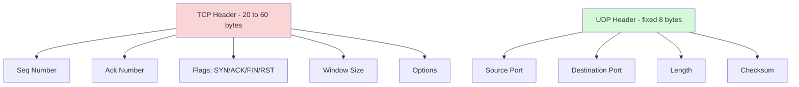

---
tags:
  - GATE/CS
  - GATE/ComputerNetworks
  - TransportLayer
  - ConnectionlessProtocols
aliases:
  - User Datagram Protocol Header
  - UDP Segment Header
  - UDP Header Format
date_created: 2026-09-07
difficulty: ⭐⭐
last_revised: 2026-09-07
pyq_frequency: Medium
---

## Syllabus Position

Subject: [[Computer Networks]]
Parent Topic: [[Transport Layer]]
Sibling Topics: [[TCP Header]], [[Go-Back-N Protocol]], [[Selective Repeat Protocol]], [[IPv4 Header]]
Leads To: [[DNS over UDP]], [[Real-Time Transport Protocol]], [[Application Layer Reliability]]

GATE Syllabus Line: "Transport layer: Flow control and congestion control, UDP, TCP."

Exam Weight Note: Appears as 1-mark MCQs on header field sizes and checksum scope, and occasionally as 2-mark NAT questions requiring computation of UDP total length or checksum, often paired with a comparison-to-TCP question in the same paper.
![[Screenshot 2026-09-07 at 11.19.07 AM.png]]
---

## The Problem This Solves

Some applications don't want a courier that double-checks every delivery, waits for signatures, and resends lost packages — that overhead costs time. A DNS lookup, a live video frame, or a heartbeat "are you alive" ping needs to go out **now**; if it's lost, the application would rather send a fresh one immediately than wait for a retransmission handshake. IP already provides bare-bones delivery (best effort, no guarantees); what's missing is just enough header to say "this came from process A, going to process B, here's roughly how big it is, and here's a cheap way to catch corruption."

Think of UDP like dropping a postcard in a mailbox: no return receipt, no tracking number, no guaranteed delivery — just an address (port) and a message, sent and forgotten. Contrast this with [[TCP Header]]'s registered courier service, which tracks every byte.

**Core Idea:** The UDP header is a fixed 8-byte header — just source port, destination port, length, and checksum — that gives IP's connectionless datagram service just enough addressing and error-detection to reach the correct process, with zero reliability, ordering, or flow-control overhead.

---

## Formal Theory

### Overview

The UDP header is defined in RFC 768, one of the shortest RFCs in networking history — matching how minimal the protocol is. UDP sits between the IP header and application data, forming a **UDP datagram** (also called a UDP segment). Unlike the [[TCP Header]], which ranges from 20–60 bytes, the UDP header is **always exactly 8 bytes** — there are no options, no variable-length fields, nothing to negotiate.

UDP is **connectionless**: there is no handshake, no connection state maintained at either endpoint, and each datagram is independent. This is the single biggest conceptual difference GATE tests against TCP.

### Field-by-Field Breakdown

### Source Port (16 bits)

Identifies the sending process's port number. This field is **optional in spirit** — RFC 768 permits it to be set to 0 if the sender doesn't expect a reply — though in practice it's almost always filled in so the receiver can respond.

Range: $0$ to $65535$ (since $2^{16} - 1 = 65535$).

### Destination Port (16 bits)

Identifies the receiving process's port number. Well-known UDP services include port 53 (DNS), port 67/68 (DHCP), port 69 (TFTP), and port 123 (NTP).

**Key GATE fact:** Because UDP is connectionless, a single destination port can receive datagrams from many different source IP/port combinations without any per-connection state — there is no 4-tuple "connection" the way TCP maintains one, just independent datagrams matched to a listening socket.

### Length (16 bits)

Specifies the total length of the UDP datagram **including the 8-byte header and the data**, measured in bytes.

$$\text{Length} = 8 + \text{Data Size (bytes)}$$

**Key formula GATE tests directly:** If Length = 508 bytes, then Data Size $= 508 - 8 = 500$ bytes.

- Minimum value: 8 (header only, zero-byte payload — a valid, legal UDP datagram).
- Maximum value: $2^{16} - 1 = 65535$ bytes, though in practice this is capped by the underlying IP MTU (an [[IPv4 Header]] datagram carrying UDP is limited to 65535 bytes total, and the UDP payload must fit within that minus the IP and UDP header overhead).

### Checksum (16 bits)

Covers the UDP header, the UDP data, **and** a 12-byte pseudo-header borrowed conceptually from IP (source IP, destination IP, protocol number = 17, UDP length) — structurally identical in purpose to the [[TCP Header]]'s pseudo-header checksum, just over a shorter, fixed-size header.

**Key GATE distinction:** Unlike TCP, where the checksum is **mandatory**, in **IPv4** the UDP checksum is **optional** — a sender may set it to all-zeros to indicate "no checksum computed." (In IPv6, the UDP checksum is mandatory, because IPv6 routers don't checksum headers at all.) If the checksum is present and fails at the receiver, the datagram is silently discarded — there is no retransmission request, because UDP has no reliability mechanism.

### How GATE Tests This Topic

GATE loves to test:
1. Computing data size from the Length field (Length − 8)
2. Recognizing the fixed 8-byte header size (no Data Offset field needed, unlike TCP)
3. Contrasting checksum optionality (UDP, optional in IPv4) vs. TCP (always mandatory)
4. Reasoning about why UDP has no sequence/ack numbers, no window field, no flags
5. Identifying application scenarios where UDP is preferred over TCP (DNS, VoIP, video streaming, DHCP)

---

## Diagrams and Visuals

### UDP Header Layout

```
Byte:  0          1          2          3
      +----------+----------+----------+----------+
  0   |     Source Port     |  Destination Port    |
      +----------+----------+----------+----------+
  4   |        Length        |      Checksum        |
      +----------+----------+----------+----------+
  8   |              Data (variable) ...            |
      +----------+----------+----------+----------+
```

Compare this to the [[TCP Header]]'s 20+ byte layout: UDP has exactly 4 fields, all fixed-size, no flags, no options, no sequence numbers.

### UDP vs TCP: What's Missing



### Checksum Pseudo-Header (Conceptual)

```
12-byte Pseudo-Header (not transmitted, only used for checksum math):
+----------------+----------------+
|  Source IP Address (32 bits)    |
+----------------+----------------+
|  Destination IP Address (32bits)|
+----------------+----------------+
| Zero (8) | Protocol=17 (8) | UDP Length (16) |
+----------------+----------------+

Actual checksum input = Pseudo-header + UDP Header + UDP Data
```

---

## Complexity Analysis

Adapted for a protocol/header concept rather than an algorithm.

### Header Processing Complexity

| Operation | Time Complexity | Notes |
|-----------|-----------------|-------|
| Header parsing | $O(1)$ | Exactly 4 fixed-size fields, no iteration, no options to scan |
| Checksum computation | $O(h + d)$ where $h$ = 12 (pseudo-header) + 8 (header) bytes, $d$ = data bytes | Same asymptotic cost as TCP's checksum, just over a much smaller fixed header |
| Datagram delivery | $O(1)$ | No connection state lookup — just a port-to-socket demultiplex |

### Field Size Constraints

| Parameter | Value | Formula |
|-----------|-------|---------|
| Header size (always) | 8 bytes | Fixed — no Data Offset field exists |
| Min datagram size | 8 bytes | Header only, zero-byte payload |
| Max datagram size | 65535 bytes | 16-bit Length field, $2^{16}-1$ |
| Max data payload | 65507 bytes | $65535 - 8 (\text{UDP}) - 20 (\text{min IPv4 header})$ |

---

## Worked Example

### Example: Computing Data Size and Checksum Scope for a DNS Query

**Scenario:** A client sends a DNS query over UDP. The captured UDP header shows:

- Source Port = 51342
- Destination Port = 53 (DNS well-known port)
- Length = 41

**Step 1 — Compute the data payload size:**

$$\text{Data Size} = \text{Length} - 8 = 41 - 8 = 33 \text{ bytes}$$

So the DNS query message itself is 33 bytes, riding inside an 8-byte UDP header, inside an IPv4 datagram.

**Step 2 — Identify what the checksum covers:**

The checksum (if computed, which is typical even though optional over IPv4) covers:
- The 12-byte pseudo-header (client IP, DNS server IP, protocol=17, UDP length=41)
- The 8-byte UDP header itself
- The 33 bytes of DNS query data

Total checksum input = $12 + 8 + 33 = 53$ bytes (padded to an even number of bytes if odd, per the 16-bit one's-complement checksum algorithm — here it's already odd at 53, so one padding byte of zero is added, making it 54 bytes for the arithmetic).

**Step 3 — Total wire size (including IPv4 header):**

Assuming a minimal 20-byte IPv4 header with no options:

$$\text{Total Frame Payload} = 20 (\text{IPv4}) + 8 (\text{UDP}) + 33 (\text{DNS data}) = 61 \text{ bytes}$$

**Verification:** Length field (41) correctly equals UDP header (8) + data (33). This confirms the formula $\text{Length} = 8 + \text{Data Size}$.

**What would change if this were sent over IPv6 instead?**

The UDP checksum would become **mandatory** (not optional), because IPv6 doesn't compute a header checksum at any layer — UDP (and TCP) checksums are the only end-to-end integrity check available, so RFC 8200 forbids a zero/disabled UDP checksum over IPv6.

---

## Intuition Anchors

**The Analogy (deepened):**

The postcard analogy extends naturally: Source Port and Destination Port are the return address and delivery address written on the postcard. Length is just "how many words are on this postcard" (so the mail sorter knows where this postcard ends and the next one begins, in a batch). Checksum is an optional "did the ink smudge?" self-check the sender can choose to scribble in the corner — if it's missing, the post office (network) doesn't refuse to deliver, it just delivers without any smudge-check. There's no signature required, no tracking number, no promise of a reply.

**The Mental Model:**

When you see a UDP header question, picture a single envelope with only four labels on it: "from," "to," "size," and an optional "self-check number." Nothing else. No memory of past envelopes, no numbering scheme across envelopes, no waiting for a reply before sending the next one.

**The One-Line Recall:**

UDP header is always exactly 8 bytes — Source Port, Destination Port, Length (header+data), Checksum (optional in IPv4, mandatory in IPv6) — connectionless, no sequencing, no flow control, no retransmission.

**The #1 Trap:**

Students assume the UDP **Length** field means "just the data size," because that's what feels intuitive after learning TCP's separate Data Offset field. But UDP's Length field includes its own 8-byte header — so a GATE question stating "Length = 8" describes a datagram with **zero** data bytes, not an invalid one, and computing data size always requires subtracting 8 first.

---

## GATE Questions

---

**Question 1 — GATE-style — 1-mark MCQ**

> The UDP header field "Length" indicates:

- (A) The length of the UDP data only, excluding the header
- (B) The combined length of the UDP header and data
- (C) The length of the UDP header only, always equal to 8
- (D) The total length of the IP datagram carrying this UDP segment

<details>
<summary>Solution</summary>

**Answer: (B) The combined length of the UDP header and data**

**Reasoning:**

By RFC 768, the Length field explicitly covers the UDP header (8 bytes) plus the data. Option (A) is the most common wrong answer, confusing this with how some students expect a "data length" field to behave. Option (C) is wrong because Length varies with payload size; only the header itself is fixed at 8 bytes. Option (D) is wrong because that would be the IPv4 header's own Total Length field, a separate field at a separate layer.

**What this question is really testing:**

Whether the student has internalized that UDP's Length field is inclusive of its own header, unlike a naive "just the payload size" assumption.

**Trap to avoid:**

Picking (A) because it "sounds simpler" — always verify against the formula $\text{Length} = 8 + \text{Data Size}$.

</details>

---

**Question 2 — Conceptual — 1-mark MCQ**

> Which of the following is true regarding the UDP checksum over IPv4?

- (A) It is mandatory and covers only the UDP header
- (B) It is mandatory and covers the UDP header, data, and a pseudo-header
- (C) It is optional and, if computed, covers the UDP header, data, and a pseudo-header
- (D) UDP has no checksum field at all

<details>
<summary>Solution</summary>

**Answer: (C) It is optional and, if computed, covers the UDP header, data, and a pseudo-header**

**Reasoning:**

Over IPv4, RFC 768 permits the sender to disable the checksum by setting it to all zeros. When it is computed, it covers the same scope as TCP's checksum: header + data + a 12-byte pseudo-header containing source/destination IP, protocol number (17), and UDP length. Option (A) is wrong on both "mandatory" and "scope" (it's not header-only). Option (B) is wrong only on "mandatory" — this is the trap answer for students who correctly recall the scope but forget the optionality over IPv4. Option (D) is simply false — the Checksum field always exists in the header, it just may be set to zero.

**What this question is really testing:**

The IPv4-vs-IPv6 optionality distinction, plus whether the student conflates "field exists" with "field is enforced."

**Trap to avoid:**

Choosing (B) — correct on scope, wrong on mandatoriness, which is exactly why GATE likes to pair a true detail with one false detail in the same option.

</details>

---

**Question 3 — Hard / Multi-concept — 2-mark NAT**

> A UDP datagram is encapsulated inside an IPv4 datagram with no IP options. The IPv4 Total Length field reads 548 bytes. The UDP Length field reads 528 bytes. How many bytes of actual application data are being carried, and how many bytes does the IPv4 header itself occupy?

<details>
<summary>Solution</summary>

**Answer: IPv4 header = 20 bytes; Application data = 520 bytes**

**Reasoning:**

- IPv4 Total Length (548) includes the IPv4 header + the entire UDP datagram (UDP header + data).
- IPv4 header size $= \text{IPv4 Total Length} - \text{UDP Length} = 548 - 528 = 20$ bytes — consistent with "no IP options" (minimum IHL = 5 × 4 = 20 bytes), confirming internal consistency.
- UDP Length (528) includes the 8-byte UDP header plus the actual data.
- Application data $= 528 - 8 = 520$ bytes.

**What this question is really testing:**

Whether the student can chain two separate "length includes my own header" formulas across two different protocol layers ([[IPv4 Header]]'s Total Length and UDP's Length) without conflating them.

**Trap to avoid:**

Subtracting 20 bytes directly from 548 without first isolating the UDP Length field, which would incorrectly yield 528 as "the data size" (forgetting to further subtract the UDP header's own 8 bytes).

</details>

---

**Pattern Recognition:**

- Whenever GATE gives a UDP Length value, always subtract 8 before treating it as "data size."
- Whenever GATE gives both IPv4 Total Length and UDP Length in the same question, treat them as two independent "self-inclusive" length fields, and solve outer-to-inner (IPv4 header size first, then UDP data size).
- Whenever GATE asks "why does UDP have no X" (no seq numbers, no window, no flags) the answer is always "UDP is connectionless and offers no reliability, ordering, or flow control by design — those are left to the application layer if needed."
- Whenever GATE contrasts UDP and TCP checksums, remember: TCP checksum is always mandatory; UDP checksum is optional only over IPv4, mandatory over IPv6.

---

## Edge Cases and Failure Modes

- [ ] **Length field = 8 (minimum):** This is a **valid** zero-byte-payload UDP datagram (e.g., used as a simple "ping" or keep-alive), not an error — students sometimes assume a header-only datagram is malformed.
- [ ] **Checksum = 0 over IPv4:** This is a deliberate "checksum disabled" signal per RFC 768, not a computed checksum that happens to equal zero — if a genuinely computed checksum evaluates to all-zero bits, it must be transmitted as all-ones instead, to avoid this exact ambiguity.
- [ ] **Checksum failure at receiver:** The datagram is silently discarded with no notification back to the sender — there is no retransmission request, unlike a failed TCP checksum which triggers standard reliability mechanisms.
- [ ] **Fragmentation:** If UDP data plus headers exceeds the path MTU, [[Fragmentation in IPv4]] occurs at the IP layer — UDP itself has no fragmentation or reassembly logic of its own.
- [ ] **Port unreachable:** If a UDP datagram arrives at a port with no listening socket, the receiving host typically responds with an ICMP "Destination Unreachable (Port Unreachable)" message — this is an IP/ICMP-layer behavior, not something UDP itself signals.
- [ ] **Length field mismatch with actual data received:** If the Length field doesn't match the actual bytes delivered by IP, the datagram is considered corrupted/malformed and dropped.
- [ ] **Application must implement its own reliability:** If an application needs ordering or retransmission over UDP (e.g., a custom protocol), it must build this itself — UDP guarantees nothing.

---

## Comparisons

| Feature | [[UDP Header]] | [[TCP Header]] | [[IPv4 Header]] |
|---------|-----------------|-------------------|-------------------|
| Size | Fixed 8 bytes | 20–60 bytes | 20–60 bytes |
| Connection State | Connectionless | Connection-oriented | Connectionless |
| Sequencing | No | Yes (Seq/Ack numbers) | No |
| Flow Control | No | Yes (Window field) | No |
| Checksum Scope | Header + data + pseudo-header (optional in IPv4) | Header + data + pseudo-header (mandatory) | Header only (mandatory) |
| GATE Preference | Tested but simpler | Very heavily tested | Most tested |

The most common GATE question comparing these is: "Why does UDP have a much smaller header than TCP, and what functionality is lost as a result?" The answer hinges on the fact that UDP deliberately omits sequence numbers, acknowledgment numbers, window size, and control flags — trading reliability, ordering, and flow control for lower overhead and lower latency, which is exactly why latency-sensitive applications (DNS, VoIP, live video, DHCP) prefer it.

---

## Connections Web

**Must know before this topic:**
- [[IPv4 Header]] — UDP datagrams are encapsulated inside IP datagrams; the pseudo-header borrows IP addressing fields for the checksum
- [[TCP Header]] — the natural contrast; understanding what TCP adds clarifies exactly what UDP omits
- [[Types of Communication]] — connectionless vs. connection-oriented delivery models underpin why UDP behaves the way it does

**Topics that build on this:**
- [[DNS over UDP]] — the canonical example application, using UDP's low-latency, single-round-trip request/response pattern
- [[Real-Time Transport Protocol]] — builds application-layer sequencing and timing on top of raw UDP for audio/video streaming
- [[Application Layer Reliability]] — when applications need reliability over UDP, they must implement their own ACK/retransmission scheme, as TCP does natively

**GATE subject cross-links:**
- [[Computer Networks]] > [[Transport Layer]] > UDP Header

**Cross-subject connections:**
- [[Hamming Code]] — error-detection concepts parallel UDP's optional checksum computation
- [[Cyclic Redundancy Check (CRC)]] — alternative error-detection scheme used at the Data Link Layer, contrasted with UDP/TCP's Internet checksum approach

**Standard references:**
- RFC 768 — User Datagram Protocol (original specification)
- [[Kurose & Ross]] Chapter 3 — Transport Layer
- [[Tanenbaum & Wetherall]] Chapter 6 — Transport Layer

---

## Quick Revision Sheet

**Definition (1 sentence):** The UDP header is a fixed 8-byte header — Source Port, Destination Port, Length, Checksum — providing minimal, connectionless, best-effort datagram delivery to a specific process, with no reliability, ordering, or flow control.

**Core Idea / Analogy (1 sentence):** It's a postcard: an address, a size, an optional self-check, sent and forgotten — no receipts, no tracking, no guarantees.

**Key Field Sizes:**

| Field | Size | Key Detail |
|-------|------|------------|
| Source Port | 16 bits | Identifies sending process; may be 0 if no reply expected |
| Destination Port | 16 bits | Identifies receiving process |
| Length | 16 bits | Header (8) + Data; min value 8, max value 65535 |
| Checksum | 16 bits | Header + data + pseudo-header; optional in IPv4, mandatory in IPv6 |

**Complexity:**
- Header parsing: $O(1)$
- Checksum computation: $O(h+d)$
- No sequence/window logic exists, so no recurrence relation applies

**Key Properties (GATE-tested facts):**
- Header size is always exactly 8 bytes — never variable, no options field exists.
- No sequence numbers, acknowledgment numbers, window field, or control flags.
- Checksum is optional over IPv4 (all-zero = disabled), mandatory over IPv6.
- Failed checksum → silent discard, no retransmission request generated by UDP itself.

**The #1 Trap:**
The Length field includes the 8-byte UDP header itself — always subtract 8 to get the actual data size.

**When to use this over alternatives:**
Use UDP when low latency matters more than reliability and the application can tolerate loss or will implement its own reliability (DNS, VoIP, live video, DHCP, simple request-response protocols); use TCP when guaranteed, ordered, flow-controlled delivery matters more than latency (web browsing, file transfer, email).

**Mnemonic:** "Some People Like Chocolate" → Source Port, dest Port, Length, Checksum (the only 4 fields, in header order).

---

## Revision Checklist

- [ ] I can state the fixed header size without looking (always 8 bytes).
- [ ] I can compute data size from the Length field (Length − 8).
- [ ] I can explain why UDP has no Data Offset field, unlike TCP.
- [ ] I know the checksum's exact scope (header + data + 12-byte pseudo-header).
- [ ] I know the IPv4-vs-IPv6 mandatoriness distinction for the checksum.
- [ ] I can list at least 3 real applications that prefer UDP over TCP and explain why.
- [ ] I understand what happens (silent discard) when a UDP checksum fails.
- [ ] I can chain IPv4 Total Length and UDP Length together in a combined NAT question.
- [ ] I have linked this note correctly in my Obsidian vault.
</content>
