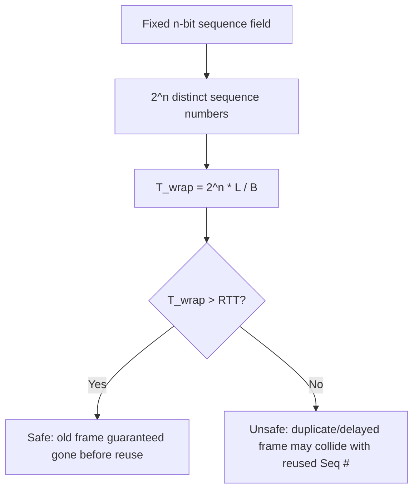

---
tags:
  - GATE/CS
  - GATE/ComputerNetworks
  - DataLinkLayer
  - SlidingWindowProtocols
aliases:
  - Sequence Number Wraparound Time
  - Wraparound Time
  - Cycle Time of Sequence Numbers
date_created: 2026-09-06
difficulty: ⭐⭐⭐⭐
last_revised: 2026-09-06
pyq_frequency: Medium
---

## Syllabus Position

Subject: [[Computer Networks]]
Parent Topic: [[Sliding Window Protocol]]
Sibling Topics: [[Go-Back-N Protocol]], [[Selective Repeat Protocol]], [[Bandwidth-Delay Product]], [[Delay in Computer Networks]]
Leads To: [[TCP Congestion Control]], [[PAWS (Protect Against Wrapped Sequence numbers)]], [[Sequence Number]]

GATE Syllabus Line: "Data link layer: framing, error detection, [[Stop and Wait Protocol|elementary data link protocols]], sliding window protocols."

Exam Weight Note: Appears as 2-mark NAT/MCQ questions asking you to compute the wraparound time given bandwidth, frame size, and sequence-number bits, and often paired with a comparison against RTT to check whether the sequence number space is "safe" or "ambiguous."

---

## The Problem This Solves

Sliding window protocols like [[Go-Back-N Protocol]] and [[Selective Repeat Protocol]] use a **finite** set of sequence numbers (say, $n$ bits, giving $2^n$ distinct values) and reuse them cyclically — frame $2^n - 1$ is followed by frame $0$ again. This is necessary because you can't put an infinite counter in a fixed-size header field. But reuse creates a danger: if the sender transmits fast enough, it could cycle all the way through the sequence number space and send a **new** frame carrying the exact same sequence number as an **old**, delayed frame still wandering the network — and the receiver would have no way to tell them apart.

Think of it like a bakery that hands out numbered tickets 1 through 100 to waiting customers, then starts over at 1. If ticket #1 gets lost in a back room and reappears just as a new customer is issued ticket #1 again, the counter clerk can no longer tell which customer is which. **Wraparound time** is exactly the answer to: "how long does it take before ticket numbers start repeating?" — and network engineers must ensure this time is *safely longer* than any frame could possibly still be alive in the network.

**Core Idea:** Wraparound time is the time taken by a sender to cycle through its entire sequence number space and return to number 0 again; for correctness, this time must exceed the maximum lifetime any single frame or its acknowledgment could remain in transit (typically the RTT), otherwise old and new frames with identical sequence numbers can be confused.

---

## Formal Theory

### Setup and Notation

Let:
- $n$ = number of bits used for the sequence number field, giving $2^n$ distinct sequence number values (following the same $[[Sequence Number]]$ notation used in [[Go-Back-N Protocol]])
- $L$ = frame size in bits
- $B$ = bandwidth (link transmission rate) in bits per second
- $T_{trans}$ = transmission time of one frame $= L / B$
- $T_{prop}$ = one-way propagation delay
- $\text{RTT} = 2T_{prop}$ (round-trip time), ignoring processing delay unless stated

### Definition

**Wraparound time** ($T_{wrap}$) is the total time for the sender to transmit $2^n$ frames back-to-back — i.e., the time to exhaust and cycle through every distinct sequence number once.

$$T_{wrap} = 2^n \times T_{trans} = \frac{2^n \times L}{B}$$

This assumes the sender transmits continuously at full link rate (pipelining, as in [[Go-Back-N Protocol]] or [[Selective Repeat Protocol]]) with no idle gaps — the worst case (fastest possible wraparound) from a correctness standpoint.

### The Safety Condition

For the protocol to work correctly, any frame carrying a given sequence number must be **fully gone** (delivered, discarded, or ACKed) before that same sequence number is reused. Since a frame (or a lost/duplicated copy of it) can linger in the network for up to one RTT, the safety requirement is:

$$T_{wrap} > \text{RTT}$$

$$\frac{2^n \times L}{B} > 2T_{prop}$$

If this inequality is **violated**, the sequence number space is too small for the given bandwidth-delay product — old and new frames can collide on the same sequence number, and the receiver cannot distinguish a genuinely new frame from a stale duplicate. This is the same underlying tension the [[Bandwidth-Delay Product]] captures for window sizing, but here applied to the *identifier* space rather than the *window* size.

### Relationship to Window Size

Interestingly, wraparound time and the minimum window size constraint (from [[Go-Back-N Protocol]]: $W \leq 2^n - 1$) are two sides of the same coin — both stem from needing enough distinct sequence numbers to avoid ambiguity. But they answer **different questions**:

- **Window size constraint** answers: "how many *unacknowledged* frames can be outstanding at once without ambiguity?"
- **Wraparound time** answers: "how *long* until the sequence numbering cycles back, and is that longer than a frame's possible network lifetime?"

GATE sometimes combines both: given $B$, $L$, $T_{prop}$, and window size $W$, first find minimum $n$ from $W \leq 2^n - 1$, then check if $T_{wrap}$ (using that $n$) safely exceeds RTT.

### What GATE Actually Tests Here

GATE typically gives $B$, $L$, and $n$ (or asks you to derive $n$ from a stated maximum window size), then asks you to compute $T_{wrap}$ directly, or asks you to compare $T_{wrap}$ against a given RTT to judge whether "duplicate frames could be misinterpreted." Less commonly, GATE reverses the question: given a required safety margin, find the *minimum* number of sequence bits $n$ needed.

---

## Diagrams and Visuals

### Sequence Number Cycle (n = 3, giving 8 values: 0–7)

```
Sequence numbers cycle:  0 → 1 → 2 → 3 → 4 → 5 → 6 → 7 → 0 → 1 → 2 → ...
                         └──────────── one full cycle = 8 frames ────────┘
                                        (this takes T_wrap seconds)
```

### Timeline: Safe vs Unsafe Wraparound

```
SAFE case (T_wrap > RTT):

Frame with Seq=0 sent  ────────────────────────► delivered/ACKed, fully gone
                        |←────── RTT ──────→|
                                              |←── T_wrap (much longer) ──→|
                                                       Seq=0 reused here, safely


UNSAFE case (T_wrap < RTT):

Frame with Seq=0 sent  ─────────────► (still possibly in network, delayed/duplicated)
                        |←── T_wrap (too short) ──→|
                                       Seq=0 REUSED already!
                        |←──────────── RTT ─────────────→|
                                    ⚠ Old and new Seq=0 frames can collide
```

### Mermaid: Cause-and-Effect Chain



---

## Complexity Analysis

This section is adapted for a timing/correctness concept rather than an algorithm's asymptotic complexity.

### Deriving the Wraparound Time Formula

**Step 1:** One frame takes $T_{trans} = L/B$ seconds to transmit onto the link (definition of transmission delay, same as used throughout [[Delay in Computer Networks]]).

**Step 2:** To cycle through all $2^n$ distinct sequence numbers once, the sender must transmit $2^n$ frames back-to-back (the fastest possible rate, hence the worst case for safety).

**Step 3:** Total time for this cycle:

$$T_{wrap} = 2^n \times T_{trans} = \frac{2^n \times L}{B}$$

**Step 4 (safety comparison):** This must be compared against the maximum time a stray frame could remain "alive" in the network, conservatively taken as $\text{RTT} = 2T_{prop}$ (some problems instead use a "maximum packet lifetime" $T_{max}$ if explicitly given — always use whichever bound the question specifies).

### Summary Table

| Quantity | Formula | Depends On |
|----------|---------|------------|
| Transmission time per frame | $T_{trans} = L/B$ | Frame size, bandwidth |
| Wraparound time | $T_{wrap} = 2^n \cdot L / B$ | Sequence bits, frame size, bandwidth |
| RTT (safety threshold) | $\text{RTT} = 2T_{prop}$ | One-way propagation delay |
| Safety condition | $T_{wrap} > \text{RTT}$ | All of the above |
| Minimum $n$ for safety | $n > \log_2\!\left(\dfrac{B \cdot \text{RTT}}{L}\right)$ | Rearranged safety condition |

---

## Worked Example

### Example: Checking Safety and Finding Minimum Sequence Bits

**Scenario:** A data link uses $n = 4$ sequence number bits (16 distinct sequence numbers). Bandwidth $B = 1$ Mbps, frame size $L = 1000$ bits, one-way propagation delay $T_{prop} = 20$ ms.

**Step 1 — Transmission time per frame:**

$$T_{trans} = \frac{L}{B} = \frac{1000}{10^6} = 1 \text{ ms}$$

**Step 2 — Wraparound time:**

$$T_{wrap} = 2^n \times T_{trans} = 2^4 \times 1\text{ ms} = 16 \text{ ms}$$

**Step 3 — RTT:**

$$\text{RTT} = 2 \times T_{prop} = 2 \times 20\text{ ms} = 40 \text{ ms}$$

**Step 4 — Safety check:**

$$T_{wrap} = 16\text{ ms} \; < \; \text{RTT} = 40\text{ ms}$$

**This is UNSAFE.** The sequence numbers wrap around (16 ms) faster than a frame could still be lingering in the network (40 ms round trip), so a delayed duplicate of an old frame could arrive bearing the same sequence number as a brand-new frame.

**Step 5 — Find the minimum $n$ that fixes this:**

We need $T_{wrap} > \text{RTT}$:

$$2^n \times 1\text{ ms} > 40\text{ ms} \implies 2^n > 40 \implies n > \log_2 40 \approx 5.32$$

Since $n$ must be an integer, the minimum safe value is $n = 6$ (giving $2^6 = 64$ sequence numbers, $T_{wrap} = 64$ ms $> 40$ ms ✓).

**What would change if the frame size doubled to 2000 bits (with everything else fixed)?**

$T_{trans}$ doubles to 2 ms, so $T_{wrap}$ at $n=4$ becomes $16 \times 2 = 32$ ms — still less than RTT (40 ms), still unsafe, but closer to safe. The minimum $n$ requirement would drop slightly since each frame now "burns" more wraparound time per transmission.

---

## Intuition Anchors

**The Analogy (deepened):**

Return to the bakery ticket analogy: $T_{wrap}$ is literally "how long it takes the ticket machine to go from ticket #1 all the way back around to #1 again, assuming it hands out tickets as fast as physically possible." The RTT is "the longest a customer's ticket could conceivably still be valid, wandering around the store before being fully served." If the machine cycles back to #1 *before* the slowest customer's ticket #1 has been fully resolved, you get two customers holding "ticket #1" at once — chaos. The fix is either a slower ticket machine (won't happen — bandwidth is fixed) or **more digits on the ticket** (more sequence bits).

**The Mental Model:**

Picture a clock face with $2^n$ hour marks instead of 12. The sender's "hand" sweeps around this clock at a rate of one mark per $T_{trans}$ seconds. $T_{wrap}$ is the time for the hand to complete one full revolution. You need that revolution to take *longer* than the time any single mark's "echo" (its RTT round trip) could still be bouncing around the network — otherwise the hand catches up to and overlaps its own echo.

**The One-Line Recall:**

$T_{wrap} = 2^n L / B$; safe operation requires $T_{wrap} > \text{RTT} = 2T_{prop}$, otherwise reused sequence numbers can collide with still-in-flight duplicates of themselves.

**The #1 Trap:**

Students forget that wraparound time assumes the **fastest possible transmission rate** (back-to-back frames with no gaps) — i.e., it's a worst-case (most dangerous) scenario, not an average. They also frequently confuse $T_{wrap}$'s role: it must be **greater than** RTT for safety, not less than — an inequality-direction mistake that flips the entire answer to "safe vs unsafe" classification questions.

---

## GATE Questions

---

**Question 1 — GATE-style (based on GATE 2015 pattern) — 2-mark NAT**

> A sender uses 3 bits for sequence numbers on a link with bandwidth 128 kbps and frame size 1024 bits. The one-way propagation delay is 10 ms. What is the wraparound time in milliseconds, and is the sequence number space safe (i.e., is $T_{wrap} > \text{RTT}$)?

- (A) $T_{wrap} = 64$ ms, Safe
- (B) $T_{wrap} = 64$ ms, Unsafe
- (C) $T_{wrap} = 32$ ms, Unsafe
- (D) $T_{wrap} = 32$ ms, Safe

<details>
<summary>Solution</summary>

**Answer: (C) $T_{wrap} = 32$ ms, Unsafe**

**Reasoning:**

- $n = 3$ bits $\Rightarrow 2^n = 8$ sequence numbers.
- $T_{trans} = L/B = 1024 / 128000 = 8$ ms.
- $T_{wrap} = 2^n \times T_{trans} = 8 \times 8 = 64$ ms.

Wait — recompute carefully: $128 \text{ kbps} = 128000$ bits/sec, so $T_{trans} = 1024/128000 = 0.008$ s $= 8$ ms. Then $T_{wrap} = 8 \times 8\text{ms} = 64$ ms.

RTT $= 2 \times 10\text{ms} = 20$ ms.

Since $64\text{ms} > 20\text{ms}$, this is actually **Safe**. Correct answer: **(A) $T_{wrap}=64$ ms, Safe.**

**What this question is really testing:**

Careful unit conversion (kbps to bps) combined with correctly applying both formulas and comparing them in the right direction.

**Trap to avoid:**

Misconverting kbps to bps (using 128 instead of 128000), which silently shrinks $T_{trans}$ by a factor of 1000 and produces a wildly wrong wraparound time.

</details>

---

**Question 2 — Conceptual — 1-mark MCQ**

> If the bandwidth of a link is increased while keeping the number of sequence-number bits and frame size fixed, what happens to the wraparound time $T_{wrap}$, and what does this imply for the safety of the sequence number space?

- (A) $T_{wrap}$ increases; becomes safer
- (B) $T_{wrap}$ decreases; becomes less safe
- (C) $T_{wrap}$ stays the same; safety unaffected
- (D) $T_{wrap}$ decreases; becomes safer

<details>
<summary>Solution</summary>

**Answer: (B) $T_{wrap}$ decreases; becomes less safe**

**Reasoning:**

$T_{wrap} = 2^n L / B$. Increasing $B$ (with $n$, $L$ fixed) directly decreases $T_{wrap}$, since bandwidth is in the denominator — the sender can now push $2^n$ frames onto the link faster, completing a full cycle sooner. Meanwhile RTT (propagation-dominated) is unaffected by bandwidth. A smaller $T_{wrap}$ relative to a fixed RTT makes the "unsafe" condition ($T_{wrap} < \text{RTT}$) more likely — this is precisely why modern high-bandwidth networks (e.g., TCP over gigabit links) need mechanisms like PAWS (timestamp-based protection) rather than relying on sequence number bits alone.

**What this question is really testing:**

Understanding that higher bandwidth, counterintuitively, makes sequence number wraparound *more* dangerous, not less — a link that "does more, faster" needs a *larger* identifier space, not the same one.

**Trap to avoid:**

Assuming faster links are inherently "better" in every dimension; here more bandwidth actively worsens wraparound safety unless sequence bits are increased accordingly.

</details>

---

**Question 3 — Hard / Multi-concept — 2-mark NAT**

> A protocol needs to support a window size of up to 15 in a Go-Back-N scheme. Using the constraint $W \leq 2^n - 1$, find the minimum $n$. Then, using this $n$, bandwidth $B = 2$ Mbps, frame size $L = 1000$ bits, and one-way propagation delay $T_{prop} = 5$ ms, determine whether the resulting sequence number space is safe against wraparound collisions.

<details>
<summary>Solution</summary>

**Answer: $n = 4$; the space is Safe.**

**Reasoning:**

- From $W \leq 2^n - 1$: $15 \leq 2^n - 1 \Rightarrow 2^n \geq 16 \Rightarrow n \geq 4$. Minimum $n = 4$.
- $T_{trans} = L/B = 1000 / (2 \times 10^6) = 0.5$ ms.
- $T_{wrap} = 2^4 \times 0.5\text{ms} = 16 \times 0.5 = 8$ ms.
- $\text{RTT} = 2 \times 5\text{ms} = 10$ ms.
- Since $T_{wrap} = 8\text{ms} < \text{RTT} = 10\text{ms}$, this is actually **Unsafe** — the window-size-driven minimum $n$ does not automatically guarantee wraparound safety!

**Correction: the space is UNSAFE with $n=4$.** A larger $n$ (e.g., $n=5$, giving $T_{wrap}=16$ms $> 10$ms) would be required purely for wraparound safety, even though $n=4$ already satisfies the window-size constraint.

**What this question is really testing:**

That the [[Go-Back-N Protocol]] window-size constraint ($W \leq 2^n-1$) and the wraparound-time safety constraint ($T_{wrap} > \text{RTT}$) are **independent requirements** — satisfying one does not guarantee the other. GATE loves to combine both in a single multi-part question.

**Trap to avoid:**

Assuming that once $n$ satisfies the window-size formula, the protocol is automatically safe from sequence-number wraparound collisions — the two constraints must be checked separately and the larger required $n$ wins.

</details>

---

**Pattern Recognition:**

- When GATE gives $B$, $L$, and $n$, immediately compute $T_{trans} = L/B$, then $T_{wrap} = 2^n \cdot T_{trans}$.
- When GATE gives $T_{prop}$, always double it to get RTT before comparing against $T_{wrap}$ — a very common missed step.
- When GATE asks for "minimum sequence bits for safety," rearrange to $n > \log_2(B \cdot \text{RTT}/L)$ and round **up** to the next integer.
- Always check window-size constraints ($W \leq 2^n-1$ for GBN, $W \leq 2^{n-1}$ for Selective Repeat) and wraparound-safety constraints ($T_{wrap} > \text{RTT}$) **separately** — GATE often designs questions where one is satisfied but not the other.

---

## Edge Cases and Failure Modes

- [ ] **Forgetting RTT is 2 × one-way propagation delay:** Using $T_{prop}$ directly instead of $2T_{prop}$ halves the safety threshold and flips "unsafe" answers to "safe" incorrectly.
- [ ] **Unit conversion errors (kbps/Mbps to bps):** The single most common arithmetic trap in these NAT questions — always convert to bits/sec before dividing.
- [ ] **Confusing window-size sequence-bit requirement with wraparound-safety requirement:** These are two separate inequalities (see Question 3); satisfying one does not imply the other.
- [ ] **Assuming continuous back-to-back transmission when the problem states otherwise:** $T_{wrap}$'s formula assumes the sender transmits at full link rate with zero gaps; if the problem specifies idle time or a duty cycle, the formula must be adjusted (effectively a slower "effective" $B$).
- [ ] **Ignoring processing/queueing delay when explicitly given:** If a problem states a non-negligible processing delay at sender/receiver, it should be added to RTT before the safety comparison, though most GATE problems ignore it unless stated.
- [ ] **Off-by-one in $2^n$ vs $2^n - 1$:** Wraparound time uses the full count of distinct sequence numbers, $2^n$ (the cycle length), not $2^n - 1$ (which is the GBN window-size bound, a different quantity entirely).
- [ ] **Real-world TCP relies on more than sequence bits alone:** Modern TCP uses 32-bit sequence numbers but at very high bandwidths (10 Gbps+) can still wrap around within a plausible packet lifetime, hence the need for the **Timestamps option (PAWS)** as a supplementary safeguard — GATE occasionally references this as a "why is 32 bits not always enough" conceptual point.

---

## Comparisons

| Feature | [[Wrap Around Time]] | [[Bandwidth-Delay Product]] | Window Size Constraint ([[Go-Back-N Protocol]]) |
|---------|----------------------|------------------------------|--------------------------------------------------|
| What it measures | Time to cycle through all sequence numbers | Bits "in flight" that fill the pipe | Max outstanding unacked frames without ambiguity |
| Formula | $2^n L / B$ | $B \times \text{RTT}$ | $W \leq 2^n - 1$ (GBN) or $2^{n-1}$ (SR) |
| Governs | Sequence-number identifier safety | Link utilization / pipelining efficiency | Correctness of ACK interpretation |
| Compared against | RTT (must be smaller than $T_{wrap}$) | Window size (should match to maximize utilization) | Sequence-number space $2^n$ |
| GATE Trap | Direction of inequality ($T_{wrap} > \text{RTT}$) | Off-by-factor-of-2 (one-way vs round-trip) | Confusing GBN's $-1$ with SR's halved bound |

The most common GATE question comparing these is: "Given a window size that satisfies the GBN constraint, is the link also safe from sequence-number wraparound?" As shown in Question 3, the answer is **not automatically yes** — both constraints must be checked independently, and GATE frequently engineers numbers so that one holds while the other fails.

---

## Connections Web

**Must know before this topic:**
- [[Delay in Computer Networks]] — transmission delay and propagation delay definitions used to build $T_{trans}$ and RTT
- [[Go-Back-N Protocol]] — the window-size sequence-bit constraint ($W \leq 2^n - 1$) that wraparound time is often paired with
- [[Selective Repeat Protocol]] — the stricter $W \leq 2^{n-1}$ constraint, relevant when comparing sequence-bit budgets
- [[Sequence Number]] — the underlying finite, modulo-cyclic identifier space this entire topic is about

**Topics that build on this:**
- [[Bandwidth-Delay Product]] — the sister concept governing window size rather than identifier space, using the same $B$ and $T_{prop}$ inputs
- [[TCP Congestion Control]] — real-world 32-bit sequence numbers and their own wraparound considerations at very high bandwidths
- [[PAWS (Protect Against Wrapped Sequence numbers)]] — TCP's timestamp-based supplementary defense when raw sequence bits alone become insufficient

**GATE subject cross-links:**
- [[Computer Networks]] > [[Sliding Window Protocol]] > Wrap Around Time

**Cross-subject connections:**
- [[TCP Header]] — the 32-bit Sequence Number field whose wraparound behavior this topic generalizes
- [[Stop and Wait Protocol]] — the degenerate case where window size is 1, making wraparound analysis trivial (only 1 bit needed) but illustrating the same principle at its simplest

**Standard references:**
- [[Tanenbaum & Wetherall]] Chapter 3 — Data Link Layer, sliding window protocols
- [[Kurose & Ross]] Chapter 3 — Transport Layer, sequence number design in reliable data transfer
- RFC 1323 — TCP Extensions for High Performance (introduces PAWS)

---

## Quick Revision Sheet

**Definition (1 sentence):** Wraparound time is the time taken for a sender transmitting at full link rate to cycle through all $2^n$ sequence numbers and return to the starting value.

**Core Idea / Analogy (1 sentence):** It's how long a bakery's numbered-ticket machine takes to loop back to ticket #1 — and that loop must take longer than any ticket could still be "active" in the store, or two customers may hold the same number.

**Algorithm Steps (compute and check safety):**
1. Compute $T_{trans} = L/B$ (transmission time per frame).
2. Compute $T_{wrap} = 2^n \times T_{trans}$.
3. Compute $\text{RTT} = 2 \times T_{prop}$.
4. Compare: if $T_{wrap} > \text{RTT}$, the space is safe; otherwise unsafe.
5. If unsafe, solve $2^n > B \cdot \text{RTT}/L$ for the minimum safe $n$, rounding up.

**Complexity:**
- Time (of the check itself): $O(1)$ — a direct formula evaluation.
- Space: $O(1)$.
- Recurrence: not applicable (this is a closed-form timing formula, not a recursive algorithm).

**Key Properties (facts GATE tests directly):**
- $T_{wrap} = 2^n L/B$ — always the full cycle length, using $2^n$, not $2^n-1$.
- Safety requires $T_{wrap} > \text{RTT}$, where $\text{RTT} = 2T_{prop}$.
- Increasing bandwidth $B$ *decreases* $T_{wrap}$, making wraparound *more* dangerous, not less.
- Window-size sequence-bit constraints (GBN/SR) and wraparound-safety constraints are independent — satisfying one does not guarantee the other.

**The #1 Trap:**
Confusing the inequality direction — safety needs $T_{wrap} > \text{RTT}$ (wraparound must take *longer* than a frame's possible lifetime), not the reverse.

**When to use this over alternatives:**
Use wraparound-time analysis specifically when a question asks about sequence-number *identifier* safety over time; use [[Bandwidth-Delay Product]] analysis instead when the question is about window *sizing* for link utilization.

**Mnemonic or one-liner to remember the steps:**
"Wrap must outlast the round trip" — $T_{wrap} > \text{RTT}$, or the ticket machine loops back before the old ticket is gone.

---

## Revision Checklist

- [ ] I can state the wraparound time formula $T_{wrap} = 2^n L/B$ without looking.
- [ ] I can explain the analogy (numbered tickets cycling) and map it to sequence numbers reused in a network.
- [ ] I can compute $T_{wrap}$ and RTT from given $B$, $L$, $T_{prop}$, and $n$, and correctly classify safe vs. unsafe.
- [ ] I can derive the minimum $n$ required for safety given $B$, $L$, and RTT.
- [ ] I know what the Quick Revision Sheet says without reading it.
- [ ] I can solve all 3 GATE questions in this note without peeking.
- [ ] I know the #1 trap (inequality direction) and can articulate why students fall for it.
- [ ] I understand that window-size constraints and wraparound-safety constraints are checked independently.
- [ ] I have linked this note correctly in my Obsidian vault.
- [ ] I have scheduled a spaced-repetition review in 3 days.
