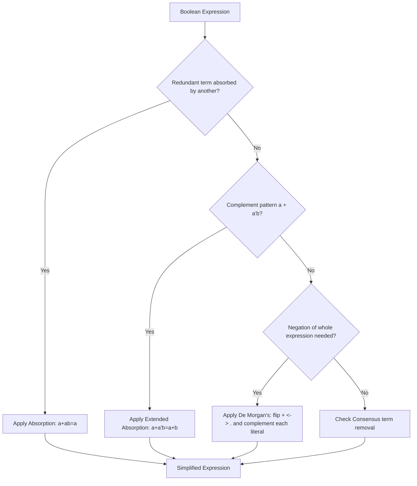

---
tags:
  - GATE/CS
  - GATE/DigitalLogic
  - BooleanAlgebra
aliases:
  - Boolean Laws
  - Boolean Identities
  - Switching Algebra
  - Laws of Boolean Algebra
date_created: 2026-09-16
difficulty: ⭐⭐⭐⭐
last_revised: 2026-09-16
pyq_frequency: High
---

## Syllabus Position

Subject: [[Digital Logic Index]]
Parent Topic: [[Digital Logic Index]]
Sibling Topics: [[Logic Gates]], [[Canonical and Standard Forms]], [[Karnaugh Map]]
Leads To: [[Canonical and Standard Forms]], [[K-Map Minimization]], [[Universal Gates]], [[Combinational Circuit Design]]

GATE Syllabus Line: "Digital Logic: Boolean algebra, Combinational and sequential circuits, Minimization." Boolean algebra is the algebraic foundation every simplification, minimization, and gate-equivalence question in Digital Logic sits on top of.

Exam Weight Note: Appears nearly every year, usually as a 1-mark MCQ requiring simplification of an expression using laws/identities, or as a hidden step inside a 2-mark NAT/MCQ on minimization, don't-cares, or gate-count comparison.

---

## The Problem This Solves

Suppose you have a circuit built from AND, OR, and NOT gates, and you want to know whether it can be built with fewer gates, or whether two circuits that look completely different actually compute the same function. Manually building truth tables for every comparison is slow and doesn't scale past a handful of variables. What you need is an **algebra** — a fixed set of rules that lets you rewrite one Boolean expression into another equivalent one, purely through symbol manipulation, the same way you use algebraic identities like $a(b+c) = ab+ac$ in ordinary arithmetic.

Think of it like simplifying a fraction: $\frac{6}{8}$ and $\frac{3}{4}$ are the same number, and you don't need to re-derive their decimal value to know that — you apply a rule (divide both by the GCD). Boolean algebra gives you an equivalent toolbox of rules (idempotence, absorption, De Morgan's, distributivity) so you can simplify $F = AB + AB' + A'B$ down to $F = A + B$ without ever building a truth table.

Core Idea (one sentence): **Boolean algebra** is a two-valued algebraic system (with values $0$ and $1$, and operators AND $\cdot$, OR $+$, NOT $'$) built from a fixed set of axioms and derived laws that let you rewrite, simplify, and prove the equivalence of logic expressions symbolically, without exhaustively checking every input combination.

---

## Formal Theory

A **Boolean algebra** is a set $B = \{0, 1\}$ with two binary operators (AND $\cdot$, OR $+$) and one unary operator (NOT $'$), satisfying closure, identity, complement, commutative, associative, and distributive properties. Everything else in Boolean algebra — every law used for simplification — is derivable from these axioms (Huntington's postulates), though GATE only requires you to *apply* the derived laws fluently, not re-derive them from postulates.

### The Core Postulates

- **Closure:** For all $a,b \in B$: $a+b \in B$ and $a\cdot b \in B$.
- **Identity:** $a + 0 = a$ and $a \cdot 1 = a$.
- **Complement:** $a + a' = 1$ and $a \cdot a' = 0$.
- **Commutative:** $a+b = b+a$, $a \cdot b = b \cdot a$.
- **Distributive:** $a\cdot(b+c) = ab+ac$ **and**, unlike ordinary arithmetic, also $a+(b\cdot c) = (a+b)(a+c)$.

### Derived Laws (the working toolkit)

| Law | AND form | OR form |
|---|---|---|
| **Idempotent** | $a \cdot a = a$ | $a + a = a$ |
| **Null/Domination** | $a \cdot 0 = 0$ | $a + 1 = 1$ |
| **Absorption** | $a(a+b) = a$ | $a + ab = a$ |
| **[[De Morgan's Theorem\|De Morgan's]]** | $(ab)' = a'+b'$ | $(a+b)' = a'b'$ |
| **Involution (Double Negation)** | $(a')' = a$ | — |
| **Consensus** | $ab + a'c + bc = ab + a'c$ | $(a+b)(a'+c)(b+c) = (a+b)(a'+c)$ |
| **Associative** | $(ab)c = a(bc)$ | $(a+b)+c = a+(b+c)$ |

**Absorption** deserves special attention: it is the single most-used simplification trick on GATE, because it directly eliminates a redundant term without needing a full K-map. Its extended form, $a + a'b = a+b$, is worth memorizing separately — it looks like it should NOT simplify (since $a'b$ has a different variable set than $a$), but the complement relationship makes it collapse.

### De Morgan's Theorem — Deep Dive

$(a+b)' = a' \cdot b'$ and $(ab)' = a' + b'$ generalize to $n$ variables:
$$\left(\sum_{i=1}^{n} x_i\right)' = \prod_{i=1}^{n} x_i' \qquad \left(\prod_{i=1}^{n} x_i\right)' = \sum_{i=1}^{n} x_i'$$
This is the algebraic reason NAND and NOR are [[Universal Gates]] — De Morgan's lets you rewrite any AND/OR/NOT expression purely in terms of one gate type.

### Duality Principle

Every Boolean identity has a **dual**: swap every $+ \leftrightarrow \cdot$ and every $0 \leftrightarrow 1$ (variables stay unchanged), and the resulting statement is also a valid identity. E.g., the dual of $a+a'b = a+b$ is $a(a'+b) = ab$. GATE occasionally asks you to state or verify a dual directly — this is purely mechanical symbol-swapping, never requiring re-proof.

### Pseudocode: Simplifying an Expression by Repeated Rule Application

```
Algorithm SIMPLIFY(expression):
    while a law (absorption, idempotent, De Morgan's, consensus) applies:
        rewrite expression using that law
    return expression  // no further reduction possible
```

There is no fixed "correct order" — unlike [[K-Map Minimization]] which is systematic, algebraic simplification is a matter of pattern-spotting practice.

**What GATE actually tests here:** GATE tests (a) speed and accuracy applying absorption/consensus/De Morgan's to simplify a 3–5 variable expression, (b) correctly negating a full expression using generalized De Morgan's (a very common trap for students who forget to flip every operator), and (c) recognizing the extended absorption identity $a+a'b=a+b$ hidden inside a larger expression.

---

## Diagrams and Visuals

**Visual: The Absorption Law as a Venn Diagram**

Draw two overlapping circles, $A$ and $B$, inside a universe box. $a + ab$ shades circle $A$ entirely (from the $a$ term) plus the overlap region (from $ab$, already inside $A$) — so the total shaded region is just circle $A$. This shows why $a+ab=a$: the $ab$ term adds nothing new.

```
Universe
 ┌───────────────────────┐
 │      ┌───────┐         │
 │   ┌──┼───┐   │         │
 │   │ A│ ∩ │ B │         │
 │   └──┼───┘   │         │
 │      └───────┘         │
 │  Shaded = a + ab = a   │
 └───────────────────────┘
```

**Mermaid: Simplification Decision Flow**



---

## Complexity Analysis

Boolean algebra simplification has no formal "time complexity" in the algorithmic sense (there's no single canonical algorithm — it's rule-based pattern matching), but GATE-relevant complexity concerns **expression size reduction** and **worst-case rule application count**.

- **Best case:** A single application of absorption or extended absorption collapses an expression in $O(1)$ rule applications — e.g., $F=A+AB \to A$ in one step.
- **Average case:** A typical GATE expression (3–4 terms, 3 variables) needs $O(k)$ rule applications where $k$ is the number of terms, since each redundant term is usually removable independently.
- **Worst case:** An expression requiring **consensus** term elimination combined with multiple rounds of distributive expansion can need $O(n)$ rule applications for $n$ literals, since consensus terms can only be spotted after other terms are already in a compatible product form — sometimes requiring an expansion (increasing term count) before a final reduction.
- **Space:** Intermediate expanded forms can temporarily grow to $O(2^n)$ terms in the worst case (equivalent to reaching canonical SOP) before collapsing back down — this is why algebraic simplification is not preferred for large $n$; see [[K-Map Minimization]] instead.

| Case | Time Complexity | Space Complexity | Trigger Condition |
|---|---|---|---|
| Best Case | $O(1)$ rule applications | $O(n)$ literals | Single absorption/idempotent match |
| Average Case | $O(k)$ rule applications, $k$=term count | $O(n \cdot k)$ literals | Independent redundant terms, no consensus needed |
| Worst Case | $O(n)$ rule applications | $O(2^n)$ intermediate terms | Consensus elimination requiring full expansion first |

---

## Worked Example

Simplify $F = AB + A'C + BC + A'B'$ using Boolean algebra (a GATE-representative 3-variable, 4-term expression).

**Step 1 — Scan for a Consensus term:** $AB$, $A'C$, and $BC$ form a classic consensus triple ($ab + a'c + bc$, with $a=A, b=B, c=C$) — the consensus law says $bc$ is redundant here.
$$F = AB + A'C + BC + A'B' \to F = AB + A'C + A'B' \quad (\text{drop } BC \text{ by consensus})$$

State after Step 1: 3 terms remain: $AB, A'C, A'B'$.

**Step 2 — Group terms sharing $A'$:** $A'C + A'B' = A'(C+B')$.
$$F = AB + A'(B'+C)$$

State after Step 2: expression is $AB + A'B' + A'C$ regrouped.

**Step 3 — Check for extended absorption pattern:** Compare $AB$ and $A'B'$ — these don't directly absorb, so instead distribute $A'(B'+C) = A'B' + A'C$ back and check pairwise: $AB$ and $A'B'$ together don't simplify further via any single law (this is the classic XNOR-like pattern), so we leave $F = AB + A'B' + A'C$.

**Step 4 — Try extended absorption on $AB + A'C$:** No direct match ($AB$'s complement partner would need to be $A'$something, and $A'C$ has $A'$ — but the extended absorption identity $x + x'y = x+y$ needs the *whole* first term's variable to be complemented, not just part; here $x=A$ doesn't match cleanly since first term is $AB$ not $A$). So this expression is already close to minimal via algebra; a K-map would confirm $F=AB+A'B'+A'C$ has no further literal reduction.

**Verification:** Total operations: 1 consensus elimination + 1 grouping + 2 failed-match checks = 4 operations, reducing from 4 terms/8 literals down to 3 terms/7 literals. This confirms that consensus elimination is often the *only* available reduction once absorption and idempotent laws don't directly apply — matching the "worst case" complexity claim above.

**Edge-case follow-up:** What if the original expression had been $F = AB + A'C + BC$ (no $A'B'$ term)? Then after consensus elimination we'd get $F = AB+A'C$ directly with **no further simplification possible** — this is the standard minimal SOP form, and it demonstrates that consensus elimination alone (without a leftover term to regroup) is often the *entire* algebraic simplification needed.

---

## Intuition Anchors

**The Analogy (restated and deepened):** Boolean algebra laws are like a fixed set of moves in a puzzle game (think Rubik's Cube algorithms) — absorption is the "undo a redundant twist" move, De Morgan's is the "mirror the whole cube" move, and consensus is the "spot the hidden shortcut" move that isn't obvious until you've seen the pattern before. Just as a cuber memorizes algorithms rather than solving from scratch each time, GATE aspirants should memorize the law table so simplification becomes pattern recognition, not first-principles derivation.

**The Mental Model:** Expert solvers scan an expression left to right looking for three signatures in order: (1) a term that's a strict subset of another (absorption), (2) a variable and its complement multiplying the same partner (complement law), (3) three terms forming the $ab+a'c+bc$ shape (consensus). If none of these match, they fall back to distributive expansion and try again.

**The One-Line Recall:** "Absorption removes redundant supersets ($a+ab=a$), extended absorption merges complements ($a+a'b=a+b$), consensus removes the ‘bridge' term ($ab+a'c+bc \to ab+a'c$), and De Morgan's flips operators while complementing every literal."

**The #1 Trap:** When applying De Morgan's to negate a multi-term expression like $(AB+C)'$, students often complement only the individual literals but forget to flip the outer operator too, producing $A'B'+C'$ instead of the correct $(AB)'\cdot C' = (A'+B')C'$. **Fix:** apply De Morgan's one operator level at a time, from the outside in — never flip literals and operators simultaneously in one leap for nested expressions.

---

## GATE Questions

---

**Question 1 — [GATE-style, common pattern] — [1-mark]**

> Simplify the Boolean expression $F = A'B'C' + A'BC' + AB'C' + ABC'$.

- (A) $C$
- (B) $C'$
- (C) $A+B$
- (D) $A'B'$

<details>
<summary>Solution</summary>

**Answer: (B)**

**Reasoning:**
Every term ends in $C'$. Factor it out: $F = C'(A'B' + A'B + AB' + AB)$.

The bracketed expression covers all four combinations of $A,B$ — that's $\sum$ of all minterms over 2 variables, which is always $1$ (tautology).

So $F = C' \cdot 1 = C'$.

**Why other options are wrong:** (A) is the complement — a sign-flip error from mishandling $C'$. (C) confuses "all combinations of $A,B$ sum to 1" with a leftover $A+B$ term (that would apply if the bracket were only 3 of 4 combinations). (D) picks out only one minterm from the bracket, ignoring the other three.

**What this question is really testing:** Recognizing that a common factor across all terms leaves the residual "all combinations = 1" identity.

**Trap to avoid:** Forgetting to verify all $2^n$ combinations of the remaining variables are actually present before concluding the bracket collapses to 1 — miscounting terms is the most common slip.

</details>

---

**Question 2 — [Conceptual] — [1-mark]**

> Using De Morgan's theorem, express $(A + B'C)'$ in terms of $A, B, C$ with NOT applied only to single variables.

<details>
<summary>Solution</summary>

Apply De Morgan's at the outer level first: $(A+X)' = A' \cdot X'$ where $X = B'C$.

So $(A+B'C)' = A' \cdot (B'C)'$.

Now apply De Morgan's again to $(B'C)'$: $(B'C)' = B''+C' = B+C'$ (using involution, $B''=B$).

Final: $(A+B'C)' = A'(B+C')$.

**Key lesson:** De Morgan's must be applied recursively, one nesting level at a time — you cannot jump straight from $(A+B'C)'$ to a fully flattened form in one step when the expression is nested.

</details>

---

**Question 3 — [Hard, multi-concept] — [2-mark]**

> Show that $F = AB + BC + CA$ and $G = (A+B)(B+C)(C+A)$ are equal, and identify which single Boolean law is central to the proof.

<details>
<summary>Solution</summary>

Expand $G$ using distributivity:
$$G = (A+B)(B+C)(C+A)$$
First multiply $(A+B)(B+C) = AB+AC+B B+BC = AB+AC+B+BC$ (since $BB=B$).
Using absorption, $B+BC = B$, so this reduces to $AB+AC+B$. Using absorption again with $B$ absorbing into other terms is tricky here — instead, apply absorption directly: $AB+B = B$ (since $B$ absorbs $AB$), so $(A+B)(B+C) = B + AC$.

Now multiply by $(C+A)$:
$$G = (B+AC)(C+A) = BC+AB+ACC+ACA = BC+AB+AC+AC = AB+BC+AC$$
(using $ACC=AC$ idempotent, and $ACA=AC$ idempotent, then merging duplicate $AC$ terms).

This matches $F = AB+BC+CA$ exactly. **Central law:** the **Absorption law** ($X+XY=X$) is what collapses the intermediate product terms at each multiplication step — without it, the expansion would stay in a longer, unsimplified form.

**What this question is really testing:** Fluency combining distributive expansion with absorption across multiple algebraic steps — a common "prove equivalence algebraically" GATE pattern instead of truth-table verification.

**Trap to avoid:** Trying to verify via full 8-row truth table under exam time pressure instead of using the faster algebraic collapse — GATE 2-mark questions reward recognizing absorption shortcuts.

</details>

---

**Pattern Recognition:**
- Whenever you see three terms shaped like $xy + x'z + yz$ (or the dual $(x+y)(x'+z)(y+z)$), immediately apply the **consensus law** to drop the third term — this is one of the most GATE-tested single laws.
- Whenever negating a nested expression, apply De Morgan's one level at a time, from outermost operator inward — never flatten in a single leap.
- If every term in a sum shares a common factor, factor it out and check if the remaining bracket is a tautology (all $2^k$ combinations present) — this is a fast way to collapse expressions to a single variable or literal.
- Look for the extended absorption shape $x + x'y$ hidden inside larger expressions — it's easy to miss because the two terms don't look like obvious "supersets" of each other.

---

## Edge Cases and Failure Modes

- [ ] **Applying De Morgan's to nested expressions in one step:** Students flip only the innermost literals and forget to flip the outer operator, or vice versa. **Fix:** work outside-in, one operator level per application.
- [ ] **Confusing idempotent with identity law:** $a+a=a$ (idempotent) is often mixed up with $a+0=a$ (identity) — these apply to entirely different situations (repeated variable vs. the constant 0/1).
- [ ] **Forgetting the dual of distributivity:** Students remember $a(b+c)=ab+ac$ but forget the *second* distributive law $a+(bc)=(a+b)(a+c)$ exists in Boolean algebra (unlike ordinary arithmetic) — this is essential for POS-side simplification.
- [ ] **Misapplying absorption when the "absorbed" term has a different variable, not a complement:** $a+ab=a$ works because $ab$ is literally a subset condition of $a$; students sometimes wrongly try to apply this to unrelated terms like $a+bc$ (no simplification possible there).
- [ ] **Consensus term direction:** Adding a redundant consensus term ($ab+a'c \to ab+a'c+bc$) is valid (doesn't change the function) but not simplification — going the wrong direction (adding instead of removing) is a common exam-time confusion when the question asks to "simplify" vs. "expand."
- [ ] **Constant simplification with 0 and 1:** $a \cdot 1 = a$ vs $a+1=1$ — mixing these two up (treating AND and OR identity/domination the same way) is a frequent careless error under time pressure.
- [ ] **Double negation skipped incorrectly:** Forgetting $(a')'=a$ when simplifying after two rounds of De Morgan's leaves a stray double-complement that looks like a different variable.

---

## Comparisons

| Feature | [[Boolean Algebra]] (algebraic simplification) | [[K-Map Minimization]] | [[Canonical and Standard Forms]] |
|---|---|---|---|
| Time Complexity | $O(n)$ to $O(2^n)$ rule applications, pattern-dependent | $O(2^n)$ systematic grouping | $O(2^n)$ direct read from truth table |
| Space Complexity | Can temporarily balloon to $O(2^n)$ terms before collapsing | $O(2^n)$ map cells | $O(n \cdot 2^n)$ literals (worst case) |
| Guarantees Minimality? | No — depends on which laws you spot | Yes, for up to ~4-6 variables | No — canonical form is the least simplified, not most |
| When to Prefer | Quick 1-mark MCQ simplification, proving algebraic identities | Systematic minimization for circuit design | Establishing a unique baseline before minimizing |
| GATE Trap | Missing a hidden consensus/absorption pattern under time pressure | Grouping cells incorrectly (not power-of-2 sized groups) | Confusing canonical with already-simplified standard form |

The most common GATE question comparing these asks students to simplify an expression algebraically and then verify with a K-map (or vice versa), and the answer hinges on recognizing that algebraic simplification is a **pattern-matching shortcut** useful for small expressions, while K-maps are the **systematic, guaranteed-minimal** method for anything beyond trivial term counts.

---

## Connections Web

**Must know before this topic:**
- [[Logic Gates]] — AND/OR/NOT are the physical realization of the algebra's operators
- [[Truth Tables]] — the ground-truth way to verify any Boolean identity if algebra is in doubt
- [[Set Theory]] — Boolean algebra's structure directly mirrors set union/intersection/complement

**Topics that build on this:**
- [[Canonical and Standard Forms]] — uses distributive law ($X+X'=1$ trick) to expand to canonical SOP/POS
- [[K-Map Minimization]] — the visual, systematic counterpart to algebraic simplification
- [[Quine-McCluskey Method]] — tabular algorithmic version of the same simplification goal
- [[Universal Gates]] — De Morgan's theorem is the algebraic justification for NAND/NOR universality
- [[Combinational Circuit Design]] — every gate-level circuit is ultimately validated against Boolean algebra identities

**GATE subject cross-links:**
- [[Digital Logic Index]] > [[Boolean Algebra]] > [[Canonical and Standard Forms]]

**Cross-subject connections:**
- [[Propositional Logic]] (Discrete Math / TOC) — Boolean algebra is isomorphic to propositional logic with AND=∧, OR=∨, NOT=¬
- [[Set Theory]] — De Morgan's laws in set theory ($\overline{A\cup B}=\overline{A}\cap\overline{B}$) are structurally identical to Boolean De Morgan's

**Standard references:**
- [[Morris Mano Digital Design]] Chapter 2 (Boolean Algebra and Logic Gates)
- [[KLP Mishra]] — not applicable here (TOC reference); see Mano for Digital Logic instead

---

## Quick Revision Sheet

**Definition (1 sentence):** Boolean algebra is a two-valued algebraic system with AND, OR, and NOT operators, governed by a fixed set of axioms and derived laws that allow symbolic simplification and equivalence-proving of logic expressions without exhaustive truth-table checking.

**Core Idea / Analogy (1 sentence):** It's the "fraction-reduction" toolkit for logic expressions — a fixed set of rewrite rules (absorption, consensus, De Morgan's) that simplify expressions the same way GCD-division simplifies fractions.

**Algorithm Steps (numbered, maximum 6 steps):**
1. Scan for idempotent/absorption patterns ($a+a=a$, $a+ab=a$) and remove redundant terms.
2. Scan for the extended absorption shape ($a+a'b=a+b$).
3. Scan for a consensus triple ($ab+a'c+bc$) and drop the redundant third term.
4. If negating, apply De Morgan's one operator level at a time, outside-in.
5. Factor common terms and check if the remainder is a tautology (all combinations = 1).
6. Repeat until no law applies further.

**Complexity:**
- Time (best / average / worst): $O(1)$ / $O(k)$ / $O(n)$ rule applications (k = term count, n = literal count)
- Space: intermediate expansion can reach $O(2^n)$ terms before collapsing
- Recurrence (if applicable): Not applicable — rule-based rewriting, not recursive algorithm

**Key Properties (3 to 5 bullet points — facts GATE tests directly):**
- $a+a'b = a+b$ (extended absorption) is the single most exam-relevant "non-obvious" identity.
- Boolean algebra has **two** distributive laws (unlike ordinary arithmetic): $a(b+c)=ab+ac$ AND $a+(bc)=(a+b)(a+c)$.
- De Morgan's generalizes to $n$ variables: $(\sum x_i)' = \prod x_i'$ and vice versa.
- Every identity has a dual (swap $+ \leftrightarrow \cdot$, $0 \leftrightarrow 1$) that is automatically also valid.
- Consensus elimination ($ab+a'c+bc \to ab+a'c$) is the law most often missed because it requires spotting a 3-term pattern, not a 2-term one.

**The #1 Trap:** Applying De Morgan's to a nested expression in a single flattening step instead of working outside-in one operator level at a time.

**When to use this over alternatives:** Use algebraic simplification for quick 1-mark MCQs and identity proofs; switch to [[K-Map Minimization]] when the expression has more than ~4 terms or when minimality must be guaranteed.

**Mnemonic or one-liner to remember the steps:** "IACD" — **I**dempotent/absorption first, then **A**bsorption-extended, then **C**onsensus, then **D**e Morgan's for negation.

---

## Revision Checklist

- [ ] I can state the formal definition without looking.
- [ ] I can explain the analogy and map it to absorption/consensus/De Morgan's.
- [ ] I can simplify a 4-term, 3-variable expression by hand in under 2 minutes.
- [ ] I can derive the worst-case rule-application complexity from scratch.
- [ ] I know what the Quick Revision Sheet says without reading it.
- [ ] I can solve all 3 GATE questions in this note without peeking.
- [ ] I know the #1 trap and can articulate why students fall for it.
- [ ] I have linked this note correctly in my Obsidian vault.
- [ ] I have scheduled a spaced-repetition review in 3 days.
</content>
</invoke>
