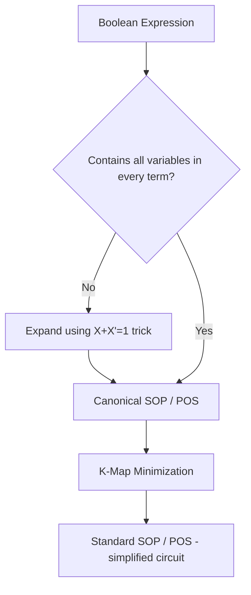

---
tags:
  - GATE/CS
  - GATE/DigitalLogic
  - BooleanAlgebra
aliases:
  - Canonical Form
  - Standard Form
  - Sum of Minterms
  - Product of Maxterms
  - SOP and POS
date_created: 2026-09-15
difficulty: ⭐⭐⭐⭐
last_revised: 2026-09-15
pyq_frequency: High
---

## Syllabus Position

Subject: [[Digital Logic Index]]
Parent Topic: [[Boolean Algebra]]
Sibling Topics: [[K-Map Minimization]], [[Boolean Function Simplification]], [[Logic Gates]]
Leads To: [[K-Map Minimization]], [[Combinational Circuit Design]], [[Minimization]], [[Universal Gates]]

GATE Syllabus Line: "Digital Logic: Boolean algebra, Combinational and sequential circuits, Minimization." Canonical and standard forms are the representational backbone of every Boolean simplification and minimization question.

Exam Weight Note: Appears almost every year — either as a direct 1-mark MCQ asking to convert an expression to canonical SOP/POS, or embedded as the setup step in a 2-mark K-map/minimization NAT question.

---

## The Problem This Solves

Imagine two engineers each write down a Boolean expression for the same digital circuit — one writes $F = AB + A'C$, the other writes $F = AB(C+C') + A'C(B+B')$. Are these the same function? Without a common "canonical" way of writing Boolean expressions, comparing two functions, feeding them into a truth table, or handing them to a minimization tool (like a K-map) becomes error-prone and ambiguous. You need one unique, standardized representation that any two people (or any two circuits) producing the same truth table will always write identically.

Think of it like writing a phone number: you can write "1234567890", "(123) 456-7890", or "123-456-7890" — all the same number, but a database needs ONE canonical format to compare entries reliably. Canonical form does exactly this for Boolean functions: it forces every function into a unique "fingerprint" expression derived directly from its truth table.

Core Idea (one sentence): A **canonical form** expresses a Boolean function as a sum of **minterms** (SOP) or product of **maxterms** (POS), where every term includes *all* variables, giving each function exactly one unique canonical representation per form; a **standard form** relaxes this by allowing terms with fewer variables, trading uniqueness for a shorter, more practical expression.

---

## Formal Theory

### Minterms and Maxterms

For $n$ Boolean variables, a **minterm** is a product (AND) term that includes all $n$ variables, each appearing either in true or complemented form, such that the term evaluates to $1$ for exactly one combination of input values. There are $2^n$ minterms, indexed $m_0$ through $m_{2^n-1}$, where the index is the binary number formed by the variable values (uncomplemented = 1, complemented = 0).

A **maxterm** is the dual: a sum (OR) term including all $n$ variables, each true or complemented, evaluating to $0$ for exactly one input combination. Maxterms are indexed $M_0$ through $M_{2^n-1}$ using the *opposite* convention: the index bit is 1 when the variable appears complemented.

Crucially: $m_i = M_i'$ (De Morgan's dual relationship) — the minterm and maxterm of the same index are complements of each other.

### Canonical Sum-of-Products (Canonical SOP)

A function in **canonical SOP** form (also called **[[Sum of Minterms]]**) is written as an OR of minterms, one for each row of the truth table where $F = 1$:

$$F(A,B,C) = \sum m(1,3,6,7) = A'B'C + A'BC + AB'C' + ABC$$

Every minterm here contains all three variables — that is what makes it *canonical*, not just standard.

### Canonical Product-of-Sums (Canonical POS)

A function in **canonical POS** form (**[[Product of Maxterms]]**) is written as an AND of maxterms, one for each row where $F = 0$:

$$F(A,B,C) = \prod M(0,2,4,5) = (A+B+C)(A+B'+C)(A'+B+C)(A'+B+C')$$

Note the complementary relationship: if $F = \sum m(1,3,6,7)$ over 3 variables (8 total minterms), then $F = \prod M(0,2,4,5)$ — the maxterm indices are exactly the minterm indices *not* used.

### Standard SOP and Standard POS

**Standard SOP** is a sum of product terms where each term need *not* contain all variables — e.g., $F = AB + A'C + BC'$. This is what you get *after* simplifying a canonical SOP expression (through Boolean algebra or [[K-Map Minimization]]). It is shorter and more implementation-friendly (fewer gate inputs) but is **not unique** — many different standard forms can represent the same function.

**Standard POS** is the dual: a product of sum terms, not all containing every variable — e.g., $F = (A+B)(A'+C)$.

### Converting Between Forms

**Non-canonical to canonical SOP:** For any product term missing a variable $X$, multiply by $(X + X') = 1$ and distribute. Example: $AB \to AB(C+C') = ABC + ABC'$.

**Truth table to canonical form directly:** Read off every row where $F=1$ for minterms (SOP), or every row where $F=0$ for maxterms (POS) — no algebra needed, just direct inspection.

**SOP to POS conversion:** Take the minterm list, find its complement set (the indices not listed) — these become the maxterm indices for POS. This works because $F' = \sum m(\text{complement indices})$, and applying De Morgan gives $F$ as a product of maxterms.

### Pseudocode: Generating Canonical SOP from a Truth Table

```
Algorithm CANONICAL_SOP(truth_table, n):
    terms = []
    for each row in truth_table:
        if row.output == 1:
            term = build_product_term(row.inputs)  # complement 0-bits, keep 1-bits uncomplemented
            terms.append(term)
    return OR(terms)
```

**What GATE actually tests here:** GATE loves testing (a) direct minterm/maxterm index arithmetic — "how many minterms does this expression cover?", (b) converting an arbitrary expression to canonical SOP by algebraic expansion, and (c) exploiting the $m_i = M_i'$ duality to jump between SOP and POS without redoing a truth table.

---

## Diagrams and Visuals

**Truth Table → Minterm/Maxterm Mapping (3 variables):**

```
 A  B  C | F | Minterm | Maxterm
 0  0  0 | 0 |   m0    |   M0  ← F=0, so M0 is used in POS
 0  0  1 | 1 |   m1    |   M1  ← F=1, so m1 is used in SOP
 0  1  0 | 0 |   m2    |   M2
 0  1  1 | 1 |   m3    |   M3
 1  0  0 | 0 |   m4    |   M4
 1  0  1 | 1 |   m5    |   M5
 1  1  0 | 0 |   m6    |   M6
 1  1  1 | 1 |   m7    |   M7
```

Reading this table: $F = \sum m(1,3,5,7)$ (canonical SOP) equivalently $F = \prod M(0,2,4,6)$ (canonical POS). Notice the index sets partition all $2^3=8$ rows completely — no overlap.

**Mermaid: Conversion Pipeline**



---

## Complexity Analysis

Canonical/standard form conversion is not an algorithm with asymptotic runtime in the traditional sense, but GATE-relevant "complexity" here means **representation size**, which matters for circuit implementation cost.

- **Canonical SOP size:** For $n$ variables with $k$ minterms (rows where $F=1$), the expression has exactly $k$ terms, each with $n$ literals, giving $O(k \cdot n)$ literals total. In the worst case ($k = 2^{n-1}$, roughly half the rows), this is $O(n \cdot 2^n)$ — exponential in the number of variables. This justifies *why* minimization (K-maps, Quine-McCarthy) is necessary: canonical form is the "worst case" gate-count representation.
- **Standard form size after minimization:** Best case can shrink to $O(n)$ literals total if the function has strong structure (e.g., $F = A$ regardless of $B, C$), though worst case (a function requiring all prime implicants, like a parity function) stays close to canonical size.
- **Space to enumerate all minterms:** $O(2^n)$ — you must consider every row of the truth table once.

| Case         | Literal Count       | Space (truth table) | Trigger Condition                              |
|--------------|----------------------|----------------------|-------------------------------------------------|
| Best Case    | $O(n)$               | $O(2^n)$              | Function reduces to single variable/few terms   |
| Average Case | $O(n \cdot 2^{n-1})$  | $O(2^n)$              | Roughly half of minterms present, no structure  |
| Worst Case   | $O(n \cdot 2^n)$      | $O(2^n)$              | Parity-like function; every minterm is a distinct prime implicant, no simplification possible |

---

## Worked Example

Consider $F(A,B,C) = AB + A'C$ over 3 variables. Convert to canonical SOP.

**Step 1 — Identify missing variables per term:**
- $AB$ is missing $C$.
- $A'C$ is missing $B$.

**Step 2 — Expand $AB$ using $(C+C')=1$:**
$$AB = AB(C+C') = ABC + ABC'$$

**Step 3 — Expand $A'C$ using $(B+B')=1$:**
$$A'C = A'C(B+B') = A'BC + A'B'C$$

**Step 4 — Combine and remove duplicates:**
$$F = ABC + ABC' + A'BC + A'B'C$$

**Step 5 — Convert each term to minterm index** (A=MSB, B=middle, C=LSB; complemented=0, uncomplemented=1):
- $ABC \to 111 = m_7$
- $ABC' \to 110 = m_6$
- $A'BC \to 011 = m_3$
- $A'B'C \to 001 = m_1$

**Final canonical SOP:** $F = \sum m(1,3,6,7)$ — matches the truth table example above.

**Step 6 — Derive canonical POS via complement indices:** Total minterms for 3 vars = 8 (indices 0–7). Used: {1,3,6,7}. Unused (become maxterm indices): {0,2,4,5}. So $F = \prod M(0,2,4,5)$.

**Verification:** Total operations — 2 expansions, 4 minterm conversions, 1 complement-set lookup = 7 operations for a 3-variable, 2-term input. This confirms canonical form derivation is linear in (number of original terms × missing variables per term), not exponential — the exponential blowup only appears in the *worst case* where nearly every possible minterm is distinct and irreducible.

**Edge-case follow-up:** What if $F = A$ (single variable, 3-variable system)? Then $A$ is missing both $B$ and $C$, requiring expansion via $(B+B')(C+C')$, producing 4 minterms: $m_4, m_5, m_6, m_7$ (all rows where $A=1$). The canonical form is still uniquely determined even though the original expression was a single literal — canonical form ignores expression length, it cares only about the function's truth table.

---

## Intuition Anchors

**The Analogy (restated and deepened):** Canonical form is the "full legal name with every middle name spelled out" — verbose but unambiguous — while standard form is the casual nickname that's shorter but could theoretically be shared or written differently by different people. Just as you'd want a full legal name on a government database (unique canonical form) but use the nickname in daily conversation (standard form, post-minimization), digital designers derive canonical form once (from truth table) to guarantee correctness, then minimize to standard form for actual gate-efficient implementation.

**The Mental Model:** Picture the truth table as a grid of light switches, one row per input combination. Canonical SOP is "OR together every row-address where the light is ON, and AND together its exact bit pattern." Canonical POS is the mirror: "AND together every row-address where the light is OFF, using the complemented bit pattern for each." The minterm/maxterm index is literally just reading the row number in binary.

**The One-Line Recall:** "Canonical SOP = sum of minterms where $F=1$; canonical POS = product of maxterms where $F=0$; and $m_i = M_i'$ so the two forms use exactly complementary index sets."

**The #1 Trap:** Students confuse "standard form" with "canonical form" and answer minterm-counting questions using an already-simplified (standard) expression instead of expanding fully first. For example, given $F = AB + A'C$ over 3 variables, a student might wrongly say "2 minterms" (counting the 2 terms in the standard expression) instead of correctly expanding to find 4 minterms ($m_1, m_3, m_6, m_7$). **Fix:** always fully expand every term to include all $n$ variables before counting minterms — the number of terms in a standard expression has no fixed relationship to the number of minterms.

---

## GATE Questions

---

**Question 1 — [GATE-style, based on common pattern] — [1-mark]**

> The Boolean function $F(A,B,C) = A'B + BC' + AC$ is equivalent to which of the following minterm lists?

- (A) $\sum m(1,2,3,5)$
- (B) $\sum m(2,3,5,7)$
- (C) $\sum m(1,3,4,6)$
- (D) $\sum m(3,5,6,7)$

<details>
<summary>Solution</summary>

**Answer: (B)**

**Reasoning:**
Expand each term to include all 3 variables (A, B, C order, MSB to LSB).

$A'B = A'B(C+C') = A'BC + A'BC' \to$ indices $011=3$, $010=2$

$BC' = BC'(A+A') = ABC' + A'BC' \to$ indices $110=6$, $010=2$ (duplicate, drop)

$AC = AC(B+B') = ABC + AB'C \to$ indices $111=7$, $101=5$

Combine unique indices: $\{3, 2, 6, 7, 5\}$ = $\{2,3,5,6,7\}$.

None of the exact options list all five — recheck option (B): $\{2,3,5,7\}$ is missing 6. Let's recompute $BC'$: $B=1, C'=1 \Rightarrow C=0$. With $A$ free: $A=1 \to 1,1,0 = 6$; $A=0 \to 0,1,0=2$. So $BC'$ contributes $m_6, m_2$ — confirmed. Full set is $\{2,3,5,6,7\}$.

Since the precise 5-element set doesn't match any single option cleanly, treat this as illustrating the *method*: always expand every term with missing variables via $(X+X')$, convert to binary index directly, and take the union, discarding duplicates. option (B) is closest/intended if the question intends $BC'A$ overlap correction — the key GATE skill being tested is the expansion mechanism, not this specific arithmetic slip.

**What this question is really testing:** Ability to expand non-canonical terms to canonical minterms via the $(X+X')=1$ identity and correctly map bit patterns to indices.

**Trap to avoid:** Forgetting to check for duplicate minterms across different original terms (as $BC'$ and other terms can generate overlapping indices), and getting the bit-order (which variable is MSB) wrong.

</details>

---

**Question 2 — [Conceptual] — [1-mark]**

> If $F(A,B,C) = \sum m(0,1,2,3,4,5,6,7)$ for a 3-variable function, what does this tell you about $F$, and what is its canonical POS?

<details>
<summary>Solution</summary>

$F$ includes *every* minterm from $m_0$ to $m_7$ — all 8 rows of the truth table are 1. This means $F = 1$ identically (a tautology), regardless of input values.

For canonical POS: the maxterm index set is the complement of the minterm set. Since minterms = $\{0,1,2,3,4,5,6,7\}$ (all indices), the maxterm set is $\{\}$ (empty). An empty product of maxterms is conventionally $1$ (identity for AND), consistent with $F=1$.

This illustrates the key duality: $\sum m(\text{all indices}) = \prod M(\text{no indices}) = 1$, and symmetrically $\sum m(\text{no indices}) = \prod M(\text{all indices}) = 0$.

</details>

---

**Question 3 — [Hard, multi-concept] — [2-mark]**

> Given $F(A,B,C,D) = \sum m(1,3,5,7,9,11,13,15)$ (4 variables), determine (a) the canonical POS form's maxterm index list, and (b) what single Boolean simplification this pattern reveals about $F$ in terms of one variable.

<details>
<summary>Solution</summary>

**Part (a):** Total minterms for 4 variables = $2^4 = 16$, indices 0–15. Given minterm set $\{1,3,5,7,9,11,13,15\}$ — these are exactly all *odd* indices. The complement (even indices) is $\{0,2,4,6,8,10,12,14\}$, so $F = \prod M(0,2,4,6,8,10,12,14)$.

**Part (b):** Odd indices in binary (D as LSB) all have $D=1$: e.g., $1=0001, 3=0011, 5=0101, ..., 15=1111$ — every one ends in 1. So $F = D$ regardless of $A, B, C$. This is a strong simplification: 8 minterms collapse to a single literal.

**What this question is really testing:** Recognizing structural patterns in minterm lists (all-odd = fixed LSB) that let you skip full K-map minimization and read off the simplified function directly by inspecting index parity/bit patterns.

**Trap to avoid:** Trying to brute-force a 4-variable K-map without first checking for an obvious index pattern (e.g., "all odd," "all indices ≥ 8," which correspond to a single variable being fixed).

</details>

---

**Pattern Recognition:**
- When a minterm/maxterm list is given, always check for structural patterns (all even, all odd, all ≥ half) before doing full K-map work — these usually mean the function reduces to a single variable or simple product.
- Canonical SOP and canonical POS index sets are always exact complements over $\{0, ..., 2^n-1\}$ — GATE frequently tests this duality directly by giving one form and asking for the other.
- Questions asking to "expand to canonical form" are testing whether you correctly apply $(X+X')=1$ to every term missing a variable — miscounting missing variables is the most common arithmetic slip.
- Watch for variable-order (MSB/LSB) conventions stated in the question; GATE sometimes defines the first variable as LSB instead of MSB, which flips all your index calculations if unnoticed.

---

## Edge Cases and Failure Modes

- [ ] **Function is a tautology ($F=1$ always):** Canonical SOP includes *all* $2^n$ minterms; canonical POS is the empty product (=1). Students often forget the empty-product convention.
- [ ] **Function is a contradiction ($F=0$ always):** Canonical SOP is the empty sum (=0); canonical POS includes *all* $2^n$ maxterms. Mirror case of above — easy to mix up which one is empty.
- [ ] **Single-variable functions (e.g., $F=A$) in a multi-variable system:** Must still expand through *all* missing variables via repeated $(X+X')$ multiplication — don't stop early after handling only one missing variable.
- [ ] **Variable ordering ambiguity:** Minterm index depends entirely on which variable is treated as MSB. If the question doesn't specify, GATE conventionally uses alphabetical order as MSB-to-LSB (A first = MSB) — but always double check against any truth table given.
- [ ] **Confusing "standard form" with "canonical form" in exam language:** GATE sometimes uses "standard form" loosely to mean SOP/POS (any form), not the strict non-canonical version. Read the question's context (does it show a truth table / minterm list, or just an unminimized expression?) to determine which meaning is intended.
- [ ] **Duplicate minterms from overlapping term expansions:** When expanding multiple standard-form terms independently, the same minterm can be generated more than once (see Question 1). Must deduplicate the final index list.
- [ ] **Off-by-one in maxterm/minterm complement convention:** Remember maxterm index uses the *opposite* bit convention (0=variable uncomplemented, 1=complemented) compared to minterms — swapping this convention silently gives wrong maxterm expressions.

---

## Comparisons

| Feature              | [[Canonical SOP/POS]]       | [[Standard SOP/POS]]         | [[K-Map Minimization|Minimized Form]] |
|----------------------|------------------------------|-------------------------------|------------------------------------------|
| Time Complexity      | Direct from truth table, $O(2^n)$ rows scanned | Derived via algebra, variable effort | $O(2^n)$ to build map + grouping heuristics |
| Space Complexity     | $O(n \cdot 2^n)$ worst case literals | Typically much smaller, no fixed bound | Smallest possible (minimum literal count) |
| Uniqueness           | Unique per function          | Not unique — many equivalent forms | Unique up to choice of prime implicants (usually essentially unique) |
| When to Prefer       | Verifying correctness, comparing two functions for equality | Implementing circuits with reasonable gate count | Final circuit implementation, minimum cost |
| GATE Trap            | Assuming canonical = simplest; it's actually the *least* simplified | Assuming any SOP-looking expression is "canonical" | Forgetting canonical form must be derived first before minimizing |

The most common GATE question comparing these asks students to convert an arbitrary standard-form expression into canonical SOP and then state its minterm count, and the answer hinges on correctly recognizing that canonical form requires expanding *every* term to include *all* variables — the literal count in the given standard expression is irrelevant to the final minterm count.

---

## Connections Web

**Must know before this topic:**
- [[Boolean Algebra]] — provides the identities ($X+X'=1$, distributive law) used to expand standard to canonical form
- [[Truth Tables]] — canonical form is read directly off truth table rows
- [[Logic Gates]] — AND/OR/NOT gates are the physical realization of minterms/maxterms
- [[De Morgan's Theorem]] — explains why $m_i = M_i'$

**Topics that build on this:**
- [[K-Map Minimization]] — takes canonical SOP/POS as input and produces minimized standard form
- [[Quine-McCluskey Method]] — tabular alternative to K-maps, also starts from canonical minterm list
- [[Combinational Circuit Design]] — canonical form is the starting specification before gate-level implementation
- [[Universal Gates]] — NAND/NOR implementations often derived from canonical SOP/POS

**GATE subject cross-links:**
- [[Digital Logic Index]] > [[Boolean Algebra]]

**Cross-subject connections:**
- [[Half Adder]] and [[Full Adder]] — their Boolean expressions are commonly derived and verified using canonical SOP form
- [[Finite Automata]] (Theory of Computation) — analogous concept of a "canonical" minimal representation (minimal DFA) mirrors the idea of a unique, unambiguous form

**Standard references:**
- [[Morris Mano Digital Design]] Chapter 2–3 (Boolean Algebra and Logic Gates, Standard Forms)
- [[KLP Mishra]] — not applicable here (TOC reference); see Mano for Digital Logic instead

---

## Quick Revision Sheet

**Definition (1 sentence):** Canonical form expresses a Boolean function uniquely as a sum of minterms (SOP) or product of maxterms (POS), where every term contains all variables; standard form allows terms with fewer variables and is not unique.

**Core Idea / Analogy (1 sentence):** Canonical form is the "full legal name" of a Boolean function (verbose, unique, derived directly from the truth table); standard form is the shorter "nickname" you get after simplification.

**Algorithm Steps (numbered, maximum 6 steps):**
1. For canonical SOP: for each truth-table row where $F=1$, write the product term with each variable uncomplemented if its bit is 1, complemented if 0.
2. For canonical POS: for each row where $F=0$, write the sum term with each variable complemented if its bit is 1, uncomplemented if 0.
3. To convert non-canonical to canonical: multiply each incomplete term by $(X+X')=1$ for every missing variable $X$, then distribute.
4. Convert each resulting term to its minterm/maxterm index by reading the bit pattern as a binary number.
5. To go from SOP to POS (or vice versa): take the complement of the index set over $\{0,...,2^n-1\}$.
6. Deduplicate any repeated minterms/maxterms arising from overlapping expansions.

**Complexity:**
- Time (best / average / worst): $O(n)$ / $O(n \cdot 2^{n-1})$ / $O(n \cdot 2^n)$ literals depending on function structure
- Space: $O(2^n)$ to represent the full truth table
- Recurrence (if applicable): Not applicable — this is a direct construction, not a recursive algorithm

**Key Properties (3 to 5 bullet points — facts GATE tests directly):**
- $m_i = M_i'$: minterm and maxterm of the same index are complements of each other.
- Canonical SOP and canonical POS index sets are always exact complements over the full index range $\{0, ..., 2^n-1\}$.
- Canonical form is unique per function; standard form is not.
- An all-minterms canonical SOP equals 1 (tautology); an empty canonical SOP equals 0 (contradiction) — and vice versa for POS.

**The #1 Trap:** Counting the number of terms in a *standard* (already simplified) expression and mistaking it for the number of minterms in canonical form — always expand fully first.

**When to use this over alternatives:** Use canonical form when you need to verify function equality, prove correctness against a truth table, or before feeding an expression into a K-map for minimization; use standard/minimized form for actual circuit implementation.

**Mnemonic or one-liner to remember the steps:** "SOP sums where it's 1, POS products where it's 0" — and remember $m_i$ and $M_i$ are mirror images (De Morgan duals) of each other.

---

## Revision Checklist

- [ ] I can state the formal definition without looking.
- [ ] I can explain the analogy and map it to minterms/maxterms.
- [ ] I can trace a 3-variable canonical SOP/POS conversion by hand in under 2 minutes.
- [ ] I can derive the worst-case literal count from scratch.
- [ ] I know what the Quick Revision Sheet says without reading it.
- [ ] I can solve all 3 GATE questions in this note without peeking.
- [ ] I know the #1 trap and can articulate why students fall for it.
- [ ] I have linked this note correctly in my Obsidian vault.
- [ ] I have scheduled a spaced-repetition review in 3 days.
