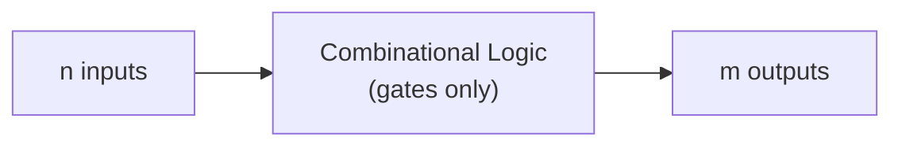
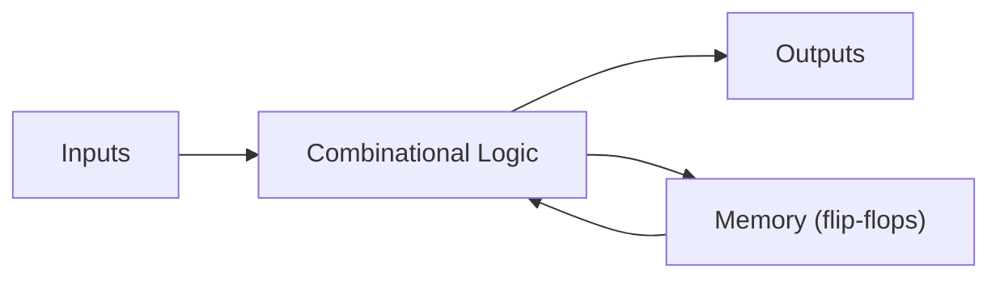

---
tags:
  - GATE/CS
  - GATE/DigitalLogic
  - CombinationalCircuits
aliases:
  - Combinational Logic
  - Combinatorial Circuit
  - Combinational Logic Circuit
date_created: 2026-10-12
difficulty: 3 stars
last_revised: 2026-10-12
pyq_frequency: High
---

# Combinational Circuit

## Syllabus Position

Subject: [[Digital Logic Index]]
Parent Topic: [[Digital Logic]]
Sibling Topics: [[Sequential Circuit]], [[Number Systems and Computer Arithmetic]]
Leads To: [[Adder and Subtractor]], [[Multiplexer]], [[Decoder and Encoder]], [[Programmable Logic Array]], [[Hazards in Combinational Circuits]]

GATE Syllabus Line: *"Digital Logic: Boolean algebra. Combinational and sequential circuits. Minimization. Number representations and computer arithmetic (fixed and floating point)."*

Exam Weight Note: Appears nearly every year, as 1-mark MCQ/NAT (gate counts, MUX/decoder implementation, adder delay) and 2-mark MCQ (function identification, minimum gate/MUX design, propagation delay).

---

## The Problem This Solves

Every computer must make decisions from current inputs: is this number zero, which of 8 devices is selected, what is A + B. These tasks need no memory of the past; the answer depends only on what is on the wires right now. Combinational circuits are the hardware for this: wire together gates so that the outputs are always a pure function of the inputs.

Analogy: a **vending-machine price lookup board**. You press buttons (inputs) and a light turns on (output). The board does not remember your last press; the same buttons always give the same light. A [[Sequential Circuit]] would be the whole machine, which remembers the coins already inserted.

Core Idea (one sentence): A combinational circuit is a network of logic gates, with no feedback and no memory, whose outputs are determined solely by the present inputs.

---

## Formal Theory

A **combinational circuit** with $n$ inputs and $m$ outputs realises $m$ [[Boolean Functions]]:

$$F_i : \{0,1\}^n \to \{0,1\}, \quad i = 1, \dots, m$$

Properties:
- No **feedback loops** and no **memory elements** (no flip-flops or latches).
- Output is a function only of the present input, so it is fully described by a [[Truth Table]] with $2^n$ rows.
- Built from [[Logic Gates]] (AND, OR, NOT, NAND, NOR, XOR). [[Universal Gates]] (NAND or NOR alone) are sufficient, as shown in [[Functional Completeness]].

### Design Procedure
1. Read the spec and fix the number of inputs $n$ and outputs $m$.
2. Build the truth table.
3. Write each output in [[Canonical and Standard Forms]] (SOP of minterms or POS of maxterms).
4. Minimise using [[Boolean Algebra]] or [[K-Map Minimization]] (finding [[Implicants and Prime Implicants]]).
5. Draw the gate network (optionally convert to NAND-only or NOR-only).

Analysis is the reverse: label every gate output, write expressions, simplify, then build the truth table.

### Standard Combinational Building Blocks

**Half Adder (HA):** adds two bits.
$$S = A \oplus B, \qquad C = A \cdot B$$

**Full Adder (FA):** adds two bits and a carry-in.
$$S = A \oplus B \oplus C_{in}, \qquad C_{out} = AB + C_{in}(A \oplus B)$$
Justification: carry out occurs if both inputs are 1, or exactly one is 1 and a carry arrives. A full adder = 2 half adders + 1 OR gate.

**Subtractor:** half subtractor $D = A \oplus B$, $Bor = \bar{A}B$. A full adder performs $A - B$ by feeding $\bar{B}$ and $C_{in}=1$ (two's complement).

**[[Multiplexer]] (MUX):** $2^k$ data inputs, $k$ select lines, 1 output. For a 4:1 MUX:
$$Y = \bar{S_1}\bar{S_0}I_0 + \bar{S_1}S_0 I_1 + S_1\bar{S_0}I_2 + S_1S_0I_3$$
Key fact: a $2^k : 1$ MUX implements any $(k+1)$-variable function, using $k$ variables as selects and the last variable (or $0$, $1$, $\bar{x}$) on the data lines. A $2^k:1$ MUX can also be built from $2^k - 1$ copies of 2:1 MUXes.

**[[Demultiplexer]]:** 1 input routed to one of $2^k$ outputs.

**[[Decoder and Encoder]]:**
- $n$-to-$2^n$ decoder produces all minterms, so any function is the OR of selected decoder outputs. Needs one OR gate per function.
- $2^n$-to-$n$ encoder is the reverse; a **priority encoder** resolves multiple active inputs.

**Comparator:** 1-bit: $A>B = A\bar{B}$, $A=B = A \odot B$ ([[XNOR Gate]]), $A<B = \bar{A}B$.

**Parity generator/checker:** chain of [[XOR Gate]]s; odd parity is the XOR of all bits.

### Adders for Multi-bit Numbers
**Ripple Carry Adder (RCA):** chain $n$ full adders; $C_{out}$ of stage $i$ feeds $C_{in}$ of stage $i+1$. Simple but slow.

**Carry Look-Ahead Adder (CLA):** define
$$G_i = A_iB_i \;(\text{generate}), \qquad P_i = A_i \oplus B_i \;(\text{propagate})$$
$$C_{i+1} = G_i + P_iC_i$$
Expanding gives every carry directly from inputs in constant gate levels, so delay does not grow with $n$ (ignoring fan-in limits).

### Other Realisations
[[Programmable Logic Array]] (PLA): programmable AND plane + programmable OR plane. PROM: fixed AND (full decoder) + programmable OR. PAL: programmable AND + fixed OR. [[ROM]] as a lookup table is also a combinational circuit.

### What GATE actually tests here
(1) Implement a function with a given MUX/decoder and count gates; (2) identify what a given circuit computes; (3) propagation delay of RCA vs CLA; (4) number of gates/NAND-only count; (5) distinguishing combinational from sequential circuits (feedback present?); (6) [[Hazards in Combinational Circuits]].

---

## Diagrams and Visuals

**Block model.** Draw a box labelled "Combinational Logic" with $n$ arrows entering on the left and $m$ arrows leaving on the right. No arrow returns from output to input.



**Combinational vs sequential (feedback is the difference).**


The loop through memory in the second diagram makes the circuit sequential. Remove it and you have a combinational circuit.

**Full adder from two half adders.**

```
 A ----+--[HA1]--S1--+--[HA2]---- Sum
 B ----+      |C1    |   |C2
              |   Cin-+   |
              +-->[ OR ]<-+---- Cout
```
- HA1 adds A, B giving S1 and C1.
- HA2 adds S1 and Cin giving Sum and C2.
- OR combines carries: $C_{out} = C_1 + C_2$.

**4-bit ripple carry adder.**

```
 A3B3     A2B2     A1B1     A0B0
  |  |     |  |     |  |     |  |
[FA3]<-C3-[FA2]<-C2-[FA1]<-C1-[FA0]<-C0(=0)
  |         |         |         |
 S3        S2        S1        S0
```
Carry travels right to left; the worst path is $C_0 \to S_3/C_4$.

**4:1 MUX.** Draw a trapezoid with four inputs $I_0..I_3$ on the wide side, select lines $S_1S_0$ at the bottom, output $Y$ on the narrow side.

**3-to-8 decoder.** Box with inputs $A,B,C$ and outputs $D_0..D_7$; exactly one output is 1, namely $D_{(ABC)_2}$.

---

## Complexity Analysis

For circuits, "complexity" means **gate count** (area) and **propagation delay** (time), not asymptotic loop counts.

**Propagation delay.** Delay is the longest path (critical path) from any input to any output, in gate delays $t_g$.

- Full adder: sum has 2 XOR levels (about $2t_{XOR}$); carry has AND-OR (about $2t_g$).
- RCA: the carry must pass through all $n$ stages, each costing about $2t_g$, so
$$T_{RCA} = O(n) \quad (\approx 2n\,t_g \text{ for the carry, sum adds about one more XOR})$$
- CLA: $P_i, G_i$ need 1 level; each carry is a 2-level AND-OR of those; the sum needs one more XOR. So delay is about $4t_g$, i.e. $O(1)$ (with unlimited fan-in; with bounded fan-in, $O(\log n)$ via hierarchical lookahead).

**Gate count.**
- RCA: $n$ full adders, each 5 gates (2 XOR, 2 AND, 1 OR), so $O(n)$.
- CLA: carry $C_i$ needs terms of up to $i$ literals; total gates $O(n^2)$ with unlimited fan-in.
- Any $n$-variable function in SOP needs up to $2^{n-1}$ product terms (e.g. parity), so $O(2^n)$ in two-level logic; multi-level (XOR chain) brings parity to $O(n)$.
- $n$-to-$2^n$ decoder: $2^n$ AND gates of $n$ inputs.
- $2^k:1$ MUX from 2:1 MUXes: $2^k - 1$ MUXes, depth $k$.

| Circuit             | Delay (gate levels) | Gate Count     | Trigger / Note                                   |
|---------------------|---------------------|----------------|--------------------------------------------------|
| Ripple Carry Adder  | $O(n)$              | $O(n)$         | Carry ripples through all $n$ stages             |
| Carry Look-Ahead    | $O(1)$ (ideal)      | $O(n^2)$       | Parallel carry computation, fan-in unbounded     |
| $n$:$2^n$ Decoder   | $O(1)$              | $2^n$ ANDs     | One AND per minterm                              |
| $2^k:1$ MUX (tree)  | $O(k)$              | $2^k-1$ MUX2   | Binary tree of 2:1 MUXes                         |
| Parity (XOR tree)   | $O(\log n)$         | $n-1$ XORs     | Balanced tree beats chain depth $O(n)$           |

Space is not meaningful for combinational circuits (no storage); area is the analogue.

---

## Worked Example

**Problem:** Design a circuit with inputs $A,B,C$ (3-bit binary number, $A$ = MSB) whose output $F=1$ when the number is prime (2, 3, 5, 7). Implement it using a 4:1 MUX.

**Step 1, truth table** ($F = \sum m(2,3,5,7)$):

| A B C | F |
|-------|---|
| 000 | 0 |
| 001 | 0 |
| 010 | 1 |
| 011 | 1 |
| 100 | 0 |
| 101 | 1 |
| 110 | 0 |
| 111 | 1 |

**Step 2, minimise with K-map.** Groups: $m_3,m_7$ gives $BC$; $m_2,m_3$ gives $\bar{A}B$; $m_5,m_7$ gives $AC$.
$$F = \bar{A}B + AC$$
Check: $m_2 = 010 \to \bar{A}B=1$ ✓; $m_5 = 101 \to AC=1$ ✓; $m_3 = 011\to \bar{A}B=1$ ✓; $m_7=111\to AC=1$ ✓; $m_6 = 110$: $\bar{A}B=0, AC=0$ ✓. ($BC$ is redundant since it is already covered.)

**Step 3, 4:1 MUX.** Select lines $S_1=A,\ S_0=B$, data inputs are functions of $C$. For each $(A,B)$ pair, look at $F$ as a function of $C$:

| AB | F for C=0, C=1 | Data input |
|----|----------------|------------|
| 00 | 0, 0 | $I_0 = 0$ |
| 01 | 1, 1 | $I_1 = 1$ |
| 10 | 0, 1 | $I_2 = C$ |
| 11 | 0, 1 | $I_3 = C$ |

Step trace for input $ABC=101$: $S_1S_0 = 10 \to$ choose $I_2 = C = 1$, so $F=1$ ✓.
For $ABC = 110$: $S_1S_0=11 \to I_3 = C = 0$, so $F=0$ ✓.
For $ABC = 011$: $S_1S_0=01 \to I_1 = 1$, so $F=1$ ✓.

Total hardware: one 4:1 MUX, zero extra gates (constants and wires only). The SOP version needed 1 NOT, 2 AND, 1 OR = 4 gates. Total operations (evaluations): 8 truth-table rows, all verified. This confirms a $2^{k}:1$ MUX handles $k+1 = 3$ variables.

**Edge-case follow-up:** What if the input were 4-bit ($n=4$) with the same 4:1 MUX? A 4:1 MUX covers only 3 variables, so you need extra gates feeding the data lines (data inputs become functions of two variables), or an 8:1 MUX with the 4th variable on the data lines.

---

## Intuition Anchors

**The Analogy (deepened):** The price-lookup board is a combinational circuit. Its **gate count** is the number of wires and switches on the board; its **delay** is how long the signal takes to travel the longest wire path (critical path). A ripple adder is a bucket brigade: each person must wait for the previous person to hand over the carry. A look-ahead adder is a manager who looks at everyone's inputs at once and announces all the carries. The **hazard** (glitch) is the board flickering briefly while signals race down paths of unequal length before settling. Adding a memory (the machine remembering coins) turns it into a sequential circuit.

**The Mental Model:** Experts picture signals flowing left to right through layers of gates, and ask two questions: "What does each output equal as a Boolean expression?" and "What is the longest path?" They never ask "what was the previous state?"; if they must, the circuit is sequential.

**The One-Line Recall:** Combinational = no feedback, no memory, output $=f(\text{inputs})$; $2^k:1$ MUX implements any $(k+1)$-variable function; RCA delay $=O(n)$, CLA delay $=O(1)$.

**The #1 Trap:** Students assume that any circuit with a loop in the diagram is sequential and anything with flip-flop-looking symbols is too; the real test is **memory/feedback**. Conversely, they assume a MUX/decoder-based design with $k$ selects handles only $k$ variables, when in fact a MUX with $k$ selects handles $k+1$ variables (by putting the last variable or its complement/constants on data inputs), while a decoder handles exactly $n$ with extra OR gates.

---

## GATE Questions

**Question 1 - [GATE-style (frequently asked pattern)] - [2-mark]**

> A 4:1 multiplexer has select lines $S_1 = A$, $S_0 = B$ and data inputs $I_0 = C$, $I_1 = \bar{C}$, $I_2 = 1$, $I_3 = 0$ . What is the output $F(A,B,C)$ expressed as a minimal SOP?

- (A) $\bar{A}\bar{B}C + \bar{A}B\bar{C} + A\bar{B}$
- (B) $\bar{A}B + A\bar{B}C$
- (C) $\bar{A}\bar{B}\bar{C} + AB$
- (D) $A\bar{B} + \bar{A}\bar{B}C$

<details>
<summary>Solution</summary>

**Answer: (A)**

**Reasoning:** $F = \bar{A}\bar{B}\cdot C + \bar{A}B\cdot\bar{C} + A\bar{B}\cdot 1 + AB\cdot 0 = \bar{A}\bar{B}C + \bar{A}B\bar{C} + A\bar{B}$.
- (B) swaps the roles of the data lines; wrong.
- (C) uses $I_0 = \bar{C}$ and $I_3=1$; wrong.
- (D) drops the $\bar{A}B\bar{C}$ term from $I_1$.

**What this question is really testing:** Reading the MUX equation $Y=\sum (\text{select minterm})\cdot I_j$.

**Trap to avoid:** Mixing up which select line is MSB; $S_1$ is the MSB selecting index $2$ or $3$.

</details>

---

**Question 2 - [Numerical] - [2-mark]**

> A 16-bit ripple carry adder is built from full adders where each AND/OR gate has delay 1 ns and each XOR gate has delay 2 ns (carry: $C_{out} = AB + C_{in}(A\oplus B)$). Assume the $A\oplus B$ values are ready at time 2 ns. What is the time at which $C_{16}$ is available (inputs ready at 0, $C_0 = 0$)?

<details>
<summary>Solution</summary>

$P_i = A_i\oplus B_i$ ready at 2 ns (all stages in parallel). $G_i = A_iB_i$ ready at 1 ns.
For stage 0: $C_1 = G_0 + P_0C_0$; with $C_0$ available at 0, $C_1$ is ready at $2 + 1 (AND) + 1 (OR) = 4$ ns.
For each later stage, carry-in arrives after $P_i$ is ready, so each stage adds AND (1 ns) + OR (1 ns) = 2 ns.
$C_{16}$ time $= 4 + 15\times 2 = 34$ ns.

(If $C_0$ is treated as arriving at 0, stage 0 is bounded by $P_0$ at 2 ns, as above.) The key insight: the first carry waits for the XOR; afterwards the carry chain costs 2 ns per stage.

</details>

---

**Question 3 - [Hard / Multi-concept] - [2-mark]**

> What is the minimum number of 2-input NAND gates needed... instead consider: how many $2{:}1$ MUXes are needed to implement a $16:1$ MUX, and what is the maximum number of distinct variables of a Boolean function implementable with a single $8:1$ MUX plus no other gates?

<details>
<summary>Solution</summary>

- $16:1$ MUX from $2:1$ MUXes: $16 - 1 = 15$ (a tree: 8 + 4 + 2 + 1).
- Single $8:1$ MUX: 3 select lines handle 3 variables, and data inputs can carry the 4th variable (or complement) or constants $0,1$. So any function of up to **4 variables** if the 4th appears as $0, 1, x, \bar{x}$ on data lines. With a NOT gate allowed it is 4; strictly "no other gates" makes complement of the 4th variable unavailable, so only functions where each cofactor is $0$, $1$ or $x_4$ are possible (but still 4 variables).
Answer: 15 MUXes; up to 4 variables.

</details>

---

**Pattern Recognition:**
- "Implement $f$ using a $2^k:1$ MUX" → select lines get $k$ variables, data lines get $\{0,1,x,\bar{x}\}$ of the remaining one.
- "Delay of $n$-bit adder" → RCA is $n\times$ (carry delay per stage), CLA is constant.
- "Is circuit combinational?" → hunt for feedback/memory.
- "Decoder + OR gates" → each output function needs one OR across its minterms (or NAND if active-low outputs).

---

## Edge Cases and Failure Modes

- [ ] **Static hazard:** the output glitches momentarily when one input changes, e.g. $F = AB + \bar{A}C$ with $B=C=1$ and $A$ switching; fix by adding the consensus term $BC$. See [[Hazards in Combinational Circuits]].
- [ ] **Don't-care conditions:** treating don't cares as 0 yields a larger circuit; the fix is using them in [[K-Map Minimization]] groups.
- [ ] **Unused/disabled MUX/decoder lines:** a decoder with enable low gives all-zero (or all-one for active-low) outputs; fixes by checking the enable polarity.
- [ ] **Overflow in adders:** unsigned overflow = carry out; signed overflow = $C_{n-1} \oplus C_n$. Confusing these is a classic mistake.
- [ ] **Priority encoder with no active input:** output is undefined unless a valid bit is provided; fix by adding a V (valid) output.
- [ ] **Accidental feedback:** wiring an output back to an input creates a latch-like (sequential) circuit; the fix is breaking the loop.
- [ ] **Fan-in limits:** CLA's $O(1)$ delay assumes unbounded fan-in; real gates need $O(\log n)$ depth.

---

## Comparisons

| Feature          | [[Combinational Circuit]]        | [[Sequential Circuit]]                | [[Programmable Logic Array]]             |
|------------------|----------------------------------|---------------------------------------|------------------------------------------|
| Memory           | None                             | Yes (flip-flops/latches)              | None (it is a combinational device)      |
| Output depends on| Present inputs only              | Inputs and present state              | Present inputs only                      |
| Feedback         | No                               | Yes (through memory)                  | No                                       |
| Clock            | Not needed                       | Usually needed (synchronous)          | Not needed                               |
| Description      | Truth table                      | State table / diagram                 | Product-term and sum-term programming    |
| GATE Trap        | Delay is longest path            | Counting states/flip-flops            | Counting AND-plane/OR-plane programmable points |

The most common GATE question comparing these asks "which of the following is a combinational circuit?" (adder, MUX, decoder, comparator versus counter, register, shift register), and the answer hinges on the precise distinguishing property: **presence of storage/feedback**.

---

## Connections Web

**Must know before this topic:**
- [[Boolean Algebra]] - laws for simplification
- [[Logic Gates]] - the building blocks
- [[Truth Table]] - function specification
- [[Canonical and Standard Forms]] - minterms/maxterms
- [[K-Map Minimization]] - minimisation tool
- [[Implicants and Prime Implicants]] - what K-map groups are
- [[Universal Gates]] and [[Functional Completeness]] - NAND/NOR-only designs
- [[XOR Gate]] and [[XNOR Gate]] - adders, comparators, parity

**Topics that build on this:**
- [[Adder and Subtractor]]
- [[Multiplexer]], [[Demultiplexer]], [[Decoder and Encoder]]
- [[Programmable Logic Array]], [[ROM]]
- [[Hazards in Combinational Circuits]]
- [[Sequential Circuit]] - adds memory on top

**GATE subject cross-links:**
- [[Digital Logic Index]] > [[Combinational Circuits Index]]

**Cross-subject connections:**
- [[ALU Design]] - ALU is a big combinational block (Computer Organization)
- [[Instruction Decoding]] - control unit uses decoders
- [[Number Systems and Computer Arithmetic]] - two's complement via adders
- [[Pipelining]] - stage delay set by combinational critical path

**Standard references:**
- [[Morris Mano Digital Design Chapter 4]] / [[Brown and Vranesic Digital Logic Chapter 6]]

---

## Quick Revision Sheet

**Definition (1 sentence):** Output depends only on present inputs; gates only, no memory or feedback.

**Core Idea / Analogy (1 sentence):** A lookup board - press inputs, get output, nothing remembered.

**Design Steps:**
1. Fix $n$ inputs, $m$ outputs.
2. Write truth table.
3. Derive SOP/POS.
4. Minimise (K-map).
5. Draw gates (or NAND-only/MUX/decoder).

**Complexity:**
- Delay: RCA $O(n)$, CLA $O(1)$ ideal, parity tree $O(\log n)$.
- Gates: RCA $5n$, decoder $2^n$ ANDs, MUX $2^k:1$ = $2^k-1$ MUX2.
- Recurrence: $C_{i+1} = G_i + P_iC_i$, $G_i=A_iB_i$, $P_i = A_i\oplus B_i$.

**Key Properties:**
- HA: $S=A\oplus B$, $C=AB$; FA: $S=A\oplus B\oplus C_{in}$, $C_{out}=AB+C_{in}(A\oplus B)$.
- $2^k:1$ MUX implements any $(k+1)$-variable function.
- $n$-to-$2^n$ decoder + OR gates implements any function (minterm generator).
- Full adder = 2 HA + 1 OR; 1 FA = 5 gates.
- Signed overflow $= C_{n-1}\oplus C_n$.

**The #1 Trap:** Believing "$k$ select lines handle only $k$ variables" - MUX handles $k+1$.

**When to use over alternatives:** Combinational for stateless computation; use [[Sequential Circuit]] if history matters; use CLA when speed matters more than area.

**Mnemonic:** "No Memory, No Loop, No Clock" = combinational. For carry: "$G$enerate or $P$ropagate".

---

## Revision Checklist

- [ ] I can state the formal definition without looking.
- [ ] I can explain the analogy and map it to the concept.
- [ ] I can design a function with a MUX in under 2 minutes.
- [ ] I can derive RCA and CLA delay from scratch.
- [ ] I know what the Quick Revision Sheet says without reading it.
- [ ] I can solve all 3 GATE questions in this note without peeking.
- [ ] I know the #1 trap and can articulate why students fall for it.
- [ ] I have linked this note correctly in my Obsidian vault.
- [ ] I have scheduled a spaced-repetition review in 3 days.
