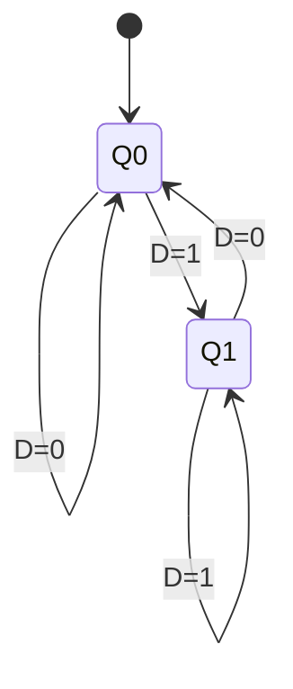
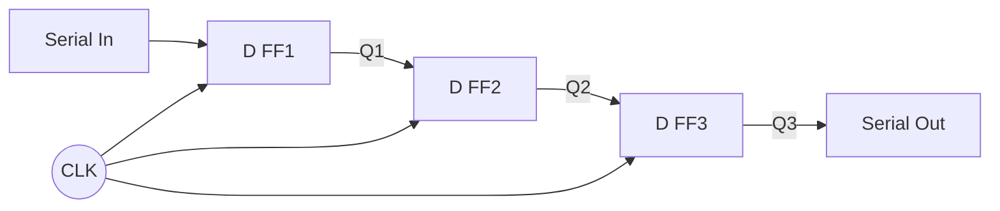
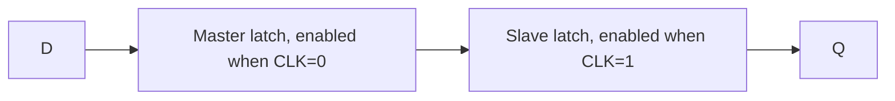

---
tags:
  - GATE/CS
  - GATE/DigitalLogic
  - SequentialCircuits
  - FlipFlops
aliases:
  - D FF
  - Data Flip Flop
  - Delay Flip Flop
date_created: 2026-10-17
difficulty: ⭐⭐⭐
last_revised: 2026-10-17
pyq_frequency: High
---

## Syllabus Position

Subject: [[Digital Logic Index]]
Parent Topic: [[Flip Flops]]
Sibling Topics: [[SR Flip Flop]], [[JK Flip Flop]], [[T Flip Flop]]
Leads To: [[Shift Register]], [[Counters]], [[Sequential Circuit Design]], [[Registers]]

GATE Syllabus Line: "Digital Logic: Boolean algebra. Combinational and sequential circuits. Minimization. Number representations and computer arithmetic (fixed and floating point)."

Exam Weight Note: Appears as 1-mark or 2-mark MCQ/NAT: characteristic equation, converting one flip flop to another, shift-register/counter output sequences, and propagation-delay/timing questions.

## The Problem This Solves

A circuit that must remember one bit needs a way to store a value and change it only at a controlled moment. The [[SR Flip Flop]] stores bits, but it has a forbidden input ($S=R=1$) and needs two inputs to say one thing: "store this bit". Designers wanted a single data input, with no illegal combination, that simply copies whatever is on the wire at the clock tick.

Analogy: a photographer with a camera. The shutter (clock edge) fires, the scene (D) at that instant is captured, and the photo (Q) stays unchanged until the next click, however the scene moves in between.

Core Idea (one sentence): On every active clock edge, $Q$ takes the value of $D$, and holds it until the next edge.

## Formal Theory

A **D Flip Flop** is an edge-triggered [[Flip Flops]] with one data input $D$ and outputs $Q$, $\overline{Q}$, whose next state equals $D$.

### Characteristic Table and Equation

| $D$ | $Q(t)$ | $Q(t+1)$ | Action |
|---|---|---|---|
| 0 | 0 | 0 | Reset |
| 0 | 1 | 0 | Reset |
| 1 | 0 | 1 | Set |
| 1 | 1 | 1 | Set |

Compact form: $D=0 \Rightarrow Q^+=0$; $D=1 \Rightarrow Q^+=1$. The next state is independent of the present state, so

$$Q^+ = D$$

### Excitation Table

An excitation table answers: "to go from $Q$ to $Q^+$, what must $D$ be?"

| $Q$ | $Q^+$ | $D$ |
|---|---|---|
| 0 | 0 | 0 |
| 0 | 1 | 1 |
| 1 | 0 | 0 |
| 1 | 1 | 1 |

Hence $D = Q^+$. There are no don't-cares, which is why D is the simplest flip flop to design with.

### Construction from an SR Latch

Take a gated **D [[Latches]]**: $S = D$, $R = \overline{D}$. Then $S=R=1$ can never occur, removing the forbidden state. Making it edge-triggered needs a [[Master Slave Flip Flop]] (two back-to-back D latches with opposite clock phases) or a edge-detector.

### Conversions

**D from SR:** $Q^+ = S + \overline{R}Q$ with the constraint $SR=0$. Set $S = D$, $R = \overline{D}$ (one inverter).

**D from JK:** $Q^+ = J\overline{Q} + \overline{K}Q$. Set $J = D$, $K = \overline{D}$. Check: $D=1 \Rightarrow \overline{Q}+Q = 1$; $D=0 \Rightarrow 0$.

**D from T:** $Q^+ = T \oplus Q$. We need $Q^+ = D$, so $T = D \oplus Q$ (one XOR gate).

**Reverse (others from D):**
- JK using D: $D = J\overline{Q} + \overline{K}Q$.
- T using D: $D = T \oplus Q$.
- SR using D: $D = S + \overline{R}Q$.

### Applications

- **Delay element:** Output equals input delayed by one clock cycle, hence the name "Delay" FF. $Q(n+1)=D(n)$.
- **[[Shift Register]]:** Chain $Q_i \to D_{i+1}$; each tick moves the data one position. An $n$-bit register needs $n$ D flip flops.
- **Registers and storage:** Parallel-load registers in CPUs ([[Registers]]).
- **Synchronizers:** Two D flip flops in series reduce metastability on asynchronous inputs.
- **[[Counters]]:** Tying $D=\overline{Q}$ gives a toggle (divide-by-2).

### Pseudocode (behavior)

```
Algorithm DFF(D, clk):
    on rising edge of clk:
        Q = D
    return Q   // holds otherwise
```

What GATE actually tests here: converting JK/T to D and vice versa, tracing shift-register or $D=\overline{Q}$ circuits over clock pulses, noting that a D flip flop has no "hold" input, and timing (setup, hold, propagation) in chained flip flops.

## Diagrams and Visuals

Drawing instructions: draw a rectangle labeled D FF; $D$ enters left, clock triangle at bottom-left, $Q$ and $\overline{Q}$ on the right.

```
        +---------+
   D ---|D       Q|--- Q
        |         |
 CLK -->|>      Q'|--- Q'
        +---------+
```

Timing (rising-edge triggered):

```
CLK : _|‾|_|‾|_|‾|_|‾|_
D   : __|‾‾‾‾|____|‾‾‾‾
Q   : ___|‾‾‾‾‾|___|‾‾‾   (changes only just after the rising edge)
```

State diagram:



Shift register (3-bit):



Master-slave construction:



Conversion circuits: D from JK = JK with $J=D$, $K=\overline{D}$ (inverter). D from T = XOR($D$, $Q$) feeding $T$.

## Complexity Analysis

For circuits we analyze timing and hardware cost instead.

- **Hardware:** A master-slave D flip flop uses 2 D latches; each latch of NAND gates is 4 NANDs + 1 inverter, so roughly 8 NAND + inverters, about 6 NAND gates for the classic positive-edge design.
- **Setup time $t_{su}$:** $D$ must be stable before the edge, so the internal gates settle.
- **Hold time $t_h$:** $D$ must remain stable after the edge to finish capturing.
- **Minimum clock period** for flip-flop to flip-flop paths:

$$T_{clk} \ge t_{pd,FF} + t_{comb} + t_{su}$$

- For a shift register $t_{comb}=0$, so $T_{clk} \ge t_{pd}+t_{su}$. Hold safety requires $t_{pd,FF} \ge t_h$ (plus skew).
- Ripple counters from D: total delay $= n \cdot t_{pd}$; synchronous design keeps it at $t_{pd}$.

| Case | Time | Space | Trigger Condition |
|---|---|---|---|
| Best | $t_{pd}$ | 1 bit | Output switches per edge |
| Average | $t_{pd}+t_{su}$ | 1 bit | Typical clock constraint |
| Worst | $t_{pd}+t_{comb}+t_{su}$ | 1 bit | Longest combinational path |

## Worked Example

Circuit: 4-bit serial-in shift register of D flip flops, initial $Q_3Q_2Q_1Q_0 = 0000$, input stream $1,0,1,1,0$ (rising edge, serial input enters $Q_3$, shifting right).

| Clock | $D_{in}$ | $Q_3$ | $Q_2$ | $Q_1$ | $Q_0$ | Note |
|---|---|---|---|---|---|---|
| 0 | - | 0 | 0 | 0 | 0 | initial |
| 1 | 1 | 1 | 0 | 0 | 0 | 1 enters |
| 2 | 0 | 0 | 1 | 0 | 0 | shift |
| 3 | 1 | 1 | 0 | 1 | 0 | shift |
| 4 | 1 | 1 | 1 | 0 | 1 | shift |
| 5 | 0 | 0 | 1 | 1 | 0 | first bit exits |

Each step: $Q_i^+=Q_{i+1}$-neighbor on its left, $Q_3^+=D_{in}$. After 4 clocks, the register holds $1101$, the input bits in reverse arrival order at output positions (first bit at $Q_0$).

Total operations: 5 clock edges, 4 flip flop updates each = 20 updates. This confirms the claim "output = input delayed by $n$ clocks" because the first bit appeared at $Q_0$ exactly 4 edges later.

What changes if the input is held constant at 1? The register fills with 1s after 4 clocks ($1111$) and stays there; with all-zeros it flushes to $0000$. Data never "disappears" sooner than $n$ clocks.

## Intuition Anchors

**The Analogy (restated and deepened):** The camera shutter is the clock edge. Timing needs: the scene must be still just before (setup) and just after (hold) the shot; otherwise the photo blurs, which is metastability. A shift register is a conveyor belt of cameras, each photographing the previous photo, delaying data one frame per stage. Conversions are adapters: a JK or T camera can mimic D if you feed it an inverter or XOR to compute what it needs.

**The Mental Model:** Picture a gate that opens for an instant at each clock edge. Whatever sits on $D$ at that instant is pushed into the box, and the box's output is frozen otherwise. Next state never depends on the old state, so trace by simply copying $D$ per clock.

**The One-Line Recall:** $Q^+ = D$, input delayed by one clock; for conversions, plug $D$ into the target's characteristic equation and solve for the other inputs: $T=D\oplus Q$, $J=D,K=\overline{D}$, $S=D,R=\overline{D}$.

**The #1 Trap:** Students think a D flip flop "holds" when $D$ is unchanged and treat $D=\overline{Q}$ as unstable. In reality, between edges nothing changes; at each edge $Q^+=\overline{Q}$, so $Q$ toggles once per clock, giving a clean divide-by-2. Also, students mix up the $D$ latch (transparent while the clock is high, so output follows input) with the D flip flop (samples only at the edge).

## GATE Questions

**Question 1 — [GATE-style] — [1-mark]**

> A D flip flop has its $D$ input connected to $\overline{Q}$. The clock frequency is 8 MHz. What is the frequency of $Q$?

- (A) 16 MHz
- (B) 8 MHz
- (C) 4 MHz
- (D) 2 MHz

<details>
<summary>Solution</summary>

**Answer: (C)**

**Reasoning:** $Q^+=D=\overline{Q}$, so $Q$ toggles at each rising edge. One full cycle of $Q$ needs two clock edges, so $f_Q = 8/2 = 4$ MHz. (A) would require doubling, impossible for a sequential divider. (B) holds only if $Q$ stayed fixed. (D) would be a divide-by-4.

**What this question is really testing:** $D=\overline{Q}$ acts as a $T$ flip flop with $T=1$.

**Trap to avoid:** Believing $Q$ toggles every clock means frequency equals the clock; toggling per edge gives a period of two clocks.

</details>

---

**Question 2 — [Conceptual / Numerical] — [2-mark]**

> Implement a T flip flop using a D flip flop. Which expression gives $D$ in terms of $T$ and $Q$?

- (A) $D = T + Q$
- (B) $D = T\overline{Q}$
- (C) $D = T \oplus Q$
- (D) $D = \overline{T}Q$

<details>
<summary>Solution</summary>

**Answer: (C)**

**Reasoning:** The T characteristic equation is $Q^+=T\oplus Q$, and a D flip flop gives $Q^+=D$. Equating, $D=T\oplus Q$. Check: $T=0\Rightarrow D=Q$ (hold); $T=1\Rightarrow D=\overline{Q}$ (toggle). (A) fails at $T=1,Q=1$ (gives 1, should toggle to 0). (B) never holds 1. (D) is wrong for $T=0,Q=1$.

**What this question is really testing:** Using the excitation approach $D=Q^+$.

**Trap to avoid:** Using OR; it fails when both are 1.

</details>

---

**Question 3 — [Hard / Multi-concept] — [2-mark]**

> Two positive-edge D flip flops $A$ and $B$ are connected as $D_A = A \oplus B$, $D_B=\overline{A}$. Initial $AB=00$. What is the state after 3 clock pulses, and what is the sequence period?

- (A) $AB=10$, period 4
- (B) $AB=11$, period 3
- (C) $AB=01$, period 4
- (D) $AB=00$, period 3

<details>
<summary>Solution</summary>

**Answer: (D)**

**Reasoning:** Since $Q^+=D$: $A^+=A\oplus B$, $B^+=\overline{A}$ (uses old values).
- $00 \to A^+=0,\ B^+=1 \to 01$
- $01 \to A^+=1,\ B^+=1 \to 11$
- $11 \to A^+=0,\ B^+=0 \to 00$

After pulse 1 the state is $01$, after pulse 2 it is $11$, after pulse 3 it is $00$. The state returns to $00$, so the period is 3. Options (A) and (C) assume period 4, and (B) gives the state after only 2 pulses.

**What this question is really testing:** Simultaneous update from old values and cycle detection.

**Trap to avoid:** Updating $B$ using the new $A$; all flip flops sample on the same edge using old outputs.

</details>

**Pattern Recognition:**
- "Find output after $n$ clocks": write $Q^+=D$ per flip flop, evaluate all from old values at once.
- Conversion questions: set target's characteristic equation equal to $Q^+$ of the available flip flop and solve (excitation table method).
- $D=\overline{Q}$ means divide-by-2; $n$ stages give modulo-$2^n$ ripple counter.
- Shift register timing: $T_{clk}\ge t_{pd}+t_{su}$ and hold constraints.

## Edge Cases and Failure Modes

- [ ] Input changes during setup/hold window: wrong assumption that capture is clean. Actually the flip flop may go metastable. Fix: synchronize with two flip flops in series.
- [ ] Latch vs flip flop: wrong assumption that $Q$ follows $D$ all the time. A level-triggered latch is transparent; a flip flop samples only at the edge.
- [ ] Power-up state unknown: use asynchronous preset/clear inputs to initialize.
- [ ] All-identical inputs in a shift register: output equals input after $n$ clocks; nothing changes in between.
- [ ] Off-by-one in delay: an $n$-stage register gives $n$-cycle delay, not $n-1$ or $n+1$.
- [ ] Clock skew in chained flip flops: if skew exceeds $t_{pd}-t_h$, data races through two stages in one tick (hold violation). Fix: balance clock tree or insert delay.
- [ ] No hold mode: a D flip flop cannot "hold" by itself; to hold, feed $D=Q$ or gate the clock/enable.

## Comparisons

| Feature | [[D Flip Flop]] | [[JK Flip Flop]] | [[T Flip Flop]] |
|---|---|---|---|
| Inputs | 1 ($D$) | 2 ($J,K$) | 1 ($T$) |
| Characteristic equation | $Q^+=D$ | $Q^+=J\overline{Q}+\overline{K}Q$ | $Q^+=T\oplus Q$ |
| Key property | Copy/delay, no invalid input | Set, reset, hold, toggle | Hold or toggle |
| When to prefer | Registers, shift registers, state storage | General purpose, counters | Counters |
| GATE trap | Not a latch; no hold input | $J=K=1$ toggles | $T=1$ always toggles |

The most common GATE question comparing these is "convert flip flop X to Y" (or find the extra gate needed), and the answer hinges on writing the target's excitation in terms of the available characteristic equation.

## Connections Web

**Must know before this topic:**
- [[Latches]] — level-triggered storage, the building block.
- [[SR Flip Flop]] — origin and forbidden state removed by D.
- [[Boolean Algebra]] — to derive conversion expressions.
- [[XOR Gate]] — used in the T conversion.

**Topics that build on this:**
- [[Shift Register]], [[Counters]], [[Registers]], [[Sequential Circuit Design]]

**GATE subject cross-links:**
- [[Digital Logic Index]] > [[Flip Flops]]
- [[JK Flip Flop]], [[T Flip Flop]], [[Master Slave Flip Flop]]

**Cross-subject connections:**
- [[Pipelining]] — pipeline registers are D flip flops between stages.
- [[CPU Registers]] — registers are banks of D flip flops.

**Standard references:**
- [[Morris Mano Digital Design Chapter 5]]

## Quick Revision Sheet

**Definition (1 sentence):** Edge-triggered flip flop whose next state equals its $D$ input.

**Core Idea / Analogy (1 sentence):** A camera shutter: it photographs $D$ at the clock edge and holds it.

**Algorithm Steps:**
1. Wait for the active clock edge.
2. Read $D$.
3. Set $Q=D$, $\overline{Q}=\overline{D}$.
4. Hold until the next edge.

**Complexity:**
- Time: $t_{pd}$ per edge; clock period $T\ge t_{pd}+t_{comb}+t_{su}$
- Space: 1 bit
- Recurrence: $Q^+=D$

**Key Properties:**
- $Q^+=D$; excitation $D=Q^+$, no don't cares.
- $D=\overline{Q}$ gives divide-by-2.
- Conversions: $T=D\oplus Q$ (D from T); $J=D,K=\overline{D}$ (D from JK); $S=D,R=\overline{D}$ (D from SR); $D=T\oplus Q$ (T from D).
- $n$ D flip flops make an $n$-bit shift register with $n$ cycle delay.

**The #1 Trap:** Confusing the transparent D latch with the edge-triggered D flip flop.

**When to use this over alternatives:** Whenever you only need to store/copy/delay data; simplest design with no illegal input.

**Mnemonic:** "D = Data = Delay: what you give is what you get, one clock later."

## Revision Checklist

- [ ] I can state the formal definition without looking.
- [ ] I can explain the analogy and map it to the algorithm or concept.
- [ ] I can trace a 6-element example by hand in under 2 minutes.
- [ ] I can derive the worst-case complexity from scratch.
- [ ] I know what the Quick Revision Sheet says without reading it.
- [ ] I can solve all 3 GATE questions in this note without peeking.
- [ ] I know the #1 trap and can articulate why students fall for it.
- [ ] I have linked this note correctly in my Obsidian vault.
- [ ] I have scheduled a spaced-repetition review in 3 days.
