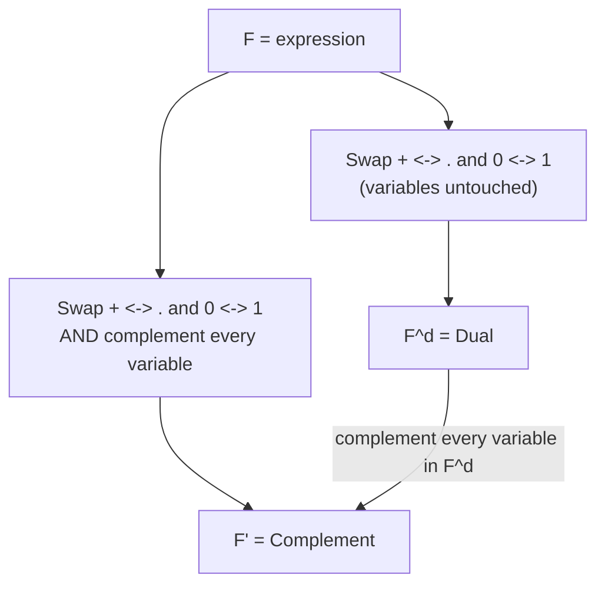

---
tags:
  - GATE/CS
  - GATE/DigitalLogic
  - BooleanAlgebra
aliases:
  - Duality Principle
  - Dual of a Boolean Function
  - Complement of a Boolean Function
  - Self-Dual Function
date_created: 2026-09-16
difficulty: ⭐⭐⭐⭐
last_revised: 2026-09-16
pyq_frequency: Medium
---

## Syllabus Position

Subject: [[Digital Logic Index]]
Parent Topic: [[Boolean Algebra]]
Sibling Topics: [[Canonical and Standard Forms]], [[De Morgan's Theorem]]
Leads To: [[Karnaugh Map]], [[Quine-McCluskey Method]], [[Universal Gates]]

GATE Syllabus Line: "Digital Logic: Boolean algebra, Combinational and sequential circuits, Minimization." Duality and complementation are algebraic properties of Boolean functions used repeatedly to derive dual laws, verify identities, and spot self-dual functions in objective questions.

Exam Weight Note: Appears as a 1-mark MCQ roughly every 2–3 years — usually "find the dual/complement of this expression" or "which of these functions is self-dual?" Occasionally embedded in a 2-mark NAT question counting self-dual functions among $n$ variables.

---

## The Problem This Solves

Every time you prove a new Boolean identity, do you really need to prove it twice — once for AND/OR and once for OR/AND? No. Boolean algebra has a built-in symmetry: swapping every AND with OR (and every 0 with 1) in a *true* statement always produces another *true* statement, for free. This symmetry is called **duality**, and it saves half the derivation work in the entire subject.

Separately, engineers often need the exact opposite function of a given one — "when does this circuit output 0 instead of 1?" That's the **complement** of a function, and it matters directly for building the same logic using NAND/NOR gates only, or for POS derivation.

Think of duality like a mirror: swap "AND" and "OR" the way a mirror swaps left and right, and any true statement about the original stays true about its mirror image. Complement is different — it's not a symbol swap, it's asking "what is the function that outputs exactly the opposite value on every single input?"

Core Idea (one sentence): The **dual** of a Boolean expression is obtained by mechanically swapping $+\leftrightarrow\cdot$ and $0\leftrightarrow1$ (variables untouched), which preserves the truth of any valid identity; the **complement** of a function $F$ is obtained by both taking the dual *and* complementing every individual variable, and it represents the function that is $1$ exactly where $F$ is $0$. A function that equals its own dual is called **self-dual**.

---

## Formal Theory

### Dual of an Expression

Given a Boolean expression $F$ built from AND ($\cdot$), OR ($+$), and constants $0,1$, the **dual** $F^d$ is formed by:
1. Replacing every $\cdot$ with $+$ and every $+$ with $\cdot$.
2. Replacing every $0$ with $1$ and every $1$ with $0$.
3. **Leaving variables and their complements untouched** (this is the critical distinction from complementation).

Example: $F = A(B+C)$ → dual $F^d = A+BC$.

**Why this matters (Duality Principle):** if a Boolean identity $E_1 = E_2$ is provable from the postulates, then $E_1^d = E_2^d$ is automatically also a valid identity — because the postulates themselves come in dual pairs (e.g., $a\cdot 1 = a$ is dual to $a+0=a$). This is why every law you learned in [[Boolean Algebra]] has a mirror-image law you get for free.

### Complement of a Function

The **complement** $F'$ of a function is the function that outputs $1$ wherever $F$ outputs $0$, and vice versa — literally $F$ XNOR'd against the constant-0 function, or simply "flip every output row in the truth table."

**Algebraic rule (De Morgan's generalized):** To compute $F'$ from an expression, take the dual **and** complement every individual literal simultaneously:
$$F' = (F^d)\Big|_{x_i \to x_i'}$$

Example: $F = A(B+C)$. Dual: $A+BC$. Now complement every literal ($A\to A', B\to B', C\to C'$): $F' = A'+B'C'$.

**Verification via De Morgan's directly:** $F' = [A(B+C)]' = A' + (B+C)' = A'+B'C'$ — matches exactly. This confirms: **complementation = dualize + complement every variable**, which is precisely what repeated application of De Morgan's theorem produces.

### Self-Dual Functions

A function $F$ is **self-dual** if $F^d = F$ — i.e., swapping every AND↔OR and $0\leftrightarrow1$ in its expression produces the *same* function back (not merely the same expression syntactically, but the same truth table).

**Truth-table characterization (the exam-critical test):** $F$ is self-dual **if and only if** for every input combination $\mathbf{x}=(x_1,\dots,x_n)$, 
$$F(x_1,\dots,x_n) = F'(x_1',\dots,x_n')' \quad\text{simplifies to}\quad F(x_1,\dots,x_n) \ne F(x_1',\dots,x_n')$$
Wait — precisely: $F$ is self-dual iff $F(x_1',x_2',\dots,x_n') = F'(x_1,\dots,x_n)$, i.e., the output on the **complemented input** always equals the **complement of the output** on the original input. In plain terms: **flipping every input bit always flips the output bit.**

This gives a fast row-pairing test on the truth table: pair up every row with its "bitwise complement" row (row $i$ pairs with row $2^n-1-i$). $F$ is self-dual **iff every such pair has opposite output values** (one row is 1, its complement-partner row is 0) for *all* $2^{n-1}$ pairs.

**Counting self-dual functions:** since each of the $2^{n-1}$ complementary row-pairs must have exactly one row output as 1 (the other forced to 0 automatically), there are exactly **2 free choices per pair**, giving $2^{2^{n-1}}$ self-dual functions of $n$ variables — this is a frequently GATE-tested counting fact.

### Pseudocode: Self-Dual Test

```
Algorithm IS_SELF_DUAL(truth_table, n):
    for i from 0 to 2^n - 1:
        j = complement_index(i, n)   // flip all n bits of i
        if truth_table[i] == truth_table[j]:
            return False   // pair must differ, not match
    return True
```

**What GATE actually tests here:** (a) computing the dual of a given expression (pure symbol swap, easy but error-prone if you also complement variables by mistake), (b) computing the complement correctly by combining dualization with literal complementation, (c) applying the row-pairing test to identify or count self-dual functions, and (d) the counting formula $2^{2^{n-1}}$ for the number of self-dual functions of $n$ variables.

---

## Diagrams and Visuals

**Truth Table Row-Pairing for Self-Duality Test (2 variables, $n=2$):**

```
 A  B | F | complement input (A',B') | F on complement input | F must equal complement of this
 0  0 | ? |     1  1  (row 3)         |         ?             |
 0  1 | ? |     1  0  (row 2)         |         ?             |
 1  0 | ? |     0  1  (row 1)         |         ?             |
 1  1 | ? |     0  0  (row 0)         |         ?             |
```

Row 0 pairs with Row 3, Row 1 pairs with Row 2. For self-duality: F(row 0) ≠ F(row 3), and F(row 1) ≠ F(row 2).

Example self-dual function: $F = AB + A'B' \cdot 0 ...$ actually the simplest 2-variable self-dual function is $F = A$ (check: row0=0,row3=1 differ ✓; row1=0,row2=1 differ ✓). Another is $F=AB+A'B'C$-style majority functions for odd $n$.

**Mermaid: Dual vs Complement Pipeline**



---

## Complexity Analysis

Computing a dual or complement is a direct, non-recursive symbol transformation, so complexity is measured in transformation steps relative to expression size, not asymptotic algorithmic growth.

- **Dual computation:** $O(m)$ where $m$ is the number of operator/constant symbols in the expression — each operator/constant is swapped exactly once, a single linear pass.
- **Complement computation:** $O(m+n)$ where $n$ is the number of literal occurrences — one linear pass for the dual swap, plus one linear pass to complement every literal.
- **Self-dual test via truth table:** $O(2^n)$ to build/scan the full truth table and pair up all rows — this is the practical bottleneck for larger $n$, since there's no shortcut without either a truth table or an already-simplified expression exploiting known self-dual building blocks (like majority functions).
- **Self-dual test via expression inspection (no truth table):** if the expression is already in a form where every term's complement-partner term is also present with matching structure, this can be checked in $O(m)$, but this shortcut only works for specific recognizable patterns (e.g., the majority function).

| Case | Time Complexity | Space Complexity | Trigger Condition |
|---|---|---|---|
| Best Case | $O(m)$ | $O(m)$ | Dual/complement computed directly on expression tree |
| Average Case | $O(m+n)$ | $O(m)$ | Complement computation, moderate literal count |
| Worst Case | $O(2^n)$ | $O(2^n)$ | Self-duality verified only via full truth table (no algebraic shortcut spotted) |

---

## Worked Example

Let $F(A,B,C) = AB + BC + CA$ (the 3-variable majority function). Find (a) its dual, (b) its complement, and (c) determine if it is self-dual.

**Step 1 — Compute the dual $F^d$:** Swap every $+\leftrightarrow\cdot$ (no constants present here):
$$F = AB+BC+CA \;\to\; F^d = (A+B)(B+C)(C+A)$$

**Step 2 — Simplify $F^d$ algebraically** (reusing the [[Boolean Algebra]] worked example result): $(A+B)(B+C)(C+A) = AB+BC+CA$ — this was shown earlier to equal $F$ itself via absorption/idempotent expansion.

**State after Step 2:** $F^d = AB+BC+CA = F$. Since the dual expression, once simplified, equals the original function, **$F$ is self-dual.**

**Step 3 — Verify via truth table row-pairing (cross-check):** Build the 8-row truth table for the majority function (output 1 when at least 2 of $A,B,C$ are 1):

```
Row  A B C | F
0    0 0 0 | 0     pairs with Row 7
1    0 0 1 | 0     pairs with Row 6
2    0 1 0 | 0     pairs with Row 5
3    0 1 1 | 1     pairs with Row 4
4    1 0 0 | 0     pairs with Row 3
5    1 0 1 | 1     pairs with Row 2
6    1 1 0 | 1     pairs with Row 1
7    1 1 1 | 1     pairs with Row 0
```

Check pairs: (0,7)=(0,1) differ ✓; (1,6)=(0,1) differ ✓; (2,5)=(0,1) differ ✓; (3,4)=(1,0) differ ✓. All four pairs differ → confirms self-dual.

**Step 4 — Compute the complement $F'$ for contrast:** Take the dual $F^d=(A+B)(B+C)(C+A)$ and complement every literal: $F' = (A'+B')(B'+C')(C'+A')$, which by De Morgan's equals $A'B'+B'C'+C'A'$ — the "minority function" (1 when at least 2 of $A,B,C$ are 0), confirming $F' \ne F$ (complement is a genuinely different function from the self-dual property).

**Verification:** Total operations — 1 dual swap, 1 algebraic re-simplification (reusing 4 absorption steps from the earlier note), 4 truth-table pair checks, 1 complement computation = 7 operations confirming self-duality both algebraically and combinatorially.

**Edge-case follow-up:** What if $F=AB+BC+CA$ had 4 variables instead of 3 (odd vs even variable count matters for majority-style functions)? Majority functions are only cleanly self-dual for an **odd** number of variables, because the row-pairing tie-breaking requires no input to be "exactly half 1s, half 0s" — with an even variable count, the middle input weight class would need to pair with itself, which is impossible for a genuine self-dual function (a row can't differ from itself), so even-variable majority-style functions are typically NOT self-dual without an explicit tie-breaking rule.

---

## Intuition Anchors

**The Analogy (restated and deepened):** Duality is a mirror reflection — swap left/right ($+\leftrightarrow\cdot$, $0\leftrightarrow1$) and the reflected image is still a valid "picture" (identity), just displayed differently. Complement is different: it's not a mirror, it's a color-negative photograph — every white pixel becomes black and vice versa (every output flipped). Self-dual functions are the rare images that look *identical* in the mirror — no visible difference between the function and its reflection.

**The Mental Model:** To check self-duality fast without a truth table, picture pairing up opposite "corners" of the $n$-dimensional hypercube of inputs (input $\mathbf{x}$ pairs with its bitwise-complement $\mathbf{x}'$). Self-dual means every such corner-pair has opposite colors (one lit, one dark) — like a perfectly checkerboarded hypercube with no two paired corners sharing a color.

**The One-Line Recall:** "Dual = swap $+/\cdot$ and $0/1$, variables stay; Complement = dual + flip every variable; Self-dual = flipping all inputs always flips the output, giving $2^{2^{n-1}}$ self-dual functions of $n$ variables."

**The #1 Trap:** Students confuse **dual** and **complement**, and when asked to find the "dual" of $F=AB+C$, they wrongly complement the variables too, producing $A'+B'C'$... wait, actually the trap is the reverse: computing $F^d = A+BC$ correctly, then mistakenly calling this the "complement" — but $F^d \ne F'$ in general (they coincide only for self-dual functions after complementing variables). **Fix:** dual touches only operators/constants; complement additionally requires flipping every literal. Always ask "did I touch the variables?" — if yes, you computed something toward the complement, not the pure dual.

---

## GATE Questions

---

**Question 1 — [GATE-style, common pattern] — [1-mark]**

> What is the dual of the Boolean expression $F = A(B+0) + 1\cdot C'$?

- (A) $A+(B\cdot 1)\cdot(0+C')$
- (B) $(A+B)\cdot 1 + 0\cdot C'$
- (C) $(A+(B\cdot 1))(0+C')$
- (D) $A'+(B'\cdot 0)(1+C)$

<details>
<summary>Solution</summary>

**Answer: (C)**

**Reasoning:**
Apply the dual transformation mechanically: swap every $+\leftrightarrow\cdot$, swap every $0\leftrightarrow1$, leave every variable (including $C'$) untouched.

$F = A(B+0)+1\cdot C'$

- Outer $+$ between the two big terms → becomes $\cdot$.
- $A(B+0)$: the $\cdot$ between $A$ and $(B+0)$ → becomes $+$; inside, $B+0$ → becomes $B\cdot 1$ (the $+$ becomes $\cdot$, and $0$ becomes $1$). So this term dualizes to $A+(B\cdot 1)$.
- $1\cdot C'$: the $\cdot$ becomes $+$, and $1$ becomes $0$. So this term dualizes to $0+C'$.
- Combine with outer $\cdot$ (since outer $+$ became $\cdot$): $(A+(B\cdot1))\cdot(0+C')$.

This matches (C).

**Why other options are wrong:** (A) has the outer connective wrong (used $+$ instead of $\cdot$). (B) failed to swap the outer $+$ and left inner terms partially untouched. (D) incorrectly complemented variables ($A\to A'$) — that's the complement, not the dual.

**What this question is really testing:** Careful, mechanical application of the dual transform without accidentally complementing variables.

**Trap to avoid:** Mixing up dual (operators/constants only) with complement (also flips variables) — option (D) is the classic "did complement instead of dual" trap.

</details>

---

**Question 2 — [Conceptual] — [1-mark]**

> How many self-dual Boolean functions exist for $n=3$ variables?

<details>
<summary>Solution</summary>

Using the formula $2^{2^{n-1}}$ with $n=3$: $2^{2^{2}} = 2^4 = 16$.

**Reasoning:** For $n=3$, there are $2^3=8$ rows, forming $2^{3-1}=4$ complementary row-pairs. Each pair must have exactly one row = 1 and the other = 0 (2 choices per pair: which one is 1), giving $2^4=16$ total self-dual functions.

**Trap to avoid:** Confusing this with the total number of Boolean functions of 3 variables ($2^{2^3}=2^8=256$) — self-dual functions are a small, constrained subset of all functions, not the full count.

</details>

---

**Question 3 — [Hard, multi-concept] — [2-mark]**

> Determine whether $F(A,B,C) = A'BC + AB'C + ABC' + ABC$ is self-dual. If not, find its dual and simplify it.

<details>
<summary>Solution</summary>

**Step 1 — Build/inspect the truth table.** $F=1$ for minterms: $A'BC=011=3$, $AB'C=101=5$, $ABC'=110=6$, $ABC=111=7$. So $F=\sum m(3,5,6,7)$.

**Step 2 — Apply the row-pairing test.** Pairs over 3 variables: (0,7),(1,6),(2,5),(3,4).
- Row 0 (not in set, F=0) pairs with Row 7 (in set, F=1): differ ✓
- Row 1 (F=0) pairs with Row 6 (F=1): differ ✓
- Row 2 (F=0) pairs with Row 5 (F=1): differ ✓
- Row 3 (F=1) pairs with Row 4 (F=0, since 4 is not in {3,5,6,7}): differ ✓

All four pairs differ → **$F$ is self-dual.**

**Step 3 (bonus, to illustrate the non-self-dual case):** If instead $F=\sum m(3,5,6)$ (dropping minterm 7), then pair (3,4): row3=1, row4=0, differ — but pair (0,7): row0=0,row7=0 — **same value**, so this modified function would NOT be self-dual, illustrating how removing a single minterm can break self-duality.

**What this question is really testing:** Fluent application of the row-pairing test directly on a minterm list, without needing to draw the full 8-row table explicitly.

**Trap to avoid:** Forgetting that self-duality is an all-or-nothing property — even one matching (non-differing) pair disqualifies the entire function, as shown in the bonus illustration.

</details>

---

**Pattern Recognition:**
- Odd-variable majority-style functions ($AB+BC+CA$ for 3 variables, and its generalizations) are the most commonly GATE-tested self-dual functions — memorize this family as your go-to example.
- The counting formula $2^{2^{n-1}}$ for self-dual functions of $n$ variables is a frequent 1-mark NAT/MCQ fact — memorize it directly rather than re-deriving under time pressure.
- When asked for a "dual," check immediately whether the question also wants variables complemented — if it does, it's actually asking for the complement, a very common terminology trap in question phrasing.
- Self-duality can be checked directly from a minterm list: pair minterm $i$ with minterm $(2^n-1-i)$ and verify exactly one of each pair is present.

---

## Edge Cases and Failure Modes

- [ ] **Confusing dual with complement:** The dual only swaps operators/constants; the complement additionally flips every variable. Computing one when asked for the other is the single most common GATE-question error on this topic.
- [ ] **Constant-only expressions ($F=0$ or $F=1$):** The dual of $F=0$ is $F^d=1$ and vice versa — students sometimes forget constants participate in the swap even when no variables are involved.
- [ ] **Single-variable functions:** $F=A$ has dual $F^d=A$ (unchanged, since there are no operators/constants to swap) — and $F=A$ is trivially self-dual, a useful minimal sanity-check example.
- [ ] **Even number of variables and self-duality:** Middle-weight inputs (exactly $n/2$ ones) cannot pair with themselves under bit-complementation when $n$ is even in certain symmetric function definitions — this can make naive "majority-style" functions fail to be self-dual for even $n$ without an explicit tie-break; always verify with the row-pairing test rather than assuming.
- [ ] **Applying De Morgan's incompletely when computing complement:** Complementing only the top-level operator but forgetting to recurse into nested sub-expressions leaves a partially-complemented (incorrect) result.
- [ ] **Assuming dual of a simplified expression matches dual of an unsimplified one without re-verifying:** Duality is a function-level property, but the *symbolic* dual must be taken on the actual expression given — always double check by re-simplifying after dualizing, as in the worked example.
- [ ] **Miscounting complementary row pairs:** For $n$ variables there are exactly $2^{n-1}$ pairs (not $2^n$) — forgetting the halving leads to wrong self-dual function counts.

---

## Comparisons

| Feature | [[Duality Principle\|Dual of F]] | [[Complement of a Function]] | [[Self-Dual Function]] |
|---|---|---|---|
| What changes | Operators ($+\leftrightarrow\cdot$) and constants ($0\leftrightarrow1$) only | Operators, constants, AND every variable/literal | Neither — it's a *property* (F equals its own dual) |
| Relation to original F | $F^d$ is generally a different function from $F$ | $F'$ is always the exact logical opposite of $F$ | $F^d = F$ (as functions) |
| Test method | Direct symbol-swap on the expression | Symbol-swap + literal complementation, or De Morgan's | Row-pairing test on truth table: every complementary pair differs |
| Count for $n$ variables | N/A (every function has exactly one dual) | N/A (every function has exactly one complement) | Exactly $2^{2^{n-1}}$ functions are self-dual |
| GATE Trap | Accidentally also complementing variables | Forgetting to dualize before complementing literals | Assuming any "symmetric-looking" function is automatically self-dual |

The most common GATE question comparing these gives an expression and asks for both its dual and complement in the same question, and the answer hinges on remembering that complement = dual + literal complementation — computing only one step when both are needed is the most frequent partial-credit loss.

---

## Connections Web

**Must know before this topic:**
- [[Boolean Algebra]] — provides the postulates and derived laws that dualize in pairs
- [[De Morgan's Theorem]] — algebraically equivalent to computing the complement of a function
- [[Canonical and Standard Forms]] — minterm/maxterm indices are used directly in the row-pairing self-dual test
- [[Truth Tables]] — the ground-truth structure over which self-duality is verified

**Topics that build on this:**
- [[Universal Gates]] — De Morgan-based complement derivation justifies NAND/NOR universality
- [[Symmetric Boolean Functions]] — majority and other symmetric functions are a rich source of self-dual examples
- [[Karnaugh Map]] — dual/complement relationships can be visually spotted via K-map symmetry across the diagonal

**GATE subject cross-links:**
- [[Digital Logic Index]] > [[Boolean Algebra]] > [[Duality and Complement of Boolean Functions]]

**Cross-subject connections:**
- [[Propositional Logic]] — duality mirrors the $\land/\lor$ swap under De Morgan's in propositional logic
- [[Set Theory]] — set complement and De Morgan's laws for unions/intersections are structurally identical to Boolean complement

**Standard references:**
- [[Morris Mano Digital Design]] Chapter 2 (Boolean Algebra, Duality)
- [[KLP Mishra]] — not applicable here (TOC reference); see Mano for Digital Logic instead

---

## Quick Revision Sheet

**Definition (1 sentence):** The dual of $F$ swaps every AND↔OR and $0\leftrightarrow1$ (variables untouched); the complement of $F$ does the same swap *and* additionally complements every variable; a function is self-dual if its dual equals itself.

**Core Idea / Analogy (1 sentence):** Dual is a mirror-image identity that stays true; complement is a color-negative that flips every output; self-dual functions are the rare ones that look the same in the mirror.

**Algorithm Steps (numbered, maximum 6 steps):**
1. To find the dual: swap every $+\leftrightarrow\cdot$ and $0\leftrightarrow1$; leave variables unchanged.
2. To find the complement: take the dual, then also complement every literal.
3. Alternatively compute the complement directly via recursive De Morgan's, outside-in.
4. To test self-duality: pair truth-table row $i$ with row $2^n-1-i$ (its bitwise complement).
5. Check every pair has opposite outputs (one 1, one 0); if any pair matches, $F$ is not self-dual.
6. If all pairs differ, $F$ is self-dual — and the count of all such functions for $n$ variables is $2^{2^{n-1}}$.

**Complexity:**
- Time (best / average / worst): $O(m)$ dual / $O(m+n)$ complement / $O(2^n)$ full self-dual truth-table test
- Space: $O(m)$ for symbolic transform; $O(2^n)$ if truth table is built explicitly
- Recurrence (if applicable): Not applicable — direct transformation, not recursive algorithm

**Key Properties (3 to 5 bullet points — facts GATE tests directly):**
- Dual touches only operators/constants; complement additionally flips every variable.
- $F' = (F^d)$ with every literal complemented — complement is "dualize then negate variables."
- Self-dual test: $F$ is self-dual iff $F(\mathbf{x}) \ne F(\mathbf{x}')$ for every input $\mathbf{x}$ (flipping all inputs always flips the output).
- Number of self-dual functions of $n$ variables: $2^{2^{n-1}}$.
- Odd-variable majority functions ($AB+BC+CA$, etc.) are canonical self-dual examples; even-variable symmetric functions usually are not, without explicit tie-breaking.

**The #1 Trap:** Confusing "dual" (operators/constants only) with "complement" (also flips variables) — always ask whether the question wants variables touched.

**When to use this over alternatives:** Use duality to get a second law "for free" after proving one identity; use complement when deriving POS from SOP or building NAND/NOR-only circuits; use the self-dual test when a question asks to classify or count functions with the input-flip-output-flip property.

**Mnemonic or one-liner to remember the steps:** "Dual swaps symbols, Complement swaps symbols AND signals (variables), Self-dual survives its own mirror." Count formula: "$2$ raised to $2^{n-1}$" — half the rows pair up, each pair gives one free bit of choice.

---

## Revision Checklist

- [ ] I can state the formal definition without looking.
- [ ] I can explain the analogy (mirror vs. color-negative) and map it to dual vs. complement.
- [ ] I can compute the dual and complement of a 3-variable expression by hand in under 2 minutes.
- [ ] I can derive the self-dual counting formula $2^{2^{n-1}}$ from scratch.
- [ ] I know what the Quick Revision Sheet says without reading it.
- [ ] I can solve all 3 GATE questions in this note without peeking.
- [ ] I know the #1 trap and can articulate why students fall for it.
- [ ] I have linked this note correctly in my Obsidian vault.
- [ ] I have scheduled a spaced-repetition review in 3 days.
</content>
