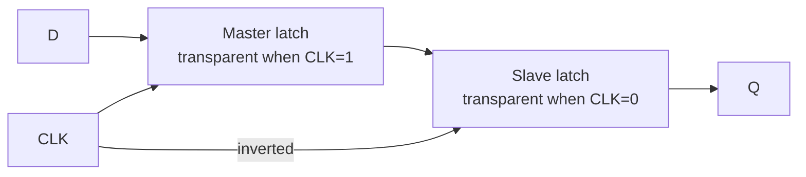
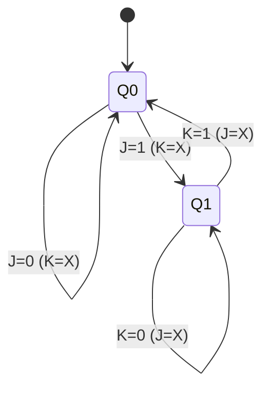

---
tags:
  - GATE/CS
  - GATE/DigitalLogic
  - SequentialCircuits
aliases:
  - Flip-Flop
  - FF
  - Bistable Multivibrator
  - Edge-Triggered Storage Element
date_created: 2026-10-17
difficulty: ⭐⭐⭐
last_revised: 2026-10-17
pyq_frequency: High
---

## Syllabus Position

Subject: [[Digital Logic Index]]
Parent Topic: [[Sequential Circuits]]
Sibling Topics: [[Latches]], [[SR Flip Flop]], [[JK Flip Flop]], [[D Flip Flop]], [[T Flip Flop]], [[Master Slave Flip Flop]]
Leads To: [[Counters]], [[Registers]], [[Finite State Machine Design]], [[Pipelining]]

GATE Syllabus Line: "Digital Logic: Boolean algebra. Combinational and sequential circuits. Minimization. Number representations and computer arithmetic (fixed and floating point)."

Exam Weight Note: Appears nearly every year as a 1- or 2-mark MCQ/NAT: conversion between flip flops, characteristic equations, counter sequences built from flip flops, and setup/hold/clock-frequency timing calculations.

---

## The Problem This Solves

A [[Combinational Circuit]] forgets. Change its inputs and the output changes immediately; it has no past. But a computer must remember things: the value of a variable, which step of an instruction it is on, how many clock ticks have passed. We therefore need a tiny circuit that can hold one bit, ignore the input most of the time, and accept a new value only at a precisely controlled moment.

Analogy: a flip flop is a camera with a shutter. The world (input $D$) keeps changing, but the camera captures a snapshot only at the instant the shutter clicks (the clock edge), and the photo (output $Q$) stays unchanged until the next click. A [[Latches|latch]] is instead a window: while it is open, you see everything that changes outside.

Core Idea (one sentence): A flip flop is a 1-bit memory element that samples its inputs only at a clock edge and holds the resulting state $Q$ until the next edge.

---

## Formal Theory

### Sequential Circuits

A **sequential circuit** has outputs that depend on current inputs and on the stored **state**: $Q^{+} = f(\text{inputs}, Q)$. Contrast with a [[Combinational Circuit]] where output depends only on present inputs. Memory elements make the difference, and flip flops are the standard memory elements.

- **Synchronous** sequential circuit: all state changes are synchronised to a common clock.
- **Asynchronous** sequential circuit: state changes whenever inputs change (no global clock); prone to hazards and races.
- **Moore machine**: output depends on state only. **Mealy machine**: output depends on state and input. See [[Finite State Machine Design]].

### Clocking and Triggering

The **clock** is a periodic square wave with period $T_{clk}$ and frequency $f = 1/T_{clk}$.

- **Level triggering**: the storage element responds during the whole time the clock is at 1 (or 0). Devices of this type are [[Latches]]. Problem: if input changes while the clock is high, the output changes repeatedly and, with feedback, causes the **race-around condition** (e.g. JK with $J=K=1$, when the pulse width exceeds propagation delay).
- **Edge triggering**: the element samples inputs only at the rising (0→1) or falling (1→0) edge. These are flip flops. Race-around is eliminated because the sampling window is essentially instantaneous.
- **Pulse (master-slave) triggering**: two latches in series, master transparent on clock high, slave on clock low; output changes at the falling edge. See [[Master Slave Flip Flop]].

### The Four Basic Flip Flops

| FF | Characteristic equation | Behaviour |
|----|-------------------------|-----------|
| [[SR Flip Flop]] | $Q^+ = S + \bar{R}Q$ (with $SR=0$) | Set, reset, hold; $S=R=1$ forbidden |
| [[JK Flip Flop]] | $Q^+ = J\bar{Q} + \bar{K}Q$ | Set, reset, hold, toggle |
| [[D Flip Flop]] | $Q^+ = D$ | Delay / copy input |
| [[T Flip Flop]] | $Q^+ = T \oplus Q = T\bar{Q} + \bar{T}Q$ | Hold ($T=0$) or toggle ($T=1$) |

Each characteristic equation comes directly from the characteristic table by K-map of $Q^+$ in terms of inputs and $Q$.

### Characteristic Tables (next state for given inputs)

| SR: S R | $Q^+$ | JK: J K | $Q^+$ | D | $Q^+$ | T | $Q^+$ |
|---|---|---|---|---|---|---|---|
| 0 0 | $Q$ | 0 0 | $Q$ | 0 | 0 | 0 | $Q$ |
| 0 1 | 0 | 0 1 | 0 | 1 | 1 | 1 | $\bar{Q}$ |
| 1 0 | 1 | 1 0 | 1 | | | | |
| 1 1 | invalid | 1 1 | $\bar{Q}$ | | | | |

### Excitation Tables (inputs needed for a desired transition $Q \to Q^+$)

| $Q \to Q^+$ | S R | J K | D | T |
|---|---|---|---|---|
| 0 → 0 | 0 X | 0 X | 0 | 0 |
| 0 → 1 | 1 0 | 1 X | 1 | 1 |
| 1 → 0 | 0 1 | X 1 | 0 | 1 |
| 1 → 1 | X 0 | X 0 | 1 | 0 |

The X (don't care) entries arise because two different input combinations produce the same transition (e.g. for $0 \to 0$ in JK: $J=0,K=0$ hold or $J=0,K=1$ reset). Excitation tables are the tool for design and conversion.

### Timing Parameters

- **Setup time** $t_{su}$: minimum time the data must be stable *before* the active clock edge.
- **Hold time** $t_h$: minimum time the data must remain stable *after* the active edge.
- **Clock-to-Q delay** $t_{cq}$ (propagation delay): time after the edge for $Q$ to become valid.
- Violating setup or hold may drive the flip flop into **metastability**: output hovers at an indeterminate voltage before resolving randomly.

For two flip flops separated by combinational logic of delay $t_{comb}$:

$$T_{clk} \ge t_{cq} + t_{comb} + t_{su}$$

$$f_{max} = \frac{1}{t_{cq} + t_{comb,max} + t_{su}}$$

Hold constraint (ignoring skew): $t_{cq} + t_{comb,min} \ge t_h$. The setup constraint depends on clock period; the hold constraint does **not**, so you cannot fix a hold violation by slowing the clock.

### Asynchronous Preset and Clear

Many flip flops have direct inputs $\overline{PR}$ (preset, forces $Q=1$) and $\overline{CLR}$ (clear, forces $Q=0$) that act **immediately, regardless of the clock**, and override synchronous inputs. They are active-low normally, and both being active at once is illegal. They are used to initialise a counter or state machine to a known state, and also to build **modulo-N counters** by resetting at a detected count.

### Conversion Between Flip Flops

Procedure (any FF X to FF Y; Y is the one you want, X is the one you have):

```
Algorithm CONVERT(target Y, available X):
    1. Write the characteristic/excitation table of target Y (inputs, Q, Q+).
    2. For each row, read from X's excitation table the inputs of X
       needed for the transition Q -> Q+.
    3. Draw K-maps for each X input as functions of (Y inputs, Q).
    4. Simplify and draw the logic.
```

Key results to memorise:

| Conversion | Logic |
|---|---|
| SR → JK | $S = J\bar{Q}$, $R = KQ$ |
| JK → T | $J = K = T$ |
| JK → D | $J = D$, $K = \bar{D}$ |
| D → T | $D = T \oplus Q$ |
| D → JK | $D = J\bar{Q} + \bar{K}Q$ |
| SR → D | $S = D$, $R = \bar{D}$ |
| SR → T | $S = T\bar{Q}$, $R = TQ$ |
| T → D | $T = D \oplus Q$ |
| T → JK | $T = J\bar{Q} + KQ$ |

What GATE actually tests here: (1) deriving the input expression in a conversion (e.g. "D flip flop to JK, what is $D$?"), (2) the output sequence of a circuit that feeds $Q$ back (toggle or ring/Johnson counter behaviour), (3) $f_{max}$ using $t_{cq}$, $t_{su}$ and logic delay, and (4) identifying which input combination is forbidden or toggles.

---

## Diagrams and Visuals

**1. Latch vs flip flop timing.** Draw clock, $D$, latch output and flip flop output on aligned axes. The latch output follows $D$ during the entire high level; the positive-edge flip flop output changes only at each rising edge.

```
CLK : __|‾‾‾|___|‾‾‾|___|‾‾‾|___
D   : _____|‾‾‾‾‾‾‾‾|_____|‾‾‾‾‾
Latch Q (high-level): follows D whenever CLK=1
FF Q (rising edge)  : ___________|‾‾‾‾‾‾‾‾‾‾‾‾|____   changes at ^ only
```
Labels: each rising edge `^` is a sample instant; between edges $Q$ is frozen.

**2. Setup/hold window.**
```
          |<- t_su ->|<- t_h ->|
 D  ======XXXXXXXXXXXX stable XXXX======
                     ^ active clock edge
 Q  -----------------------\ t_cq /----- new value
```
The data must be stable in the shaded window around the edge.

**3. Master-slave construction (D flip flop from two D latches).**



**4. State diagram of a JK flip flop.**


The edge labels are exactly the excitation table: $J$ and $K$ with X where either value works.

**5. Conversion block (JK to T).** Tie $J$ and $K$ together to form $T$; the single input drives both.

---

## Complexity Analysis

Flip flops are hardware, so we analyse **timing** and **cost** instead of $O(n)$.

**Setup constraint derivation.** Data launched at edge $k$ leaves the source FF after $t_{cq}$, passes through the logic ($t_{comb}$), and must be stable $t_{su}$ before edge $k+1$. Therefore $T_{clk} \ge t_{cq} + t_{comb} + t_{su}$. The slowest path (critical path) sets $f_{max}$.

**With clock skew** $t_{skew}$ (capture clock arrives later than launch): $T_{clk} \ge t_{cq} + t_{comb} + t_{su} - t_{skew}$, while the hold condition becomes $t_{cq} + t_{comb,min} \ge t_h + t_{skew}$.

**Race-around.** A level-triggered JK with $J=K=1$ toggles every $t_{pd}$ while the clock is high. Avoid it by requiring pulse width $t_p < t_{pd}$, which is impractical, hence edge or master-slave designs.

**Counter frequency division.** Each T flip flop (with $T=1$) produces an output at half the clock frequency, so $n$ cascaded stages divide by $2^n$: $f_{out} = f_{clk}/2^n$. Ripple counter delay: $n \cdot t_{pd}$ per count (worst case), so $f_{max} \approx 1/(n\,t_{pd} + t_{su})$.

| Case | Time Complexity (delay) | Space (gates/FFs) | Trigger Condition |
|---|---|---|---|
| Best | $t_{cq} + t_{su}$ | 1 FF | No logic between FFs |
| Average | $t_{cq} + \bar{t}_{comb} + t_{su}$ | depends | Typical paths |
| Worst | $t_{cq} + t_{comb,max} + t_{su}$ | depends | Critical path decides clock |

Gate cost: D FF needs ~ 2 latches (about 8 NAND gates); JK built from SR plus 2 AND gates; T needs one XOR or a JK with tied inputs.

---

## Worked Example

**Problem:** Convert a **D flip flop** into a **JK flip flop** and run it for 6 clock edges from $Q=0$ with the input sequence $(J,K)$: (1,0), (1,1), (1,1), (0,1), (0,0), (1,1).

Step 1. Characteristic equation of JK: $Q^+ = J\bar{Q} + \bar{K}Q$. A D flip flop has $Q^+ = D$, so $D = J\bar{Q} + \bar{K}Q$ (this is the conversion logic: two AND gates, one OR, one inverter on $Q$ and one on $K$).

Step 2. Simulate (state shown after each edge):

| Edge | J K | $Q$ before | $D = J\bar{Q} + \bar{K}Q$ | $Q$ after |
|---|---|---|---|---|
| 1 | 1 0 | 0 | $1\cdot1 + 1\cdot0 = 1$ | 1 |
| 2 | 1 1 | 1 | $1\cdot0 + 0\cdot1 = 0$ | 0 |
| 3 | 1 1 | 0 | $1\cdot1 + 0 = 1$ | 1 |
| 4 | 0 1 | 1 | $0 + 0 = 0$ | 0 |
| 5 | 0 0 | 0 | $0 + 1\cdot0 = 0$ | 0 |
| 6 | 1 1 | 0 | $1\cdot1 + 0 = 1$ | 1 |

Final $Q = 1$; output sequence 1, 0, 1, 0, 0, 1.

Total operations: 6 evaluations of $D$ (each 2 AND + 1 OR), 6 state updates. This confirms the single-bit-memory behaviour: each edge updates state exactly once, so the count of state changes is bounded by the number of edges, $O(\text{edges})$.

What changes if the input is $(J,K) = (1,1)$ held for 6 edges? The FF toggles every edge: 1,0,1,0,1,0, so $Q$ is a clock divided by 2, which is exactly the T flip flop with $T=1$. If instead $(J,K)=(0,0)$ throughout, $Q$ stays at 0 forever.

---

## Intuition Anchors

**The Analogy (restated and deepened):** The camera takes a snapshot only on the shutter click. Setup time is "the subject must stand still just before the click"; hold time is "stay still just after it", or the picture blurs (metastability). The maximum clock frequency is the maximum shutter rate: you need enough time for the subject to move into place (logic delay) and settle before the next click. A latch is a window: all motion seen while open. A conversion is putting a different lens on the same camera: you still get the same snapshot, but you control it differently.

**The Mental Model:** I picture a flip flop as a box with a "next state" calculator in front of a register: inputs go through $Q^+ = f(\text{inputs}, Q)$, then the edge copies $Q^+ \to Q$. For any problem I write $Q^+$, then iterate edge by edge in a table. For conversion, I take the excitation table of the available FF and fill it for each (target input, $Q$) row.

**The One-Line Recall:** Write $Q^+$ for each FF: SR $=S+\bar{R}Q$, JK $=J\bar{Q}+\bar{K}Q$, D $=D$, T $=T\oplus Q$; for conversion use the *available* FF's excitation table with the *target's* inputs and $Q$.

**The #1 Trap:** Students swap the roles in a conversion: they use the characteristic table of the FF they have instead of the excitation table, or derive the logic in the wrong direction (e.g. "T to D" versus "D to T"). The correct logic always expresses the *available* FF's inputs as functions of the *target* inputs and $Q$. Another classic: assuming JK with $J=K=1$ gives a stable output in a level-triggered setup; it races around.

---

## GATE Questions

**Question 1 — [PYQ-style: GATE] — [1-mark]**

> A T flip flop is to be built from a JK flip flop. Which connection is correct?

- (A) $J = T$, $K = \bar{T}$
- (B) $J = K = T$
- (C) $J = \bar{T}$, $K = T$
- (D) $J = K = \bar{T}$

<details>
<summary>Solution</summary>

**Answer: (B)**

**Reasoning:** Substituting $J=K=T$ into $Q^+ = J\bar{Q} + \bar{K}Q$ gives $T\bar{Q} + \bar{T}Q = T\oplus Q$, the T characteristic equation. (A) gives $T\bar{Q} + TQ = T$, i.e. a D flip flop copying $T$. (C) gives $\bar{T}\bar{Q} + \bar{T}Q = \bar{T}$, an inverted D. (D) with $T=0$ gives $J=K=1$, toggle, the opposite of T behaviour.

**What this question is really testing:** Derivation of conversion logic from the characteristic equation.

**Trap to avoid:** Choosing (A) because "complementary inputs sound like toggling"; it actually produces D behaviour.

</details>

---

**Question 2 — [Numerical] — [2-mark]**

> Two positive-edge-triggered D flip flops are connected through a combinational block with maximum delay $12$ ns and minimum delay $3$ ns. Each FF has $t_{cq} = 4$ ns, $t_{su} = 2$ ns, $t_h = 5$ ns; clock skew is zero. (a) What is the maximum clock frequency? (b) Does a hold violation occur?

<details>
<summary>Solution</summary>

(a) $T_{clk} \ge t_{cq} + t_{comb,max} + t_{su} = 4 + 12 + 2 = 18$ ns, so $f_{max} = 1/18\text{ ns} \approx 55.6$ MHz.

(b) Hold requires $t_{cq} + t_{comb,min} \ge t_h$: $4 + 3 = 7 \ge 5$ ns. The condition holds, so no violation. Note that hold is independent of clock frequency.

</details>

---

**Question 3 — [Hard / Multi-concept] — [2-mark]**

> Two T flip flops $A$ (LSB) and $B$ are connected as a synchronous counter with $T_A = 1$ and $T_B = A$, all negative-edge triggered with common clock and initial $AB$ = 00. After 7 clock pulses, what is the state $BA$, and what is the output frequency of $B$ if the clock is 800 MHz?

<details>
<summary>Solution</summary>

$A$ toggles every edge; $B$ toggles when $A=1$ before the edge. Sequence of $BA$: 00 → 01 → 10 → 11 → 00 → 01 → 10 → 11. After 7 pulses: **11**. This is a mod-4 binary up counter, so $B$ divides the clock by 4: $f_B = 800/4 = 200$ MHz.

Check using characteristic equations: $A^+ = A\oplus 1 = \bar{A}$; $B^+ = B\oplus A$. Starting from (B,A)=(0,0): (0,1), (1,0), (1,1), (0,0)... same as above.

</details>

---

**Pattern Recognition:**
- "Convert FF X to FF Y": write Y's table, read X's excitation, K-map, simplify.
- Counter/sequence questions: write $Q^+$ for each FF, tabulate states, and find the cycle (watch for lock-out states).
- Timing: $T_{clk} \ge t_{cq} + t_{comb} + t_{su}$; hold is independent of frequency.
- Questions about "race-around" almost always point to level-triggered JK with $J=K=1$ and the fix is master-slave or edge triggering.

---

## Edge Cases and Failure Modes

- [ ] **$S=R=1$ in SR:** wrong assumption: "both set and reset gives something sensible". It is forbidden, and a NOR-based latch gives $Q=\bar{Q}=0$ then races to an unknown state when released. Fix: constrain $SR=0$ or use JK.
- [ ] **$J=K=1$ in a level-triggered JK:** race-around; fix with master-slave or edge-triggered design.
- [ ] **Setup/hold violation:** metastable output. Fix: reduce logic delay, add synchroniser (two FFs in series) for asynchronous inputs.
- [ ] **Hold violation cannot be cured by slowing the clock:** add delay on the data path.
- [ ] **Preset and clear both active:** illegal; priority is device-specific.
- [ ] **Asynchronous inputs override the clock:** do not assume a clear waits for the next edge.
- [ ] **Power-up state is undefined:** use preset/clear to initialise, or counters may start in an unused (lock-out) state.
- [ ] **Active-low vs active-high:** a bubble on the clock means falling edge; a bubble on PR/CLR means active low.
- [ ] **Topic-specific failure:** ripple (asynchronous) counters accumulate delay, so decoding glitches appear during transitions; use synchronous counters at high frequency.

---

## Comparisons

| Feature | [[Flip Flops]] (edge-triggered) | [[Latches]] (level-triggered) | [[Master Slave Flip Flop]] |
|---|---|---|---|
| Time Complexity (delay) | $t_{cq}$ after edge | $t_{pd}$ while transparent | $t_{cq}$ after falling edge |
| Space (gates) | ~2 latches (D FF) | 4 NAND/NOR gates (SR) | 2 latches + inverter |
| Key Property | Samples at edge only | Transparent when enabled | Master captures, slave releases |
| When to Prefer | Synchronous design, counters, registers | Simple storage, time borrowing | Avoid race-around in older JK |
| GATE Trap | Setup/hold calculations | Race-around, transparency | Output changes at the opposite clock edge |

The most common GATE question comparing these asks which device suffers race-around or which output changes when the clock is high, and the answer hinges on whether the device is level-sensitive (transparent) or edge-sensitive.

Also compare the four types: [[SR Flip Flop]] has an invalid input, [[JK Flip Flop]] removes it by toggling, [[D Flip Flop]] is a pure delay, and [[T Flip Flop]] is a toggle for counters.

---

## Connections Web

**Must know before this topic:**
- [[Combinational Circuit]] — flip flop inputs are driven by combinational logic
- [[Boolean Algebra]] — characteristic equations
- [[K-Map Minimization]] — deriving conversion logic
- [[Universal Gates]] — NAND/NOR realisation of latches
- [[XOR Gate]] — T flip flop and D to T conversion

**Topics that build on this:**
- [[Counters]], [[Registers]], [[Finite State Machine Design]], [[Shift Registers]]

**GATE subject cross-links:**
- [[Digital Logic Index]] > [[Sequential Circuits]]

**Cross-subject connections:**
- [[Pipelining]] (COA) — pipeline registers are flip flops; $f_{max}$ follows from $t_{cq} + t_{comb} + t_{su}$
- [[Cache Memory]] (COA) — SRAM cells are cross-coupled latch pairs
- [[Registers]] — processor registers are arrays of D flip flops

**Sibling notes:** [[Latches]], [[SR Flip Flop]], [[JK Flip Flop]], [[D Flip Flop]], [[T Flip Flop]], [[Master Slave Flip Flop]]

**Standard references:**
- [[Morris Mano Digital Design Chapter 5]] / [[Floyd Digital Fundamentals Chapter 7]]

---

## Quick Revision Sheet

**Definition (1 sentence):** A flip flop is an edge-triggered 1-bit memory element whose next state $Q^+$ is determined by inputs and $Q$ at the active clock edge.

**Core Idea / Analogy (1 sentence):** A camera shutter: it captures input only at the click and holds the picture.

**Algorithm Steps (conversion):**
1. Write target FF's table (inputs, $Q$, $Q^+$).
2. Look up available FF's excitation inputs for each $Q \to Q^+$.
3. K-map each available-FF input.
4. Simplify and draw.

**Complexity:**
- Time (best / average / worst): $t_{cq}+t_{su}$ / typical path / $t_{cq}+t_{comb,max}+t_{su}$
- Space: 1 FF per bit
- Recurrence: $T_{clk} \ge t_{cq} + t_{comb} + t_{su}$

**Key Properties:**
- SR: $Q^+ = S + \bar{R}Q$, $SR=0$; JK: $J\bar{Q}+\bar{K}Q$; D: $D$; T: $T\oplus Q$
- JK→T: $J=K=T$; D→T: $D=T\oplus Q$; SR→JK: $S=J\bar{Q}$, $R=KQ$
- $n$ T-FFs give divide-by-$2^n$
- Preset/clear are asynchronous and override the clock
- Hold check does not depend on clock frequency

**The #1 Trap:** Using the characteristic table of the available FF for conversion instead of its excitation table.

**When to use this over alternatives:** Use flip flops (edge-triggered) over latches for synchronous designs; D for registers, T for counters, JK for general sequential design.

**Mnemonic:** "**S**et, **R**eset, **J**ump-**K**ill, **D**elay, **T**oggle": SR sets/resets, JK adds toggle, D delays, T toggles.

---

## Revision Checklist

- [ ] I can state the formal definition without looking.
- [ ] I can explain the analogy and map it to the algorithm or concept.
- [ ] I can trace a 6-element example by hand in under 2 minutes.
- [ ] I can derive the worst-case complexity from scratch.
- [ ] I know what the Quick Revision Sheet says without reading it.
- [ ] I can solve all 3 GATE questions in this note without peeking.
- [ ] I know the #1 trap and can articulate why students fall for it.
- [ ] I have linked this note correctly in my Obsidian vault.
- [ ] I have scheduled a spaced-repetition review in 3 days.
