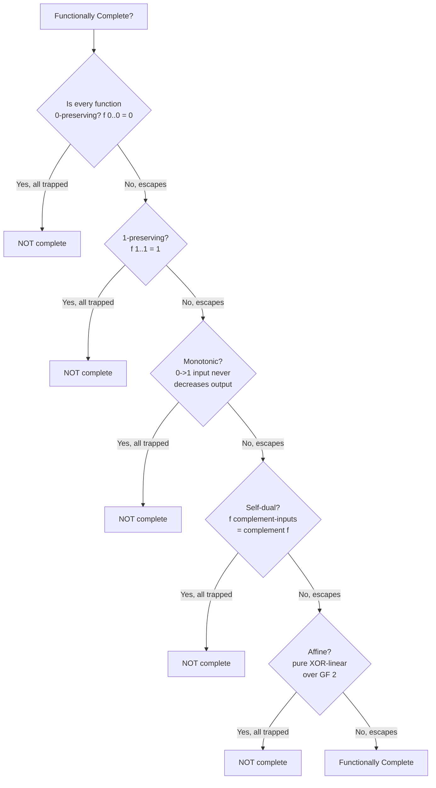

---
tags:
  - GATE/CS
  - GATE/DigitalLogic
  - BooleanAlgebra
aliases:
  - Functionally Complete Set
  - Adequate Set of Connectives
  - Complete Set of Boolean Operators
date_created: 2026-09-18
difficulty: ⭐⭐⭐⭐
last_revised: 2026-09-18
pyq_frequency: Medium
---

## Syllabus Position

Subject: [[Digital Logic Index]]
Parent Topic: [[Boolean Algebra]]
Sibling Topics: [[Universal Gates]], [[Canonical and Standard Forms]], [[Duality and Complement of Boolean Functions]]
Leads To: [[Combinational Circuit Design]], [[Minimization Techniques]], [[Post's Lattice]] (advanced/beyond-GATE)

GATE Syllabus Line: "Digital Logic: Boolean algebra, Combinational and sequential circuits, Minimization." Functional completeness is the general theory underlying the specific fact that NAND/NOR are [[Universal Gates]] — GATE tests it both as the direct definition and as "which set of gates can realize any Boolean function."

Exam Weight Note: Usually a 1-mark conceptual MCQ ("which set is functionally complete?") but occasionally escalates to a 2-mark question asking you to prove a *given, unusual* set (e.g., {XOR, AND, 1}) is or isn't complete using the five properties below.

---

## The Problem This Solves

Imagine a client hands you a mystery bag of logic gates — say {XOR, AND, constant-1} — and asks: "Can you build literally any digital circuit I might ever need using only what's in this bag, or is the bag fundamentally missing something?" Checking this by trial and error (trying to build every possible function) is impossible — there are infinitely many Boolean functions as the variable count grows. You need a **finite, checkable test** that tells you, with certainty, whether a given set of gates can express *every* Boolean function or is permanently stuck in some restricted corner of function-space.

Think of it like checking whether a small set of Lego pieces can build absolutely any shape versus only shapes made of straight lines — no amount of experimentation proves "any shape" conclusively, but if you can show your piece set is missing the ability to make a curve, you know instantly that certain shapes are impossible forever. **Functional completeness** is precisely this kind of structural test: instead of testing every function (impossible), you test the gate set against five specific "escape hatches" (Post's classes), and if the set escapes all five, it can build everything.

Core Idea (one sentence): A set of Boolean operators is **functionally complete** if every possible Boolean function of any number of variables can be expressed using only operators from that set, and this is *provably* true whenever the set fails to be entirely contained in each of five special restricted function classes (Post's lattice).

---

## Formal Theory

A set $S$ of Boolean functions/gates is **functionally complete** (also called **adequate** or a **complete set of connectives**) if every Boolean function $f: \{0,1\}^n \to \{0,1\}$, for every $n$, can be realized as a composition of functions from $S$.

### Baseline Complete Sets (definitional)

- $\{AND, OR, NOT\}$ — complete because every truth table can be written in canonical **SOP** form ([[Canonical and Standard Forms]]): OR together the minterms where the output is 1, each minterm being an AND of (possibly complemented) literals, and NOT supplies the complements. This is the "ground truth" completeness proof every other proof reduces to.
- $\{AND, NOT\}$ — complete, because $OR$ is derivable via De Morgan's: $a+b = \overline{\bar a \cdot \bar b}$.
- $\{OR, NOT\}$ — complete, by the dual De Morgan's derivation: $ab = \overline{\bar a + \bar b}$.
- $\{NAND\}$ alone, $\{NOR\}$ alone — complete, as shown fully in [[Universal Gates]].

### Post's Theorem: The Five-Class Test (the general machinery)

Emil Post proved that a set $S$ of Boolean functions is functionally complete **if and only if** $S$ is **not entirely contained** in any one of the following five classes. You check $S$ against each class; if even one function in $S$ escapes a class, that class is "broken," and if all five classes are broken, $S$ is complete.

1. **$T_0$ (0-preserving):** functions where $f(0,0,\dots,0) = 0$. (e.g., AND, OR, XOR all preserve 0; NOT and the constant-1 function do **not**.)
2. **$T_1$ (1-preserving):** functions where $f(1,1,\dots,1) = 1$. (e.g., AND, OR preserve 1; XOR and NOT do **not** — $NOT(1)=0$, $XOR(1,1)=0$.)
3. **$M$ (monotonic):** functions where increasing any input from 0 to 1 never decreases the output. (AND, OR are monotonic; NOT is **not** — this is exactly why AND/OR alone can never build NOT, as covered in [[Universal Gates]].)
4. **$D$ (self-dual):** functions equal to their own dual, i.e., $f(\bar x_1,\dots,\bar x_n) = \overline{f(x_1,\dots,x_n)}$. (NOT is self-dual; AND and OR are **not** self-dual.)
5. **$A$ (affine/linear):** functions expressible as $c_0 \oplus c_1x_1 \oplus \dots \oplus c_nx_n$ over $\text{GF}(2)$ — i.e., built purely from XOR/XNOR and constants. (XOR, XNOR, NOT, constants are affine; AND and OR are **not** affine.)

```
Algorithm IS_FUNCTIONALLY_COMPLETE(S):
    for each class C in {T0, T1, M, D, A}:
        if every function in S belongs to class C:
            return False   # S is trapped inside C, cannot escape it
    return True             # S escapes all five classes
```

### Why This Works (the intuition behind Post's theorem)

Each of the five classes is **closed under composition** — if every function you plug in is 0-preserving (or monotonic, or affine, etc.), every function you can *build* from them is also 0-preserving (or monotonic, or affine). So if your whole gate set $S$ sits inside class $C$, you are mathematically trapped: you can never build a function outside $C$, no matter how cleverly you wire the gates. Post's remarkable result is the converse: escaping **all five** simultaneously is not just necessary but *sufficient* for completeness — no sixth hidden trap exists.

### Applying the Test to Common Gate Sets

| Gate | $T_0$? | $T_1$? | $M$? | $D$? | $A$? | Escapes all 5? |
|---|---|---|---|---|---|---|
| AND | Yes | Yes | Yes | No | No | No — trapped in $T_0, T_1, M$ (not complete alone) |
| OR | Yes | Yes | Yes | No | No | No — trapped in $T_0, T_1, M$ |
| NOT | No | No | No | Yes | Yes | No — trapped in $D, A$ |
| XOR | Yes | No | No | No | Yes | No — trapped in $A$ (and escapes $T_1, M, D$) |
| NAND | No | No | No | No | No | **Yes — escapes all 5, complete alone** |
| NOR | No | No | No | No | No | **Yes — escapes all 5, complete alone** |

**What GATE actually tests here:** GATE almost never asks you to run the full five-class Post's test from scratch (it's beyond typical syllabus depth), but it *does* test the **consequences**: (a) recognizing that AND/OR alone fail because they're monotonic, (b) recognizing XOR/XNOR alone fail because they're affine, (c) direct recall that {AND,OR,NOT}, {NAND}, and {NOR} are the standard complete sets, and (d) occasionally a "prove this unusual set like {XOR, AND, 1} is complete" question, which is really just asking you to check monotonicity and affine-ness of the *combination*.

---

## Diagrams and Visuals

**Post's Lattice — the five "trap" classes and where common gates sit:**



**Monotonicity as a Hasse diagram (why AND/OR can't build NOT):**

```
Input pairs ordered by "increase":
  (0,0) -> (0,1) -> (1,1)
  (0,0) -> (1,0) -> (1,1)

AND output:  0 -> 0 -> 1   (never decreases: monotonic)
OR  output:  0 -> 1 -> 1   (never decreases: monotonic)
NOT(a) output on a: 0->1 : output 1->0   (DECREASES: non-monotonic)
```
A purely monotonic gate set can only ever produce monotonic outputs — NOT is the smallest possible witness of non-monotonicity, so it can never be synthesized from AND/OR alone.

**Affine-space intuition (why XOR/XNOR can't build AND):**
```
XOR / XNOR reachable functions = { affine combinations of inputs over GF(2) }
                                 = flat "hyperplane" of function-space

AND, OR = "curved" (non-linear) functions, sitting OUTSIDE that hyperplane
No amount of XOR-only wiring can reach outside the hyperplane.
```

---

## Complexity Analysis

Functional completeness is a structural/decidability property, not an algorithm with input size $n$ — but GATE-relevant "complexity" here means **how many class-checks are needed** and **how expensive it is to test a specific candidate set**.

- **Best case:** Checking a well-known set like $\{NAND\}$ takes $O(1)$ — a memorized fact.
- **Average case:** For a gate set of size $k$ built from standard 2-input gates, checking Post's five classes takes $O(5k)$ membership checks — for each of the 5 classes, check whether **every** one of the $k$ functions belongs to it (checking one function against one class for a 2-input gate is $O(1)$, since there are only 4 input rows to inspect).
- **Worst case:** If $S$ contains functions of $n$ variables, checking monotonicity or affine-ness for a single function naively requires inspecting up to $O(2^n)$ input rows (for monotonicity, comparing all covered input pairs in the Boolean cube; for affine-ness, verifying the Möbius/parity expansion has no non-linear terms) — so worst-case completeness-checking is $O(k \cdot 2^n)$.
- **Space:** $O(2^n)$ to store a full truth table per function if testing from scratch; $O(1)$ if using known closure properties (AND/OR are always monotonic regardless of $n$, by definition).

### Complexity Summary Table

| Case | Time Complexity | Space Complexity | Trigger Condition |
|---|---|---|---|
| Best Case | $O(1)$ | $O(1)$ | Set matches a memorized standard result ({NAND}, {NOR}, {AND,OR,NOT}) |
| Average Case | $O(5k)$ class checks | $O(k)$ | Set of $k$ standard 2-input gates, checked against 5 Post classes |
| Worst Case | $O(k \cdot 2^n)$ | $O(2^n)$ | Novel $n$-variable functions requiring full truth-table inspection per class |

---

## Worked Example

Prove or disprove: the set $S = \{XOR, AND, 1\}$ (XOR gate, AND gate, and the constant-1 function) is functionally complete. This is a GATE-representative "test an unusual set" question, not a trivial single-gate lookup.

**Step 1 — Check $T_0$ (0-preserving):** $XOR(0,0)=0$ ✓ preserves 0. $AND(0,0)=0$ ✓ preserves 0. Constant-$1$ function: $f() = 1 \neq 0$ — **does not** preserve 0.
State: since constant-1 is not 0-preserving, $S$ is **not entirely contained** in $T_0$ — class $T_0$ is escaped. ✅

**Step 2 — Check $T_1$ (1-preserving):** $XOR(1,1) = 0 \neq 1$ — **does not** preserve 1.
State: $S$ escapes $T_1$ immediately because XOR alone breaks it. ✅

**Step 3 — Check $M$ (monotonic):** $AND$ is monotonic, constant-$1$ is (trivially) monotonic, but $XOR(1,0)=1$ while $XOR(1,1)=0$ — increasing the second input from 0 to 1 **decreased** the output, so XOR is **not monotonic**.
State: $S$ escapes $M$ because of XOR. ✅

**Step 4 — Check $D$ (self-dual):** The dual of $AND(a,b)$ is $\overline{\overline{a}\cdot\overline{b}}$-complemented appropriately, which works out to $OR(a,b) \neq AND(a,b)$ in general — so AND is **not self-dual**.
State: $S$ escapes $D$ because of AND. ✅

**Step 5 — Check $A$ (affine):** $AND(a,b) = ab$ is a genuinely quadratic (non-linear) term over $\text{GF}(2)$ — it cannot be written as $c_0 \oplus c_1 a \oplus c_2 b$ for any constants (verify: $AND(0,0)\oplus AND(0,1)\oplus AND(1,0)\oplus AND(1,1) = 0\oplus0\oplus0\oplus1=1$, which must equal $0$ for any 2-variable affine function — contradiction). So $AND$ is **not affine**.
State: $S$ escapes $A$ because of AND. ✅

**Result:** $S=\{XOR, AND, 1\}$ escapes all five Post classes — **$S$ is functionally complete**. ✅ Verified — total checks performed: 5 (one per class), each resolved by a single witness function within $S$ (constant-1, XOR, XOR, AND, AND respectively).

**Total operations:** 5 class-membership checks, each requiring inspection of at most 4 truth-table rows (since all functions here are at most 2-input) — so $O(5 \times 4) = O(20)$ elementary comparisons, consistent with the "average case" $O(5k)$ complexity claim for $k=3$ functions.

**Edge case follow-up:** What if the constant-1 function were replaced by constant-0 instead, giving $S' = \{XOR, AND, 0\}$? Then re-check $T_0$: $XOR$, $AND$, and constant-$0$ **all** preserve 0 — so $S'$ is now **trapped inside $T_0$** and therefore **not** functionally complete (it can never build the constant-1 function or NOT, since every function built from 0-preserving gates is itself 0-preserving).

---

## Intuition Anchors

**The Analogy (restated and deepened):** The Lego-piece analogy now extends precisely: each of Post's five classes is a different "shape restriction" your piece set might be secretly obeying — always flat (monotonic), always symmetric under mirroring (self-dual), always preserving a base color (0- or 1-preserving), or always built from straight rods only (affine). You don't need to try building every possible shape to know if you're stuck — you just check your pieces against these five specific restrictions, and if you can build *something* that violates each one, you're free to build anything.

**The Mental Model:** When handed an unfamiliar gate set, don't try random constructions — run the five checks in a fixed, fast order: **0-preserving, 1-preserving, monotonic, self-dual, affine** (mnemonic below). The moment you find one function in the set that violates a class, cross that class off and move to the next; you never need to re-check a class once any single member of $S$ escapes it.

**The One-Line Recall:** "A gate set is functionally complete iff it's not entirely trapped inside any one of Post's five classes: $T_0$, $T_1$, monotonic, self-dual, or affine — NAND and NOR escape all five alone, which is why they're universal."

**The #1 Trap:** Students assume that because a set contains a "powerful-looking" gate like XOR, it must be functionally complete on its own — but XOR (and XNOR) are trapped entirely inside the **affine** class, so $\{XOR\}$ alone can *never* build AND or OR. The fix: always check affine-ness specifically for any all-XOR/XNOR set, since it's the one class GATE distractors rely on most.

---

## GATE Questions

---

**Question 1 — [GATE-style, based on recurring pattern] — [1-mark]**

> Which of the following sets of Boolean functions is **NOT** functionally complete?
- (A) {AND, NOT}
- (B) {NAND}
- (C) {XOR, XNOR}
- (D) {OR, NOT}

<details>
<summary>Solution</summary>

**Answer: (C)**

**Reasoning:**
{XOR, XNOR} are both entirely **affine** functions over $\text{GF}(2)$ — every function you can build by composing XOR and XNOR gates remains a linear combination $c_0 \oplus c_1 a_1 \oplus \dots$, and this class is closed under composition. Since neither XOR nor XNOR can escape the affine class, no combination of just these two can ever produce a non-linear function like AND. Options (A), (B), and (D) are each classical complete sets: (A) and (D) derive the missing OR/AND via De Morgan's law, and (B) is directly universal as shown in [[Universal Gates]].

**What this question is really testing:** Whether the student recognizes XOR/XNOR's shared confinement to the affine class as the reason they fail completeness, rather than assuming "any two different gates" must be enough.

**Trap to avoid:** Assuming that because XOR and XNOR are each other's complements, combining them adds enough "variety" to escape the affine trap — complementation *within* the affine class doesn't escape it; XNOR is affine too.

</details>

---

**Question 2 — [Conceptual/Numerical] — [2-mark]**

> Determine whether $S = \{OR, NOT\}$ is functionally complete. Show which Post class(es), if any, trap the set.

<details>
<summary>Solution</summary>

**Reasoning:**
Check each class: $T_0$ — $NOT(0)=1\neq0$, so NOT escapes $T_0$; set escapes. $T_1$ — $NOT(1)=0\neq1$, escapes. $M$ (monotonic) — NOT is non-monotonic (output decreases as input increases from 0 to 1), so the set escapes $M$. $D$ (self-dual) — $OR$'s dual is $AND \neq OR$, so OR is not self-dual, and the set escapes $D$. $A$ (affine) — $OR(1,1)\oplus OR(1,0)\oplus OR(0,1)\oplus OR(0,0) = 1\oplus1\oplus1\oplus0 = 1 \neq 0$, violating the affine tautology check, so OR is not affine, and the set escapes $A$.

Since $S$ escapes all five Post classes, **$S=\{OR, NOT\}$ is functionally complete** — consistent with the standard derivation $AND(a,b) = \overline{\bar a + \bar b}$ via De Morgan's law, confirming AND is constructible.

**Trap to avoid:** Stopping after checking only monotonicity (since that's the "famous" reason AND/OR alone fail) and forgetting that a *combined* set like {OR, NOT} must be re-checked as a whole — NOT alone already breaks monotonicity for the entire set, so this set never gets trapped there.

</details>

</details>

---

**Question 3 — [Hard / Multi-concept] — [2-mark]**

> A student claims: "Since $\{NAND\}$ is functionally complete and $\{NOR\}$ is functionally complete, any single gate that behaves like 'NAND on some inputs and NOR on others' must also be functionally complete." Evaluate this claim, and identify what property (if any) guarantees completeness for an arbitrary single gate.

<details>
<summary>Solution</summary>

**Reasoning:**
The claim is **false as a general reasoning pattern** — functional completeness must be verified for the *specific* function in question via Post's five classes; there is no shortcut that transfers completeness from NAND and NOR individually to some hybrid function without checking. In fact, for a single 2-input gate to be functionally complete, it must simultaneously fail to be 0-preserving, fail to be 1-preserving, fail to be monotonic, fail to be self-dual, and fail to be affine — this is a fairly restrictive combination, and NAND and NOR are the *only* two out of the sixteen possible 2-input Boolean functions that satisfy all five simultaneously (this can be verified by exhaustively checking all 16 truth tables against Post's lattice). A "hybrid" function invented by mixing NAND-like and NOR-like behavior on different input rows produces one of the other 14 functions (like XOR, IMPLIES, AND, OR, etc.), each of which is trapped in at least one Post class.

**What this question is really testing:** Whether the student understands that functional completeness is a property of the *specific* function's truth table, not something that can be "inherited" or "blended" from other complete functions informally.

**Trap to avoid:** Assuming completeness is somehow a "combinable" or "average" property across gates — it is a strict, per-function pass/fail test against all five Post classes simultaneously.

</details>

---

**Pattern Recognition:**
- When a question asks "which set is NOT complete," check for **monotonic-only** sets (AND, OR without NOT) or **affine-only** sets (XOR, XNOR, constants without AND/OR) first — these two traps cover the vast majority of GATE distractors.
- When asked to verify an *unusual* set (e.g., with a constant or an uncommon gate), run all five Post checks methodically rather than guessing — the constant functions (0 and 1) are frequently the deciding witness for $T_0$/$T_1$ escape.
- Recall that among all sixteen 2-input Boolean functions, only **NAND** and **NOR** are individually functionally complete — this fact alone resolves most single-gate "is X universal" questions instantly.
- If a set contains **both** a non-monotonic function and a non-affine function (e.g., NOT and AND together), it very likely also escapes $T_0$/$T_1$/$D$ — check those last since they are often already broken as a side effect.

---

## Edge Cases and Failure Modes

- [ ] **Single-function sets that "look" complete but aren't:** e.g., $\{XOR\}$ alone seems powerful (it can build a half-adder!) but remains trapped in the affine class — building specific useful circuits (adders, parity checkers) is not the same as functional completeness across *all* Boolean functions.
- [ ] **Forgetting to check a set as a whole, not gate-by-gate:** A set can escape a class even if only *one* of its member functions breaks that class — students sometimes wrongly check each gate individually and conclude "not complete" just because one particular gate in the set (say, AND) is monotonic, forgetting that another gate in the same set (say, NOT) already breaks that class for the whole set.
- [ ] **Constant functions (0 and 1) as silent completeness-breakers:** Adding just a constant-0 or constant-1 function to a set can flip whether $T_0$/$T_1$ is escaped — students often ignore constants as "trivial" and skip checking them, missing the deciding witness.
- [ ] **Confusing "complete set" with "minimal complete set":** {AND, OR, NOT} is complete but not minimal (OR is redundant given AND+NOT via De Morgan's); {NAND} alone is both complete and minimal (a single-gate set). GATE sometimes asks for the minimum number of gate *types* needed, which is a distinct question from "is this set complete."
- [ ] **Self-duality miscalculation:** Computing the dual of a function incorrectly (forgetting to complement the inputs **and** the output) leads to wrongly concluding a function is self-dual when it isn't, or vice versa — always double-check both the input complementation and output complementation steps.
- [ ] **Assuming any 2 distinct "different-looking" gates are automatically complete:** Two gates can both individually be non-monotonic or non-affine yet still jointly fail a *different* one of the five classes (e.g., {XOR, XNOR} — both non-monotonic in different ways, but both trapped in the affine class together).

---

## Comparisons

| Feature | [[Functional Completeness]] (general theory) | [[Universal Gates]] (single-gate special case) | [[Boolean Algebra]] (baseline complete set) |
|---|---|---|---|
| Scope | Tests **any** set of gates, of any size | Tests whether **one single gate** alone is complete | The canonical 3-gate complete baseline {AND, OR, NOT} |
| Test Method | Post's five-class exclusion test | Direct derivation of NOT/AND/OR via De Morgan's law | Direct SOP/POS canonical form construction |
| Number of "complete" 2-input single gates | N/A (general framework) | Exactly 2 out of 16 possible 2-input functions (NAND, NOR) | N/A — always uses 3 gate types together |
| GATE Trap | Forgetting to check the set as a whole, not gate-by-gate | Confusing "part of a complete set" with "universal alone" | Assuming SOP form alone proves minimality |

The most common GATE question comparing these asks students to determine completeness for a *non-standard* set (like {XOR, AND, 1}) rather than the memorized {NAND}/{NOR}/{AND,OR,NOT} cases, and the answer hinges on correctly running (or recognizing the outcome of) Post's five-class test rather than pattern-matching to a memorized gate name.

---

## Connections Web

**Must know before this topic:**
- [[Boolean Algebra]] — canonical SOP/POS forms are the foundational proof that {AND, OR, NOT} is complete
- [[Universal Gates]] — the specific single-gate (NAND/NOR) special case of this general theory
- [[Duality and Complement of Boolean Functions]] — needed to understand the self-dual ($D$) Post class
- [[XOR Gate]] and [[XNOR Gate]] — the standard examples of functions trapped in the affine class

**Topics that build on this:**
- [[Combinational Circuit Design]] — any real circuit implicitly relies on its gate library being functionally complete
- [[Minimization Techniques]] — minimal complete sets (like {NAND} alone) drive gate-count-optimal fabrication choices
- [[Post's Lattice]] — the full mathematical structure (beyond-GATE depth) underlying the five-class test

**GATE subject cross-links:**
- [[Digital Logic Index]] > [[Boolean Algebra]] > [[Universal Gates]]

**Cross-subject connections:**
- [[Boolean Satisfiability]] (Theory/Complexity) — functional completeness of a gate basis underlies why arbitrary circuits can encode any SAT instance
- [[Propositional Logic]] (Discrete Math/TOC) — "adequate set of connectives" in logic (e.g., {¬, ∧}) is the exact same concept stated in logical rather than circuit terms

**Standard references:**
- [[Morris Mano Digital Logic Chapter 4]]
- Post, E. (1941) — original theorem on functional completeness (beyond typical GATE depth but useful for full understanding)

---

## Quick Revision Sheet

**Definition (1 sentence):** A set of Boolean functions is functionally complete if every possible Boolean function of any number of variables can be built using only compositions of functions from that set.

**Core Idea / Analogy (1 sentence):** It's the Lego-piece test — instead of trying to build every shape, check whether your piece set is secretly restricted to one of five "trap" shapes (Post's classes); escape all five and you can build anything.

**Algorithm Steps (numbered, maximum 6 steps):**
1. List every function in the candidate set $S$.
2. Check if all functions in $S$ are 0-preserving ($T_0$) — if yes, $S$ is incomplete.
3. Check if all functions in $S$ are 1-preserving ($T_1$) — if yes, incomplete.
4. Check if all functions in $S$ are monotonic ($M$) — if yes, incomplete.
5. Check if all functions in $S$ are self-dual ($D$) or all affine ($A$) — if yes to either, incomplete.
6. If $S$ escapes all five classes, $S$ is functionally complete.

**Complexity:**
- Time (best/average/worst): $O(1)$ (memorized set) / $O(5k)$ (k standard gates) / $O(k \cdot 2^n)$ (n-variable functions, full truth-table check)
- Space: $O(1)$ using known closure facts; $O(2^n)$ if building full truth tables
- Recurrence: Not applicable — this is a classification test, not a recursive algorithm

**Key Properties (3 to 5 bullet points):**
- Post's five classes: $T_0$ (0-preserving), $T_1$ (1-preserving), $M$ (monotonic), $D$ (self-dual), $A$ (affine/linear over GF(2)).
- A set is complete **iff** it escapes all five classes (not entirely contained in any one).
- Among all 16 two-input Boolean functions, only **NAND** and **NOR** are individually complete.
- {AND, OR, NOT}, {AND, NOT}, {OR, NOT} are all classical complete sets via De Morgan's law derivations.
- XOR/XNOR alone (or combined) remain trapped in the affine class and can never build AND or OR.

**The #1 Trap:** Assuming a "powerful-looking" gate like XOR must be complete just because it builds useful circuits (adders, parity) — usefulness for specific circuits is not the same as completeness for *all* Boolean functions.

**When to use this over alternatives:** Use the full five-class Post's test when handed an unfamiliar or unusual gate combination; use direct recall ({NAND}, {NOR}, {AND,OR,NOT}) for standard, well-known sets to save time.

**Mnemonic or one-liner:** "**Z-O-M-D-A**" — **Z**ero-preserving, **O**ne-preserving, **M**onotonic, self-**D**ual, **A**ffine: escape all five, and you're complete.

---

## Revision Checklist

- [ ] I can state the formal definition of functional completeness without looking.
- [ ] I can explain the Lego-piece analogy and map it to Post's five classes.
- [ ] I can list all five Post classes and give one example gate trapped in each.
- [ ] I can run the five-class test on an unfamiliar set (like {XOR, AND, 1}) by hand in under 5 minutes.
- [ ] I know what the Quick Revision Sheet says without reading it.
- [ ] I can solve all 3 GATE questions in this note without peeking.
- [ ] I know the #1 trap (XOR/XNOR trapped in the affine class) and can articulate why students fall for it.
- [ ] I have linked this note correctly in my Obsidian vault.
- [ ] I have scheduled a spaced-repetition review in 3 days.
