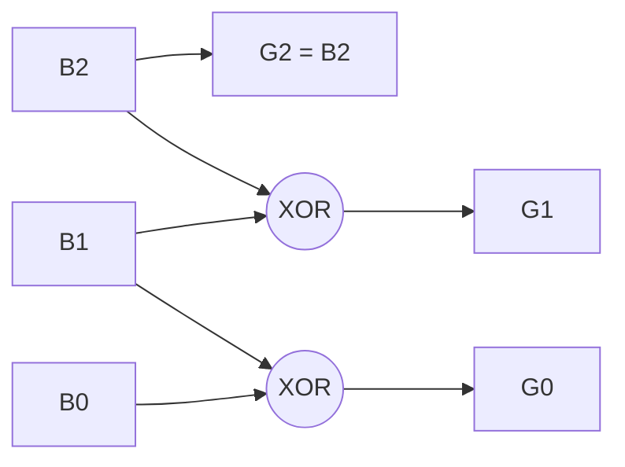

---
tags:
  - GATE/CS
  - GATE/DigitalLogic
  - NumberSystems
  - Codes
aliases:
  - Reflected Binary Code
  - Unit Distance Code
  - Cyclic Code
date_created: 2026-10-12
difficulty: ⭐⭐
last_revised: 2026-10-12
pyq_frequency: Low
---

# Gray Code

## Syllabus Position

Subject: [[Digital Logic Index]]
Parent Topic: [[Number Systems and Codes]]
Sibling Topics: [[BCD Code]], [[Excess-3 Code]], [[Binary Number System]]
Leads To: [[K-Map Minimization]], [[Counters]], [[Asynchronous Counters]], [[Rotary Encoders]]

GATE Syllabus Line: *"Digital Logic: Boolean algebra. Combinational and sequential circuits. Minimization. Number representations and computer arithmetic (fixed and floating point)."*

Exam Weight Note: Rarely asked directly (1-mark MCQ/NAT on binary-to-Gray conversion). Its real value is indirect: the [[K-Map Minimization]] axis ordering is Gray code, and it shows up in counter and encoder questions.

---

## The Problem This Solves

Imagine a mechanical position sensor, such as a rotating disk with bands read by brushes. When the disk moves from position 3 (`011`) to position 4 (`100`) in ordinary binary, all three bits must change. No sensor flips perfectly simultaneously, so for a brief instant you might read `111`, `000`, or `101`. That is a wildly wrong position. The same problem appears when a multi-bit value crosses a clock domain: several bits changing at once can be sampled mid-change.

Gray code fixes this by ordering the numbers so that consecutive values differ in exactly one bit. A glitch can then produce only the old or the new value, never a garbage one.

Analogy: a combination lock where you may turn only one dial per step. You can never jump through a nonsense combination, because you always move to a neighbour.

Core Idea (one sentence): Gray code is a binary encoding in which successive values differ in exactly one bit position.

---

## Formal Theory

A **Gray code** (reflected binary code) of $n$ bits is an ordering of all $2^n$ bit strings such that any two consecutive strings have **Hamming distance** 1. The ordering is also **cyclic**: the last and first codewords differ in one bit too.

### Binary to Gray

$$G_{n-1} = B_{n-1}, \qquad G_i = B_{i+1} \oplus B_i \quad (i < n-1)$$

Equivalently, $G = B \oplus (B \gg 1)$. The MSB is copied, and each other bit is the [[XOR Gate]] of that bit and the bit to its left. Justification: a one-step increment of $B$ flips a trailing run of bits, and XOR with the shifted copy cancels all of them but one.

```
Algorithm BinToGray(B[n-1..0]):
    G[n-1] = B[n-1]
    for i = n-2 down to 0:
        G[i] = B[i+1] XOR B[i]
    return G
```

### Gray to Binary

$$B_{n-1} = G_{n-1}, \qquad B_i = B_{i+1} \oplus G_i$$

Each binary bit is the XOR of all Gray bits from the MSB down to that position. It is a running XOR, so the conversion is sequential (a chain of $n-1$ XOR gates), while Binary to Gray is parallel.

```
Algorithm GrayToBin(G[n-1..0]):
    B[n-1] = G[n-1]
    for i = n-2 down to 0:
        B[i] = B[i+1] XOR G[i]
    return B
```

### Reflect-and-Prefix Construction

To get the $(n+1)$-bit code from the $n$-bit code:
1. Write the $n$-bit list.
2. Append its mirror image (reversed list) below it.
3. Prefix `0` to the top half and `1` to the bottom half.

The mirror guarantees that the join between halves differs only in the new MSB, and within each half the one-bit property is inherited.

### Key Properties

- Only one bit changes between consecutive codes (**unit distance**).
- It is cyclic: $2^n-1 \to 0$ also changes one bit.
- It is **not weighted**, so it is not suited to arithmetic.
- It is **reflective**: the lower $n-1$ bits are symmetric about the midpoint.
- The Gray code of a number has even parity for even-indexed values and odd parity for odd-indexed values (parity alternates each step).

What GATE actually tests here: converting a given number in either direction, naming the code property (unit distance, non-weighted), counting bit transitions in a sequence, and Gray-code ordering of [[K-Map Minimization]] rows and columns.

---

## Diagrams and Visuals

**Drawing instructions:** draw a table with three columns (decimal, binary, Gray) for 0 to 7, and mark the bit that flips at each step.

```
Dec  Binary  Gray   Bit flipped
0    000     000    -
1    001     001    b0
2    010     011    b1
3    011     010    b0
4    100     110    b2
5    101     111    b0
6    110     101    b1
7    111     100    b0
(7 -> 0: 100 -> 000, flips b2, so the code is cyclic)
```

Flipped bit pattern: $0,1,0,2,0,1,0,2,\dots$ The index of the flipped bit at step $k$ is the position of the lowest set bit of $k$.

Hardware conversion:



Gray to binary is a chain: $B_2 = G_2$, then $B_1 = B_2 \oplus G_1$, then $B_0 = B_1 \oplus G_0$.

K-map axis order: `00, 01, 11, 10`, which is the 2-bit Gray code. Adjacent cells differ in one variable, enabling grouping.

---

## Complexity Analysis

This topic is hardware rather than algorithmic, so we analyse gate count and delay.

- Binary to Gray: $n-1$ XOR gates, all in parallel, so delay is one XOR: $O(1)$.
- Gray to Binary: $n-1$ XOR gates in a chain; $B_i$ depends on $B_{i+1}$, so delay is $O(n)$ XOR delays (reducible to $O(\log n)$ with a prefix-XOR tree at more gates).
- Generating the sequence: $G(k) = k \oplus (k \gg 1)$ is $O(1)$ per value with a word-wide shift and XOR.

| Case | Time (delay) | Space (gates) | Trigger Condition |
|---|---|---|---|
| Bin to Gray | $O(1)$ | $n-1$ XOR | Each bit uses only two inputs |
| Gray to Bin (chain) | $O(n)$ | $n-1$ XOR | Ripple dependency on MSB side |
| Gray to Bin (tree) | $O(\log n)$ | $O(n \log n)$ XOR | Parallel prefix XOR |

---

## Worked Example

Convert binary `101101` to Gray, then back.

**Binary to Gray** ($B = 1\,0\,1\,1\,0\,1$):
1. $G_5 = B_5 = 1$
2. $G_4 = B_5 \oplus B_4 = 1 \oplus 0 = 1$
3. $G_3 = B_4 \oplus B_3 = 0 \oplus 1 = 1$
4. $G_2 = B_3 \oplus B_2 = 1 \oplus 1 = 0$
5. $G_1 = B_2 \oplus B_1 = 1 \oplus 0 = 1$
6. $G_0 = B_1 \oplus B_0 = 0 \oplus 1 = 1$

Gray = `111011`. Check with $B \oplus (B \gg 1)$: `101101 XOR 010110 = 111011`. ✔

**Gray to Binary** ($G = 1\,1\,1\,0\,1\,1$):
1. $B_5 = 1$
2. $B_4 = 1 \oplus 1 = 0$
3. $B_3 = 0 \oplus 1 = 1$
4. $B_2 = 1 \oplus 0 = 1$
5. $B_1 = 1 \oplus 1 = 0$
6. $B_0 = 0 \oplus 1 = 1$

Binary = `101101`. ✔

Total operations: 5 XORs each way. This confirms the $n-1$ gate count because the MSB is copied and every other bit needs exactly one XOR.

What changes if the input is all zeros or a single bit? `000000` gives `000000`, and a 1-bit code is identical to binary, since there is no bit to XOR with.

---

## Intuition Anchors

**The Analogy (deepened):** The one-dial-at-a-time lock. Reflect-and-prefix is like walking down a hallway, turning around at the end, and retracing your steps with a new door opened behind you: the turnaround point changes only the new bit. Cyclic means the lock wraps around. Not weighted means the dial positions do not carry place values, so you cannot add them.

**The Mental Model:** Picture the binary count and ask "which bits flip?" In binary, counting flips a trailing run; Gray XORs with the shifted neighbour so that run collapses into a single flip at the run's top bit.

**The One-Line Recall:** $G = B \oplus (B \gg 1)$ for binary to Gray; for Gray to binary, running XOR from the MSB down.

**The #1 Trap:** Students think Gray to Binary is the same operation as Binary to Gray (XOR adjacent Gray bits). It is not. You must XOR the *previously computed binary bit* with the current Gray bit. XORing adjacent Gray bits gives a wrong answer, because the inverse of $G = B \oplus (B \gg 1)$ is a prefix XOR, not another shift-XOR.

---

## GATE Questions

**Question 1 — GATE-style — 1-mark**

> The 4-bit Gray code equivalent of binary `1011` is:

- (A) 1110
- (B) 1101
- (C) 1010
- (D) 1111

<details>
<summary>Solution</summary>

**Answer: (A)**

**Reasoning:** MSB copied: 1. Then $1\oplus0=1$, $0\oplus1=1$, $1\oplus1=0$, so Gray = `1110`. Check: `1011 XOR 0101 = 1110`. Option (B) `1101` comes from XORing from the wrong end. (C) and (D) do not match the formula.

**What this question is really testing:** the binary-to-Gray rule.

**Trap to avoid:** misaligning the shift, or XORing in the wrong direction.

</details>

---

**Question 2 — Numerical — 1-mark**

> A 3-bit Gray code counter runs through all 8 states in a full cycle and returns to the start. How many total bit transitions occur in one full cycle?

<details>
<summary>Solution</summary>

Each of the 8 steps (including the wrap-around $7 \to 0$) flips exactly one bit, so the total is **8**. A binary counter would flip $1+2+1+3+1+2+1+3 = 14$ bits. Gray therefore also saves switching power, which is why it is used in low-power counters.

</details>

---

**Question 3 — Multi-concept — 2-mark**

> The Gray code `1100` is read from a 4-bit encoder. Convert it to binary and state whether the binary value is even or odd.

<details>
<summary>Solution</summary>

$B_3=1$; $B_2=1\oplus1=0$; $B_1=0\oplus0=0$; $B_0=0\oplus0=0$. Binary = `1000` = 8, which is even.

Shortcut: the LSB of the binary value is the XOR (parity) of all Gray bits: $1\oplus1\oplus0\oplus0=0$, so even.

**Trap:** adjacent XOR of Gray bits gives `1010`, which is wrong.

</details>

**Pattern Recognition:**
- "Only one bit changes" or "unit distance" means Gray code.
- Conversion question: binary to Gray is shift-XOR; Gray to binary is running XOR.
- Parity of binary LSB equals the XOR of all Gray bits.
- K-map question: row/column labels are in Gray order, never plain binary.

---

## Edge Cases and Failure Modes

- [ ] Input of size 1: Gray equals binary. Nothing to XOR.
- [ ] All zeros: Gray is all zeros; the code of 0 is always 0.
- [ ] Wrong direction of conversion: using bin-to-Gray rule on a Gray input. Fix: use running XOR.
- [ ] Arithmetic on Gray values: not weighted, so convert to binary first.
- [ ] Wrap-around: the last code to the first differs in one bit only for the reflected Gray code of full length $2^n$. A truncated sequence (e.g. decimal 0 to 9) may not be cyclic in a standard reflected code.
- [ ] Gray is not unique: other unit-distance orderings exist; GATE means the *reflected* code unless stated.

---

## Comparisons

| Feature | [[Gray Code]] | [[Binary Number System]] | [[BCD Code]] |
|---|---|---|---|
| Bits changed per step | 1 | up to $n$ | up to 4 |
| Weighted | No | Yes | Yes (8-4-2-1) |
| Arithmetic friendly | No | Yes | Partially |
| Typical use | Encoders, K-maps, counters | General computation | Decimal displays |
| GATE trap | Conversion direction | None | Invalid codes 1010 to 1111 |

The most common GATE question comparing these asks for the Gray or binary equivalent of a given number, and the answer hinges on the prefix-XOR versus shift-XOR distinction.

---

## Connections Web

**Must know before this topic:**
- [[Binary Number System]] — the base representation being converted
- [[XOR Gate]] — the sole gate used in conversion
- [[Hamming Distance]] — defines unit distance

**Topics that build on this:**
- [[K-Map Minimization]] — Gray ordering of axes
- [[Counters]] — Gray counters avoid glitches
- [[Asynchronous FIFO]] — Gray pointers cross clock domains safely

**GATE subject cross-links:**
- [[Digital Logic Index]] > [[Number Systems and Codes]]

**Cross-subject connections:**
- [[Clock Domain Crossing]] — one-bit changes avoid metastable misreads
- [[Error Detection and Correction]] — Hamming distance concept

**Standard references:**
- [[Morris Mano Chapter 1]]

---

## Quick Revision Sheet

**Definition:** An unweighted binary code where consecutive values differ in exactly one bit, cyclically.

**Core Idea / Analogy:** One dial turns at a time, so no nonsense in-between states.

**Algorithm Steps:**
1. Bin to Gray: copy the MSB.
2. Each next Gray bit is $B_{i+1} \oplus B_i$ (equivalently $B \oplus (B\gg1)$).
3. Gray to Bin: copy the MSB.
4. Each next binary bit is previous binary bit $\oplus$ current Gray bit.

**Complexity:**
- Delay: bin to Gray $O(1)$; Gray to bin $O(n)$ chain
- Space: $n-1$ XOR gates

**Key Properties:**
- Unit distance and cyclic
- Not weighted
- Reflective construction
- Used in K-map axes, encoders, counters
- 3-bit sequence: 000, 001, 011, 010, 110, 111, 101, 100

**The #1 Trap:** Using adjacent-XOR to go Gray to binary.

**When to use this over alternatives:** Whenever glitches from multi-bit changes are dangerous (position sensors, clock crossing, K-maps).

**Mnemonic:** "Copy the MSB, then XOR to move": Bin to Gray uses *neighbours*, Gray to Bin uses the *answer so far*.

---

## Revision Checklist

- [ ] I can state the formal definition without looking.
- [ ] I can explain the one-dial lock analogy and map it to the code.
- [ ] I can write the 3-bit Gray sequence in under a minute.
- [ ] I can derive the gate count and delay for both conversions.
- [ ] I know what the Quick Revision Sheet says without reading it.
- [ ] I can solve all 3 GATE questions in this note without peeking.
- [ ] I know the #1 trap and why students fall for it.
- [ ] I have linked this note correctly in my Obsidian vault.
- [ ] I have scheduled a spaced-repetition review in 3 days.
